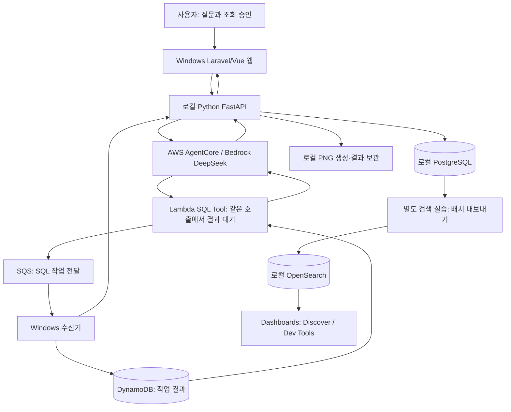

# 프로젝트 전체 구조

Windows 로컬 챗봇에서 자연어 질문을 해석하고, 사용자가 승인한 SQL을 로컬 PostgreSQL에 실행한 뒤 결과 설명·표·그래프를 제공하는 PoC입니다. AWS Agent가 해석·SQL 계획·설명을 담당하고 로컬 PC가 DB 조회와 화면·산출물 저장을 담당합니다. 별도 OpenSearch 실습은 같은 DB에 추가한 일본어 가상 상품·프로모션을 검색하는 학습 환경입니다.

[문서 안내](README.md) · [지속 지침](project-guidelines.md) · [DB 전체 안내](database/index.md)

## 사용자 흐름과 구성



웹은 조건·조회 계획·SQL을 제시하고 승인을 받습니다. Python API는 승인 원장과 SQL 검사를 통해 실행 대상을 제한합니다. Windows 수신기는 AWS에 HTTPS 연결을 시작해 SQS 요청을 받고, 로컬 FastAPI의 조회 결과를 DynamoDB로 전달합니다. Lambda가 결과를 기다려 **같은 SQL Tool 호출의 응답**으로 반환하고 Agent가 이를 설명합니다. Agent가 DynamoDB를 직접 폴링하는 흐름은 사용하지 않습니다.

새 대화형 분석 웹은 문서 탐색·처리 이벤트·대화·표·PNG를 한 흐름에 보관합니다. AI 분석과 AWS 없는 고정 SQL 연결 검사를 화면과 검증 기록에서 구분합니다. 기능별 실제 완료·실패 상태는 [분석 웹 검증 기록](../analysis-chatbot/docs/VERIFICATION.md)이 기준입니다.

## 구성요소와 파일 책임

| 경로 | 책임·연결 |
| --- | --- |
| `AGENTS.md` | 프로젝트 전체 작업 규칙과 이 문서의 진입점 |
| `doc/` | 전체 구조·지속 지침·DB 범위 안내 |
| `docs/database/idempiere/` | 실제 DB 기반 912개 테이블 구조·사전·양방향 FK |
| `docs/design/` | 구현과 구분한 설계 문서 |
| `docs/verification/` | 날짜별 과거 로컬·AWS 검증 기록 |
| `docs/learning/` | 실제 프로젝트를 바탕으로 한 교육 자료 |
| `aws/config/models.json` | DeepSeek V3.2와 Titan V2의 공통 모델 기본값 |
| `aws/infra/`, `aws/runtime/` | CloudFormation, Agent 런타임, Lambda SQL 도구 |
| `aws/scripts/`, `aws/budget_guard/` | 인증·배포·상태·정리, 월 비용 차단과 수동 복구 |
| `local/python/poc/` | SQL API·카탈로그·승인/작업 원장·수신기·분석 처리 |
| `local/web/` | 기존 Laravel/Vue 웹, 기본 포트 8000 |
| `local/scripts/` | 로컬 환경 설치·시작·중지·상태·문서 생성과 검증 |
| `analysis-chatbot/` | 별도 대화형 분석 웹, 기본 포트 8010 |
| `analysis-chatbot/visualization/` | Matplotlib PNG 생성 전용 Python 패키지 |
| `local/opensearch/` | 검색 서버 설치·실행·데이터 생성·내보내기·색인·화면 구성 |
| `.local/` | 실제 환경설정·비밀 파일·설치물·DB 관련 산출물·로그. Git 제외 |

## 저장소와 원본의 경계

| 저장소 | 담는 정보 | 해석 기준 |
| --- | --- | --- |
| PostgreSQL `poc_idempiere.adempiere` | 현재 기본 ERP 조회 대상 GardenWorld | 실제 PK·FK와 DB 타입을 가진 원본 |
| 기존 TPC-H PostgreSQL DB | 이전 벤치마크 데이터 | 보존한 별도 데이터이며 현재 ERP 기본 조회 대상과 구분 |
| 로컬 앱 SQLite | 대화·승인·작업·중복 방지·전송 기록 | 웹과 Python 원장의 책임·파일은 각 운영 가이드 참조 |
| DynamoDB | AWS-로컬 요청의 결과·상태 | Lambda가 같은 도구 호출 응답을 완성하기 위한 전달 저장소 |
| OpenSearch `poc-product`, `poc-promotion` | 승인된 일본어 실습 배치 각 200문서 | PostgreSQL의 검색용 사본, 정기 동기화 없음 |

전체 DB·스키마의 포함 범위·확인 시점·미확인 사항은 [DB index](database/index.md), iDempiere 물리 구조의 근거는 [기존 테이블 사전](../docs/database/idempiere/README.md)을 따릅니다. 테이블 문서는 스냅샷 기준이므로 데이터 행 수의 시점과 현재 데이터의 차이를 확인합니다.

## 로컬 OpenSearch 데이터 흐름

1. `Install.ps1`이 OpenSearch와 Dashboards 3.9.0을 `.local/os`, `.local/osd`에 설치합니다. 포함 JDK·1GiB JVM·단일 노드·일본어 kuromoji를 설정합니다.
2. `Start.ps1`이 OpenSearch 9200/9300과 Dashboards 5601을 루프백 주소에서 실행하고 자신이 시작한 프로세스를 기록합니다.
3. `seed_data.py`가 기존 상품 55행을 보존하고 일본어 상품·프로모션 각 200행과 연결용 1,000행을 생성합니다. 기존 부모 행을 재사용하며 DB 스키마를 변경하지 않습니다.
4. `search_lab.py`가 고정 UUID 배치만 읽어 원본 전체 컬럼과 부모 이름·상품/프로모션 관계를 JSON 문서로 만듭니다. 상품 원본 73컬럼, 프로모션 원본 13컬럼을 유지합니다.
5. 상품 200문서는 `poc-product`, 프로모션 200문서는 `poc-promotion`에 PK를 `_id`로 적재합니다. 관계 배열은 `nested`, 이름·설명은 일본어 `text`로 매핑합니다.
6. Dashboards 저장 조회로 각 200건을 열고 Dev Tools로 상세 검색을 연습합니다. DB 전체 상품은 기존 55건과 신규 200건의 합계 255건이며 인덱스는 실습 배치 200건만 담습니다.

이 과정은 앱에서 검색 결과로 SQL을 생성하는 기능이나 AWS 검색 인프라를 추가하지 않습니다. Titan 모델 설정과 별개로 벡터·하이브리드 검색을 구현하지 않습니다. [운영 가이드](../local/opensearch/README.md)와 [교육 문서](../docs/learning/opensearch-lab.md)에 데이터 관계·재실행·복구·DSL 예제가 있습니다.

## 설정과 실행

앱의 실제 설정은 `.local/app.env`, 예시는 [local/app.env.example](../local/app.env.example)입니다. 모델 기본값은 [aws/config/models.json](../aws/config/models.json)을 읽습니다. AWS 인증정보는 사용자 홈의 AWS 설정·캐시를 사용하며 소스에 기록하지 않습니다. 앱·수신기는 root 대신 정해진 일반 IAM 역할을 사용합니다.

프로젝트 루트 PowerShell에서 필요한 구성요소를 선택합니다.

```powershell
# 기존 웹 8000·공용 API 8001
.\local\scripts\Start.ps1
.\local\scripts\Status.ps1
.\local\scripts\Stop.ps1

# 새 분석 웹 8010·공용 API 8001
.\analysis-chatbot\scripts\Start.ps1
.\analysis-chatbot\scripts\Status.ps1
.\analysis-chatbot\scripts\Stop.ps1

# 독립 검색 실습 9200/9300/5601
.\local\opensearch\Start.ps1
.\local\opensearch\Status.ps1
.\local\opensearch\Stop.ps1
```

API를 공유하는 웹을 함께 사용할 때는 각 시작 스크립트의 계약·기존 프로세스 재사용 기준을 따릅니다. 실제 AWS 자연어 조회에는 해당 가이드에 따라 `Start.ps1 -Receiver`로 수신기를 실행합니다. Windows·Mac의 수신기를 동시에 같은 큐에 붙이지 않습니다. 로그·복구·연결 검사는 [로컬](../local/README.md), [분석 웹](../analysis-chatbot/README.md), [검색 실습](../local/opensearch/README.md)의 운영 문서를 사용합니다.

## 구현과 검증 상태를 확인하는 방법

| 영역 | 근거·상태 확인 위치 |
| --- | --- |
| 기존 SQL API·승인·수신기와 AWS 연결 | [로컬 안내](../local/README.md), [AWS 검증](../aws/verification-2026-10-12.md) |
| 새 분석 웹·실제 질문 평가 | [분석 웹 검증 기록](../analysis-chatbot/docs/VERIFICATION.md). 실패·진행 중인 평가를 포함 |
| iDempiere 전체 구조 문서 | [사전 검증 기록](../docs/database/idempiere/VERIFICATION.md), [DB index](database/index.md) |
| 로컬 OpenSearch 설치·적재·화면·보존 | `.local/opensearch/installation.json`, `last-load.json`, `verification.json` 또는 `verification-faults.json`의 실제 실행 기록. `Verify.ps1` 전체 종료 결과와 `listeners.json`도 확인 |
| 구성도를 먼저 읽는 질의 흐름 | [설계 문서](../docs/design/2026-11-03-schema-guided-query.md). 설계와 실제 구현 범위를 구분 |

파일 존재·설치 성공·DB 생성·색인 성공·브라우저 표시·재실행·재시작은 각각 확인합니다. 단일 노드 복제본 0개는 고가용성 구성이 아닙니다. 재부팅 후 자동 실행, 무인 인증 갱신·장애 복구, 검색 품질 평가·부하 시험, 새 Mac에서의 실제 설치 성공은 별도 검증 없이는 완료로 보고하지 않습니다.


## SQL 챗봇 실행·저장·검증의 추가 명세

이 절은 2026-11-03 SQL 챗봇 작업에서 확인한 소스와 실행 경로입니다. 위의 별도 OpenSearch 검색 실습을 이번 AWS SQL 왕복의 검증 성과에 포함하지 않습니다. 검색 실습의 실행 상태는 해당 운영·검증 원문에서 따로 확인해야 합니다. [SQL 챗봇 교육](../docs/education/README.md)과 [CHAT 지속 규칙](project-guidelines.md)을 함께 읽습니다.

| 실제 구성 | 경로와 역할 |
| --- | --- |
| 새 웹·공용 API | `127.0.0.1:8010` Laravel·Vue / `127.0.0.1:8001` FastAPI, 기존 웹8000 유지 |
| 분석 작업 제어 | `local/python/poc/analysis_api.py`, 해석·문서 탐색·계획 승인·결과 후처리 |
| 근거 검증 | `analysis_documents.py`, 원문 영수증·실제 열/FK·조건·기간 적용 근거 |
| 그래프 근거 | `analysis_units.py`·`analysis_dimensions.py`·`analysis_chart_defaults.py`, SQL 표현식의 단위·그룹 차원과 기본 그래프 선택 |
| PNG | `analysis-chatbot/visualization/src/analysis_visualization/`, 별도 가상환경·Matplotlib Agg subprocess |
| 시사점 | `analysis_postprocess.py`, 원본 표에서 계산한 관측 근거와 모델 설명을 대조 |
| Laravel SQLite | `.local/analysis-chatbot/conversations.sqlite`, 대화·턴·공개 스냅샷·이벤트 |
| Python 공유 SQLite | `.local/jobs.sqlite`, 기존 승인/SQL 작업 원장과 `analysis_runs`·`analysis_events`·`analysis_results`·`analysis_artifacts` |
| 업무 원본 PostgreSQL | `poc_idempiere.adempiere`, 읽기 전용 계정으로 조회하는 ERP 원본 |
| 산출물 | `.local/analysis-chatbot/artifacts/`, PNG·입력·manifest·이미지 캐시; artifact ID로 전달 |
| 프로세스·로그 | `.local/analysis-chatbot/services.json`, PID·경로·시작 시각으로 소유권 확인; `logs/`와 `analysis-chatbot/storage/logs/` |

SQLite의 대화/작업 원장과 PostgreSQL 업무 데이터는 서로 다른 저장소입니다. 대화가 복원돼도 AWS 인증·수신기·SQL 왕복의 성공이 입증되지는 않습니다. 새 SQL은 사용자가 계획을 승인한 뒤 조회하며, 기간·지표 변경은 다시 계획과 승인을 거칩니다. 재시각화·재설명은 저장 결과를 사용하며 SQL을 다시 실행하지 않는 경로입니다. 그래프 기본 선택이 생기면 승인 계획의 `그래프 선택과 검증`에서 선택 규칙과 단위 미검증 등의 한계를 확인합니다.

앱은 `poc-chatbot`, Windows 수신기는 `poc-worker` 일반 IAM 역할을 사용합니다. root 로그인 프로필을 앱 실행 인증에 사용하지 않습니다. 단일 SQS 수신기와 기존 원장을 재사용하며 웹/API/DB/PNG는 로컬에 유지합니다. 원본 DB·토큰·DSN·인증캐시·실제 환경설정은 소스와 검증 지문에 포함하지 않습니다.

v12/v12b의 원본 실행과 현재 AWS runtime/DEFAULT v13을 구분합니다. v13 실제10문항은 독립 수치9/10·수동 전체4/10으로 종료됐습니다. 사후 로컬 보완은 Python661개, 저장 차트4사례·PNG7개 및 API 단독 재시작 복원으로 확인했으며 추가 모델/SQL 호출은0입니다. 이 확인은 실AWS 전체 재평가가 아닙니다. [검증 기록](../analysis-chatbot/docs/VERIFICATION.md)에 문제·수정 효과·남은 한계를 기록합니다. 독립 golden 전후가 달라지면 기준 데이터 변경으로 수치 정확도를 확정할 수 없으며 모델 SQL 오답으로 단정하지 않습니다. 이전 실패·응답·정답·PNG는 덮어쓰지 않습니다. 단위 증명 불가, 정상0행, 잘림과 후처리 실패도 각각 구분합니다. date/timestamp 범위·isactive의 미승인 추가 필터 가드는 모든 WHERE 업무 의미의 검증을 뜻하지 않습니다.
