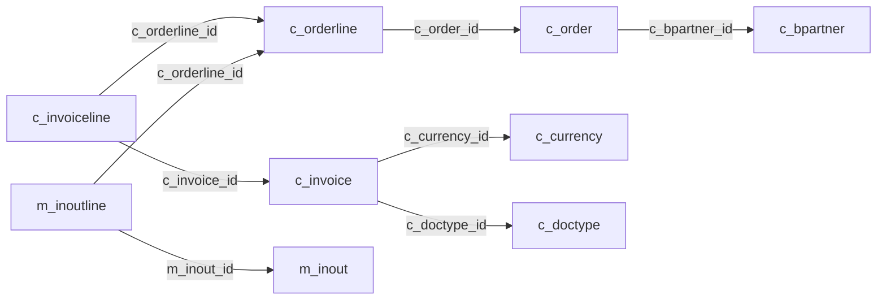

# 업무별 테이블 안내

[시작 안내](README.md) · [전체 일람](TABLE_INDEX.md) · [외래키 읽는 법](RELATIONSHIPS.md)

## 질문에서 출발 테이블 찾기

| 업무·질문 | 출발 테이블 | 쓰임과 구분 |
|---|---|---|
| 고객·공급업체·거래처 | [`c_bpartner`](c/c_bpartner.md) · [`c_bpartner_location`](c/c_bpartner_location.md) · [`ad_user`](ad/ad_user.md) | 거래처, 거래처 주소, 사용자/담당자를 구분합니다. 고객을 임의로 판매자 계정으로 바꾸지 않습니다. |
| 판매·구매 주문 | [`c_order`](c/c_order.md) · [`c_orderline`](c/c_orderline.md) | 주문 헤더와 품목 상세. `issotrx`로 판매/구매를 구분하고 주문일 기준을 명시합니다. |
| 청구·매출 분석 | [`c_invoice`](c/c_invoice.md) · [`c_invoiceline`](c/c_invoiceline.md) · [`c_doctype`](c/c_doctype.md) · [`c_currency`](c/c_currency.md) | 청구 금액과 상세, 문서 종류, 통화를 함께 확인합니다. 수금액·회계 수익과 동일시하지 않습니다. |
| 수금·지급·상계 | [`c_payment`](c/c_payment.md) · [`c_allocationhdr`](c/c_allocationhdr.md) · [`c_allocationline`](c/c_allocationline.md) | 현금 흐름과 청구서 연결을 확인합니다. 결제액을 주문액으로 해석하지 않습니다. |
| 출하·입고 | [`m_inout`](m/m_inout.md) · [`m_inoutline`](m/m_inoutline.md) | 출입고 헤더/상세와 주문·청구 상세 FK를 확인합니다. 입고와 출하를 구분합니다. |
| 제품·창고·재고 | [`m_product`](m/m_product.md) · [`m_warehouse`](m/m_warehouse.md) · [`m_locator`](m/m_locator.md) · [`m_storageonhand`](m/m_storageonhand.md) · [`m_inventory`](m/m_inventory.md) · [`m_inventoryline`](m/m_inventoryline.md) | 제품 기준, 창고/로케이터, 보유 재고, 실사 문서를 구분합니다. |
| 가격·통화·세금 | [`m_pricelist`](m/m_pricelist.md) · [`m_pricelist_version`](m/m_pricelist_version.md) · [`m_productprice`](m/m_productprice.md) · [`c_currency`](c/c_currency.md) · [`c_tax`](c/c_tax.md) | 유효한 가격표·버전·통화와 세금 기준을 확인합니다. 통화 혼합 합산을 피합니다. |
| 회계·원장 | [`fact_acct`](fact/fact_acct.md) · [`gl_journal`](gl/gl_journal.md) · [`gl_journalline`](gl/gl_journalline.md) · [`c_acctschema`](c/c_acctschema.md) · [`c_validcombination`](c/c_validcombination.md) | 회계 전표·분개와 계정 체계. 수집 시점 `fact_acct`는 0행입니다. 행이 없으면 원장 기반 손익의 근거가 없습니다. |
| 프로젝트 | [`c_project`](c/c_project.md) · [`c_projectphase`](c/c_projectphase.md) · [`c_projecttask`](c/c_projecttask.md) · [`c_projectline`](c/c_projectline.md) | 프로젝트와 단계·작업·내역의 연결을 확인합니다. |
| 테넌트·조직·권한 | [`ad_client`](ad/ad_client.md) · [`ad_org`](ad/ad_org.md) · [`ad_user`](ad/ad_user.md) · [`ad_role`](ad/ad_role.md) · [`ad_user_roles`](ad/ad_user_roles.md) | 업무 소유 범위와 사용자 접근 설정. 실제 거래 실적과 분리합니다. |
| 테이블·열·화면 사전 | [`ad_table`](ad/ad_table.md) · [`ad_column`](ad/ad_column.md) · [`ad_element`](ad/ad_element.md) · [`ad_window`](ad/ad_window.md) · [`ad_tab`](ad/ad_tab.md) · [`ad_field`](ad/ad_field.md) | 물리 구조의 업무 의미와 화면 연결을 찾습니다. 사전상의 관계가 항상 물리 FK인 것은 아닙니다. |

## 대표적인 관계를 읽는 방법

다음은 DB에 선언된 FK의 일부입니다. 화살표는 자식 → 부모이며 실제 문서 상태 전이를 표시하지 않습니다.

## GardenWorld에서 적용할 기준

- 기본 업무 테넌트는 `ad_client_id=11`입니다. 시스템 공통 기준값에는 `0`이 쓰일 수 있어 모든 테이블에 같은 필터를 기계적으로 적용하지 않습니다.
- 판매/구매는 `issotrx='Y'/'N'`로 구분합니다. 확정 거래만 필요하면 문서 상태 `CO`·`CL`을 조건으로 사용한다고 계획에 명시합니다.
- 주문액(`c_order`), 청구액(`c_invoice`), 수금/지급액(`c_payment`)은 다릅니다. 질문의 지표를 먼저 정합니다.
- 청구서 `totallines`는 문서행 합계, `grandtotal`은 총액입니다. 금액의 세금 포함 여부는 `istaxincluded`·가격표·세액과 실제 계산 규칙을 확인해 정의합니다. 상세 집계에는 `c_invoiceline.linenetamt` 등 상세 수준의 값을 사용하고 헤더 합계를 중복하지 않습니다.
- 판매 대변전표는 `c_doctype.docbasetype='ARC'`를 확인해 차감합니다. USD·EUR를 임의 환율로 합치지 않습니다.
- 2026-11-03T23:29:01+09:00 수집 시 GardenWorld(`ad_client_id=11`)의 청구일 범위는 2002-02-22 ~ 2003-11-01입니다. 데모 데이터를 최근 거래나 실제 기업 실적으로 설명하지 않습니다.
- 임베딩 호출 설정과 문서 검색 시스템은 별개입니다. 이 Markdown 문서 생성으로 벡터 검색·RAG가 자동 구성되지는 않습니다.
