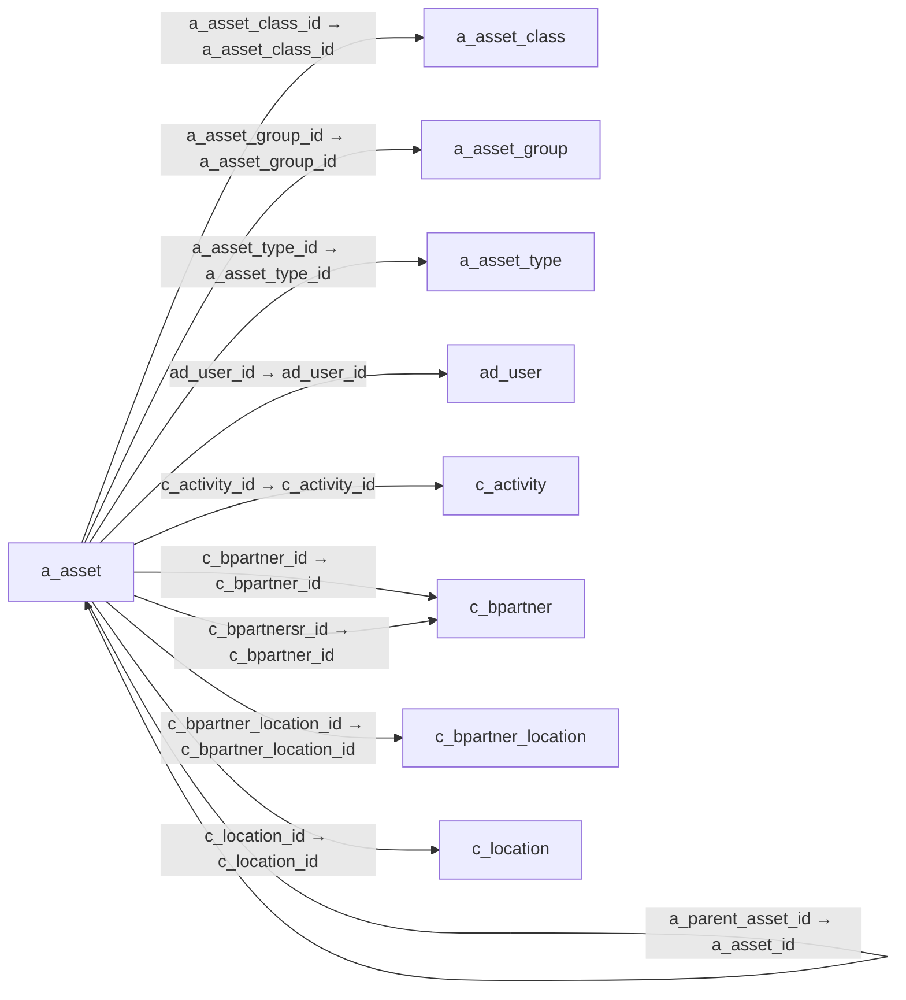

# a_asset — 자산

[전체 일람](../TABLE_INDEX.md) · [분류 일람](README.md) · [AI 사용 안내](../README.md) · [외래키 읽는 법](../RELATIONSHIPS.md)

## 기본 정보

| 항목 | 내용 |
|---|---|
| 물리명 | `adempiere.a_asset` |
| 한국어 논리명(문서용 해석) | 자산 |
| 원본 논리명 | Asset |
| 원본 사전 ID | 539 |
| 분류 | `a` — 자산·감가상각 |
| 전체 테넌트 행 수 | 0 |
| 물리 열 수 | 69 |
| 나가는 FK / 들어오는 FK | 16 / 39 |
| 구조·행 수 확인 시점 | 2026-11-03T23:29:01+09:00 |

## 의미와 쓰임

내부에서 사용하거나 고객에게 제공한 자산을 관리한다.

- 설명 근거: 원본 애플리케이션 사전 명칭·설명을 한국어로 해석.
- 한국어 이름과 개요는 문서용 해석입니다. 공식 한국어 번역으로 간주하지 않습니다.
- 원본 설명: Asset used internally or by customers
- 원본 도움말: —
- PostgreSQL 테이블 주석: —

## 키와 열

### 기본키·고유 제약조건

| 종류 | 제약조건 | 열(순서 유지) |
|---|---|---|
| PRIMARY KEY | `a_asset_pkey` | `a_asset_id` |
| UNIQUE | `a_asset_uu_idx` | `a_asset_uu` |

### 열 목록

원본 논리명·설명은 `AD_Column`에서 가져왔습니다. 기본값은 실제 PostgreSQL 메타데이터이며, 비어 있는 항목은 `—`로 표시합니다.

| 순서 | 물리명 | 원본 논리명 | PostgreSQL 타입 | NULL | PK | 기본값 | 설명 |
|---:|---|---|---|---|---|---|---|
| 1 | `a_asset_id` | Asset | numeric(10,0) | 불가 | 예 | — | Asset used internally or by customers |
| 2 | `ad_client_id` | Tenant | numeric(10,0) | 불가 | — | — | Tenant for this installation. |
| 3 | `ad_org_id` | Organization | numeric(10,0) | 불가 | — | — | Organizational entity within tenant |
| 4 | `isactive` | Active | character(1) | 불가 | — | 'Y'::bpchar | The record is active in the system |
| 5 | `created` | Created | timestamp without time zone | 불가 | — | now() | Date this record was created |
| 6 | `createdby` | Created By | numeric(10,0) | 불가 | — | — | User who created this records |
| 7 | `updated` | Updated | timestamp without time zone | 불가 | — | now() | Date this record was updated |
| 8 | `updatedby` | Updated By | numeric(10,0) | 불가 | — | — | User who updated this records |
| 9 | `value` | Search Key | character varying(40) | 불가 | — | — | Search key for the record in the format required - must be unique |
| 10 | `name` | Name | character varying(60) | 불가 | — | — | Alphanumeric identifier of the entity |
| 11 | `description` | Description | character varying(255) | 허용 | — | — | Optional short description of the record |
| 12 | `help` | Comment/Help | character varying(2000) | 허용 | — | — | Comment or Hint |
| 13 | `a_asset_group_id` | Asset Group | numeric(10,0) | 불가 | — | — | Group of Assets |
| 14 | `m_product_id` | Product | numeric(10,0) | 불가 | — | — | Product, Service, Item |
| 15 | `serno` | Serial No | character varying(255) | 허용 | — | — | Product Serial Number  |
| 16 | `lot` | Lot No | character varying(255) | 허용 | — | — | Lot number (alphanumeric) |
| 17 | `versionno` | Version No | character varying(20) | 허용 | — | — | Version Number |
| 18 | `guaranteedate` | Guarantee Date | timestamp without time zone | 허용 | — | — | Date when guarantee expires |
| 19 | `assetservicedate` | In Service Date | timestamp without time zone | 허용 | — | — | Date when Asset was put into service |
| 20 | `isowned` | Owned | character(1) | 불가 | — | 'Y'::bpchar | The asset is owned by the organization |
| 21 | `assetdepreciationdate` | Asset Depreciation Date | timestamp without time zone | 허용 | — | — | Date of last depreciation |
| 22 | `uselifeyears` | Usable Life - Years | numeric | 허용 | — | — | Years of the usable life of the asset |
| 23 | `uselifemonths` | Usable Life - Months | numeric(10,0) | 허용 | — | — | Months of the usable life of the asset |
| 24 | `lifeuseunits` | Life use | numeric | 허용 | — | — | Units of use until the asset is not usable anymore |
| 25 | `useunits` | Use units | numeric | 허용 | — | — | Currently used units of the assets |
| 26 | `isdisposed` | Disposed | character(1) | 불가 | — | 'N'::bpchar | The asset is disposed |
| 27 | `assetdisposaldate` | Asset Disposal Date | timestamp without time zone | 허용 | — | — | Date when the asset is/was disposed |
| 28 | `isinposession` | In Possession | character(1) | 불가 | — | 'Y'::bpchar | The asset is in the possession of the organization |
| 29 | `locationcomment` | Location comment | character varying(255) | 허용 | — | — | Additional comments or remarks concerning the location |
| 30 | `m_locator_id` | Locator | numeric(10,0) | 허용 | — | — | Warehouse Locator |
| 31 | `c_bpartner_id` | Business Partner | numeric(10,0) | 허용 | — | — | Identifies a Business Partner |
| 32 | `c_bpartner_location_id` | Partner Location | numeric(10,0) | 허용 | — | — | Identifies the (ship to) address for this Business Partner |
| 33 | `c_location_id` | Address | numeric(10,0) | 허용 | — | — | Location or Address |
| 34 | `processing` | Process Now | character(1) | 허용 | — | 'N'::bpchar | — |
| 35 | `isdepreciated` | Depreciate | character(1) | 불가 | — | 'Y'::bpchar | The asset will be depreciated |
| 36 | `isfullydepreciated` | Fully depreciated | character(1) | 불가 | — | 'N'::bpchar | The asset is fully depreciated |
| 37 | `ad_user_id` | User/Contact | numeric(10,0) | 허용 | — | — | User within the system - Internal or Business Partner Contact |
| 38 | `m_attributesetinstance_id` | Attribute Set Instance | numeric(10,0) | 허용 | — | 0 | Product Attribute Set Instance |
| 39 | `qty` | Quantity | numeric | 허용 | — | — | Quantity |
| 40 | `c_project_id` | Project | numeric(10,0) | 허용 | — | — | Financial Project |
| 41 | `c_bpartnersr_id` | BPartner (Agent) | numeric(10,0) | 허용 | — | — | Business Partner (Agent or Sales Rep) |
| 42 | `m_inoutline_id` | Shipment/Receipt Line | numeric(10,0) | 허용 | — | — | Line on Shipment or Receipt document |
| 43 | `lastmaintenencedate` | — | timestamp without time zone | 허용 | — | — | — |
| 44 | `nextmaintenencedate` | Next Maintenance | timestamp without time zone | 허용 | — | — | Next Maintenance Date |
| 45 | `lastmaintenanceuseunit` | — | numeric(10,0) | 허용 | — | — | — |
| 46 | `nextmaintenanceuseunit` | — | numeric(10,0) | 허용 | — | — | — |
| 47 | `leaseterminationdate` | Lease Termination | timestamp without time zone | 허용 | — | — | Lease Termination Date |
| 48 | `lease_bpartner_id` | Lessor | numeric(10,0) | 허용 | — | — | The Business Partner who rents or leases |
| 49 | `lastmaintenancenote` | Last Note | character varying(60) | 허용 | — | — | Last Maintenance Note |
| 50 | `lastmaintenancedate` | Last Maintenance | timestamp without time zone | 허용 | — | — | Last Maintenance Date |
| 51 | `lastmaintenanceunit` | Last Unit | numeric(10,0) | 허용 | — | — | Last Maintenance Unit |
| 52 | `nextmaintenenceunit` | Next Unit | numeric(10,0) | 허용 | — | — | Next Maintenance Unit |
| 53 | `a_asset_createdate` | Create Date | timestamp without time zone | 허용 | — | — | — |
| 54 | `a_asset_revaldate` | Revaluation Date | timestamp without time zone | 허용 | — | — | — |
| 55 | `a_parent_asset_id` | Parent Asset | numeric(10,0) | 허용 | — | — | — |
| 56 | `a_qty_current` | Current Qty | numeric | 허용 | — | — | — |
| 57 | `a_qty_original` | A_QTY_Original | numeric | 허용 | — | — | — |
| 58 | `a_asset_uu` | A_Asset_UU | uuid | 허용 | — | — | — |
| 59 | `a_asset_class_id` | Asset class | numeric(10,0) | 허용 | — | NULL::numeric | — |
| 60 | `a_asset_status` | Asset Status | character varying(2) | 불가 | — | 'NW'::character varying | — |
| 61 | `a_asset_action` | Asset Action | character varying(2) | 불가 | — | 'MD'::character varying | — |
| 62 | `processed` | Processed | character(1) | 불가 | — | 'N'::bpchar | The document has been processed |
| 63 | `assetactivationdate` | Activation Date | timestamp without time zone | 허용 | — | — | — |
| 64 | `inventoryno` | Inventory No | character varying(30) | 허용 | — | NULL::character varying | — |
| 65 | `a_asset_type_id` | Asset Type | numeric(10,0) | 허용 | — | — | — |
| 66 | `a_assettype` | Asset Type | character varying(3) | 불가 | — | 'MFX'::character varying | — |
| 67 | `c_activity_id` | Activity | numeric(10,0) | 허용 | — | NULL::numeric | Business Activity |
| 68 | `manufacturer` | Manufacturer | character varying(30) | 허용 | — | NULL::character varying | Manufacturer of the Product |
| 69 | `manufacturedyear` | Manufactured Year | numeric(10,0) | 허용 | — | NULL::numeric | — |

## 외래키 흐름

화살표는 **FK를 가진 자식 → 참조되는 부모**입니다. 업무 처리의 시간 순서나 무조건적인 1:N 관계를 뜻하지 않습니다.

주변 관계 54개 중 10개를 그림으로 표시합니다. **전체 관계는 아래 두 표에 모두 포함**합니다.

### 이 테이블이 참조하는 부모 — 나가는 FK

| 제약조건 | 참조하는 쪽(자식) | 자식 열 | 참조받는 쪽(부모) | 부모 열 | 삭제 / 갱신 | 검증 / 지연 가능 |
|---|---|---|---|---|---|---|
| `aassetclass_aasset` <!-- FK_OUT: adempiere.a_asset.aassetclass_aasset --> | [`a_asset`](a_asset.md) | `a_asset_class_id` | [`a_asset_class`](a_asset_class.md) | `a_asset_class_id` | NO ACTION / NO ACTION | 완료 / 가능 (초기 지연) |
| `aassetgroup_aasset` <!-- FK_OUT: adempiere.a_asset.aassetgroup_aasset --> | [`a_asset`](a_asset.md) | `a_asset_group_id` | [`a_asset_group`](a_asset_group.md) | `a_asset_group_id` | NO ACTION / NO ACTION | 완료 / 가능 (초기 지연) |
| `aassettype_aasset` <!-- FK_OUT: adempiere.a_asset.aassettype_aasset --> | [`a_asset`](a_asset.md) | `a_asset_type_id` | [`a_asset_type`](a_asset_type.md) | `a_asset_type_id` | NO ACTION / NO ACTION | 완료 / 가능 (초기 지연) |
| `aduser_aasset` <!-- FK_OUT: adempiere.a_asset.aduser_aasset --> | [`a_asset`](a_asset.md) | `ad_user_id` | [`ad_user`](../ad/ad_user.md) | `ad_user_id` | NO ACTION / NO ACTION | 완료 / 가능 (초기 지연) |
| `aparentasset_aasset` <!-- FK_OUT: adempiere.a_asset.aparentasset_aasset --> | [`a_asset`](a_asset.md) | `a_parent_asset_id` | [`a_asset`](a_asset.md) | `a_asset_id` | NO ACTION / NO ACTION | 완료 / 가능 (초기 지연) |
| `cactivity_aasset` <!-- FK_OUT: adempiere.a_asset.cactivity_aasset --> | [`a_asset`](a_asset.md) | `c_activity_id` | [`c_activity`](../c/c_activity.md) | `c_activity_id` | NO ACTION / NO ACTION | 완료 / 가능 (초기 지연) |
| `cbpartner_aasset` <!-- FK_OUT: adempiere.a_asset.cbpartner_aasset --> | [`a_asset`](a_asset.md) | `c_bpartner_id` | [`c_bpartner`](../c/c_bpartner.md) | `c_bpartner_id` | NO ACTION / NO ACTION | 완료 / 가능 (초기 지연) |
| `cbpartnersr_aasset` <!-- FK_OUT: adempiere.a_asset.cbpartnersr_aasset --> | [`a_asset`](a_asset.md) | `c_bpartnersr_id` | [`c_bpartner`](../c/c_bpartner.md) | `c_bpartner_id` | NO ACTION / NO ACTION | 완료 / 가능 (초기 지연) |
| `cbplocation_aasset` <!-- FK_OUT: adempiere.a_asset.cbplocation_aasset --> | [`a_asset`](a_asset.md) | `c_bpartner_location_id` | [`c_bpartner_location`](../c/c_bpartner_location.md) | `c_bpartner_location_id` | NO ACTION / NO ACTION | 완료 / 가능 (초기 지연) |
| `clocation_aasset` <!-- FK_OUT: adempiere.a_asset.clocation_aasset --> | [`a_asset`](a_asset.md) | `c_location_id` | [`c_location`](../c/c_location.md) | `c_location_id` | NO ACTION / NO ACTION | 완료 / 가능 (초기 지연) |
| `cproject_aasset` <!-- FK_OUT: adempiere.a_asset.cproject_aasset --> | [`a_asset`](a_asset.md) | `c_project_id` | [`c_project`](../c/c_project.md) | `c_project_id` | NO ACTION / NO ACTION | 완료 / 가능 (초기 지연) |
| `leasebpartner_aasset` <!-- FK_OUT: adempiere.a_asset.leasebpartner_aasset --> | [`a_asset`](a_asset.md) | `lease_bpartner_id` | [`c_bpartner`](../c/c_bpartner.md) | `c_bpartner_id` | NO ACTION / NO ACTION | 완료 / 가능 (초기 지연) |
| `mattributesetinstance_aasset` <!-- FK_OUT: adempiere.a_asset.mattributesetinstance_aasset --> | [`a_asset`](a_asset.md) | `m_attributesetinstance_id` | [`m_attributesetinstance`](../m/m_attributesetinstance.md) | `m_attributesetinstance_id` | NO ACTION / NO ACTION | 완료 / 가능 (초기 지연) |
| `minoutline_aasset` <!-- FK_OUT: adempiere.a_asset.minoutline_aasset --> | [`a_asset`](a_asset.md) | `m_inoutline_id` | [`m_inoutline`](../m/m_inoutline.md) | `m_inoutline_id` | NO ACTION / NO ACTION | 완료 / 가능 (초기 지연) |
| `mlocator_aasset` <!-- FK_OUT: adempiere.a_asset.mlocator_aasset --> | [`a_asset`](a_asset.md) | `m_locator_id` | [`m_locator`](../m/m_locator.md) | `m_locator_id` | NO ACTION / NO ACTION | 완료 / 가능 (초기 지연) |
| `mproduct_aasset` <!-- FK_OUT: adempiere.a_asset.mproduct_aasset --> | [`a_asset`](a_asset.md) | `m_product_id` | [`m_product`](../m/m_product.md) | `m_product_id` | NO ACTION / NO ACTION | 완료 / 가능 (초기 지연) |

### 이 테이블을 참조하는 자식 — 들어오는 FK

| 제약조건 | 참조하는 쪽(자식) | 자식 열 | 참조받는 쪽(부모) | 부모 열 | 삭제 / 갱신 | 검증 / 지연 가능 |
|---|---|---|---|---|---|---|
| `aparentasset_aasset` <!-- FK_IN: adempiere.a_asset.aparentasset_aasset --> | [`a_asset`](a_asset.md) | `a_parent_asset_id` | [`a_asset`](a_asset.md) | `a_asset_id` | NO ACTION / NO ACTION | 완료 / 가능 (초기 지연) |
| `aasset_aassetacct` <!-- FK_IN: adempiere.a_asset_acct.aasset_aassetacct --> | [`a_asset_acct`](a_asset_acct.md) | `a_asset_id` | [`a_asset`](a_asset.md) | `a_asset_id` | CASCADE / NO ACTION | 완료 / 가능 (초기 지연) |
| `aasset_aassetaddition` <!-- FK_IN: adempiere.a_asset_addition.aasset_aassetaddition --> | [`a_asset_addition`](a_asset_addition.md) | `a_asset_id` | [`a_asset`](a_asset.md) | `a_asset_id` | NO ACTION / NO ACTION | 완료 / 가능 (초기 지연) |
| `aasset_aassetchange` <!-- FK_IN: adempiere.a_asset_change.aasset_aassetchange --> | [`a_asset_change`](a_asset_change.md) | `a_asset_id` | [`a_asset`](a_asset.md) | `a_asset_id` | NO ACTION / NO ACTION | 완료 / 가능 (초기 지연) |
| `aparentasset_aassetchange` <!-- FK_IN: adempiere.a_asset_change.aparentasset_aassetchange --> | [`a_asset_change`](a_asset_change.md) | `a_parent_asset_id` | [`a_asset`](a_asset.md) | `a_asset_id` | NO ACTION / NO ACTION | 완료 / 가능 (초기 지연) |
| `aasset_aassetdelivery` <!-- FK_IN: adempiere.a_asset_delivery.aasset_aassetdelivery --> | [`a_asset_delivery`](a_asset_delivery.md) | `a_asset_id` | [`a_asset`](a_asset.md) | `a_asset_id` | NO ACTION / NO ACTION | 완료 / 가능 (초기 지연) |
| `aasset_aassetdisposed` <!-- FK_IN: adempiere.a_asset_disposed.aasset_aassetdisposed --> | [`a_asset_disposed`](a_asset_disposed.md) | `a_asset_id` | [`a_asset`](a_asset.md) | `a_asset_id` | NO ACTION / NO ACTION | 완료 / 가능 (초기 지연) |
| `aassettrade_aassetdisposed` <!-- FK_IN: adempiere.a_asset_disposed.aassettrade_aassetdisposed --> | [`a_asset_disposed`](a_asset_disposed.md) | `a_asset_trade_id` | [`a_asset`](a_asset.md) | `a_asset_id` | NO ACTION / NO ACTION | 완료 / 가능 (초기 지연) |
| `aasset_aassetinfofin` <!-- FK_IN: adempiere.a_asset_info_fin.aasset_aassetinfofin --> | [`a_asset_info_fin`](a_asset_info_fin.md) | `a_asset_id` | [`a_asset`](a_asset.md) | `a_asset_id` | NO ACTION / NO ACTION | 완료 / 가능 (초기 지연) |
| `aasset_aassetinfolic` <!-- FK_IN: adempiere.a_asset_info_lic.aasset_aassetinfolic --> | [`a_asset_info_lic`](a_asset_info_lic.md) | `a_asset_id` | [`a_asset`](a_asset.md) | `a_asset_id` | NO ACTION / NO ACTION | 완료 / 가능 (초기 지연) |
| `aasset_aassetproduct` <!-- FK_IN: adempiere.a_asset_product.aasset_aassetproduct --> | [`a_asset_product`](a_asset_product.md) | `a_asset_id` | [`a_asset`](a_asset.md) | `a_asset_id` | NO ACTION / NO ACTION | 완료 / 가능 (초기 지연) |
| `aasset_aassetretirement` <!-- FK_IN: adempiere.a_asset_retirement.aasset_aassetretirement --> | [`a_asset_retirement`](a_asset_retirement.md) | `a_asset_id` | [`a_asset`](a_asset.md) | `a_asset_id` | NO ACTION / NO ACTION | 완료 / 가능 (초기 지연) |
| `aasset_aassetreval` <!-- FK_IN: adempiere.a_asset_reval.aasset_aassetreval --> | [`a_asset_reval`](a_asset_reval.md) | `a_asset_id` | [`a_asset`](a_asset.md) | `a_asset_id` | NO ACTION / NO ACTION | 완료 / 가능 (초기 지연) |
| `aassetid_aassetsplit` <!-- FK_IN: adempiere.a_asset_split.aassetid_aassetsplit --> | [`a_asset_split`](a_asset_split.md) | `a_asset_id_to` | [`a_asset`](a_asset.md) | `a_asset_id` | NO ACTION / NO ACTION | 완료 / 가능 (초기 지연) |
| `aasset_aassettransfer` <!-- FK_IN: adempiere.a_asset_transfer.aasset_aassettransfer --> | [`a_asset_transfer`](a_asset_transfer.md) | `a_asset_id` | [`a_asset`](a_asset.md) | `a_asset_id` | NO ACTION / NO ACTION | 완료 / 가능 (초기 지연) |
| `aasset_aassetuse` <!-- FK_IN: adempiere.a_asset_use.aasset_aassetuse --> | [`a_asset_use`](a_asset_use.md) | `a_asset_id` | [`a_asset`](a_asset.md) | `a_asset_id` | NO ACTION / NO ACTION | 완료 / 가능 (초기 지연) |
| `aendasset_adepreciationbuild` <!-- FK_IN: adempiere.a_depreciation_build.aendasset_adepreciationbuild --> | [`a_depreciation_build`](a_depreciation_build.md) | `a_end_asset_id` | [`a_asset`](a_asset.md) | `a_asset_id` | NO ACTION / NO ACTION | 완료 / 가능 (초기 지연) |
| `astartasset_adepreciationbuild` <!-- FK_IN: adempiere.a_depreciation_build.astartasset_adepreciationbuild --> | [`a_depreciation_build`](a_depreciation_build.md) | `a_start_asset_id` | [`a_asset`](a_asset.md) | `a_asset_id` | NO ACTION / NO ACTION | 완료 / 가능 (초기 지연) |
| `aasset_adepreciationexp` <!-- FK_IN: adempiere.a_depreciation_exp.aasset_adepreciationexp --> | [`a_depreciation_exp`](a_depreciation_exp.md) | `a_asset_id` | [`a_asset`](a_asset.md) | `a_asset_id` | NO ACTION / NO ACTION | 완료 / 가능 (초기 지연) |
| `aendasset_adepreciationforecas` <!-- FK_IN: adempiere.a_depreciation_forecast.aendasset_adepreciationforecas --> | [`a_depreciation_forecast`](a_depreciation_forecast.md) | `a_end_asset_id` | [`a_asset`](a_asset.md) | `a_asset_id` | NO ACTION / NO ACTION | 완료 / 가능 (초기 지연) |
| `astartasset_adepreciationforec` <!-- FK_IN: adempiere.a_depreciation_forecast.astartasset_adepreciationforec --> | [`a_depreciation_forecast`](a_depreciation_forecast.md) | `a_start_asset_id` | [`a_asset`](a_asset.md) | `a_asset_id` | NO ACTION / NO ACTION | 완료 / 가능 (초기 지연) |
| `aasset_adepreciationworkfile` <!-- FK_IN: adempiere.a_depreciation_workfile.aasset_adepreciationworkfile --> | [`a_depreciation_workfile`](a_depreciation_workfile.md) | `a_asset_id` | [`a_asset`](a_asset.md) | `a_asset_id` | NO ACTION / NO ACTION | 완료 / 가능 (초기 지연) |
| `aasset_aregistration` <!-- FK_IN: adempiere.a_registration.aasset_aregistration --> | [`a_registration`](a_registration.md) | `a_asset_id` | [`a_asset`](a_asset.md) | `a_asset_id` | NO ACTION / NO ACTION | 완료 / 가능 (초기 지연) |
| `aasset_adissue` <!-- FK_IN: adempiere.ad_issue.aasset_adissue --> | [`ad_issue`](../ad/ad_issue.md) | `a_asset_id` | [`a_asset`](a_asset.md) | `a_asset_id` | SET NULL / NO ACTION | 완료 / 가능 (초기 지연) |
| `aasset_cacctschemaelement` <!-- FK_IN: adempiere.c_acctschema_element.aasset_cacctschemaelement --> | [`c_acctschema_element`](../c/c_acctschema_element.md) | `a_asset_id` | [`a_asset`](a_asset.md) | `a_asset_id` | NO ACTION / NO ACTION | 완료 / 가능 (초기 지연) |
| `aasset_cinvoiceline` <!-- FK_IN: adempiere.c_invoiceline.aasset_cinvoiceline --> | [`c_invoiceline`](../c/c_invoiceline.md) | `a_asset_id` | [`a_asset`](a_asset.md) | `a_asset_id` | NO ACTION / NO ACTION | 완료 / 가능 (초기 지연) |
| `aasset_factacct` <!-- FK_IN: adempiere.fact_acct.aasset_factacct --> | [`fact_acct`](../fact/fact_acct.md) | `a_asset_id` | [`a_asset`](a_asset.md) | `a_asset_id` | NO ACTION / NO ACTION | 완료 / 가능 (초기 지연) |
| `aasset_factacctsummary` <!-- FK_IN: adempiere.fact_acct_summary.aasset_factacctsummary --> | [`fact_acct_summary`](../fact/fact_acct_summary.md) | `a_asset_id` | [`a_asset`](a_asset.md) | `a_asset_id` | NO ACTION / NO ACTION | 완료 / 가능 (초기 지연) |
| `aasset_gldistribution` <!-- FK_IN: adempiere.gl_distribution.aasset_gldistribution --> | [`gl_distribution`](../gl/gl_distribution.md) | `a_asset_id` | [`a_asset`](a_asset.md) | `a_asset_id` | NO ACTION / NO ACTION | 완료 / 가능 (초기 지연) |
| `aasset_gldistributionline` <!-- FK_IN: adempiere.gl_distributionline.aasset_gldistributionline --> | [`gl_distributionline`](../gl/gl_distributionline.md) | `a_asset_id` | [`a_asset`](a_asset.md) | `a_asset_id` | NO ACTION / NO ACTION | 완료 / 가능 (초기 지연) |
| `aasset_gljournalline` <!-- FK_IN: adempiere.gl_journalline.aasset_gljournalline --> | [`gl_journalline`](../gl/gl_journalline.md) | `a_asset_id` | [`a_asset`](a_asset.md) | `a_asset_id` | NO ACTION / NO ACTION | 완료 / 가능 (초기 지연) |
| `aasset_ifixedasset` <!-- FK_IN: adempiere.i_fixedasset.aasset_ifixedasset --> | [`i_fixedasset`](../i/i_fixedasset.md) | `a_asset_id` | [`a_asset`](a_asset.md) | `a_asset_id` | NO ACTION / NO ACTION | 완료 / 가능 (초기 지연) |
| `aasset_moperationresource` <!-- FK_IN: adempiere.m_operationresource.aasset_moperationresource --> | [`m_operationresource`](../m/m_operationresource.md) | `a_asset_id` | [`a_asset`](a_asset.md) | `a_asset_id` | NO ACTION / NO ACTION | 완료 / 가능 (초기 지연) |
| `aasset_ppordernodeasset` <!-- FK_IN: adempiere.pp_order_node_asset.aasset_ppordernodeasset --> | [`pp_order_node_asset`](../pp/pp_order_node_asset.md) | `a_asset_id` | [`a_asset`](a_asset.md) | `a_asset_id` | NO ACTION / NO ACTION | 완료 / 가능 (초기 지연) |
| `aasset_ppwfnodeasset` <!-- FK_IN: adempiere.pp_wf_node_asset.aasset_ppwfnodeasset --> | [`pp_wf_node_asset`](../pp/pp_wf_node_asset.md) | `a_asset_id` | [`a_asset`](a_asset.md) | `a_asset_id` | NO ACTION / NO ACTION | 완료 / 가능 (초기 지연) |
| `aasset_rissueproject` <!-- FK_IN: adempiere.r_issueproject.aasset_rissueproject --> | [`r_issueproject`](../r/r_issueproject.md) | `a_asset_id` | [`a_asset`](a_asset.md) | `a_asset_id` | NO ACTION / NO ACTION | 완료 / 가능 (초기 지연) |
| `aasset_rissuesystem` <!-- FK_IN: adempiere.r_issuesystem.aasset_rissuesystem --> | [`r_issuesystem`](../r/r_issuesystem.md) | `a_asset_id` | [`a_asset`](a_asset.md) | `a_asset_id` | NO ACTION / NO ACTION | 완료 / 가능 (초기 지연) |
| `aasset_rrequest` <!-- FK_IN: adempiere.r_request.aasset_rrequest --> | [`r_request`](../r/r_request.md) | `a_asset_id` | [`a_asset`](a_asset.md) | `a_asset_id` | NO ACTION / NO ACTION | 완료 / 가능 (초기 지연) |
| `aasset_rrequestaction` <!-- FK_IN: adempiere.r_requestaction.aasset_rrequestaction --> | [`r_requestaction`](../r/r_requestaction.md) | `a_asset_id` | [`a_asset`](a_asset.md) | `a_asset_id` | NO ACTION / NO ACTION | 완료 / 가능 (초기 지연) |

## 조회 시 주의

- FK 표의 자식 열과 부모 열을 같은 순서로 대응시킵니다. 복합 FK는 모든 열의 동등 조건을 `AND`로 연결합니다.
- 테이블 이름이나 `_id` 열 이름만으로 물리 FK가 있다고 가정하지 않습니다. FK 미선언은 업무 관계가 없다는 뜻도 아닙니다.
- 자식이 여러 행인 테이블과 조인하면 부모의 금액·건수가 중복될 수 있습니다. 집계 단위를 먼저 정합니다.
- `ad_client_id`가 있습니다. 업무 분석에서는 대상 테넌트를 명시합니다. GardenWorld는 `11`, 시스템 공통 설정은 `0`일 수 있으므로 일괄 필터 적용 전에 테이블 역할을 확인합니다.
- 수집 시점에 0행입니다. 이 표만으로 거래 실적·처리 결과를 계산할 수 없습니다.
- 행 수는 위 확인 시점의 전체 테넌트 값입니다. 최신 업무 실적이나 현재 실행 결과로 재사용하지 않습니다.
