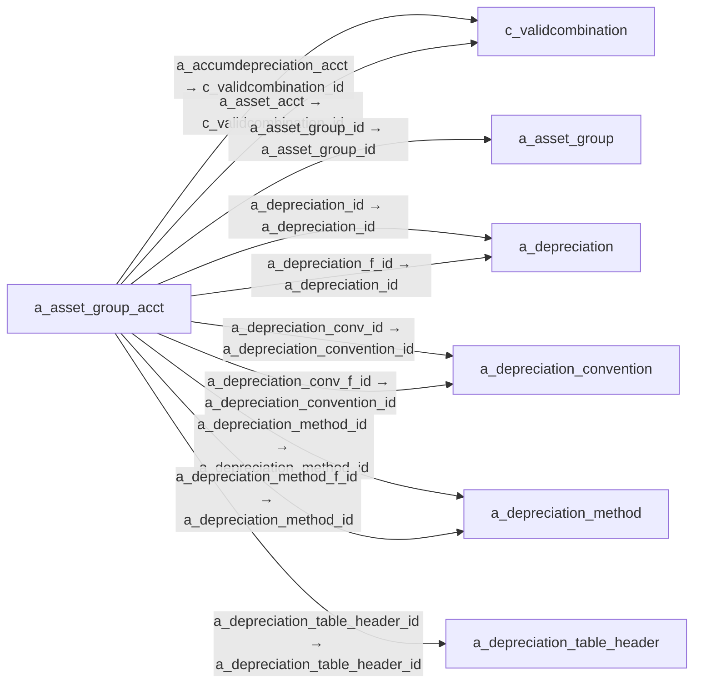

# a_asset_group_acct — 자산 그룹 회계 설정

[전체 일람](../TABLE_INDEX.md) · [분류 일람](README.md) · [AI 사용 안내](../README.md) · [외래키 읽는 법](../RELATIONSHIPS.md)

## 기본 정보

| 항목 | 내용 |
|---|---|
| 물리명 | `adempiere.a_asset_group_acct` |
| 한국어 논리명(문서용 해석) | 자산 그룹 회계 설정 |
| 원본 논리명 | Asset Group Accounting |
| 원본 사전 ID | 53130 |
| 분류 | `a` — 자산·감가상각 |
| 전체 테넌트 행 수 | 6 |
| 물리 열 수 | 53 |
| 나가는 FK / 들어오는 FK | 20 / 0 |
| 구조·행 수 확인 시점 | 2026-11-03T23:29:01+09:00 |

## 의미와 쓰임

자산 그룹에 적용할 감가상각 계정과 계산 방법을 설정한다.

- 설명 근거: 원본 애플리케이션 사전 명칭·설명을 한국어로 해석.
- 한국어 이름과 개요는 문서용 해석입니다. 공식 한국어 번역으로 간주하지 않습니다.
- 원본 설명: —
- 원본 도움말: This table holds the accounting setup for each fixed asset group.  Settings include account numbers to be used in depreciation entries as well depreciation calculation methods
- PostgreSQL 테이블 주석: —

## 키와 열

### 기본키·고유 제약조건

| 종류 | 제약조건 | 열(순서 유지) |
|---|---|---|
| PRIMARY KEY | `a_asset_group_acct_key` | `a_asset_group_acct_id` |
| UNIQUE | `a_asset_group_acct_uu_idx` | `a_asset_group_acct_uu` |

### 열 목록

원본 논리명·설명은 `AD_Column`에서 가져왔습니다. 기본값은 실제 PostgreSQL 메타데이터이며, 비어 있는 항목은 `—`로 표시합니다.

| 순서 | 물리명 | 원본 논리명 | PostgreSQL 타입 | NULL | PK | 기본값 | 설명 |
|---:|---|---|---|---|---|---|---|
| 1 | `a_asset_group_id` | Asset Group | numeric(10,0) | 불가 | — | — | Group of Assets |
| 2 | `c_acctschema_id` | Accounting Schema | numeric(10,0) | 불가 | — | — | Rules for accounting |
| 3 | `ad_client_id` | Tenant | numeric(10,0) | 불가 | — | — | Tenant for this installation. |
| 4 | `ad_org_id` | Organization | numeric(10,0) | 불가 | — | — | Organizational entity within tenant |
| 5 | `isactive` | Active | character(1) | 허용 | — | — | The record is active in the system |
| 6 | `created` | Created | timestamp without time zone | 불가 | — | statement_timestamp() | Date this record was created |
| 7 | `createdby` | Created By | numeric(10,0) | 허용 | — | — | User who created this records |
| 8 | `updated` | Updated | timestamp without time zone | 불가 | — | statement_timestamp() | Date this record was updated |
| 9 | `updatedby` | Updated By | numeric(10,0) | 허용 | — | — | User who updated this records |
| 10 | `a_asset_acct` | Asset Acct | numeric(10,0) | 불가 | — | — | — |
| 11 | `a_depreciation_acct` | Depreciation Account | numeric(10,0) | 불가 | — | — | — |
| 12 | `a_accumdepreciation_acct` | Accumulated Depreciation Account | numeric(10,0) | 불가 | — | — | — |
| 13 | `a_disposal_loss` | Loss on Disposal | character varying(22) | 허용 | — | — | — |
| 14 | `a_disposal_gain` | Disposal Gain | character varying(10) | 허용 | — | — | — |
| 15 | `a_depreciation_id` | Depreciation | numeric(10,0) | 불가 | — | — | — |
| 16 | `a_asset_group_acct_id` | Asset Group Accounting | numeric(10,0) | 불가 | 예 | — | — |
| 17 | `a_depreciation_manual_period` | A_Depreciation_Manual_Period | character varying(2) | 허용 | — | — | — |
| 18 | `a_depreciation_variable_perc` | Variable Percent | numeric | 허용 | — | — | — |
| 19 | `a_split_percent` | Split Percent | numeric | 불가 | — | (1)::numeric | — |
| 20 | `a_reval_depexp_offset` | Revaluation Expense Offs | character varying(22) | 허용 | — | — | — |
| 21 | `a_reval_cost_offset_prior` | Revaluation Cost Offset for Prior Year | character varying(22) | 허용 | — | — | — |
| 22 | `a_reval_cost_offset` | Revaluation Cost Offset for Current Year | character varying(22) | 허용 | — | — | — |
| 23 | `a_reval_cal_method` | A_Reval_Cal_Method | character varying(22) | 허용 | — | — | — |
| 24 | `a_reval_accumdep_offset_prior` | Revaluation Accumulated Depreciation Offset for Prior Year | character varying(22) | 허용 | — | — | — |
| 25 | `a_reval_accumdep_offset_cur` | Revaluation Accumulated Depreciation Offset for Current Year | character varying(22) | 허용 | — | — | — |
| 26 | `a_disposal_revenue` | Disposal Revenue | character varying(22) | 허용 | — | — | — |
| 27 | `uselifeyears` | Usable Life - Years | numeric | 허용 | — | — | Years of the usable life of the asset |
| 28 | `uselifemonths` | Usable Life - Months | numeric(10,0) | 허용 | — | (0)::numeric | Months of the usable life of the asset |
| 29 | `processing` | Process Now | character(1) | 허용 | — | — | — |
| 30 | `postingtype` | Posting Type | character(1) | 불가 | — | 'A'::bpchar | The type of posted amount for the transaction |
| 31 | `depreciationtype` | Depreciation Type | character varying(10) | 허용 | — | — | — |
| 32 | `conventiontype` | Convention Type | character varying(10) | 허용 | — | — | — |
| 33 | `a_depreciation_table_header_id` | A_Depreciation_Table_Header_ID | numeric(10,0) | 허용 | — | — | — |
| 34 | `a_depreciation_manual_amount` | A_Depreciation_Manual_Amount | numeric | 허용 | — | — | — |
| 35 | `a_depreciation_calc_type` | Calculation Type | character varying(10) | 허용 | — | — | — |
| 36 | `a_asset_spread_type` | Spread Type | character varying(10) | 허용 | — | — | — |
| 37 | `a_reval_depexp_offset_acct` | Reval Depexp Offset Acct | numeric(10,0) | 허용 | — | NULL::numeric | — |
| 38 | `a_reval_cost_offset_prior_acct` | Reval Cost Offset Prior Acct | numeric(10,0) | 허용 | — | NULL::numeric | — |
| 39 | `a_reval_cost_offset_acct` | Reval Cost Offset Acct | numeric(10,0) | 허용 | — | NULL::numeric | — |
| 40 | `a_reval_adep_offset_prior_acct` | A_Reval_Accumdep_Offset_Prior | numeric(10,0) | 허용 | — | NULL::numeric | — |
| 41 | `a_reval_adep_offset_cur_acct` | A_Reval_Accumdep_Offset_Cur | numeric(10,0) | 허용 | — | NULL::numeric | — |
| 42 | `a_disposal_gain_acct` | Disposal Gain Acct | numeric(10,0) | 허용 | — | NULL::numeric | — |
| 43 | `a_depreciation_method_id` | Depreciation Method | numeric(10,0) | 허용 | — | — | — |
| 44 | `a_depreciation_conv_f_id` | Depreciation Convention (fiscal) | numeric(10,0) | 허용 | — | — | — |
| 45 | `a_depreciation_conv_id` | Convention Type | numeric(10,0) | 허용 | — | — | — |
| 46 | `a_depreciation_method_f_id` | Depreciation Method (fiscal) | numeric(10,0) | 허용 | — | — | — |
| 47 | `a_depreciation_variable_perc_f` | Variable Percent (fiscal) | numeric | 허용 | — | — | — |
| 48 | `a_depreciation_f_id` | Depreciation (fiscal) | numeric(10,0) | 불가 | — | — | — |
| 49 | `uselifeyears_f` | Use Life - Years (fiscal) | numeric | 불가 | — | '0'::numeric | — |
| 50 | `uselifemonths_f` | Use Life - Months (fiscal) | numeric(10,0) | 불가 | — | (0)::numeric | — |
| 51 | `a_disposal_revenue_acct` | Disposal Revenue Acct | numeric(10,0) | 허용 | — | NULL::numeric | — |
| 52 | `a_disposal_loss_acct` | Disposal Loss Acct | numeric(10,0) | 허용 | — | NULL::numeric | — |
| 53 | `a_asset_group_acct_uu` | A_Asset_Group_Acct_UU | uuid | 허용 | — | — | — |

## 외래키 흐름

화살표는 **FK를 가진 자식 → 참조되는 부모**입니다. 업무 처리의 시간 순서나 무조건적인 1:N 관계를 뜻하지 않습니다.

주변 관계 20개 중 10개를 그림으로 표시합니다. **전체 관계는 아래 두 표에 모두 포함**합니다.

### 이 테이블이 참조하는 부모 — 나가는 FK

| 제약조건 | 참조하는 쪽(자식) | 자식 열 | 참조받는 쪽(부모) | 부모 열 | 삭제 / 갱신 | 검증 / 지연 가능 |
|---|---|---|---|---|---|---|
| `aaccumdepreciation_aassetgroup` <!-- FK_OUT: adempiere.a_asset_group_acct.aaccumdepreciation_aassetgroup --> | [`a_asset_group_acct`](a_asset_group_acct.md) | `a_accumdepreciation_acct` | [`c_validcombination`](../c/c_validcombination.md) | `c_validcombination_id` | NO ACTION / NO ACTION | 완료 / 가능 (초기 지연) |
| `aasset_aassetgroupacct` <!-- FK_OUT: adempiere.a_asset_group_acct.aasset_aassetgroupacct --> | [`a_asset_group_acct`](a_asset_group_acct.md) | `a_asset_acct` | [`c_validcombination`](../c/c_validcombination.md) | `c_validcombination_id` | NO ACTION / NO ACTION | 완료 / 가능 (초기 지연) |
| `aassetgroup_aassetgroupacct` <!-- FK_OUT: adempiere.a_asset_group_acct.aassetgroup_aassetgroupacct --> | [`a_asset_group_acct`](a_asset_group_acct.md) | `a_asset_group_id` | [`a_asset_group`](a_asset_group.md) | `a_asset_group_id` | CASCADE / NO ACTION | 완료 / 가능 (초기 지연) |
| `adepreciation_aassetgroupacct` <!-- FK_OUT: adempiere.a_asset_group_acct.adepreciation_aassetgroupacct --> | [`a_asset_group_acct`](a_asset_group_acct.md) | `a_depreciation_id` | [`a_depreciation`](a_depreciation.md) | `a_depreciation_id` | NO ACTION / NO ACTION | 완료 / 가능 (초기 지연) |
| `adepreciationconv_aassetgroupa` <!-- FK_OUT: adempiere.a_asset_group_acct.adepreciationconv_aassetgroupa --> | [`a_asset_group_acct`](a_asset_group_acct.md) | `a_depreciation_conv_id` | [`a_depreciation_convention`](a_depreciation_convention.md) | `a_depreciation_convention_id` | NO ACTION / NO ACTION | 완료 / 가능 (초기 지연) |
| `adepreciationconvf_aassetgroup` <!-- FK_OUT: adempiere.a_asset_group_acct.adepreciationconvf_aassetgroup --> | [`a_asset_group_acct`](a_asset_group_acct.md) | `a_depreciation_conv_f_id` | [`a_depreciation_convention`](a_depreciation_convention.md) | `a_depreciation_convention_id` | NO ACTION / NO ACTION | 완료 / 가능 (초기 지연) |
| `adepreciationf_aassetgroupacct` <!-- FK_OUT: adempiere.a_asset_group_acct.adepreciationf_aassetgroupacct --> | [`a_asset_group_acct`](a_asset_group_acct.md) | `a_depreciation_f_id` | [`a_depreciation`](a_depreciation.md) | `a_depreciation_id` | NO ACTION / NO ACTION | 완료 / 가능 (초기 지연) |
| `adepreciationmethod_aassetgrou` <!-- FK_OUT: adempiere.a_asset_group_acct.adepreciationmethod_aassetgrou --> | [`a_asset_group_acct`](a_asset_group_acct.md) | `a_depreciation_method_id` | [`a_depreciation_method`](a_depreciation_method.md) | `a_depreciation_method_id` | NO ACTION / NO ACTION | 완료 / 가능 (초기 지연) |
| `adepreciationmethodf_aassetgro` <!-- FK_OUT: adempiere.a_asset_group_acct.adepreciationmethodf_aassetgro --> | [`a_asset_group_acct`](a_asset_group_acct.md) | `a_depreciation_method_f_id` | [`a_depreciation_method`](a_depreciation_method.md) | `a_depreciation_method_id` | NO ACTION / NO ACTION | 완료 / 가능 (초기 지연) |
| `adepreciationtableheader_aass3` <!-- FK_OUT: adempiere.a_asset_group_acct.adepreciationtableheader_aass3 --> | [`a_asset_group_acct`](a_asset_group_acct.md) | `a_depreciation_table_header_id` | [`a_depreciation_table_header`](a_depreciation_table_header.md) | `a_depreciation_table_header_id` | NO ACTION / NO ACTION | 완료 / 가능 (초기 지연) |
| `adepreciationvc_aassetgroupacc` <!-- FK_OUT: adempiere.a_asset_group_acct.adepreciationvc_aassetgroupacc --> | [`a_asset_group_acct`](a_asset_group_acct.md) | `a_depreciation_acct` | [`c_validcombination`](../c/c_validcombination.md) | `c_validcombination_id` | NO ACTION / NO ACTION | 완료 / 가능 (초기 지연) |
| `adisposalgain_aassetgroupacct` <!-- FK_OUT: adempiere.a_asset_group_acct.adisposalgain_aassetgroupacct --> | [`a_asset_group_acct`](a_asset_group_acct.md) | `a_disposal_gain_acct` | [`c_validcombination`](../c/c_validcombination.md) | `c_validcombination_id` | NO ACTION / NO ACTION | 완료 / 가능 (초기 지연) |
| `adisposalloss_aassetgroupacct` <!-- FK_OUT: adempiere.a_asset_group_acct.adisposalloss_aassetgroupacct --> | [`a_asset_group_acct`](a_asset_group_acct.md) | `a_disposal_loss_acct` | [`c_validcombination`](../c/c_validcombination.md) | `c_validcombination_id` | NO ACTION / NO ACTION | 완료 / 가능 (초기 지연) |
| `adisposalrevenue_aassetgroupac` <!-- FK_OUT: adempiere.a_asset_group_acct.adisposalrevenue_aassetgroupac --> | [`a_asset_group_acct`](a_asset_group_acct.md) | `a_disposal_revenue_acct` | [`c_validcombination`](../c/c_validcombination.md) | `c_validcombination_id` | NO ACTION / NO ACTION | 완료 / 가능 (초기 지연) |
| `arevaladepoffsetcur_aassetgrou` <!-- FK_OUT: adempiere.a_asset_group_acct.arevaladepoffsetcur_aassetgrou --> | [`a_asset_group_acct`](a_asset_group_acct.md) | `a_reval_adep_offset_cur_acct` | [`c_validcombination`](../c/c_validcombination.md) | `c_validcombination_id` | NO ACTION / NO ACTION | 완료 / 가능 (초기 지연) |
| `arevaladepoffsetprior_aassetgr` <!-- FK_OUT: adempiere.a_asset_group_acct.arevaladepoffsetprior_aassetgr --> | [`a_asset_group_acct`](a_asset_group_acct.md) | `a_reval_adep_offset_prior_acct` | [`c_validcombination`](../c/c_validcombination.md) | `c_validcombination_id` | NO ACTION / NO ACTION | 완료 / 가능 (초기 지연) |
| `arevalcostoffset_aassetgroupac` <!-- FK_OUT: adempiere.a_asset_group_acct.arevalcostoffset_aassetgroupac --> | [`a_asset_group_acct`](a_asset_group_acct.md) | `a_reval_cost_offset_acct` | [`c_validcombination`](../c/c_validcombination.md) | `c_validcombination_id` | NO ACTION / NO ACTION | 완료 / 가능 (초기 지연) |
| `arevalcostoffsetprior_aassetgr` <!-- FK_OUT: adempiere.a_asset_group_acct.arevalcostoffsetprior_aassetgr --> | [`a_asset_group_acct`](a_asset_group_acct.md) | `a_reval_cost_offset_prior_acct` | [`c_validcombination`](../c/c_validcombination.md) | `c_validcombination_id` | NO ACTION / NO ACTION | 완료 / 가능 (초기 지연) |
| `arevaldepexpoffset_aassetgroup` <!-- FK_OUT: adempiere.a_asset_group_acct.arevaldepexpoffset_aassetgroup --> | [`a_asset_group_acct`](a_asset_group_acct.md) | `a_reval_depexp_offset_acct` | [`c_validcombination`](../c/c_validcombination.md) | `c_validcombination_id` | NO ACTION / NO ACTION | 완료 / 가능 (초기 지연) |
| `cacctschema_aassetgroupacct` <!-- FK_OUT: adempiere.a_asset_group_acct.cacctschema_aassetgroupacct --> | [`a_asset_group_acct`](a_asset_group_acct.md) | `c_acctschema_id` | [`c_acctschema`](../c/c_acctschema.md) | `c_acctschema_id` | NO ACTION / NO ACTION | 완료 / 가능 (초기 지연) |

### 이 테이블을 참조하는 자식 — 들어오는 FK

해당 방향의 물리 FK 제약조건은 없습니다. 이름이 비슷한 열만으로 관계를 추가하지 않습니다.

## 조회 시 주의

- FK 표의 자식 열과 부모 열을 같은 순서로 대응시킵니다. 복합 FK는 모든 열의 동등 조건을 `AND`로 연결합니다.
- 테이블 이름이나 `_id` 열 이름만으로 물리 FK가 있다고 가정하지 않습니다. FK 미선언은 업무 관계가 없다는 뜻도 아닙니다.
- 자식이 여러 행인 테이블과 조인하면 부모의 금액·건수가 중복될 수 있습니다. 집계 단위를 먼저 정합니다.
- `ad_client_id`가 있습니다. 업무 분석에서는 대상 테넌트를 명시합니다. GardenWorld는 `11`, 시스템 공통 설정은 `0`일 수 있으므로 일괄 필터 적용 전에 테이블 역할을 확인합니다.
- 행 수는 위 확인 시점의 전체 테넌트 값입니다. 최신 업무 실적이나 현재 실행 결과로 재사용하지 않습니다.
