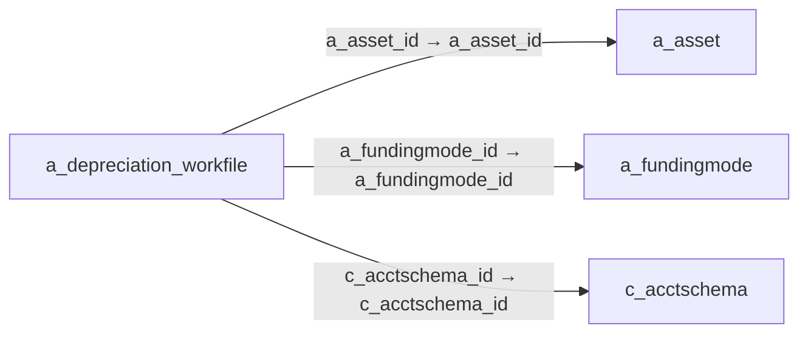

# a_depreciation_workfile — 자산 원가·상각 잔액

[전체 일람](../TABLE_INDEX.md) · [분류 일람](README.md) · [AI 사용 안내](../README.md) · [외래키 읽는 법](../RELATIONSHIPS.md)

## 기본 정보

| 항목 | 내용 |
|---|---|
| 물리명 | `adempiere.a_depreciation_workfile` |
| 한국어 논리명(문서용 해석) | 자산 원가·상각 잔액 |
| 원본 논리명 | A_Depreciation_Workfile_ID |
| 원본 사전 ID | 53116 |
| 분류 | `a` — 자산·감가상각 |
| 전체 테넌트 행 수 | 0 |
| 물리 열 수 | 45 |
| 나가는 FK / 들어오는 FK | 3 / 0 |
| 구조·행 수 확인 시점 | 2026-11-03T23:29:01+09:00 |

## 의미와 쓰임

개별 고정자산의 원가와 감가상각 잔액을 관리한다.

- 설명 근거: 원본 애플리케이션 사전 명칭·설명을 한국어로 해석.
- 한국어 이름과 개요는 문서용 해석입니다. 공식 한국어 번역으로 간주하지 않습니다.
- 원본 설명: —
- 원본 도움말: This table holds the Cost and Depreciation Balances for each fixed asset
- PostgreSQL 테이블 주석: —

## 키와 열

### 기본키·고유 제약조건

| 종류 | 제약조건 | 열(순서 유지) |
|---|---|---|
| PRIMARY KEY | `a_depreciation_workfile_key` | `a_depreciation_workfile_id` |
| UNIQUE | `a_depreciation_workfile_uu_idx` | `a_depreciation_workfile_uu` |

### 열 목록

원본 논리명·설명은 `AD_Column`에서 가져왔습니다. 기본값은 실제 PostgreSQL 메타데이터이며, 비어 있는 항목은 `—`로 표시합니다.

| 순서 | 물리명 | 원본 논리명 | PostgreSQL 타입 | NULL | PK | 기본값 | 설명 |
|---:|---|---|---|---|---|---|---|
| 1 | `a_depreciation_workfile_id` | A_Depreciation_Workfile_ID | numeric(10,0) | 불가 | 예 | — | — |
| 2 | `ad_client_id` | Tenant | numeric(10,0) | 불가 | — | — | Tenant for this installation. |
| 3 | `ad_org_id` | Organization | numeric(10,0) | 불가 | — | — | Organizational entity within tenant |
| 4 | `a_accumulated_depr` | Accumulated Depreciation | numeric | 불가 | — | (0)::numeric | — |
| 5 | `a_asset_cost` | Asset Cost | numeric | 불가 | — | (0)::numeric | — |
| 6 | `a_asset_id` | Asset | numeric(10,0) | 불가 | — | — | Asset used internally or by customers |
| 7 | `a_asset_life_current_year` | A_Asset_Life_Current_Year | numeric | 불가 | — | (0)::numeric | — |
| 8 | `a_period_forecast` | A_Period_Forecast | numeric | 허용 | — | — | — |
| 9 | `a_prior_year_accumulated_depr` | A_Prior_Year_Accumulated_Depr | numeric | 허용 | — | — | — |
| 10 | `postingtype` | Posting Type | character(1) | 허용 | — | 'A'::bpchar | The type of posted amount for the transaction |
| 11 | `isdepreciated` | Depreciate | character(1) | 허용 | — | — | The asset will be depreciated |
| 12 | `isactive` | Active | character(1) | 불가 | — | — | The record is active in the system |
| 13 | `dateacct` | Account Date | timestamp without time zone | 허용 | — | — | Accounting Date |
| 14 | `createdby` | Created By | numeric(10,0) | 불가 | — | — | User who created this records |
| 15 | `created` | Created | timestamp without time zone | 불가 | — | statement_timestamp() | Date this record was created |
| 16 | `assetdepreciationdate` | Asset Depreciation Date | timestamp without time zone | 허용 | — | — | Date of last depreciation |
| 17 | `a_salvage_value` | Asset Salvage Value | numeric | 불가 | — | (0)::numeric | — |
| 18 | `a_qty_current` | Current Qty | numeric | 불가 | — | — | — |
| 19 | `updatedby` | Updated By | numeric(10,0) | 불가 | — | — | User who updated this records |
| 20 | `updated` | Updated | timestamp without time zone | 불가 | — | statement_timestamp() | Date this record was updated |
| 21 | `processing` | Process Now | character(1) | 허용 | — | 'N'::bpchar | — |
| 22 | `a_period_posted` | A_Period_Posted | numeric(10,0) | 허용 | — | — | — |
| 23 | `a_life_period` | Life Periods | numeric(10,0) | 불가 | — | (0)::numeric | — |
| 24 | `a_asset_life_years` | Life Years | numeric | 불가 | — | '0'::numeric | — |
| 25 | `a_base_amount` | A_Base_Amount | numeric | 허용 | — | — | — |
| 26 | `a_calc_accumulated_depr` | A_Calc_Accumulated_Depr | numeric | 허용 | — | (0)::numeric | — |
| 27 | `a_curr_dep_exp` | A_Curr_Dep_Exp | numeric | 불가 | — | (0)::numeric | — |
| 28 | `a_current_period` | Current Period | numeric(10,0) | 허용 | — | — | — |
| 29 | `a_depreciation_workfile_uu` | A_Depreciation_Workfile_UU | uuid | 허용 | — | — | — |
| 30 | `a_accumulated_depr_f` | Accumulated Depreciation (fiscal) | numeric | 불가 | — | (0)::numeric | — |
| 31 | `a_asset_life_years_f` | Life Years (fiscal) | numeric | 불가 | — | '0'::numeric | — |
| 32 | `a_life_period_f` | Life Period (fiscal) | numeric(10,0) | 불가 | — | (0)::numeric | — |
| 33 | `uselifeyears` | Usable Life - Years | numeric | 불가 | — | '0'::numeric | Years of the usable life of the asset |
| 34 | `uselifemonths` | Usable Life - Months | numeric(10,0) | 불가 | — | (0)::numeric | Months of the usable life of the asset |
| 35 | `uselifeyears_f` | Use Life - Years (fiscal) | numeric | 불가 | — | '0'::numeric | — |
| 36 | `uselifemonths_f` | Use Life - Months (fiscal) | numeric(10,0) | 불가 | — | (0)::numeric | — |
| 37 | `a_asset_remaining` | Remaining Amt | numeric | 허용 | — | — | — |
| 38 | `a_asset_remaining_f` | Remaining Amt (fiscal) | numeric | 허용 | — | — | — |
| 39 | `a_tip_finantare` | Financing Type | character(1) | 불가 | — | 'P'::bpchar | Financing Type |
| 40 | `a_valoare_cofinantare` | Own contribution | numeric | 허용 | — | — | — |
| 41 | `a_valoare_tert` | Third contribution | numeric | 허용 | — | — | — |
| 42 | `description` | Description | character varying(255) | 허용 | — | NULL::character varying | Optional short description of the record |
| 43 | `a_fundingmode_id` | Asset Funding Mode | numeric(10,0) | 허용 | — | NULL::numeric | — |
| 44 | `processed` | Processed | character(1) | 불가 | — | 'N'::bpchar | The document has been processed |
| 45 | `c_acctschema_id` | Accounting Schema | numeric(10,0) | 허용 | — | NULL::numeric | Rules for accounting |

## 외래키 흐름

화살표는 **FK를 가진 자식 → 참조되는 부모**입니다. 업무 처리의 시간 순서나 무조건적인 1:N 관계를 뜻하지 않습니다.

주변 관계 3개 중 3개를 그림으로 표시합니다. **전체 관계는 아래 두 표에 모두 포함**합니다.

### 이 테이블이 참조하는 부모 — 나가는 FK

| 제약조건 | 참조하는 쪽(자식) | 자식 열 | 참조받는 쪽(부모) | 부모 열 | 삭제 / 갱신 | 검증 / 지연 가능 |
|---|---|---|---|---|---|---|
| `aasset_adepreciationworkfile` <!-- FK_OUT: adempiere.a_depreciation_workfile.aasset_adepreciationworkfile --> | [`a_depreciation_workfile`](a_depreciation_workfile.md) | `a_asset_id` | [`a_asset`](a_asset.md) | `a_asset_id` | NO ACTION / NO ACTION | 완료 / 가능 (초기 지연) |
| `afundingmode_adepreciationwork` <!-- FK_OUT: adempiere.a_depreciation_workfile.afundingmode_adepreciationwork --> | [`a_depreciation_workfile`](a_depreciation_workfile.md) | `a_fundingmode_id` | [`a_fundingmode`](a_fundingmode.md) | `a_fundingmode_id` | NO ACTION / NO ACTION | 완료 / 가능 (초기 지연) |
| `cacctschema_adepreciationworkf` <!-- FK_OUT: adempiere.a_depreciation_workfile.cacctschema_adepreciationworkf --> | [`a_depreciation_workfile`](a_depreciation_workfile.md) | `c_acctschema_id` | [`c_acctschema`](../c/c_acctschema.md) | `c_acctschema_id` | CASCADE / NO ACTION | 완료 / 가능 (초기 지연) |

### 이 테이블을 참조하는 자식 — 들어오는 FK

해당 방향의 물리 FK 제약조건은 없습니다. 이름이 비슷한 열만으로 관계를 추가하지 않습니다.

## 조회 시 주의

- FK 표의 자식 열과 부모 열을 같은 순서로 대응시킵니다. 복합 FK는 모든 열의 동등 조건을 `AND`로 연결합니다.
- 테이블 이름이나 `_id` 열 이름만으로 물리 FK가 있다고 가정하지 않습니다. FK 미선언은 업무 관계가 없다는 뜻도 아닙니다.
- 자식이 여러 행인 테이블과 조인하면 부모의 금액·건수가 중복될 수 있습니다. 집계 단위를 먼저 정합니다.
- `ad_client_id`가 있습니다. 업무 분석에서는 대상 테넌트를 명시합니다. GardenWorld는 `11`, 시스템 공통 설정은 `0`일 수 있으므로 일괄 필터 적용 전에 테이블 역할을 확인합니다.
- 수집 시점에 0행입니다. 이 표만으로 거래 실적·처리 결과를 계산할 수 없습니다.
- 행 수는 위 확인 시점의 전체 테넌트 값입니다. 최신 업무 실적이나 현재 실행 결과로 재사용하지 않습니다.
