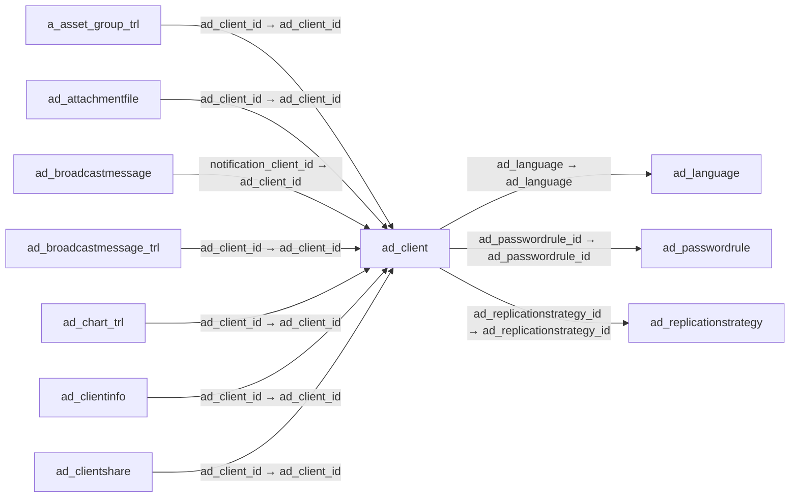

# ad_client — 테넌트

[전체 일람](../TABLE_INDEX.md) · [분류 일람](README.md) · [AI 사용 안내](../README.md) · [외래키 읽는 법](../RELATIONSHIPS.md)

## 기본 정보

| 항목 | 내용 |
|---|---|
| 물리명 | `adempiere.ad_client` |
| 한국어 논리명(문서용 해석) | 테넌트 |
| 원본 논리명 | Tenant |
| 원본 사전 ID | 112 |
| 분류 | `ad` — 애플리케이션 사전·화면·권한·시스템 |
| 전체 테넌트 행 수 | 2 |
| 물리 열 수 | 42 |
| 나가는 FK / 들어오는 FK | 3 / 121 |
| 구조·행 수 확인 시점 | 2026-11-03T23:29:01+09:00 |

## 의미와 쓰임

하나의 설치 환경에서 구분되는 테넌트를 정의한다.

- 설명 근거: 원본 애플리케이션 사전 명칭·설명을 한국어로 해석.
- 한국어 이름과 개요는 문서용 해석입니다. 공식 한국어 번역으로 간주하지 않습니다.
- 원본 설명: Tenant for this installation.
- 원본 도움말: —
- PostgreSQL 테이블 주석: —

## 키와 열

### 기본키·고유 제약조건

| 종류 | 제약조건 | 열(순서 유지) |
|---|---|---|
| PRIMARY KEY | `ad_client_pkey` | `ad_client_id` |
| UNIQUE | `ad_client_uu_idx` | `ad_client_uu` |

### 별도 고유 인덱스

PK·UNIQUE 제약조건의 인덱스와 별도로 존재하는 고유 인덱스입니다. 식·조건·열 순서는 원본 정의를 따릅니다.

- `ad_client_loginprefix`: `CREATE UNIQUE INDEX ad_client_loginprefix ON adempiere.ad_client USING btree (loginprefix)`
- `ad_client_value`: `CREATE UNIQUE INDEX ad_client_value ON adempiere.ad_client USING btree (value)`

### 열 목록

원본 논리명·설명은 `AD_Column`에서 가져왔습니다. 기본값은 실제 PostgreSQL 메타데이터이며, 비어 있는 항목은 `—`로 표시합니다.

| 순서 | 물리명 | 원본 논리명 | PostgreSQL 타입 | NULL | PK | 기본값 | 설명 |
|---:|---|---|---|---|---|---|---|
| 1 | `ad_client_id` | Tenant | numeric(10,0) | 불가 | 예 | — | Tenant for this installation. |
| 2 | `ad_org_id` | Organization | numeric(10,0) | 불가 | — | — | Organizational entity within tenant |
| 3 | `isactive` | Active | character(1) | 불가 | — | 'Y'::bpchar | The record is active in the system |
| 4 | `created` | Created | timestamp without time zone | 불가 | — | now() | Date this record was created |
| 5 | `createdby` | Created By | numeric(10,0) | 불가 | — | — | User who created this records |
| 6 | `updated` | Updated | timestamp without time zone | 불가 | — | now() | Date this record was updated |
| 7 | `updatedby` | Updated By | numeric(10,0) | 불가 | — | — | User who updated this records |
| 8 | `value` | Search Key | character varying(40) | 불가 | — | — | Search key for the record in the format required - must be unique |
| 9 | `name` | Name | character varying(60) | 불가 | — | — | Alphanumeric identifier of the entity |
| 10 | `description` | Description | character varying(255) | 허용 | — | — | Optional short description of the record |
| 11 | `smtphost` | Mail Host | character varying(60) | 허용 | — | — | Hostname of Mail Server for SMTP and IMAP |
| 12 | `requestemail` | Request EMail | character varying(60) | 허용 | — | — | EMail address to send automated mails from or receive mails for automated processing (fully qualified) |
| 13 | `requestuser` | Request User | character varying(60) | 허용 | — | — | User Name (ID) of the email owner |
| 14 | `requestuserpw` | Request User Password | character varying(255) | 허용 | — | — | Password of the user name (ID) for mail processing |
| 15 | `requestfolder` | Request Folder | character varying(20) | 허용 | — | — | EMail folder to process incoming emails; if empty INBOX is used |
| 16 | `ad_language` | Language | character varying(6) | 허용 | — | — | Language for this entity |
| 17 | `ismultilingualdocument` | Multi Lingual Documents | character(1) | 불가 | — | 'N'::bpchar | Documents are Multi Lingual |
| 18 | `issmtpauthorization` | SMTP Authentication | character(1) | 불가 | — | 'N'::bpchar | Your mail server requires Authentication |
| 19 | `isusebetafunctions` | Use Beta Functions | character(1) | 불가 | — | 'N'::bpchar | Enable the use of Beta Functionality |
| 20 | `ldapquery` | — | character varying(255) | 허용 | — | — | — |
| 21 | `modelvalidationclasses` | Model Validation Classes | character varying(255) | 허용 | — | — | List of data model validation classes separated by ; |
| 22 | `autoarchive` | Auto Archive | character(1) | 불가 | — | 'N'::bpchar | Enable and level of automatic Archive of documents |
| 23 | `mmpolicy` | Material Policy | character(1) | 불가 | — | 'F'::bpchar | Material Movement Policy |
| 24 | `emailtest` | EMail Test | character(1) | 허용 | — | — | Test EMail |
| 25 | `isserveremail` | Server EMail | character(1) | 허용 | — | — | Send EMail from Server |
| 26 | `documentdir` | Document Directory | character varying(60) | 허용 | — | — | Directory for documents from the application server |
| 27 | `ispostimmediate` | Post Immediately (Deprecated) | character(1) | 불가 | — | 'N'::bpchar | Post the accounting immediately for testing (Deprecated) |
| 28 | `iscostimmediate` | Cost Immediately | character(1) | 불가 | — | 'N'::bpchar | Update Costs immediately for testing |
| 29 | `storeattachmentsonfilesystem` | Store Attachments On File System | character(1) | 불가 | — | 'N'::bpchar | — |
| 30 | `windowsattachmentpath` | Windows Attachment Path | character varying(255) | 허용 | — | — | — |
| 31 | `unixattachmentpath` | Unix Attachment Path | character varying(255) | 허용 | — | — | — |
| 32 | `storearchiveonfilesystem` | Store Archive On File System | character(1) | 불가 | — | 'N'::bpchar | — |
| 33 | `windowsarchivepath` | Windows Archive Path | character varying(255) | 허용 | — | — | — |
| 34 | `unixarchivepath` | Unix Archive Path | character varying(255) | 허용 | — | — | — |
| 35 | `isuseasp` | Is Use ASP | character(1) | 불가 | — | 'N'::bpchar | — |
| 36 | `ad_replicationstrategy_id` | Replication Strategy | numeric(10,0) | 허용 | — | — | Data Replication Strategy |
| 37 | `ad_client_uu` | AD_Client_UU | uuid | 허용 | — | — | — |
| 38 | `ad_passwordrule_id` | Password Policies | numeric(10,0) | 허용 | — | NULL::numeric | — |
| 39 | `issecuresmtp` | SMTP SSL/TLS | character(1) | 불가 | — | 'N'::bpchar | Use SSL/TLS for SMTP |
| 40 | `smtpport` | SMTP Port | numeric(10,0) | 허용 | — | NULL::numeric | SMTP Port Number |
| 41 | `loginprefix` | Login Prefix | character varying(40) | 허용 | — | NULL::character varying | — |
| 42 | `authenticationtype` | Authentication Type | character varying(10) | 불가 | — | 'AAS'::character varying | — |

## 외래키 흐름

화살표는 **FK를 가진 자식 → 참조되는 부모**입니다. 업무 처리의 시간 순서나 무조건적인 1:N 관계를 뜻하지 않습니다.

주변 관계 124개 중 10개를 그림으로 표시합니다. **전체 관계는 아래 두 표에 모두 포함**합니다.

### 이 테이블이 참조하는 부모 — 나가는 FK

| 제약조건 | 참조하는 쪽(자식) | 자식 열 | 참조받는 쪽(부모) | 부모 열 | 삭제 / 갱신 | 검증 / 지연 가능 |
|---|---|---|---|---|---|---|
| `adlangu_adclient` <!-- FK_OUT: adempiere.ad_client.adlangu_adclient --> | [`ad_client`](ad_client.md) | `ad_language` | [`ad_language`](ad_language.md) | `ad_language` | NO ACTION / NO ACTION | 완료 / 가능 (초기 지연) |
| `adpasswordrule_adclient` <!-- FK_OUT: adempiere.ad_client.adpasswordrule_adclient --> | [`ad_client`](ad_client.md) | `ad_passwordrule_id` | [`ad_passwordrule`](ad_passwordrule.md) | `ad_passwordrule_id` | NO ACTION / NO ACTION | 완료 / 가능 (초기 지연) |
| `adreplicationstrategy_adclient` <!-- FK_OUT: adempiere.ad_client.adreplicationstrategy_adclient --> | [`ad_client`](ad_client.md) | `ad_replicationstrategy_id` | [`ad_replicationstrategy`](ad_replicationstrategy.md) | `ad_replicationstrategy_id` | NO ACTION / NO ACTION | 완료 / 가능 (초기 지연) |

### 이 테이블을 참조하는 자식 — 들어오는 FK

| 제약조건 | 참조하는 쪽(자식) | 자식 열 | 참조받는 쪽(부모) | 부모 열 | 삭제 / 갱신 | 검증 / 지연 가능 |
|---|---|---|---|---|---|---|
| `adclient_aassetgrouptrl` <!-- FK_IN: adempiere.a_asset_group_trl.adclient_aassetgrouptrl --> | [`a_asset_group_trl`](../a/a_asset_group_trl.md) | `ad_client_id` | [`ad_client`](ad_client.md) | `ad_client_id` | NO ACTION / NO ACTION | 완료 / 가능 (초기 지연) |
| `adclient_adattachmentfile` <!-- FK_IN: adempiere.ad_attachmentfile.adclient_adattachmentfile --> | [`ad_attachmentfile`](ad_attachmentfile.md) | `ad_client_id` | [`ad_client`](ad_client.md) | `ad_client_id` | NO ACTION / NO ACTION | 완료 / 가능 (초기 지연) |
| `notificationclient_adbroadcast` <!-- FK_IN: adempiere.ad_broadcastmessage.notificationclient_adbroadcast --> | [`ad_broadcastmessage`](ad_broadcastmessage.md) | `notification_client_id` | [`ad_client`](ad_client.md) | `ad_client_id` | NO ACTION / NO ACTION | 완료 / 가능 (초기 지연) |
| `adclient_adbroadcastmessagetrl` <!-- FK_IN: adempiere.ad_broadcastmessage_trl.adclient_adbroadcastmessagetrl --> | [`ad_broadcastmessage_trl`](ad_broadcastmessage_trl.md) | `ad_client_id` | [`ad_client`](ad_client.md) | `ad_client_id` | NO ACTION / NO ACTION | 완료 / 가능 (초기 지연) |
| `adclient_adcharttrl` <!-- FK_IN: adempiere.ad_chart_trl.adclient_adcharttrl --> | [`ad_chart_trl`](ad_chart_trl.md) | `ad_client_id` | [`ad_client`](ad_client.md) | `ad_client_id` | NO ACTION / NO ACTION | 완료 / 가능 (초기 지연) |
| `adclient_adclientinfo` <!-- FK_IN: adempiere.ad_clientinfo.adclient_adclientinfo --> | [`ad_clientinfo`](ad_clientinfo.md) | `ad_client_id` | [`ad_client`](ad_client.md) | `ad_client_id` | CASCADE / NO ACTION | 완료 / 가능 (초기 지연) |
| `adclient_adclientshare` <!-- FK_IN: adempiere.ad_clientshare.adclient_adclientshare --> | [`ad_clientshare`](ad_clientshare.md) | `ad_client_id` | [`ad_client`](ad_client.md) | `ad_client_id` | NO ACTION / NO ACTION | 완료 / 가능 (초기 지연) |
| `adclient_adcolortrl` <!-- FK_IN: adempiere.ad_color_trl.adclient_adcolortrl --> | [`ad_color_trl`](ad_color_trl.md) | `ad_client_id` | [`ad_client`](ad_client.md) | `ad_client_id` | NO ACTION / NO ACTION | 완료 / 가능 (초기 지연) |
| `columnclient` <!-- FK_IN: adempiere.ad_column.columnclient --> | [`ad_column`](ad_column.md) | `ad_client_id` | [`ad_client`](ad_client.md) | `ad_client_id` | NO ACTION / NO ACTION | 완료 / 가능 (초기 지연) |
| `aduserclient_adctxhelpsuggesti` <!-- FK_IN: adempiere.ad_ctxhelpsuggestion.aduserclient_adctxhelpsuggesti --> | [`ad_ctxhelpsuggestion`](ad_ctxhelpsuggestion.md) | `ad_userclient_id` | [`ad_client`](ad_client.md) | `ad_client_id` | NO ACTION / NO ACTION | 완료 / 가능 (초기 지연) |
| `fieldclient` <!-- FK_IN: adempiere.ad_field.fieldclient --> | [`ad_field`](ad_field.md) | `ad_client_id` | [`ad_client`](ad_client.md) | `ad_client_id` | NO ACTION / NO ACTION | 완료 / 가능 (초기 지연) |
| `aduserclient_adfieldsuggestion` <!-- FK_IN: adempiere.ad_fieldsuggestion.aduserclient_adfieldsuggestion --> | [`ad_fieldsuggestion`](ad_fieldsuggestion.md) | `ad_userclient_id` | [`ad_client`](ad_client.md) | `ad_client_id` | NO ACTION / NO ACTION | 완료 / 가능 (초기 지연) |
| `adclient_adimporttemplate` <!-- FK_IN: adempiere.ad_importtemplate.adclient_adimporttemplate --> | [`ad_importtemplate`](ad_importtemplate.md) | `ad_client_id` | [`ad_client`](ad_client.md) | `ad_client_id` | NO ACTION / NO ACTION | 완료 / 가능 (초기 지연) |
| `adclient_adimporttemplateacces` <!-- FK_IN: adempiere.ad_importtemplateaccess.adclient_adimporttemplateacces --> | [`ad_importtemplateaccess`](ad_importtemplateaccess.md) | `ad_client_id` | [`ad_client`](ad_client.md) | `ad_client_id` | NO ACTION / NO ACTION | 완료 / 가능 (초기 지연) |
| `adclient_adinforelated` <!-- FK_IN: adempiere.ad_inforelated.adclient_adinforelated --> | [`ad_inforelated`](ad_inforelated.md) | `ad_client_id` | [`ad_client`](ad_client.md) | `ad_client_id` | NO ACTION / NO ACTION | 완료 / 가능 (초기 지연) |
| `adclient_adlabeltrl` <!-- FK_IN: adempiere.ad_label_trl.adclient_adlabeltrl --> | [`ad_label_trl`](ad_label_trl.md) | `ad_client_id` | [`ad_client`](ad_client.md) | `ad_client_id` | NO ACTION / NO ACTION | 완료 / 가능 (초기 지연) |
| `adclient_adlabelcategorytrl` <!-- FK_IN: adempiere.ad_labelcategory_trl.adclient_adlabelcategorytrl --> | [`ad_labelcategory_trl`](ad_labelcategory_trl.md) | `ad_client_id` | [`ad_client`](ad_client.md) | `ad_client_id` | NO ACTION / NO ACTION | 완료 / 가능 (초기 지연) |
| `languageclient` <!-- FK_IN: adempiere.ad_language.languageclient --> | [`ad_language`](ad_language.md) | `ad_client_id` | [`ad_client`](ad_client.md) | `ad_client_id` | NO ACTION / NO ACTION | 완료 / 가능 (초기 지연) |
| `adclient_admenu` <!-- FK_IN: adempiere.ad_menu.adclient_admenu --> | [`ad_menu`](ad_menu.md) | `ad_client_id` | [`ad_client`](ad_client.md) | `ad_client_id` | NO ACTION / NO ACTION | 완료 / 가능 (초기 지연) |
| `messageclient` <!-- FK_IN: adempiere.ad_message.messageclient --> | [`ad_message`](ad_message.md) | `ad_client_id` | [`ad_client`](ad_client.md) | `ad_client_id` | NO ACTION / NO ACTION | 완료 / 가능 (초기 지연) |
| `adclient_admodelgeneratortempl` <!-- FK_IN: adempiere.ad_modelgeneratortemplate.adclient_admodelgeneratortempl --> | [`ad_modelgeneratortemplate`](ad_modelgeneratortemplate.md) | `ad_client_id` | [`ad_client`](ad_client.md) | `ad_client_id` | NO ACTION / NO ACTION | 완료 / 가능 (초기 지연) |
| `adclient_adorg` <!-- FK_IN: adempiere.ad_org.adclient_adorg --> | [`ad_org`](ad_org.md) | `ad_client_id` | [`ad_client`](ad_client.md) | `ad_client_id` | NO ACTION / NO ACTION | 완료 / 가능 (초기 지연) |
| `adclient_adpasswordhistory` <!-- FK_IN: adempiere.ad_password_history.adclient_adpasswordhistory --> | [`ad_password_history`](ad_password_history.md) | `ad_client_id` | [`ad_client`](ad_client.md) | `ad_client_id` | NO ACTION / NO ACTION | 완료 / 가능 (초기 지연) |
| `adclient_adpostit` <!-- FK_IN: adempiere.ad_postit.adclient_adpostit --> | [`ad_postit`](ad_postit.md) | `ad_client_id` | [`ad_client`](ad_client.md) | `ad_client_id` | NO ACTION / NO ACTION | 완료 / 가능 (초기 지연) |
| `ad_preference_client` <!-- FK_IN: adempiere.ad_preference.ad_preference_client --> | [`ad_preference`](ad_preference.md) | `ad_client_id` | [`ad_client`](ad_client.md) | `ad_client_id` | NO ACTION / NO ACTION | 완료 / 가능 (초기 지연) |
| `adclient_adprintcolortrl` <!-- FK_IN: adempiere.ad_printcolor_trl.adclient_adprintcolortrl --> | [`ad_printcolor_trl`](ad_printcolor_trl.md) | `ad_client_id` | [`ad_client`](ad_client.md) | `ad_client_id` | NO ACTION / NO ACTION | 완료 / 가능 (초기 지연) |
| `adclient_adprintform` <!-- FK_IN: adempiere.ad_printform.adclient_adprintform --> | [`ad_printform`](ad_printform.md) | `ad_client_id` | [`ad_client`](ad_client.md) | `ad_client_id` | NO ACTION / NO ACTION | 완료 / 가능 (초기 지연) |
| `ad_processaccess_client` <!-- FK_IN: adempiere.ad_process_access.ad_processaccess_client --> | [`ad_process_access`](ad_process_access.md) | `ad_client_id` | [`ad_client`](ad_client.md) | `ad_client_id` | NO ACTION / NO ACTION | 완료 / 가능 (초기 지연) |
| `ad_reflist_client` <!-- FK_IN: adempiere.ad_ref_list.ad_reflist_client --> | [`ad_ref_list`](ad_ref_list.md) | `ad_client_id` | [`ad_client`](ad_client.md) | `ad_client_id` | NO ACTION / NO ACTION | 완료 / 가능 (초기 지연) |
| `ref_tableclient` <!-- FK_IN: adempiere.ad_ref_table.ref_tableclient --> | [`ad_ref_table`](ad_ref_table.md) | `ad_client_id` | [`ad_client`](ad_client.md) | `ad_client_id` | NO ACTION / NO ACTION | 완료 / 가능 (초기 지연) |
| `referenceclient` <!-- FK_IN: adempiere.ad_reference.referenceclient --> | [`ad_reference`](ad_reference.md) | `ad_client_id` | [`ad_client`](ad_client.md) | `ad_client_id` | NO ACTION / NO ACTION | 완료 / 가능 (초기 지연) |
| `remoteclient_adreplication` <!-- FK_IN: adempiere.ad_replication.remoteclient_adreplication --> | [`ad_replication`](ad_replication.md) | `remote_client_id` | [`ad_client`](ad_client.md) | `ad_client_id` | NO ACTION / NO ACTION | 완료 / 가능 (초기 지연) |
| `adclient_adreportviewcolumn` <!-- FK_IN: adempiere.ad_reportview_column.adclient_adreportviewcolumn --> | [`ad_reportview_column`](ad_reportview_column.md) | `ad_client_id` | [`ad_client`](ad_client.md) | `ad_client_id` | NO ACTION / NO ACTION | 완료 / 가능 (초기 지연) |
| `adclient_adrequiredplugin` <!-- FK_IN: adempiere.ad_requiredplugin.adclient_adrequiredplugin --> | [`ad_requiredplugin`](ad_requiredplugin.md) | `ad_client_id` | [`ad_client`](ad_client.md) | `ad_client_id` | NO ACTION / NO ACTION | 완료 / 가능 (초기 지연) |
| `ad_roleclient` <!-- FK_IN: adempiere.ad_role.ad_roleclient --> | [`ad_role`](ad_role.md) | `ad_client_id` | [`ad_client`](ad_client.md) | `ad_client_id` | NO ACTION / NO ACTION | 완료 / 가능 (초기 지연) |
| `sequenceclient` <!-- FK_IN: adempiere.ad_sequence.sequenceclient --> | [`ad_sequence`](ad_sequence.md) | `ad_client_id` | [`ad_client`](ad_client.md) | `ad_client_id` | NO ACTION / NO ACTION | 완료 / 가능 (초기 지연) |
| `sequence_auditclient` <!-- FK_IN: adempiere.ad_sequence_audit.sequence_auditclient --> | [`ad_sequence_audit`](ad_sequence_audit.md) | `ad_client_id` | [`ad_client`](ad_client.md) | `ad_client_id` | NO ACTION / NO ACTION | 완료 / 가능 (초기 지연) |
| `sequence_noclient` <!-- FK_IN: adempiere.ad_sequence_no.sequence_noclient --> | [`ad_sequence_no`](ad_sequence_no.md) | `ad_client_id` | [`ad_client`](ad_client.md) | `ad_client_id` | NO ACTION / NO ACTION | 완료 / 가능 (초기 지연) |
| `adclient_adstatusline` <!-- FK_IN: adempiere.ad_statusline.adclient_adstatusline --> | [`ad_statusline`](ad_statusline.md) | `ad_client_id` | [`ad_client`](ad_client.md) | `ad_client_id` | NO ACTION / NO ACTION | 완료 / 가능 (초기 지연) |
| `adclient_adstatuslineusedin` <!-- FK_IN: adempiere.ad_statuslineusedin.adclient_adstatuslineusedin --> | [`ad_statuslineusedin`](ad_statuslineusedin.md) | `ad_client_id` | [`ad_client`](ad_client.md) | `ad_client_id` | NO ACTION / NO ACTION | 완료 / 가능 (초기 지연) |
| `tabclient` <!-- FK_IN: adempiere.ad_tab.tabclient --> | [`ad_tab`](ad_tab.md) | `ad_client_id` | [`ad_client`](ad_client.md) | `ad_client_id` | NO ACTION / NO ACTION | 완료 / 가능 (초기 지연) |
| `tableclient` <!-- FK_IN: adempiere.ad_table.tableclient --> | [`ad_table`](ad_table.md) | `ad_client_id` | [`ad_client`](ad_client.md) | `ad_client_id` | NO ACTION / NO ACTION | 완료 / 가능 (초기 지연) |
| `ad_dataaccessclient` <!-- FK_IN: adempiere.ad_table_access.ad_dataaccessclient --> | [`ad_table_access`](ad_table_access.md) | `ad_client_id` | [`ad_client`](ad_client.md) | `ad_client_id` | NO ACTION / NO ACTION | 완료 / 가능 (초기 지연) |
| `adclient_adtableattributeset` <!-- FK_IN: adempiere.ad_tableattributeset.adclient_adtableattributeset --> | [`ad_tableattributeset`](ad_tableattributeset.md) | `ad_client_id` | [`ad_client`](ad_client.md) | `ad_client_id` | NO ACTION / NO ACTION | 완료 / 가능 (초기 지연) |
| `adclient_adtablevalrule` <!-- FK_IN: adempiere.ad_tablevalrule.adclient_adtablevalrule --> | [`ad_tablevalrule`](ad_tablevalrule.md) | `ad_client_id` | [`ad_client`](ad_client.md) | `ad_client_id` | NO ACTION / NO ACTION | 완료 / 가능 (초기 지연) |
| `taskclient` <!-- FK_IN: adempiere.ad_task.taskclient --> | [`ad_task`](ad_task.md) | `ad_client_id` | [`ad_client`](ad_client.md) | `ad_client_id` | NO ACTION / NO ACTION | 완료 / 가능 (초기 지연) |
| `ad_taskaccess_client` <!-- FK_IN: adempiere.ad_task_access.ad_taskaccess_client --> | [`ad_task_access`](ad_task_access.md) | `ad_client_id` | [`ad_client`](ad_client.md) | `ad_client_id` | NO ACTION / NO ACTION | 완료 / 가능 (초기 지연) |
| `taskinstanceclient` <!-- FK_IN: adempiere.ad_taskinstance.taskinstanceclient --> | [`ad_taskinstance`](ad_taskinstance.md) | `ad_client_id` | [`ad_client`](ad_client.md) | `ad_client_id` | NO ACTION / NO ACTION | 완료 / 가능 (초기 지연) |
| `ad_user_client` <!-- FK_IN: adempiere.ad_user.ad_user_client --> | [`ad_user`](ad_user.md) | `ad_client_id` | [`ad_client`](ad_client.md) | `ad_client_id` | NO ACTION / NO ACTION | 완료 / 가능 (초기 지연) |
| `ad_userrolesclient` <!-- FK_IN: adempiere.ad_user_roles.ad_userrolesclient --> | [`ad_user_roles`](ad_user_roles.md) | `ad_client_id` | [`ad_client`](ad_client.md) | `ad_client_id` | NO ACTION / NO ACTION | 완료 / 가능 (초기 지연) |
| `adclient_aduserdeftheme` <!-- FK_IN: adempiere.ad_userdef_theme.adclient_aduserdeftheme --> | [`ad_userdef_theme`](ad_userdef_theme.md) | `ad_client_id` | [`ad_client`](ad_client.md) | `ad_client_id` | NO ACTION / NO ACTION | 완료 / 가능 (초기 지연) |
| `adclient_aduserdefthemedetail` <!-- FK_IN: adempiere.ad_userdef_theme_detail.adclient_aduserdefthemedetail --> | [`ad_userdef_theme_detail`](ad_userdef_theme_detail.md) | `ad_client_id` | [`ad_client`](ad_client.md) | `ad_client_id` | NO ACTION / NO ACTION | 완료 / 가능 (초기 지연) |
| `adclient_aduserpreference` <!-- FK_IN: adempiere.ad_userpreference.adclient_aduserpreference --> | [`ad_userpreference`](ad_userpreference.md) | `ad_client_id` | [`ad_client`](ad_client.md) | `ad_client_id` | NO ACTION / NO ACTION | 완료 / 가능 (초기 지연) |
| `val_ruleclient` <!-- FK_IN: adempiere.ad_val_rule.val_ruleclient --> | [`ad_val_rule`](ad_val_rule.md) | `ad_client_id` | [`ad_client`](ad_client.md) | `ad_client_id` | NO ACTION / NO ACTION | 완료 / 가능 (초기 지연) |
| `adclient_adverifymigration` <!-- FK_IN: adempiere.ad_verifymigration.adclient_adverifymigration --> | [`ad_verifymigration`](ad_verifymigration.md) | `ad_client_id` | [`ad_client`](ad_client.md) | `ad_client_id` | NO ACTION / NO ACTION | 완료 / 가능 (초기 지연) |
| `wf_nodeclient` <!-- FK_IN: adempiere.ad_wf_node.wf_nodeclient --> | [`ad_wf_node`](ad_wf_node.md) | `ad_client_id` | [`ad_client`](ad_client.md) | `ad_client_id` | NO ACTION / NO ACTION | 완료 / 가능 (초기 지연) |
| `wf_nodenextclient` <!-- FK_IN: adempiere.ad_wf_nodenext.wf_nodenextclient --> | [`ad_wf_nodenext`](ad_wf_nodenext.md) | `ad_client_id` | [`ad_client`](ad_client.md) | `ad_client_id` | NO ACTION / NO ACTION | 완료 / 가능 (초기 지연) |
| `wf_instanceclient` <!-- FK_IN: adempiere.ad_wf_process.wf_instanceclient --> | [`ad_wf_process`](ad_wf_process.md) | `ad_client_id` | [`ad_client`](ad_client.md) | `ad_client_id` | NO ACTION / NO ACTION | 완료 / 가능 (초기 지연) |
| `windowclient` <!-- FK_IN: adempiere.ad_window.windowclient --> | [`ad_window`](ad_window.md) | `ad_client_id` | [`ad_client`](ad_client.md) | `ad_client_id` | NO ACTION / NO ACTION | 완료 / 가능 (초기 지연) |
| `ad_functaccess_client` <!-- FK_IN: adempiere.ad_window_access.ad_functaccess_client --> | [`ad_window_access`](ad_window_access.md) | `ad_client_id` | [`ad_client`](ad_client.md) | `ad_client_id` | NO ACTION / NO ACTION | 완료 / 가능 (초기 지연) |
| `workflowclient` <!-- FK_IN: adempiere.ad_workflow.workflowclient --> | [`ad_workflow`](ad_workflow.md) | `ad_client_id` | [`ad_client`](ad_client.md) | `ad_client_id` | NO ACTION / NO ACTION | 완료 / 가능 (초기 지연) |
| `ad_workflowaccess_client` <!-- FK_IN: adempiere.ad_workflow_access.ad_workflowaccess_client --> | [`ad_workflow_access`](ad_workflow_access.md) | `ad_client_id` | [`ad_client`](ad_client.md) | `ad_client_id` | NO ACTION / NO ACTION | 완료 / 가능 (초기 지연) |
| `ad_client_c_acctschema` <!-- FK_IN: adempiere.c_acctschema.ad_client_c_acctschema --> | [`c_acctschema`](../c/c_acctschema.md) | `ad_client_id` | [`ad_client`](ad_client.md) | `ad_client_id` | NO ACTION / NO ACTION | 완료 / 가능 (초기 지연) |
| `adclient_caschemaelement` <!-- FK_IN: adempiere.c_acctschema_element.adclient_caschemaelement --> | [`c_acctschema_element`](../c/c_acctschema_element.md) | `ad_client_id` | [`ad_client`](ad_client.md) | `ad_client_id` | NO ACTION / NO ACTION | 완료 / 가능 (초기 지연) |
| `adclient_cactivitytrl` <!-- FK_IN: adempiere.c_activity_trl.adclient_cactivitytrl --> | [`c_activity_trl`](../c/c_activity_trl.md) | `ad_client_id` | [`ad_client`](ad_client.md) | `ad_client_id` | NO ACTION / NO ACTION | 완료 / 가능 (초기 지연) |
| `adclient_caddresstransaction` <!-- FK_IN: adempiere.c_addresstransaction.adclient_caddresstransaction --> | [`c_addresstransaction`](../c/c_addresstransaction.md) | `ad_client_id` | [`ad_client`](ad_client.md) | `ad_client_id` | NO ACTION / NO ACTION | 완료 / 가능 (초기 지연) |
| `adclient_caddressvalidation` <!-- FK_IN: adempiere.c_addressvalidation.adclient_caddressvalidation --> | [`c_addressvalidation`](../c/c_addressvalidation.md) | `ad_client_id` | [`ad_client`](ad_client.md) | `ad_client_id` | NO ACTION / NO ACTION | 완료 / 가능 (초기 지연) |
| `adclient_caddressvalidationcfg` <!-- FK_IN: adempiere.c_addressvalidationcfg.adclient_caddressvalidationcfg --> | [`c_addressvalidationcfg`](../c/c_addressvalidationcfg.md) | `ad_client_id` | [`ad_client`](ad_client.md) | `ad_client_id` | NO ACTION / NO ACTION | 완료 / 가능 (초기 지연) |
| `adclient_cbpartner` <!-- FK_IN: adempiere.c_bpartner.adclient_cbpartner --> | [`c_bpartner`](../c/c_bpartner.md) | `ad_client_id` | [`ad_client`](ad_client.md) | `ad_client_id` | NO ACTION / NO ACTION | 완료 / 가능 (초기 지연) |
| `c_buspartner_locationclient` <!-- FK_IN: adempiere.c_bpartner_location.c_buspartner_locationclient --> | [`c_bpartner_location`](../c/c_bpartner_location.md) | `ad_client_id` | [`ad_client`](ad_client.md) | `ad_client_id` | NO ACTION / NO ACTION | 완료 / 가능 (초기 지연) |
| `c_calendarclient` <!-- FK_IN: adempiere.c_calendar.c_calendarclient --> | [`c_calendar`](../c/c_calendar.md) | `ad_client_id` | [`ad_client`](ad_client.md) | `ad_client_id` | NO ACTION / NO ACTION | 완료 / 가능 (초기 지연) |
| `adclient_ccampaigntrl` <!-- FK_IN: adempiere.c_campaign_trl.adclient_ccampaigntrl --> | [`c_campaign_trl`](../c/c_campaign_trl.md) | `ad_client_id` | [`ad_client`](ad_client.md) | `ad_client_id` | NO ACTION / NO ACTION | 완료 / 가능 (초기 지연) |
| `c_cityclient` <!-- FK_IN: adempiere.c_city.c_cityclient --> | [`c_city`](../c/c_city.md) | `ad_client_id` | [`ad_client`](ad_client.md) | `ad_client_id` | NO ACTION / NO ACTION | 완료 / 가능 (초기 지연) |
| `c_conversion_rateclient` <!-- FK_IN: adempiere.c_conversion_rate.c_conversion_rateclient --> | [`c_conversion_rate`](../c/c_conversion_rate.md) | `ad_client_id` | [`ad_client`](ad_client.md) | `ad_client_id` | NO ACTION / NO ACTION | 완료 / 가능 (초기 지연) |
| `c_countryclient` <!-- FK_IN: adempiere.c_country.c_countryclient --> | [`c_country`](../c/c_country.md) | `ad_client_id` | [`ad_client`](ad_client.md) | `ad_client_id` | NO ACTION / NO ACTION | 완료 / 가능 (초기 지연) |
| `adclient_ccountrygroup` <!-- FK_IN: adempiere.c_countrygroup.adclient_ccountrygroup --> | [`c_countrygroup`](../c/c_countrygroup.md) | `ad_client_id` | [`ad_client`](ad_client.md) | `ad_client_id` | NO ACTION / NO ACTION | 완료 / 가능 (초기 지연) |
| `adclient_ccountrygrouptrl` <!-- FK_IN: adempiere.c_countrygroup_trl.adclient_ccountrygrouptrl --> | [`c_countrygroup_trl`](../c/c_countrygroup_trl.md) | `ad_client_id` | [`ad_client`](ad_client.md) | `ad_client_id` | NO ACTION / NO ACTION | 완료 / 가능 (초기 지연) |
| `adclient_ccountrygroupcountry` <!-- FK_IN: adempiere.c_countrygroupcountry.adclient_ccountrygroupcountry --> | [`c_countrygroupcountry`](../c/c_countrygroupcountry.md) | `ad_client_id` | [`ad_client`](ad_client.md) | `ad_client_id` | NO ACTION / NO ACTION | 완료 / 가능 (초기 지연) |
| `c_currencyclient` <!-- FK_IN: adempiere.c_currency.c_currencyclient --> | [`c_currency`](../c/c_currency.md) | `ad_client_id` | [`ad_client`](ad_client.md) | `ad_client_id` | NO ACTION / NO ACTION | 완료 / 가능 (초기 지연) |
| `adclient_cperioddocgroup` <!-- FK_IN: adempiere.c_docbasegroup.adclient_cperioddocgroup --> | [`c_docbasegroup`](../c/c_docbasegroup.md) | `ad_client_id` | [`ad_client`](ad_client.md) | `ad_client_id` | NO ACTION / NO ACTION | 완료 / 가능 (초기 지연) |
| `adclient_cperioddocgroupline` <!-- FK_IN: adempiere.c_docbasegroupline.adclient_cperioddocgroupline --> | [`c_docbasegroupline`](../c/c_docbasegroupline.md) | `ad_client_id` | [`ad_client`](ad_client.md) | `ad_client_id` | NO ACTION / NO ACTION | 완료 / 가능 (초기 지연) |
| `adclient_celement` <!-- FK_IN: adempiere.c_element.adclient_celement --> | [`c_element`](../c/c_element.md) | `ad_client_id` | [`ad_client`](ad_client.md) | `ad_client_id` | NO ACTION / NO ACTION | 완료 / 가능 (초기 지연) |
| `adclient_celementvalue` <!-- FK_IN: adempiere.c_elementvalue.adclient_celementvalue --> | [`c_elementvalue`](../c/c_elementvalue.md) | `ad_client_id` | [`ad_client`](ad_client.md) | `ad_client_id` | NO ACTION / NO ACTION | 완료 / 가능 (초기 지연) |
| `adclient_clocation` <!-- FK_IN: adempiere.c_location.adclient_clocation --> | [`c_location`](../c/c_location.md) | `ad_client_id` | [`ad_client`](ad_client.md) | `ad_client_id` | NO ACTION / NO ACTION | 완료 / 가능 (초기 지연) |
| `c_nonbusinesdaysclient` <!-- FK_IN: adempiere.c_nonbusinessday.c_nonbusinesdaysclient --> | [`c_nonbusinessday`](../c/c_nonbusinessday.md) | `ad_client_id` | [`ad_client`](ad_client.md) | `ad_client_id` | NO ACTION / NO ACTION | 완료 / 가능 (초기 지연) |
| `adclient_cordersource` <!-- FK_IN: adempiere.c_ordersource.adclient_cordersource --> | [`c_ordersource`](../c/c_ordersource.md) | `ad_client_id` | [`ad_client`](ad_client.md) | `ad_client_id` | NO ACTION / NO ACTION | 완료 / 가능 (초기 지연) |
| `c_periodclient` <!-- FK_IN: adempiere.c_period.c_periodclient --> | [`c_period`](../c/c_period.md) | `ad_client_id` | [`ad_client`](ad_client.md) | `ad_client_id` | NO ACTION / NO ACTION | 완료 / 가능 (초기 지연) |
| `adclient_cproject` <!-- FK_IN: adempiere.c_project.adclient_cproject --> | [`c_project`](../c/c_project.md) | `ad_client_id` | [`ad_client`](ad_client.md) | `ad_client_id` | NO ACTION / NO ACTION | 완료 / 가능 (초기 지연) |
| `adclient_crecurringgroup` <!-- FK_IN: adempiere.c_recurringgroup.adclient_crecurringgroup --> | [`c_recurringgroup`](../c/c_recurringgroup.md) | `ad_client_id` | [`ad_client`](ad_client.md) | `ad_client_id` | NO ACTION / NO ACTION | 완료 / 가능 (초기 지연) |
| `c_regionclient` <!-- FK_IN: adempiere.c_region.c_regionclient --> | [`c_region`](../c/c_region.md) | `ad_client_id` | [`ad_client`](ad_client.md) | `ad_client_id` | NO ACTION / NO ACTION | 완료 / 가능 (초기 지연) |
| `adclient_cregiontrl` <!-- FK_IN: adempiere.c_region_trl.adclient_cregiontrl --> | [`c_region_trl`](../c/c_region_trl.md) | `ad_client_id` | [`ad_client`](ad_client.md) | `ad_client_id` | NO ACTION / NO ACTION | 완료 / 가능 (초기 지연) |
| `adclient_crevenuerecogservice` <!-- FK_IN: adempiere.c_revenuerecog_service.adclient_crevenuerecogservice --> | [`c_revenuerecog_service`](../c/c_revenuerecog_service.md) | `ad_client_id` | [`ad_client`](ad_client.md) | `ad_client_id` | NO ACTION / NO ACTION | 완료 / 가능 (초기 지연) |
| `adclient_csalesregiontrl` <!-- FK_IN: adempiere.c_salesregion_trl.adclient_csalesregiontrl --> | [`c_salesregion_trl`](../c/c_salesregion_trl.md) | `ad_client_id` | [`ad_client`](ad_client.md) | `ad_client_id` | NO ACTION / NO ACTION | 완료 / 가능 (초기 지연) |
| `adclient_csalesstagetrl` <!-- FK_IN: adempiere.c_salesstage_trl.adclient_csalesstagetrl --> | [`c_salesstage_trl`](../c/c_salesstage_trl.md) | `ad_client_id` | [`ad_client`](ad_client.md) | `ad_client_id` | NO ACTION / NO ACTION | 완료 / 가능 (초기 지연) |
| `adclient_ctaxprovider` <!-- FK_IN: adempiere.c_taxprovider.adclient_ctaxprovider --> | [`c_taxprovider`](../c/c_taxprovider.md) | `ad_client_id` | [`ad_client`](ad_client.md) | `ad_client_id` | NO ACTION / NO ACTION | 완료 / 가능 (초기 지연) |
| `adclient_adtaxprovider` <!-- FK_IN: adempiere.c_taxprovidercfg.adclient_adtaxprovider --> | [`c_taxprovidercfg`](../c/c_taxprovidercfg.md) | `ad_client_id` | [`ad_client`](ad_client.md) | `ad_client_id` | NO ACTION / NO ACTION | 완료 / 가능 (초기 지연) |
| `c_uomclient` <!-- FK_IN: adempiere.c_uom.c_uomclient --> | [`c_uom`](../c/c_uom.md) | `ad_client_id` | [`ad_client`](ad_client.md) | `ad_client_id` | NO ACTION / NO ACTION | 완료 / 가능 (초기 지연) |
| `c_uom_conversionclient` <!-- FK_IN: adempiere.c_uom_conversion.c_uom_conversionclient --> | [`c_uom_conversion`](../c/c_uom_conversion.md) | `ad_client_id` | [`ad_client`](ad_client.md) | `ad_client_id` | NO ACTION / NO ACTION | 완료 / 가능 (초기 지연) |
| `adclient_vc` <!-- FK_IN: adempiere.c_validcombination.adclient_vc --> | [`c_validcombination`](../c/c_validcombination.md) | `ad_client_id` | [`ad_client`](ad_client.md) | `ad_client_id` | NO ACTION / NO ACTION | 완료 / 가능 (초기 지연) |
| `c_yearclient` <!-- FK_IN: adempiere.c_year.c_yearclient --> | [`c_year`](../c/c_year.md) | `ad_client_id` | [`ad_client`](ad_client.md) | `ad_client_id` | NO ACTION / NO ACTION | 완료 / 가능 (초기 지연) |
| `ac_client_fact_acct` <!-- FK_IN: adempiere.fact_acct.ac_client_fact_acct --> | [`fact_acct`](../fact/fact_acct.md) | `ad_client_id` | [`ad_client`](ad_client.md) | `ad_client_id` | NO ACTION / NO ACTION | 완료 / 가능 (초기 지연) |
| `adclient_glcategorytrl` <!-- FK_IN: adempiere.gl_category_trl.adclient_glcategorytrl --> | [`gl_category_trl`](../gl/gl_category_trl.md) | `ad_client_id` | [`ad_client`](ad_client.md) | `ad_client_id` | NO ACTION / NO ACTION | 완료 / 가능 (초기 지연) |
| `adclient_gljournalline` <!-- FK_IN: adempiere.gl_journalline.adclient_gljournalline --> | [`gl_journalline`](../gl/gl_journalline.md) | `ad_client_id` | [`ad_client`](ad_client.md) | `ad_client_id` | NO ACTION / NO ACTION | 완료 / 가능 (초기 지연) |
| `adclient_mattributeinstancelin` <!-- FK_IN: adempiere.m_attributeinstanceline.adclient_mattributeinstancelin --> | [`m_attributeinstanceline`](../m/m_attributeinstanceline.md) | `ad_client_id` | [`ad_client`](ad_client.md) | `ad_client_id` | NO ACTION / NO ACTION | 완료 / 가능 (초기 지연) |
| `adclient_mcost` <!-- FK_IN: adempiere.m_cost.adclient_mcost --> | [`m_cost`](../m/m_cost.md) | `ad_client_id` | [`ad_client`](ad_client.md) | `ad_client_id` | NO ACTION / NO ACTION | 완료 / 가능 (초기 지연) |
| `adclient_mcostdetail` <!-- FK_IN: adempiere.m_costdetail.adclient_mcostdetail --> | [`m_costdetail`](../m/m_costdetail.md) | `ad_client_id` | [`ad_client`](ad_client.md) | `ad_client_id` | NO ACTION / NO ACTION | 완료 / 가능 (초기 지연) |
| `m_wh_locator_client` <!-- FK_IN: adempiere.m_locator.m_wh_locator_client --> | [`m_locator`](../m/m_locator.md) | `ad_client_id` | [`ad_client`](ad_client.md) | `ad_client_id` | NO ACTION / NO ACTION | 완료 / 가능 (초기 지연) |
| `adclient_mlocatortype` <!-- FK_IN: adempiere.m_locatortype.adclient_mlocatortype --> | [`m_locatortype`](../m/m_locatortype.md) | `ad_client_id` | [`ad_client`](ad_client.md) | `ad_client_id` | NO ACTION / NO ACTION | 완료 / 가능 (초기 지연) |
| `adclient_mpricelisttrl` <!-- FK_IN: adempiere.m_pricelist_trl.adclient_mpricelisttrl --> | [`m_pricelist_trl`](../m/m_pricelist_trl.md) | `ad_client_id` | [`ad_client`](ad_client.md) | `ad_client_id` | NO ACTION / NO ACTION | 완료 / 가능 (초기 지연) |
| `adclient_mpricelistversiontrl` <!-- FK_IN: adempiere.m_pricelist_version_trl.adclient_mpricelistversiontrl --> | [`m_pricelist_version_trl`](../m/m_pricelist_version_trl.md) | `ad_client_id` | [`ad_client`](ad_client.md) | `ad_client_id` | NO ACTION / NO ACTION | 완료 / 가능 (초기 지연) |
| `adclient_mproduct` <!-- FK_IN: adempiere.m_product.adclient_mproduct --> | [`m_product`](../m/m_product.md) | `ad_client_id` | [`ad_client`](ad_client.md) | `ad_client_id` | NO ACTION / NO ACTION | 완료 / 가능 (초기 지연) |
| `adclient_mproductcategorytrl` <!-- FK_IN: adempiere.m_product_category_trl.adclient_mproductcategorytrl --> | [`m_product_category_trl`](../m/m_product_category_trl.md) | `ad_client_id` | [`ad_client`](ad_client.md) | `ad_client_id` | NO ACTION / NO ACTION | 완료 / 가능 (초기 지연) |
| `m_productpo_client` <!-- FK_IN: adempiere.m_product_po.m_productpo_client --> | [`m_product_po`](../m/m_product_po.md) | `ad_client_id` | [`ad_client`](ad_client.md) | `ad_client_id` | NO ACTION / NO ACTION | 완료 / 가능 (초기 지연) |
| `adclient_mstoragereservationlo` <!-- FK_IN: adempiere.m_storagereservationlog.adclient_mstoragereservationlo --> | [`m_storagereservationlog`](../m/m_storagereservationlog.md) | `ad_client_id` | [`ad_client`](ad_client.md) | `ad_client_id` | NO ACTION / NO ACTION | 완료 / 가능 (초기 지연) |
| `m_substitute_client` <!-- FK_IN: adempiere.m_substitute.m_substitute_client --> | [`m_substitute`](../m/m_substitute.md) | `ad_client_id` | [`ad_client`](ad_client.md) | `ad_client_id` | NO ACTION / NO ACTION | 완료 / 가능 (초기 지연) |
| `m_warehouse_client` <!-- FK_IN: adempiere.m_warehouse.m_warehouse_client --> | [`m_warehouse`](../m/m_warehouse.md) | `ad_client_id` | [`ad_client`](ad_client.md) | `ad_client_id` | NO ACTION / NO ACTION | 완료 / 가능 (초기 지연) |
| `adclient_padashboardcontentacc` <!-- FK_IN: adempiere.pa_dashboardcontent_access.adclient_padashboardcontentacc --> | [`pa_dashboardcontent_access`](../pa/pa_dashboardcontent_access.md) | `ad_client_id` | [`ad_client`](ad_client.md) | `ad_client_id` | NO ACTION / NO ACTION | 완료 / 가능 (초기 지연) |
| `adclient_testuu` <!-- FK_IN: adempiere.testuu.adclient_testuu --> | [`testuu`](../other/testuu.md) | `ad_client_id` | [`ad_client`](ad_client.md) | `ad_client_id` | NO ACTION / NO ACTION | 완료 / 가능 (초기 지연) |
| `adclient_testuutrl` <!-- FK_IN: adempiere.testuu_trl.adclient_testuutrl --> | [`testuu_trl`](../testuu/testuu_trl.md) | `ad_client_id` | [`ad_client`](ad_client.md) | `ad_client_id` | NO ACTION / NO ACTION | 완료 / 가능 (초기 지연) |
| `adclient_testuudet` <!-- FK_IN: adempiere.testuudet.adclient_testuudet --> | [`testuudet`](../other/testuudet.md) | `ad_client_id` | [`ad_client`](ad_client.md) | `ad_client_id` | NO ACTION / NO ACTION | 완료 / 가능 (초기 지연) |
| `adclient_wstore` <!-- FK_IN: adempiere.w_store.adclient_wstore --> | [`w_store`](../w/w_store.md) | `ad_client_id` | [`ad_client`](ad_client.md) | `ad_client_id` | NO ACTION / NO ACTION | 완료 / 가능 (초기 지연) |

## 조회 시 주의

- FK 표의 자식 열과 부모 열을 같은 순서로 대응시킵니다. 복합 FK는 모든 열의 동등 조건을 `AND`로 연결합니다.
- 테이블 이름이나 `_id` 열 이름만으로 물리 FK가 있다고 가정하지 않습니다. FK 미선언은 업무 관계가 없다는 뜻도 아닙니다.
- 자식이 여러 행인 테이블과 조인하면 부모의 금액·건수가 중복될 수 있습니다. 집계 단위를 먼저 정합니다.
- `ad_client_id`가 있습니다. 업무 분석에서는 대상 테넌트를 명시합니다. GardenWorld는 `11`, 시스템 공통 설정은 `0`일 수 있으므로 일괄 필터 적용 전에 테이블 역할을 확인합니다.
- 행 수는 위 확인 시점의 전체 테넌트 값입니다. 최신 업무 실적이나 현재 실행 결과로 재사용하지 않습니다.
