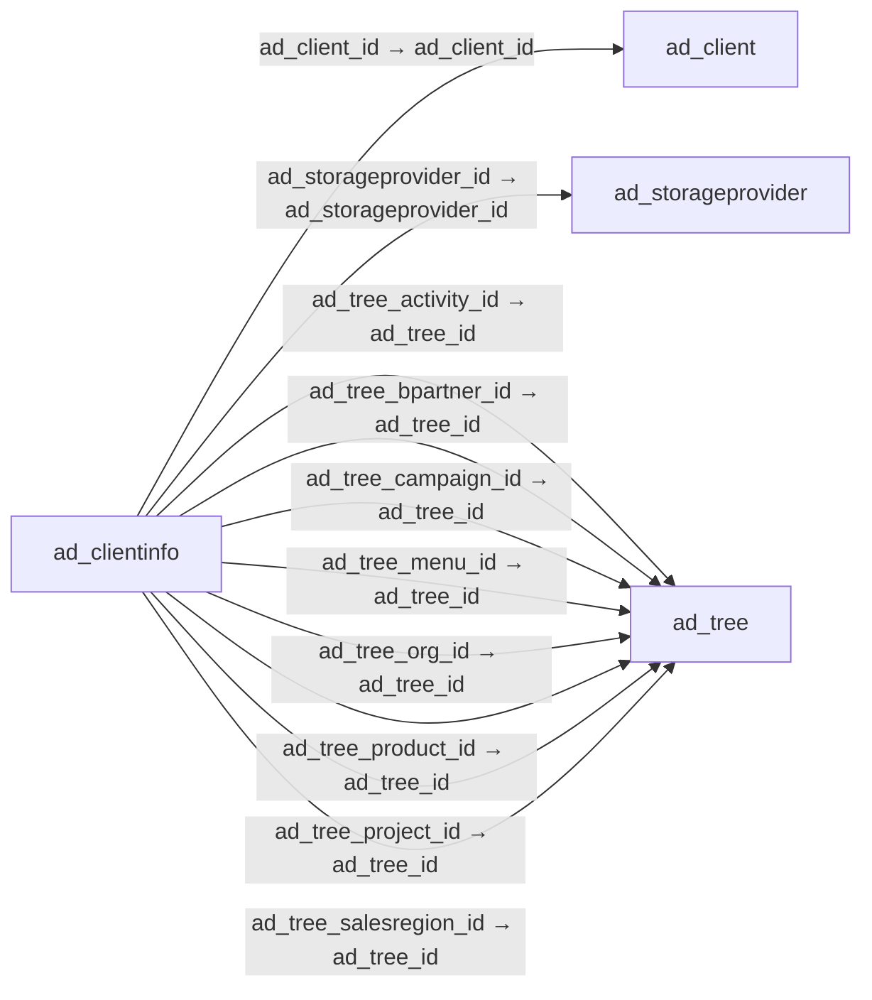

# ad_clientinfo — 테넌트 상세 설정

[전체 일람](../TABLE_INDEX.md) · [분류 일람](README.md) · [AI 사용 안내](../README.md) · [외래키 읽는 법](../RELATIONSHIPS.md)

## 기본 정보

| 항목 | 내용 |
|---|---|
| 물리명 | `adempiere.ad_clientinfo` |
| 한국어 논리명(문서용 해석) | 테넌트 상세 설정 |
| 원본 논리명 | AD_ClientInfo |
| 원본 사전 ID | 227 |
| 분류 | `ad` — 애플리케이션 사전·화면·권한·시스템 |
| 전체 테넌트 행 수 | 2 |
| 물리 열 수 | 37 |
| 나가는 FK / 들어오는 FK | 24 / 0 |
| 구조·행 수 확인 시점 | 2026-11-03T23:29:01+09:00 |

## 의미와 쓰임

테넌트의 회계 스키마·달력·단위·업무 트리·저장소 등 공통 설정을 관리한다.

- 설명 근거: 물리명·열·외래키 구조를 근거로 보수적으로 해석.
- 한국어 이름과 개요는 문서용 해석입니다. 공식 한국어 번역으로 간주하지 않습니다.
- 원본 설명: —
- 원본 도움말: —
- PostgreSQL 테이블 주석: —

## 키와 열

### 기본키·고유 제약조건

| 종류 | 제약조건 | 열(순서 유지) |
|---|---|---|
| PRIMARY KEY | `ad_clientinfo_pkey` | `ad_client_id` |
| UNIQUE | `ad_clientinfo_uu_idx` | `ad_clientinfo_uu` |

### 열 목록

원본 논리명·설명은 `AD_Column`에서 가져왔습니다. 기본값은 실제 PostgreSQL 메타데이터이며, 비어 있는 항목은 `—`로 표시합니다.

| 순서 | 물리명 | 원본 논리명 | PostgreSQL 타입 | NULL | PK | 기본값 | 설명 |
|---:|---|---|---|---|---|---|---|
| 1 | `ad_client_id` | Tenant | numeric(10,0) | 불가 | 예 | — | Tenant for this installation. |
| 2 | `ad_org_id` | Organization | numeric(10,0) | 불가 | — | — | Organizational entity within tenant |
| 3 | `isactive` | Active | character(1) | 불가 | — | 'Y'::bpchar | The record is active in the system |
| 4 | `created` | Created | timestamp without time zone | 불가 | — | now() | Date this record was created |
| 5 | `createdby` | Created By | numeric(10,0) | 불가 | — | — | User who created this records |
| 6 | `updated` | Updated | timestamp without time zone | 불가 | — | now() | Date this record was updated |
| 7 | `updatedby` | Updated By | numeric(10,0) | 불가 | — | — | User who updated this records |
| 8 | `isdiscountlineamt` | Discount calculated from Line Amounts | character(1) | 불가 | — | 'Y'::bpchar | Payment Discount calculation does not include Taxes and Charges |
| 9 | `c_calendar_id` | Calendar | numeric(10,0) | 허용 | — | — | Accounting Calendar Name |
| 10 | `c_acctschema1_id` | Primary Accounting Schema | numeric(10,0) | 허용 | — | — | Primary rules for accounting |
| 11 | `c_uom_volume_id` | UOM for Volume | numeric(10,0) | 허용 | — | — | Standard Unit of Measure for Volume |
| 12 | `c_uom_weight_id` | UOM for Weight | numeric(10,0) | 허용 | — | — | Standard Unit of Measure for Weight |
| 13 | `c_uom_length_id` | UOM for Length | numeric(10,0) | 허용 | — | — | Standard Unit of Measure for Length |
| 14 | `c_uom_time_id` | UOM for Time | numeric(10,0) | 허용 | — | — | Standard Unit of Measure for Time |
| 15 | `ad_tree_menu_id` | Menu Tree | numeric(10,0) | 허용 | — | — | Tree of the menu |
| 16 | `ad_tree_org_id` | Organization Tree | numeric(10,0) | 허용 | — | — | Trees are used for (financial) reporting and security access (via role) |
| 17 | `ad_tree_bpartner_id` | BPartner Tree | numeric(10,0) | 허용 | — | — | Trees are used for (financial) reporting |
| 18 | `ad_tree_project_id` | Project Tree | numeric(10,0) | 허용 | — | — | Trees are used for (financial) reporting |
| 19 | `ad_tree_salesregion_id` | Sales Region Tree | numeric(10,0) | 허용 | — | — | Trees are used for (financial) reporting |
| 20 | `ad_tree_product_id` | Product Tree | numeric(10,0) | 허용 | — | — | Trees are used for (financial) reporting |
| 21 | `m_productfreight_id` | Product for Freight | numeric(10,0) | 허용 | — | — | — |
| 22 | `c_bpartnercashtrx_id` | Template B.Partner | numeric(10,0) | 허용 | — | — | Business Partner used for creating new Business Partners on the fly |
| 23 | `keeplogdays` | Days to keep Log | numeric(10,0) | 허용 | — | — | Number of days to keep the log entries |
| 24 | `ad_tree_activity_id` | Activity Tree | numeric(10,0) | 허용 | — | — | Trees are used for (financial) reporting |
| 25 | `ad_tree_campaign_id` | Campaign Tree | numeric(10,0) | 허용 | — | — | Trees are used for (financial) reporting |
| 26 | `logo_id` | Logo | numeric(10,0) | 허용 | — | NULL::numeric | — |
| 27 | `logoreport_id` | Logo Report | numeric(10,0) | 허용 | — | NULL::numeric | — |
| 28 | `logoweb_id` | Logo Web | numeric(10,0) | 허용 | — | NULL::numeric | — |
| 29 | `ad_clientinfo_uu` | AD_ClientInfo_UU | uuid | 허용 | — | — | — |
| 30 | `ad_storageprovider_id` | Storage Provider | numeric(10,0) | 허용 | — | NULL::numeric | — |
| 31 | `storagearchive_id` | Archive Store | numeric(10,0) | 허용 | — | NULL::numeric | — |
| 32 | `c_chargefreight_id` | Charge for Freight | numeric(10,0) | 허용 | — | NULL::numeric | — |
| 33 | `fy_startdate` | Financial Year Start Date | timestamp without time zone | 허용 | — | — | — |
| 34 | `isconfirmondocclose` | Show Confirmation On Document Action Close | character(1) | 불가 | — | 'N'::bpchar | — |
| 35 | `isconfirmondocvoid` | Show Confirmation On Document Action Void | character(1) | 불가 | — | 'N'::bpchar | — |
| 36 | `storageimage_id` | Image Store | numeric(10,0) | 허용 | — | NULL::numeric | Storage provider for Image |
| 37 | `timezone` | Time Zone | character varying(60) | 허용 | — | NULL::character varying | Time zone name |

## 외래키 흐름

화살표는 **FK를 가진 자식 → 참조되는 부모**입니다. 업무 처리의 시간 순서나 무조건적인 1:N 관계를 뜻하지 않습니다.

주변 관계 24개 중 10개를 그림으로 표시합니다. **전체 관계는 아래 두 표에 모두 포함**합니다.

### 이 테이블이 참조하는 부모 — 나가는 FK

| 제약조건 | 참조하는 쪽(자식) | 자식 열 | 참조받는 쪽(부모) | 부모 열 | 삭제 / 갱신 | 검증 / 지연 가능 |
|---|---|---|---|---|---|---|
| `adclient_adclientinfo` <!-- FK_OUT: adempiere.ad_clientinfo.adclient_adclientinfo --> | [`ad_clientinfo`](ad_clientinfo.md) | `ad_client_id` | [`ad_client`](ad_client.md) | `ad_client_id` | CASCADE / NO ACTION | 완료 / 가능 (초기 지연) |
| `adstorageprovider_adclientinfo` <!-- FK_OUT: adempiere.ad_clientinfo.adstorageprovider_adclientinfo --> | [`ad_clientinfo`](ad_clientinfo.md) | `ad_storageprovider_id` | [`ad_storageprovider`](ad_storageprovider.md) | `ad_storageprovider_id` | NO ACTION / NO ACTION | 완료 / 가능 (초기 지연) |
| `adtreeactivity_adclientinfo` <!-- FK_OUT: adempiere.ad_clientinfo.adtreeactivity_adclientinfo --> | [`ad_clientinfo`](ad_clientinfo.md) | `ad_tree_activity_id` | [`ad_tree`](ad_tree.md) | `ad_tree_id` | NO ACTION / NO ACTION | 완료 / 가능 (초기 지연) |
| `adtreebpartner_adclientinfo` <!-- FK_OUT: adempiere.ad_clientinfo.adtreebpartner_adclientinfo --> | [`ad_clientinfo`](ad_clientinfo.md) | `ad_tree_bpartner_id` | [`ad_tree`](ad_tree.md) | `ad_tree_id` | NO ACTION / NO ACTION | 완료 / 가능 (초기 지연) |
| `adtreecampaign_adclientinfo` <!-- FK_OUT: adempiere.ad_clientinfo.adtreecampaign_adclientinfo --> | [`ad_clientinfo`](ad_clientinfo.md) | `ad_tree_campaign_id` | [`ad_tree`](ad_tree.md) | `ad_tree_id` | NO ACTION / NO ACTION | 완료 / 가능 (초기 지연) |
| `adtreemenu_adclientinfo` <!-- FK_OUT: adempiere.ad_clientinfo.adtreemenu_adclientinfo --> | [`ad_clientinfo`](ad_clientinfo.md) | `ad_tree_menu_id` | [`ad_tree`](ad_tree.md) | `ad_tree_id` | NO ACTION / NO ACTION | 완료 / 가능 (초기 지연) |
| `adtreeorg_adclientinfo` <!-- FK_OUT: adempiere.ad_clientinfo.adtreeorg_adclientinfo --> | [`ad_clientinfo`](ad_clientinfo.md) | `ad_tree_org_id` | [`ad_tree`](ad_tree.md) | `ad_tree_id` | NO ACTION / NO ACTION | 완료 / 가능 (초기 지연) |
| `adtreeproduct_adclientinfo` <!-- FK_OUT: adempiere.ad_clientinfo.adtreeproduct_adclientinfo --> | [`ad_clientinfo`](ad_clientinfo.md) | `ad_tree_product_id` | [`ad_tree`](ad_tree.md) | `ad_tree_id` | NO ACTION / NO ACTION | 완료 / 가능 (초기 지연) |
| `adtreeproject_adclientinfo` <!-- FK_OUT: adempiere.ad_clientinfo.adtreeproject_adclientinfo --> | [`ad_clientinfo`](ad_clientinfo.md) | `ad_tree_project_id` | [`ad_tree`](ad_tree.md) | `ad_tree_id` | NO ACTION / NO ACTION | 완료 / 가능 (초기 지연) |
| `adtreesalesreg_adclientinfo` <!-- FK_OUT: adempiere.ad_clientinfo.adtreesalesreg_adclientinfo --> | [`ad_clientinfo`](ad_clientinfo.md) | `ad_tree_salesregion_id` | [`ad_tree`](ad_tree.md) | `ad_tree_id` | NO ACTION / NO ACTION | 완료 / 가능 (초기 지연) |
| `c_uom_length_ad_clientinfo` <!-- FK_OUT: adempiere.ad_clientinfo.c_uom_length_ad_clientinfo --> | [`ad_clientinfo`](ad_clientinfo.md) | `c_uom_length_id` | [`c_uom`](../c/c_uom.md) | `c_uom_id` | NO ACTION / NO ACTION | 완료 / 가능 (초기 지연) |
| `c_uom_time_ad_clientinfo` <!-- FK_OUT: adempiere.ad_clientinfo.c_uom_time_ad_clientinfo --> | [`ad_clientinfo`](ad_clientinfo.md) | `c_uom_time_id` | [`c_uom`](../c/c_uom.md) | `c_uom_id` | NO ACTION / NO ACTION | 완료 / 가능 (초기 지연) |
| `c_uom_volume_ad_clientinfo` <!-- FK_OUT: adempiere.ad_clientinfo.c_uom_volume_ad_clientinfo --> | [`ad_clientinfo`](ad_clientinfo.md) | `c_uom_volume_id` | [`c_uom`](../c/c_uom.md) | `c_uom_id` | NO ACTION / NO ACTION | 완료 / 가능 (초기 지연) |
| `c_uom_weight_ad_clientinfo` <!-- FK_OUT: adempiere.ad_clientinfo.c_uom_weight_ad_clientinfo --> | [`ad_clientinfo`](ad_clientinfo.md) | `c_uom_weight_id` | [`c_uom`](../c/c_uom.md) | `c_uom_id` | NO ACTION / NO ACTION | 완료 / 가능 (초기 지연) |
| `cacctschema1_adclientinfo` <!-- FK_OUT: adempiere.ad_clientinfo.cacctschema1_adclientinfo --> | [`ad_clientinfo`](ad_clientinfo.md) | `c_acctschema1_id` | [`c_acctschema`](../c/c_acctschema.md) | `c_acctschema_id` | NO ACTION / NO ACTION | 완료 / 가능 (초기 지연) |
| `cbpartnercashtrx_adclientinfo` <!-- FK_OUT: adempiere.ad_clientinfo.cbpartnercashtrx_adclientinfo --> | [`ad_clientinfo`](ad_clientinfo.md) | `c_bpartnercashtrx_id` | [`c_bpartner`](../c/c_bpartner.md) | `c_bpartner_id` | NO ACTION / NO ACTION | 완료 / 가능 (초기 지연) |
| `ccalendar_adclientinfo` <!-- FK_OUT: adempiere.ad_clientinfo.ccalendar_adclientinfo --> | [`ad_clientinfo`](ad_clientinfo.md) | `c_calendar_id` | [`c_calendar`](../c/c_calendar.md) | `c_calendar_id` | NO ACTION / NO ACTION | 완료 / 가능 (초기 지연) |
| `cchargefreight_adclientinfo` <!-- FK_OUT: adempiere.ad_clientinfo.cchargefreight_adclientinfo --> | [`ad_clientinfo`](ad_clientinfo.md) | `c_chargefreight_id` | [`c_charge`](../c/c_charge.md) | `c_charge_id` | NO ACTION / NO ACTION | 완료 / 가능 (초기 지연) |
| `logo_adclientinfo` <!-- FK_OUT: adempiere.ad_clientinfo.logo_adclientinfo --> | [`ad_clientinfo`](ad_clientinfo.md) | `logo_id` | [`ad_image`](ad_image.md) | `ad_image_id` | NO ACTION / NO ACTION | 완료 / 가능 (초기 지연) |
| `logoreport_adclientinfo` <!-- FK_OUT: adempiere.ad_clientinfo.logoreport_adclientinfo --> | [`ad_clientinfo`](ad_clientinfo.md) | `logoreport_id` | [`ad_image`](ad_image.md) | `ad_image_id` | NO ACTION / NO ACTION | 완료 / 가능 (초기 지연) |
| `logoweb_adclientinfo` <!-- FK_OUT: adempiere.ad_clientinfo.logoweb_adclientinfo --> | [`ad_clientinfo`](ad_clientinfo.md) | `logoweb_id` | [`ad_image`](ad_image.md) | `ad_image_id` | NO ACTION / NO ACTION | 완료 / 가능 (초기 지연) |
| `mproductfreight_adclientinfo` <!-- FK_OUT: adempiere.ad_clientinfo.mproductfreight_adclientinfo --> | [`ad_clientinfo`](ad_clientinfo.md) | `m_productfreight_id` | [`m_product`](../m/m_product.md) | `m_product_id` | NO ACTION / NO ACTION | 완료 / 가능 (초기 지연) |
| `storagearchive_adclientinfo` <!-- FK_OUT: adempiere.ad_clientinfo.storagearchive_adclientinfo --> | [`ad_clientinfo`](ad_clientinfo.md) | `storagearchive_id` | [`ad_storageprovider`](ad_storageprovider.md) | `ad_storageprovider_id` | NO ACTION / NO ACTION | 완료 / 가능 (초기 지연) |
| `storageimage_adclientinfo` <!-- FK_OUT: adempiere.ad_clientinfo.storageimage_adclientinfo --> | [`ad_clientinfo`](ad_clientinfo.md) | `storageimage_id` | [`ad_storageprovider`](ad_storageprovider.md) | `ad_storageprovider_id` | NO ACTION / NO ACTION | 완료 / 가능 (초기 지연) |

### 이 테이블을 참조하는 자식 — 들어오는 FK

해당 방향의 물리 FK 제약조건은 없습니다. 이름이 비슷한 열만으로 관계를 추가하지 않습니다.

## 조회 시 주의

- FK 표의 자식 열과 부모 열을 같은 순서로 대응시킵니다. 복합 FK는 모든 열의 동등 조건을 `AND`로 연결합니다.
- 테이블 이름이나 `_id` 열 이름만으로 물리 FK가 있다고 가정하지 않습니다. FK 미선언은 업무 관계가 없다는 뜻도 아닙니다.
- 자식이 여러 행인 테이블과 조인하면 부모의 금액·건수가 중복될 수 있습니다. 집계 단위를 먼저 정합니다.
- `ad_client_id`가 있습니다. 업무 분석에서는 대상 테넌트를 명시합니다. GardenWorld는 `11`, 시스템 공통 설정은 `0`일 수 있으므로 일괄 필터 적용 전에 테이블 역할을 확인합니다.
- 행 수는 위 확인 시점의 전체 테넌트 값입니다. 최신 업무 실적이나 현재 실행 결과로 재사용하지 않습니다.
