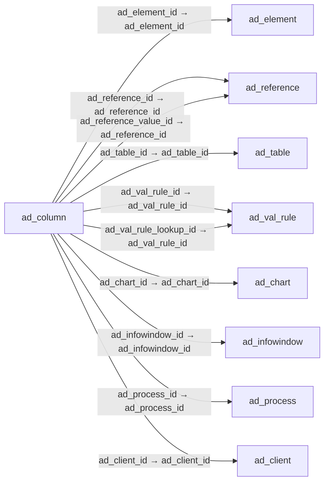

# ad_column — 애플리케이션 사전 열

[전체 일람](../TABLE_INDEX.md) · [분류 일람](README.md) · [AI 사용 안내](../README.md) · [외래키 읽는 법](../RELATIONSHIPS.md)

## 기본 정보

| 항목 | 내용 |
|---|---|
| 물리명 | `adempiere.ad_column` |
| 한국어 논리명(문서용 해석) | 애플리케이션 사전 열 |
| 원본 논리명 | Column |
| 원본 사전 ID | 101 |
| 분류 | `ad` — 애플리케이션 사전·화면·권한·시스템 |
| 전체 테넌트 행 수 | 26,476 |
| 물리 열 수 | 63 |
| 나가는 FK / 들어오는 FK | 14 / 33 |
| 구조·행 수 확인 시점 | 2026-11-03T23:29:01+09:00 |

## 의미와 쓰임

테이블 열에 대한 애플리케이션 사전 정의를 관리한다.

- 설명 근거: 원본 애플리케이션 사전 명칭·설명을 한국어로 해석.
- 한국어 이름과 개요는 문서용 해석입니다. 공식 한국어 번역으로 간주하지 않습니다.
- 원본 설명: Column in the table
- 원본 도움말: —
- PostgreSQL 테이블 주석: —

## 키와 열

### 기본키·고유 제약조건

| 종류 | 제약조건 | 열(순서 유지) |
|---|---|---|
| PRIMARY KEY | `ad_column_pkey` | `ad_column_id` |
| UNIQUE | `ad_column_uu_idx` | `ad_column_uu` |

### 별도 고유 인덱스

PK·UNIQUE 제약조건의 인덱스와 별도로 존재하는 고유 인덱스입니다. 식·조건·열 순서는 원본 정의를 따릅니다.

- `ad_column_fkconstraintname`: `CREATE UNIQUE INDEX ad_column_fkconstraintname ON adempiere.ad_column USING btree (upper((fkconstraintname)::text))`
- `ad_column_name`: `CREATE UNIQUE INDEX ad_column_name ON adempiere.ad_column USING btree (ad_table_id, upper((columnname)::text))`

### 열 목록

원본 논리명·설명은 `AD_Column`에서 가져왔습니다. 기본값은 실제 PostgreSQL 메타데이터이며, 비어 있는 항목은 `—`로 표시합니다.

| 순서 | 물리명 | 원본 논리명 | PostgreSQL 타입 | NULL | PK | 기본값 | 설명 |
|---:|---|---|---|---|---|---|---|
| 1 | `ad_column_id` | Column | numeric(10,0) | 불가 | 예 | — | Column in the table |
| 2 | `ad_client_id` | Tenant | numeric(10,0) | 불가 | — | — | Tenant for this installation. |
| 3 | `ad_org_id` | Organization | numeric(10,0) | 불가 | — | — | Organizational entity within tenant |
| 4 | `isactive` | Active | character(1) | 불가 | — | 'Y'::bpchar | The record is active in the system |
| 5 | `created` | Created | timestamp without time zone | 불가 | — | now() | Date this record was created |
| 6 | `updated` | Updated | timestamp without time zone | 불가 | — | now() | Date this record was updated |
| 7 | `createdby` | Created By | numeric(10,0) | 불가 | — | — | User who created this records |
| 8 | `updatedby` | Updated By | numeric(10,0) | 불가 | — | — | User who updated this records |
| 9 | `name` | Name | character varying(60) | 불가 | — | — | Alphanumeric identifier of the entity |
| 10 | `description` | Description | character varying(255) | 허용 | — | — | Optional short description of the record |
| 11 | `help` | Comment/Help | character varying(2000) | 허용 | — | — | Comment or Hint |
| 12 | `version` | Version | numeric | 불가 | — | — | Version of the table definition |
| 13 | `entitytype` | Entity Type | character varying(40) | 불가 | — | 'D'::character varying | Dictionary Entity Type; Determines ownership and synchronization |
| 14 | `columnname` | DB Column Name | character varying(63) | 불가 | — | — | Name of the column in the database |
| 15 | `ad_table_id` | Table | numeric(10,0) | 불가 | — | — | Database Table information |
| 16 | `ad_reference_id` | Reference | numeric(10,0) | 불가 | — | — | System Reference and Validation |
| 17 | `ad_reference_value_id` | Reference Key | numeric(10,0) | 허용 | — | — | Required to specify, if data type is Table or List |
| 18 | `ad_val_rule_id` | Dynamic Validation | numeric(10,0) | 허용 | — | — | Dynamic Validation Rule |
| 19 | `fieldlength` | Length | numeric(10,0) | 허용 | — | — | Length of the column in the database |
| 20 | `defaultvalue` | Default Logic | character varying(2000) | 허용 | — | — | Default value hierarchy, separated by ; |
| 21 | `iskey` | Key column | character(1) | 불가 | — | 'N'::bpchar | This column is the key in this table |
| 22 | `isparent` | Parent link column | character(1) | 불가 | — | 'N'::bpchar | This column is a link to the parent table (e.g. header from lines) - incl. Association key columns |
| 23 | `ismandatory` | Mandatory | character(1) | 불가 | — | 'N'::bpchar | Data entry is required in this column |
| 24 | `isupdateable` | Updatable | character(1) | 불가 | — | 'Y'::bpchar | Determines, if the field can be updated |
| 25 | `readonlylogic` | Read Only Logic | character varying(2000) | 허용 | — | — | Logic to determine if field is read only (applies only when field is read-write) |
| 26 | `isidentifier` | Identifier | character(1) | 불가 | — | 'N'::bpchar | This column is part of the record identifier |
| 27 | `seqno` | Sequence | numeric(10,0) | 허용 | — | — | Method of ordering records; lowest number comes first |
| 28 | `istranslated` | Translated | character(1) | 불가 | — | 'N'::bpchar | This column is translated |
| 29 | `isencrypted` | Encrypted | character(1) | 불가 | — | 'N'::bpchar | Display or Storage is encrypted |
| 30 | `callout` | Callout | character varying(255) | 허용 | — | — | Fully qualified class names and method - separated by semicolons |
| 31 | `vformat` | Value Format | character varying(255) | 허용 | — | — | Format of the value; Can contain fixed format elements, Variables: "_lLoOaAcCa09", or ~regex |
| 32 | `valuemin` | Min. Value | character varying(20) | 허용 | — | — | Minimum Value for a field |
| 33 | `valuemax` | Max. Value | character varying(20) | 허용 | — | — | Maximum Value for a field |
| 34 | `isselectioncolumn` | Selection Column | character(1) | 불가 | — | 'N'::bpchar | Is this column used for finding rows in windows |
| 35 | `ad_element_id` | System Element | numeric(10,0) | 허용 | — | — | System Element enables the central maintenance of column description and help. |
| 36 | `ad_process_id` | Process | numeric(10,0) | 허용 | — | — | Process or Report |
| 37 | `issyncdatabase` | Synchronize Database | character(1) | 허용 | — | 'N'::bpchar | Change database table definition when changing dictionary definition |
| 38 | `isalwaysupdateable` | Always Updatable | character(1) | 불가 | — | 'N'::bpchar | The column is always updateable, even if the record is not active or processed |
| 39 | `columnsql` | Column SQL | character varying(4000) | 허용 | — | — | Virtual Column (r/o) |
| 40 | `mandatorylogic` | Mandatory Logic | character varying(2000) | 허용 | — | — | — |
| 41 | `infofactoryclass` | Info Factory Class | character varying(255) | 허용 | — | — | Fully qualified class name that implements the InfoFactory interface |
| 42 | `isautocomplete` | Auto complete | character(1) | 불가 | — | 'N'::bpchar | Automatic completion for text fields |
| 43 | `isallowlogging` | Allow Logging | character(1) | 허용 | — | 'Y'::bpchar | Determine if a column must be recorded into the change log |
| 44 | `formatpattern` | Format Pattern | character varying(22) | 허용 | — | — | The pattern used to format a number or date. |
| 45 | `ad_column_uu` | AD_Column_UU | uuid | 허용 | — | — | — |
| 46 | `isallowcopy` | Allow Copy | character(1) | 불가 | — | 'Y'::bpchar | Determine if a column must be copied when pushing the button to copy record |
| 47 | `seqnoselection` | Selection Column Sequence | numeric(10,0) | 허용 | — | NULL::numeric | Selection Column Sequence |
| 48 | `istoolbarbutton` | Toolbar Button | character(1) | 불가 | — | 'Y'::bpchar | Show the button on the toolbar, the window, or both |
| 49 | `issecure` | Secure content | character(1) | 불가 | — | 'N'::bpchar | Defines whether content must be treated as secure |
| 50 | `ad_chart_id` | Chart | numeric(10,0) | 허용 | — | NULL::numeric | — |
| 51 | `fkconstraintname` | Constraint Name | character varying(63) | 허용 | — | — | — |
| 52 | `fkconstrainttype` | Constraint Type | character(1) | 허용 | — | 'N'::bpchar | — |
| 53 | `pa_dashboardcontent_id` | Dashboard Content | numeric(10,0) | 허용 | — | NULL::numeric | — |
| 54 | `placeholder` | Placeholder | character varying(255) | 허용 | — | NULL::character varying | — |
| 55 | `ishtml` | HTML | character(1) | 허용 | — | 'N'::bpchar | Text has HTML tags |
| 56 | `ad_val_rule_lookup_id` | Dynamic Validation (Lookup) | numeric(10,0) | 허용 | — | NULL::numeric | Override Dynamic Validation Rule for Lookup Window |
| 57 | `ad_infowindow_id` | Info Window | numeric(10,0) | 허용 | — | — | Info and search/select Window |
| 58 | `alwaysupdatablelogic` | Always Updatable Logic | character varying(2000) | 허용 | — | NULL::character varying | Logic to determine if field is Updatable irrespective if record's active status or processed status. This logic Applicable only if Always Updatable is N. |
| 59 | `fkconstraintmsg_id` | Constraint Message | numeric(10,0) | 허용 | — | NULL::numeric | — |
| 60 | `partitioningmethod` | Partitioning Method | character varying(2) | 허용 | — | NULL::character varying | Indicates how the Table is partitioned |
| 61 | `ispartitionkey` | Partition Key | character(1) | 불가 | — | 'N'::bpchar | This is a partition key |
| 62 | `seqnopartition` | Partition Key Sequence | numeric(10,0) | 허용 | — | NULL::numeric | Indicates the order of partition keys |
| 63 | `rangepartitioninterval` | Range Partition Interval | character varying(30) | 허용 | — | NULL::character varying | Indicates the interval used in a range partitioning |

## 외래키 흐름

화살표는 **FK를 가진 자식 → 참조되는 부모**입니다. 업무 처리의 시간 순서나 무조건적인 1:N 관계를 뜻하지 않습니다.

주변 관계 47개 중 10개를 그림으로 표시합니다. **전체 관계는 아래 두 표에 모두 포함**합니다.

### 이 테이블이 참조하는 부모 — 나가는 FK

| 제약조건 | 참조하는 쪽(자식) | 자식 열 | 참조받는 쪽(부모) | 부모 열 | 삭제 / 갱신 | 검증 / 지연 가능 |
|---|---|---|---|---|---|---|
| `ad_element_ad_column` <!-- FK_OUT: adempiere.ad_column.ad_element_ad_column --> | [`ad_column`](ad_column.md) | `ad_element_id` | [`ad_element`](ad_element.md) | `ad_element_id` | NO ACTION / NO ACTION | 완료 / 가능 (초기 지연) |
| `ad_reference_columndatatype` <!-- FK_OUT: adempiere.ad_column.ad_reference_columndatatype --> | [`ad_column`](ad_column.md) | `ad_reference_id` | [`ad_reference`](ad_reference.md) | `ad_reference_id` | NO ACTION / NO ACTION | 완료 / 가능 (초기 지연) |
| `ad_reference_columnvalue` <!-- FK_OUT: adempiere.ad_column.ad_reference_columnvalue --> | [`ad_column`](ad_column.md) | `ad_reference_value_id` | [`ad_reference`](ad_reference.md) | `ad_reference_id` | NO ACTION / NO ACTION | 완료 / 가능 (초기 지연) |
| `ad_table_column` <!-- FK_OUT: adempiere.ad_column.ad_table_column --> | [`ad_column`](ad_column.md) | `ad_table_id` | [`ad_table`](ad_table.md) | `ad_table_id` | CASCADE / NO ACTION | 완료 / 가능 (초기 지연) |
| `ad_valrule_column` <!-- FK_OUT: adempiere.ad_column.ad_valrule_column --> | [`ad_column`](ad_column.md) | `ad_val_rule_id` | [`ad_val_rule`](ad_val_rule.md) | `ad_val_rule_id` | NO ACTION / NO ACTION | 완료 / 가능 (초기 지연) |
| `adchart_adcolumn` <!-- FK_OUT: adempiere.ad_column.adchart_adcolumn --> | [`ad_column`](ad_column.md) | `ad_chart_id` | [`ad_chart`](ad_chart.md) | `ad_chart_id` | NO ACTION / NO ACTION | 완료 / 가능 (초기 지연) |
| `adinfowindow_adcolumn` <!-- FK_OUT: adempiere.ad_column.adinfowindow_adcolumn --> | [`ad_column`](ad_column.md) | `ad_infowindow_id` | [`ad_infowindow`](ad_infowindow.md) | `ad_infowindow_id` | SET NULL / NO ACTION | 완료 / 가능 (초기 지연) |
| `adprocess_adcolumn` <!-- FK_OUT: adempiere.ad_column.adprocess_adcolumn --> | [`ad_column`](ad_column.md) | `ad_process_id` | [`ad_process`](ad_process.md) | `ad_process_id` | SET NULL / NO ACTION | 완료 / 가능 (초기 지연) |
| `advalrulelookup_adcolumn` <!-- FK_OUT: adempiere.ad_column.advalrulelookup_adcolumn --> | [`ad_column`](ad_column.md) | `ad_val_rule_lookup_id` | [`ad_val_rule`](ad_val_rule.md) | `ad_val_rule_id` | NO ACTION / NO ACTION | 완료 / 가능 (초기 지연) |
| `columnclient` <!-- FK_OUT: adempiere.ad_column.columnclient --> | [`ad_column`](ad_column.md) | `ad_client_id` | [`ad_client`](ad_client.md) | `ad_client_id` | NO ACTION / NO ACTION | 완료 / 가능 (초기 지연) |
| `columnorg` <!-- FK_OUT: adempiere.ad_column.columnorg --> | [`ad_column`](ad_column.md) | `ad_org_id` | [`ad_org`](ad_org.md) | `ad_org_id` | NO ACTION / NO ACTION | 완료 / 가능 (초기 지연) |
| `entityt_adcolumn` <!-- FK_OUT: adempiere.ad_column.entityt_adcolumn --> | [`ad_column`](ad_column.md) | `entitytype` | [`ad_entitytype`](ad_entitytype.md) | `entitytype` | NO ACTION / NO ACTION | 완료 / 가능 (초기 지연) |
| `fkconstraintmsg_adcolumn` <!-- FK_OUT: adempiere.ad_column.fkconstraintmsg_adcolumn --> | [`ad_column`](ad_column.md) | `fkconstraintmsg_id` | [`ad_message`](ad_message.md) | `ad_message_id` | NO ACTION / NO ACTION | 완료 / 가능 (초기 지연) |
| `padashboardcontent_adcolumn` <!-- FK_OUT: adempiere.ad_column.padashboardcontent_adcolumn --> | [`ad_column`](ad_column.md) | `pa_dashboardcontent_id` | [`pa_dashboardcontent`](../pa/pa_dashboardcontent.md) | `pa_dashboardcontent_id` | NO ACTION / NO ACTION | 완료 / 가능 (초기 지연) |

### 이 테이블을 참조하는 자식 — 들어오는 FK

| 제약조건 | 참조하는 쪽(자식) | 자식 열 | 참조받는 쪽(부모) | 부모 열 | 삭제 / 갱신 | 검증 / 지연 가능 |
|---|---|---|---|---|---|---|
| `adcolumn_adaccesslog` <!-- FK_IN: adempiere.ad_accesslog.adcolumn_adaccesslog --> | [`ad_accesslog`](ad_accesslog.md) | `ad_column_id` | [`ad_column`](ad_column.md) | `ad_column_id` | CASCADE / NO ACTION | 완료 / 가능 (초기 지연) |
| `adcolumn_adchangelog` <!-- FK_IN: adempiere.ad_changelog.adcolumn_adchangelog --> | [`ad_changelog`](ad_changelog.md) | `ad_column_id` | [`ad_column`](ad_column.md) | `ad_column_id` | CASCADE / NO ACTION | 완료 / 가능 (초기 지연) |
| `adcolumn_adcolumnaccess` <!-- FK_IN: adempiere.ad_column_access.adcolumn_adcolumnaccess --> | [`ad_column_access`](ad_column_access.md) | `ad_column_id` | [`ad_column`](ad_column.md) | `ad_column_id` | NO ACTION / NO ACTION | 완료 / 가능 (초기 지연) |
| `adcolumn_adcolumntrl` <!-- FK_IN: adempiere.ad_column_trl.adcolumn_adcolumntrl --> | [`ad_column_trl`](ad_column_trl.md) | `ad_column_id` | [`ad_column`](ad_column.md) | `ad_column_id` | CASCADE / NO ACTION | 완료 / 가능 (초기 지연) |
| `ad_column_field` <!-- FK_IN: adempiere.ad_field.ad_column_field --> | [`ad_field`](ad_field.md) | `ad_column_id` | [`ad_column`](ad_column.md) | `ad_column_id` | NO ACTION / NO ACTION | 완료 / 가능 (초기 지연) |
| `adcolumn_adfind` <!-- FK_IN: adempiere.ad_find.adcolumn_adfind --> | [`ad_find`](ad_find.md) | `ad_column_id` | [`ad_column`](ad_column.md) | `ad_column_id` | NO ACTION / NO ACTION | 완료 / 가능 (초기 지연) |
| `adcolumn_adimpformatrow` <!-- FK_IN: adempiere.ad_impformat_row.adcolumn_adimpformatrow --> | [`ad_impformat_row`](ad_impformat_row.md) | `ad_column_id` | [`ad_column`](ad_column.md) | `ad_column_id` | NO ACTION / NO ACTION | 완료 / 가능 (초기 지연) |
| `adcolumn_adindexcolumn` <!-- FK_IN: adempiere.ad_indexcolumn.adcolumn_adindexcolumn --> | [`ad_indexcolumn`](ad_indexcolumn.md) | `ad_column_id` | [`ad_column`](ad_column.md) | `ad_column_id` | NO ACTION / NO ACTION | 완료 / 가능 (초기 지연) |
| `adcolumn_adpackageimpbackup` <!-- FK_IN: adempiere.ad_package_imp_backup.adcolumn_adpackageimpbackup --> | [`ad_package_imp_backup`](ad_package_imp_backup.md) | `ad_column_id` | [`ad_column`](ad_column.md) | `ad_column_id` | NO ACTION / NO ACTION | 완료 / 가능 (초기 지연) |
| `adcolumn_adprintformatitem` <!-- FK_IN: adempiere.ad_printformatitem.adcolumn_adprintformatitem --> | [`ad_printformatitem`](ad_printformatitem.md) | `ad_column_id` | [`ad_column`](ad_column.md) | `ad_column_id` | NO ACTION / NO ACTION | 완료 / 가능 (초기 지연) |
| `adcolumn_adprintlabelline` <!-- FK_IN: adempiere.ad_printlabelline.adcolumn_adprintlabelline --> | [`ad_printlabelline`](ad_printlabelline.md) | `ad_column_id` | [`ad_column`](ad_column.md) | `ad_column_id` | NO ACTION / NO ACTION | 완료 / 가능 (초기 지연) |
| `ad_column_reftable_display` <!-- FK_IN: adempiere.ad_ref_table.ad_column_reftable_display --> | [`ad_ref_table`](ad_ref_table.md) | `ad_display` | [`ad_column`](ad_column.md) | `ad_column_id` | NO ACTION / NO ACTION | 완료 / 가능 (초기 지연) |
| `ad_column_reftable_id` <!-- FK_IN: adempiere.ad_ref_table.ad_column_reftable_id --> | [`ad_ref_table`](ad_ref_table.md) | `ad_key` | [`ad_column`](ad_column.md) | `ad_column_id` | NO ACTION / NO ACTION | 완료 / 가능 (초기 지연) |
| `adcolumn_adreportviewcol` <!-- FK_IN: adempiere.ad_reportview_col.adcolumn_adreportviewcol --> | [`ad_reportview_col`](ad_reportview_col.md) | `ad_column_id` | [`ad_column`](ad_column.md) | `ad_column_id` | NO ACTION / NO ACTION | 완료 / 가능 (초기 지연) |
| `adcolumn_adreportviewcolumn` <!-- FK_IN: adempiere.ad_reportview_column.adcolumn_adreportviewcolumn --> | [`ad_reportview_column`](ad_reportview_column.md) | `ad_column_id` | [`ad_column`](ad_column.md) | `ad_column_id` | NO ACTION / NO ACTION | 완료 / 가능 (초기 지연) |
| `adcolumn_adsearchdefinition` <!-- FK_IN: adempiere.ad_searchdefinition.adcolumn_adsearchdefinition --> | [`ad_searchdefinition`](ad_searchdefinition.md) | `ad_column_id` | [`ad_column`](ad_column.md) | `ad_column_id` | NO ACTION / NO ACTION | 완료 / 가능 (초기 지연) |
| `ad_column_ad_tab` <!-- FK_IN: adempiere.ad_tab.ad_column_ad_tab --> | [`ad_tab`](ad_tab.md) | `ad_column_id` | [`ad_column`](ad_column.md) | `ad_column_id` | NO ACTION / NO ACTION | 완료 / 가능 (초기 지연) |
| `adcolumn_adtabsortorder` <!-- FK_IN: adempiere.ad_tab.adcolumn_adtabsortorder --> | [`ad_tab`](ad_tab.md) | `ad_columnsortorder_id` | [`ad_column`](ad_column.md) | `ad_column_id` | NO ACTION / NO ACTION | 완료 / 가능 (초기 지연) |
| `adcolumn_adtabsortyesno` <!-- FK_IN: adempiere.ad_tab.adcolumn_adtabsortyesno --> | [`ad_tab`](ad_tab.md) | `ad_columnsortyesno_id` | [`ad_column`](ad_column.md) | `ad_column_id` | NO ACTION / NO ACTION | 완료 / 가능 (초기 지연) |
| `parentcolumn_adtab` <!-- FK_IN: adempiere.ad_tab.parentcolumn_adtab --> | [`ad_tab`](ad_tab.md) | `parent_column_id` | [`ad_column`](ad_column.md) | `ad_column_id` | NO ACTION / NO ACTION | 완료 / 가능 (초기 지연) |
| `adcolumn_adtablepartition` <!-- FK_IN: adempiere.ad_tablepartition.adcolumn_adtablepartition --> | [`ad_tablepartition`](ad_tablepartition.md) | `ad_column_id` | [`ad_column`](ad_column.md) | `ad_column_id` | NO ACTION / NO ACTION | 완료 / 가능 (초기 지연) |
| `parentcolumn_adtree` <!-- FK_IN: adempiere.ad_tree.parentcolumn_adtree --> | [`ad_tree`](ad_tree.md) | `parent_column_id` | [`ad_column`](ad_column.md) | `ad_column_id` | NO ACTION / NO ACTION | 완료 / 가능 (초기 지연) |
| `adcolumn_adverifymigration` <!-- FK_IN: adempiere.ad_verifymigration.adcolumn_adverifymigration --> | [`ad_verifymigration`](ad_verifymigration.md) | `ad_column_id` | [`ad_column`](ad_column.md) | `ad_column_id` | NO ACTION / NO ACTION | 완료 / 가능 (초기 지연) |
| `adcolumn_adwfnextcondition` <!-- FK_IN: adempiere.ad_wf_nextcondition.adcolumn_adwfnextcondition --> | [`ad_wf_nextcondition`](ad_wf_nextcondition.md) | `ad_column_id` | [`ad_column`](ad_column.md) | `ad_column_id` | NO ACTION / NO ACTION | 완료 / 가능 (초기 지연) |
| `adcolumn_adwfnode` <!-- FK_IN: adempiere.ad_wf_node.adcolumn_adwfnode --> | [`ad_wf_node`](ad_wf_node.md) | `ad_column_id` | [`ad_column`](ad_column.md) | `ad_column_id` | NO ACTION / NO ACTION | 완료 / 가능 (초기 지연) |
| `adcolumn_adworkbench` <!-- FK_IN: adempiere.ad_workbench.adcolumn_adworkbench --> | [`ad_workbench`](ad_workbench.md) | `ad_column_id` | [`ad_column`](ad_column.md) | `ad_column_id` | NO ACTION / NO ACTION | 완료 / 가능 (초기 지연) |
| `adcolumn2_cacctschemaelement` <!-- FK_IN: adempiere.c_acctschema_element.adcolumn2_cacctschemaelement --> | [`c_acctschema_element`](../c/c_acctschema_element.md) | `ad_column2_id` | [`ad_column`](ad_column.md) | `ad_column_id` | NO ACTION / NO ACTION | 완료 / 가능 (초기 지연) |
| `adcolumn_cacctschemaelement` <!-- FK_IN: adempiere.c_acctschema_element.adcolumn_cacctschemaelement --> | [`c_acctschema_element`](../c/c_acctschema_element.md) | `ad_column_id` | [`ad_column`](ad_column.md) | `ad_column_id` | NO ACTION / NO ACTION | 완료 / 가능 (초기 지연) |
| `adcolumn_expformatline` <!-- FK_IN: adempiere.exp_formatline.adcolumn_expformatline --> | [`exp_formatline`](../exp/exp_formatline.md) | `ad_column_id` | [`ad_column`](ad_column.md) | `ad_column_id` | NO ACTION / NO ACTION | 완료 / 가능 (초기 지연) |
| `adcolumn_ielementvalue` <!-- FK_IN: adempiere.i_elementvalue.adcolumn_ielementvalue --> | [`i_elementvalue`](../i/i_elementvalue.md) | `ad_column_id` | [`ad_column`](ad_column.md) | `ad_column_id` | SET NULL / NO ACTION | 완료 / 가능 (초기 지연) |
| `adcolumn_ppordernode` <!-- FK_IN: adempiere.pp_order_node.adcolumn_ppordernode --> | [`pp_order_node`](../pp/pp_order_node.md) | `ad_column_id` | [`ad_column`](ad_column.md) | `ad_column_id` | NO ACTION / NO ACTION | 완료 / 가능 (초기 지연) |
| `adcolumn_wswebservicefieldinpu` <!-- FK_IN: adempiere.ws_webservicefieldinput.adcolumn_wswebservicefieldinpu --> | [`ws_webservicefieldinput`](../ws/ws_webservicefieldinput.md) | `ad_column_id` | [`ad_column`](ad_column.md) | `ad_column_id` | NO ACTION / NO ACTION | 완료 / 가능 (초기 지연) |
| `adcolumn_wswebservicefieldoutp` <!-- FK_IN: adempiere.ws_webservicefieldoutput.adcolumn_wswebservicefieldoutp --> | [`ws_webservicefieldoutput`](../ws/ws_webservicefieldoutput.md) | `ad_column_id` | [`ad_column`](ad_column.md) | `ad_column_id` | NO ACTION / NO ACTION | 완료 / 가능 (초기 지연) |

## 조회 시 주의

- FK 표의 자식 열과 부모 열을 같은 순서로 대응시킵니다. 복합 FK는 모든 열의 동등 조건을 `AND`로 연결합니다.
- 테이블 이름이나 `_id` 열 이름만으로 물리 FK가 있다고 가정하지 않습니다. FK 미선언은 업무 관계가 없다는 뜻도 아닙니다.
- 자식이 여러 행인 테이블과 조인하면 부모의 금액·건수가 중복될 수 있습니다. 집계 단위를 먼저 정합니다.
- `ad_client_id`가 있습니다. 업무 분석에서는 대상 테넌트를 명시합니다. GardenWorld는 `11`, 시스템 공통 설정은 `0`일 수 있으므로 일괄 필터 적용 전에 테이블 역할을 확인합니다.
- 행 수는 위 확인 시점의 전체 테넌트 값입니다. 최신 업무 실적이나 현재 실행 결과로 재사용하지 않습니다.
