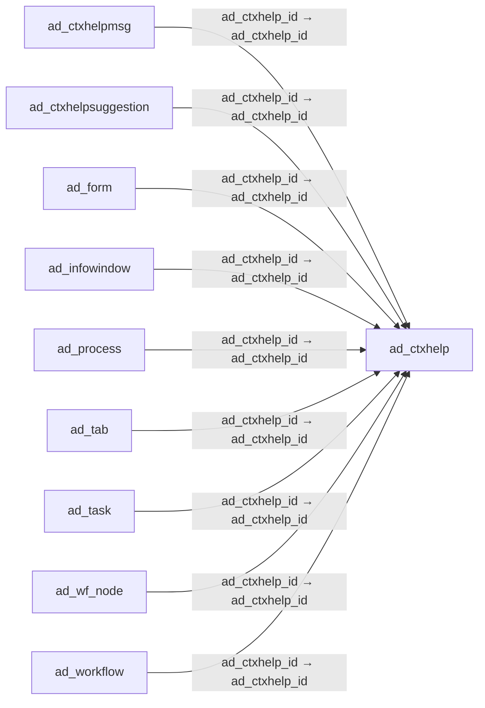

# ad_ctxhelp — 화면별 도움말 연결

[전체 일람](../TABLE_INDEX.md) · [분류 일람](README.md) · [AI 사용 안내](../README.md) · [외래키 읽는 법](../RELATIONSHIPS.md)

## 기본 정보

| 항목 | 내용 |
|---|---|
| 물리명 | `adempiere.ad_ctxhelp` |
| 한국어 논리명(문서용 해석) | 화면별 도움말 연결 |
| 원본 논리명 | Context Help |
| 원본 사전 ID | 200063 |
| 분류 | `ad` — 애플리케이션 사전·화면·권한·시스템 |
| 전체 테넌트 행 수 | 1 |
| 물리 열 수 | 19 |
| 나가는 FK / 들어오는 FK | 0 / 9 |
| 구조·행 수 확인 시점 | 2026-11-03T23:29:01+09:00 |

## 의미와 쓰임

탭·프로세스·폼 등 화면 구성요소에 문맥 도움말을 연결한다.

- 설명 근거: 물리명·열·외래키 구조를 근거로 보수적으로 해석.
- 한국어 이름과 개요는 문서용 해석입니다. 공식 한국어 번역으로 간주하지 않습니다.
- 원본 설명: —
- 원본 도움말: —
- PostgreSQL 테이블 주석: —

## 키와 열

### 기본키·고유 제약조건

| 종류 | 제약조건 | 열(순서 유지) |
|---|---|---|
| PRIMARY KEY | `ad_ctxhelp_key` | `ad_ctxhelp_id` |
| UNIQUE | `ad_ctxhelp_uu_idx` | `ad_ctxhelp_uu` |

### 열 목록

원본 논리명·설명은 `AD_Column`에서 가져왔습니다. 기본값은 실제 PostgreSQL 메타데이터이며, 비어 있는 항목은 `—`로 표시합니다.

| 순서 | 물리명 | 원본 논리명 | PostgreSQL 타입 | NULL | PK | 기본값 | 설명 |
|---:|---|---|---|---|---|---|---|
| 1 | `ad_client_id` | Tenant | numeric(10,0) | 불가 | — | — | Tenant for this installation. |
| 2 | `ad_ctxhelp_id` | Context Help | numeric(10,0) | 불가 | 예 | — | — |
| 3 | `ad_ctxhelp_uu` | AD_CtxHelp_UU | uuid | 허용 | — | — | — |
| 4 | `ad_form_id` | — | numeric(10,0) | 허용 | — | NULL::numeric | — |
| 5 | `ad_org_id` | Organization | numeric(10,0) | 불가 | — | — | Organizational entity within tenant |
| 6 | `ad_process_id` | — | numeric(10,0) | 허용 | — | NULL::numeric | — |
| 7 | `ad_tab_id` | — | numeric(10,0) | 허용 | — | NULL::numeric | — |
| 8 | `created` | Created | timestamp without time zone | 불가 | — | statement_timestamp() | Date this record was created |
| 9 | `createdby` | Created By | numeric(10,0) | 불가 | — | — | User who created this records |
| 10 | `ctxtype` | Context Type | character(1) | 허용 | — | — | Type of Context Help |
| 11 | `description` | Description | character varying(255) | 허용 | — | NULL::character varying | Optional short description of the record |
| 12 | `isactive` | Active | character(1) | 불가 | — | 'Y'::bpchar | The record is active in the system |
| 13 | `name` | Name | character varying(120) | 불가 | — | — | Alphanumeric identifier of the entity |
| 14 | `updated` | Updated | timestamp without time zone | 불가 | — | statement_timestamp() | Date this record was updated |
| 15 | `updatedby` | Updated By | numeric(10,0) | 불가 | — | — | User who updated this records |
| 16 | `ad_infowindow_id` | — | numeric(10,0) | 허용 | — | — | — |
| 17 | `ad_workflow_id` | — | numeric(10,0) | 허용 | — | NULL::numeric | — |
| 18 | `ad_task_id` | — | numeric(10,0) | 허용 | — | NULL::numeric | — |
| 19 | `ad_table_id` | — | numeric(10,0) | 허용 | — | NULL::numeric | — |

## 외래키 흐름

화살표는 **FK를 가진 자식 → 참조되는 부모**입니다. 업무 처리의 시간 순서나 무조건적인 1:N 관계를 뜻하지 않습니다.

주변 관계 9개 중 9개를 그림으로 표시합니다. **전체 관계는 아래 두 표에 모두 포함**합니다.

### 이 테이블이 참조하는 부모 — 나가는 FK

해당 방향의 물리 FK 제약조건은 없습니다. 이름이 비슷한 열만으로 관계를 추가하지 않습니다.

### 이 테이블을 참조하는 자식 — 들어오는 FK

| 제약조건 | 참조하는 쪽(자식) | 자식 열 | 참조받는 쪽(부모) | 부모 열 | 삭제 / 갱신 | 검증 / 지연 가능 |
|---|---|---|---|---|---|---|
| `adctxhelp_adctxhelpmsg` <!-- FK_IN: adempiere.ad_ctxhelpmsg.adctxhelp_adctxhelpmsg --> | [`ad_ctxhelpmsg`](ad_ctxhelpmsg.md) | `ad_ctxhelp_id` | [`ad_ctxhelp`](ad_ctxhelp.md) | `ad_ctxhelp_id` | NO ACTION / NO ACTION | 완료 / 가능 (초기 지연) |
| `adctxhelp_adctxhelpsuggestion` <!-- FK_IN: adempiere.ad_ctxhelpsuggestion.adctxhelp_adctxhelpsuggestion --> | [`ad_ctxhelpsuggestion`](ad_ctxhelpsuggestion.md) | `ad_ctxhelp_id` | [`ad_ctxhelp`](ad_ctxhelp.md) | `ad_ctxhelp_id` | NO ACTION / NO ACTION | 완료 / 가능 (초기 지연) |
| `adctxhelp_adform` <!-- FK_IN: adempiere.ad_form.adctxhelp_adform --> | [`ad_form`](ad_form.md) | `ad_ctxhelp_id` | [`ad_ctxhelp`](ad_ctxhelp.md) | `ad_ctxhelp_id` | NO ACTION / NO ACTION | 완료 / 가능 (초기 지연) |
| `adctxhelp_adinfowindow` <!-- FK_IN: adempiere.ad_infowindow.adctxhelp_adinfowindow --> | [`ad_infowindow`](ad_infowindow.md) | `ad_ctxhelp_id` | [`ad_ctxhelp`](ad_ctxhelp.md) | `ad_ctxhelp_id` | NO ACTION / NO ACTION | 완료 / 가능 (초기 지연) |
| `adctxhelp_adprocess` <!-- FK_IN: adempiere.ad_process.adctxhelp_adprocess --> | [`ad_process`](ad_process.md) | `ad_ctxhelp_id` | [`ad_ctxhelp`](ad_ctxhelp.md) | `ad_ctxhelp_id` | NO ACTION / NO ACTION | 완료 / 가능 (초기 지연) |
| `adctxhelp_adtab` <!-- FK_IN: adempiere.ad_tab.adctxhelp_adtab --> | [`ad_tab`](ad_tab.md) | `ad_ctxhelp_id` | [`ad_ctxhelp`](ad_ctxhelp.md) | `ad_ctxhelp_id` | NO ACTION / NO ACTION | 완료 / 가능 (초기 지연) |
| `adctxhelp_adtask` <!-- FK_IN: adempiere.ad_task.adctxhelp_adtask --> | [`ad_task`](ad_task.md) | `ad_ctxhelp_id` | [`ad_ctxhelp`](ad_ctxhelp.md) | `ad_ctxhelp_id` | NO ACTION / NO ACTION | 완료 / 가능 (초기 지연) |
| `adctxhelp_adwfnode` <!-- FK_IN: adempiere.ad_wf_node.adctxhelp_adwfnode --> | [`ad_wf_node`](ad_wf_node.md) | `ad_ctxhelp_id` | [`ad_ctxhelp`](ad_ctxhelp.md) | `ad_ctxhelp_id` | NO ACTION / NO ACTION | 완료 / 가능 (초기 지연) |
| `adctxhelp_adworkflow` <!-- FK_IN: adempiere.ad_workflow.adctxhelp_adworkflow --> | [`ad_workflow`](ad_workflow.md) | `ad_ctxhelp_id` | [`ad_ctxhelp`](ad_ctxhelp.md) | `ad_ctxhelp_id` | NO ACTION / NO ACTION | 완료 / 가능 (초기 지연) |

## 조회 시 주의

- FK 표의 자식 열과 부모 열을 같은 순서로 대응시킵니다. 복합 FK는 모든 열의 동등 조건을 `AND`로 연결합니다.
- 테이블 이름이나 `_id` 열 이름만으로 물리 FK가 있다고 가정하지 않습니다. FK 미선언은 업무 관계가 없다는 뜻도 아닙니다.
- 자식이 여러 행인 테이블과 조인하면 부모의 금액·건수가 중복될 수 있습니다. 집계 단위를 먼저 정합니다.
- `ad_client_id`가 있습니다. 업무 분석에서는 대상 테넌트를 명시합니다. GardenWorld는 `11`, 시스템 공통 설정은 `0`일 수 있으므로 일괄 필터 적용 전에 테이블 역할을 확인합니다.
- 행 수는 위 확인 시점의 전체 테넌트 값입니다. 최신 업무 실적이나 현재 실행 결과로 재사용하지 않습니다.
