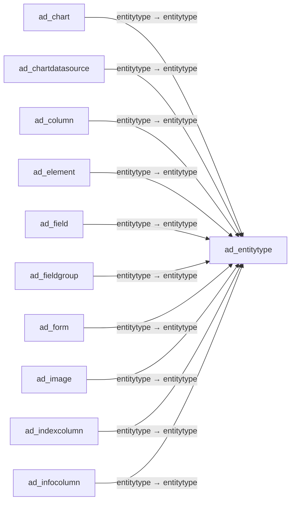

# ad_entitytype — 엔터티 유형

[전체 일람](../TABLE_INDEX.md) · [분류 일람](README.md) · [AI 사용 안내](../README.md) · [외래키 읽는 법](../RELATIONSHIPS.md)

## 기본 정보

| 항목 | 내용 |
|---|---|
| 물리명 | `adempiere.ad_entitytype` |
| 한국어 논리명(문서용 해석) | 엔터티 유형 |
| 원본 논리명 | Entity Type |
| 원본 사전 ID | 882 |
| 분류 | `ad` — 애플리케이션 사전·화면·권한·시스템 |
| 전체 테넌트 행 수 | 12 |
| 물리 열 수 | 17 |
| 나가는 FK / 들어오는 FK | 0 / 64 |
| 구조·행 수 확인 시점 | 2026-11-03T23:29:01+09:00 |

## 의미와 쓰임

시스템 구성요소를 구분하는 엔터티 유형을 정의한다.

- 설명 근거: 원본 애플리케이션 사전 명칭·설명을 한국어로 해석.
- 한국어 이름과 개요는 문서용 해석입니다. 공식 한국어 번역으로 간주하지 않습니다.
- 원본 설명: System Entity Type
- 원본 도움말: —
- PostgreSQL 테이블 주석: —

## 키와 열

### 기본키·고유 제약조건

| 종류 | 제약조건 | 열(순서 유지) |
|---|---|---|
| UNIQUE | `ad_entitytype_id_unq` | `ad_entitytype_id` |
| PRIMARY KEY | `ad_entitytype_pkey` | `entitytype` |
| UNIQUE | `ad_entitytype_uu_idx` | `ad_entitytype_uu` |

### 열 목록

원본 논리명·설명은 `AD_Column`에서 가져왔습니다. 기본값은 실제 PostgreSQL 메타데이터이며, 비어 있는 항목은 `—`로 표시합니다.

| 순서 | 물리명 | 원본 논리명 | PostgreSQL 타입 | NULL | PK | 기본값 | 설명 |
|---:|---|---|---|---|---|---|---|
| 1 | `entitytype` | Entity Type | character varying(40) | 불가 | 예 | 'D'::character varying | Dictionary Entity Type; Determines ownership and synchronization |
| 2 | `ad_client_id` | Tenant | numeric(10,0) | 불가 | — | — | Tenant for this installation. |
| 3 | `ad_org_id` | Organization | numeric(10,0) | 불가 | — | — | Organizational entity within tenant |
| 4 | `ad_entitytype_id` | Entity Type | numeric(10,0) | 불가 | — | — | System Entity Type |
| 5 | `isactive` | Active | character(1) | 불가 | — | 'Y'::bpchar | The record is active in the system |
| 6 | `created` | Created | timestamp without time zone | 불가 | — | now() | Date this record was created |
| 7 | `createdby` | Created By | numeric(10,0) | 불가 | — | — | User who created this records |
| 8 | `updated` | Updated | timestamp without time zone | 불가 | — | now() | Date this record was updated |
| 9 | `updatedby` | Updated By | numeric(10,0) | 불가 | — | — | User who updated this records |
| 10 | `name` | Name | character varying(60) | 불가 | — | — | Alphanumeric identifier of the entity |
| 11 | `description` | Description | character varying(255) | 허용 | — | — | Optional short description of the record |
| 12 | `help` | Comment/Help | character varying(2000) | 허용 | — | — | Comment or Hint |
| 13 | `version` | Version | character varying(20) | 허용 | — | — | Version of the table definition |
| 14 | `modelpackage` | Model Package | character varying(255) | 허용 | — | — | Java Package of the model classes |
| 15 | `classpath` | Classpath | character varying(255) | 허용 | — | — | Extension Classpath |
| 16 | `processing` | Process Now | character(1) | 허용 | — | — | — |
| 17 | `ad_entitytype_uu` | AD_EntityType_UU | uuid | 허용 | — | — | — |

## 외래키 흐름

화살표는 **FK를 가진 자식 → 참조되는 부모**입니다. 업무 처리의 시간 순서나 무조건적인 1:N 관계를 뜻하지 않습니다.

주변 관계 64개 중 10개를 그림으로 표시합니다. **전체 관계는 아래 두 표에 모두 포함**합니다.

### 이 테이블이 참조하는 부모 — 나가는 FK

해당 방향의 물리 FK 제약조건은 없습니다. 이름이 비슷한 열만으로 관계를 추가하지 않습니다.

### 이 테이블을 참조하는 자식 — 들어오는 FK

| 제약조건 | 참조하는 쪽(자식) | 자식 열 | 참조받는 쪽(부모) | 부모 열 | 삭제 / 갱신 | 검증 / 지연 가능 |
|---|---|---|---|---|---|---|
| `entityt_adchart` <!-- FK_IN: adempiere.ad_chart.entityt_adchart --> | [`ad_chart`](ad_chart.md) | `entitytype` | [`ad_entitytype`](ad_entitytype.md) | `entitytype` | NO ACTION / NO ACTION | 완료 / 가능 (초기 지연) |
| `entityt_adchartdatasource` <!-- FK_IN: adempiere.ad_chartdatasource.entityt_adchartdatasource --> | [`ad_chartdatasource`](ad_chartdatasource.md) | `entitytype` | [`ad_entitytype`](ad_entitytype.md) | `entitytype` | NO ACTION / NO ACTION | 완료 / 가능 (초기 지연) |
| `entityt_adcolumn` <!-- FK_IN: adempiere.ad_column.entityt_adcolumn --> | [`ad_column`](ad_column.md) | `entitytype` | [`ad_entitytype`](ad_entitytype.md) | `entitytype` | NO ACTION / NO ACTION | 완료 / 가능 (초기 지연) |
| `entityt_adelement` <!-- FK_IN: adempiere.ad_element.entityt_adelement --> | [`ad_element`](ad_element.md) | `entitytype` | [`ad_entitytype`](ad_entitytype.md) | `entitytype` | NO ACTION / NO ACTION | 완료 / 가능 (초기 지연) |
| `entityt_adfield` <!-- FK_IN: adempiere.ad_field.entityt_adfield --> | [`ad_field`](ad_field.md) | `entitytype` | [`ad_entitytype`](ad_entitytype.md) | `entitytype` | NO ACTION / NO ACTION | 완료 / 가능 (초기 지연) |
| `entityt_adfieldgroup` <!-- FK_IN: adempiere.ad_fieldgroup.entityt_adfieldgroup --> | [`ad_fieldgroup`](ad_fieldgroup.md) | `entitytype` | [`ad_entitytype`](ad_entitytype.md) | `entitytype` | NO ACTION / NO ACTION | 완료 / 가능 (초기 지연) |
| `entityt_adform` <!-- FK_IN: adempiere.ad_form.entityt_adform --> | [`ad_form`](ad_form.md) | `entitytype` | [`ad_entitytype`](ad_entitytype.md) | `entitytype` | NO ACTION / NO ACTION | 완료 / 가능 (초기 지연) |
| `entityt_adimage` <!-- FK_IN: adempiere.ad_image.entityt_adimage --> | [`ad_image`](ad_image.md) | `entitytype` | [`ad_entitytype`](ad_entitytype.md) | `entitytype` | NO ACTION / NO ACTION | 완료 / 가능 (초기 지연) |
| `entityt_adindexcolumn` <!-- FK_IN: adempiere.ad_indexcolumn.entityt_adindexcolumn --> | [`ad_indexcolumn`](ad_indexcolumn.md) | `entitytype` | [`ad_entitytype`](ad_entitytype.md) | `entitytype` | NO ACTION / NO ACTION | 완료 / 가능 (초기 지연) |
| `entityt_adinfocolumn` <!-- FK_IN: adempiere.ad_infocolumn.entityt_adinfocolumn --> | [`ad_infocolumn`](ad_infocolumn.md) | `entitytype` | [`ad_entitytype`](ad_entitytype.md) | `entitytype` | NO ACTION / NO ACTION | 완료 / 가능 (초기 지연) |
| `entitytype_adinfoprocess` <!-- FK_IN: adempiere.ad_infoprocess.entitytype_adinfoprocess --> | [`ad_infoprocess`](ad_infoprocess.md) | `entitytype` | [`ad_entitytype`](ad_entitytype.md) | `entitytype` | NO ACTION / NO ACTION | 완료 / 가능 (초기 지연) |
| `entitytype_adinforelated` <!-- FK_IN: adempiere.ad_inforelated.entitytype_adinforelated --> | [`ad_inforelated`](ad_inforelated.md) | `entitytype` | [`ad_entitytype`](ad_entitytype.md) | `entitytype` | NO ACTION / NO ACTION | 완료 / 가능 (초기 지연) |
| `entityt_adinfowindow` <!-- FK_IN: adempiere.ad_infowindow.entityt_adinfowindow --> | [`ad_infowindow`](ad_infowindow.md) | `entitytype` | [`ad_entitytype`](ad_entitytype.md) | `entitytype` | NO ACTION / NO ACTION | 완료 / 가능 (초기 지연) |
| `entityt_admenu` <!-- FK_IN: adempiere.ad_menu.entityt_admenu --> | [`ad_menu`](ad_menu.md) | `entitytype` | [`ad_entitytype`](ad_entitytype.md) | `entitytype` | NO ACTION / NO ACTION | 완료 / 가능 (초기 지연) |
| `entityt_admessage` <!-- FK_IN: adempiere.ad_message.entityt_admessage --> | [`ad_message`](ad_message.md) | `entitytype` | [`ad_entitytype`](ad_entitytype.md) | `entitytype` | NO ACTION / NO ACTION | 완료 / 가능 (초기 지연) |
| `entityt_admodelvalidator` <!-- FK_IN: adempiere.ad_modelvalidator.entityt_admodelvalidator --> | [`ad_modelvalidator`](ad_modelvalidator.md) | `entitytype` | [`ad_entitytype`](ad_entitytype.md) | `entitytype` | NO ACTION / NO ACTION | 완료 / 가능 (초기 지연) |
| `adenritytype_admodification` <!-- FK_IN: adempiere.ad_modification.adenritytype_admodification --> | [`ad_modification`](ad_modification.md) | `entitytype` | [`ad_entitytype`](ad_entitytype.md) | `entitytype` | NO ACTION / NO ACTION | 완료 / 가능 (초기 지연) |
| `adentitytype_adpackageexpdetai` <!-- FK_IN: adempiere.ad_package_exp_detail.adentitytype_adpackageexpdetai --> | [`ad_package_exp_detail`](ad_package_exp_detail.md) | `ad_entitytype_id` | [`ad_entitytype`](ad_entitytype.md) | `ad_entitytype_id` | NO ACTION / NO ACTION | 완료 / 가능 (초기 지연) |
| `entityt_adprocess` <!-- FK_IN: adempiere.ad_process.entityt_adprocess --> | [`ad_process`](ad_process.md) | `entitytype` | [`ad_entitytype`](ad_entitytype.md) | `entitytype` | NO ACTION / NO ACTION | 완료 / 가능 (초기 지연) |
| `entityt_adprocesspara` <!-- FK_IN: adempiere.ad_process_para.entityt_adprocesspara --> | [`ad_process_para`](ad_process_para.md) | `entitytype` | [`ad_entitytype`](ad_entitytype.md) | `entitytype` | NO ACTION / NO ACTION | 완료 / 가능 (초기 지연) |
| `entityt_adreflist` <!-- FK_IN: adempiere.ad_ref_list.entityt_adreflist --> | [`ad_ref_list`](ad_ref_list.md) | `entitytype` | [`ad_entitytype`](ad_entitytype.md) | `entitytype` | NO ACTION / NO ACTION | 완료 / 가능 (초기 지연) |
| `entityt_adreftable` <!-- FK_IN: adempiere.ad_ref_table.entityt_adreftable --> | [`ad_ref_table`](ad_ref_table.md) | `entitytype` | [`ad_entitytype`](ad_entitytype.md) | `entitytype` | NO ACTION / NO ACTION | 완료 / 가능 (초기 지연) |
| `entityt_adreference` <!-- FK_IN: adempiere.ad_reference.entityt_adreference --> | [`ad_reference`](ad_reference.md) | `entitytype` | [`ad_entitytype`](ad_entitytype.md) | `entitytype` | NO ACTION / NO ACTION | 완료 / 가능 (초기 지연) |
| `entitytype_adrelationtype` <!-- FK_IN: adempiere.ad_relationtype.entitytype_adrelationtype --> | [`ad_relationtype`](ad_relationtype.md) | `entitytype` | [`ad_entitytype`](ad_entitytype.md) | `entitytype` | NO ACTION / NO ACTION | 완료 / 가능 (초기 지연) |
| `entityt_adreplicationstrategy` <!-- FK_IN: adempiere.ad_replicationstrategy.entityt_adreplicationstrategy --> | [`ad_replicationstrategy`](ad_replicationstrategy.md) | `entitytype` | [`ad_entitytype`](ad_entitytype.md) | `entitytype` | NO ACTION / NO ACTION | 완료 / 가능 (초기 지연) |
| `entityt_adreplicationtable` <!-- FK_IN: adempiere.ad_replicationtable.entityt_adreplicationtable --> | [`ad_replicationtable`](ad_replicationtable.md) | `entitytype` | [`ad_entitytype`](ad_entitytype.md) | `entitytype` | NO ACTION / NO ACTION | 완료 / 가능 (초기 지연) |
| `entityt_adreportview` <!-- FK_IN: adempiere.ad_reportview.entityt_adreportview --> | [`ad_reportview`](ad_reportview.md) | `entitytype` | [`ad_entitytype`](ad_entitytype.md) | `entitytype` | NO ACTION / NO ACTION | 완료 / 가능 (초기 지연) |
| `entitytype_adrequiredplugin` <!-- FK_IN: adempiere.ad_requiredplugin.entitytype_adrequiredplugin --> | [`ad_requiredplugin`](ad_requiredplugin.md) | `entitytype` | [`ad_entitytype`](ad_entitytype.md) | `entitytype` | NO ACTION / NO ACTION | 완료 / 가능 (초기 지연) |
| `entityt_adrule` <!-- FK_IN: adempiere.ad_rule.entityt_adrule --> | [`ad_rule`](ad_rule.md) | `entitytype` | [`ad_entitytype`](ad_entitytype.md) | `entitytype` | NO ACTION / NO ACTION | 완료 / 가능 (초기 지연) |
| `entitytype_adsearchdefinition` <!-- FK_IN: adempiere.ad_searchdefinition.entitytype_adsearchdefinition --> | [`ad_searchdefinition`](ad_searchdefinition.md) | `entitytype` | [`ad_entitytype`](ad_entitytype.md) | `entitytype` | NO ACTION / NO ACTION | 완료 / 가능 (초기 지연) |
| `entitytype_adstatusline` <!-- FK_IN: adempiere.ad_statusline.entitytype_adstatusline --> | [`ad_statusline`](ad_statusline.md) | `entitytype` | [`ad_entitytype`](ad_entitytype.md) | `entitytype` | NO ACTION / NO ACTION | 완료 / 가능 (초기 지연) |
| `entitytype_adstatuslineusedin` <!-- FK_IN: adempiere.ad_statuslineusedin.entitytype_adstatuslineusedin --> | [`ad_statuslineusedin`](ad_statuslineusedin.md) | `entitytype` | [`ad_entitytype`](ad_entitytype.md) | `entitytype` | NO ACTION / NO ACTION | 완료 / 가능 (초기 지연) |
| `entitytype_adstyle` <!-- FK_IN: adempiere.ad_style.entitytype_adstyle --> | [`ad_style`](ad_style.md) | `entitytype` | [`ad_entitytype`](ad_entitytype.md) | `entitytype` | NO ACTION / NO ACTION | 완료 / 가능 (초기 지연) |
| `entitytype_adstyleline` <!-- FK_IN: adempiere.ad_styleline.entitytype_adstyleline --> | [`ad_styleline`](ad_styleline.md) | `entitytype` | [`ad_entitytype`](ad_entitytype.md) | `entitytype` | NO ACTION / NO ACTION | 완료 / 가능 (초기 지연) |
| `entityt_adsysconfig` <!-- FK_IN: adempiere.ad_sysconfig.entityt_adsysconfig --> | [`ad_sysconfig`](ad_sysconfig.md) | `entitytype` | [`ad_entitytype`](ad_entitytype.md) | `entitytype` | NO ACTION / NO ACTION | 완료 / 가능 (초기 지연) |
| `entityt_adtab` <!-- FK_IN: adempiere.ad_tab.entityt_adtab --> | [`ad_tab`](ad_tab.md) | `entitytype` | [`ad_entitytype`](ad_entitytype.md) | `entitytype` | NO ACTION / NO ACTION | 완료 / 가능 (초기 지연) |
| `entityt_adtable` <!-- FK_IN: adempiere.ad_table.entityt_adtable --> | [`ad_table`](ad_table.md) | `entitytype` | [`ad_entitytype`](ad_entitytype.md) | `entitytype` | NO ACTION / NO ACTION | 완료 / 가능 (초기 지연) |
| `entityt_adtableindex` <!-- FK_IN: adempiere.ad_tableindex.entityt_adtableindex --> | [`ad_tableindex`](ad_tableindex.md) | `entitytype` | [`ad_entitytype`](ad_entitytype.md) | `entitytype` | NO ACTION / NO ACTION | 완료 / 가능 (초기 지연) |
| `entityt_adtask` <!-- FK_IN: adempiere.ad_task.entityt_adtask --> | [`ad_task`](ad_task.md) | `entitytype` | [`ad_entitytype`](ad_entitytype.md) | `entitytype` | NO ACTION / NO ACTION | 완료 / 가능 (초기 지연) |
| `entitytype_adtoolbarbutton` <!-- FK_IN: adempiere.ad_toolbarbutton.entitytype_adtoolbarbutton --> | [`ad_toolbarbutton`](ad_toolbarbutton.md) | `entitytype` | [`ad_entitytype`](ad_entitytype.md) | `entitytype` | NO ACTION / NO ACTION | 완료 / 가능 (초기 지연) |
| `entityt_advalrule` <!-- FK_IN: adempiere.ad_val_rule.entityt_advalrule --> | [`ad_val_rule`](ad_val_rule.md) | `entitytype` | [`ad_entitytype`](ad_entitytype.md) | `entitytype` | NO ACTION / NO ACTION | 완료 / 가능 (초기 지연) |
| `entityt_adviewcolumn` <!-- FK_IN: adempiere.ad_viewcolumn.entityt_adviewcolumn --> | [`ad_viewcolumn`](ad_viewcolumn.md) | `entitytype` | [`ad_entitytype`](ad_entitytype.md) | `entitytype` | NO ACTION / NO ACTION | 완료 / 가능 (초기 지연) |
| `entityt_adviewcomponent` <!-- FK_IN: adempiere.ad_viewcomponent.entityt_adviewcomponent --> | [`ad_viewcomponent`](ad_viewcomponent.md) | `entitytype` | [`ad_entitytype`](ad_entitytype.md) | `entitytype` | NO ACTION / NO ACTION | 완료 / 가능 (초기 지연) |
| `entityt_adwfnextcondition` <!-- FK_IN: adempiere.ad_wf_nextcondition.entityt_adwfnextcondition --> | [`ad_wf_nextcondition`](ad_wf_nextcondition.md) | `entitytype` | [`ad_entitytype`](ad_entitytype.md) | `entitytype` | NO ACTION / NO ACTION | 완료 / 가능 (초기 지연) |
| `entityt_adwfnode` <!-- FK_IN: adempiere.ad_wf_node.entityt_adwfnode --> | [`ad_wf_node`](ad_wf_node.md) | `entitytype` | [`ad_entitytype`](ad_entitytype.md) | `entitytype` | NO ACTION / NO ACTION | 완료 / 가능 (초기 지연) |
| `entityt_adwfnodepara` <!-- FK_IN: adempiere.ad_wf_node_para.entityt_adwfnodepara --> | [`ad_wf_node_para`](ad_wf_node_para.md) | `entitytype` | [`ad_entitytype`](ad_entitytype.md) | `entitytype` | NO ACTION / NO ACTION | 완료 / 가능 (초기 지연) |
| `entityt_adwfnodenext` <!-- FK_IN: adempiere.ad_wf_nodenext.entityt_adwfnodenext --> | [`ad_wf_nodenext`](ad_wf_nodenext.md) | `entitytype` | [`ad_entitytype`](ad_entitytype.md) | `entitytype` | NO ACTION / NO ACTION | 완료 / 가능 (초기 지연) |
| `entityt_adwfresponsible` <!-- FK_IN: adempiere.ad_wf_responsible.entityt_adwfresponsible --> | [`ad_wf_responsible`](ad_wf_responsible.md) | `entitytype` | [`ad_entitytype`](ad_entitytype.md) | `entitytype` | NO ACTION / NO ACTION | 완료 / 가능 (초기 지연) |
| `entityt_adwindow` <!-- FK_IN: adempiere.ad_window.entityt_adwindow --> | [`ad_window`](ad_window.md) | `entitytype` | [`ad_entitytype`](ad_entitytype.md) | `entitytype` | NO ACTION / NO ACTION | 완료 / 가능 (초기 지연) |
| `entityt_adworkbench` <!-- FK_IN: adempiere.ad_workbench.entityt_adworkbench --> | [`ad_workbench`](ad_workbench.md) | `entitytype` | [`ad_entitytype`](ad_entitytype.md) | `entitytype` | NO ACTION / NO ACTION | 완료 / 가능 (초기 지연) |
| `entityt_adworkbenchwindow` <!-- FK_IN: adempiere.ad_workbenchwindow.entityt_adworkbenchwindow --> | [`ad_workbenchwindow`](ad_workbenchwindow.md) | `entitytype` | [`ad_entitytype`](ad_entitytype.md) | `entitytype` | NO ACTION / NO ACTION | 완료 / 가능 (초기 지연) |
| `entityt_adworkflow` <!-- FK_IN: adempiere.ad_workflow.entityt_adworkflow --> | [`ad_workflow`](ad_workflow.md) | `entitytype` | [`ad_entitytype`](ad_entitytype.md) | `entitytype` | NO ACTION / NO ACTION | 완료 / 가능 (초기 지연) |
| `entitytype_adzoomcondition` <!-- FK_IN: adempiere.ad_zoomcondition.entitytype_adzoomcondition --> | [`ad_zoomcondition`](ad_zoomcondition.md) | `entitytype` | [`ad_entitytype`](ad_entitytype.md) | `entitytype` | NO ACTION / NO ACTION | 완료 / 가능 (초기 지연) |
| `entitytype_mattribute` <!-- FK_IN: adempiere.m_attribute.entitytype_mattribute --> | [`m_attribute`](../m/m_attribute.md) | `entitytype` | [`ad_entitytype`](ad_entitytype.md) | `entitytype` | NO ACTION / NO ACTION | 완료 / 가능 (초기 지연) |
| `entitytype_mattributeset` <!-- FK_IN: adempiere.m_attributeset.entitytype_mattributeset --> | [`m_attributeset`](../m/m_attributeset.md) | `entitytype` | [`ad_entitytype`](ad_entitytype.md) | `entitytype` | NO ACTION / NO ACTION | 완료 / 가능 (초기 지연) |
| `entitytype_mattributeuse` <!-- FK_IN: adempiere.m_attributeuse.entitytype_mattributeuse --> | [`m_attributeuse`](../m/m_attributeuse.md) | `entitytype` | [`ad_entitytype`](ad_entitytype.md) | `entitytype` | NO ACTION / NO ACTION | 완료 / 가능 (초기 지연) |
| `entitytype_mattributevalue` <!-- FK_IN: adempiere.m_attributevalue.entitytype_mattributevalue --> | [`m_attributevalue`](../m/m_attributevalue.md) | `entitytype` | [`ad_entitytype`](ad_entitytype.md) | `entitytype` | NO ACTION / NO ACTION | 완료 / 가능 (초기 지연) |
| `entityt_pacolorschema` <!-- FK_IN: adempiere.pa_colorschema.entityt_pacolorschema --> | [`pa_colorschema`](../pa/pa_colorschema.md) | `entitytype` | [`ad_entitytype`](ad_entitytype.md) | `entitytype` | NO ACTION / NO ACTION | 완료 / 가능 (초기 지연) |
| `entitytype_padocumentstatus` <!-- FK_IN: adempiere.pa_documentstatus.entitytype_padocumentstatus --> | [`pa_documentstatus`](../pa/pa_documentstatus.md) | `entitytype` | [`ad_entitytype`](ad_entitytype.md) | `entitytype` | NO ACTION / NO ACTION | 완료 / 가능 (초기 지연) |
| `entityt_pameasurecalc` <!-- FK_IN: adempiere.pa_measurecalc.entityt_pameasurecalc --> | [`pa_measurecalc`](../pa/pa_measurecalc.md) | `entitytype` | [`ad_entitytype`](ad_entitytype.md) | `entitytype` | NO ACTION / NO ACTION | 완료 / 가능 (초기 지연) |
| `entityt_ppordernode` <!-- FK_IN: adempiere.pp_order_node.entityt_ppordernode --> | [`pp_order_node`](../pp/pp_order_node.md) | `entitytype` | [`ad_entitytype`](ad_entitytype.md) | `entitytype` | NO ACTION / NO ACTION | 완료 / 가능 (초기 지연) |
| `entityt_ppordernodenext` <!-- FK_IN: adempiere.pp_order_nodenext.entityt_ppordernodenext --> | [`pp_order_nodenext`](../pp/pp_order_nodenext.md) | `entitytype` | [`ad_entitytype`](ad_entitytype.md) | `entitytype` | NO ACTION / NO ACTION | 완료 / 가능 (초기 지연) |
| `entityt_pporderworkflow` <!-- FK_IN: adempiere.pp_order_workflow.entityt_pporderworkflow --> | [`pp_order_workflow`](../pp/pp_order_workflow.md) | `entitytype` | [`ad_entitytype`](ad_entitytype.md) | `entitytype` | NO ACTION / NO ACTION | 완료 / 가능 (초기 지연) |
| `entityt_ppwfnodeproduct` <!-- FK_IN: adempiere.pp_wf_node_product.entityt_ppwfnodeproduct --> | [`pp_wf_node_product`](../pp/pp_wf_node_product.md) | `entitytype` | [`ad_entitytype`](ad_entitytype.md) | `entitytype` | NO ACTION / NO ACTION | 완료 / 가능 (초기 지연) |

## 조회 시 주의

- FK 표의 자식 열과 부모 열을 같은 순서로 대응시킵니다. 복합 FK는 모든 열의 동등 조건을 `AND`로 연결합니다.
- 테이블 이름이나 `_id` 열 이름만으로 물리 FK가 있다고 가정하지 않습니다. FK 미선언은 업무 관계가 없다는 뜻도 아닙니다.
- 자식이 여러 행인 테이블과 조인하면 부모의 금액·건수가 중복될 수 있습니다. 집계 단위를 먼저 정합니다.
- `ad_client_id`가 있습니다. 업무 분석에서는 대상 테넌트를 명시합니다. GardenWorld는 `11`, 시스템 공통 설정은 `0`일 수 있으므로 일괄 필터 적용 전에 테이블 역할을 확인합니다.
- 행 수는 위 확인 시점의 전체 테넌트 값입니다. 최신 업무 실적이나 현재 실행 결과로 재사용하지 않습니다.
