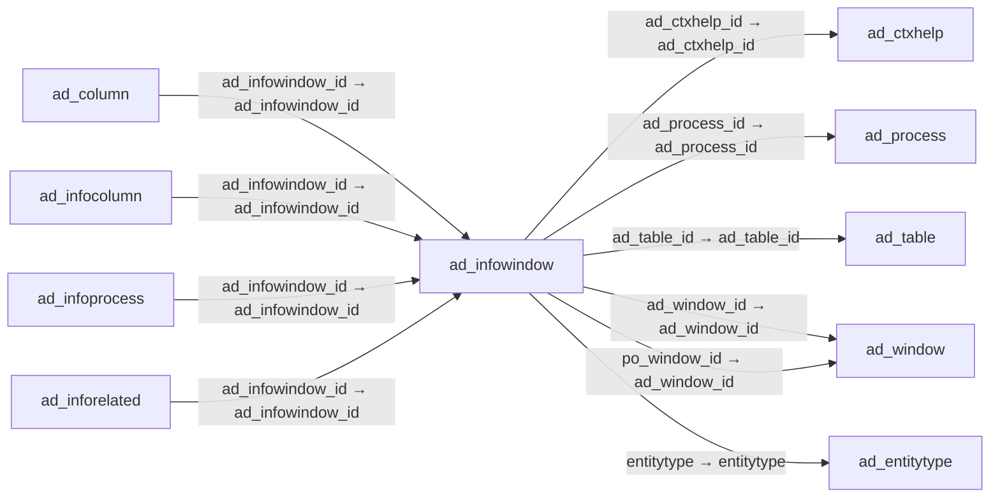

# ad_infowindow — 조회 창

[전체 일람](../TABLE_INDEX.md) · [분류 일람](README.md) · [AI 사용 안내](../README.md) · [외래키 읽는 법](../RELATIONSHIPS.md)

## 기본 정보

| 항목 | 내용 |
|---|---|
| 물리명 | `adempiere.ad_infowindow` |
| 한국어 논리명(문서용 해석) | 조회 창 |
| 원본 논리명 | Info Window |
| 원본 사전 ID | 895 |
| 분류 | `ad` — 애플리케이션 사전·화면·권한·시스템 |
| 전체 테넌트 행 수 | 17 |
| 물리 열 수 | 32 |
| 나가는 FK / 들어오는 FK | 6 / 15 |
| 구조·행 수 확인 시점 | 2026-11-03T23:29:01+09:00 |

## 의미와 쓰임

검색·선택용 조회 창의 대상 테이블·SQL 구성·정렬·페이지 설정을 정의한다.

- 설명 근거: 물리명·열·외래키 구조를 근거로 보수적으로 해석.
- 한국어 이름과 개요는 문서용 해석입니다. 공식 한국어 번역으로 간주하지 않습니다.
- 원본 설명: —
- 원본 도움말: —
- PostgreSQL 테이블 주석: —

## 키와 열

### 기본키·고유 제약조건

| 종류 | 제약조건 | 열(순서 유지) |
|---|---|---|
| PRIMARY KEY | `ad_infowindow_pkey` | `ad_infowindow_id` |
| UNIQUE | `ad_infowindow_uu_idx` | `ad_infowindow_uu` |

### 별도 고유 인덱스

PK·UNIQUE 제약조건의 인덱스와 별도로 존재하는 고유 인덱스입니다. 식·조건·열 순서는 원본 정의를 따릅니다.

- `ad_infowindow_unique_name`: `CREATE UNIQUE INDEX ad_infowindow_unique_name ON adempiere.ad_infowindow USING btree (ad_client_id, name)`

### 열 목록

원본 논리명·설명은 `AD_Column`에서 가져왔습니다. 기본값은 실제 PostgreSQL 메타데이터이며, 비어 있는 항목은 `—`로 표시합니다.

| 순서 | 물리명 | 원본 논리명 | PostgreSQL 타입 | NULL | PK | 기본값 | 설명 |
|---:|---|---|---|---|---|---|---|
| 1 | `ad_infowindow_id` | Info Window | numeric(10,0) | 불가 | 예 | — | Info and search/select Window |
| 2 | `ad_client_id` | Tenant | numeric(10,0) | 불가 | — | — | Tenant for this installation. |
| 3 | `ad_org_id` | Organization | numeric(10,0) | 불가 | — | — | Organizational entity within tenant |
| 4 | `isactive` | Active | character(1) | 불가 | — | 'Y'::bpchar | The record is active in the system |
| 5 | `created` | Created | timestamp without time zone | 불가 | — | now() | Date this record was created |
| 6 | `createdby` | Created By | numeric(10,0) | 불가 | — | — | User who created this records |
| 7 | `updated` | Updated | timestamp without time zone | 불가 | — | now() | Date this record was updated |
| 8 | `updatedby` | Updated By | numeric(10,0) | 불가 | — | — | User who updated this records |
| 9 | `name` | Name | character varying(60) | 불가 | — | — | Alphanumeric identifier of the entity |
| 10 | `description` | Description | character varying(255) | 허용 | — | — | Optional short description of the record |
| 11 | `help` | Comment/Help | character varying(2000) | 허용 | — | — | Comment or Hint |
| 12 | `ad_table_id` | Table | numeric(10,0) | 불가 | — | — | Database Table information |
| 13 | `entitytype` | Entity Type | character varying(40) | 불가 | — | 'D'::character varying | Dictionary Entity Type; Determines ownership and synchronization |
| 14 | `fromclause` | Sql FROM | character varying(2000) | 불가 | — | — | SQL FROM clause |
| 15 | `otherclause` | Other SQL Clause | character varying(2000) | 허용 | — | — | Other SQL Clause |
| 16 | `processing` | Process Now | character(1) | 허용 | — | — | — |
| 17 | `ad_infowindow_uu` | AD_InfoWindow_UU | uuid | 허용 | — | — | — |
| 18 | `whereclause` | Sql WHERE | character varying(2000) | 허용 | — | NULL::character varying | Fully qualified SQL WHERE clause |
| 19 | `isdefault` | Default | character(1) | 불가 | — | 'N'::bpchar | Default value |
| 20 | `isdistinct` | Distinct | character(1) | 불가 | — | 'N'::bpchar | Select Distinct |
| 21 | `orderbyclause` | Sql ORDER BY | character varying(2000) | 허용 | — | NULL::character varying | Fully qualified ORDER BY clause |
| 22 | `isvalid` | Valid | character(1) | 불가 | — | 'N'::bpchar | Element is valid |
| 23 | `ad_ctxhelp_id` | Context Help | numeric(10,0) | 허용 | — | NULL::numeric | — |
| 24 | `imageurl` | Image URL | character varying(120) | 허용 | — | NULL::character varying | URL of  image |
| 25 | `seqno` | Sequence | numeric(10,0) | 허용 | — | NULL::numeric | Method of ordering records; lowest number comes first |
| 26 | `isshowindashboard` | Show in Dashboard | character(1) | 불가 | — | 'Y'::bpchar | Show the dashlet in the dashboard |
| 27 | `ad_process_id` | Process | numeric(10,0) | 허용 | — | NULL::numeric | Process or Report |
| 28 | `maxqueryrecords` | Max Query Records | numeric(10,0) | 불가 | — | (0)::numeric | If defined, you cannot query more records as defined - the query criteria needs to be changed to query less records |
| 29 | `isloadpagenum` | Load Page Num | character(1) | 허용 | — | 'Y'::bpchar | When load data for info window, also load number of paging |
| 30 | `pagingsize` | Paging Size | numeric(10,0) | 불가 | — | '0'::numeric | — |
| 31 | `ad_window_id` | Window | numeric(10,0) | 허용 | — | NULL::numeric | Data entry or display window |
| 32 | `po_window_id` | PO Window | numeric(10,0) | 허용 | — | NULL::numeric | Purchase Order Window |

## 외래키 흐름

화살표는 **FK를 가진 자식 → 참조되는 부모**입니다. 업무 처리의 시간 순서나 무조건적인 1:N 관계를 뜻하지 않습니다.

주변 관계 21개 중 10개를 그림으로 표시합니다. **전체 관계는 아래 두 표에 모두 포함**합니다.

### 이 테이블이 참조하는 부모 — 나가는 FK

| 제약조건 | 참조하는 쪽(자식) | 자식 열 | 참조받는 쪽(부모) | 부모 열 | 삭제 / 갱신 | 검증 / 지연 가능 |
|---|---|---|---|---|---|---|
| `adctxhelp_adinfowindow` <!-- FK_OUT: adempiere.ad_infowindow.adctxhelp_adinfowindow --> | [`ad_infowindow`](ad_infowindow.md) | `ad_ctxhelp_id` | [`ad_ctxhelp`](ad_ctxhelp.md) | `ad_ctxhelp_id` | NO ACTION / NO ACTION | 완료 / 가능 (초기 지연) |
| `adprocess_adinfowindow` <!-- FK_OUT: adempiere.ad_infowindow.adprocess_adinfowindow --> | [`ad_infowindow`](ad_infowindow.md) | `ad_process_id` | [`ad_process`](ad_process.md) | `ad_process_id` | NO ACTION / NO ACTION | 완료 / 가능 (초기 지연) |
| `adtable_adinfowindow` <!-- FK_OUT: adempiere.ad_infowindow.adtable_adinfowindow --> | [`ad_infowindow`](ad_infowindow.md) | `ad_table_id` | [`ad_table`](ad_table.md) | `ad_table_id` | NO ACTION / NO ACTION | 완료 / 가능 (초기 지연) |
| `adwindow_adinfowindow` <!-- FK_OUT: adempiere.ad_infowindow.adwindow_adinfowindow --> | [`ad_infowindow`](ad_infowindow.md) | `ad_window_id` | [`ad_window`](ad_window.md) | `ad_window_id` | NO ACTION / NO ACTION | 완료 / 가능 (초기 지연) |
| `entityt_adinfowindow` <!-- FK_OUT: adempiere.ad_infowindow.entityt_adinfowindow --> | [`ad_infowindow`](ad_infowindow.md) | `entitytype` | [`ad_entitytype`](ad_entitytype.md) | `entitytype` | NO ACTION / NO ACTION | 완료 / 가능 (초기 지연) |
| `powindow_adinfowindow` <!-- FK_OUT: adempiere.ad_infowindow.powindow_adinfowindow --> | [`ad_infowindow`](ad_infowindow.md) | `po_window_id` | [`ad_window`](ad_window.md) | `ad_window_id` | NO ACTION / NO ACTION | 완료 / 가능 (초기 지연) |

### 이 테이블을 참조하는 자식 — 들어오는 FK

| 제약조건 | 참조하는 쪽(자식) | 자식 열 | 참조받는 쪽(부모) | 부모 열 | 삭제 / 갱신 | 검증 / 지연 가능 |
|---|---|---|---|---|---|---|
| `adinfowindow_adcolumn` <!-- FK_IN: adempiere.ad_column.adinfowindow_adcolumn --> | [`ad_column`](ad_column.md) | `ad_infowindow_id` | [`ad_infowindow`](ad_infowindow.md) | `ad_infowindow_id` | SET NULL / NO ACTION | 완료 / 가능 (초기 지연) |
| `adinfowindow_adinfocolumn` <!-- FK_IN: adempiere.ad_infocolumn.adinfowindow_adinfocolumn --> | [`ad_infocolumn`](ad_infocolumn.md) | `ad_infowindow_id` | [`ad_infowindow`](ad_infowindow.md) | `ad_infowindow_id` | CASCADE / NO ACTION | 완료 / 가능 (초기 지연) |
| `adinfowindow_adinfoprocess` <!-- FK_IN: adempiere.ad_infoprocess.adinfowindow_adinfoprocess --> | [`ad_infoprocess`](ad_infoprocess.md) | `ad_infowindow_id` | [`ad_infowindow`](ad_infowindow.md) | `ad_infowindow_id` | CASCADE / NO ACTION | 완료 / 가능 (초기 지연) |
| `adinfowindow_adinforelated` <!-- FK_IN: adempiere.ad_inforelated.adinfowindow_adinforelated --> | [`ad_inforelated`](ad_inforelated.md) | `ad_infowindow_id` | [`ad_infowindow`](ad_infowindow.md) | `ad_infowindow_id` | NO ACTION / NO ACTION | 완료 / 가능 (초기 지연) |
| `relatedinfo_adinforelated` <!-- FK_IN: adempiere.ad_inforelated.relatedinfo_adinforelated --> | [`ad_inforelated`](ad_inforelated.md) | `relatedinfo_id` | [`ad_infowindow`](ad_infowindow.md) | `ad_infowindow_id` | NO ACTION / NO ACTION | 완료 / 가능 (초기 지연) |
| `adinfowindow_adinfowindowacces` <!-- FK_IN: adempiere.ad_infowindow_access.adinfowindow_adinfowindowacces --> | [`ad_infowindow_access`](ad_infowindow_access.md) | `ad_infowindow_id` | [`ad_infowindow`](ad_infowindow.md) | `ad_infowindow_id` | CASCADE / NO ACTION | 완료 / 가능 (초기 지연) |
| `adinfowindow_adinfowindowtrl` <!-- FK_IN: adempiere.ad_infowindow_trl.adinfowindow_adinfowindowtrl --> | [`ad_infowindow_trl`](ad_infowindow_trl.md) | `ad_infowindow_id` | [`ad_infowindow`](ad_infowindow.md) | `ad_infowindow_id` | CASCADE / NO ACTION | 완료 / 가능 (초기 지연) |
| `adinfowindow_admenu` <!-- FK_IN: adempiere.ad_menu.adinfowindow_admenu --> | [`ad_menu`](ad_menu.md) | `ad_infowindow_id` | [`ad_infowindow`](ad_infowindow.md) | `ad_infowindow_id` | NO ACTION / NO ACTION | 완료 / 가능 (초기 지연) |
| `adinfowindow_adpackageexpdetai` <!-- FK_IN: adempiere.ad_package_exp_detail.adinfowindow_adpackageexpdetai --> | [`ad_package_exp_detail`](ad_package_exp_detail.md) | `ad_infowindow_id` | [`ad_infowindow`](ad_infowindow.md) | `ad_infowindow_id` | NO ACTION / NO ACTION | 완료 / 가능 (초기 지연) |
| `ad_infowindow_preference` <!-- FK_IN: adempiere.ad_preference.ad_infowindow_preference --> | [`ad_preference`](ad_preference.md) | `ad_infowindow_id` | [`ad_infowindow`](ad_infowindow.md) | `ad_infowindow_id` | NO ACTION / NO ACTION | 완료 / 가능 (초기 지연) |
| `adinfowindow_adreftable` <!-- FK_IN: adempiere.ad_ref_table.adinfowindow_adreftable --> | [`ad_ref_table`](ad_ref_table.md) | `ad_infowindow_id` | [`ad_infowindow`](ad_infowindow.md) | `ad_infowindow_id` | NO ACTION / NO ACTION | 완료 / 가능 (초기 지연) |
| `adinfowindow_adstatuslineusedi` <!-- FK_IN: adempiere.ad_statuslineusedin.adinfowindow_adstatuslineusedi --> | [`ad_statuslineusedin`](ad_statuslineusedin.md) | `ad_infowindow_id` | [`ad_infowindow`](ad_infowindow.md) | `ad_infowindow_id` | CASCADE / NO ACTION | 완료 / 가능 (초기 지연) |
| `adinfowindow_aduserdefinfo` <!-- FK_IN: adempiere.ad_userdef_info.adinfowindow_aduserdefinfo --> | [`ad_userdef_info`](ad_userdef_info.md) | `ad_infowindow_id` | [`ad_infowindow`](ad_infowindow.md) | `ad_infowindow_id` | CASCADE / NO ACTION | 완료 / 가능 (초기 지연) |
| `adinfowindow_adwfnode` <!-- FK_IN: adempiere.ad_wf_node.adinfowindow_adwfnode --> | [`ad_wf_node`](ad_wf_node.md) | `ad_infowindow_id` | [`ad_infowindow`](ad_infowindow.md) | `ad_infowindow_id` | NO ACTION / NO ACTION | 완료 / 가능 (초기 지연) |
| `adinfowindow_padocumentstatus` <!-- FK_IN: adempiere.pa_documentstatus.adinfowindow_padocumentstatus --> | [`pa_documentstatus`](../pa/pa_documentstatus.md) | `ad_infowindow_id` | [`ad_infowindow`](ad_infowindow.md) | `ad_infowindow_id` | CASCADE / NO ACTION | 완료 / 가능 (초기 지연) |

## 조회 시 주의

- FK 표의 자식 열과 부모 열을 같은 순서로 대응시킵니다. 복합 FK는 모든 열의 동등 조건을 `AND`로 연결합니다.
- 테이블 이름이나 `_id` 열 이름만으로 물리 FK가 있다고 가정하지 않습니다. FK 미선언은 업무 관계가 없다는 뜻도 아닙니다.
- 자식이 여러 행인 테이블과 조인하면 부모의 금액·건수가 중복될 수 있습니다. 집계 단위를 먼저 정합니다.
- `ad_client_id`가 있습니다. 업무 분석에서는 대상 테넌트를 명시합니다. GardenWorld는 `11`, 시스템 공통 설정은 `0`일 수 있으므로 일괄 필터 적용 전에 테이블 역할을 확인합니다.
- 행 수는 위 확인 시점의 전체 테넌트 값입니다. 최신 업무 실적이나 현재 실행 결과로 재사용하지 않습니다.
