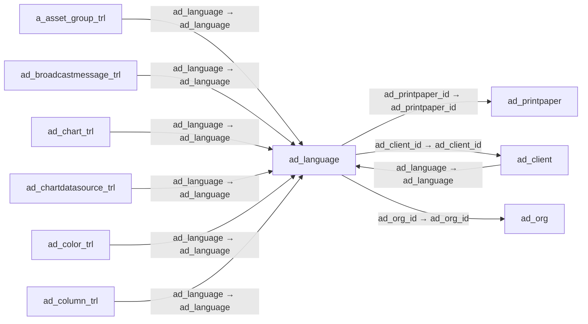

# ad_language — 언어·지역 설정

[전체 일람](../TABLE_INDEX.md) · [분류 일람](README.md) · [AI 사용 안내](../README.md) · [외래키 읽는 법](../RELATIONSHIPS.md)

## 기본 정보

| 항목 | 내용 |
|---|---|
| 물리명 | `adempiere.ad_language` |
| 한국어 논리명(문서용 해석) | 언어·지역 설정 |
| 원본 논리명 | Language ID |
| 원본 사전 ID | 111 |
| 분류 | `ad` — 애플리케이션 사전·화면·권한·시스템 |
| 전체 테넌트 행 수 | 109 |
| 물리 열 수 | 22 |
| 나가는 FK / 들어오는 FK | 3 / 86 |
| 구조·행 수 확인 시점 | 2026-11-03T23:29:01+09:00 |

## 의미와 쓰임

언어 코드와 국가·날짜·시간·숫자 표시 방식 및 시스템 사용 여부를 관리한다.

- 설명 근거: 물리명·열·외래키 구조를 근거로 보수적으로 해석.
- 한국어 이름과 개요는 문서용 해석입니다. 공식 한국어 번역으로 간주하지 않습니다.
- 원본 설명: —
- 원본 도움말: —
- PostgreSQL 테이블 주석: —

## 키와 열

### 기본키·고유 제약조건

| 종류 | 제약조건 | 열(순서 유지) |
|---|---|---|
| UNIQUE | `ad_language_id_idx` | `ad_language_id` |
| PRIMARY KEY | `ad_language_pkey` | `ad_language` |
| UNIQUE | `ad_language_uu_idx` | `ad_language_uu` |

### 열 목록

원본 논리명·설명은 `AD_Column`에서 가져왔습니다. 기본값은 실제 PostgreSQL 메타데이터이며, 비어 있는 항목은 `—`로 표시합니다.

| 순서 | 물리명 | 원본 논리명 | PostgreSQL 타입 | NULL | PK | 기본값 | 설명 |
|---:|---|---|---|---|---|---|---|
| 1 | `ad_language` | Language | character varying(6) | 불가 | 예 | — | Language for this entity |
| 2 | `ad_client_id` | Tenant | numeric(10,0) | 불가 | — | — | Tenant for this installation. |
| 3 | `ad_org_id` | Organization | numeric(10,0) | 불가 | — | — | Organizational entity within tenant |
| 4 | `isactive` | Active | character(1) | 불가 | — | 'N'::bpchar | The record is active in the system |
| 5 | `created` | Created | timestamp without time zone | 불가 | — | now() | Date this record was created |
| 6 | `createdby` | Created By | numeric(10,0) | 불가 | — | — | User who created this records |
| 7 | `updated` | Updated | timestamp without time zone | 불가 | — | now() | Date this record was updated |
| 8 | `updatedby` | Updated By | numeric(10,0) | 불가 | — | — | User who updated this records |
| 9 | `name` | Name | character varying(60) | 불가 | — | — | Alphanumeric identifier of the entity |
| 10 | `languageiso` | ISO Language Code | character(2) | 허용 | — | — | Lower-case two-letter ISO-3166 code - http://www.ics.uci.edu/pub/ietf/http/related/iso639.txt  |
| 11 | `countrycode` | ISO Country Code | character(2) | 허용 | — | — | Upper-case two-letter alphanumeric ISO Country code according to ISO 3166-1 |
| 12 | `isbaselanguage` | Base Language | character(1) | 불가 | — | 'N'::bpchar | The system information is maintained in this language |
| 13 | `issystemlanguage` | System Language | character(1) | 불가 | — | 'N'::bpchar | The screens, etc. are maintained in this Language |
| 14 | `processing` | Process Now | character(1) | 허용 | — | — | — |
| 15 | `ad_language_id` | Language ID | numeric(10,0) | 불가 | — | — | — |
| 16 | `isdecimalpoint` | Decimal Point | character(1) | 허용 | — | — | The number notation has a decimal point (no decimal comma) |
| 17 | `datepattern` | Date Pattern | character varying(20) | 허용 | — | — | Java Date Pattern |
| 18 | `timepattern` | Time Pattern | character varying(20) | 허용 | — | — | Java Time Pattern |
| 19 | `ad_language_uu` | AD_Language_UU | uuid | 허용 | — | — | — |
| 20 | `isloginlocale` | Login Locale | character(1) | 허용 | — | 'N'::bpchar | — |
| 21 | `ad_printpaper_id` | Print Paper | numeric(10,0) | 허용 | — | NULL::numeric | Printer paper definition |
| 22 | `printname` | Print Text | character varying(60) | 불가 | — | NULL::character varying | The label text to be printed on a document or correspondence. |

## 외래키 흐름

화살표는 **FK를 가진 자식 → 참조되는 부모**입니다. 업무 처리의 시간 순서나 무조건적인 1:N 관계를 뜻하지 않습니다.

주변 관계 89개 중 10개를 그림으로 표시합니다. **전체 관계는 아래 두 표에 모두 포함**합니다.

### 이 테이블이 참조하는 부모 — 나가는 FK

| 제약조건 | 참조하는 쪽(자식) | 자식 열 | 참조받는 쪽(부모) | 부모 열 | 삭제 / 갱신 | 검증 / 지연 가능 |
|---|---|---|---|---|---|---|
| `adprintpaper_adlanguage` <!-- FK_OUT: adempiere.ad_language.adprintpaper_adlanguage --> | [`ad_language`](ad_language.md) | `ad_printpaper_id` | [`ad_printpaper`](ad_printpaper.md) | `ad_printpaper_id` | NO ACTION / NO ACTION | 완료 / 가능 (초기 지연) |
| `languageclient` <!-- FK_OUT: adempiere.ad_language.languageclient --> | [`ad_language`](ad_language.md) | `ad_client_id` | [`ad_client`](ad_client.md) | `ad_client_id` | NO ACTION / NO ACTION | 완료 / 가능 (초기 지연) |
| `languageorg` <!-- FK_OUT: adempiere.ad_language.languageorg --> | [`ad_language`](ad_language.md) | `ad_org_id` | [`ad_org`](ad_org.md) | `ad_org_id` | NO ACTION / NO ACTION | 완료 / 가능 (초기 지연) |

### 이 테이블을 참조하는 자식 — 들어오는 FK

| 제약조건 | 참조하는 쪽(자식) | 자식 열 | 참조받는 쪽(부모) | 부모 열 | 삭제 / 갱신 | 검증 / 지연 가능 |
|---|---|---|---|---|---|---|
| `adlanguage_aassetgrouptrl` <!-- FK_IN: adempiere.a_asset_group_trl.adlanguage_aassetgrouptrl --> | [`a_asset_group_trl`](../a/a_asset_group_trl.md) | `ad_language` | [`ad_language`](ad_language.md) | `ad_language` | NO ACTION / NO ACTION | 완료 / 가능 (초기 지연) |
| `adlanguage_adbroadcastmessaget` <!-- FK_IN: adempiere.ad_broadcastmessage_trl.adlanguage_adbroadcastmessaget --> | [`ad_broadcastmessage_trl`](ad_broadcastmessage_trl.md) | `ad_language` | [`ad_language`](ad_language.md) | `ad_language` | NO ACTION / NO ACTION | 완료 / 가능 (초기 지연) |
| `adlanguage_adcharttrl` <!-- FK_IN: adempiere.ad_chart_trl.adlanguage_adcharttrl --> | [`ad_chart_trl`](ad_chart_trl.md) | `ad_language` | [`ad_language`](ad_language.md) | `ad_language` | NO ACTION / NO ACTION | 완료 / 가능 (초기 지연) |
| `adlanguage_adchartdatasourcetr` <!-- FK_IN: adempiere.ad_chartdatasource_trl.adlanguage_adchartdatasourcetr --> | [`ad_chartdatasource_trl`](ad_chartdatasource_trl.md) | `ad_language` | [`ad_language`](ad_language.md) | `ad_language` | NO ACTION / NO ACTION | 완료 / 가능 (초기 지연) |
| `adlangu_adclient` <!-- FK_IN: adempiere.ad_client.adlangu_adclient --> | [`ad_client`](ad_client.md) | `ad_language` | [`ad_language`](ad_language.md) | `ad_language` | NO ACTION / NO ACTION | 완료 / 가능 (초기 지연) |
| `adlanguage_adcolortrl` <!-- FK_IN: adempiere.ad_color_trl.adlanguage_adcolortrl --> | [`ad_color_trl`](ad_color_trl.md) | `ad_language` | [`ad_language`](ad_language.md) | `ad_language` | NO ACTION / NO ACTION | 완료 / 가능 (초기 지연) |
| `adlanguage_adcolumntrl` <!-- FK_IN: adempiere.ad_column_trl.adlanguage_adcolumntrl --> | [`ad_column_trl`](ad_column_trl.md) | `ad_language` | [`ad_language`](ad_language.md) | `ad_language` | NO ACTION / NO ACTION | 완료 / 가능 (초기 지연) |
| `adlangu_adctxhelpmsgtrl` <!-- FK_IN: adempiere.ad_ctxhelpmsg_trl.adlangu_adctxhelpmsgtrl --> | [`ad_ctxhelpmsg_trl`](ad_ctxhelpmsg_trl.md) | `ad_language` | [`ad_language`](ad_language.md) | `ad_language` | NO ACTION / NO ACTION | 완료 / 가능 (초기 지연) |
| `adlanguage_adctxhelpsuggestion` <!-- FK_IN: adempiere.ad_ctxhelpsuggestion.adlanguage_adctxhelpsuggestion --> | [`ad_ctxhelpsuggestion`](ad_ctxhelpsuggestion.md) | `ad_language` | [`ad_language`](ad_language.md) | `ad_language` | NO ACTION / NO ACTION | 완료 / 가능 (초기 지연) |
| `adlanguage_addesktoptrl` <!-- FK_IN: adempiere.ad_desktop_trl.adlanguage_addesktoptrl --> | [`ad_desktop_trl`](ad_desktop_trl.md) | `ad_language` | [`ad_language`](ad_language.md) | `ad_language` | NO ACTION / NO ACTION | 완료 / 가능 (초기 지연) |
| `ad_language_ad_element_trl` <!-- FK_IN: adempiere.ad_element_trl.ad_language_ad_element_trl --> | [`ad_element_trl`](ad_element_trl.md) | `ad_language` | [`ad_language`](ad_language.md) | `ad_language` | NO ACTION / NO ACTION | 완료 / 가능 (초기 지연) |
| `adlangu_aderror` <!-- FK_IN: adempiere.ad_error.adlangu_aderror --> | [`ad_error`](ad_error.md) | `ad_language` | [`ad_language`](ad_language.md) | `ad_language` | NO ACTION / NO ACTION | 완료 / 가능 (초기 지연) |
| `ad_language_fieldtrl` <!-- FK_IN: adempiere.ad_field_trl.ad_language_fieldtrl --> | [`ad_field_trl`](ad_field_trl.md) | `ad_language` | [`ad_language`](ad_language.md) | `ad_language` | NO ACTION / NO ACTION | 완료 / 가능 (초기 지연) |
| `adlanguage_adfieldgrouptrl` <!-- FK_IN: adempiere.ad_fieldgroup_trl.adlanguage_adfieldgrouptrl --> | [`ad_fieldgroup_trl`](ad_fieldgroup_trl.md) | `ad_language` | [`ad_language`](ad_language.md) | `ad_language` | NO ACTION / NO ACTION | 완료 / 가능 (초기 지연) |
| `adlanguage_adfieldsuggestion` <!-- FK_IN: adempiere.ad_fieldsuggestion.adlanguage_adfieldsuggestion --> | [`ad_fieldsuggestion`](ad_fieldsuggestion.md) | `ad_language` | [`ad_language`](ad_language.md) | `ad_language` | NO ACTION / NO ACTION | 완료 / 가능 (초기 지연) |
| `adlanguage_adformtrl` <!-- FK_IN: adempiere.ad_form_trl.adlanguage_adformtrl --> | [`ad_form_trl`](ad_form_trl.md) | `ad_language` | [`ad_language`](ad_language.md) | `ad_language` | NO ACTION / NO ACTION | 완료 / 가능 (초기 지연) |
| `adlanguage_adinfocolumntrl` <!-- FK_IN: adempiere.ad_infocolumn_trl.adlanguage_adinfocolumntrl --> | [`ad_infocolumn_trl`](ad_infocolumn_trl.md) | `ad_language` | [`ad_language`](ad_language.md) | `ad_language` | CASCADE / NO ACTION | 완료 / 가능 (초기 지연) |
| `adlanguage_adinfowindowtrl` <!-- FK_IN: adempiere.ad_infowindow_trl.adlanguage_adinfowindowtrl --> | [`ad_infowindow_trl`](ad_infowindow_trl.md) | `ad_language` | [`ad_language`](ad_language.md) | `ad_language` | CASCADE / NO ACTION | 완료 / 가능 (초기 지연) |
| `adlanguage_adlabeltrl` <!-- FK_IN: adempiere.ad_label_trl.adlanguage_adlabeltrl --> | [`ad_label_trl`](ad_label_trl.md) | `ad_language` | [`ad_language`](ad_language.md) | `ad_language` | NO ACTION / NO ACTION | 완료 / 가능 (초기 지연) |
| `adlanguage_adlabelcategorytrl` <!-- FK_IN: adempiere.ad_labelcategory_trl.adlanguage_adlabelcategorytrl --> | [`ad_labelcategory_trl`](ad_labelcategory_trl.md) | `ad_language` | [`ad_language`](ad_language.md) | `ad_language` | NO ACTION / NO ACTION | 완료 / 가능 (초기 지연) |
| `ad_language_menutrl` <!-- FK_IN: adempiere.ad_menu_trl.ad_language_menutrl --> | [`ad_menu_trl`](ad_menu_trl.md) | `ad_language` | [`ad_language`](ad_language.md) | `ad_language` | NO ACTION / NO ACTION | 완료 / 가능 (초기 지연) |
| `ad_language_messagetrl` <!-- FK_IN: adempiere.ad_message_trl.ad_language_messagetrl --> | [`ad_message_trl`](ad_message_trl.md) | `ad_language` | [`ad_language`](ad_language.md) | `ad_language` | NO ACTION / NO ACTION | 완료 / 가능 (초기 지연) |
| `adlanguage_adpinstance` <!-- FK_IN: adempiere.ad_pinstance.adlanguage_adpinstance --> | [`ad_pinstance`](ad_pinstance.md) | `ad_language_id` | [`ad_language`](ad_language.md) | `ad_language_id` | NO ACTION / NO ACTION | 완료 / 가능 (초기 지연) |
| `adlanguage_adprintcolortrl` <!-- FK_IN: adempiere.ad_printcolor_trl.adlanguage_adprintcolortrl --> | [`ad_printcolor_trl`](ad_printcolor_trl.md) | `ad_language` | [`ad_language`](ad_language.md) | `ad_language` | NO ACTION / NO ACTION | 완료 / 가능 (초기 지연) |
| `adlanguage_adprintformtrl` <!-- FK_IN: adempiere.ad_printformat_trl.adlanguage_adprintformtrl --> | [`ad_printformat_trl`](ad_printformat_trl.md) | `ad_language` | [`ad_language`](ad_language.md) | `ad_language` | NO ACTION / NO ACTION | 완료 / 가능 (초기 지연) |
| `adlanguage_adprintformitemtrl` <!-- FK_IN: adempiere.ad_printformatitem_trl.adlanguage_adprintformitemtrl --> | [`ad_printformatitem_trl`](ad_printformatitem_trl.md) | `ad_language` | [`ad_language`](ad_language.md) | `ad_language` | NO ACTION / NO ACTION | 완료 / 가능 (초기 지연) |
| `adlanguage_adplabellinetrl` <!-- FK_IN: adempiere.ad_printlabelline_trl.adlanguage_adplabellinetrl --> | [`ad_printlabelline_trl`](ad_printlabelline_trl.md) | `ad_language` | [`ad_language`](ad_language.md) | `ad_language` | NO ACTION / NO ACTION | 완료 / 가능 (초기 지연) |
| `adlanguage_adprocessdrillrulet` <!-- FK_IN: adempiere.ad_process_drillrule_trl.adlanguage_adprocessdrillrulet --> | [`ad_process_drillrule_trl`](ad_process_drillrule_trl.md) | `ad_language` | [`ad_language`](ad_language.md) | `ad_language` | NO ACTION / NO ACTION | 완료 / 가능 (초기 지연) |
| `adlanguage_adprocessparatrl` <!-- FK_IN: adempiere.ad_process_para_trl.adlanguage_adprocessparatrl --> | [`ad_process_para_trl`](ad_process_para_trl.md) | `ad_language` | [`ad_language`](ad_language.md) | `ad_language` | NO ACTION / NO ACTION | 완료 / 가능 (초기 지연) |
| `ad_language_ad_process_trl` <!-- FK_IN: adempiere.ad_process_trl.ad_language_ad_process_trl --> | [`ad_process_trl`](ad_process_trl.md) | `ad_language` | [`ad_language`](ad_language.md) | `ad_language` | NO ACTION / NO ACTION | 완료 / 가능 (초기 지연) |
| `ad_language_reflisttrl` <!-- FK_IN: adempiere.ad_ref_list_trl.ad_language_reflisttrl --> | [`ad_ref_list_trl`](ad_ref_list_trl.md) | `ad_language` | [`ad_language`](ad_language.md) | `ad_language` | NO ACTION / NO ACTION | 완료 / 가능 (초기 지연) |
| `ad_language_referencetrl` <!-- FK_IN: adempiere.ad_reference_trl.ad_language_referencetrl --> | [`ad_reference_trl`](ad_reference_trl.md) | `ad_language` | [`ad_language`](ad_language.md) | `ad_language` | NO ACTION / NO ACTION | 완료 / 가능 (초기 지연) |
| `ad_language_tabtrl` <!-- FK_IN: adempiere.ad_tab_trl.ad_language_tabtrl --> | [`ad_tab_trl`](ad_tab_trl.md) | `ad_language` | [`ad_language`](ad_language.md) | `ad_language` | NO ACTION / NO ACTION | 완료 / 가능 (초기 지연) |
| `adlanguage_adtabletrl` <!-- FK_IN: adempiere.ad_table_trl.adlanguage_adtabletrl --> | [`ad_table_trl`](ad_table_trl.md) | `ad_language` | [`ad_language`](ad_language.md) | `ad_language` | NO ACTION / NO ACTION | 완료 / 가능 (초기 지연) |
| `ad_language_tasktrl` <!-- FK_IN: adempiere.ad_task_trl.ad_language_tasktrl --> | [`ad_task_trl`](ad_task_trl.md) | `ad_language` | [`ad_language`](ad_language.md) | `ad_language` | NO ACTION / NO ACTION | 완료 / 가능 (초기 지연) |
| `adlangu_aduserdefinfo` <!-- FK_IN: adempiere.ad_userdef_info.adlangu_aduserdefinfo --> | [`ad_userdef_info`](ad_userdef_info.md) | `ad_language` | [`ad_language`](ad_language.md) | `ad_language` | NO ACTION / NO ACTION | 완료 / 가능 (초기 지연) |
| `adlanguage_aduserdefproc` <!-- FK_IN: adempiere.ad_userdef_proc.adlanguage_aduserdefproc --> | [`ad_userdef_proc`](ad_userdef_proc.md) | `ad_language` | [`ad_language`](ad_language.md) | `ad_language` | NO ACTION / NO ACTION | 완료 / 가능 (초기 지연) |
| `adlangu_aduserdefwin` <!-- FK_IN: adempiere.ad_userdef_win.adlangu_aduserdefwin --> | [`ad_userdef_win`](ad_userdef_win.md) | `ad_language` | [`ad_language`](ad_language.md) | `ad_language` | NO ACTION / NO ACTION | 완료 / 가능 (초기 지연) |
| `ad_language_wfnodetrl` <!-- FK_IN: adempiere.ad_wf_node_trl.ad_language_wfnodetrl --> | [`ad_wf_node_trl`](ad_wf_node_trl.md) | `ad_language` | [`ad_language`](ad_language.md) | `ad_language` | NO ACTION / NO ACTION | 완료 / 가능 (초기 지연) |
| `ad_language_windowtrl` <!-- FK_IN: adempiere.ad_window_trl.ad_language_windowtrl --> | [`ad_window_trl`](ad_window_trl.md) | `ad_language` | [`ad_language`](ad_language.md) | `ad_language` | NO ACTION / NO ACTION | 완료 / 가능 (초기 지연) |
| `adlanguage_adworkbenchtrl` <!-- FK_IN: adempiere.ad_workbench_trl.adlanguage_adworkbenchtrl --> | [`ad_workbench_trl`](ad_workbench_trl.md) | `ad_language` | [`ad_language`](ad_language.md) | `ad_language` | NO ACTION / NO ACTION | 완료 / 가능 (초기 지연) |
| `ad_language_workflowtrl` <!-- FK_IN: adempiere.ad_workflow_trl.ad_language_workflowtrl --> | [`ad_workflow_trl`](ad_workflow_trl.md) | `ad_language` | [`ad_language`](ad_language.md) | `ad_language` | NO ACTION / NO ACTION | 완료 / 가능 (초기 지연) |
| `adlanguage_cactivitytrl` <!-- FK_IN: adempiere.c_activity_trl.adlanguage_cactivitytrl --> | [`c_activity_trl`](../c/c_activity_trl.md) | `ad_language` | [`ad_language`](ad_language.md) | `ad_language` | NO ACTION / NO ACTION | 완료 / 가능 (초기 지연) |
| `ad_language_c_buspartner` <!-- FK_IN: adempiere.c_bpartner.ad_language_c_buspartner --> | [`c_bpartner`](../c/c_bpartner.md) | `ad_language` | [`ad_language`](ad_language.md) | `ad_language` | NO ACTION / NO ACTION | 완료 / 가능 (초기 지연) |
| `adlanguage_ccampaigntrl` <!-- FK_IN: adempiere.c_campaign_trl.adlanguage_ccampaigntrl --> | [`c_campaign_trl`](../c/c_campaign_trl.md) | `ad_language` | [`ad_language`](ad_language.md) | `ad_language` | NO ACTION / NO ACTION | 완료 / 가능 (초기 지연) |
| `adlangu_cchargetrl` <!-- FK_IN: adempiere.c_charge_trl.adlangu_cchargetrl --> | [`c_charge_trl`](../c/c_charge_trl.md) | `ad_language` | [`ad_language`](ad_language.md) | `ad_language` | NO ACTION / NO ACTION | 완료 / 가능 (초기 지연) |
| `adlanguage_ccountry` <!-- FK_IN: adempiere.c_country.adlanguage_ccountry --> | [`c_country`](../c/c_country.md) | `ad_language` | [`ad_language`](ad_language.md) | `ad_language` | NO ACTION / NO ACTION | 완료 / 가능 (초기 지연) |
| `adlanguage_ccountrytrl` <!-- FK_IN: adempiere.c_country_trl.adlanguage_ccountrytrl --> | [`c_country_trl`](../c/c_country_trl.md) | `ad_language` | [`ad_language`](ad_language.md) | `ad_language` | CASCADE / NO ACTION | 완료 / 가능 (초기 지연) |
| `adlanguage_ccountrygrouptrl` <!-- FK_IN: adempiere.c_countrygroup_trl.adlanguage_ccountrygrouptrl --> | [`c_countrygroup_trl`](../c/c_countrygroup_trl.md) | `ad_language` | [`ad_language`](ad_language.md) | `ad_language` | NO ACTION / NO ACTION | 완료 / 가능 (초기 지연) |
| `adlanguage_ccurrencytrl` <!-- FK_IN: adempiere.c_currency_trl.adlanguage_ccurrencytrl --> | [`c_currency_trl`](../c/c_currency_trl.md) | `ad_language` | [`ad_language`](ad_language.md) | `ad_language` | CASCADE / NO ACTION | 완료 / 가능 (초기 지연) |
| `adlanguage_cdoctypetrl` <!-- FK_IN: adempiere.c_doctype_trl.adlanguage_cdoctypetrl --> | [`c_doctype_trl`](../c/c_doctype_trl.md) | `ad_language` | [`ad_language`](ad_language.md) | `ad_language` | NO ACTION / NO ACTION | 완료 / 가능 (초기 지연) |
| `adlanguage_cdunninglevel` <!-- FK_IN: adempiere.c_dunninglevel_trl.adlanguage_cdunninglevel --> | [`c_dunninglevel_trl`](../c/c_dunninglevel_trl.md) | `ad_language` | [`ad_language`](ad_language.md) | `ad_language` | NO ACTION / NO ACTION | 완료 / 가능 (초기 지연) |
| `adlanguage_celementvaluetrl` <!-- FK_IN: adempiere.c_elementvalue_trl.adlanguage_celementvaluetrl --> | [`c_elementvalue_trl`](../c/c_elementvalue_trl.md) | `ad_language` | [`ad_language`](ad_language.md) | `ad_language` | NO ACTION / NO ACTION | 완료 / 가능 (초기 지연) |
| `adlanguage_cgreetingtrl` <!-- FK_IN: adempiere.c_greeting_trl.adlanguage_cgreetingtrl --> | [`c_greeting_trl`](../c/c_greeting_trl.md) | `ad_language` | [`ad_language`](ad_language.md) | `ad_language` | NO ACTION / NO ACTION | 완료 / 가능 (초기 지연) |
| `adlanguage_cpaymenttermtrl` <!-- FK_IN: adempiere.c_paymentterm_trl.adlanguage_cpaymenttermtrl --> | [`c_paymentterm_trl`](../c/c_paymentterm_trl.md) | `ad_language` | [`ad_language`](ad_language.md) | `ad_language` | NO ACTION / NO ACTION | 완료 / 가능 (초기 지연) |
| `adlanguage_cregiontrl` <!-- FK_IN: adempiere.c_region_trl.adlanguage_cregiontrl --> | [`c_region_trl`](../c/c_region_trl.md) | `ad_language` | [`ad_language`](ad_language.md) | `ad_language` | NO ACTION / NO ACTION | 완료 / 가능 (초기 지연) |
| `adlanguage_csalesregiontrl` <!-- FK_IN: adempiere.c_salesregion_trl.adlanguage_csalesregiontrl --> | [`c_salesregion_trl`](../c/c_salesregion_trl.md) | `ad_language` | [`ad_language`](ad_language.md) | `ad_language` | NO ACTION / NO ACTION | 완료 / 가능 (초기 지연) |
| `adlanguage_csalesstagetrl` <!-- FK_IN: adempiere.c_salesstage_trl.adlanguage_csalesstagetrl --> | [`c_salesstage_trl`](../c/c_salesstage_trl.md) | `ad_language` | [`ad_language`](ad_language.md) | `ad_language` | NO ACTION / NO ACTION | 완료 / 가능 (초기 지연) |
| `adlanguage_ctaxtrl` <!-- FK_IN: adempiere.c_tax_trl.adlanguage_ctaxtrl --> | [`c_tax_trl`](../c/c_tax_trl.md) | `ad_language` | [`ad_language`](ad_language.md) | `ad_language` | CASCADE / NO ACTION | 완료 / 가능 (초기 지연) |
| `adlanguage_ctaxcategorytrl` <!-- FK_IN: adempiere.c_taxcategory_trl.adlanguage_ctaxcategorytrl --> | [`c_taxcategory_trl`](../c/c_taxcategory_trl.md) | `ad_language` | [`ad_language`](ad_language.md) | `ad_language` | NO ACTION / NO ACTION | 완료 / 가능 (초기 지연) |
| `adlanguage_cuomtrl` <!-- FK_IN: adempiere.c_uom_trl.adlanguage_cuomtrl --> | [`c_uom_trl`](../c/c_uom_trl.md) | `ad_language` | [`ad_language`](ad_language.md) | `ad_language` | CASCADE / NO ACTION | 완료 / 가능 (초기 지연) |
| `adlanguage_cmcontainereletrl` <!-- FK_IN: adempiere.cm_container_element_trl.adlanguage_cmcontainereletrl --> | [`cm_container_element_trl`](../cm/cm_container_element_trl.md) | `ad_language` | [`ad_language`](ad_language.md) | `ad_language` | CASCADE / NO ACTION | 완료 / 가능 (초기 지연) |
| `adlanguage_cmcontainertrl` <!-- FK_IN: adempiere.cm_container_trl.adlanguage_cmcontainertrl --> | [`cm_container_trl`](../cm/cm_container_trl.md) | `ad_language` | [`ad_language`](ad_language.md) | `ad_language` | CASCADE / NO ACTION | 완료 / 가능 (초기 지연) |
| `adlanguage_cmcstageeletrl` <!-- FK_IN: adempiere.cm_cstage_element_trl.adlanguage_cmcstageeletrl --> | [`cm_cstage_element_trl`](../cm/cm_cstage_element_trl.md) | `ad_language` | [`ad_language`](ad_language.md) | `ad_language` | CASCADE / NO ACTION | 완료 / 가능 (초기 지연) |
| `adlanguage_cmcstagetrl` <!-- FK_IN: adempiere.cm_cstage_trl.adlanguage_cmcstagetrl --> | [`cm_cstage_trl`](../cm/cm_cstage_trl.md) | `ad_language` | [`ad_language`](ad_language.md) | `ad_language` | CASCADE / NO ACTION | 완료 / 가능 (초기 지연) |
| `adlangu_cmnewschannel` <!-- FK_IN: adempiere.cm_newschannel.adlangu_cmnewschannel --> | [`cm_newschannel`](../cm/cm_newschannel.md) | `ad_language` | [`ad_language`](ad_language.md) | `ad_language` | NO ACTION / NO ACTION | 완료 / 가능 (초기 지연) |
| `adlanguage_glcategorytrl` <!-- FK_IN: adempiere.gl_category_trl.adlanguage_glcategorytrl --> | [`gl_category_trl`](../gl/gl_category_trl.md) | `ad_language` | [`ad_language`](ad_language.md) | `ad_language` | NO ACTION / NO ACTION | 완료 / 가능 (초기 지연) |
| `adlangu_ksynonym` <!-- FK_IN: adempiere.k_synonym.adlangu_ksynonym --> | [`k_synonym`](../k/k_synonym.md) | `ad_language` | [`ad_language`](ad_language.md) | `ad_language` | NO ACTION / NO ACTION | 완료 / 가능 (초기 지연) |
| `adlanguage_mpricelisttrl` <!-- FK_IN: adempiere.m_pricelist_trl.adlanguage_mpricelisttrl --> | [`m_pricelist_trl`](../m/m_pricelist_trl.md) | `ad_language` | [`ad_language`](ad_language.md) | `ad_language` | NO ACTION / NO ACTION | 완료 / 가능 (초기 지연) |
| `adlanguage_mpricelistversiontr` <!-- FK_IN: adempiere.m_pricelist_version_trl.adlanguage_mpricelistversiontr --> | [`m_pricelist_version_trl`](../m/m_pricelist_version_trl.md) | `ad_language` | [`ad_language`](ad_language.md) | `ad_language` | NO ACTION / NO ACTION | 완료 / 가능 (초기 지연) |
| `adlanguage_mproductcategorytrl` <!-- FK_IN: adempiere.m_product_category_trl.adlanguage_mproductcategorytrl --> | [`m_product_category_trl`](../m/m_product_category_trl.md) | `ad_language` | [`ad_language`](ad_language.md) | `ad_language` | NO ACTION / NO ACTION | 완료 / 가능 (초기 지연) |
| `adlanguage_mproducttrl` <!-- FK_IN: adempiere.m_product_trl.adlanguage_mproducttrl --> | [`m_product_trl`](../m/m_product_trl.md) | `ad_language` | [`ad_language`](ad_language.md) | `ad_language` | NO ACTION / NO ACTION | 완료 / 가능 (초기 지연) |
| `adlangu_padashboardcontenttrl` <!-- FK_IN: adempiere.pa_dashboardcontent_trl.adlangu_padashboardcontenttrl --> | [`pa_dashboardcontent_trl`](../pa/pa_dashboardcontent_trl.md) | `ad_language` | [`ad_language`](ad_language.md) | `ad_language` | NO ACTION / NO ACTION | 완료 / 가능 (초기 지연) |
| `adlanguage_padocumentstatustrl` <!-- FK_IN: adempiere.pa_documentstatus_trl.adlanguage_padocumentstatustrl --> | [`pa_documentstatus_trl`](../pa/pa_documentstatus_trl.md) | `ad_language` | [`ad_language`](ad_language.md) | `ad_language` | NO ACTION / NO ACTION | 완료 / 가능 (초기 지연) |
| `adlanguage_pareportcolumntrl` <!-- FK_IN: adempiere.pa_reportcolumn_trl.adlanguage_pareportcolumntrl --> | [`pa_reportcolumn_trl`](../pa/pa_reportcolumn_trl.md) | `ad_language` | [`ad_language`](ad_language.md) | `ad_language` | NO ACTION / NO ACTION | 완료 / 가능 (초기 지연) |
| `adlanguage_pareportlinetrl` <!-- FK_IN: adempiere.pa_reportline_trl.adlanguage_pareportlinetrl --> | [`pa_reportline_trl`](../pa/pa_reportline_trl.md) | `ad_language` | [`ad_language`](ad_language.md) | `ad_language` | NO ACTION / NO ACTION | 완료 / 가능 (초기 지연) |
| `adlangu_pporderbomtrl` <!-- FK_IN: adempiere.pp_order_bom_trl.adlangu_pporderbomtrl --> | [`pp_order_bom_trl`](../pp/pp_order_bom_trl.md) | `ad_language` | [`ad_language`](ad_language.md) | `ad_language` | NO ACTION / NO ACTION | 완료 / 가능 (초기 지연) |
| `adlangu_pporderbomlinetrl` <!-- FK_IN: adempiere.pp_order_bomline_trl.adlangu_pporderbomlinetrl --> | [`pp_order_bomline_trl`](../pp/pp_order_bomline_trl.md) | `ad_language` | [`ad_language`](ad_language.md) | `ad_language` | NO ACTION / NO ACTION | 완료 / 가능 (초기 지연) |
| `adlangu_ppordernodetrl` <!-- FK_IN: adempiere.pp_order_node_trl.adlangu_ppordernodetrl --> | [`pp_order_node_trl`](../pp/pp_order_node_trl.md) | `ad_language` | [`ad_language`](ad_language.md) | `ad_language` | NO ACTION / NO ACTION | 완료 / 가능 (초기 지연) |
| `adlangu_pporderworkflowtrl` <!-- FK_IN: adempiere.pp_order_workflow_trl.adlangu_pporderworkflowtrl --> | [`pp_order_workflow_trl`](../pp/pp_order_workflow_trl.md) | `ad_language` | [`ad_language`](ad_language.md) | `ad_language` | NO ACTION / NO ACTION | 완료 / 가능 (초기 지연) |
| `adlangu_ppproductbomtrl` <!-- FK_IN: adempiere.pp_product_bom_trl.adlangu_ppproductbomtrl --> | [`pp_product_bom_trl`](../pp/pp_product_bom_trl.md) | `ad_language` | [`ad_language`](ad_language.md) | `ad_language` | NO ACTION / NO ACTION | 완료 / 가능 (초기 지연) |
| `adlangu_ppproductbomlinetrl` <!-- FK_IN: adempiere.pp_product_bomline_trl.adlangu_ppproductbomlinetrl --> | [`pp_product_bomline_trl`](../pp/pp_product_bomline_trl.md) | `ad_language` | [`ad_language`](ad_language.md) | `ad_language` | NO ACTION / NO ACTION | 완료 / 가능 (초기 지연) |
| `adlanguage_rmailtexttrl` <!-- FK_IN: adempiere.r_mailtext_trl.adlanguage_rmailtexttrl --> | [`r_mailtext_trl`](../r/r_mailtext_trl.md) | `ad_language` | [`ad_language`](ad_language.md) | `ad_language` | NO ACTION / NO ACTION | 완료 / 가능 (초기 지연) |
| `adlanguage_testuutrl` <!-- FK_IN: adempiere.testuu_trl.adlanguage_testuutrl --> | [`testuu_trl`](../testuu/testuu_trl.md) | `ad_language` | [`ad_language`](ad_language.md) | `ad_language` | NO ACTION / NO ACTION | 완료 / 가능 (초기 지연) |
| `adlanguage_wmailmsgtrl` <!-- FK_IN: adempiere.w_mailmsg_trl.adlanguage_wmailmsgtrl --> | [`w_mailmsg_trl`](../w/w_mailmsg_trl.md) | `ad_language` | [`ad_language`](ad_language.md) | `ad_language` | CASCADE / NO ACTION | 완료 / 가능 (초기 지연) |
| `wstoretrl_adlangauge` <!-- FK_IN: adempiere.w_store_trl.wstoretrl_adlangauge --> | [`w_store_trl`](../w/w_store_trl.md) | `ad_language` | [`ad_language`](ad_language.md) | `ad_language` | CASCADE / NO ACTION | 완료 / 가능 (초기 지연) |

## 조회 시 주의

- FK 표의 자식 열과 부모 열을 같은 순서로 대응시킵니다. 복합 FK는 모든 열의 동등 조건을 `AND`로 연결합니다.
- 테이블 이름이나 `_id` 열 이름만으로 물리 FK가 있다고 가정하지 않습니다. FK 미선언은 업무 관계가 없다는 뜻도 아닙니다.
- 자식이 여러 행인 테이블과 조인하면 부모의 금액·건수가 중복될 수 있습니다. 집계 단위를 먼저 정합니다.
- `ad_client_id`가 있습니다. 업무 분석에서는 대상 테넌트를 명시합니다. GardenWorld는 `11`, 시스템 공통 설정은 `0`일 수 있으므로 일괄 필터 적용 전에 테이블 역할을 확인합니다.
- 행 수는 위 확인 시점의 전체 테넌트 값입니다. 최신 업무 실적이나 현재 실행 결과로 재사용하지 않습니다.
