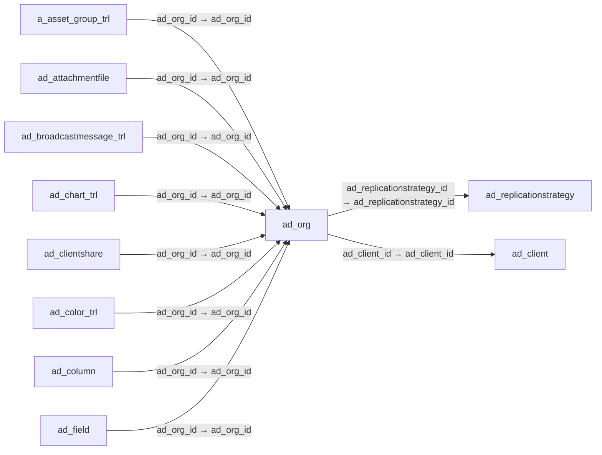

# ad_org — 조직

[전체 일람](../TABLE_INDEX.md) · [분류 일람](README.md) · [AI 사용 안내](../README.md) · [외래키 읽는 법](../RELATIONSHIPS.md)

## 기본 정보

| 항목 | 내용 |
|---|---|
| 물리명 | `adempiere.ad_org` |
| 한국어 논리명(문서용 해석) | 조직 |
| 원본 논리명 | Organization |
| 원본 사전 ID | 155 |
| 분류 | `ad` — 애플리케이션 사전·화면·권한·시스템 |
| 전체 테넌트 행 수 | 10 |
| 물리 열 수 | 13 |
| 나가는 FK / 들어오는 FK | 2 / 189 |
| 구조·행 수 확인 시점 | 2026-11-03T23:29:01+09:00 |

## 의미와 쓰임

테넌트 내부의 조직 단위를 정의한다.

- 설명 근거: 원본 애플리케이션 사전 명칭·설명을 한국어로 해석.
- 한국어 이름과 개요는 문서용 해석입니다. 공식 한국어 번역으로 간주하지 않습니다.
- 원본 설명: Organizational entity within client
- 원본 도움말: —
- PostgreSQL 테이블 주석: —

## 키와 열

### 기본키·고유 제약조건

| 종류 | 제약조건 | 열(순서 유지) |
|---|---|---|
| PRIMARY KEY | `ad_org_pkey` | `ad_org_id` |
| UNIQUE | `ad_org_uu_idx` | `ad_org_uu` |

### 별도 고유 인덱스

PK·UNIQUE 제약조건의 인덱스와 별도로 존재하는 고유 인덱스입니다. 식·조건·열 순서는 원본 정의를 따릅니다.

- `ad_org_value`: `CREATE UNIQUE INDEX ad_org_value ON adempiere.ad_org USING btree (ad_client_id, value)`

### 열 목록

원본 논리명·설명은 `AD_Column`에서 가져왔습니다. 기본값은 실제 PostgreSQL 메타데이터이며, 비어 있는 항목은 `—`로 표시합니다.

| 순서 | 물리명 | 원본 논리명 | PostgreSQL 타입 | NULL | PK | 기본값 | 설명 |
|---:|---|---|---|---|---|---|---|
| 1 | `ad_org_id` | Organization | numeric(10,0) | 불가 | 예 | — | Organizational entity within tenant |
| 2 | `ad_client_id` | Tenant | numeric(10,0) | 불가 | — | — | Tenant for this installation. |
| 3 | `isactive` | Active | character(1) | 불가 | — | 'Y'::bpchar | The record is active in the system |
| 4 | `created` | Created | timestamp without time zone | 불가 | — | now() | Date this record was created |
| 5 | `createdby` | Created By | numeric(10,0) | 불가 | — | — | User who created this records |
| 6 | `updated` | Updated | timestamp without time zone | 불가 | — | now() | Date this record was updated |
| 7 | `updatedby` | Updated By | numeric(10,0) | 불가 | — | — | User who updated this records |
| 8 | `value` | Search Key | character varying(40) | 불가 | — | — | Search key for the record in the format required - must be unique |
| 9 | `name` | Name | character varying(60) | 불가 | — | — | Alphanumeric identifier of the entity |
| 10 | `description` | Description | character varying(255) | 허용 | — | — | Optional short description of the record |
| 11 | `issummary` | Summary Level | character(1) | 불가 | — | 'N'::bpchar | This is a summary entity |
| 12 | `ad_replicationstrategy_id` | Replication Strategy | numeric | 허용 | — | — | Data Replication Strategy |
| 13 | `ad_org_uu` | AD_Org_UU | uuid | 허용 | — | — | — |

## 외래키 흐름

화살표는 **FK를 가진 자식 → 참조되는 부모**입니다. 업무 처리의 시간 순서나 무조건적인 1:N 관계를 뜻하지 않습니다.

주변 관계 191개 중 10개를 그림으로 표시합니다. **전체 관계는 아래 두 표에 모두 포함**합니다.

### 이 테이블이 참조하는 부모 — 나가는 FK

| 제약조건 | 참조하는 쪽(자식) | 자식 열 | 참조받는 쪽(부모) | 부모 열 | 삭제 / 갱신 | 검증 / 지연 가능 |
|---|---|---|---|---|---|---|
| `ad_org__ad_repli_ad_replica` <!-- FK_OUT: adempiere.ad_org.ad_org__ad_repli_ad_replica --> | [`ad_org`](ad_org.md) | `ad_replicationstrategy_id` | [`ad_replicationstrategy`](ad_replicationstrategy.md) | `ad_replicationstrategy_id` | NO ACTION / NO ACTION | 완료 / 가능 (초기 지연) |
| `adclient_adorg` <!-- FK_OUT: adempiere.ad_org.adclient_adorg --> | [`ad_org`](ad_org.md) | `ad_client_id` | [`ad_client`](ad_client.md) | `ad_client_id` | NO ACTION / NO ACTION | 완료 / 가능 (초기 지연) |

### 이 테이블을 참조하는 자식 — 들어오는 FK

| 제약조건 | 참조하는 쪽(자식) | 자식 열 | 참조받는 쪽(부모) | 부모 열 | 삭제 / 갱신 | 검증 / 지연 가능 |
|---|---|---|---|---|---|---|
| `adorg_aassetgrouptrl` <!-- FK_IN: adempiere.a_asset_group_trl.adorg_aassetgrouptrl --> | [`a_asset_group_trl`](../a/a_asset_group_trl.md) | `ad_org_id` | [`ad_org`](ad_org.md) | `ad_org_id` | NO ACTION / NO ACTION | 완료 / 가능 (초기 지연) |
| `adorg_adattachmentfile` <!-- FK_IN: adempiere.ad_attachmentfile.adorg_adattachmentfile --> | [`ad_attachmentfile`](ad_attachmentfile.md) | `ad_org_id` | [`ad_org`](ad_org.md) | `ad_org_id` | NO ACTION / NO ACTION | 완료 / 가능 (초기 지연) |
| `adorg_adbroadcastmessagetrl` <!-- FK_IN: adempiere.ad_broadcastmessage_trl.adorg_adbroadcastmessagetrl --> | [`ad_broadcastmessage_trl`](ad_broadcastmessage_trl.md) | `ad_org_id` | [`ad_org`](ad_org.md) | `ad_org_id` | NO ACTION / NO ACTION | 완료 / 가능 (초기 지연) |
| `adorg_adcharttrl` <!-- FK_IN: adempiere.ad_chart_trl.adorg_adcharttrl --> | [`ad_chart_trl`](ad_chart_trl.md) | `ad_org_id` | [`ad_org`](ad_org.md) | `ad_org_id` | NO ACTION / NO ACTION | 완료 / 가능 (초기 지연) |
| `adorg_adclientshare` <!-- FK_IN: adempiere.ad_clientshare.adorg_adclientshare --> | [`ad_clientshare`](ad_clientshare.md) | `ad_org_id` | [`ad_org`](ad_org.md) | `ad_org_id` | NO ACTION / NO ACTION | 완료 / 가능 (초기 지연) |
| `adorg_adcolortrl` <!-- FK_IN: adempiere.ad_color_trl.adorg_adcolortrl --> | [`ad_color_trl`](ad_color_trl.md) | `ad_org_id` | [`ad_org`](ad_org.md) | `ad_org_id` | NO ACTION / NO ACTION | 완료 / 가능 (초기 지연) |
| `columnorg` <!-- FK_IN: adempiere.ad_column.columnorg --> | [`ad_column`](ad_column.md) | `ad_org_id` | [`ad_org`](ad_org.md) | `ad_org_id` | NO ACTION / NO ACTION | 완료 / 가능 (초기 지연) |
| `fieldorg` <!-- FK_IN: adempiere.ad_field.fieldorg --> | [`ad_field`](ad_field.md) | `ad_org_id` | [`ad_org`](ad_org.md) | `ad_org_id` | NO ACTION / NO ACTION | 완료 / 가능 (초기 지연) |
| `adorg_adimporttemplate` <!-- FK_IN: adempiere.ad_importtemplate.adorg_adimporttemplate --> | [`ad_importtemplate`](ad_importtemplate.md) | `ad_org_id` | [`ad_org`](ad_org.md) | `ad_org_id` | NO ACTION / NO ACTION | 완료 / 가능 (초기 지연) |
| `adorg_adimporttemplateaccess` <!-- FK_IN: adempiere.ad_importtemplateaccess.adorg_adimporttemplateaccess --> | [`ad_importtemplateaccess`](ad_importtemplateaccess.md) | `ad_org_id` | [`ad_org`](ad_org.md) | `ad_org_id` | NO ACTION / NO ACTION | 완료 / 가능 (초기 지연) |
| `adorg_adinforelated` <!-- FK_IN: adempiere.ad_inforelated.adorg_adinforelated --> | [`ad_inforelated`](ad_inforelated.md) | `ad_org_id` | [`ad_org`](ad_org.md) | `ad_org_id` | NO ACTION / NO ACTION | 완료 / 가능 (초기 지연) |
| `adorg_adlabeltrl` <!-- FK_IN: adempiere.ad_label_trl.adorg_adlabeltrl --> | [`ad_label_trl`](ad_label_trl.md) | `ad_org_id` | [`ad_org`](ad_org.md) | `ad_org_id` | NO ACTION / NO ACTION | 완료 / 가능 (초기 지연) |
| `adorg_adlabelcategorytrl` <!-- FK_IN: adempiere.ad_labelcategory_trl.adorg_adlabelcategorytrl --> | [`ad_labelcategory_trl`](ad_labelcategory_trl.md) | `ad_org_id` | [`ad_org`](ad_org.md) | `ad_org_id` | NO ACTION / NO ACTION | 완료 / 가능 (초기 지연) |
| `languageorg` <!-- FK_IN: adempiere.ad_language.languageorg --> | [`ad_language`](ad_language.md) | `ad_org_id` | [`ad_org`](ad_org.md) | `ad_org_id` | NO ACTION / NO ACTION | 완료 / 가능 (초기 지연) |
| `ad_menu_org` <!-- FK_IN: adempiere.ad_menu.ad_menu_org --> | [`ad_menu`](ad_menu.md) | `ad_org_id` | [`ad_org`](ad_org.md) | `ad_org_id` | NO ACTION / NO ACTION | 완료 / 가능 (초기 지연) |
| `messageorg` <!-- FK_IN: adempiere.ad_message.messageorg --> | [`ad_message`](ad_message.md) | `ad_org_id` | [`ad_org`](ad_org.md) | `ad_org_id` | NO ACTION / NO ACTION | 완료 / 가능 (초기 지연) |
| `adorg_admodelgeneratortemplate` <!-- FK_IN: adempiere.ad_modelgeneratortemplate.adorg_admodelgeneratortemplate --> | [`ad_modelgeneratortemplate`](ad_modelgeneratortemplate.md) | `ad_org_id` | [`ad_org`](ad_org.md) | `ad_org_id` | NO ACTION / NO ACTION | 완료 / 가능 (초기 지연) |
| `adorg_adorginfo` <!-- FK_IN: adempiere.ad_orginfo.adorg_adorginfo --> | [`ad_orginfo`](ad_orginfo.md) | `ad_org_id` | [`ad_org`](ad_org.md) | `ad_org_id` | CASCADE / NO ACTION | 완료 / 가능 (초기 지연) |
| `adorgparent_adorginfo` <!-- FK_IN: adempiere.ad_orginfo.adorgparent_adorginfo --> | [`ad_orginfo`](ad_orginfo.md) | `parent_org_id` | [`ad_org`](ad_org.md) | `ad_org_id` | SET NULL / NO ACTION | 완료 / 가능 (초기 지연) |
| `adorg_adpasswordhistory` <!-- FK_IN: adempiere.ad_password_history.adorg_adpasswordhistory --> | [`ad_password_history`](ad_password_history.md) | `ad_org_id` | [`ad_org`](ad_org.md) | `ad_org_id` | NO ACTION / NO ACTION | 완료 / 가능 (초기 지연) |
| `adorg_adpostit` <!-- FK_IN: adempiere.ad_postit.adorg_adpostit --> | [`ad_postit`](ad_postit.md) | `ad_org_id` | [`ad_org`](ad_org.md) | `ad_org_id` | NO ACTION / NO ACTION | 완료 / 가능 (초기 지연) |
| `ad_preference_org` <!-- FK_IN: adempiere.ad_preference.ad_preference_org --> | [`ad_preference`](ad_preference.md) | `ad_org_id` | [`ad_org`](ad_org.md) | `ad_org_id` | NO ACTION / NO ACTION | 완료 / 가능 (초기 지연) |
| `adorg_adprintcolortrl` <!-- FK_IN: adempiere.ad_printcolor_trl.adorg_adprintcolortrl --> | [`ad_printcolor_trl`](ad_printcolor_trl.md) | `ad_org_id` | [`ad_org`](ad_org.md) | `ad_org_id` | NO ACTION / NO ACTION | 완료 / 가능 (초기 지연) |
| `ad_processtaccess_org` <!-- FK_IN: adempiere.ad_process_access.ad_processtaccess_org --> | [`ad_process_access`](ad_process_access.md) | `ad_org_id` | [`ad_org`](ad_org.md) | `ad_org_id` | NO ACTION / NO ACTION | 완료 / 가능 (초기 지연) |
| `ad_reflist_org` <!-- FK_IN: adempiere.ad_ref_list.ad_reflist_org --> | [`ad_ref_list`](ad_ref_list.md) | `ad_org_id` | [`ad_org`](ad_org.md) | `ad_org_id` | NO ACTION / NO ACTION | 완료 / 가능 (초기 지연) |
| `ref_tableorg` <!-- FK_IN: adempiere.ad_ref_table.ref_tableorg --> | [`ad_ref_table`](ad_ref_table.md) | `ad_org_id` | [`ad_org`](ad_org.md) | `ad_org_id` | NO ACTION / NO ACTION | 완료 / 가능 (초기 지연) |
| `referenceorg` <!-- FK_IN: adempiere.ad_reference.referenceorg --> | [`ad_reference`](ad_reference.md) | `ad_org_id` | [`ad_org`](ad_org.md) | `ad_org_id` | NO ACTION / NO ACTION | 완료 / 가능 (초기 지연) |
| `remoteorg_adreplication` <!-- FK_IN: adempiere.ad_replication.remoteorg_adreplication --> | [`ad_replication`](ad_replication.md) | `remote_org_id` | [`ad_org`](ad_org.md) | `ad_org_id` | NO ACTION / NO ACTION | 완료 / 가능 (초기 지연) |
| `adorg_adreportviewcolumn` <!-- FK_IN: adempiere.ad_reportview_column.adorg_adreportviewcolumn --> | [`ad_reportview_column`](ad_reportview_column.md) | `ad_org_id` | [`ad_org`](ad_org.md) | `ad_org_id` | NO ACTION / NO ACTION | 완료 / 가능 (초기 지연) |
| `adorg_adrequiredplugin` <!-- FK_IN: adempiere.ad_requiredplugin.adorg_adrequiredplugin --> | [`ad_requiredplugin`](ad_requiredplugin.md) | `ad_org_id` | [`ad_org`](ad_org.md) | `ad_org_id` | NO ACTION / NO ACTION | 완료 / 가능 (초기 지연) |
| `ad_roleorg` <!-- FK_IN: adempiere.ad_role.ad_roleorg --> | [`ad_role`](ad_role.md) | `ad_org_id` | [`ad_org`](ad_org.md) | `ad_org_id` | NO ACTION / NO ACTION | 완료 / 가능 (초기 지연) |
| `adorg_adroleorgaccess` <!-- FK_IN: adempiere.ad_role_orgaccess.adorg_adroleorgaccess --> | [`ad_role_orgaccess`](ad_role_orgaccess.md) | `ad_org_id` | [`ad_org`](ad_org.md) | `ad_org_id` | CASCADE / NO ACTION | 완료 / 가능 (초기 지연) |
| `sequenceorg` <!-- FK_IN: adempiere.ad_sequence.sequenceorg --> | [`ad_sequence`](ad_sequence.md) | `ad_org_id` | [`ad_org`](ad_org.md) | `ad_org_id` | NO ACTION / NO ACTION | 완료 / 가능 (초기 지연) |
| `sequence_auditorg` <!-- FK_IN: adempiere.ad_sequence_audit.sequence_auditorg --> | [`ad_sequence_audit`](ad_sequence_audit.md) | `ad_org_id` | [`ad_org`](ad_org.md) | `ad_org_id` | NO ACTION / NO ACTION | 완료 / 가능 (초기 지연) |
| `sequence_noorg` <!-- FK_IN: adempiere.ad_sequence_no.sequence_noorg --> | [`ad_sequence_no`](ad_sequence_no.md) | `ad_org_id` | [`ad_org`](ad_org.md) | `ad_org_id` | NO ACTION / NO ACTION | 완료 / 가능 (초기 지연) |
| `adorg_adstatusline` <!-- FK_IN: adempiere.ad_statusline.adorg_adstatusline --> | [`ad_statusline`](ad_statusline.md) | `ad_org_id` | [`ad_org`](ad_org.md) | `ad_org_id` | NO ACTION / NO ACTION | 완료 / 가능 (초기 지연) |
| `adorg_adstatuslineusedin` <!-- FK_IN: adempiere.ad_statuslineusedin.adorg_adstatuslineusedin --> | [`ad_statuslineusedin`](ad_statuslineusedin.md) | `ad_org_id` | [`ad_org`](ad_org.md) | `ad_org_id` | NO ACTION / NO ACTION | 완료 / 가능 (초기 지연) |
| `taborg` <!-- FK_IN: adempiere.ad_tab.taborg --> | [`ad_tab`](ad_tab.md) | `ad_org_id` | [`ad_org`](ad_org.md) | `ad_org_id` | NO ACTION / NO ACTION | 완료 / 가능 (초기 지연) |
| `tableorg` <!-- FK_IN: adempiere.ad_table.tableorg --> | [`ad_table`](ad_table.md) | `ad_org_id` | [`ad_org`](ad_org.md) | `ad_org_id` | NO ACTION / NO ACTION | 완료 / 가능 (초기 지연) |
| `ad_dataaccessorg` <!-- FK_IN: adempiere.ad_table_access.ad_dataaccessorg --> | [`ad_table_access`](ad_table_access.md) | `ad_org_id` | [`ad_org`](ad_org.md) | `ad_org_id` | NO ACTION / NO ACTION | 완료 / 가능 (초기 지연) |
| `adorg_adtableattributeset` <!-- FK_IN: adempiere.ad_tableattributeset.adorg_adtableattributeset --> | [`ad_tableattributeset`](ad_tableattributeset.md) | `ad_org_id` | [`ad_org`](ad_org.md) | `ad_org_id` | NO ACTION / NO ACTION | 완료 / 가능 (초기 지연) |
| `adorg_adtablevalrule` <!-- FK_IN: adempiere.ad_tablevalrule.adorg_adtablevalrule --> | [`ad_tablevalrule`](ad_tablevalrule.md) | `ad_org_id` | [`ad_org`](ad_org.md) | `ad_org_id` | NO ACTION / NO ACTION | 완료 / 가능 (초기 지연) |
| `taskorg` <!-- FK_IN: adempiere.ad_task.taskorg --> | [`ad_task`](ad_task.md) | `ad_org_id` | [`ad_org`](ad_org.md) | `ad_org_id` | NO ACTION / NO ACTION | 완료 / 가능 (초기 지연) |
| `ad_taskaccess_org` <!-- FK_IN: adempiere.ad_task_access.ad_taskaccess_org --> | [`ad_task_access`](ad_task_access.md) | `ad_org_id` | [`ad_org`](ad_org.md) | `ad_org_id` | NO ACTION / NO ACTION | 완료 / 가능 (초기 지연) |
| `taskinstanceorg` <!-- FK_IN: adempiere.ad_taskinstance.taskinstanceorg --> | [`ad_taskinstance`](ad_taskinstance.md) | `ad_org_id` | [`ad_org`](ad_org.md) | `ad_org_id` | NO ACTION / NO ACTION | 완료 / 가능 (초기 지연) |
| `ad_user_org` <!-- FK_IN: adempiere.ad_user.ad_user_org --> | [`ad_user`](ad_user.md) | `ad_org_id` | [`ad_org`](ad_org.md) | `ad_org_id` | NO ACTION / NO ACTION | 완료 / 가능 (초기 지연) |
| `adorgtrx_aduser` <!-- FK_IN: adempiere.ad_user.adorgtrx_aduser --> | [`ad_user`](ad_user.md) | `ad_orgtrx_id` | [`ad_org`](ad_org.md) | `ad_org_id` | NO ACTION / NO ACTION | 완료 / 가능 (초기 지연) |
| `adorg_aduserorgaccess` <!-- FK_IN: adempiere.ad_user_orgaccess.adorg_aduserorgaccess --> | [`ad_user_orgaccess`](ad_user_orgaccess.md) | `ad_org_id` | [`ad_org`](ad_org.md) | `ad_org_id` | NO ACTION / NO ACTION | 완료 / 가능 (초기 지연) |
| `ad_userrolesorg` <!-- FK_IN: adempiere.ad_user_roles.ad_userrolesorg --> | [`ad_user_roles`](ad_user_roles.md) | `ad_org_id` | [`ad_org`](ad_org.md) | `ad_org_id` | NO ACTION / NO ACTION | 완료 / 가능 (초기 지연) |
| `adorg_aduserdeftheme` <!-- FK_IN: adempiere.ad_userdef_theme.adorg_aduserdeftheme --> | [`ad_userdef_theme`](ad_userdef_theme.md) | `ad_org_id` | [`ad_org`](ad_org.md) | `ad_org_id` | NO ACTION / NO ACTION | 완료 / 가능 (초기 지연) |
| `adorg_aduserdefthemedetail` <!-- FK_IN: adempiere.ad_userdef_theme_detail.adorg_aduserdefthemedetail --> | [`ad_userdef_theme_detail`](ad_userdef_theme_detail.md) | `ad_org_id` | [`ad_org`](ad_org.md) | `ad_org_id` | NO ACTION / NO ACTION | 완료 / 가능 (초기 지연) |
| `adorg_aduserpreference` <!-- FK_IN: adempiere.ad_userpreference.adorg_aduserpreference --> | [`ad_userpreference`](ad_userpreference.md) | `ad_org_id` | [`ad_org`](ad_org.md) | `ad_org_id` | NO ACTION / NO ACTION | 완료 / 가능 (초기 지연) |
| `val_ruleorg` <!-- FK_IN: adempiere.ad_val_rule.val_ruleorg --> | [`ad_val_rule`](ad_val_rule.md) | `ad_org_id` | [`ad_org`](ad_org.md) | `ad_org_id` | NO ACTION / NO ACTION | 완료 / 가능 (초기 지연) |
| `adorg_adverifymigration` <!-- FK_IN: adempiere.ad_verifymigration.adorg_adverifymigration --> | [`ad_verifymigration`](ad_verifymigration.md) | `ad_org_id` | [`ad_org`](ad_org.md) | `ad_org_id` | NO ACTION / NO ACTION | 완료 / 가능 (초기 지연) |
| `wf_nodeorg` <!-- FK_IN: adempiere.ad_wf_node.wf_nodeorg --> | [`ad_wf_node`](ad_wf_node.md) | `ad_org_id` | [`ad_org`](ad_org.md) | `ad_org_id` | NO ACTION / NO ACTION | 완료 / 가능 (초기 지연) |
| `wf_nodenextorg` <!-- FK_IN: adempiere.ad_wf_nodenext.wf_nodenextorg --> | [`ad_wf_nodenext`](ad_wf_nodenext.md) | `ad_org_id` | [`ad_org`](ad_org.md) | `ad_org_id` | NO ACTION / NO ACTION | 완료 / 가능 (초기 지연) |
| `wf_instanceorg` <!-- FK_IN: adempiere.ad_wf_process.wf_instanceorg --> | [`ad_wf_process`](ad_wf_process.md) | `ad_org_id` | [`ad_org`](ad_org.md) | `ad_org_id` | NO ACTION / NO ACTION | 완료 / 가능 (초기 지연) |
| `adorg_adwfresponsible` <!-- FK_IN: adempiere.ad_wf_responsible.adorg_adwfresponsible --> | [`ad_wf_responsible`](ad_wf_responsible.md) | `ad_org_id` | [`ad_org`](ad_org.md) | `ad_org_id` | NO ACTION / NO ACTION | 완료 / 가능 (초기 지연) |
| `windoworg` <!-- FK_IN: adempiere.ad_window.windoworg --> | [`ad_window`](ad_window.md) | `ad_org_id` | [`ad_org`](ad_org.md) | `ad_org_id` | NO ACTION / NO ACTION | 완료 / 가능 (초기 지연) |
| `ad_functaccessorg` <!-- FK_IN: adempiere.ad_window_access.ad_functaccessorg --> | [`ad_window_access`](ad_window_access.md) | `ad_org_id` | [`ad_org`](ad_org.md) | `ad_org_id` | NO ACTION / NO ACTION | 완료 / 가능 (초기 지연) |
| `workfloworg` <!-- FK_IN: adempiere.ad_workflow.workfloworg --> | [`ad_workflow`](ad_workflow.md) | `ad_org_id` | [`ad_org`](ad_org.md) | `ad_org_id` | NO ACTION / NO ACTION | 완료 / 가능 (초기 지연) |
| `ad_workflowaccess_org` <!-- FK_IN: adempiere.ad_workflow_access.ad_workflowaccess_org --> | [`ad_workflow_access`](ad_workflow_access.md) | `ad_org_id` | [`ad_org`](ad_org.md) | `ad_org_id` | NO ACTION / NO ACTION | 완료 / 가능 (초기 지연) |
| `ad_org_c_acctschema` <!-- FK_IN: adempiere.c_acctschema.ad_org_c_acctschema --> | [`c_acctschema`](../c/c_acctschema.md) | `ad_org_id` | [`ad_org`](ad_org.md) | `ad_org_id` | NO ACTION / NO ACTION | 완료 / 가능 (초기 지연) |
| `adorgonly_cacctschema` <!-- FK_IN: adempiere.c_acctschema.adorgonly_cacctschema --> | [`c_acctschema`](../c/c_acctschema.md) | `ad_orgonly_id` | [`ad_org`](ad_org.md) | `ad_org_id` | NO ACTION / NO ACTION | 완료 / 가능 (초기 지연) |
| `adorg_caschemaelement` <!-- FK_IN: adempiere.c_acctschema_element.adorg_caschemaelement --> | [`c_acctschema_element`](../c/c_acctschema_element.md) | `org_id` | [`ad_org`](ad_org.md) | `ad_org_id` | NO ACTION / NO ACTION | 완료 / 가능 (초기 지연) |
| `adorgid_c_aschemaelement` <!-- FK_IN: adempiere.c_acctschema_element.adorgid_c_aschemaelement --> | [`c_acctschema_element`](../c/c_acctschema_element.md) | `ad_org_id` | [`ad_org`](ad_org.md) | `ad_org_id` | NO ACTION / NO ACTION | 완료 / 가능 (초기 지연) |
| `adorg_cactivitytrl` <!-- FK_IN: adempiere.c_activity_trl.adorg_cactivitytrl --> | [`c_activity_trl`](../c/c_activity_trl.md) | `ad_org_id` | [`ad_org`](ad_org.md) | `ad_org_id` | NO ACTION / NO ACTION | 완료 / 가능 (초기 지연) |
| `adorg_caddresstransaction` <!-- FK_IN: adempiere.c_addresstransaction.adorg_caddresstransaction --> | [`c_addresstransaction`](../c/c_addresstransaction.md) | `ad_org_id` | [`ad_org`](ad_org.md) | `ad_org_id` | NO ACTION / NO ACTION | 완료 / 가능 (초기 지연) |
| `adorg_caddressvalidation` <!-- FK_IN: adempiere.c_addressvalidation.adorg_caddressvalidation --> | [`c_addressvalidation`](../c/c_addressvalidation.md) | `ad_org_id` | [`ad_org`](ad_org.md) | `ad_org_id` | NO ACTION / NO ACTION | 완료 / 가능 (초기 지연) |
| `adorg_caddressvalidationcfg` <!-- FK_IN: adempiere.c_addressvalidationcfg.adorg_caddressvalidationcfg --> | [`c_addressvalidationcfg`](../c/c_addressvalidationcfg.md) | `ad_org_id` | [`ad_org`](ad_org.md) | `ad_org_id` | NO ACTION / NO ACTION | 완료 / 가능 (초기 지연) |
| `fromadorg_cbanktransfer` <!-- FK_IN: adempiere.c_banktransfer.fromadorg_cbanktransfer --> | [`c_banktransfer`](../c/c_banktransfer.md) | `from_ad_org_id` | [`ad_org`](ad_org.md) | `ad_org_id` | NO ACTION / NO ACTION | 완료 / 가능 (초기 지연) |
| `toadorg_cbanktransfer` <!-- FK_IN: adempiere.c_banktransfer.toadorg_cbanktransfer --> | [`c_banktransfer`](../c/c_banktransfer.md) | `to_ad_org_id` | [`ad_org`](ad_org.md) | `ad_org_id` | NO ACTION / NO ACTION | 완료 / 가능 (초기 지연) |
| `adorg_cbpartner` <!-- FK_IN: adempiere.c_bpartner.adorg_cbpartner --> | [`c_bpartner`](../c/c_bpartner.md) | `ad_org_id` | [`ad_org`](ad_org.md) | `ad_org_id` | NO ACTION / NO ACTION | 완료 / 가능 (초기 지연) |
| `adorg_cbpartnerorg` <!-- FK_IN: adempiere.c_bpartner.adorg_cbpartnerorg --> | [`c_bpartner`](../c/c_bpartner.md) | `ad_orgbp_id` | [`ad_org`](ad_org.md) | `ad_org_id` | NO ACTION / NO ACTION | 완료 / 가능 (초기 지연) |
| `c_buspartner_locationorg` <!-- FK_IN: adempiere.c_bpartner_location.c_buspartner_locationorg --> | [`c_bpartner_location`](../c/c_bpartner_location.md) | `ad_org_id` | [`ad_org`](ad_org.md) | `ad_org_id` | NO ACTION / NO ACTION | 완료 / 가능 (초기 지연) |
| `c_calendarorg` <!-- FK_IN: adempiere.c_calendar.c_calendarorg --> | [`c_calendar`](../c/c_calendar.md) | `ad_org_id` | [`ad_org`](ad_org.md) | `ad_org_id` | NO ACTION / NO ACTION | 완료 / 가능 (초기 지연) |
| `adorg_ccampaigntrl` <!-- FK_IN: adempiere.c_campaign_trl.adorg_ccampaigntrl --> | [`c_campaign_trl`](../c/c_campaign_trl.md) | `ad_org_id` | [`ad_org`](ad_org.md) | `ad_org_id` | NO ACTION / NO ACTION | 완료 / 가능 (초기 지연) |
| `adorg_ccash` <!-- FK_IN: adempiere.c_cash.adorg_ccash --> | [`c_cash`](../c/c_cash.md) | `ad_org_id` | [`ad_org`](ad_org.md) | `ad_org_id` | NO ACTION / NO ACTION | 완료 / 가능 (초기 지연) |
| `adorgtrx_ccash` <!-- FK_IN: adempiere.c_cash.adorgtrx_ccash --> | [`c_cash`](../c/c_cash.md) | `ad_orgtrx_id` | [`ad_org`](ad_org.md) | `ad_org_id` | NO ACTION / NO ACTION | 완료 / 가능 (초기 지연) |
| `adorgtrx_ccashplan` <!-- FK_IN: adempiere.c_cashplan.adorgtrx_ccashplan --> | [`c_cashplan`](../c/c_cashplan.md) | `ad_orgtrx_id` | [`ad_org`](ad_org.md) | `ad_org_id` | NO ACTION / NO ACTION | 완료 / 가능 (초기 지연) |
| `adorgtrx_ccashplanline` <!-- FK_IN: adempiere.c_cashplanline.adorgtrx_ccashplanline --> | [`c_cashplanline`](../c/c_cashplanline.md) | `ad_orgtrx_id` | [`ad_org`](ad_org.md) | `ad_org_id` | NO ACTION / NO ACTION | 완료 / 가능 (초기 지연) |
| `c_cityorg` <!-- FK_IN: adempiere.c_city.c_cityorg --> | [`c_city`](../c/c_city.md) | `ad_org_id` | [`ad_org`](ad_org.md) | `ad_org_id` | NO ACTION / NO ACTION | 완료 / 가능 (초기 지연) |
| `adorgtrx_ccommissionline` <!-- FK_IN: adempiere.c_commissionline.adorgtrx_ccommissionline --> | [`c_commissionline`](../c/c_commissionline.md) | `org_id` | [`ad_org`](ad_org.md) | `ad_org_id` | NO ACTION / NO ACTION | 완료 / 가능 (초기 지연) |
| `c_conversion_rateorg` <!-- FK_IN: adempiere.c_conversion_rate.c_conversion_rateorg --> | [`c_conversion_rate`](../c/c_conversion_rate.md) | `ad_org_id` | [`ad_org`](ad_org.md) | `ad_org_id` | NO ACTION / NO ACTION | 완료 / 가능 (초기 지연) |
| `c_countryorg` <!-- FK_IN: adempiere.c_country.c_countryorg --> | [`c_country`](../c/c_country.md) | `ad_org_id` | [`ad_org`](ad_org.md) | `ad_org_id` | NO ACTION / NO ACTION | 완료 / 가능 (초기 지연) |
| `adorg_ccountrygroup` <!-- FK_IN: adempiere.c_countrygroup.adorg_ccountrygroup --> | [`c_countrygroup`](../c/c_countrygroup.md) | `ad_org_id` | [`ad_org`](ad_org.md) | `ad_org_id` | NO ACTION / NO ACTION | 완료 / 가능 (초기 지연) |
| `adorg_ccountrygrouptrl` <!-- FK_IN: adempiere.c_countrygroup_trl.adorg_ccountrygrouptrl --> | [`c_countrygroup_trl`](../c/c_countrygroup_trl.md) | `ad_org_id` | [`ad_org`](ad_org.md) | `ad_org_id` | NO ACTION / NO ACTION | 완료 / 가능 (초기 지연) |
| `adorg_ccountrygroupcountry` <!-- FK_IN: adempiere.c_countrygroupcountry.adorg_ccountrygroupcountry --> | [`c_countrygroupcountry`](../c/c_countrygroupcountry.md) | `ad_org_id` | [`ad_org`](ad_org.md) | `ad_org_id` | NO ACTION / NO ACTION | 완료 / 가능 (초기 지연) |
| `c_currencyorg` <!-- FK_IN: adempiere.c_currency.c_currencyorg --> | [`c_currency`](../c/c_currency.md) | `ad_org_id` | [`ad_org`](ad_org.md) | `ad_org_id` | NO ACTION / NO ACTION | 완료 / 가능 (초기 지연) |
| `adorg_cperioddocgroup` <!-- FK_IN: adempiere.c_docbasegroup.adorg_cperioddocgroup --> | [`c_docbasegroup`](../c/c_docbasegroup.md) | `ad_org_id` | [`ad_org`](ad_org.md) | `ad_org_id` | NO ACTION / NO ACTION | 완료 / 가능 (초기 지연) |
| `adorg_cperioddocgroupline` <!-- FK_IN: adempiere.c_docbasegroupline.adorg_cperioddocgroupline --> | [`c_docbasegroupline`](../c/c_docbasegroupline.md) | `ad_org_id` | [`ad_org`](ad_org.md) | `ad_org_id` | NO ACTION / NO ACTION | 완료 / 가능 (초기 지연) |
| `c_elementorg` <!-- FK_IN: adempiere.c_element.c_elementorg --> | [`c_element`](../c/c_element.md) | `ad_org_id` | [`ad_org`](ad_org.md) | `ad_org_id` | NO ACTION / NO ACTION | 완료 / 가능 (초기 지연) |
| `adorg_celementvalue` <!-- FK_IN: adempiere.c_elementvalue.adorg_celementvalue --> | [`c_elementvalue`](../c/c_elementvalue.md) | `ad_org_id` | [`ad_org`](ad_org.md) | `ad_org_id` | NO ACTION / NO ACTION | 완료 / 가능 (초기 지연) |
| `adorg_cinterorgacct` <!-- FK_IN: adempiere.c_interorg_acct.adorg_cinterorgacct --> | [`c_interorg_acct`](../c/c_interorg_acct.md) | `ad_org_id` | [`ad_org`](ad_org.md) | `ad_org_id` | CASCADE / NO ACTION | 완료 / 가능 (초기 지연) |
| `adorgto_cinterorgacct` <!-- FK_IN: adempiere.c_interorg_acct.adorgto_cinterorgacct --> | [`c_interorg_acct`](../c/c_interorg_acct.md) | `ad_orgto_id` | [`ad_org`](ad_org.md) | `ad_org_id` | CASCADE / NO ACTION | 완료 / 가능 (초기 지연) |
| `adorg_cinvoice` <!-- FK_IN: adempiere.c_invoice.adorg_cinvoice --> | [`c_invoice`](../c/c_invoice.md) | `ad_org_id` | [`ad_org`](ad_org.md) | `ad_org_id` | NO ACTION / NO ACTION | 완료 / 가능 (초기 지연) |
| `adorgtrx_cinvoice` <!-- FK_IN: adempiere.c_invoice.adorgtrx_cinvoice --> | [`c_invoice`](../c/c_invoice.md) | `ad_orgtrx_id` | [`ad_org`](ad_org.md) | `ad_org_id` | NO ACTION / NO ACTION | 완료 / 가능 (초기 지연) |
| `adorg_cinvoicebatchline` <!-- FK_IN: adempiere.c_invoicebatchline.adorg_cinvoicebatchline --> | [`c_invoicebatchline`](../c/c_invoicebatchline.md) | `ad_org_id` | [`ad_org`](ad_org.md) | `ad_org_id` | NO ACTION / NO ACTION | 완료 / 가능 (초기 지연) |
| `adorgtrx_cinvoicebatchline` <!-- FK_IN: adempiere.c_invoicebatchline.adorgtrx_cinvoicebatchline --> | [`c_invoicebatchline`](../c/c_invoicebatchline.md) | `ad_orgtrx_id` | [`ad_org`](ad_org.md) | `ad_org_id` | NO ACTION / NO ACTION | 완료 / 가능 (초기 지연) |
| `adorg_cinvoiceline` <!-- FK_IN: adempiere.c_invoiceline.adorg_cinvoiceline --> | [`c_invoiceline`](../c/c_invoiceline.md) | `ad_org_id` | [`ad_org`](ad_org.md) | `ad_org_id` | NO ACTION / NO ACTION | 완료 / 가능 (초기 지연) |
| `adorgtrx_cinvoiceline` <!-- FK_IN: adempiere.c_invoiceline.adorgtrx_cinvoiceline --> | [`c_invoiceline`](../c/c_invoiceline.md) | `ad_orgtrx_id` | [`ad_org`](ad_org.md) | `ad_org_id` | NO ACTION / NO ACTION | 완료 / 가능 (초기 지연) |
| `adorg_clocation` <!-- FK_IN: adempiere.c_location.adorg_clocation --> | [`c_location`](../c/c_location.md) | `ad_org_id` | [`ad_org`](ad_org.md) | `ad_org_id` | NO ACTION / NO ACTION | 완료 / 가능 (초기 지연) |
| `c_nonbusinesdaysorg` <!-- FK_IN: adempiere.c_nonbusinessday.c_nonbusinesdaysorg --> | [`c_nonbusinessday`](../c/c_nonbusinessday.md) | `ad_org_id` | [`ad_org`](ad_org.md) | `ad_org_id` | NO ACTION / NO ACTION | 완료 / 가능 (초기 지연) |
| `adorg_corder` <!-- FK_IN: adempiere.c_order.adorg_corder --> | [`c_order`](../c/c_order.md) | `ad_org_id` | [`ad_org`](ad_org.md) | `ad_org_id` | NO ACTION / NO ACTION | 완료 / 가능 (초기 지연) |
| `adorgtrx_corder` <!-- FK_IN: adempiere.c_order.adorgtrx_corder --> | [`c_order`](../c/c_order.md) | `ad_orgtrx_id` | [`ad_org`](ad_org.md) | `ad_org_id` | NO ACTION / NO ACTION | 완료 / 가능 (초기 지연) |
| `adorg_corderline` <!-- FK_IN: adempiere.c_orderline.adorg_corderline --> | [`c_orderline`](../c/c_orderline.md) | `ad_org_id` | [`ad_org`](ad_org.md) | `ad_org_id` | NO ACTION / NO ACTION | 완료 / 가능 (초기 지연) |
| `adorgtrx_corderline` <!-- FK_IN: adempiere.c_orderline.adorgtrx_corderline --> | [`c_orderline`](../c/c_orderline.md) | `ad_orgtrx_id` | [`ad_org`](ad_org.md) | `ad_org_id` | NO ACTION / NO ACTION | 완료 / 가능 (초기 지연) |
| `adorg_cordersource` <!-- FK_IN: adempiere.c_ordersource.adorg_cordersource --> | [`c_ordersource`](../c/c_ordersource.md) | `ad_org_id` | [`ad_org`](ad_org.md) | `ad_org_id` | NO ACTION / NO ACTION | 완료 / 가능 (초기 지연) |
| `adorg_corgassignment` <!-- FK_IN: adempiere.c_orgassignment.adorg_corgassignment --> | [`c_orgassignment`](../c/c_orgassignment.md) | `ad_org_id` | [`ad_org`](ad_org.md) | `ad_org_id` | NO ACTION / NO ACTION | 완료 / 가능 (초기 지연) |
| `adorg_cpayment` <!-- FK_IN: adempiere.c_payment.adorg_cpayment --> | [`c_payment`](../c/c_payment.md) | `ad_org_id` | [`ad_org`](ad_org.md) | `ad_org_id` | NO ACTION / NO ACTION | 완료 / 가능 (초기 지연) |
| `adorgtrx_cpayment` <!-- FK_IN: adempiere.c_payment.adorgtrx_cpayment --> | [`c_payment`](../c/c_payment.md) | `ad_orgtrx_id` | [`ad_org`](ad_org.md) | `ad_org_id` | NO ACTION / NO ACTION | 완료 / 가능 (초기 지연) |
| `adorgtrx_cpaymenttransaction` <!-- FK_IN: adempiere.c_paymenttransaction.adorgtrx_cpaymenttransaction --> | [`c_paymenttransaction`](../c/c_paymenttransaction.md) | `ad_orgtrx_id` | [`ad_org`](ad_org.md) | `ad_org_id` | NO ACTION / NO ACTION | 완료 / 가능 (초기 지연) |
| `c_periodorg` <!-- FK_IN: adempiere.c_period.c_periodorg --> | [`c_period`](../c/c_period.md) | `ad_org_id` | [`ad_org`](ad_org.md) | `ad_org_id` | NO ACTION / NO ACTION | 완료 / 가능 (초기 지연) |
| `adorg_cproject` <!-- FK_IN: adempiere.c_project.adorg_cproject --> | [`c_project`](../c/c_project.md) | `ad_org_id` | [`ad_org`](ad_org.md) | `ad_org_id` | NO ACTION / NO ACTION | 완료 / 가능 (초기 지연) |
| `adorgtrx_cproject` <!-- FK_IN: adempiere.c_project.adorgtrx_cproject --> | [`c_project`](../c/c_project.md) | `ad_orgtrx_id` | [`ad_org`](ad_org.md) | `ad_org_id` | NO ACTION / NO ACTION | 완료 / 가능 (초기 지연) |
| `adorg_crecurringgroup` <!-- FK_IN: adempiere.c_recurringgroup.adorg_crecurringgroup --> | [`c_recurringgroup`](../c/c_recurringgroup.md) | `ad_org_id` | [`ad_org`](ad_org.md) | `ad_org_id` | NO ACTION / NO ACTION | 완료 / 가능 (초기 지연) |
| `c_regionorg` <!-- FK_IN: adempiere.c_region.c_regionorg --> | [`c_region`](../c/c_region.md) | `ad_org_id` | [`ad_org`](ad_org.md) | `ad_org_id` | NO ACTION / NO ACTION | 완료 / 가능 (초기 지연) |
| `adorg_cregiontrl` <!-- FK_IN: adempiere.c_region_trl.adorg_cregiontrl --> | [`c_region_trl`](../c/c_region_trl.md) | `ad_org_id` | [`ad_org`](ad_org.md) | `ad_org_id` | NO ACTION / NO ACTION | 완료 / 가능 (초기 지연) |
| `adorg_crevenuerecogservice` <!-- FK_IN: adempiere.c_revenuerecog_service.adorg_crevenuerecogservice --> | [`c_revenuerecog_service`](../c/c_revenuerecog_service.md) | `ad_org_id` | [`ad_org`](ad_org.md) | `ad_org_id` | NO ACTION / NO ACTION | 완료 / 가능 (초기 지연) |
| `adorg_csalesregiontrl` <!-- FK_IN: adempiere.c_salesregion_trl.adorg_csalesregiontrl --> | [`c_salesregion_trl`](../c/c_salesregion_trl.md) | `ad_org_id` | [`ad_org`](ad_org.md) | `ad_org_id` | NO ACTION / NO ACTION | 완료 / 가능 (초기 지연) |
| `adorg_csalesstagetrl` <!-- FK_IN: adempiere.c_salesstage_trl.adorg_csalesstagetrl --> | [`c_salesstage_trl`](../c/c_salesstage_trl.md) | `ad_org_id` | [`ad_org`](ad_org.md) | `ad_org_id` | NO ACTION / NO ACTION | 완료 / 가능 (초기 지연) |
| `adorg_ctaxprovider` <!-- FK_IN: adempiere.c_taxprovider.adorg_ctaxprovider --> | [`c_taxprovider`](../c/c_taxprovider.md) | `ad_org_id` | [`ad_org`](ad_org.md) | `ad_org_id` | NO ACTION / NO ACTION | 완료 / 가능 (초기 지연) |
| `adorg_adtaxprovider` <!-- FK_IN: adempiere.c_taxprovidercfg.adorg_adtaxprovider --> | [`c_taxprovidercfg`](../c/c_taxprovidercfg.md) | `ad_org_id` | [`ad_org`](ad_org.md) | `ad_org_id` | NO ACTION / NO ACTION | 완료 / 가능 (초기 지연) |
| `c_uomorg` <!-- FK_IN: adempiere.c_uom.c_uomorg --> | [`c_uom`](../c/c_uom.md) | `ad_org_id` | [`ad_org`](ad_org.md) | `ad_org_id` | NO ACTION / NO ACTION | 완료 / 가능 (초기 지연) |
| `c_uom_conversionorg` <!-- FK_IN: adempiere.c_uom_conversion.c_uom_conversionorg --> | [`c_uom_conversion`](../c/c_uom_conversion.md) | `ad_org_id` | [`ad_org`](ad_org.md) | `ad_org_id` | NO ACTION / NO ACTION | 완료 / 가능 (초기 지연) |
| `adorg_vc` <!-- FK_IN: adempiere.c_validcombination.adorg_vc --> | [`c_validcombination`](../c/c_validcombination.md) | `ad_org_id` | [`ad_org`](ad_org.md) | `ad_org_id` | NO ACTION / NO ACTION | 완료 / 가능 (초기 지연) |
| `adorgtrx_vc` <!-- FK_IN: adempiere.c_validcombination.adorgtrx_vc --> | [`c_validcombination`](../c/c_validcombination.md) | `ad_orgtrx_id` | [`ad_org`](ad_org.md) | `ad_org_id` | NO ACTION / NO ACTION | 완료 / 가능 (초기 지연) |
| `c_yearorg` <!-- FK_IN: adempiere.c_year.c_yearorg --> | [`c_year`](../c/c_year.md) | `ad_org_id` | [`ad_org`](ad_org.md) | `ad_org_id` | NO ACTION / NO ACTION | 완료 / 가능 (초기 지연) |
| `adorgtrx_ddorder` <!-- FK_IN: adempiere.dd_order.adorgtrx_ddorder --> | [`dd_order`](../dd/dd_order.md) | `ad_orgtrx_id` | [`ad_org`](ad_org.md) | `ad_org_id` | NO ACTION / NO ACTION | 완료 / 가능 (초기 지연) |
| `adorgtrx_ddorderline` <!-- FK_IN: adempiere.dd_orderline.adorgtrx_ddorderline --> | [`dd_orderline`](../dd/dd_orderline.md) | `ad_orgtrx_id` | [`ad_org`](ad_org.md) | `ad_org_id` | NO ACTION / NO ACTION | 완료 / 가능 (초기 지연) |
| `ad_org_fact_acct` <!-- FK_IN: adempiere.fact_acct.ad_org_fact_acct --> | [`fact_acct`](../fact/fact_acct.md) | `ad_org_id` | [`ad_org`](ad_org.md) | `ad_org_id` | NO ACTION / NO ACTION | 완료 / 가능 (초기 지연) |
| `ad_orgtrx_fact_acct` <!-- FK_IN: adempiere.fact_acct.ad_orgtrx_fact_acct --> | [`fact_acct`](../fact/fact_acct.md) | `ad_orgtrx_id` | [`ad_org`](ad_org.md) | `ad_org_id` | NO ACTION / NO ACTION | 완료 / 가능 (초기 지연) |
| `adorgtrx_factacctsummary` <!-- FK_IN: adempiere.fact_acct_summary.adorgtrx_factacctsummary --> | [`fact_acct_summary`](../fact/fact_acct_summary.md) | `ad_orgtrx_id` | [`ad_org`](ad_org.md) | `ad_org_id` | NO ACTION / NO ACTION | 완료 / 가능 (초기 지연) |
| `adorg_glcategorytrl` <!-- FK_IN: adempiere.gl_category_trl.adorg_glcategorytrl --> | [`gl_category_trl`](../gl/gl_category_trl.md) | `ad_org_id` | [`ad_org`](ad_org.md) | `ad_org_id` | NO ACTION / NO ACTION | 완료 / 가능 (초기 지연) |
| `adorg_gldist` <!-- FK_IN: adempiere.gl_distribution.adorg_gldist --> | [`gl_distribution`](../gl/gl_distribution.md) | `ad_org_id` | [`ad_org`](ad_org.md) | `ad_org_id` | NO ACTION / NO ACTION | 완료 / 가능 (초기 지연) |
| `adorgorg_gldist` <!-- FK_IN: adempiere.gl_distribution.adorgorg_gldist --> | [`gl_distribution`](../gl/gl_distribution.md) | `org_id` | [`ad_org`](ad_org.md) | `ad_org_id` | NO ACTION / NO ACTION | 완료 / 가능 (초기 지연) |
| `adorgtrx_gldist` <!-- FK_IN: adempiere.gl_distribution.adorgtrx_gldist --> | [`gl_distribution`](../gl/gl_distribution.md) | `ad_orgtrx_id` | [`ad_org`](ad_org.md) | `ad_org_id` | NO ACTION / NO ACTION | 완료 / 가능 (초기 지연) |
| `adorg_gldistline` <!-- FK_IN: adempiere.gl_distributionline.adorg_gldistline --> | [`gl_distributionline`](../gl/gl_distributionline.md) | `ad_org_id` | [`ad_org`](ad_org.md) | `ad_org_id` | NO ACTION / NO ACTION | 완료 / 가능 (초기 지연) |
| `adorgorg_gldistline` <!-- FK_IN: adempiere.gl_distributionline.adorgorg_gldistline --> | [`gl_distributionline`](../gl/gl_distributionline.md) | `org_id` | [`ad_org`](ad_org.md) | `ad_org_id` | NO ACTION / NO ACTION | 완료 / 가능 (초기 지연) |
| `adorgtrx_gldistline` <!-- FK_IN: adempiere.gl_distributionline.adorgtrx_gldistline --> | [`gl_distributionline`](../gl/gl_distributionline.md) | `ad_orgtrx_id` | [`ad_org`](ad_org.md) | `ad_org_id` | NO ACTION / NO ACTION | 완료 / 가능 (초기 지연) |
| `adorg_gljournalline` <!-- FK_IN: adempiere.gl_journalline.adorg_gljournalline --> | [`gl_journalline`](../gl/gl_journalline.md) | `ad_org_id` | [`ad_org`](ad_org.md) | `ad_org_id` | NO ACTION / NO ACTION | 완료 / 가능 (초기 지연) |
| `adorgtrx_gljournalline` <!-- FK_IN: adempiere.gl_journalline.adorgtrx_gljournalline --> | [`gl_journalline`](../gl/gl_journalline.md) | `ad_orgtrx_id` | [`ad_org`](ad_org.md) | `ad_org_id` | NO ACTION / NO ACTION | 완료 / 가능 (초기 지연) |
| `adorgtrx_hrmovement` <!-- FK_IN: adempiere.hr_movement.adorgtrx_hrmovement --> | [`hr_movement`](../hr/hr_movement.md) | `ad_orgtrx_id` | [`ad_org`](ad_org.md) | `ad_org_id` | NO ACTION / NO ACTION | 완료 / 가능 (초기 지연) |
| `adorgdoc_ifajournal` <!-- FK_IN: adempiere.i_fajournal.adorgdoc_ifajournal --> | [`i_fajournal`](../i/i_fajournal.md) | `ad_orgdoc_id` | [`ad_org`](ad_org.md) | `ad_org_id` | NO ACTION / NO ACTION | 완료 / 가능 (초기 지연) |
| `adorgtrx_ifajournal` <!-- FK_IN: adempiere.i_fajournal.adorgtrx_ifajournal --> | [`i_fajournal`](../i/i_fajournal.md) | `ad_orgtrx_id` | [`ad_org`](ad_org.md) | `ad_org_id` | NO ACTION / NO ACTION | 완료 / 가능 (초기 지연) |
| `adorg_igljournal` <!-- FK_IN: adempiere.i_gljournal.adorg_igljournal --> | [`i_gljournal`](../i/i_gljournal.md) | `ad_org_id` | [`ad_org`](ad_org.md) | `ad_org_id` | SET NULL / NO ACTION | 완료 / 가능 (초기 지연) |
| `adorgdoc_igljournal` <!-- FK_IN: adempiere.i_gljournal.adorgdoc_igljournal --> | [`i_gljournal`](../i/i_gljournal.md) | `ad_orgdoc_id` | [`ad_org`](ad_org.md) | `ad_org_id` | SET NULL / NO ACTION | 완료 / 가능 (초기 지연) |
| `adorgtrx_igljournal` <!-- FK_IN: adempiere.i_gljournal.adorgtrx_igljournal --> | [`i_gljournal`](../i/i_gljournal.md) | `ad_orgtrx_id` | [`ad_org`](ad_org.md) | `ad_org_id` | SET NULL / NO ACTION | 완료 / 가능 (초기 지연) |
| `adorg_iinvoice` <!-- FK_IN: adempiere.i_invoice.adorg_iinvoice --> | [`i_invoice`](../i/i_invoice.md) | `ad_org_id` | [`ad_org`](ad_org.md) | `ad_org_id` | SET NULL / NO ACTION | 완료 / 가능 (초기 지연) |
| `adorgtrx_iinvoice` <!-- FK_IN: adempiere.i_invoice.adorgtrx_iinvoice --> | [`i_invoice`](../i/i_invoice.md) | `ad_orgtrx_id` | [`ad_org`](ad_org.md) | `ad_org_id` | SET NULL / NO ACTION | 완료 / 가능 (초기 지연) |
| `adorgtrx_imovement` <!-- FK_IN: adempiere.i_movement.adorgtrx_imovement --> | [`i_movement`](../i/i_movement.md) | `ad_orgtrx_id` | [`ad_org`](ad_org.md) | `ad_org_id` | NO ACTION / NO ACTION | 완료 / 가능 (초기 지연) |
| `adorg_iorder` <!-- FK_IN: adempiere.i_order.adorg_iorder --> | [`i_order`](../i/i_order.md) | `ad_org_id` | [`ad_org`](ad_org.md) | `ad_org_id` | SET NULL / NO ACTION | 완료 / 가능 (초기 지연) |
| `adorgtrx_iorder` <!-- FK_IN: adempiere.i_order.adorgtrx_iorder --> | [`i_order`](../i/i_order.md) | `ad_orgtrx_id` | [`ad_org`](ad_org.md) | `ad_org_id` | SET NULL / NO ACTION | 완료 / 가능 (초기 지연) |
| `adorg_mattributeinstanceline` <!-- FK_IN: adempiere.m_attributeinstanceline.adorg_mattributeinstanceline --> | [`m_attributeinstanceline`](../m/m_attributeinstanceline.md) | `ad_org_id` | [`ad_org`](ad_org.md) | `ad_org_id` | NO ACTION / NO ACTION | 완료 / 가능 (초기 지연) |
| `adorg_m_cost` <!-- FK_IN: adempiere.m_cost.adorg_m_cost --> | [`m_cost`](../m/m_cost.md) | `ad_org_id` | [`ad_org`](ad_org.md) | `ad_org_id` | NO ACTION / NO ACTION | 완료 / 가능 (초기 지연) |
| `adorg_mcostdetail` <!-- FK_IN: adempiere.m_costdetail.adorg_mcostdetail --> | [`m_costdetail`](../m/m_costdetail.md) | `ad_org_id` | [`ad_org`](ad_org.md) | `ad_org_id` | NO ACTION / NO ACTION | 완료 / 가능 (초기 지연) |
| `adorg_minout` <!-- FK_IN: adempiere.m_inout.adorg_minout --> | [`m_inout`](../m/m_inout.md) | `ad_org_id` | [`ad_org`](ad_org.md) | `ad_org_id` | NO ACTION / NO ACTION | 완료 / 가능 (초기 지연) |
| `adorgtrx_minout` <!-- FK_IN: adempiere.m_inout.adorgtrx_minout --> | [`m_inout`](../m/m_inout.md) | `ad_orgtrx_id` | [`ad_org`](ad_org.md) | `ad_org_id` | NO ACTION / NO ACTION | 완료 / 가능 (초기 지연) |
| `adorg_minoutline` <!-- FK_IN: adempiere.m_inoutline.adorg_minoutline --> | [`m_inoutline`](../m/m_inoutline.md) | `ad_org_id` | [`ad_org`](ad_org.md) | `ad_org_id` | NO ACTION / NO ACTION | 완료 / 가능 (초기 지연) |
| `adorgtrx_minoutline` <!-- FK_IN: adempiere.m_inoutline.adorgtrx_minoutline --> | [`m_inoutline`](../m/m_inoutline.md) | `ad_orgtrx_id` | [`ad_org`](ad_org.md) | `ad_org_id` | NO ACTION / NO ACTION | 완료 / 가능 (초기 지연) |
| `adorg_minventory` <!-- FK_IN: adempiere.m_inventory.adorg_minventory --> | [`m_inventory`](../m/m_inventory.md) | `ad_org_id` | [`ad_org`](ad_org.md) | `ad_org_id` | NO ACTION / NO ACTION | 완료 / 가능 (초기 지연) |
| `adorgtrx_minventory` <!-- FK_IN: adempiere.m_inventory.adorgtrx_minventory --> | [`m_inventory`](../m/m_inventory.md) | `ad_orgtrx_id` | [`ad_org`](ad_org.md) | `ad_org_id` | NO ACTION / NO ACTION | 완료 / 가능 (초기 지연) |
| `m_wh_locator_org` <!-- FK_IN: adempiere.m_locator.m_wh_locator_org --> | [`m_locator`](../m/m_locator.md) | `ad_org_id` | [`ad_org`](ad_org.md) | `ad_org_id` | NO ACTION / NO ACTION | 완료 / 가능 (초기 지연) |
| `adorg_mlocatortype` <!-- FK_IN: adempiere.m_locatortype.adorg_mlocatortype --> | [`m_locatortype`](../m/m_locatortype.md) | `ad_org_id` | [`ad_org`](ad_org.md) | `ad_org_id` | NO ACTION / NO ACTION | 완료 / 가능 (초기 지연) |
| `adorg_mmovement` <!-- FK_IN: adempiere.m_movement.adorg_mmovement --> | [`m_movement`](../m/m_movement.md) | `ad_org_id` | [`ad_org`](ad_org.md) | `ad_org_id` | NO ACTION / NO ACTION | 완료 / 가능 (초기 지연) |
| `adorgtrx_mmovement` <!-- FK_IN: adempiere.m_movement.adorgtrx_mmovement --> | [`m_movement`](../m/m_movement.md) | `ad_orgtrx_id` | [`ad_org`](ad_org.md) | `ad_org_id` | NO ACTION / NO ACTION | 완료 / 가능 (초기 지연) |
| `adorg_mpricelisttrl` <!-- FK_IN: adempiere.m_pricelist_trl.adorg_mpricelisttrl --> | [`m_pricelist_trl`](../m/m_pricelist_trl.md) | `ad_org_id` | [`ad_org`](ad_org.md) | `ad_org_id` | NO ACTION / NO ACTION | 완료 / 가능 (초기 지연) |
| `adorg_mpricelistversiontrl` <!-- FK_IN: adempiere.m_pricelist_version_trl.adorg_mpricelistversiontrl --> | [`m_pricelist_version_trl`](../m/m_pricelist_version_trl.md) | `ad_org_id` | [`ad_org`](ad_org.md) | `ad_org_id` | NO ACTION / NO ACTION | 완료 / 가능 (초기 지연) |
| `ad_org_mproduct` <!-- FK_IN: adempiere.m_product.ad_org_mproduct --> | [`m_product`](../m/m_product.md) | `ad_org_id` | [`ad_org`](ad_org.md) | `ad_org_id` | NO ACTION / NO ACTION | 완료 / 가능 (초기 지연) |
| `adorg_mproductcategorytrl` <!-- FK_IN: adempiere.m_product_category_trl.adorg_mproductcategorytrl --> | [`m_product_category_trl`](../m/m_product_category_trl.md) | `ad_org_id` | [`ad_org`](ad_org.md) | `ad_org_id` | NO ACTION / NO ACTION | 완료 / 가능 (초기 지연) |
| `m_productpo_org` <!-- FK_IN: adempiere.m_product_po.m_productpo_org --> | [`m_product_po`](../m/m_product_po.md) | `ad_org_id` | [`ad_org`](ad_org.md) | `ad_org_id` | NO ACTION / NO ACTION | 완료 / 가능 (초기 지연) |
| `adorg_mproduction` <!-- FK_IN: adempiere.m_production.adorg_mproduction --> | [`m_production`](../m/m_production.md) | `ad_org_id` | [`ad_org`](ad_org.md) | `ad_org_id` | NO ACTION / NO ACTION | 완료 / 가능 (초기 지연) |
| `adorgtrx_mproduction` <!-- FK_IN: adempiere.m_production.adorgtrx_mproduction --> | [`m_production`](../m/m_production.md) | `ad_orgtrx_id` | [`ad_org`](ad_org.md) | `ad_org_id` | NO ACTION / NO ACTION | 완료 / 가능 (초기 지연) |
| `adorg_mstoragereservationlog` <!-- FK_IN: adempiere.m_storagereservationlog.adorg_mstoragereservationlog --> | [`m_storagereservationlog`](../m/m_storagereservationlog.md) | `ad_org_id` | [`ad_org`](ad_org.md) | `ad_org_id` | NO ACTION / NO ACTION | 완료 / 가능 (초기 지연) |
| `m_substitute_org` <!-- FK_IN: adempiere.m_substitute.m_substitute_org --> | [`m_substitute`](../m/m_substitute.md) | `ad_org_id` | [`ad_org`](ad_org.md) | `ad_org_id` | NO ACTION / NO ACTION | 완료 / 가능 (초기 지연) |
| `m_warehouse_org` <!-- FK_IN: adempiere.m_warehouse.m_warehouse_org --> | [`m_warehouse`](../m/m_warehouse.md) | `ad_org_id` | [`ad_org`](ad_org.md) | `ad_org_id` | NO ACTION / NO ACTION | 완료 / 가능 (초기 지연) |
| `adorg_padashboardcontentaccess` <!-- FK_IN: adempiere.pa_dashboardcontent_access.adorg_padashboardcontentaccess --> | [`pa_dashboardcontent_access`](../pa/pa_dashboardcontent_access.md) | `ad_org_id` | [`ad_org`](ad_org.md) | `ad_org_id` | NO ACTION / NO ACTION | 완료 / 가능 (초기 지연) |
| `adorg2_pagoalrestriction` <!-- FK_IN: adempiere.pa_goalrestriction.adorg2_pagoalrestriction --> | [`pa_goalrestriction`](../pa/pa_goalrestriction.md) | `org_id` | [`ad_org`](ad_org.md) | `ad_org_id` | NO ACTION / NO ACTION | 완료 / 가능 (초기 지연) |
| `adorg_pagoalrestriction` <!-- FK_IN: adempiere.pa_goalrestriction.adorg_pagoalrestriction --> | [`pa_goalrestriction`](../pa/pa_goalrestriction.md) | `ad_org_id` | [`ad_org`](ad_org.md) | `ad_org_id` | NO ACTION / NO ACTION | 완료 / 가능 (초기 지연) |
| `adorg_pareport` <!-- FK_IN: adempiere.pa_report.adorg_pareport --> | [`pa_report`](../pa/pa_report.md) | `ad_org_id` | [`ad_org`](ad_org.md) | `ad_org_id` | CASCADE / NO ACTION | 완료 / 가능 (초기 지연) |
| `adorg_pareportcolumn` <!-- FK_IN: adempiere.pa_reportcolumn.adorg_pareportcolumn --> | [`pa_reportcolumn`](../pa/pa_reportcolumn.md) | `org_id` | [`ad_org`](ad_org.md) | `ad_org_id` | NO ACTION / NO ACTION | 완료 / 가능 (초기 지연) |
| `adorgtrx_pareportcolumn` <!-- FK_IN: adempiere.pa_reportcolumn.adorgtrx_pareportcolumn --> | [`pa_reportcolumn`](../pa/pa_reportcolumn.md) | `ad_orgtrx_id` | [`ad_org`](ad_org.md) | `ad_org_id` | NO ACTION / NO ACTION | 완료 / 가능 (초기 지연) |
| `adorg_pareportsource` <!-- FK_IN: adempiere.pa_reportsource.adorg_pareportsource --> | [`pa_reportsource`](../pa/pa_reportsource.md) | `org_id` | [`ad_org`](ad_org.md) | `ad_org_id` | NO ACTION / NO ACTION | 완료 / 가능 (초기 지연) |
| `adorgtrx_pareportsource` <!-- FK_IN: adempiere.pa_reportsource.adorgtrx_pareportsource --> | [`pa_reportsource`](../pa/pa_reportsource.md) | `ad_orgtrx_id` | [`ad_org`](ad_org.md) | `ad_org_id` | NO ACTION / NO ACTION | 완료 / 가능 (초기 지연) |
| `adorgtrx_ppcostcollector` <!-- FK_IN: adempiere.pp_cost_collector.adorgtrx_ppcostcollector --> | [`pp_cost_collector`](../pp/pp_cost_collector.md) | `ad_orgtrx_id` | [`ad_org`](ad_org.md) | `ad_org_id` | NO ACTION / NO ACTION | 완료 / 가능 (초기 지연) |
| `adorgtrx_pporder` <!-- FK_IN: adempiere.pp_order.adorgtrx_pporder --> | [`pp_order`](../pp/pp_order.md) | `ad_orgtrx_id` | [`ad_org`](ad_org.md) | `ad_org_id` | NO ACTION / NO ACTION | 완료 / 가능 (초기 지연) |
| `adorg_testuu` <!-- FK_IN: adempiere.testuu.adorg_testuu --> | [`testuu`](../other/testuu.md) | `ad_org_id` | [`ad_org`](ad_org.md) | `ad_org_id` | NO ACTION / NO ACTION | 완료 / 가능 (초기 지연) |
| `adorg_testuutrl` <!-- FK_IN: adempiere.testuu_trl.adorg_testuutrl --> | [`testuu_trl`](../testuu/testuu_trl.md) | `ad_org_id` | [`ad_org`](ad_org.md) | `ad_org_id` | NO ACTION / NO ACTION | 완료 / 가능 (초기 지연) |
| `adorg_testuudet` <!-- FK_IN: adempiere.testuudet.adorg_testuudet --> | [`testuudet`](../other/testuudet.md) | `ad_org_id` | [`ad_org`](ad_org.md) | `ad_org_id` | NO ACTION / NO ACTION | 완료 / 가능 (초기 지연) |

## 조회 시 주의

- FK 표의 자식 열과 부모 열을 같은 순서로 대응시킵니다. 복합 FK는 모든 열의 동등 조건을 `AND`로 연결합니다.
- 테이블 이름이나 `_id` 열 이름만으로 물리 FK가 있다고 가정하지 않습니다. FK 미선언은 업무 관계가 없다는 뜻도 아닙니다.
- 자식이 여러 행인 테이블과 조인하면 부모의 금액·건수가 중복될 수 있습니다. 집계 단위를 먼저 정합니다.
- `ad_client_id`가 있습니다. 업무 분석에서는 대상 테넌트를 명시합니다. GardenWorld는 `11`, 시스템 공통 설정은 `0`일 수 있으므로 일괄 필터 적용 전에 테이블 역할을 확인합니다.
- 행 수는 위 확인 시점의 전체 테넌트 값입니다. 최신 업무 실적이나 현재 실행 결과로 재사용하지 않습니다.
