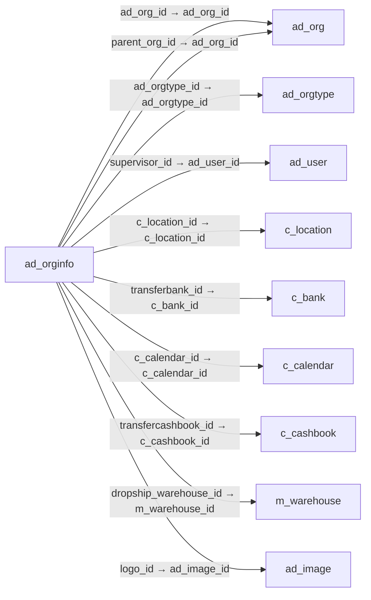

# ad_orginfo — 조직 상세 정보

[전체 일람](../TABLE_INDEX.md) · [분류 일람](README.md) · [AI 사용 안내](../README.md) · [외래키 읽는 법](../RELATIONSHIPS.md)

## 기본 정보

| 항목 | 내용 |
|---|---|
| 물리명 | `adempiere.ad_orginfo` |
| 한국어 논리명(문서용 해석) | 조직 상세 정보 |
| 원본 논리명 | Organization Info |
| 원본 사전 ID | 228 |
| 분류 | `ad` — 애플리케이션 사전·화면·권한·시스템 |
| 전체 테넌트 행 수 | 10 |
| 물리 열 수 | 27 |
| 나가는 FK / 들어오는 FK | 11 / 0 |
| 구조·행 수 확인 시점 | 2026-11-03T23:29:01+09:00 |

## 의미와 쓰임

조직의 주소·세무 정보·상위 조직·창고·연락처 등 상세 설정을 관리한다.

- 설명 근거: 물리명·열·외래키 구조를 근거로 보수적으로 해석.
- 한국어 이름과 개요는 문서용 해석입니다. 공식 한국어 번역으로 간주하지 않습니다.
- 원본 설명: —
- 원본 도움말: —
- PostgreSQL 테이블 주석: —

## 키와 열

### 기본키·고유 제약조건

| 종류 | 제약조건 | 열(순서 유지) |
|---|---|---|
| PRIMARY KEY | `ad_orginfo_pkey` | `ad_org_id` |
| UNIQUE | `ad_orginfo_uu_idx` | `ad_orginfo_uu` |

### 열 목록

원본 논리명·설명은 `AD_Column`에서 가져왔습니다. 기본값은 실제 PostgreSQL 메타데이터이며, 비어 있는 항목은 `—`로 표시합니다.

| 순서 | 물리명 | 원본 논리명 | PostgreSQL 타입 | NULL | PK | 기본값 | 설명 |
|---:|---|---|---|---|---|---|---|
| 1 | `ad_org_id` | Organization | numeric(10,0) | 불가 | 예 | — | Organizational entity within tenant |
| 2 | `ad_client_id` | Tenant | numeric(10,0) | 불가 | — | — | Tenant for this installation. |
| 3 | `isactive` | Active | character(1) | 불가 | — | 'Y'::bpchar | The record is active in the system |
| 4 | `created` | Created | timestamp without time zone | 불가 | — | now() | Date this record was created |
| 5 | `createdby` | Created By | numeric(10,0) | 불가 | — | — | User who created this records |
| 6 | `updated` | Updated | timestamp without time zone | 불가 | — | now() | Date this record was updated |
| 7 | `updatedby` | Updated By | numeric(10,0) | 불가 | — | — | User who updated this records |
| 8 | `c_location_id` | Address | numeric(10,0) | 허용 | — | — | Location or Address |
| 9 | `duns` | D-U-N-S | character varying(11) | 불가 | — | — | Dun &amp; Bradstreet Number |
| 10 | `taxid` | Tax ID | character varying(20) | 불가 | — | — | Tax Identification |
| 11 | `pa_goal_id` | — | numeric(10,0) | 허용 | — | — | — |
| 12 | `supervisor_id` | Supervisor | numeric(10,0) | 허용 | — | — | Supervisor for this user/organization - used for escalation and approval |
| 13 | `parent_org_id` | Parent Organization | numeric(10,0) | 허용 | — | — | Parent (superior) Organization  |
| 14 | `ad_orgtype_id` | Organization Type | numeric(10,0) | 허용 | — | — | Organization Type |
| 15 | `m_warehouse_id` | Warehouse | numeric(10,0) | 허용 | — | — | Storage Warehouse and Service Point |
| 16 | `transferbank_id` | Bank for transfers | numeric | 허용 | — | — | Bank account depending on currency will be used from this bank for doing transfers |
| 17 | `transfercashbook_id` | CashBook for transfers | numeric | 허용 | — | — | — |
| 18 | `receiptfootermsg` | Receipt Footer Msg | character varying(1023) | 허용 | — | — | This message will be displayed at the bottom of a receipt when doing a sales or purchase |
| 19 | `dropship_warehouse_id` | Drop Ship Warehouse | numeric(10,0) | 허용 | — | — | The (logical) warehouse to use for recording drop ship receipts and shipments. |
| 20 | `c_calendar_id` | Calendar | numeric(10,0) | 허용 | — | — | Accounting Calendar Name |
| 21 | `logo_id` | Logo | numeric(10,0) | 허용 | — | NULL::numeric | — |
| 22 | `phone` | Phone | character varying(40) | 허용 | — | NULL::character varying | Identifies a telephone number |
| 23 | `phone2` | 2nd Phone | character varying(40) | 허용 | — | NULL::character varying | Identifies an alternate telephone number. |
| 24 | `fax` | Fax | character varying(40) | 허용 | — | NULL::character varying | Facsimile number |
| 25 | `email` | EMail Address | character varying(60) | 허용 | — | NULL::character varying | Electronic Mail Address |
| 26 | `ad_orginfo_uu` | AD_OrgInfo_UU | uuid | 허용 | — | — | — |
| 27 | `timezone` | Time Zone | character varying(60) | 허용 | — | NULL::character varying | Time zone name |

## 외래키 흐름

화살표는 **FK를 가진 자식 → 참조되는 부모**입니다. 업무 처리의 시간 순서나 무조건적인 1:N 관계를 뜻하지 않습니다.

주변 관계 11개 중 10개를 그림으로 표시합니다. **전체 관계는 아래 두 표에 모두 포함**합니다.

### 이 테이블이 참조하는 부모 — 나가는 FK

| 제약조건 | 참조하는 쪽(자식) | 자식 열 | 참조받는 쪽(부모) | 부모 열 | 삭제 / 갱신 | 검증 / 지연 가능 |
|---|---|---|---|---|---|---|
| `adorg_adorginfo` <!-- FK_OUT: adempiere.ad_orginfo.adorg_adorginfo --> | [`ad_orginfo`](ad_orginfo.md) | `ad_org_id` | [`ad_org`](ad_org.md) | `ad_org_id` | CASCADE / NO ACTION | 완료 / 가능 (초기 지연) |
| `adorgparent_adorginfo` <!-- FK_OUT: adempiere.ad_orginfo.adorgparent_adorginfo --> | [`ad_orginfo`](ad_orginfo.md) | `parent_org_id` | [`ad_org`](ad_org.md) | `ad_org_id` | SET NULL / NO ACTION | 완료 / 가능 (초기 지연) |
| `adorgtype_adorginfo` <!-- FK_OUT: adempiere.ad_orginfo.adorgtype_adorginfo --> | [`ad_orginfo`](ad_orginfo.md) | `ad_orgtype_id` | [`ad_orgtype`](ad_orgtype.md) | `ad_orgtype_id` | NO ACTION / NO ACTION | 완료 / 가능 (초기 지연) |
| `aduser_adorginfo` <!-- FK_OUT: adempiere.ad_orginfo.aduser_adorginfo --> | [`ad_orginfo`](ad_orginfo.md) | `supervisor_id` | [`ad_user`](ad_user.md) | `ad_user_id` | SET NULL / NO ACTION | 완료 / 가능 (초기 지연) |
| `c_location_ad_orginfo` <!-- FK_OUT: adempiere.ad_orginfo.c_location_ad_orginfo --> | [`ad_orginfo`](ad_orginfo.md) | `c_location_id` | [`c_location`](../c/c_location.md) | `c_location_id` | NO ACTION / NO ACTION | 완료 / 가능 (초기 지연) |
| `cbank_adorginfo` <!-- FK_OUT: adempiere.ad_orginfo.cbank_adorginfo --> | [`ad_orginfo`](ad_orginfo.md) | `transferbank_id` | [`c_bank`](../c/c_bank.md) | `c_bank_id` | NO ACTION / NO ACTION | 완료 / 가능 (초기 지연) |
| `ccalendar_adorginfo` <!-- FK_OUT: adempiere.ad_orginfo.ccalendar_adorginfo --> | [`ad_orginfo`](ad_orginfo.md) | `c_calendar_id` | [`c_calendar`](../c/c_calendar.md) | `c_calendar_id` | NO ACTION / NO ACTION | 완료 / 가능 (초기 지연) |
| `ccashbook_adorginfo` <!-- FK_OUT: adempiere.ad_orginfo.ccashbook_adorginfo --> | [`ad_orginfo`](ad_orginfo.md) | `transfercashbook_id` | [`c_cashbook`](../c/c_cashbook.md) | `c_cashbook_id` | NO ACTION / NO ACTION | 완료 / 가능 (초기 지연) |
| `dropshipwarehouse_adorginfo` <!-- FK_OUT: adempiere.ad_orginfo.dropshipwarehouse_adorginfo --> | [`ad_orginfo`](ad_orginfo.md) | `dropship_warehouse_id` | [`m_warehouse`](../m/m_warehouse.md) | `m_warehouse_id` | NO ACTION / NO ACTION | 완료 / 가능 (초기 지연) |
| `logo_adorginfo` <!-- FK_OUT: adempiere.ad_orginfo.logo_adorginfo --> | [`ad_orginfo`](ad_orginfo.md) | `logo_id` | [`ad_image`](ad_image.md) | `ad_image_id` | NO ACTION / NO ACTION | 완료 / 가능 (초기 지연) |
| `mwarehouse_adorginfo` <!-- FK_OUT: adempiere.ad_orginfo.mwarehouse_adorginfo --> | [`ad_orginfo`](ad_orginfo.md) | `m_warehouse_id` | [`m_warehouse`](../m/m_warehouse.md) | `m_warehouse_id` | NO ACTION / NO ACTION | 완료 / 가능 (초기 지연) |

### 이 테이블을 참조하는 자식 — 들어오는 FK

해당 방향의 물리 FK 제약조건은 없습니다. 이름이 비슷한 열만으로 관계를 추가하지 않습니다.

## 조회 시 주의

- FK 표의 자식 열과 부모 열을 같은 순서로 대응시킵니다. 복합 FK는 모든 열의 동등 조건을 `AND`로 연결합니다.
- 테이블 이름이나 `_id` 열 이름만으로 물리 FK가 있다고 가정하지 않습니다. FK 미선언은 업무 관계가 없다는 뜻도 아닙니다.
- 자식이 여러 행인 테이블과 조인하면 부모의 금액·건수가 중복될 수 있습니다. 집계 단위를 먼저 정합니다.
- `ad_client_id`가 있습니다. 업무 분석에서는 대상 테넌트를 명시합니다. GardenWorld는 `11`, 시스템 공통 설정은 `0`일 수 있으므로 일괄 필터 적용 전에 테이블 역할을 확인합니다.
- 행 수는 위 확인 시점의 전체 테넌트 값입니다. 최신 업무 실적이나 현재 실행 결과로 재사용하지 않습니다.
