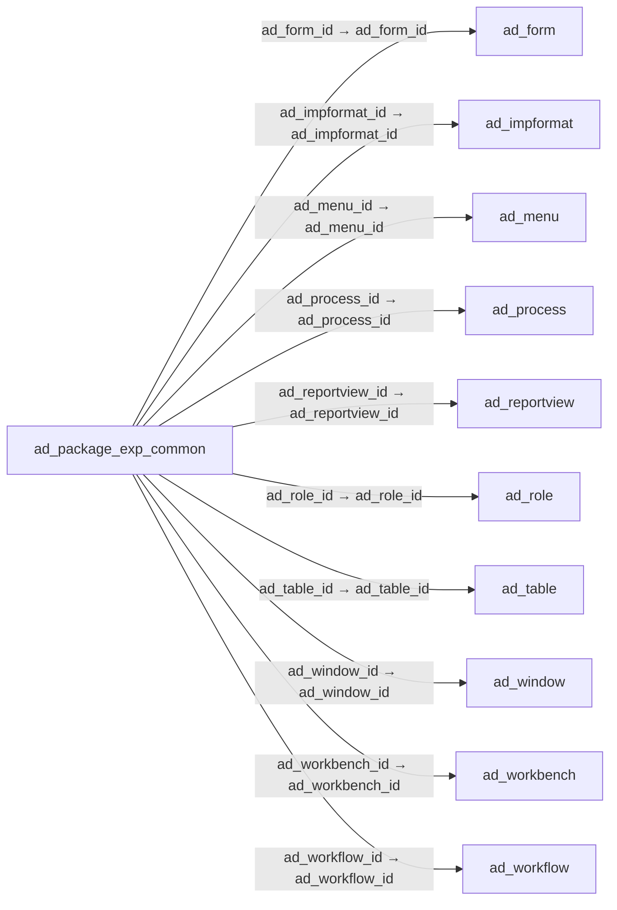

# ad_package_exp_common — 공통 내보내기 구성요소

[전체 일람](../TABLE_INDEX.md) · [분류 일람](README.md) · [AI 사용 안내](../README.md) · [외래키 읽는 법](../RELATIONSHIPS.md)

## 기본 정보

| 항목 | 내용 |
|---|---|
| 물리명 | `adempiere.ad_package_exp_common` |
| 한국어 논리명(문서용 해석) | 공통 내보내기 구성요소 |
| 원본 논리명 | Common Package Exp. |
| 원본 사전 ID | 50007 |
| 분류 | `ad` — 애플리케이션 사전·화면·권한·시스템 |
| 전체 테넌트 행 수 | 0 |
| 물리 열 수 | 32 |
| 나가는 FK / 들어오는 FK | 10 / 0 |
| 구조·행 수 확인 시점 | 2026-11-03T23:29:01+09:00 |

## 의미와 쓰임

현재 인스턴스에서 만드는 모든 패키지에 공통으로 포함할 구성요소를 관리한다.

- 설명 근거: 원본 애플리케이션 사전 명칭·설명을 한국어로 해석.
- 한국어 이름과 개요는 문서용 해석입니다. 공식 한국어 번역으로 간주하지 않습니다.
- 원본 설명: —
- 원본 도움말: This table contains detail package elements that are used in all packages that are created from this instance.
- PostgreSQL 테이블 주석: —

## 키와 열

### 기본키·고유 제약조건

| 종류 | 제약조건 | 열(순서 유지) |
|---|---|---|
| PRIMARY KEY | `ad_package_exp_common_pkey` | `ad_package_exp_common_id` |
| UNIQUE | `ad_package_exp_common_uu_idx` | `ad_package_exp_common_uu` |

### 열 목록

원본 논리명·설명은 `AD_Column`에서 가져왔습니다. 기본값은 실제 PostgreSQL 메타데이터이며, 비어 있는 항목은 `—`로 표시합니다.

| 순서 | 물리명 | 원본 논리명 | PostgreSQL 타입 | NULL | PK | 기본값 | 설명 |
|---:|---|---|---|---|---|---|---|
| 1 | `ad_package_exp_common_id` | Common Package Exp. | numeric(10,0) | 불가 | 예 | — | — |
| 2 | `ad_client_id` | Tenant | numeric(10,0) | 불가 | — | — | Tenant for this installation. |
| 3 | `ad_org_id` | Organization | numeric(10,0) | 불가 | — | — | Organizational entity within tenant |
| 4 | `isactive` | Active | character(1) | 불가 | — | 'Y'::bpchar | The record is active in the system |
| 5 | `created` | Created | timestamp without time zone | 불가 | — | now() | Date this record was created |
| 6 | `createdby` | Created By | numeric(10,0) | 불가 | — | — | User who created this records |
| 7 | `updated` | Updated | timestamp without time zone | 불가 | — | now() | Date this record was updated |
| 8 | `updatedby` | Updated By | numeric(10,0) | 불가 | — | — | User who updated this records |
| 9 | `ad_form_id` | Special Form | numeric(10,0) | 허용 | — | — | Special Form |
| 10 | `ad_impformat_id` | Import Format | numeric(10,0) | 허용 | — | — | — |
| 11 | `ad_reportview_id` | Report View | numeric(10,0) | 허용 | — | — | View used to generate this report |
| 12 | `ad_table_id` | Table | numeric(10,0) | 허용 | — | — | Database Table information |
| 13 | `ad_workbench_id` | Workbench | numeric(10,0) | 허용 | — | — | Collection of windows, reports |
| 14 | `dbtype` | DB Type | character varying(22) | 허용 | — | — | — |
| 15 | `processed` | Processed | character(1) | 허용 | — | — | The document has been processed |
| 16 | `name` | Name | character varying(60) | 허용 | — | — | Alphanumeric identifier of the entity |
| 17 | `name2` | Name 2 | character varying(60) | 허용 | — | — | Additional Name |
| 18 | `line` | Line No | numeric | 허용 | — | — | Unique line for this document |
| 19 | `file_directory` | File_Directory | character varying(255) | 허용 | — | — | — |
| 20 | `filename` | File Name | character varying(255) | 허용 | — | — | Name of the local file or URL |
| 21 | `destination_directory` | Destination_Directory | character varying(255) | 허용 | — | — | — |
| 22 | `description` | Description | character varying(1000) | 허용 | — | — | Optional short description of the record |
| 23 | `type` | Type | character varying(10) | 허용 | — | — | Type of Validation (SQL, Java Script, Java Language) |
| 24 | `target_directory` | Target_Directory | character varying(255) | 허용 | — | — | — |
| 25 | `sqlstatement` | SQL Expression/Statement | character varying(255) | 허용 | — | — | — |
| 26 | `processing` | Process Now | character(1) | 허용 | — | — | — |
| 27 | `ad_workflow_id` | Workflow | numeric(10,0) | 허용 | — | — | Workflow or combination of tasks |
| 28 | `ad_window_id` | Window | numeric(10,0) | 허용 | — | — | Data entry or display window |
| 29 | `ad_role_id` | Role | numeric(10,0) | 허용 | — | — | Responsibility Role |
| 30 | `ad_process_id` | Process | numeric(10,0) | 허용 | — | — | Process or Report |
| 31 | `ad_menu_id` | Menu | numeric(10,0) | 허용 | — | — | Identifies a Menu |
| 32 | `ad_package_exp_common_uu` | AD_Package_Exp_Common_UU | uuid | 허용 | — | — | — |

## 외래키 흐름

화살표는 **FK를 가진 자식 → 참조되는 부모**입니다. 업무 처리의 시간 순서나 무조건적인 1:N 관계를 뜻하지 않습니다.

주변 관계 10개 중 10개를 그림으로 표시합니다. **전체 관계는 아래 두 표에 모두 포함**합니다.

### 이 테이블이 참조하는 부모 — 나가는 FK

| 제약조건 | 참조하는 쪽(자식) | 자식 열 | 참조받는 쪽(부모) | 부모 열 | 삭제 / 갱신 | 검증 / 지연 가능 |
|---|---|---|---|---|---|---|
| `adform_adpackageexpcommon` <!-- FK_OUT: adempiere.ad_package_exp_common.adform_adpackageexpcommon --> | [`ad_package_exp_common`](ad_package_exp_common.md) | `ad_form_id` | [`ad_form`](ad_form.md) | `ad_form_id` | NO ACTION / NO ACTION | 완료 / 가능 (초기 지연) |
| `adimpformat_adpackageexpcommon` <!-- FK_OUT: adempiere.ad_package_exp_common.adimpformat_adpackageexpcommon --> | [`ad_package_exp_common`](ad_package_exp_common.md) | `ad_impformat_id` | [`ad_impformat`](ad_impformat.md) | `ad_impformat_id` | NO ACTION / NO ACTION | 완료 / 가능 (초기 지연) |
| `admenu_adpackageexpcommon` <!-- FK_OUT: adempiere.ad_package_exp_common.admenu_adpackageexpcommon --> | [`ad_package_exp_common`](ad_package_exp_common.md) | `ad_menu_id` | [`ad_menu`](ad_menu.md) | `ad_menu_id` | NO ACTION / NO ACTION | 완료 / 가능 (초기 지연) |
| `adprocess_adpackageexpcommon` <!-- FK_OUT: adempiere.ad_package_exp_common.adprocess_adpackageexpcommon --> | [`ad_package_exp_common`](ad_package_exp_common.md) | `ad_process_id` | [`ad_process`](ad_process.md) | `ad_process_id` | NO ACTION / NO ACTION | 완료 / 가능 (초기 지연) |
| `adreportview_adpackageexpcommo` <!-- FK_OUT: adempiere.ad_package_exp_common.adreportview_adpackageexpcommo --> | [`ad_package_exp_common`](ad_package_exp_common.md) | `ad_reportview_id` | [`ad_reportview`](ad_reportview.md) | `ad_reportview_id` | NO ACTION / NO ACTION | 완료 / 가능 (초기 지연) |
| `adrole_adpackageexpcommon` <!-- FK_OUT: adempiere.ad_package_exp_common.adrole_adpackageexpcommon --> | [`ad_package_exp_common`](ad_package_exp_common.md) | `ad_role_id` | [`ad_role`](ad_role.md) | `ad_role_id` | NO ACTION / NO ACTION | 완료 / 가능 (초기 지연) |
| `adtable_adpackageexpcommon` <!-- FK_OUT: adempiere.ad_package_exp_common.adtable_adpackageexpcommon --> | [`ad_package_exp_common`](ad_package_exp_common.md) | `ad_table_id` | [`ad_table`](ad_table.md) | `ad_table_id` | NO ACTION / NO ACTION | 완료 / 가능 (초기 지연) |
| `adwindow_adpackageexpcommon` <!-- FK_OUT: adempiere.ad_package_exp_common.adwindow_adpackageexpcommon --> | [`ad_package_exp_common`](ad_package_exp_common.md) | `ad_window_id` | [`ad_window`](ad_window.md) | `ad_window_id` | NO ACTION / NO ACTION | 완료 / 가능 (초기 지연) |
| `adworkbench_adpackageexpcommon` <!-- FK_OUT: adempiere.ad_package_exp_common.adworkbench_adpackageexpcommon --> | [`ad_package_exp_common`](ad_package_exp_common.md) | `ad_workbench_id` | [`ad_workbench`](ad_workbench.md) | `ad_workbench_id` | NO ACTION / NO ACTION | 완료 / 가능 (초기 지연) |
| `adworkflow_adpackageexpcommon` <!-- FK_OUT: adempiere.ad_package_exp_common.adworkflow_adpackageexpcommon --> | [`ad_package_exp_common`](ad_package_exp_common.md) | `ad_workflow_id` | [`ad_workflow`](ad_workflow.md) | `ad_workflow_id` | NO ACTION / NO ACTION | 완료 / 가능 (초기 지연) |

### 이 테이블을 참조하는 자식 — 들어오는 FK

해당 방향의 물리 FK 제약조건은 없습니다. 이름이 비슷한 열만으로 관계를 추가하지 않습니다.

## 조회 시 주의

- FK 표의 자식 열과 부모 열을 같은 순서로 대응시킵니다. 복합 FK는 모든 열의 동등 조건을 `AND`로 연결합니다.
- 테이블 이름이나 `_id` 열 이름만으로 물리 FK가 있다고 가정하지 않습니다. FK 미선언은 업무 관계가 없다는 뜻도 아닙니다.
- 자식이 여러 행인 테이블과 조인하면 부모의 금액·건수가 중복될 수 있습니다. 집계 단위를 먼저 정합니다.
- `ad_client_id`가 있습니다. 업무 분석에서는 대상 테넌트를 명시합니다. GardenWorld는 `11`, 시스템 공통 설정은 `0`일 수 있으므로 일괄 필터 적용 전에 테이블 역할을 확인합니다.
- 수집 시점에 0행입니다. 이 표만으로 거래 실적·처리 결과를 계산할 수 없습니다.
- 행 수는 위 확인 시점의 전체 테넌트 값입니다. 최신 업무 실적이나 현재 실행 결과로 재사용하지 않습니다.
