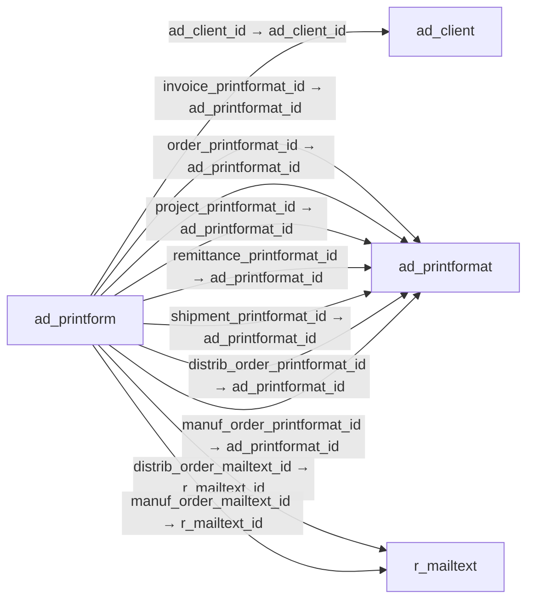

# ad_printform — 출력 서식 연결

[전체 일람](../TABLE_INDEX.md) · [분류 일람](README.md) · [AI 사용 안내](../README.md) · [외래키 읽는 법](../RELATIONSHIPS.md)

## 기본 정보

| 항목 | 내용 |
|---|---|
| 물리명 | `adempiere.ad_printform` |
| 한국어 논리명(문서용 해석) | 출력 서식 연결 |
| 원본 논리명 | Print Form |
| 원본 사전 ID | 454 |
| 분류 | `ad` — 애플리케이션 사전·화면·권한·시스템 |
| 전체 테넌트 행 수 | 2 |
| 물리 열 수 | 25 |
| 나가는 FK / 들어오는 FK | 15 / 0 |
| 구조·행 수 확인 시점 | 2026-11-03T23:29:01+09:00 |

## 의미와 쓰임

청구서·주문·송금·출하 등 문서 유형별 출력 형식과 메일 문구를 연결한다.

- 설명 근거: 물리명·열·외래키 구조를 근거로 보수적으로 해석.
- 한국어 이름과 개요는 문서용 해석입니다. 공식 한국어 번역으로 간주하지 않습니다.
- 원본 설명: Form
- 원본 도움말: —
- PostgreSQL 테이블 주석: —

## 키와 열

### 기본키·고유 제약조건

| 종류 | 제약조건 | 열(순서 유지) |
|---|---|---|
| PRIMARY KEY | `ad_printform_pkey` | `ad_printform_id` |
| UNIQUE | `ad_printform_uu_idx` | `ad_printform_uu` |

### 별도 고유 인덱스

PK·UNIQUE 제약조건의 인덱스와 별도로 존재하는 고유 인덱스입니다. 식·조건·열 순서는 원본 정의를 따릅니다.

- `ad_printform_client`: `CREATE UNIQUE INDEX ad_printform_client ON adempiere.ad_printform USING btree (ad_client_id, ad_org_id)`

### 열 목록

원본 논리명·설명은 `AD_Column`에서 가져왔습니다. 기본값은 실제 PostgreSQL 메타데이터이며, 비어 있는 항목은 `—`로 표시합니다.

| 순서 | 물리명 | 원본 논리명 | PostgreSQL 타입 | NULL | PK | 기본값 | 설명 |
|---:|---|---|---|---|---|---|---|
| 1 | `ad_printform_id` | Print Form | numeric(10,0) | 불가 | 예 | — | Form |
| 2 | `ad_client_id` | Tenant | numeric(10,0) | 허용 | — | — | Tenant for this installation. |
| 3 | `ad_org_id` | Organization | numeric(10,0) | 불가 | — | — | Organizational entity within tenant |
| 4 | `isactive` | Active | character(1) | 불가 | — | 'Y'::bpchar | The record is active in the system |
| 5 | `created` | Created | timestamp without time zone | 불가 | — | now() | Date this record was created |
| 6 | `createdby` | Created By | numeric(10,0) | 불가 | — | — | User who created this records |
| 7 | `updated` | Updated | timestamp without time zone | 불가 | — | now() | Date this record was updated |
| 8 | `updatedby` | Updated By | numeric(10,0) | 불가 | — | — | User who updated this records |
| 9 | `name` | Name | character varying(60) | 불가 | — | — | Alphanumeric identifier of the entity |
| 10 | `description` | Description | character varying(255) | 허용 | — | — | Optional short description of the record |
| 11 | `invoice_printformat_id` | Invoice Print Format | numeric(10,0) | 허용 | — | — | Print Format for printing Invoices |
| 12 | `order_printformat_id` | Order Print Format | numeric(10,0) | 허용 | — | — | Print Format for Orders, Quotes, Offers |
| 13 | `remittance_printformat_id` | Remittance Print Format | numeric(10,0) | 허용 | — | — | Print Format for separate Remittances |
| 14 | `shipment_printformat_id` | Shipment Print Format | numeric(10,0) | 허용 | — | — | Print Format for Shipments, Receipts, Pick Lists |
| 15 | `invoice_mailtext_id` | Invoice Mail Text | numeric(10,0) | 허용 | — | — | Email text used for sending invoices |
| 16 | `order_mailtext_id` | Order Mail Text | numeric(10,0) | 허용 | — | — | Email text used for sending order acknowledgements or quotations |
| 17 | `remittance_mailtext_id` | Remittance Mail Text | numeric(10,0) | 허용 | — | — | Email text used for sending payment remittances |
| 18 | `shipment_mailtext_id` | Shipment Mail Text | numeric(10,0) | 허용 | — | — | Email text used for sending delivery notes |
| 19 | `project_mailtext_id` | Project Mail Text | numeric(10,0) | 허용 | — | — | Standard text for Project EMails |
| 20 | `project_printformat_id` | Project Print Format | numeric(10,0) | 허용 | — | — | Standard Project Print Format |
| 21 | `manuf_order_mailtext_id` | Manufacturing Order Mail Text | numeric(10,0) | 허용 | — | — | Email text used for sending Manufacturing Order |
| 22 | `manuf_order_printformat_id` | Manufacturing Order Print Format | numeric(10,0) | 허용 | — | — | Print Format for printing Manufacturing Order |
| 23 | `distrib_order_mailtext_id` | Distribution Order Mail Text | numeric(10,0) | 허용 | — | — | Email text used for sending Distribution Order |
| 24 | `distrib_order_printformat_id` | Distribution Order Print Format | numeric(10,0) | 허용 | — | — | Print Format for printing Distribution Order |
| 25 | `ad_printform_uu` | AD_PrintForm_UU | uuid | 허용 | — | — | — |

## 외래키 흐름

화살표는 **FK를 가진 자식 → 참조되는 부모**입니다. 업무 처리의 시간 순서나 무조건적인 1:N 관계를 뜻하지 않습니다.

주변 관계 15개 중 10개를 그림으로 표시합니다. **전체 관계는 아래 두 표에 모두 포함**합니다.

### 이 테이블이 참조하는 부모 — 나가는 FK

| 제약조건 | 참조하는 쪽(자식) | 자식 열 | 참조받는 쪽(부모) | 부모 열 | 삭제 / 갱신 | 검증 / 지연 가능 |
|---|---|---|---|---|---|---|
| `adclient_adprintform` <!-- FK_OUT: adempiere.ad_printform.adclient_adprintform --> | [`ad_printform`](ad_printform.md) | `ad_client_id` | [`ad_client`](ad_client.md) | `ad_client_id` | NO ACTION / NO ACTION | 완료 / 가능 (초기 지연) |
| `adprintformat_forminvoice` <!-- FK_OUT: adempiere.ad_printform.adprintformat_forminvoice --> | [`ad_printform`](ad_printform.md) | `invoice_printformat_id` | [`ad_printformat`](ad_printformat.md) | `ad_printformat_id` | NO ACTION / NO ACTION | 완료 / 가능 (초기 지연) |
| `adprintformat_formorder` <!-- FK_OUT: adempiere.ad_printform.adprintformat_formorder --> | [`ad_printform`](ad_printform.md) | `order_printformat_id` | [`ad_printformat`](ad_printformat.md) | `ad_printformat_id` | NO ACTION / NO ACTION | 완료 / 가능 (초기 지연) |
| `adprintformat_formproject` <!-- FK_OUT: adempiere.ad_printform.adprintformat_formproject --> | [`ad_printform`](ad_printform.md) | `project_printformat_id` | [`ad_printformat`](ad_printformat.md) | `ad_printformat_id` | NO ACTION / NO ACTION | 완료 / 가능 (초기 지연) |
| `adprintformat_formremittance` <!-- FK_OUT: adempiere.ad_printform.adprintformat_formremittance --> | [`ad_printform`](ad_printform.md) | `remittance_printformat_id` | [`ad_printformat`](ad_printformat.md) | `ad_printformat_id` | NO ACTION / NO ACTION | 완료 / 가능 (초기 지연) |
| `adprintformat_formshipment` <!-- FK_OUT: adempiere.ad_printform.adprintformat_formshipment --> | [`ad_printform`](ad_printform.md) | `shipment_printformat_id` | [`ad_printformat`](ad_printformat.md) | `ad_printformat_id` | NO ACTION / NO ACTION | 완료 / 가능 (초기 지연) |
| `distribordermailtext_adprintfo` <!-- FK_OUT: adempiere.ad_printform.distribordermailtext_adprintfo --> | [`ad_printform`](ad_printform.md) | `distrib_order_mailtext_id` | [`r_mailtext`](../r/r_mailtext.md) | `r_mailtext_id` | NO ACTION / NO ACTION | 완료 / 가능 (초기 지연) |
| `distriborderprintformat_adprin` <!-- FK_OUT: adempiere.ad_printform.distriborderprintformat_adprin --> | [`ad_printform`](ad_printform.md) | `distrib_order_printformat_id` | [`ad_printformat`](ad_printformat.md) | `ad_printformat_id` | NO ACTION / NO ACTION | 완료 / 가능 (초기 지연) |
| `manufordermailtext_adprintform` <!-- FK_OUT: adempiere.ad_printform.manufordermailtext_adprintform --> | [`ad_printform`](ad_printform.md) | `manuf_order_mailtext_id` | [`r_mailtext`](../r/r_mailtext.md) | `r_mailtext_id` | NO ACTION / NO ACTION | 완료 / 가능 (초기 지연) |
| `manuforderprintformat_adprintf` <!-- FK_OUT: adempiere.ad_printform.manuforderprintformat_adprintf --> | [`ad_printform`](ad_printform.md) | `manuf_order_printformat_id` | [`ad_printformat`](ad_printformat.md) | `ad_printformat_id` | NO ACTION / NO ACTION | 완료 / 가능 (초기 지연) |
| `rmailtext_invoiceadprintform` <!-- FK_OUT: adempiere.ad_printform.rmailtext_invoiceadprintform --> | [`ad_printform`](ad_printform.md) | `invoice_mailtext_id` | [`r_mailtext`](../r/r_mailtext.md) | `r_mailtext_id` | NO ACTION / NO ACTION | 완료 / 가능 (초기 지연) |
| `rmailtext_orderadprintform` <!-- FK_OUT: adempiere.ad_printform.rmailtext_orderadprintform --> | [`ad_printform`](ad_printform.md) | `order_mailtext_id` | [`r_mailtext`](../r/r_mailtext.md) | `r_mailtext_id` | NO ACTION / NO ACTION | 완료 / 가능 (초기 지연) |
| `rmailtext_projectadprintform` <!-- FK_OUT: adempiere.ad_printform.rmailtext_projectadprintform --> | [`ad_printform`](ad_printform.md) | `project_mailtext_id` | [`r_mailtext`](../r/r_mailtext.md) | `r_mailtext_id` | NO ACTION / NO ACTION | 완료 / 가능 (초기 지연) |
| `rmailtext_remitadprintform` <!-- FK_OUT: adempiere.ad_printform.rmailtext_remitadprintform --> | [`ad_printform`](ad_printform.md) | `remittance_mailtext_id` | [`r_mailtext`](../r/r_mailtext.md) | `r_mailtext_id` | NO ACTION / NO ACTION | 완료 / 가능 (초기 지연) |
| `rmailtext_shipadprintform` <!-- FK_OUT: adempiere.ad_printform.rmailtext_shipadprintform --> | [`ad_printform`](ad_printform.md) | `shipment_mailtext_id` | [`r_mailtext`](../r/r_mailtext.md) | `r_mailtext_id` | NO ACTION / NO ACTION | 완료 / 가능 (초기 지연) |

### 이 테이블을 참조하는 자식 — 들어오는 FK

해당 방향의 물리 FK 제약조건은 없습니다. 이름이 비슷한 열만으로 관계를 추가하지 않습니다.

## 조회 시 주의

- FK 표의 자식 열과 부모 열을 같은 순서로 대응시킵니다. 복합 FK는 모든 열의 동등 조건을 `AND`로 연결합니다.
- 테이블 이름이나 `_id` 열 이름만으로 물리 FK가 있다고 가정하지 않습니다. FK 미선언은 업무 관계가 없다는 뜻도 아닙니다.
- 자식이 여러 행인 테이블과 조인하면 부모의 금액·건수가 중복될 수 있습니다. 집계 단위를 먼저 정합니다.
- `ad_client_id`가 있습니다. 업무 분석에서는 대상 테넌트를 명시합니다. GardenWorld는 `11`, 시스템 공통 설정은 `0`일 수 있으므로 일괄 필터 적용 전에 테이블 역할을 확인합니다.
- 행 수는 위 확인 시점의 전체 테넌트 값입니다. 최신 업무 실적이나 현재 실행 결과로 재사용하지 않습니다.
