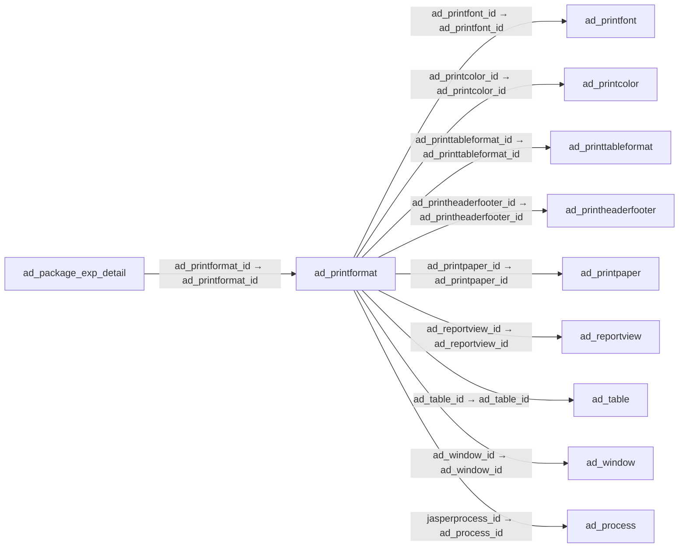

# ad_printformat — 출력 형식

[전체 일람](../TABLE_INDEX.md) · [분류 일람](README.md) · [AI 사용 안내](../README.md) · [외래키 읽는 법](../RELATIONSHIPS.md)

## 기본 정보

| 항목 | 내용 |
|---|---|
| 물리명 | `adempiere.ad_printformat` |
| 한국어 논리명(문서용 해석) | 출력 형식 |
| 원본 논리명 | Print Format |
| 원본 사전 ID | 493 |
| 분류 | `ad` — 애플리케이션 사전·화면·권한·시스템 |
| 전체 테넌트 행 수 | 93 |
| 물리 열 수 | 32 |
| 나가는 FK / 들어오는 FK | 9 / 25 |
| 구조·행 수 확인 시점 | 2026-11-03T23:29:01+09:00 |

## 의미와 쓰임

데이터를 출력하는 형식을 정의한다.

- 설명 근거: 원본 애플리케이션 사전 명칭·설명을 한국어로 해석.
- 한국어 이름과 개요는 문서용 해석입니다. 공식 한국어 번역으로 간주하지 않습니다.
- 원본 설명: Data Print Format
- 원본 도움말: —
- PostgreSQL 테이블 주석: —

## 키와 열

### 기본키·고유 제약조건

| 종류 | 제약조건 | 열(순서 유지) |
|---|---|---|
| PRIMARY KEY | `ad_printformat_pkey` | `ad_printformat_id` |
| UNIQUE | `ad_printformat_uu_idx` | `ad_printformat_uu` |

### 별도 고유 인덱스

PK·UNIQUE 제약조건의 인덱스와 별도로 존재하는 고유 인덱스입니다. 식·조건·열 순서는 원본 정의를 따릅니다.

- `ad_printformat_name`: `CREATE UNIQUE INDEX ad_printformat_name ON adempiere.ad_printformat USING btree (ad_client_id, ad_table_id, name)`

### 열 목록

원본 논리명·설명은 `AD_Column`에서 가져왔습니다. 기본값은 실제 PostgreSQL 메타데이터이며, 비어 있는 항목은 `—`로 표시합니다.

| 순서 | 물리명 | 원본 논리명 | PostgreSQL 타입 | NULL | PK | 기본값 | 설명 |
|---:|---|---|---|---|---|---|---|
| 1 | `ad_printformat_id` | Print Format | numeric(10,0) | 불가 | 예 | — | Data Print Format |
| 2 | `ad_client_id` | Tenant | numeric(10,0) | 불가 | — | — | Tenant for this installation. |
| 3 | `ad_org_id` | Organization | numeric(10,0) | 불가 | — | — | Organizational entity within tenant |
| 4 | `isactive` | Active | character(1) | 불가 | — | 'Y'::bpchar | The record is active in the system |
| 5 | `created` | Created | timestamp without time zone | 불가 | — | now() | Date this record was created |
| 6 | `createdby` | Created By | numeric(10,0) | 불가 | — | — | User who created this records |
| 7 | `updated` | Updated | timestamp without time zone | 불가 | — | now() | Date this record was updated |
| 8 | `updatedby` | Updated By | numeric(10,0) | 불가 | — | — | User who updated this records |
| 9 | `name` | Name | character varying(60) | 불가 | — | — | Alphanumeric identifier of the entity |
| 10 | `description` | Description | character varying(255) | 허용 | — | — | Optional short description of the record |
| 11 | `istablebased` | Table Based | character(1) | 불가 | — | 'Y'::bpchar | Table based List Reporting |
| 12 | `isform` | Form | character(1) | 불가 | — | 'N'::bpchar | If Selected, a Form is printed, if not selected a columnar List report |
| 13 | `ad_table_id` | Table | numeric(10,0) | 불가 | — | — | Database Table information |
| 14 | `ad_printpaper_id` | Print Paper | numeric(10,0) | 불가 | — | — | Printer paper definition |
| 15 | `ad_printcolor_id` | Print Color | numeric(10,0) | 불가 | — | — | Color used for printing and display |
| 16 | `ad_printfont_id` | Print Font | numeric(10,0) | 불가 | — | — | Maintain Print Font |
| 17 | `isstandardheaderfooter` | Standard Header/Footer | character(1) | 불가 | — | 'Y'::bpchar | The standard Header and Footer is used |
| 18 | `headermargin` | Header Margin | numeric(10,0) | 불가 | — | — | Margin of the Header in 1/72 of an inch |
| 19 | `footermargin` | Footer Margin | numeric(10,0) | 불가 | — | — | Margin of the Footer in 1/72 of an inch |
| 20 | `createcopy` | Create Copy | character(1) | 허용 | — | — | — |
| 21 | `ad_reportview_id` | Report View | numeric(10,0) | 허용 | — | — | View used to generate this report |
| 22 | `ad_printtableformat_id` | Print Table Format | numeric(10,0) | 허용 | — | — | Table Format in Reports |
| 23 | `printername` | Printer Name | character varying(40) | 허용 | — | — | Name of the Printer |
| 24 | `isdefault` | Default | character(1) | 불가 | — | 'N'::bpchar | Default value |
| 25 | `jasperprocess_id` | Jasper Process | numeric(10,0) | 허용 | — | — | The Jasper Process used by the print engine if any process defined |
| 26 | `classname` | Classname | character varying(240) | 허용 | — | — | Java Classname |
| 27 | `args` | Args | character varying(510) | 허용 | — | — | — |
| 28 | `ad_printformat_uu` | AD_PrintFormat_UU | uuid | 허용 | — | — | — |
| 29 | `ad_window_id` | Window | numeric(10,0) | 허용 | — | NULL::numeric | Data entry or display window |
| 30 | `isbreakpageperrecord` | Page break per record | character(1) | 불가 | — | 'Y'::bpchar | Page Break after each record |
| 31 | `ad_printheaderfooter_id` | Print Header/Footer | numeric(10,0) | 허용 | — | NULL::numeric | — |
| 32 | `filenamepattern` | File Name Pattern | character varying(255) | 허용 | — | — | — |

## 외래키 흐름

화살표는 **FK를 가진 자식 → 참조되는 부모**입니다. 업무 처리의 시간 순서나 무조건적인 1:N 관계를 뜻하지 않습니다.

주변 관계 34개 중 10개를 그림으로 표시합니다. **전체 관계는 아래 두 표에 모두 포함**합니다.

### 이 테이블이 참조하는 부모 — 나가는 FK

| 제약조건 | 참조하는 쪽(자식) | 자식 열 | 참조받는 쪽(부모) | 부모 열 | 삭제 / 갱신 | 검증 / 지연 가능 |
|---|---|---|---|---|---|---|
| `ad_printfont_adprintformat` <!-- FK_OUT: adempiere.ad_printformat.ad_printfont_adprintformat --> | [`ad_printformat`](ad_printformat.md) | `ad_printfont_id` | [`ad_printfont`](ad_printfont.md) | `ad_printfont_id` | NO ACTION / NO ACTION | 완료 / 가능 (초기 지연) |
| `adprintcolor_adprintformat` <!-- FK_OUT: adempiere.ad_printformat.adprintcolor_adprintformat --> | [`ad_printformat`](ad_printformat.md) | `ad_printcolor_id` | [`ad_printcolor`](ad_printcolor.md) | `ad_printcolor_id` | NO ACTION / NO ACTION | 완료 / 가능 (초기 지연) |
| `adprintformattable_format` <!-- FK_OUT: adempiere.ad_printformat.adprintformattable_format --> | [`ad_printformat`](ad_printformat.md) | `ad_printtableformat_id` | [`ad_printtableformat`](ad_printtableformat.md) | `ad_printtableformat_id` | NO ACTION / NO ACTION | 완료 / 가능 (초기 지연) |
| `adprintheaderfooter_adprintfor` <!-- FK_OUT: adempiere.ad_printformat.adprintheaderfooter_adprintfor --> | [`ad_printformat`](ad_printformat.md) | `ad_printheaderfooter_id` | [`ad_printheaderfooter`](ad_printheaderfooter.md) | `ad_printheaderfooter_id` | NO ACTION / NO ACTION | 완료 / 가능 (초기 지연) |
| `adprintpaper_adprintformat` <!-- FK_OUT: adempiere.ad_printformat.adprintpaper_adprintformat --> | [`ad_printformat`](ad_printformat.md) | `ad_printpaper_id` | [`ad_printpaper`](ad_printpaper.md) | `ad_printpaper_id` | NO ACTION / NO ACTION | 완료 / 가능 (초기 지연) |
| `adprintview_adprintformat` <!-- FK_OUT: adempiere.ad_printformat.adprintview_adprintformat --> | [`ad_printformat`](ad_printformat.md) | `ad_reportview_id` | [`ad_reportview`](ad_reportview.md) | `ad_reportview_id` | NO ACTION / NO ACTION | 완료 / 가능 (초기 지연) |
| `adtable_adprintformat` <!-- FK_OUT: adempiere.ad_printformat.adtable_adprintformat --> | [`ad_printformat`](ad_printformat.md) | `ad_table_id` | [`ad_table`](ad_table.md) | `ad_table_id` | NO ACTION / NO ACTION | 완료 / 가능 (초기 지연) |
| `adwindow_adprintformat` <!-- FK_OUT: adempiere.ad_printformat.adwindow_adprintformat --> | [`ad_printformat`](ad_printformat.md) | `ad_window_id` | [`ad_window`](ad_window.md) | `ad_window_id` | NO ACTION / NO ACTION | 완료 / 가능 (초기 지연) |
| `jasperprocess_adprintformat` <!-- FK_OUT: adempiere.ad_printformat.jasperprocess_adprintformat --> | [`ad_printformat`](ad_printformat.md) | `jasperprocess_id` | [`ad_process`](ad_process.md) | `ad_process_id` | NO ACTION / NO ACTION | 완료 / 가능 (초기 지연) |

### 이 테이블을 참조하는 자식 — 들어오는 FK

| 제약조건 | 참조하는 쪽(자식) | 자식 열 | 참조받는 쪽(부모) | 부모 열 | 삭제 / 갱신 | 검증 / 지연 가능 |
|---|---|---|---|---|---|---|
| `adprintformat_adpackageexpdeta` <!-- FK_IN: adempiere.ad_package_exp_detail.adprintformat_adpackageexpdeta --> | [`ad_package_exp_detail`](ad_package_exp_detail.md) | `ad_printformat_id` | [`ad_printformat`](ad_printformat.md) | `ad_printformat_id` | NO ACTION / NO ACTION | 완료 / 가능 (초기 지연) |
| `adprintformat_adpinstance` <!-- FK_IN: adempiere.ad_pinstance.adprintformat_adpinstance --> | [`ad_pinstance`](ad_pinstance.md) | `ad_printformat_id` | [`ad_printformat`](ad_printformat.md) | `ad_printformat_id` | NO ACTION / NO ACTION | 완료 / 가능 (초기 지연) |
| `adprintformat_forminvoice` <!-- FK_IN: adempiere.ad_printform.adprintformat_forminvoice --> | [`ad_printform`](ad_printform.md) | `invoice_printformat_id` | [`ad_printformat`](ad_printformat.md) | `ad_printformat_id` | NO ACTION / NO ACTION | 완료 / 가능 (초기 지연) |
| `adprintformat_formorder` <!-- FK_IN: adempiere.ad_printform.adprintformat_formorder --> | [`ad_printform`](ad_printform.md) | `order_printformat_id` | [`ad_printformat`](ad_printformat.md) | `ad_printformat_id` | NO ACTION / NO ACTION | 완료 / 가능 (초기 지연) |
| `adprintformat_formproject` <!-- FK_IN: adempiere.ad_printform.adprintformat_formproject --> | [`ad_printform`](ad_printform.md) | `project_printformat_id` | [`ad_printformat`](ad_printformat.md) | `ad_printformat_id` | NO ACTION / NO ACTION | 완료 / 가능 (초기 지연) |
| `adprintformat_formremittance` <!-- FK_IN: adempiere.ad_printform.adprintformat_formremittance --> | [`ad_printform`](ad_printform.md) | `remittance_printformat_id` | [`ad_printformat`](ad_printformat.md) | `ad_printformat_id` | NO ACTION / NO ACTION | 완료 / 가능 (초기 지연) |
| `adprintformat_formshipment` <!-- FK_IN: adempiere.ad_printform.adprintformat_formshipment --> | [`ad_printform`](ad_printform.md) | `shipment_printformat_id` | [`ad_printformat`](ad_printformat.md) | `ad_printformat_id` | NO ACTION / NO ACTION | 완료 / 가능 (초기 지연) |
| `distriborderprintformat_adprin` <!-- FK_IN: adempiere.ad_printform.distriborderprintformat_adprin --> | [`ad_printform`](ad_printform.md) | `distrib_order_printformat_id` | [`ad_printformat`](ad_printformat.md) | `ad_printformat_id` | NO ACTION / NO ACTION | 완료 / 가능 (초기 지연) |
| `manuforderprintformat_adprintf` <!-- FK_IN: adempiere.ad_printform.manuforderprintformat_adprintf --> | [`ad_printform`](ad_printform.md) | `manuf_order_printformat_id` | [`ad_printformat`](ad_printformat.md) | `ad_printformat_id` | NO ACTION / NO ACTION | 완료 / 가능 (초기 지연) |
| `adprintformat_trl` <!-- FK_IN: adempiere.ad_printformat_trl.adprintformat_trl --> | [`ad_printformat_trl`](ad_printformat_trl.md) | `ad_printformat_id` | [`ad_printformat`](ad_printformat.md) | `ad_printformat_id` | NO ACTION / NO ACTION | 완료 / 가능 (초기 지연) |
| `adprintformat_printformatchild` <!-- FK_IN: adempiere.ad_printformatitem.adprintformat_printformatchild --> | [`ad_printformatitem`](ad_printformatitem.md) | `ad_printformatchild_id` | [`ad_printformat`](ad_printformat.md) | `ad_printformat_id` | SET NULL / NO ACTION | 완료 / 가능 (초기 지연) |
| `adprintformat_printformatitem` <!-- FK_IN: adempiere.ad_printformatitem.adprintformat_printformatitem --> | [`ad_printformatitem`](ad_printformatitem.md) | `ad_printformat_id` | [`ad_printformat`](ad_printformat.md) | `ad_printformat_id` | CASCADE / NO ACTION | 완료 / 가능 (초기 지연) |
| `adprintformat_adprintgraph` <!-- FK_IN: adempiere.ad_printgraph.adprintformat_adprintgraph --> | [`ad_printgraph`](ad_printgraph.md) | `ad_printformat_id` | [`ad_printformat`](ad_printformat.md) | `ad_printformat_id` | NO ACTION / NO ACTION | 완료 / 가능 (초기 지연) |
| `adprintformat_adprocess` <!-- FK_IN: adempiere.ad_process.adprintformat_adprocess --> | [`ad_process`](ad_process.md) | `ad_printformat_id` | [`ad_printformat`](ad_printformat.md) | `ad_printformat_id` | NO ACTION / NO ACTION | 완료 / 가능 (초기 지연) |
| `adprintformat_addrillrule` <!-- FK_IN: adempiere.ad_process_drillrule.adprintformat_addrillrule --> | [`ad_process_drillrule`](ad_process_drillrule.md) | `ad_printformat_id` | [`ad_printformat`](ad_printformat.md) | `ad_printformat_id` | NO ACTION / NO ACTION | 완료 / 가능 (초기 지연) |
| `adprintformat_adscheduler` <!-- FK_IN: adempiere.ad_scheduler.adprintformat_adscheduler --> | [`ad_scheduler`](ad_scheduler.md) | `ad_printformat_id` | [`ad_printformat`](ad_printformat.md) | `ad_printformat_id` | SET NULL / NO ACTION | 완료 / 가능 (초기 지연) |
| `adprintformat_cbankaccountdoc` <!-- FK_IN: adempiere.c_bankaccountdoc.adprintformat_cbankaccountdoc --> | [`c_bankaccountdoc`](../c/c_bankaccountdoc.md) | `check_printformat_id` | [`ad_printformat`](ad_printformat.md) | `ad_printformat_id` | NO ACTION / NO ACTION | 완료 / 가능 (초기 지연) |
| `adprintformatinv_cbpartner` <!-- FK_IN: adempiere.c_bpartner.adprintformatinv_cbpartner --> | [`c_bpartner`](../c/c_bpartner.md) | `invoice_printformat_id` | [`ad_printformat`](ad_printformat.md) | `ad_printformat_id` | NO ACTION / NO ACTION | 완료 / 가능 (초기 지연) |
| `adprintformat_cdoctype` <!-- FK_IN: adempiere.c_doctype.adprintformat_cdoctype --> | [`c_doctype`](../c/c_doctype.md) | `ad_printformat_id` | [`ad_printformat`](ad_printformat.md) | `ad_printformat_id` | NO ACTION / NO ACTION | 완료 / 가능 (초기 지연) |
| `adprintformat_cdunninglevel` <!-- FK_IN: adempiere.c_dunninglevel.adprintformat_cdunninglevel --> | [`c_dunninglevel`](../c/c_dunninglevel.md) | `dunning_printformat_id` | [`ad_printformat`](ad_printformat.md) | `ad_printformat_id` | NO ACTION / NO ACTION | 완료 / 가능 (초기 지연) |
| `adprintformat_arfqtopic` <!-- FK_IN: adempiere.c_rfq_topic.adprintformat_arfqtopic --> | [`c_rfq_topic`](../c/c_rfq_topic.md) | `ad_printformat_id` | [`ad_printformat`](ad_printformat.md) | `ad_printformat_id` | SET NULL / NO ACTION | 완료 / 가능 (초기 지연) |
| `adprintformat_hrpayroll` <!-- FK_IN: adempiere.hr_payroll.adprintformat_hrpayroll --> | [`hr_payroll`](../hr/hr_payroll.md) | `ad_printformat_id` | [`ad_printformat`](ad_printformat.md) | `ad_printformat_id` | NO ACTION / NO ACTION | 완료 / 가능 (초기 지연) |
| `adprintformat_hrprocess` <!-- FK_IN: adempiere.hr_process.adprintformat_hrprocess --> | [`hr_process`](../hr/hr_process.md) | `ad_printformat_id` | [`ad_printformat`](ad_printformat.md) | `ad_printformat_id` | NO ACTION / NO ACTION | 완료 / 가능 (초기 지연) |
| `adprintformat_padashboardconte` <!-- FK_IN: adempiere.pa_dashboardcontent.adprintformat_padashboardconte --> | [`pa_dashboardcontent`](../pa/pa_dashboardcontent.md) | `ad_printformat_id` | [`ad_printformat`](ad_printformat.md) | `ad_printformat_id` | NO ACTION / NO ACTION | 완료 / 가능 (초기 지연) |
| `adprintformat_pareport` <!-- FK_IN: adempiere.pa_report.adprintformat_pareport --> | [`pa_report`](../pa/pa_report.md) | `ad_printformat_id` | [`ad_printformat`](ad_printformat.md) | `ad_printformat_id` | SET NULL / NO ACTION | 완료 / 가능 (초기 지연) |

## 조회 시 주의

- FK 표의 자식 열과 부모 열을 같은 순서로 대응시킵니다. 복합 FK는 모든 열의 동등 조건을 `AND`로 연결합니다.
- 테이블 이름이나 `_id` 열 이름만으로 물리 FK가 있다고 가정하지 않습니다. FK 미선언은 업무 관계가 없다는 뜻도 아닙니다.
- 자식이 여러 행인 테이블과 조인하면 부모의 금액·건수가 중복될 수 있습니다. 집계 단위를 먼저 정합니다.
- `ad_client_id`가 있습니다. 업무 분석에서는 대상 테넌트를 명시합니다. GardenWorld는 `11`, 시스템 공통 설정은 `0`일 수 있으므로 일괄 필터 적용 전에 테이블 역할을 확인합니다.
- 행 수는 위 확인 시점의 전체 테넌트 값입니다. 최신 업무 실적이나 현재 실행 결과로 재사용하지 않습니다.
