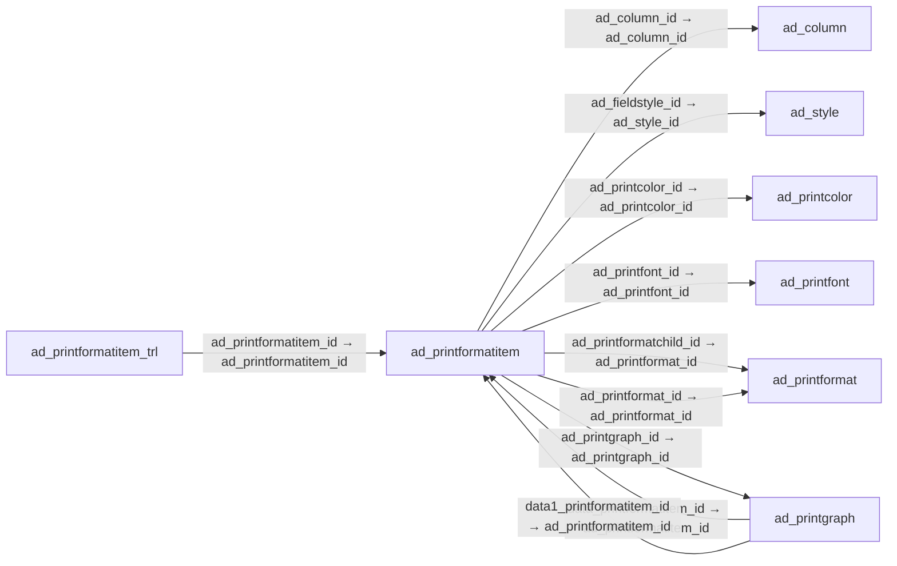

# ad_printformatitem — 출력 형식 항목

[전체 일람](../TABLE_INDEX.md) · [분류 일람](README.md) · [AI 사용 안내](../README.md) · [외래키 읽는 법](../RELATIONSHIPS.md)

## 기본 정보

| 항목 | 내용 |
|---|---|
| 물리명 | `adempiere.ad_printformatitem` |
| 한국어 논리명(문서용 해석) | 출력 형식 항목 |
| 원본 논리명 | Print Format Item |
| 원본 사전 ID | 489 |
| 분류 | `ad` — 애플리케이션 사전·화면·권한·시스템 |
| 전체 테넌트 행 수 | 2,780 |
| 물리 열 수 | 69 |
| 나가는 FK / 들어오는 FK | 7 / 7 |
| 구조·행 수 확인 시점 | 2026-11-03T23:29:01+09:00 |

## 의미와 쓰임

출력 형식을 구성하는 개별 항목과 열을 정의한다.

- 설명 근거: 원본 애플리케이션 사전 명칭·설명을 한국어로 해석.
- 한국어 이름과 개요는 문서용 해석입니다. 공식 한국어 번역으로 간주하지 않습니다.
- 원본 설명: Item/Column in the Print format
- 원본 도움말: —
- PostgreSQL 테이블 주석: —

## 키와 열

### 기본키·고유 제약조건

| 종류 | 제약조건 | 열(순서 유지) |
|---|---|---|
| PRIMARY KEY | `ad_printformatitem_pkey` | `ad_printformatitem_id` |
| UNIQUE | `ad_printformatitem_uu_idx` | `ad_printformatitem_uu` |

### 열 목록

원본 논리명·설명은 `AD_Column`에서 가져왔습니다. 기본값은 실제 PostgreSQL 메타데이터이며, 비어 있는 항목은 `—`로 표시합니다.

| 순서 | 물리명 | 원본 논리명 | PostgreSQL 타입 | NULL | PK | 기본값 | 설명 |
|---:|---|---|---|---|---|---|---|
| 1 | `ad_printformatitem_id` | Print Format Item | numeric(10,0) | 불가 | 예 | — | Item/Column in the Print format |
| 2 | `ad_client_id` | Tenant | numeric(10,0) | 불가 | — | — | Tenant for this installation. |
| 3 | `ad_org_id` | Organization | numeric(10,0) | 불가 | — | — | Organizational entity within tenant |
| 4 | `isactive` | Active | character(1) | 불가 | — | 'Y'::bpchar | The record is active in the system |
| 5 | `created` | Created | timestamp without time zone | 불가 | — | now() | Date this record was created |
| 6 | `createdby` | Created By | numeric(10,0) | 불가 | — | — | User who created this records |
| 7 | `updated` | Updated | timestamp without time zone | 불가 | — | now() | Date this record was updated |
| 8 | `updatedby` | Updated By | numeric(10,0) | 불가 | — | — | User who updated this records |
| 9 | `ad_printformat_id` | Print Format | numeric(10,0) | 불가 | — | — | Data Print Format |
| 10 | `name` | Name | character varying(60) | 불가 | — | — | Alphanumeric identifier of the entity |
| 11 | `printname` | Print Text | character varying(2000) | 허용 | — | — | The label text to be printed on a document or correspondence. |
| 12 | `isprinted` | Printed | character(1) | 불가 | — | 'Y'::bpchar | Indicates if this document / line is printed |
| 13 | `printareatype` | Area | character(1) | 불가 | — | — | Print Area |
| 14 | `seqno` | Sequence | numeric(10,0) | 불가 | — | — | Method of ordering records; lowest number comes first |
| 15 | `printformattype` | Format Type | character(1) | 불가 | — | — | Print Format Type |
| 16 | `ad_column_id` | Column | numeric(10,0) | 허용 | — | — | Column in the table |
| 17 | `ad_printformatchild_id` | Included Print Format | numeric(10,0) | 허용 | — | — | Print format that is included here. |
| 18 | `isrelativeposition` | Relative Position | character(1) | 불가 | — | 'Y'::bpchar | The item is relative positioned (not absolute) |
| 19 | `isnextline` | Next Line | character(1) | 불가 | — | 'Y'::bpchar | Print item on next line |
| 20 | `xspace` | X Space | numeric(10,0) | 불가 | — | — | Relative X (horizontal) space in 1/72 of an inch |
| 21 | `yspace` | Y Space | numeric(10,0) | 불가 | — | — | Relative Y (vertical) space in 1/72 of an inch |
| 22 | `xposition` | X Position | numeric(10,0) | 불가 | — | — | Absolute X (horizontal) position in 1/72 of an inch |
| 23 | `yposition` | Y Position | numeric(10,0) | 불가 | — | — | Absolute Y (vertical) position in 1/72 of an inch |
| 24 | `maxwidth` | Max Width | numeric(10,0) | 불가 | — | — | Maximum Width in 1/72 if an inch - 0 = no restriction |
| 25 | `isheightoneline` | One Line Only | character(1) | 불가 | — | 'Y'::bpchar | If selected, only one line is printed |
| 26 | `maxheight` | Max Height | numeric(10,0) | 불가 | — | — | Maximum Height in 1/72 if an inch - 0 = no restriction |
| 27 | `fieldalignmenttype` | Field Alignment | character(1) | 불가 | — | — | Field Text Alignment |
| 28 | `linealignmenttype` | Line Alignment | character(1) | 불가 | — | — | Line Alignment |
| 29 | `ad_printcolor_id` | Print Color | numeric(10,0) | 허용 | — | — | Color used for printing and display |
| 30 | `ad_printfont_id` | Print Font | numeric(10,0) | 허용 | — | — | Maintain Print Font |
| 31 | `isorderby` | Order by | character(1) | 불가 | — | 'N'::bpchar | Include in sort order |
| 32 | `sortno` | Record Sort No | numeric(10,0) | 불가 | — | — | Determines in what order the records are displayed |
| 33 | `isgroupby` | Group by | character(1) | 불가 | — | 'N'::bpchar | After a group change, totals, etc. are printed |
| 34 | `ispagebreak` | Page break | character(1) | 불가 | — | 'N'::bpchar | Start with new page |
| 35 | `issummarized` | Calculate Sum (Σ) | character(1) | 불가 | — | 'N'::bpchar | Calculate the Sum of numeric content or length |
| 36 | `imageisattached` | Image attached | character(1) | 불가 | — | 'N'::bpchar | The image to be printed is attached to the record |
| 37 | `imageurl` | Image URL | character varying(120) | 허용 | — | — | URL of  image |
| 38 | `isaveraged` | Calculate Mean (μ) | character(1) | 불가 | — | 'N'::bpchar | Calculate Average of numeric content or length |
| 39 | `iscounted` | Calculate Count (№) | character(1) | 불가 | — | 'N'::bpchar | Count number of not empty elements |
| 40 | `issetnlposition` | Set NL Position | character(1) | 불가 | — | 'N'::bpchar | Set New Line Position |
| 41 | `issuppressnull` | Suppress Null | character(1) | 불가 | — | 'N'::bpchar | Suppress columns or elements with NULL value |
| 42 | `belowcolumn` | Below Column | numeric(10,0) | 허용 | — | — | Print this column below the column index entered |
| 43 | `ad_printgraph_id` | Graph | numeric(10,0) | 허용 | — | — | Graph included in Reports |
| 44 | `isfixedwidth` | Fixed Width | character(1) | 불가 | — | 'N'::bpchar | Column has a fixed width |
| 45 | `isnextpage` | Next Page | character(1) | 불가 | — | 'N'::bpchar | The column is printed on the next page |
| 46 | `printnamesuffix` | Print Label Suffix | character varying(60) | 허용 | — | — | The label text to be printed on a document or correspondence after the field |
| 47 | `ismincalc` | Calculate Minimum (↓) | character(1) | 불가 | — | 'N'::bpchar | Calculate the minimum amount |
| 48 | `ismaxcalc` | Calculate Maximum (↑) | character(1) | 불가 | — | 'N'::bpchar | Calculate the maximum amount |
| 49 | `isrunningtotal` | Running Total | character(1) | 불가 | — | 'N'::bpchar | Create a running total (sum) |
| 50 | `runningtotallines` | Running Total Lines | numeric(10,0) | 허용 | — | — | Create Running Total Lines (page break) every x lines |
| 51 | `isvariancecalc` | Calculate Variance (σ²) | character(1) | 불가 | — | 'N'::bpchar | Calculate Variance |
| 52 | `isdeviationcalc` | Calculate Deviation (σ) | character(1) | 불가 | — | 'N'::bpchar | Calculate Standard Deviation |
| 53 | `isfilledrectangle` | Fill Shape | character(1) | 불가 | — | 'N'::bpchar | Fill the shape with the color selected |
| 54 | `linewidth` | Line Width | numeric(10,0) | 허용 | — | — | Width of the lines |
| 55 | `arcdiameter` | Arc Diameter | numeric(10,0) | 허용 | — | — | Arc Diameter for rounded Rectangles |
| 56 | `shapetype` | Shape Type | character(1) | 허용 | — | — | Type of the shape to be painted |
| 57 | `iscentrallymaintained` | Centrally maintained | character(1) | 불가 | — | 'Y'::bpchar | Information maintained in System Element table |
| 58 | `isimagefield` | Image Field | character(1) | 불가 | — | 'N'::bpchar | The image is retrieved from the data column |
| 59 | `barcodetype` | Barcode Type | character(3) | 허용 | — | — | Type of barcode |
| 60 | `formatpattern` | Format Pattern | character varying(60) | 허용 | — | — | The pattern used to format a number or date. |
| 61 | `issuppressrepeats` | Suppress Repeats | character(1) | 불가 | — | 'N'::bpchar | Suppress repeated elements in column. |
| 62 | `ad_printformatitem_uu` | AD_PrintFormatItem_UU | uuid | 허용 | — | — | — |
| 63 | `isdesc` | Descending | character(1) | 불가 | — | 'N'::bpchar | Sort your data using a SQL Desc Order By statement |
| 64 | `isprintbarcodetext` | Print Barcode Text | character(1) | 불가 | — | 'Y'::bpchar | Print barcode text at the bottom of barcode |
| 65 | `displaylogic` | Display Logic | character varying(2000) | 허용 | — | NULL::character varying | If the Field is displayed, the result determines if the field is actually displayed |
| 66 | `script` | Script | character varying(2000) | 허용 | — | NULL::character varying | Dynamic Java Language Script to calculate result |
| 67 | `isprintinstanceattributes` | Print Attributes | character(1) | 불가 | — | 'N'::bpchar | Print each attributes as report column instead of printing the description of attribute set instance |
| 68 | `ad_fieldstyle_id` | Field Style | numeric(10,0) | 허용 | — | NULL::numeric | Field CSS Style  |
| 69 | `scalefactor` | Scale Factor | numeric | 허용 | — | 1.0 | Scale Factor |

## 외래키 흐름

화살표는 **FK를 가진 자식 → 참조되는 부모**입니다. 업무 처리의 시간 순서나 무조건적인 1:N 관계를 뜻하지 않습니다.

주변 관계 14개 중 10개를 그림으로 표시합니다. **전체 관계는 아래 두 표에 모두 포함**합니다.

### 이 테이블이 참조하는 부모 — 나가는 FK

| 제약조건 | 참조하는 쪽(자식) | 자식 열 | 참조받는 쪽(부모) | 부모 열 | 삭제 / 갱신 | 검증 / 지연 가능 |
|---|---|---|---|---|---|---|
| `adcolumn_adprintformatitem` <!-- FK_OUT: adempiere.ad_printformatitem.adcolumn_adprintformatitem --> | [`ad_printformatitem`](ad_printformatitem.md) | `ad_column_id` | [`ad_column`](ad_column.md) | `ad_column_id` | NO ACTION / NO ACTION | 완료 / 가능 (초기 지연) |
| `adfieldstyle_adprintformatitem` <!-- FK_OUT: adempiere.ad_printformatitem.adfieldstyle_adprintformatitem --> | [`ad_printformatitem`](ad_printformatitem.md) | `ad_fieldstyle_id` | [`ad_style`](ad_style.md) | `ad_style_id` | NO ACTION / NO ACTION | 완료 / 가능 (초기 지연) |
| `adprintcolor_adprintformatitem` <!-- FK_OUT: adempiere.ad_printformatitem.adprintcolor_adprintformatitem --> | [`ad_printformatitem`](ad_printformatitem.md) | `ad_printcolor_id` | [`ad_printcolor`](ad_printcolor.md) | `ad_printcolor_id` | NO ACTION / NO ACTION | 완료 / 가능 (초기 지연) |
| `adprintfont_adprintformatitem` <!-- FK_OUT: adempiere.ad_printformatitem.adprintfont_adprintformatitem --> | [`ad_printformatitem`](ad_printformatitem.md) | `ad_printfont_id` | [`ad_printfont`](ad_printfont.md) | `ad_printfont_id` | NO ACTION / NO ACTION | 완료 / 가능 (초기 지연) |
| `adprintformat_printformatchild` <!-- FK_OUT: adempiere.ad_printformatitem.adprintformat_printformatchild --> | [`ad_printformatitem`](ad_printformatitem.md) | `ad_printformatchild_id` | [`ad_printformat`](ad_printformat.md) | `ad_printformat_id` | SET NULL / NO ACTION | 완료 / 가능 (초기 지연) |
| `adprintformat_printformatitem` <!-- FK_OUT: adempiere.ad_printformatitem.adprintformat_printformatitem --> | [`ad_printformatitem`](ad_printformatitem.md) | `ad_printformat_id` | [`ad_printformat`](ad_printformat.md) | `ad_printformat_id` | CASCADE / NO ACTION | 완료 / 가능 (초기 지연) |
| `adprintgraph_printformatitem` <!-- FK_OUT: adempiere.ad_printformatitem.adprintgraph_printformatitem --> | [`ad_printformatitem`](ad_printformatitem.md) | `ad_printgraph_id` | [`ad_printgraph`](ad_printgraph.md) | `ad_printgraph_id` | NO ACTION / NO ACTION | 완료 / 가능 (초기 지연) |

### 이 테이블을 참조하는 자식 — 들어오는 FK

| 제약조건 | 참조하는 쪽(자식) | 자식 열 | 참조받는 쪽(부모) | 부모 열 | 삭제 / 갱신 | 검증 / 지연 가능 |
|---|---|---|---|---|---|---|
| `adprintformatitem_trl` <!-- FK_IN: adempiere.ad_printformatitem_trl.adprintformatitem_trl --> | [`ad_printformatitem_trl`](ad_printformatitem_trl.md) | `ad_printformatitem_id` | [`ad_printformatitem`](ad_printformatitem.md) | `ad_printformatitem_id` | CASCADE / NO ACTION | 완료 / 가능 (초기 지연) |
| `adprintformatitem_graphdata` <!-- FK_IN: adempiere.ad_printgraph.adprintformatitem_graphdata --> | [`ad_printgraph`](ad_printgraph.md) | `data_printformatitem_id` | [`ad_printformatitem`](ad_printformatitem.md) | `ad_printformatitem_id` | NO ACTION / NO ACTION | 완료 / 가능 (초기 지연) |
| `adprintformatitem_graphdata1` <!-- FK_IN: adempiere.ad_printgraph.adprintformatitem_graphdata1 --> | [`ad_printgraph`](ad_printgraph.md) | `data1_printformatitem_id` | [`ad_printformatitem`](ad_printformatitem.md) | `ad_printformatitem_id` | NO ACTION / NO ACTION | 완료 / 가능 (초기 지연) |
| `adprintformatitem_graphdata2` <!-- FK_IN: adempiere.ad_printgraph.adprintformatitem_graphdata2 --> | [`ad_printgraph`](ad_printgraph.md) | `data2_printformatitem_id` | [`ad_printformatitem`](ad_printformatitem.md) | `ad_printformatitem_id` | NO ACTION / NO ACTION | 완료 / 가능 (초기 지연) |
| `adprintformatitem_graphdata3` <!-- FK_IN: adempiere.ad_printgraph.adprintformatitem_graphdata3 --> | [`ad_printgraph`](ad_printgraph.md) | `data3_printformatitem_id` | [`ad_printformatitem`](ad_printformatitem.md) | `ad_printformatitem_id` | NO ACTION / NO ACTION | 완료 / 가능 (초기 지연) |
| `adprintformatitem_graphdata4` <!-- FK_IN: adempiere.ad_printgraph.adprintformatitem_graphdata4 --> | [`ad_printgraph`](ad_printgraph.md) | `data4_printformatitem_id` | [`ad_printformatitem`](ad_printformatitem.md) | `ad_printformatitem_id` | NO ACTION / NO ACTION | 완료 / 가능 (초기 지연) |
| `adprintformatitem_graphdescr` <!-- FK_IN: adempiere.ad_printgraph.adprintformatitem_graphdescr --> | [`ad_printgraph`](ad_printgraph.md) | `description_printformatitem_id` | [`ad_printformatitem`](ad_printformatitem.md) | `ad_printformatitem_id` | NO ACTION / NO ACTION | 완료 / 가능 (초기 지연) |

## 조회 시 주의

- FK 표의 자식 열과 부모 열을 같은 순서로 대응시킵니다. 복합 FK는 모든 열의 동등 조건을 `AND`로 연결합니다.
- 테이블 이름이나 `_id` 열 이름만으로 물리 FK가 있다고 가정하지 않습니다. FK 미선언은 업무 관계가 없다는 뜻도 아닙니다.
- 자식이 여러 행인 테이블과 조인하면 부모의 금액·건수가 중복될 수 있습니다. 집계 단위를 먼저 정합니다.
- `ad_client_id`가 있습니다. 업무 분석에서는 대상 테넌트를 명시합니다. GardenWorld는 `11`, 시스템 공통 설정은 `0`일 수 있으므로 일괄 필터 적용 전에 테이블 역할을 확인합니다.
- 행 수는 위 확인 시점의 전체 테넌트 값입니다. 최신 업무 실적이나 현재 실행 결과로 재사용하지 않습니다.
