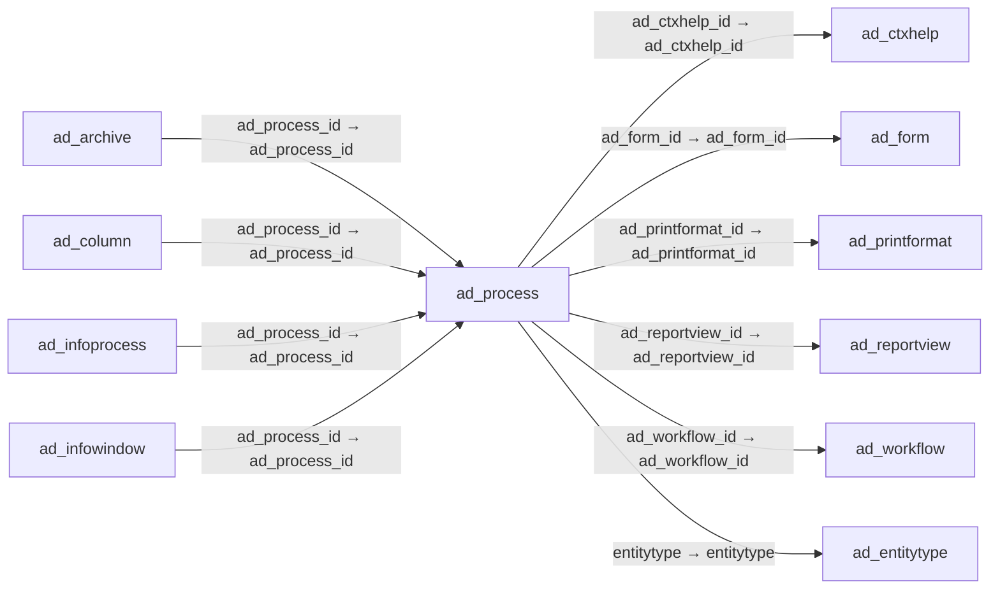

# ad_process — 프로세스·보고서

[전체 일람](../TABLE_INDEX.md) · [분류 일람](README.md) · [AI 사용 안내](../README.md) · [외래키 읽는 법](../RELATIONSHIPS.md)

## 기본 정보

| 항목 | 내용 |
|---|---|
| 물리명 | `adempiere.ad_process` |
| 한국어 논리명(문서용 해석) | 프로세스·보고서 |
| 원본 논리명 | Process |
| 원본 사전 ID | 284 |
| 분류 | `ad` — 애플리케이션 사전·화면·권한·시스템 |
| 전체 테넌트 행 수 | 472 |
| 물리 열 수 | 35 |
| 나가는 FK / 들어오는 FK | 6 / 29 |
| 구조·행 수 확인 시점 | 2026-11-03T23:29:01+09:00 |

## 의미와 쓰임

실행할 프로세스 또는 보고서를 정의한다.

- 설명 근거: 원본 애플리케이션 사전 명칭·설명을 한국어로 해석.
- 한국어 이름과 개요는 문서용 해석입니다. 공식 한국어 번역으로 간주하지 않습니다.
- 원본 설명: Process or Report
- 원본 도움말: —
- PostgreSQL 테이블 주석: —

## 키와 열

### 기본키·고유 제약조건

| 종류 | 제약조건 | 열(순서 유지) |
|---|---|---|
| PRIMARY KEY | `ad_process_pkey` | `ad_process_id` |
| UNIQUE | `ad_process_uu_idx` | `ad_process_uu` |

### 열 목록

원본 논리명·설명은 `AD_Column`에서 가져왔습니다. 기본값은 실제 PostgreSQL 메타데이터이며, 비어 있는 항목은 `—`로 표시합니다.

| 순서 | 물리명 | 원본 논리명 | PostgreSQL 타입 | NULL | PK | 기본값 | 설명 |
|---:|---|---|---|---|---|---|---|
| 1 | `ad_process_id` | Process | numeric(10,0) | 불가 | 예 | — | Process or Report |
| 2 | `ad_client_id` | Tenant | numeric(10,0) | 불가 | — | — | Tenant for this installation. |
| 3 | `ad_org_id` | Organization | numeric(10,0) | 불가 | — | — | Organizational entity within tenant |
| 4 | `isactive` | Active | character(1) | 불가 | — | 'Y'::bpchar | The record is active in the system |
| 5 | `created` | Created | timestamp without time zone | 불가 | — | now() | Date this record was created |
| 6 | `createdby` | Created By | numeric(10,0) | 불가 | — | — | User who created this records |
| 7 | `updated` | Updated | timestamp without time zone | 불가 | — | now() | Date this record was updated |
| 8 | `updatedby` | Updated By | numeric(10,0) | 불가 | — | — | User who updated this records |
| 9 | `value` | Search Key | character varying(40) | 불가 | — | — | Search key for the record in the format required - must be unique |
| 10 | `name` | Name | character varying(60) | 불가 | — | — | Alphanumeric identifier of the entity |
| 11 | `description` | Description | character varying(255) | 허용 | — | — | Optional short description of the record |
| 12 | `help` | Comment/Help | character varying(2000) | 허용 | — | — | Comment or Hint |
| 13 | `accesslevel` | Data Access Level | character(1) | 불가 | — | — | Access Level required |
| 14 | `entitytype` | Entity Type | character varying(40) | 불가 | — | 'D'::character varying | Dictionary Entity Type; Determines ownership and synchronization |
| 15 | `procedurename` | Procedure | character varying(60) | 허용 | — | — | Name of the Database Procedure |
| 16 | `isreport` | Report | character(1) | 불가 | — | 'Y'::bpchar | Indicates a Report record |
| 17 | `isdirectprint` | Direct print | character(1) | 허용 | — | 'N'::bpchar | Print without dialog |
| 18 | `ad_reportview_id` | Report View | numeric(10,0) | 허용 | — | — | View used to generate this report |
| 19 | `classname` | Classname | character varying(255) | 허용 | — | — | Java Classname |
| 20 | `statistic_count` | Statistic Count | numeric(10,0) | 허용 | — | — | Internal statistics how often the entity was used |
| 21 | `statistic_seconds` | Statistic Seconds | numeric | 허용 | — | — | Internal statistics how many seconds a process took |
| 22 | `ad_printformat_id` | Print Format | numeric(10,0) | 허용 | — | — | Data Print Format |
| 23 | `workflowvalue` | Workflow Key | character varying(40) | 허용 | — | — | Key of the Workflow to start |
| 24 | `ad_workflow_id` | Workflow | numeric(10,0) | 허용 | — | — | Workflow or combination of tasks |
| 25 | `isbetafunctionality` | Beta Functionality | character(1) | 불가 | — | 'N'::bpchar | This functionality is considered Beta |
| 26 | `isserverprocess` | Server Process | character(1) | 허용 | — | — | Run this Process on Server only |
| 27 | `showhelp` | Show Help | character(1) | 허용 | — | 'Y'::bpchar | — |
| 28 | `jasperreport` | Jasper Report | character varying(255) | 허용 | — | — | — |
| 29 | `ad_form_id` | Special Form | numeric(10,0) | 허용 | — | — | Special Form |
| 30 | `copyfromprocess` | Copy From Report and Process | character(1) | 허용 | — | NULL::bpchar | Copy settings from one report and process to another. |
| 31 | `ad_process_uu` | AD_Process_UU | uuid | 허용 | — | — | — |
| 32 | `ad_ctxhelp_id` | Context Help | numeric(10,0) | 허용 | — | NULL::numeric | — |
| 33 | `executiontype` | Execution Type | character(1) | 허용 | — | NULL::bpchar | Execution Type defines whether the report/process will always run in background or foreground.  |
| 34 | `allowmultipleexecution` | Allow Concurrent Execution | character varying(2) | 불가 | — | 'P'::character varying | Allow or disallow executing a process/report multiple times concurrently |
| 35 | `filenamepattern` | File Name Pattern | character varying(255) | 허용 | — | NULL::character varying | — |

## 외래키 흐름

화살표는 **FK를 가진 자식 → 참조되는 부모**입니다. 업무 처리의 시간 순서나 무조건적인 1:N 관계를 뜻하지 않습니다.

주변 관계 35개 중 10개를 그림으로 표시합니다. **전체 관계는 아래 두 표에 모두 포함**합니다.

### 이 테이블이 참조하는 부모 — 나가는 FK

| 제약조건 | 참조하는 쪽(자식) | 자식 열 | 참조받는 쪽(부모) | 부모 열 | 삭제 / 갱신 | 검증 / 지연 가능 |
|---|---|---|---|---|---|---|
| `adctxhelp_adprocess` <!-- FK_OUT: adempiere.ad_process.adctxhelp_adprocess --> | [`ad_process`](ad_process.md) | `ad_ctxhelp_id` | [`ad_ctxhelp`](ad_ctxhelp.md) | `ad_ctxhelp_id` | NO ACTION / NO ACTION | 완료 / 가능 (초기 지연) |
| `adform_adprocess` <!-- FK_OUT: adempiere.ad_process.adform_adprocess --> | [`ad_process`](ad_process.md) | `ad_form_id` | [`ad_form`](ad_form.md) | `ad_form_id` | NO ACTION / NO ACTION | 완료 / 가능 (초기 지연) |
| `adprintformat_adprocess` <!-- FK_OUT: adempiere.ad_process.adprintformat_adprocess --> | [`ad_process`](ad_process.md) | `ad_printformat_id` | [`ad_printformat`](ad_printformat.md) | `ad_printformat_id` | NO ACTION / NO ACTION | 완료 / 가능 (초기 지연) |
| `adreportview_adprocess` <!-- FK_OUT: adempiere.ad_process.adreportview_adprocess --> | [`ad_process`](ad_process.md) | `ad_reportview_id` | [`ad_reportview`](ad_reportview.md) | `ad_reportview_id` | NO ACTION / NO ACTION | 완료 / 가능 (초기 지연) |
| `adworkflow_adprocess` <!-- FK_OUT: adempiere.ad_process.adworkflow_adprocess --> | [`ad_process`](ad_process.md) | `ad_workflow_id` | [`ad_workflow`](ad_workflow.md) | `ad_workflow_id` | NO ACTION / NO ACTION | 완료 / 가능 (초기 지연) |
| `entityt_adprocess` <!-- FK_OUT: adempiere.ad_process.entityt_adprocess --> | [`ad_process`](ad_process.md) | `entitytype` | [`ad_entitytype`](ad_entitytype.md) | `entitytype` | NO ACTION / NO ACTION | 완료 / 가능 (초기 지연) |

### 이 테이블을 참조하는 자식 — 들어오는 FK

| 제약조건 | 참조하는 쪽(자식) | 자식 열 | 참조받는 쪽(부모) | 부모 열 | 삭제 / 갱신 | 검증 / 지연 가능 |
|---|---|---|---|---|---|---|
| `adprocess_adarchive` <!-- FK_IN: adempiere.ad_archive.adprocess_adarchive --> | [`ad_archive`](ad_archive.md) | `ad_process_id` | [`ad_process`](ad_process.md) | `ad_process_id` | NO ACTION / NO ACTION | 완료 / 가능 (초기 지연) |
| `adprocess_adcolumn` <!-- FK_IN: adempiere.ad_column.adprocess_adcolumn --> | [`ad_column`](ad_column.md) | `ad_process_id` | [`ad_process`](ad_process.md) | `ad_process_id` | SET NULL / NO ACTION | 완료 / 가능 (초기 지연) |
| `adprocess_adinfoprocess` <!-- FK_IN: adempiere.ad_infoprocess.adprocess_adinfoprocess --> | [`ad_infoprocess`](ad_infoprocess.md) | `ad_process_id` | [`ad_process`](ad_process.md) | `ad_process_id` | NO ACTION / NO ACTION | 완료 / 가능 (초기 지연) |
| `adprocess_adinfowindow` <!-- FK_IN: adempiere.ad_infowindow.adprocess_adinfowindow --> | [`ad_infowindow`](ad_infowindow.md) | `ad_process_id` | [`ad_process`](ad_process.md) | `ad_process_id` | NO ACTION / NO ACTION | 완료 / 가능 (초기 지연) |
| `adprocess_adissue` <!-- FK_IN: adempiere.ad_issue.adprocess_adissue --> | [`ad_issue`](ad_issue.md) | `ad_process_id` | [`ad_process`](ad_process.md) | `ad_process_id` | SET NULL / NO ACTION | 완료 / 가능 (초기 지연) |
| `adprocess_admenu` <!-- FK_IN: adempiere.ad_menu.adprocess_admenu --> | [`ad_menu`](ad_menu.md) | `ad_process_id` | [`ad_process`](ad_process.md) | `ad_process_id` | NO ACTION / NO ACTION | 완료 / 가능 (초기 지연) |
| `adprocess_adpackageexpcommon` <!-- FK_IN: adempiere.ad_package_exp_common.adprocess_adpackageexpcommon --> | [`ad_package_exp_common`](ad_package_exp_common.md) | `ad_process_id` | [`ad_process`](ad_process.md) | `ad_process_id` | NO ACTION / NO ACTION | 완료 / 가능 (초기 지연) |
| `adprocess_adpackageexpdetail` <!-- FK_IN: adempiere.ad_package_exp_detail.adprocess_adpackageexpdetail --> | [`ad_package_exp_detail`](ad_package_exp_detail.md) | `ad_process_id` | [`ad_process`](ad_process.md) | `ad_process_id` | NO ACTION / NO ACTION | 완료 / 가능 (초기 지연) |
| `adprocess_adpinstance` <!-- FK_IN: adempiere.ad_pinstance.adprocess_adpinstance --> | [`ad_pinstance`](ad_pinstance.md) | `ad_process_id` | [`ad_process`](ad_process.md) | `ad_process_id` | NO ACTION / NO ACTION | 완료 / 가능 (초기 지연) |
| `ad_process_preference` <!-- FK_IN: adempiere.ad_preference.ad_process_preference --> | [`ad_preference`](ad_preference.md) | `ad_process_id` | [`ad_process`](ad_process.md) | `ad_process_id` | NO ACTION / NO ACTION | 완료 / 가능 (초기 지연) |
| `jasperprocess_adprintformat` <!-- FK_IN: adempiere.ad_printformat.jasperprocess_adprintformat --> | [`ad_printformat`](ad_printformat.md) | `jasperprocess_id` | [`ad_process`](ad_process.md) | `ad_process_id` | NO ACTION / NO ACTION | 완료 / 가능 (초기 지연) |
| `adprocess_adprocessaccess` <!-- FK_IN: adempiere.ad_process_access.adprocess_adprocessaccess --> | [`ad_process_access`](ad_process_access.md) | `ad_process_id` | [`ad_process`](ad_process.md) | `ad_process_id` | CASCADE / NO ACTION | 완료 / 가능 (초기 지연) |
| `adprocess_addrillrule` <!-- FK_IN: adempiere.ad_process_drillrule.adprocess_addrillrule --> | [`ad_process_drillrule`](ad_process_drillrule.md) | `ad_process_id` | [`ad_process`](ad_process.md) | `ad_process_id` | NO ACTION / NO ACTION | 완료 / 가능 (초기 지연) |
| `adprocess_adprocesspara` <!-- FK_IN: adempiere.ad_process_para.adprocess_adprocesspara --> | [`ad_process_para`](ad_process_para.md) | `ad_process_id` | [`ad_process`](ad_process.md) | `ad_process_id` | CASCADE / NO ACTION | 완료 / 가능 (초기 지연) |
| `ad_process_ad_process_trl` <!-- FK_IN: adempiere.ad_process_trl.ad_process_ad_process_trl --> | [`ad_process_trl`](ad_process_trl.md) | `ad_process_id` | [`ad_process`](ad_process.md) | `ad_process_id` | CASCADE / NO ACTION | 완료 / 가능 (초기 지연) |
| `adprocess_adscheduler` <!-- FK_IN: adempiere.ad_scheduler.adprocess_adscheduler --> | [`ad_scheduler`](ad_scheduler.md) | `ad_process_id` | [`ad_process`](ad_process.md) | `ad_process_id` | CASCADE / NO ACTION | 완료 / 가능 (초기 지연) |
| `adprocess_adtab` <!-- FK_IN: adempiere.ad_tab.adprocess_adtab --> | [`ad_tab`](ad_tab.md) | `ad_process_id` | [`ad_process`](ad_process.md) | `ad_process_id` | NO ACTION / NO ACTION | 완료 / 가능 (초기 지연) |
| `adprocess_adtoolbarbutton` <!-- FK_IN: adempiere.ad_toolbarbutton.adprocess_adtoolbarbutton --> | [`ad_toolbarbutton`](ad_toolbarbutton.md) | `ad_process_id` | [`ad_process`](ad_process.md) | `ad_process_id` | NO ACTION / NO ACTION | 완료 / 가능 (초기 지연) |
| `adprocess_adtoolbarbuttonrestr` <!-- FK_IN: adempiere.ad_toolbarbuttonrestrict.adprocess_adtoolbarbuttonrestr --> | [`ad_toolbarbuttonrestrict`](ad_toolbarbuttonrestrict.md) | `ad_process_id` | [`ad_process`](ad_process.md) | `ad_process_id` | NO ACTION / NO ACTION | 완료 / 가능 (초기 지연) |
| `adprocess_aduserdefproc` <!-- FK_IN: adempiere.ad_userdef_proc.adprocess_aduserdefproc --> | [`ad_userdef_proc`](ad_userdef_proc.md) | `ad_process_id` | [`ad_process`](ad_process.md) | `ad_process_id` | NO ACTION / NO ACTION | 완료 / 가능 (초기 지연) |
| `adprocess_aduserdeftab` <!-- FK_IN: adempiere.ad_userdef_tab.adprocess_aduserdeftab --> | [`ad_userdef_tab`](ad_userdef_tab.md) | `ad_process_id` | [`ad_process`](ad_process.md) | `ad_process_id` | NO ACTION / NO ACTION | 완료 / 가능 (초기 지연) |
| `adprocess_adwfnode` <!-- FK_IN: adempiere.ad_wf_node.adprocess_adwfnode --> | [`ad_wf_node`](ad_wf_node.md) | `ad_process_id` | [`ad_process`](ad_process.md) | `ad_process_id` | NO ACTION / NO ACTION | 완료 / 가능 (초기 지연) |
| `adprocess_adworkbenchwindow` <!-- FK_IN: adempiere.ad_workbenchwindow.adprocess_adworkbenchwindow --> | [`ad_workbenchwindow`](ad_workbenchwindow.md) | `ad_process_id` | [`ad_process`](ad_process.md) | `ad_process_id` | NO ACTION / NO ACTION | 완료 / 가능 (초기 지연) |
| `adprocess_aspclientexception` <!-- FK_IN: adempiere.asp_clientexception.adprocess_aspclientexception --> | [`asp_clientexception`](../asp/asp_clientexception.md) | `ad_process_id` | [`ad_process`](ad_process.md) | `ad_process_id` | NO ACTION / NO ACTION | 완료 / 가능 (초기 지연) |
| `adprocess_aspprocess` <!-- FK_IN: adempiere.asp_process.adprocess_aspprocess --> | [`asp_process`](../asp/asp_process.md) | `ad_process_id` | [`ad_process`](ad_process.md) | `ad_process_id` | NO ACTION / NO ACTION | 완료 / 가능 (초기 지연) |
| `adprocess_padashboardcontent` <!-- FK_IN: adempiere.pa_dashboardcontent.adprocess_padashboardcontent --> | [`pa_dashboardcontent`](../pa/pa_dashboardcontent.md) | `ad_process_id` | [`ad_process`](ad_process.md) | `ad_process_id` | NO ACTION / NO ACTION | 완료 / 가능 (초기 지연) |
| `adprocess_padocumentstatus` <!-- FK_IN: adempiere.pa_documentstatus.adprocess_padocumentstatus --> | [`pa_documentstatus`](../pa/pa_documentstatus.md) | `ad_process_id` | [`ad_process`](ad_process.md) | `ad_process_id` | NO ACTION / NO ACTION | 완료 / 가능 (초기 지연) |
| `jasperprocess_pareport` <!-- FK_IN: adempiere.pa_report.jasperprocess_pareport --> | [`pa_report`](../pa/pa_report.md) | `jasperprocess_id` | [`ad_process`](ad_process.md) | `ad_process_id` | NO ACTION / NO ACTION | 완료 / 가능 (초기 지연) |
| `adprocess_ppordernode` <!-- FK_IN: adempiere.pp_order_node.adprocess_ppordernode --> | [`pp_order_node`](../pp/pp_order_node.md) | `ad_process_id` | [`ad_process`](ad_process.md) | `ad_process_id` | NO ACTION / NO ACTION | 완료 / 가능 (초기 지연) |

## 조회 시 주의

- FK 표의 자식 열과 부모 열을 같은 순서로 대응시킵니다. 복합 FK는 모든 열의 동등 조건을 `AND`로 연결합니다.
- 테이블 이름이나 `_id` 열 이름만으로 물리 FK가 있다고 가정하지 않습니다. FK 미선언은 업무 관계가 없다는 뜻도 아닙니다.
- 자식이 여러 행인 테이블과 조인하면 부모의 금액·건수가 중복될 수 있습니다. 집계 단위를 먼저 정합니다.
- `ad_client_id`가 있습니다. 업무 분석에서는 대상 테넌트를 명시합니다. GardenWorld는 `11`, 시스템 공통 설정은 `0`일 수 있으므로 일괄 필터 적용 전에 테이블 역할을 확인합니다.
- 행 수는 위 확인 시점의 전체 테넌트 값입니다. 최신 업무 실적이나 현재 실행 결과로 재사용하지 않습니다.
