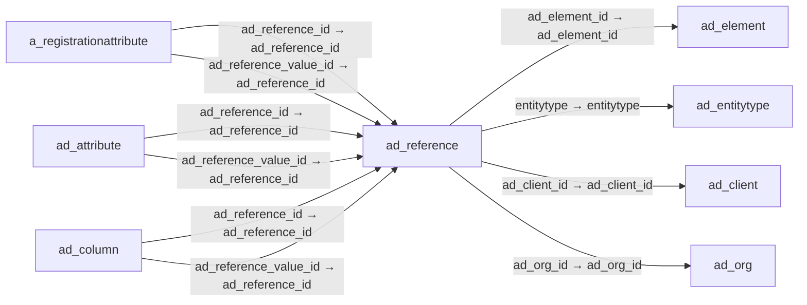

# ad_reference — 참조 유형

[전체 일람](../TABLE_INDEX.md) · [분류 일람](README.md) · [AI 사용 안내](../README.md) · [외래키 읽는 법](../RELATIONSHIPS.md)

## 기본 정보

| 항목 | 내용 |
|---|---|
| 물리명 | `adempiere.ad_reference` |
| 한국어 논리명(문서용 해석) | 참조 유형 |
| 원본 논리명 | Reference |
| 원본 사전 ID | 102 |
| 분류 | `ad` — 애플리케이션 사전·화면·권한·시스템 |
| 전체 테넌트 행 수 | 591 |
| 물리 열 수 | 18 |
| 나가는 FK / 들어오는 FK | 4 / 31 |
| 구조·행 수 확인 시점 | 2026-11-03T23:29:01+09:00 |

## 의미와 쓰임

시스템의 선택 목록과 참조 유형을 정의한다.

- 설명 근거: 원본 애플리케이션 사전 명칭·설명을 한국어로 해석.
- 한국어 이름과 개요는 문서용 해석입니다. 공식 한국어 번역으로 간주하지 않습니다.
- 원본 설명: System Reference (Pick List)
- 원본 도움말: —
- PostgreSQL 테이블 주석: —

## 키와 열

### 기본키·고유 제약조건

| 종류 | 제약조건 | 열(순서 유지) |
|---|---|---|
| PRIMARY KEY | `ad_reference_pkey` | `ad_reference_id` |
| UNIQUE | `ad_reference_uu_idx` | `ad_reference_uu` |

### 별도 고유 인덱스

PK·UNIQUE 제약조건의 인덱스와 별도로 존재하는 고유 인덱스입니다. 식·조건·열 순서는 원본 정의를 따릅니다.

- `ad_reference_name`: `CREATE UNIQUE INDEX ad_reference_name ON adempiere.ad_reference USING btree (name)`

### 열 목록

원본 논리명·설명은 `AD_Column`에서 가져왔습니다. 기본값은 실제 PostgreSQL 메타데이터이며, 비어 있는 항목은 `—`로 표시합니다.

| 순서 | 물리명 | 원본 논리명 | PostgreSQL 타입 | NULL | PK | 기본값 | 설명 |
|---:|---|---|---|---|---|---|---|
| 1 | `ad_reference_id` | Reference | numeric(10,0) | 불가 | 예 | — | System Reference and Validation |
| 2 | `ad_client_id` | Tenant | numeric(10,0) | 불가 | — | — | Tenant for this installation. |
| 3 | `ad_org_id` | Organization | numeric(10,0) | 불가 | — | — | Organizational entity within tenant |
| 4 | `isactive` | Active | character(1) | 불가 | — | 'Y'::bpchar | The record is active in the system |
| 5 | `created` | Created | timestamp without time zone | 불가 | — | now() | Date this record was created |
| 6 | `createdby` | Created By | numeric(10,0) | 불가 | — | — | User who created this records |
| 7 | `updated` | Updated | timestamp without time zone | 불가 | — | now() | Date this record was updated |
| 8 | `updatedby` | Updated By | numeric(10,0) | 불가 | — | — | User who updated this records |
| 9 | `name` | Name | character varying(60) | 불가 | — | — | Alphanumeric identifier of the entity |
| 10 | `description` | Description | character varying(255) | 허용 | — | — | Optional short description of the record |
| 11 | `help` | Comment/Help | character varying(2000) | 허용 | — | — | Comment or Hint |
| 12 | `validationtype` | Validation type | character(1) | 불가 | — | — | Different method of validating data |
| 13 | `vformat` | Value Format | character varying(40) | 허용 | — | — | Format of the value; Can contain fixed format elements, Variables: "_lLoOaAcCa09", or ~regex |
| 14 | `entitytype` | Entity Type | character varying(40) | 불가 | — | 'D'::character varying | Dictionary Entity Type; Determines ownership and synchronization |
| 15 | `isorderbyvalue` | Order By Value | character(1) | 허용 | — | 'N'::bpchar | Order list using the value column instead of the name column |
| 16 | `ad_reference_uu` | AD_Reference_UU | uuid | 허용 | — | — | — |
| 17 | `ad_element_id` | System Element | numeric(10,0) | 허용 | — | NULL::numeric | System Element enables the central maintenance of column description and help. |
| 18 | `showinactive` | Show Inactive | character varying(4) | 불가 | — | 'N'::character varying | Show Inactive Records |

## 외래키 흐름

화살표는 **FK를 가진 자식 → 참조되는 부모**입니다. 업무 처리의 시간 순서나 무조건적인 1:N 관계를 뜻하지 않습니다.

주변 관계 35개 중 10개를 그림으로 표시합니다. **전체 관계는 아래 두 표에 모두 포함**합니다.

### 이 테이블이 참조하는 부모 — 나가는 FK

| 제약조건 | 참조하는 쪽(자식) | 자식 열 | 참조받는 쪽(부모) | 부모 열 | 삭제 / 갱신 | 검증 / 지연 가능 |
|---|---|---|---|---|---|---|
| `adelement_adreference` <!-- FK_OUT: adempiere.ad_reference.adelement_adreference --> | [`ad_reference`](ad_reference.md) | `ad_element_id` | [`ad_element`](ad_element.md) | `ad_element_id` | NO ACTION / NO ACTION | 완료 / 가능 (초기 지연) |
| `entityt_adreference` <!-- FK_OUT: adempiere.ad_reference.entityt_adreference --> | [`ad_reference`](ad_reference.md) | `entitytype` | [`ad_entitytype`](ad_entitytype.md) | `entitytype` | NO ACTION / NO ACTION | 완료 / 가능 (초기 지연) |
| `referenceclient` <!-- FK_OUT: adempiere.ad_reference.referenceclient --> | [`ad_reference`](ad_reference.md) | `ad_client_id` | [`ad_client`](ad_client.md) | `ad_client_id` | NO ACTION / NO ACTION | 완료 / 가능 (초기 지연) |
| `referenceorg` <!-- FK_OUT: adempiere.ad_reference.referenceorg --> | [`ad_reference`](ad_reference.md) | `ad_org_id` | [`ad_org`](ad_org.md) | `ad_org_id` | NO ACTION / NO ACTION | 완료 / 가능 (초기 지연) |

### 이 테이블을 참조하는 자식 — 들어오는 FK

| 제약조건 | 참조하는 쪽(자식) | 자식 열 | 참조받는 쪽(부모) | 부모 열 | 삭제 / 갱신 | 검증 / 지연 가능 |
|---|---|---|---|---|---|---|
| `adreference_aregattribute` <!-- FK_IN: adempiere.a_registrationattribute.adreference_aregattribute --> | [`a_registrationattribute`](../a/a_registrationattribute.md) | `ad_reference_id` | [`ad_reference`](ad_reference.md) | `ad_reference_id` | NO ACTION / NO ACTION | 완료 / 가능 (초기 지연) |
| `adreferencevalue_aregattribute` <!-- FK_IN: adempiere.a_registrationattribute.adreferencevalue_aregattribute --> | [`a_registrationattribute`](../a/a_registrationattribute.md) | `ad_reference_value_id` | [`ad_reference`](ad_reference.md) | `ad_reference_id` | NO ACTION / NO ACTION | 완료 / 가능 (초기 지연) |
| `adreference_adattribute` <!-- FK_IN: adempiere.ad_attribute.adreference_adattribute --> | [`ad_attribute`](ad_attribute.md) | `ad_reference_id` | [`ad_reference`](ad_reference.md) | `ad_reference_id` | NO ACTION / NO ACTION | 완료 / 가능 (초기 지연) |
| `adreferencevalue_adattribute` <!-- FK_IN: adempiere.ad_attribute.adreferencevalue_adattribute --> | [`ad_attribute`](ad_attribute.md) | `ad_reference_value_id` | [`ad_reference`](ad_reference.md) | `ad_reference_id` | NO ACTION / NO ACTION | 완료 / 가능 (초기 지연) |
| `ad_reference_columndatatype` <!-- FK_IN: adempiere.ad_column.ad_reference_columndatatype --> | [`ad_column`](ad_column.md) | `ad_reference_id` | [`ad_reference`](ad_reference.md) | `ad_reference_id` | NO ACTION / NO ACTION | 완료 / 가능 (초기 지연) |
| `ad_reference_columnvalue` <!-- FK_IN: adempiere.ad_column.ad_reference_columnvalue --> | [`ad_column`](ad_column.md) | `ad_reference_value_id` | [`ad_reference`](ad_reference.md) | `ad_reference_id` | NO ACTION / NO ACTION | 완료 / 가능 (초기 지연) |
| `adreference_adfield` <!-- FK_IN: adempiere.ad_field.adreference_adfield --> | [`ad_field`](ad_field.md) | `ad_reference_id` | [`ad_reference`](ad_reference.md) | `ad_reference_id` | NO ACTION / NO ACTION | 완료 / 가능 (초기 지연) |
| `adreferencevalue_adfield` <!-- FK_IN: adempiere.ad_field.adreferencevalue_adfield --> | [`ad_field`](ad_field.md) | `ad_reference_value_id` | [`ad_reference`](ad_reference.md) | `ad_reference_id` | NO ACTION / NO ACTION | 완료 / 가능 (초기 지연) |
| `adreference_adinfocolumn` <!-- FK_IN: adempiere.ad_infocolumn.adreference_adinfocolumn --> | [`ad_infocolumn`](ad_infocolumn.md) | `ad_reference_id` | [`ad_reference`](ad_reference.md) | `ad_reference_id` | NO ACTION / NO ACTION | 완료 / 가능 (초기 지연) |
| `adreferencevalue_adinfocolumn` <!-- FK_IN: adempiere.ad_infocolumn.adreferencevalue_adinfocolumn --> | [`ad_infocolumn`](ad_infocolumn.md) | `ad_reference_value_id` | [`ad_reference`](ad_reference.md) | `ad_reference_id` | NO ACTION / NO ACTION | 완료 / 가능 (초기 지연) |
| `adreference_adpackageexpdetail` <!-- FK_IN: adempiere.ad_package_exp_detail.adreference_adpackageexpdetail --> | [`ad_package_exp_detail`](ad_package_exp_detail.md) | `ad_reference_id` | [`ad_reference`](ad_reference.md) | `ad_reference_id` | NO ACTION / NO ACTION | 완료 / 가능 (초기 지연) |
| `adreference_adpackageimpbackup` <!-- FK_IN: adempiere.ad_package_imp_backup.adreference_adpackageimpbackup --> | [`ad_package_imp_backup`](ad_package_imp_backup.md) | `ad_reference_id` | [`ad_reference`](ad_reference.md) | `ad_reference_id` | NO ACTION / NO ACTION | 완료 / 가능 (초기 지연) |
| `adreference_adprocesspara` <!-- FK_IN: adempiere.ad_process_para.adreference_adprocesspara --> | [`ad_process_para`](ad_process_para.md) | `ad_reference_id` | [`ad_reference`](ad_reference.md) | `ad_reference_id` | NO ACTION / NO ACTION | 완료 / 가능 (초기 지연) |
| `adreferencevalue_adprocpara` <!-- FK_IN: adempiere.ad_process_para.adreferencevalue_adprocpara --> | [`ad_process_para`](ad_process_para.md) | `ad_reference_value_id` | [`ad_reference`](ad_reference.md) | `ad_reference_id` | NO ACTION / NO ACTION | 완료 / 가능 (초기 지연) |
| `ad_reference_reflist` <!-- FK_IN: adempiere.ad_ref_list.ad_reference_reflist --> | [`ad_ref_list`](ad_ref_list.md) | `ad_reference_id` | [`ad_reference`](ad_reference.md) | `ad_reference_id` | CASCADE / NO ACTION | 완료 / 가능 (초기 지연) |
| `ad_reference_reftable` <!-- FK_IN: adempiere.ad_ref_table.ad_reference_reftable --> | [`ad_ref_table`](ad_ref_table.md) | `ad_reference_id` | [`ad_reference`](ad_reference.md) | `ad_reference_id` | CASCADE / NO ACTION | 완료 / 가능 (초기 지연) |
| `ad_referencetrl` <!-- FK_IN: adempiere.ad_reference_trl.ad_referencetrl --> | [`ad_reference_trl`](ad_reference_trl.md) | `ad_reference_id` | [`ad_reference`](ad_reference.md) | `ad_reference_id` | CASCADE / NO ACTION | 완료 / 가능 (초기 지연) |
| `adreferencesource_adrelationty` <!-- FK_IN: adempiere.ad_relationtype.adreferencesource_adrelationty --> | [`ad_relationtype`](ad_relationtype.md) | `ad_reference_source_id` | [`ad_reference`](ad_reference.md) | `ad_reference_id` | NO ACTION / NO ACTION | 완료 / 가능 (초기 지연) |
| `adreferencetarget_adrelationty` <!-- FK_IN: adempiere.ad_relationtype.adreferencetarget_adrelationty --> | [`ad_relationtype`](ad_relationtype.md) | `ad_reference_target_id` | [`ad_reference`](ad_reference.md) | `ad_reference_id` | NO ACTION / NO ACTION | 완료 / 가능 (초기 지연) |
| `adreference_aduserdeffield` <!-- FK_IN: adempiere.ad_userdef_field.adreference_aduserdeffield --> | [`ad_userdef_field`](ad_userdef_field.md) | `ad_reference_id` | [`ad_reference`](ad_reference.md) | `ad_reference_id` | NO ACTION / NO ACTION | 완료 / 가능 (초기 지연) |
| `adreferencevalue_aduserdeffiel` <!-- FK_IN: adempiere.ad_userdef_field.adreferencevalue_aduserdeffiel --> | [`ad_userdef_field`](ad_userdef_field.md) | `ad_reference_value_id` | [`ad_reference`](ad_reference.md) | `ad_reference_id` | NO ACTION / NO ACTION | 완료 / 가능 (초기 지연) |
| `adreference_aduserdefcolumn` <!-- FK_IN: adempiere.ad_userdef_info_column.adreference_aduserdefcolumn --> | [`ad_userdef_info_column`](ad_userdef_info_column.md) | `ad_reference_id` | [`ad_reference`](ad_reference.md) | `ad_reference_id` | NO ACTION / NO ACTION | 완료 / 가능 (초기 지연) |
| `adreferencevalue_aduserdefinfo` <!-- FK_IN: adempiere.ad_userdef_info_column.adreferencevalue_aduserdefinfo --> | [`ad_userdef_info_column`](ad_userdef_info_column.md) | `ad_reference_value_id` | [`ad_reference`](ad_reference.md) | `ad_reference_id` | NO ACTION / NO ACTION | 완료 / 가능 (초기 지연) |
| `adreference_aduserdefprocparam` <!-- FK_IN: adempiere.ad_userdef_proc_parameter.adreference_aduserdefprocparam --> | [`ad_userdef_proc_parameter`](ad_userdef_proc_parameter.md) | `ad_reference_id` | [`ad_reference`](ad_reference.md) | `ad_reference_id` | NO ACTION / NO ACTION | 완료 / 가능 (초기 지연) |
| `adreferencevalue_aduserdefproc` <!-- FK_IN: adempiere.ad_userdef_proc_parameter.adreferencevalue_aduserdefproc --> | [`ad_userdef_proc_parameter`](ad_userdef_proc_parameter.md) | `ad_reference_value_id` | [`ad_reference`](ad_reference.md) | `ad_reference_id` | NO ACTION / NO ACTION | 완료 / 가능 (초기 지연) |
| `adreference_aspreflist` <!-- FK_IN: adempiere.asp_ref_list.adreference_aspreflist --> | [`asp_ref_list`](../asp/asp_ref_list.md) | `ad_reference_id` | [`ad_reference`](ad_reference.md) | `ad_reference_id` | NO ACTION / NO ACTION | 완료 / 가능 (초기 지연) |
| `adreference_hrconcept` <!-- FK_IN: adempiere.hr_concept.adreference_hrconcept --> | [`hr_concept`](../hr/hr_concept.md) | `ad_reference_id` | [`ad_reference`](ad_reference.md) | `ad_reference_id` | NO ACTION / NO ACTION | 완료 / 가능 (초기 지연) |
| `adreference_mattribute` <!-- FK_IN: adempiere.m_attribute.adreference_mattribute --> | [`m_attribute`](../m/m_attribute.md) | `ad_reference_id` | [`ad_reference`](ad_reference.md) | `ad_reference_id` | NO ACTION / NO ACTION | 완료 / 가능 (초기 지연) |
| `adreferencevalue_mattribute` <!-- FK_IN: adempiere.m_attribute.adreferencevalue_mattribute --> | [`m_attribute`](../m/m_attribute.md) | `ad_reference_value_id` | [`ad_reference`](ad_reference.md) | `ad_reference_id` | NO ACTION / NO ACTION | 완료 / 가능 (초기 지연) |
| `adreference_wswebservicefieldi` <!-- FK_IN: adempiere.ws_webservicefieldinput.adreference_wswebservicefieldi --> | [`ws_webservicefieldinput`](../ws/ws_webservicefieldinput.md) | `ad_reference_id` | [`ad_reference`](ad_reference.md) | `ad_reference_id` | NO ACTION / NO ACTION | 완료 / 가능 (초기 지연) |
| `adreferencevalue_wswebservicef` <!-- FK_IN: adempiere.ws_webservicefieldinput.adreferencevalue_wswebservicef --> | [`ws_webservicefieldinput`](../ws/ws_webservicefieldinput.md) | `ad_reference_value_id` | [`ad_reference`](ad_reference.md) | `ad_reference_id` | NO ACTION / NO ACTION | 완료 / 가능 (초기 지연) |

## 조회 시 주의

- FK 표의 자식 열과 부모 열을 같은 순서로 대응시킵니다. 복합 FK는 모든 열의 동등 조건을 `AND`로 연결합니다.
- 테이블 이름이나 `_id` 열 이름만으로 물리 FK가 있다고 가정하지 않습니다. FK 미선언은 업무 관계가 없다는 뜻도 아닙니다.
- 자식이 여러 행인 테이블과 조인하면 부모의 금액·건수가 중복될 수 있습니다. 집계 단위를 먼저 정합니다.
- `ad_client_id`가 있습니다. 업무 분석에서는 대상 테넌트를 명시합니다. GardenWorld는 `11`, 시스템 공통 설정은 `0`일 수 있으므로 일괄 필터 적용 전에 테이블 역할을 확인합니다.
- 행 수는 위 확인 시점의 전체 테넌트 값입니다. 최신 업무 실적이나 현재 실행 결과로 재사용하지 않습니다.
