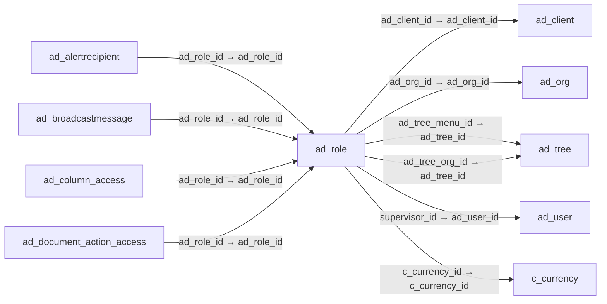

# ad_role — 역할

[전체 일람](../TABLE_INDEX.md) · [분류 일람](README.md) · [AI 사용 안내](../README.md) · [외래키 읽는 법](../RELATIONSHIPS.md)

## 기본 정보

| 항목 | 내용 |
|---|---|
| 물리명 | `adempiere.ad_role` |
| 한국어 논리명(문서용 해석) | 역할 |
| 원본 논리명 | Role |
| 원본 사전 ID | 156 |
| 분류 | `ad` — 애플리케이션 사전·화면·권한·시스템 |
| 전체 테넌트 행 수 | 5 |
| 물리 열 수 | 56 |
| 나가는 FK / 들어오는 FK | 6 / 41 |
| 구조·행 수 확인 시점 | 2026-11-03T23:29:01+09:00 |

## 의미와 쓰임

사용자의 책임과 접근 권한을 구분하는 역할을 정의한다.

- 설명 근거: 원본 애플리케이션 사전 명칭·설명을 한국어로 해석.
- 한국어 이름과 개요는 문서용 해석입니다. 공식 한국어 번역으로 간주하지 않습니다.
- 원본 설명: Responsibility Role
- 원본 도움말: —
- PostgreSQL 테이블 주석: —

## 키와 열

### 기본키·고유 제약조건

| 종류 | 제약조건 | 열(순서 유지) |
|---|---|---|
| PRIMARY KEY | `ad_role_pkey` | `ad_role_id` |
| UNIQUE | `ad_role_uu_idx` | `ad_role_uu` |

### 열 목록

원본 논리명·설명은 `AD_Column`에서 가져왔습니다. 기본값은 실제 PostgreSQL 메타데이터이며, 비어 있는 항목은 `—`로 표시합니다.

| 순서 | 물리명 | 원본 논리명 | PostgreSQL 타입 | NULL | PK | 기본값 | 설명 |
|---:|---|---|---|---|---|---|---|
| 1 | `ad_role_id` | Role | numeric(10,0) | 불가 | 예 | — | Responsibility Role |
| 2 | `ad_client_id` | Tenant | numeric(10,0) | 불가 | — | — | Tenant for this installation. |
| 3 | `ad_org_id` | Organization | numeric(10,0) | 불가 | — | — | Organizational entity within tenant |
| 4 | `isactive` | Active | character(1) | 불가 | — | 'Y'::bpchar | The record is active in the system |
| 5 | `created` | Created | timestamp without time zone | 불가 | — | now() | Date this record was created |
| 6 | `createdby` | Created By | numeric(10,0) | 불가 | — | — | User who created this records |
| 7 | `updated` | Updated | timestamp without time zone | 불가 | — | now() | Date this record was updated |
| 8 | `name` | Name | character varying(60) | 불가 | — | — | Alphanumeric identifier of the entity |
| 9 | `updatedby` | Updated By | numeric(10,0) | 불가 | — | — | User who updated this records |
| 10 | `description` | Description | character varying(255) | 허용 | — | — | Optional short description of the record |
| 11 | `userlevel` | User Level | character(3) | 허용 | — | '  O'::bpchar | System Tenant Organization |
| 12 | `c_currency_id` | Currency | numeric(10,0) | 허용 | — | — | The Currency for this record |
| 13 | `amtapproval` | Approval Amount | numeric | 허용 | — | 0 | The approval amount limit for this role |
| 14 | `ad_tree_menu_id` | Menu Tree | numeric(10,0) | 허용 | — | — | Tree of the menu |
| 15 | `ismanual` | Manual | character(1) | 불가 | — | 'Y'::bpchar | This is a manual process |
| 16 | `isshowacct` | Show Accounting | character(1) | 불가 | — | 'Y'::bpchar | Users with this role can see accounting information |
| 17 | `ispersonallock` | Personal Lock | character(1) | 불가 | — | 'N'::bpchar | Allow users with role to lock access to personal records |
| 18 | `ispersonalaccess` | Personal Access | character(1) | 불가 | — | 'N'::bpchar | Allow access to all personal records |
| 19 | `iscanexport` | Can Export | character(1) | 불가 | — | 'Y'::bpchar | Users with this role can export data |
| 20 | `iscanreport` | Can Report | character(1) | 불가 | — | 'Y'::bpchar | Users with this role can create reports |
| 21 | `supervisor_id` | Supervisor | numeric(10,0) | 허용 | — | — | Supervisor for this user/organization - used for escalation and approval |
| 22 | `iscanapproveowndoc` | Approve own Documents | character(1) | 불가 | — | 'Y'::bpchar | Users with this role can approve their own documents |
| 23 | `isaccessallorgs` | Access all Orgs | character(1) | 불가 | — | 'N'::bpchar | Access all Organizations (no org access control) of the tenant |
| 24 | `ischangelog` | Maintain Change Log | character(1) | 불가 | — | 'N'::bpchar | Maintain a log of changes |
| 25 | `preferencetype` | Preference Level | character(1) | 불가 | — | 'C'::bpchar | Determines what preferences the user can set |
| 26 | `overwritepricelimit` | Overwrite Price Limit | character(1) | 불가 | — | 'N'::bpchar | Overwrite Price Limit if the Price List  enforces the Price Limit |
| 27 | `isuseuserorgaccess` | Use User Org Access | character(1) | 불가 | — | 'N'::bpchar | Use Org Access defined by user instead of Role Org Access |
| 28 | `ad_tree_org_id` | Organization Tree | numeric(10,0) | 허용 | — | — | Trees are used for (financial) reporting and security access (via role) |
| 29 | `confirmqueryrecords` | Confirm Query Records | numeric(10,0) | 불가 | — | 0 | Require Confirmation if more records will be returned by the query (If not defined 500) |
| 30 | `maxqueryrecords` | Max Query Records | numeric(10,0) | 불가 | — | 0 | If defined, you cannot query more records as defined - the query criteria needs to be changed to query less records |
| 31 | `connectionprofile` | Connection Profile | character(1) | 허용 | — | — | How a Java Tenant connects to the server(s) |
| 32 | `allow_info_account` | Allow Info Account | character(1) | 불가 | — | 'Y'::bpchar | — |
| 33 | `allow_info_asset` | Allow Info Asset | character(1) | 불가 | — | 'Y'::bpchar | — |
| 34 | `allow_info_bpartner` | Allow Info BPartner | character(1) | 불가 | — | 'Y'::bpchar | — |
| 35 | `allow_info_cashjournal` | Allow Info Cash Journal | character(1) | 불가 | — | 'N'::bpchar | — |
| 36 | `allow_info_inout` | Allow Shipment Info | character(1) | 불가 | — | 'Y'::bpchar | — |
| 37 | `allow_info_invoice` | Allow Info Invoice | character(1) | 불가 | — | 'Y'::bpchar | — |
| 38 | `allow_info_order` | Allow Info Order | character(1) | 불가 | — | 'Y'::bpchar | — |
| 39 | `allow_info_payment` | Allow Info Payment | character(1) | 불가 | — | 'Y'::bpchar | — |
| 40 | `allow_info_product` | Allow Info Product | character(1) | 불가 | — | 'Y'::bpchar | — |
| 41 | `allow_info_resource` | Allow Info Resource | character(1) | 불가 | — | 'Y'::bpchar | — |
| 42 | `allow_info_schedule` | Allow Info Schedule | character(1) | 불가 | — | 'Y'::bpchar | — |
| 43 | `userdiscount` | User Discount | numeric(22,2) | 허용 | — | — | — |
| 44 | `allow_info_mrp` | Allow Info MRP | character(1) | 불가 | — | 'N'::bpchar | — |
| 45 | `allow_info_crp` | Allow Info CRP | character(1) | 불가 | — | 'N'::bpchar | — |
| 46 | `isdiscountuptolimitprice` | Is Discount Up to Limit Price | character(1) | 불가 | — | 'N'::bpchar | — |
| 47 | `isdiscountallowedontotal` | Is Discount Allowed On Total | character(1) | 불가 | — | 'N'::bpchar | — |
| 48 | `amtapprovalaccum` | Approval Amount Accumulated | numeric | 허용 | — | — | The approval amount limit for this role accumulated on a period |
| 49 | `daysapprovalaccum` | Days Approval Accumulated | numeric(10,0) | 허용 | — | — | The days approval indicates the days to take into account to verify the accumulated approval amount. |
| 50 | `ad_role_uu` | AD_Role_UU | uuid | 허용 | — | — | — |
| 51 | `ismenuautoexpand` | Auto expand menu | character(1) | 불가 | — | 'N'::bpchar | If ticked, the menu is automatically expanded |
| 52 | `ismasterrole` | Role Template | character(1) | 불가 | — | 'N'::bpchar | A role template cannot be assigned to users, it is intended to define access to menu option and documents and inherit to other roles |
| 53 | `isaccessadvanced` | Access Advanced | character(1) | 허용 | — | 'N'::bpchar | — |
| 54 | `roletype` | Role Type | character varying(2) | 허용 | — | NULL::character varying | — |
| 55 | `isclientadministrator` | Tenant Administrator | character(1) | 불가 | — | 'N'::bpchar | This role is a tenant administrator |
| 56 | `predefinedcontextvariables` | Predefined Context Variables | character varying(4000) | 허용 | — | NULL::character varying | Predefined context variables to inject when opening a menu entry or a window |

## 외래키 흐름

화살표는 **FK를 가진 자식 → 참조되는 부모**입니다. 업무 처리의 시간 순서나 무조건적인 1:N 관계를 뜻하지 않습니다.

주변 관계 47개 중 10개를 그림으로 표시합니다. **전체 관계는 아래 두 표에 모두 포함**합니다.

### 이 테이블이 참조하는 부모 — 나가는 FK

| 제약조건 | 참조하는 쪽(자식) | 자식 열 | 참조받는 쪽(부모) | 부모 열 | 삭제 / 갱신 | 검증 / 지연 가능 |
|---|---|---|---|---|---|---|
| `ad_roleclient` <!-- FK_OUT: adempiere.ad_role.ad_roleclient --> | [`ad_role`](ad_role.md) | `ad_client_id` | [`ad_client`](ad_client.md) | `ad_client_id` | NO ACTION / NO ACTION | 완료 / 가능 (초기 지연) |
| `ad_roleorg` <!-- FK_OUT: adempiere.ad_role.ad_roleorg --> | [`ad_role`](ad_role.md) | `ad_org_id` | [`ad_org`](ad_org.md) | `ad_org_id` | NO ACTION / NO ACTION | 완료 / 가능 (초기 지연) |
| `adtree_adrole` <!-- FK_OUT: adempiere.ad_role.adtree_adrole --> | [`ad_role`](ad_role.md) | `ad_tree_menu_id` | [`ad_tree`](ad_tree.md) | `ad_tree_id` | NO ACTION / NO ACTION | 완료 / 가능 (초기 지연) |
| `adtreeorg_adrole` <!-- FK_OUT: adempiere.ad_role.adtreeorg_adrole --> | [`ad_role`](ad_role.md) | `ad_tree_org_id` | [`ad_tree`](ad_tree.md) | `ad_tree_id` | NO ACTION / NO ACTION | 완료 / 가능 (초기 지연) |
| `adusersupervisor_adrole` <!-- FK_OUT: adempiere.ad_role.adusersupervisor_adrole --> | [`ad_role`](ad_role.md) | `supervisor_id` | [`ad_user`](ad_user.md) | `ad_user_id` | NO ACTION / NO ACTION | 완료 / 가능 (초기 지연) |
| `c_currency_ad_role` <!-- FK_OUT: adempiere.ad_role.c_currency_ad_role --> | [`ad_role`](ad_role.md) | `c_currency_id` | [`c_currency`](../c/c_currency.md) | `c_currency_id` | NO ACTION / NO ACTION | 완료 / 가능 (초기 지연) |

### 이 테이블을 참조하는 자식 — 들어오는 FK

| 제약조건 | 참조하는 쪽(자식) | 자식 열 | 참조받는 쪽(부모) | 부모 열 | 삭제 / 갱신 | 검증 / 지연 가능 |
|---|---|---|---|---|---|---|
| `adrole_adaltertrecipient` <!-- FK_IN: adempiere.ad_alertrecipient.adrole_adaltertrecipient --> | [`ad_alertrecipient`](ad_alertrecipient.md) | `ad_role_id` | [`ad_role`](ad_role.md) | `ad_role_id` | NO ACTION / NO ACTION | 완료 / 가능 (초기 지연) |
| `adrole_adbroadcastmessage` <!-- FK_IN: adempiere.ad_broadcastmessage.adrole_adbroadcastmessage --> | [`ad_broadcastmessage`](ad_broadcastmessage.md) | `ad_role_id` | [`ad_role`](ad_role.md) | `ad_role_id` | NO ACTION / NO ACTION | 완료 / 가능 (초기 지연) |
| `adrole_adcolumnaccess` <!-- FK_IN: adempiere.ad_column_access.adrole_adcolumnaccess --> | [`ad_column_access`](ad_column_access.md) | `ad_role_id` | [`ad_role`](ad_role.md) | `ad_role_id` | NO ACTION / NO ACTION | 완료 / 가능 (초기 지연) |
| `adrole_addocumentactionaccess` <!-- FK_IN: adempiere.ad_document_action_access.adrole_addocumentactionaccess --> | [`ad_document_action_access`](ad_document_action_access.md) | `ad_role_id` | [`ad_role`](ad_role.md) | `ad_role_id` | NO ACTION / NO ACTION | 완료 / 가능 (초기 지연) |
| `adrole_adformaccess` <!-- FK_IN: adempiere.ad_form_access.adrole_adformaccess --> | [`ad_form_access`](ad_form_access.md) | `ad_role_id` | [`ad_role`](ad_role.md) | `ad_role_id` | CASCADE / NO ACTION | 완료 / 가능 (초기 지연) |
| `adrole_adimporttemplateaccess` <!-- FK_IN: adempiere.ad_importtemplateaccess.adrole_adimporttemplateaccess --> | [`ad_importtemplateaccess`](ad_importtemplateaccess.md) | `ad_role_id` | [`ad_role`](ad_role.md) | `ad_role_id` | NO ACTION / NO ACTION | 완료 / 가능 (초기 지연) |
| `adrole_adinfowindowaccess` <!-- FK_IN: adempiere.ad_infowindow_access.adrole_adinfowindowaccess --> | [`ad_infowindow_access`](ad_infowindow_access.md) | `ad_role_id` | [`ad_role`](ad_role.md) | `ad_role_id` | NO ACTION / NO ACTION | 완료 / 가능 (초기 지연) |
| `adrole_adpackageexpcommon` <!-- FK_IN: adempiere.ad_package_exp_common.adrole_adpackageexpcommon --> | [`ad_package_exp_common`](ad_package_exp_common.md) | `ad_role_id` | [`ad_role`](ad_role.md) | `ad_role_id` | NO ACTION / NO ACTION | 완료 / 가능 (초기 지연) |
| `adrole_adpackageexpdetail` <!-- FK_IN: adempiere.ad_package_exp_detail.adrole_adpackageexpdetail --> | [`ad_package_exp_detail`](ad_package_exp_detail.md) | `ad_role_id` | [`ad_role`](ad_role.md) | `ad_role_id` | NO ACTION / NO ACTION | 완료 / 가능 (초기 지연) |
| `adrole_adprocessaccess` <!-- FK_IN: adempiere.ad_process_access.adrole_adprocessaccess --> | [`ad_process_access`](ad_process_access.md) | `ad_role_id` | [`ad_role`](ad_role.md) | `ad_role_id` | CASCADE / NO ACTION | 완료 / 가능 (초기 지연) |
| `adrole_adrecentitem` <!-- FK_IN: adempiere.ad_recentitem.adrole_adrecentitem --> | [`ad_recentitem`](ad_recentitem.md) | `ad_role_id` | [`ad_role`](ad_role.md) | `ad_role_id` | CASCADE / NO ACTION | 완료 / 가능 (초기 지연) |
| `adrole_ardecordaccess` <!-- FK_IN: adempiere.ad_record_access.adrole_ardecordaccess --> | [`ad_record_access`](ad_record_access.md) | `ad_role_id` | [`ad_role`](ad_role.md) | `ad_role_id` | NO ACTION / NO ACTION | 완료 / 가능 (초기 지연) |
| `ad_role_included_parent` <!-- FK_IN: adempiere.ad_role_included.ad_role_included_parent --> | [`ad_role_included`](ad_role_included.md) | `ad_role_id` | [`ad_role`](ad_role.md) | `ad_role_id` | CASCADE / NO ACTION | 완료 / 가능 (초기 지연) |
| `ad_role_included_role` <!-- FK_IN: adempiere.ad_role_included.ad_role_included_role --> | [`ad_role_included`](ad_role_included.md) | `included_role_id` | [`ad_role`](ad_role.md) | `ad_role_id` | NO ACTION / NO ACTION | 완료 / 가능 (초기 지연) |
| `adrole_adroleorgaccess` <!-- FK_IN: adempiere.ad_role_orgaccess.adrole_adroleorgaccess --> | [`ad_role_orgaccess`](ad_role_orgaccess.md) | `ad_role_id` | [`ad_role`](ad_role.md) | `ad_role_id` | CASCADE / NO ACTION | 완료 / 가능 (초기 지연) |
| `adrole_adschedulerrecipient` <!-- FK_IN: adempiere.ad_schedulerrecipient.adrole_adschedulerrecipient --> | [`ad_schedulerrecipient`](ad_schedulerrecipient.md) | `ad_role_id` | [`ad_role`](ad_role.md) | `ad_role_id` | NO ACTION / NO ACTION | 완료 / 가능 (초기 지연) |
| `adrole_adsession` <!-- FK_IN: adempiere.ad_session.adrole_adsession --> | [`ad_session`](ad_session.md) | `ad_role_id` | [`ad_role`](ad_role.md) | `ad_role_id` | NO ACTION / NO ACTION | 완료 / 가능 (초기 지연) |
| `adrole_adtableaccess` <!-- FK_IN: adempiere.ad_table_access.adrole_adtableaccess --> | [`ad_table_access`](ad_table_access.md) | `ad_role_id` | [`ad_role`](ad_role.md) | `ad_role_id` | CASCADE / NO ACTION | 완료 / 가능 (초기 지연) |
| `adrole_adtablevalrule` <!-- FK_IN: adempiere.ad_tablevalrule.adrole_adtablevalrule --> | [`ad_tablevalrule`](ad_tablevalrule.md) | `ad_role_id` | [`ad_role`](ad_role.md) | `ad_role_id` | CASCADE / NO ACTION | 완료 / 가능 (초기 지연) |
| `adrole_adtaskaccess` <!-- FK_IN: adempiere.ad_task_access.adrole_adtaskaccess --> | [`ad_task_access`](ad_task_access.md) | `ad_role_id` | [`ad_role`](ad_role.md) | `ad_role_id` | CASCADE / NO ACTION | 완료 / 가능 (초기 지연) |
| `adrole_adtoolbarbuttonrestrict` <!-- FK_IN: adempiere.ad_toolbarbuttonrestrict.adrole_adtoolbarbuttonrestrict --> | [`ad_toolbarbuttonrestrict`](ad_toolbarbuttonrestrict.md) | `ad_role_id` | [`ad_role`](ad_role.md) | `ad_role_id` | NO ACTION / NO ACTION | 완료 / 가능 (초기 지연) |
| `adrole_aduserroles` <!-- FK_IN: adempiere.ad_user_roles.adrole_aduserroles --> | [`ad_user_roles`](ad_user_roles.md) | `ad_role_id` | [`ad_role`](ad_role.md) | `ad_role_id` | CASCADE / NO ACTION | 완료 / 가능 (초기 지연) |
| `adrole_aduserdefinfo` <!-- FK_IN: adempiere.ad_userdef_info.adrole_aduserdefinfo --> | [`ad_userdef_info`](ad_userdef_info.md) | `ad_role_id` | [`ad_role`](ad_role.md) | `ad_role_id` | CASCADE / NO ACTION | 완료 / 가능 (초기 지연) |
| `adrole_aduserdefproc` <!-- FK_IN: adempiere.ad_userdef_proc.adrole_aduserdefproc --> | [`ad_userdef_proc`](ad_userdef_proc.md) | `ad_role_id` | [`ad_role`](ad_role.md) | `ad_role_id` | CASCADE / NO ACTION | 완료 / 가능 (초기 지연) |
| `adrole_aduserdeftheme` <!-- FK_IN: adempiere.ad_userdef_theme.adrole_aduserdeftheme --> | [`ad_userdef_theme`](ad_userdef_theme.md) | `ad_role_id` | [`ad_role`](ad_role.md) | `ad_role_id` | CASCADE / NO ACTION | 완료 / 가능 (초기 지연) |
| `adrole_aduserdefwin` <!-- FK_IN: adempiere.ad_userdef_win.adrole_aduserdefwin --> | [`ad_userdef_win`](ad_userdef_win.md) | `ad_role_id` | [`ad_role`](ad_role.md) | `ad_role_id` | NO ACTION / NO ACTION | 완료 / 가능 (초기 지연) |
| `adrole_aduserquery` <!-- FK_IN: adempiere.ad_userquery.adrole_aduserquery --> | [`ad_userquery`](ad_userquery.md) | `ad_role_id` | [`ad_role`](ad_role.md) | `ad_role_id` | CASCADE / NO ACTION | 완료 / 가능 (초기 지연) |
| `adrole_adwfresponsible` <!-- FK_IN: adempiere.ad_wf_responsible.adrole_adwfresponsible --> | [`ad_wf_responsible`](ad_wf_responsible.md) | `ad_role_id` | [`ad_role`](ad_role.md) | `ad_role_id` | NO ACTION / NO ACTION | 완료 / 가능 (초기 지연) |
| `adrole_adwindowaccess` <!-- FK_IN: adempiere.ad_window_access.adrole_adwindowaccess --> | [`ad_window_access`](ad_window_access.md) | `ad_role_id` | [`ad_role`](ad_role.md) | `ad_role_id` | CASCADE / NO ACTION | 완료 / 가능 (초기 지연) |
| `adrole_adworkflowaccess` <!-- FK_IN: adempiere.ad_workflow_access.adrole_adworkflowaccess --> | [`ad_workflow_access`](ad_workflow_access.md) | `ad_role_id` | [`ad_role`](ad_role.md) | `ad_role_id` | CASCADE / NO ACTION | 완료 / 가능 (초기 지연) |
| `adrole_cmalistrole` <!-- FK_IN: adempiere.cm_accesslistrole.adrole_cmalistrole --> | [`cm_accesslistrole`](../cm/cm_accesslistrole.md) | `ad_role_id` | [`ad_role`](ad_role.md) | `ad_role_id` | CASCADE / NO ACTION | 완료 / 가능 (초기 지연) |
| `adrole_padashboardcontent` <!-- FK_IN: adempiere.pa_dashboardcontent.adrole_padashboardcontent --> | [`pa_dashboardcontent`](../pa/pa_dashboardcontent.md) | `ad_role_id` | [`ad_role`](ad_role.md) | `ad_role_id` | NO ACTION / NO ACTION | 완료 / 가능 (초기 지연) |
| `adrole_padashboardcontentacces` <!-- FK_IN: adempiere.pa_dashboardcontent_access.adrole_padashboardcontentacces --> | [`pa_dashboardcontent_access`](../pa/pa_dashboardcontent_access.md) | `ad_role_id` | [`ad_role`](ad_role.md) | `ad_role_id` | NO ACTION / NO ACTION | 완료 / 가능 (초기 지연) |
| `adrole_padashboardpreference` <!-- FK_IN: adempiere.pa_dashboardpreference.adrole_padashboardpreference --> | [`pa_dashboardpreference`](../pa/pa_dashboardpreference.md) | `ad_role_id` | [`ad_role`](ad_role.md) | `ad_role_id` | NO ACTION / NO ACTION | 완료 / 가능 (초기 지연) |
| `adrole_padocumentstatus` <!-- FK_IN: adempiere.pa_documentstatus.adrole_padocumentstatus --> | [`pa_documentstatus`](../pa/pa_documentstatus.md) | `ad_role_id` | [`ad_role`](ad_role.md) | `ad_role_id` | CASCADE / NO ACTION | 완료 / 가능 (초기 지연) |
| `adrole_padocumentstatusaccess` <!-- FK_IN: adempiere.pa_documentstatusaccess.adrole_padocumentstatusaccess --> | [`pa_documentstatusaccess`](../pa/pa_documentstatusaccess.md) | `ad_role_id` | [`ad_role`](ad_role.md) | `ad_role_id` | CASCADE / NO ACTION | 완료 / 가능 (초기 지연) |
| `adrole_pagoal` <!-- FK_IN: adempiere.pa_goal.adrole_pagoal --> | [`pa_goal`](../pa/pa_goal.md) | `ad_role_id` | [`ad_role`](ad_role.md) | `ad_role_id` | NO ACTION / NO ACTION | 완료 / 가능 (초기 지연) |
| `adrole_rrequest` <!-- FK_IN: adempiere.r_request.adrole_rrequest --> | [`r_request`](../r/r_request.md) | `ad_role_id` | [`ad_role`](ad_role.md) | `ad_role_id` | NO ACTION / NO ACTION | 완료 / 가능 (초기 지연) |
| `adrole_rrequestaction` <!-- FK_IN: adempiere.r_requestaction.adrole_rrequestaction --> | [`r_requestaction`](../r/r_requestaction.md) | `ad_role_id` | [`ad_role`](ad_role.md) | `ad_role_id` | NO ACTION / NO ACTION | 완료 / 가능 (초기 지연) |
| `adrole_urolemenu` <!-- FK_IN: adempiere.u_rolemenu.adrole_urolemenu --> | [`u_rolemenu`](../u/u_rolemenu.md) | `ad_role_id` | [`ad_role`](ad_role.md) | `ad_role_id` | NO ACTION / NO ACTION | 완료 / 가능 (초기 지연) |
| `adrole_wswebservicetypeaccess` <!-- FK_IN: adempiere.ws_webservicetypeaccess.adrole_wswebservicetypeaccess --> | [`ws_webservicetypeaccess`](../ws/ws_webservicetypeaccess.md) | `ad_role_id` | [`ad_role`](ad_role.md) | `ad_role_id` | NO ACTION / NO ACTION | 완료 / 가능 (초기 지연) |

## 조회 시 주의

- FK 표의 자식 열과 부모 열을 같은 순서로 대응시킵니다. 복합 FK는 모든 열의 동등 조건을 `AND`로 연결합니다.
- 테이블 이름이나 `_id` 열 이름만으로 물리 FK가 있다고 가정하지 않습니다. FK 미선언은 업무 관계가 없다는 뜻도 아닙니다.
- 자식이 여러 행인 테이블과 조인하면 부모의 금액·건수가 중복될 수 있습니다. 집계 단위를 먼저 정합니다.
- `ad_client_id`가 있습니다. 업무 분석에서는 대상 테넌트를 명시합니다. GardenWorld는 `11`, 시스템 공통 설정은 `0`일 수 있으므로 일괄 필터 적용 전에 테이블 역할을 확인합니다.
- 행 수는 위 확인 시점의 전체 테넌트 값입니다. 최신 업무 실적이나 현재 실행 결과로 재사용하지 않습니다.
