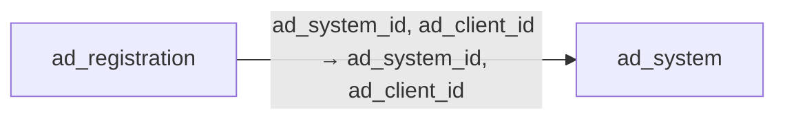

# ad_system — 시스템 정의

[전체 일람](../TABLE_INDEX.md) · [분류 일람](README.md) · [AI 사용 안내](../README.md) · [외래키 읽는 법](../RELATIONSHIPS.md)

## 기본 정보

| 항목 | 내용 |
|---|---|
| 물리명 | `adempiere.ad_system` |
| 한국어 논리명(문서용 해석) | 시스템 정의 |
| 원본 논리명 | System |
| 원본 사전 ID | 531 |
| 분류 | `ad` — 애플리케이션 사전·화면·권한·시스템 |
| 전체 테넌트 행 수 | 1 |
| 물리 열 수 | 43 |
| 나가는 FK / 들어오는 FK | 0 / 1 |
| 구조·행 수 확인 시점 | 2026-11-03T23:29:01+09:00 |

## 의미와 쓰임

설치된 시스템의 기본 정의를 관리한다.

- 설명 근거: 원본 애플리케이션 사전 명칭·설명을 한국어로 해석.
- 한국어 이름과 개요는 문서용 해석입니다. 공식 한국어 번역으로 간주하지 않습니다.
- 원본 설명: System Definition
- 원본 도움말: —
- PostgreSQL 테이블 주석: —

## 키와 열

### 기본키·고유 제약조건

| 종류 | 제약조건 | 열(순서 유지) |
|---|---|---|
| PRIMARY KEY | `ad_system_pkey` | `ad_system_id`, `ad_client_id` |
| UNIQUE | `ad_system_uu_idx` | `ad_system_uu` |

### 열 목록

원본 논리명·설명은 `AD_Column`에서 가져왔습니다. 기본값은 실제 PostgreSQL 메타데이터이며, 비어 있는 항목은 `—`로 표시합니다.

| 순서 | 물리명 | 원본 논리명 | PostgreSQL 타입 | NULL | PK | 기본값 | 설명 |
|---:|---|---|---|---|---|---|---|
| 1 | `ad_system_id` | System | numeric(10,0) | 불가 | 예 | — | System Definition |
| 2 | `ad_client_id` | Tenant | numeric(10,0) | 불가 | 예 | — | Tenant for this installation. |
| 3 | `ad_org_id` | Organization | numeric(10,0) | 불가 | — | — | Organizational entity within tenant |
| 4 | `isactive` | Active | character(1) | 불가 | — | 'Y'::bpchar | The record is active in the system |
| 5 | `created` | Created | timestamp without time zone | 불가 | — | now() | Date this record was created |
| 6 | `createdby` | Created By | numeric(10,0) | 불가 | — | — | User who created this records |
| 7 | `updated` | Updated | timestamp without time zone | 불가 | — | now() | Date this record was updated |
| 8 | `updatedby` | Updated By | numeric(10,0) | 불가 | — | — | User who updated this records |
| 9 | `name` | Name | character varying(60) | 불가 | — | — | Alphanumeric identifier of the entity |
| 10 | `username` | User Name | character varying(60) | 불가 | — | — | — |
| 11 | `info` | Info | character varying(255) | 허용 | — | — | Information |
| 12 | `version` | Version | character varying(20) | 허용 | — | — | Version of the table definition |
| 13 | `releaseno` | Release No | character varying(10) | 허용 | — | — | Internal Release Number |
| 14 | `supportunits` | Internal Users | numeric(10,0) | 허용 | — | — | Number of Internal Users for iDempiere Support |
| 15 | `password` | Password | character varying(20) | 허용 | — | — | Password of any length (case sensitive) |
| 16 | `replicationtype` | Replication Type | character(1) | 불가 | — | 'L'::bpchar | Type of Data Replication |
| 17 | `idrangestart` | ID Range Start | numeric | 허용 | — | — | Start of the ID Range used |
| 18 | `idrangeend` | ID Range End | numeric | 허용 | — | — | End if the ID Range used |
| 19 | `ldaphost` | LDAP URL | character varying(60) | 허용 | — | — | Connection String to LDAP server starting with ldap:// |
| 20 | `customprefix` | Custom Prefix | character varying(60) | 허용 | — | — | Prefix for Custom entities |
| 21 | `isjustmigrated` | Just Migrated | character(1) | 허용 | — | 'N'::bpchar | Value set by Migration for post-Migration tasks. |
| 22 | `dbinstance` | Database Name | character varying(60) | 허용 | — | — | Database Name |
| 23 | `dbaddress` | DB Address | character varying(255) | 허용 | — | — | JDBC URL of the database server |
| 24 | `noprocessors` | Processors | numeric(10,0) | 허용 | — | — | Number of Database Processors |
| 25 | `summary` | Summary | character varying(255) | 허용 | — | — | Textual summary of this request |
| 26 | `encryptionkey` | Encryption Class | character varying(255) | 허용 | — | — | Encryption Class used for securing data content |
| 27 | `ldapdomain` | LDAP Domain | character varying(255) | 허용 | — | — | Directory service domain name - e.g. idempiere.org |
| 28 | `isautoerrorreport` | Error Reporting | character(1) | 불가 | — | 'Y'::bpchar | Automatically report Errors |
| 29 | `record_id` | Record ID | numeric(10,0) | 허용 | — | — | Direct internal record ID |
| 30 | `supportexpdate` | Support Expires | timestamp without time zone | 허용 | — | — | Date when the iDempiere support expires |
| 31 | `processing` | Process Now | character(1) | 허용 | — | — | — |
| 32 | `supportemail` | Support EMail | character varying(60) | 허용 | — | — | EMail address to send support information and updates to |
| 33 | `isallowstatistics` | Maintain Statistics | character(1) | 불가 | — | 'Y'::bpchar | Maintain general statistics |
| 34 | `statisticsinfo` | Statistics | character varying(60) | 허용 | — | — | Information to help profiling the system for solving support issues |
| 35 | `profileinfo` | Profile | character varying(4000) | 허용 | — | — | Information to help profiling the system for solving support issues |
| 36 | `oldname` | Old Name | character varying(60) | 허용 | — | — | — |
| 37 | `description` | Description | character varying(255) | 허용 | — | — | Optional short description of the record |
| 38 | `systemstatus` | System Status | character(1) | 불가 | — | 'E'::bpchar | Status of the system - Support priority depends on system status |
| 39 | `isfailonmissingmodelvalidator` | Fail on Missing Model Validator | character(1) | 불가 | — | 'Y'::bpchar | — |
| 40 | `lastbuildinfo` | Last Build Info | character varying(255) | 허용 | — | — | — |
| 41 | `isfailonbuilddiffer` | Fail if Build Differ | character(1) | 불가 | — | 'N'::bpchar | — |
| 42 | `ad_system_uu` | AD_System_UU | uuid | 허용 | — | — | — |
| 43 | `lastmigrationscriptapplied` | Last Migration Script Applied | character varying(255) | 허용 | — | NULL::character varying | Register of the filename for the last migration script applied on this database |

## 외래키 흐름

화살표는 **FK를 가진 자식 → 참조되는 부모**입니다. 업무 처리의 시간 순서나 무조건적인 1:N 관계를 뜻하지 않습니다.

주변 관계 1개 중 1개를 그림으로 표시합니다. **전체 관계는 아래 두 표에 모두 포함**합니다.

### 이 테이블이 참조하는 부모 — 나가는 FK

해당 방향의 물리 FK 제약조건은 없습니다. 이름이 비슷한 열만으로 관계를 추가하지 않습니다.

### 이 테이블을 참조하는 자식 — 들어오는 FK

| 제약조건 | 참조하는 쪽(자식) | 자식 열 | 참조받는 쪽(부모) | 부모 열 | 삭제 / 갱신 | 검증 / 지연 가능 |
|---|---|---|---|---|---|---|
| `adsystem_adregistration` <!-- FK_IN: adempiere.ad_registration.adsystem_adregistration --> | [`ad_registration`](ad_registration.md) | `ad_system_id`, `ad_client_id` | [`ad_system`](ad_system.md) | `ad_system_id`, `ad_client_id` | NO ACTION / NO ACTION | 완료 / 가능 (초기 지연) |

## 조회 시 주의

- FK 표의 자식 열과 부모 열을 같은 순서로 대응시킵니다. 복합 FK는 모든 열의 동등 조건을 `AND`로 연결합니다.
- 테이블 이름이나 `_id` 열 이름만으로 물리 FK가 있다고 가정하지 않습니다. FK 미선언은 업무 관계가 없다는 뜻도 아닙니다.
- 자식이 여러 행인 테이블과 조인하면 부모의 금액·건수가 중복될 수 있습니다. 집계 단위를 먼저 정합니다.
- `ad_client_id`가 있습니다. 업무 분석에서는 대상 테넌트를 명시합니다. GardenWorld는 `11`, 시스템 공통 설정은 `0`일 수 있으므로 일괄 필터 적용 전에 테이블 역할을 확인합니다.
- `record_id`는 가리키는 테이블이 메타데이터에 따라 달라질 수 있습니다. 물리 FK 목록에 없는 대상은 별도 확인합니다.
- 행 수는 위 확인 시점의 전체 테넌트 값입니다. 최신 업무 실적이나 현재 실행 결과로 재사용하지 않습니다.
