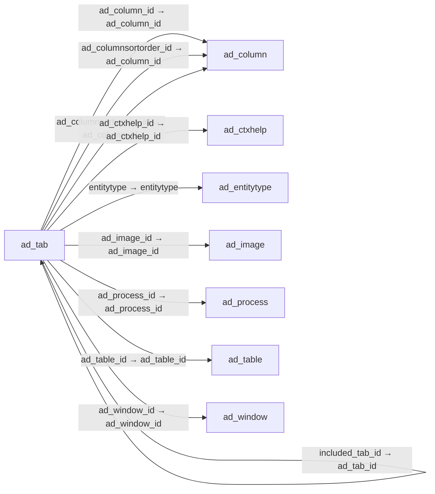

# ad_tab — 화면 탭

[전체 일람](../TABLE_INDEX.md) · [분류 일람](README.md) · [AI 사용 안내](../README.md) · [외래키 읽는 법](../RELATIONSHIPS.md)

## 기본 정보

| 항목 | 내용 |
|---|---|
| 물리명 | `adempiere.ad_tab` |
| 한국어 논리명(문서용 해석) | 화면 탭 |
| 원본 논리명 | Tab |
| 원본 사전 ID | 106 |
| 분류 | `ad` — 애플리케이션 사전·화면·권한·시스템 |
| 전체 테넌트 행 수 | 1,153 |
| 물리 열 수 | 47 |
| 나가는 FK / 들어오는 FK | 13 / 14 |
| 구조·행 수 확인 시점 | 2026-11-03T23:29:01+09:00 |

## 의미와 쓰임

창 내부의 탭을 정의한다.

- 설명 근거: 원본 애플리케이션 사전 명칭·설명을 한국어로 해석.
- 한국어 이름과 개요는 문서용 해석입니다. 공식 한국어 번역으로 간주하지 않습니다.
- 원본 설명: Tab within a Window
- 원본 도움말: —
- PostgreSQL 테이블 주석: —

## 키와 열

### 기본키·고유 제약조건

| 종류 | 제약조건 | 열(순서 유지) |
|---|---|---|
| PRIMARY KEY | `ad_tab_pkey` | `ad_tab_id` |
| UNIQUE | `ad_tab_uu_idx` | `ad_tab_uu` |

### 열 목록

원본 논리명·설명은 `AD_Column`에서 가져왔습니다. 기본값은 실제 PostgreSQL 메타데이터이며, 비어 있는 항목은 `—`로 표시합니다.

| 순서 | 물리명 | 원본 논리명 | PostgreSQL 타입 | NULL | PK | 기본값 | 설명 |
|---:|---|---|---|---|---|---|---|
| 1 | `ad_tab_id` | Tab | numeric(10,0) | 불가 | 예 | — | Tab within a Window |
| 2 | `ad_client_id` | Tenant | numeric(10,0) | 불가 | — | — | Tenant for this installation. |
| 3 | `ad_org_id` | Organization | numeric(10,0) | 불가 | — | — | Organizational entity within tenant |
| 4 | `isactive` | Active | character(1) | 불가 | — | 'Y'::bpchar | The record is active in the system |
| 5 | `created` | Created | timestamp without time zone | 불가 | — | now() | Date this record was created |
| 6 | `createdby` | Created By | numeric(10,0) | 불가 | — | — | User who created this records |
| 7 | `updated` | Updated | timestamp without time zone | 불가 | — | now() | Date this record was updated |
| 8 | `updatedby` | Updated By | numeric(10,0) | 불가 | — | — | User who updated this records |
| 9 | `name` | Name | character varying(60) | 불가 | — | — | Alphanumeric identifier of the entity |
| 10 | `description` | Description | character varying(255) | 허용 | — | — | Optional short description of the record |
| 11 | `help` | Comment/Help | character varying(2000) | 허용 | — | — | Comment or Hint |
| 12 | `ad_table_id` | Table | numeric(10,0) | 불가 | — | — | Database Table information |
| 13 | `ad_window_id` | Window | numeric(10,0) | 불가 | — | — | Data entry or display window |
| 14 | `seqno` | Sequence | numeric(10,0) | 불가 | — | — | Method of ordering records; lowest number comes first |
| 15 | `tablevel` | Tab Level | numeric(10,0) | 불가 | — | — | Hierarchical Tab Level (0 = top) |
| 16 | `issinglerow` | Single Row Layout | character(1) | 불가 | — | 'Y'::bpchar | Default for toggle between Single- and Multi-Row (Grid) Layout |
| 17 | `isinfotab` | Accounting Tab | character(1) | 허용 | — | 'N'::bpchar | This Tab contains accounting information |
| 18 | `istranslationtab` | Translation Tab | character(1) | 불가 | — | 'N'::bpchar | This Tab contains translation information |
| 19 | `isreadonly` | Read Only | character(1) | 불가 | — | 'N'::bpchar | Field is read only |
| 20 | `ad_column_id` | Column | numeric(10,0) | 허용 | — | — | Column in the table |
| 21 | `hastree` | Has Tree | character(1) | 불가 | — | 'N'::bpchar | Window has Tree Graph |
| 22 | `whereclause` | Sql WHERE | character varying(2000) | 허용 | — | — | Fully qualified SQL WHERE clause |
| 23 | `orderbyclause` | Sql ORDER BY | character varying(2000) | 허용 | — | — | Fully qualified ORDER BY clause |
| 24 | `commitwarning` | Commit Warning | character varying(2000) | 허용 | — | — | Warning displayed when saving |
| 25 | `ad_process_id` | Process | numeric(10,0) | 허용 | — | — | Process or Report |
| 26 | `processing` | Process Now | character(1) | 허용 | — | — | — |
| 27 | `ad_image_id` | Image | numeric(10,0) | 허용 | — | — | Image or Icon |
| 28 | `importfields` | Import Fields | character(1) | 허용 | — | — | Create Fields from Table Columns |
| 29 | `ad_columnsortorder_id` | Order Column | numeric(10,0) | 허용 | — | — | Column determining the order |
| 30 | `ad_columnsortyesno_id` | Included Column | numeric(10,0) | 허용 | — | — | Column determining if a Table Column is included in Ordering |
| 31 | `issorttab` | Order Tab | character(1) | 불가 | — | 'N'::bpchar | The Tab determines the Order |
| 32 | `entitytype` | Entity Type | character varying(40) | 불가 | — | 'D'::character varying | Dictionary Entity Type; Determines ownership and synchronization |
| 33 | `included_tab_id` | Included Tab | numeric(10,0) | 허용 | — | — | Included Tab in this Tab (Master Detail) |
| 34 | `readonlylogic` | Read Only Logic | character varying(2000) | 허용 | — | — | Logic to determine if field is read only (applies only when field is read-write) |
| 35 | `displaylogic` | Display Logic | character varying(2000) | 허용 | — | — | If the Field is displayed, the result determines if the field is actually displayed |
| 36 | `isinsertrecord` | Insert Record | character(1) | 불가 | — | 'Y'::bpchar | The user can insert a new Record |
| 37 | `isadvancedtab` | Advanced Tab | character(1) | 불가 | — | 'N'::bpchar | This Tab contains advanced Functionality |
| 38 | `parent_column_id` | Parent Column | numeric(10,0) | 허용 | — | NULL::numeric | The link column on the parent tab. |
| 39 | `ad_tab_uu` | AD_Tab_UU | uuid | 허용 | — | — | — |
| 40 | `ad_ctxhelp_id` | Context Help | numeric(10,0) | 허용 | — | NULL::numeric | — |
| 41 | `treedisplayedon` | Tree displayed | character(1) | 불가 | — | 'B'::bpchar | The tree can be displayed on master tab, detail tab or both |
| 42 | `maxqueryrecords` | Max Query Records | numeric(10,0) | 허용 | — | '0'::numeric | If defined, you cannot query more records as defined - the query criteria needs to be changed to query less records |
| 43 | `islookuponlyselection` | Lookup Only Selection Columns | character(1) | 허용 | — | 'N'::bpchar | When defined to true Lookup panel will display only selection columns. Default to false. |
| 44 | `isallowadvancedlookup` | Allow Advanced Lookup | character(1) | 허용 | — | 'Y'::bpchar | — |
| 45 | `ad_tabtype` | Tab Type | character varying(40) | 허용 | — | NULL::character varying | Defines Tab Type |
| 46 | `ishighvolume` | High Volume | character(1) | 허용 | — | NULL::bpchar | Use Search instead of Pick list |
| 47 | `deleteconfirmationlogic` | Delete Confirmation Logic | character varying(255) | 허용 | — | NULL::character varying | — |

## 외래키 흐름

화살표는 **FK를 가진 자식 → 참조되는 부모**입니다. 업무 처리의 시간 순서나 무조건적인 1:N 관계를 뜻하지 않습니다.

주변 관계 26개 중 10개를 그림으로 표시합니다. **전체 관계는 아래 두 표에 모두 포함**합니다.

### 이 테이블이 참조하는 부모 — 나가는 FK

| 제약조건 | 참조하는 쪽(자식) | 자식 열 | 참조받는 쪽(부모) | 부모 열 | 삭제 / 갱신 | 검증 / 지연 가능 |
|---|---|---|---|---|---|---|
| `ad_column_ad_tab` <!-- FK_OUT: adempiere.ad_tab.ad_column_ad_tab --> | [`ad_tab`](ad_tab.md) | `ad_column_id` | [`ad_column`](ad_column.md) | `ad_column_id` | NO ACTION / NO ACTION | 완료 / 가능 (초기 지연) |
| `ad_table_tab` <!-- FK_OUT: adempiere.ad_tab.ad_table_tab --> | [`ad_tab`](ad_tab.md) | `ad_table_id` | [`ad_table`](ad_table.md) | `ad_table_id` | NO ACTION / NO ACTION | 완료 / 가능 (초기 지연) |
| `ad_window_tab` <!-- FK_OUT: adempiere.ad_tab.ad_window_tab --> | [`ad_tab`](ad_tab.md) | `ad_window_id` | [`ad_window`](ad_window.md) | `ad_window_id` | CASCADE / NO ACTION | 완료 / 가능 (초기 지연) |
| `adcolumn_adtabsortorder` <!-- FK_OUT: adempiere.ad_tab.adcolumn_adtabsortorder --> | [`ad_tab`](ad_tab.md) | `ad_columnsortorder_id` | [`ad_column`](ad_column.md) | `ad_column_id` | NO ACTION / NO ACTION | 완료 / 가능 (초기 지연) |
| `adcolumn_adtabsortyesno` <!-- FK_OUT: adempiere.ad_tab.adcolumn_adtabsortyesno --> | [`ad_tab`](ad_tab.md) | `ad_columnsortyesno_id` | [`ad_column`](ad_column.md) | `ad_column_id` | NO ACTION / NO ACTION | 완료 / 가능 (초기 지연) |
| `adctxhelp_adtab` <!-- FK_OUT: adempiere.ad_tab.adctxhelp_adtab --> | [`ad_tab`](ad_tab.md) | `ad_ctxhelp_id` | [`ad_ctxhelp`](ad_ctxhelp.md) | `ad_ctxhelp_id` | NO ACTION / NO ACTION | 완료 / 가능 (초기 지연) |
| `adimage_adtab` <!-- FK_OUT: adempiere.ad_tab.adimage_adtab --> | [`ad_tab`](ad_tab.md) | `ad_image_id` | [`ad_image`](ad_image.md) | `ad_image_id` | NO ACTION / NO ACTION | 완료 / 가능 (초기 지연) |
| `adprocess_adtab` <!-- FK_OUT: adempiere.ad_tab.adprocess_adtab --> | [`ad_tab`](ad_tab.md) | `ad_process_id` | [`ad_process`](ad_process.md) | `ad_process_id` | NO ACTION / NO ACTION | 완료 / 가능 (초기 지연) |
| `adtab_included` <!-- FK_OUT: adempiere.ad_tab.adtab_included --> | [`ad_tab`](ad_tab.md) | `included_tab_id` | [`ad_tab`](ad_tab.md) | `ad_tab_id` | NO ACTION / NO ACTION | 완료 / 가능 (초기 지연) |
| `entityt_adtab` <!-- FK_OUT: adempiere.ad_tab.entityt_adtab --> | [`ad_tab`](ad_tab.md) | `entitytype` | [`ad_entitytype`](ad_entitytype.md) | `entitytype` | NO ACTION / NO ACTION | 완료 / 가능 (초기 지연) |
| `parentcolumn_adtab` <!-- FK_OUT: adempiere.ad_tab.parentcolumn_adtab --> | [`ad_tab`](ad_tab.md) | `parent_column_id` | [`ad_column`](ad_column.md) | `ad_column_id` | NO ACTION / NO ACTION | 완료 / 가능 (초기 지연) |
| `tabclient` <!-- FK_OUT: adempiere.ad_tab.tabclient --> | [`ad_tab`](ad_tab.md) | `ad_client_id` | [`ad_client`](ad_client.md) | `ad_client_id` | NO ACTION / NO ACTION | 완료 / 가능 (초기 지연) |
| `taborg` <!-- FK_OUT: adempiere.ad_tab.taborg --> | [`ad_tab`](ad_tab.md) | `ad_org_id` | [`ad_org`](ad_org.md) | `ad_org_id` | NO ACTION / NO ACTION | 완료 / 가능 (초기 지연) |

### 이 테이블을 참조하는 자식 — 들어오는 FK

| 제약조건 | 참조하는 쪽(자식) | 자식 열 | 참조받는 쪽(부모) | 부모 열 | 삭제 / 갱신 | 검증 / 지연 가능 |
|---|---|---|---|---|---|---|
| `ad_tab_field` <!-- FK_IN: adempiere.ad_field.ad_tab_field --> | [`ad_field`](ad_field.md) | `ad_tab_id` | [`ad_tab`](ad_tab.md) | `ad_tab_id` | CASCADE / NO ACTION | 완료 / 가능 (초기 지연) |
| `includedtab_adfield` <!-- FK_IN: adempiere.ad_field.includedtab_adfield --> | [`ad_field`](ad_field.md) | `included_tab_id` | [`ad_tab`](ad_tab.md) | `ad_tab_id` | NO ACTION / NO ACTION | 완료 / 가능 (초기 지연) |
| `adtab_adimporttemplate` <!-- FK_IN: adempiere.ad_importtemplate.adtab_adimporttemplate --> | [`ad_importtemplate`](ad_importtemplate.md) | `ad_tab_id` | [`ad_tab`](ad_tab.md) | `ad_tab_id` | NO ACTION / NO ACTION | 완료 / 가능 (초기 지연) |
| `adtab_adrecentitem` <!-- FK_IN: adempiere.ad_recentitem.adtab_adrecentitem --> | [`ad_recentitem`](ad_recentitem.md) | `ad_tab_id` | [`ad_tab`](ad_tab.md) | `ad_tab_id` | CASCADE / NO ACTION | 완료 / 가능 (초기 지연) |
| `adtab_adstatuslineusedin` <!-- FK_IN: adempiere.ad_statuslineusedin.adtab_adstatuslineusedin --> | [`ad_statuslineusedin`](ad_statuslineusedin.md) | `ad_tab_id` | [`ad_tab`](ad_tab.md) | `ad_tab_id` | NO ACTION / NO ACTION | 완료 / 가능 (초기 지연) |
| `adtab_included` <!-- FK_IN: adempiere.ad_tab.adtab_included --> | [`ad_tab`](ad_tab.md) | `included_tab_id` | [`ad_tab`](ad_tab.md) | `ad_tab_id` | NO ACTION / NO ACTION | 완료 / 가능 (초기 지연) |
| `adtab_adtabcustomization` <!-- FK_IN: adempiere.ad_tab_customization.adtab_adtabcustomization --> | [`ad_tab_customization`](ad_tab_customization.md) | `ad_tab_id` | [`ad_tab`](ad_tab.md) | `ad_tab_id` | NO ACTION / NO ACTION | 완료 / 가능 (초기 지연) |
| `ad_tabtrl` <!-- FK_IN: adempiere.ad_tab_trl.ad_tabtrl --> | [`ad_tab_trl`](ad_tab_trl.md) | `ad_tab_id` | [`ad_tab`](ad_tab.md) | `ad_tab_id` | CASCADE / NO ACTION | 완료 / 가능 (초기 지연) |
| `adtab_adtoolbarbutton` <!-- FK_IN: adempiere.ad_toolbarbutton.adtab_adtoolbarbutton --> | [`ad_toolbarbutton`](ad_toolbarbutton.md) | `ad_tab_id` | [`ad_tab`](ad_tab.md) | `ad_tab_id` | NO ACTION / NO ACTION | 완료 / 가능 (초기 지연) |
| `adtab_adtoolbarbuttonrestrict` <!-- FK_IN: adempiere.ad_toolbarbuttonrestrict.adtab_adtoolbarbuttonrestrict --> | [`ad_toolbarbuttonrestrict`](ad_toolbarbuttonrestrict.md) | `ad_tab_id` | [`ad_tab`](ad_tab.md) | `ad_tab_id` | NO ACTION / NO ACTION | 완료 / 가능 (초기 지연) |
| `adtab_aduserdeftab` <!-- FK_IN: adempiere.ad_userdef_tab.adtab_aduserdeftab --> | [`ad_userdef_tab`](ad_userdef_tab.md) | `ad_tab_id` | [`ad_tab`](ad_tab.md) | `ad_tab_id` | NO ACTION / NO ACTION | 완료 / 가능 (초기 지연) |
| `adtab_aduserquery` <!-- FK_IN: adempiere.ad_userquery.adtab_aduserquery --> | [`ad_userquery`](ad_userquery.md) | `ad_tab_id` | [`ad_tab`](ad_tab.md) | `ad_tab_id` | NO ACTION / NO ACTION | 완료 / 가능 (초기 지연) |
| `adtab_aspclientexception` <!-- FK_IN: adempiere.asp_clientexception.adtab_aspclientexception --> | [`asp_clientexception`](../asp/asp_clientexception.md) | `ad_tab_id` | [`ad_tab`](ad_tab.md) | `ad_tab_id` | NO ACTION / NO ACTION | 완료 / 가능 (초기 지연) |
| `adtab_asptab` <!-- FK_IN: adempiere.asp_tab.adtab_asptab --> | [`asp_tab`](../asp/asp_tab.md) | `ad_tab_id` | [`ad_tab`](ad_tab.md) | `ad_tab_id` | NO ACTION / NO ACTION | 완료 / 가능 (초기 지연) |

## 조회 시 주의

- FK 표의 자식 열과 부모 열을 같은 순서로 대응시킵니다. 복합 FK는 모든 열의 동등 조건을 `AND`로 연결합니다.
- 테이블 이름이나 `_id` 열 이름만으로 물리 FK가 있다고 가정하지 않습니다. FK 미선언은 업무 관계가 없다는 뜻도 아닙니다.
- 자식이 여러 행인 테이블과 조인하면 부모의 금액·건수가 중복될 수 있습니다. 집계 단위를 먼저 정합니다.
- `ad_client_id`가 있습니다. 업무 분석에서는 대상 테넌트를 명시합니다. GardenWorld는 `11`, 시스템 공통 설정은 `0`일 수 있으므로 일괄 필터 적용 전에 테이블 역할을 확인합니다.
- 행 수는 위 확인 시점의 전체 테넌트 값입니다. 최신 업무 실적이나 현재 실행 결과로 재사용하지 않습니다.
