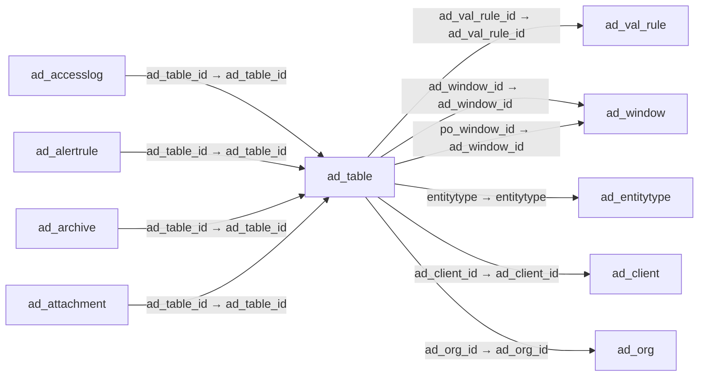

# ad_table — 애플리케이션 사전 테이블

[전체 일람](../TABLE_INDEX.md) · [분류 일람](README.md) · [AI 사용 안내](../README.md) · [외래키 읽는 법](../RELATIONSHIPS.md)

## 기본 정보

| 항목 | 내용 |
|---|---|
| 물리명 | `adempiere.ad_table` |
| 한국어 논리명(문서용 해석) | 애플리케이션 사전 테이블 |
| 원본 논리명 | Table |
| 원본 사전 ID | 100 |
| 분류 | `ad` — 애플리케이션 사전·화면·권한·시스템 |
| 전체 테넌트 행 수 | 1,063 |
| 물리 열 수 | 35 |
| 나가는 FK / 들어오는 FK | 6 / 76 |
| 구조·행 수 확인 시점 | 2026-11-03T23:29:01+09:00 |

## 의미와 쓰임

애플리케이션에서 사용하는 테이블의 사전 정의를 관리한다.

- 설명 근거: 원본 애플리케이션 사전 명칭·설명을 한국어로 해석.
- 한국어 이름과 개요는 문서용 해석입니다. 공식 한국어 번역으로 간주하지 않습니다.
- 원본 설명: Table for the Fields
- 원본 도움말: —
- PostgreSQL 테이블 주석: —

## 키와 열

### 기본키·고유 제약조건

| 종류 | 제약조건 | 열(순서 유지) |
|---|---|---|
| PRIMARY KEY | `ad_table_pkey` | `ad_table_id` |
| UNIQUE | `ad_table_uu_idx` | `ad_table_uu` |

### 별도 고유 인덱스

PK·UNIQUE 제약조건의 인덱스와 별도로 존재하는 고유 인덱스입니다. 식·조건·열 순서는 원본 정의를 따릅니다.

- `ad_table_name`: `CREATE UNIQUE INDEX ad_table_name ON adempiere.ad_table USING btree (upper((tablename)::text))`

### 열 목록

원본 논리명·설명은 `AD_Column`에서 가져왔습니다. 기본값은 실제 PostgreSQL 메타데이터이며, 비어 있는 항목은 `—`로 표시합니다.

| 순서 | 물리명 | 원본 논리명 | PostgreSQL 타입 | NULL | PK | 기본값 | 설명 |
|---:|---|---|---|---|---|---|---|
| 1 | `ad_table_id` | Table | numeric(10,0) | 불가 | 예 | — | Database Table information |
| 2 | `ad_client_id` | Tenant | numeric(10,0) | 불가 | — | — | Tenant for this installation. |
| 3 | `ad_org_id` | Organization | numeric(10,0) | 불가 | — | — | Organizational entity within tenant |
| 4 | `isactive` | Active | character(1) | 불가 | — | 'Y'::bpchar | The record is active in the system |
| 5 | `created` | Created | timestamp without time zone | 불가 | — | now() | Date this record was created |
| 6 | `createdby` | Created By | numeric(10,0) | 불가 | — | — | User who created this records |
| 7 | `updated` | Updated | timestamp without time zone | 불가 | — | now() | Date this record was updated |
| 8 | `updatedby` | Updated By | numeric(10,0) | 불가 | — | — | User who updated this records |
| 9 | `name` | Name | character varying(60) | 불가 | — | — | Alphanumeric identifier of the entity |
| 10 | `description` | Description | character varying(255) | 허용 | — | — | Optional short description of the record |
| 11 | `help` | Comment/Help | character varying(2000) | 허용 | — | — | Comment or Hint |
| 12 | `tablename` | DB Table Name | character varying(60) | 불가 | — | — | Name of the table in the database |
| 13 | `isview` | View | character(1) | 불가 | — | 'N'::bpchar | This is a view |
| 14 | `accesslevel` | Data Access Level | character(1) | 불가 | — | — | Access Level required |
| 15 | `entitytype` | Entity Type | character varying(40) | 불가 | — | 'D'::character varying | Dictionary Entity Type; Determines ownership and synchronization |
| 16 | `ad_window_id` | Window | numeric(10,0) | 허용 | — | — | Data entry or display window |
| 17 | `ad_val_rule_id` | Dynamic Validation | numeric(10,0) | 허용 | — | — | Dynamic Validation Rule |
| 18 | `loadseq` | Sequence | numeric(10,0) | 허용 | — | — | — |
| 19 | `issecurityenabled` | Security enabled | character(1) | 불가 | — | 'N'::bpchar | If security is enabled, user access to data can be restricted via Roles |
| 20 | `isdeleteable` | Records deletable | character(1) | 불가 | — | 'Y'::bpchar | Indicates if records can be deleted from the database |
| 21 | `ishighvolume` | High Volume | character(1) | 불가 | — | 'N'::bpchar | Use Search instead of Pick list |
| 22 | `importtable` | Import Table | character(1) | 허용 | — | — | Import Table Columns from Database |
| 23 | `ischangelog` | Maintain Change Log | character(1) | 불가 | — | 'N'::bpchar | Maintain a log of changes |
| 24 | `replicationtype` | Replication Type | character(1) | 불가 | — | 'L'::bpchar | Type of Data Replication |
| 25 | `po_window_id` | PO Window | numeric(10,0) | 허용 | — | — | Purchase Order Window |
| 26 | `copycolumnsfromtable` | Copy Columns From Table | character varying(1) | 허용 | — | — | — |
| 27 | `iscentrallymaintained` | Centrally maintained | character(1) | 허용 | — | 'Y'::bpchar | Information maintained in System Element table |
| 28 | `ad_table_uu` | AD_Table_UU | uuid | 허용 | — | — | — |
| 29 | `processing` | Process Now | character(1) | 허용 | — | NULL::bpchar | — |
| 30 | `databaseviewdrop` | Drop view | character(1) | 허용 | — | NULL::bpchar | — |
| 31 | `copycomponentsfromview` | Copy Components From View | character(1) | 허용 | — | NULL::bpchar | — |
| 32 | `createwindowfromtable` | Create Window From Table | character(1) | 허용 | — | NULL::bpchar | — |
| 33 | `isshowindrilloptions` | Show In Drill Options | character(1) | 허용 | — | 'Y'::bpchar | This parameter enables the table to be displayed in Drill Assistant - Table tab |
| 34 | `ispartition` | Partition | character(1) | 불가 | — | 'N'::bpchar | This is a partitioned table |
| 35 | `createpartition` | Create/update partition | character(1) | 허용 | — | NULL::bpchar | Process which create or update table partitions based on the table and column records |

## 외래키 흐름

화살표는 **FK를 가진 자식 → 참조되는 부모**입니다. 업무 처리의 시간 순서나 무조건적인 1:N 관계를 뜻하지 않습니다.

주변 관계 82개 중 10개를 그림으로 표시합니다. **전체 관계는 아래 두 표에 모두 포함**합니다.

### 이 테이블이 참조하는 부모 — 나가는 FK

| 제약조건 | 참조하는 쪽(자식) | 자식 열 | 참조받는 쪽(부모) | 부모 열 | 삭제 / 갱신 | 검증 / 지연 가능 |
|---|---|---|---|---|---|---|
| `ad_valrule_table` <!-- FK_OUT: adempiere.ad_table.ad_valrule_table --> | [`ad_table`](ad_table.md) | `ad_val_rule_id` | [`ad_val_rule`](ad_val_rule.md) | `ad_val_rule_id` | NO ACTION / NO ACTION | 완료 / 가능 (초기 지연) |
| `ad_window_table` <!-- FK_OUT: adempiere.ad_table.ad_window_table --> | [`ad_table`](ad_table.md) | `ad_window_id` | [`ad_window`](ad_window.md) | `ad_window_id` | SET NULL / NO ACTION | 완료 / 가능 (초기 지연) |
| `adwindowpo_adtable` <!-- FK_OUT: adempiere.ad_table.adwindowpo_adtable --> | [`ad_table`](ad_table.md) | `po_window_id` | [`ad_window`](ad_window.md) | `ad_window_id` | NO ACTION / NO ACTION | 완료 / 가능 (초기 지연) |
| `entityt_adtable` <!-- FK_OUT: adempiere.ad_table.entityt_adtable --> | [`ad_table`](ad_table.md) | `entitytype` | [`ad_entitytype`](ad_entitytype.md) | `entitytype` | NO ACTION / NO ACTION | 완료 / 가능 (초기 지연) |
| `tableclient` <!-- FK_OUT: adempiere.ad_table.tableclient --> | [`ad_table`](ad_table.md) | `ad_client_id` | [`ad_client`](ad_client.md) | `ad_client_id` | NO ACTION / NO ACTION | 완료 / 가능 (초기 지연) |
| `tableorg` <!-- FK_OUT: adempiere.ad_table.tableorg --> | [`ad_table`](ad_table.md) | `ad_org_id` | [`ad_org`](ad_org.md) | `ad_org_id` | NO ACTION / NO ACTION | 완료 / 가능 (초기 지연) |

### 이 테이블을 참조하는 자식 — 들어오는 FK

| 제약조건 | 참조하는 쪽(자식) | 자식 열 | 참조받는 쪽(부모) | 부모 열 | 삭제 / 갱신 | 검증 / 지연 가능 |
|---|---|---|---|---|---|---|
| `adtable_adacceslog` <!-- FK_IN: adempiere.ad_accesslog.adtable_adacceslog --> | [`ad_accesslog`](ad_accesslog.md) | `ad_table_id` | [`ad_table`](ad_table.md) | `ad_table_id` | NO ACTION / NO ACTION | 완료 / 가능 (초기 지연) |
| `adtable_adaltertrule` <!-- FK_IN: adempiere.ad_alertrule.adtable_adaltertrule --> | [`ad_alertrule`](ad_alertrule.md) | `ad_table_id` | [`ad_table`](ad_table.md) | `ad_table_id` | NO ACTION / NO ACTION | 완료 / 가능 (초기 지연) |
| `adtable_adarchive` <!-- FK_IN: adempiere.ad_archive.adtable_adarchive --> | [`ad_archive`](ad_archive.md) | `ad_table_id` | [`ad_table`](ad_table.md) | `ad_table_id` | NO ACTION / NO ACTION | 완료 / 가능 (초기 지연) |
| `adtable_adattachment` <!-- FK_IN: adempiere.ad_attachment.adtable_adattachment --> | [`ad_attachment`](ad_attachment.md) | `ad_table_id` | [`ad_table`](ad_table.md) | `ad_table_id` | NO ACTION / NO ACTION | 완료 / 가능 (초기 지연) |
| `adtable_adattribute` <!-- FK_IN: adempiere.ad_attribute.adtable_adattribute --> | [`ad_attribute`](ad_attribute.md) | `ad_table_id` | [`ad_table`](ad_table.md) | `ad_table_id` | CASCADE / NO ACTION | 완료 / 가능 (초기 지연) |
| `adtable_adchangelog` <!-- FK_IN: adempiere.ad_changelog.adtable_adchangelog --> | [`ad_changelog`](ad_changelog.md) | `ad_table_id` | [`ad_table`](ad_table.md) | `ad_table_id` | CASCADE / NO ACTION | 완료 / 가능 (초기 지연) |
| `adtable_adchartdatasource` <!-- FK_IN: adempiere.ad_chartdatasource.adtable_adchartdatasource --> | [`ad_chartdatasource`](ad_chartdatasource.md) | `ad_table_id` | [`ad_table`](ad_table.md) | `ad_table_id` | NO ACTION / NO ACTION | 완료 / 가능 (초기 지연) |
| `adtable_adclientshare` <!-- FK_IN: adempiere.ad_clientshare.adtable_adclientshare --> | [`ad_clientshare`](ad_clientshare.md) | `ad_table_id` | [`ad_table`](ad_table.md) | `ad_table_id` | NO ACTION / NO ACTION | 완료 / 가능 (초기 지연) |
| `ad_table_column` <!-- FK_IN: adempiere.ad_column.ad_table_column --> | [`ad_column`](ad_column.md) | `ad_table_id` | [`ad_table`](ad_table.md) | `ad_table_id` | CASCADE / NO ACTION | 완료 / 가능 (초기 지연) |
| `adtable_adcolumnaccess` <!-- FK_IN: adempiere.ad_column_access.adtable_adcolumnaccess --> | [`ad_column_access`](ad_column_access.md) | `ad_table_id` | [`ad_table`](ad_table.md) | `ad_table_id` | NO ACTION / NO ACTION | 완료 / 가능 (초기 지연) |
| `adtable_adhousekeeping` <!-- FK_IN: adempiere.ad_housekeeping.adtable_adhousekeeping --> | [`ad_housekeeping`](ad_housekeeping.md) | `ad_table_id` | [`ad_table`](ad_table.md) | `ad_table_id` | NO ACTION / NO ACTION | 완료 / 가능 (초기 지연) |
| `adtable_adimpformat` <!-- FK_IN: adempiere.ad_impformat.adtable_adimpformat --> | [`ad_impformat`](ad_impformat.md) | `ad_table_id` | [`ad_table`](ad_table.md) | `ad_table_id` | NO ACTION / NO ACTION | 완료 / 가능 (초기 지연) |
| `adtable_adinfowindow` <!-- FK_IN: adempiere.ad_infowindow.adtable_adinfowindow --> | [`ad_infowindow`](ad_infowindow.md) | `ad_table_id` | [`ad_table`](ad_table.md) | `ad_table_id` | NO ACTION / NO ACTION | 완료 / 가능 (초기 지연) |
| `adtable_adlabelassignment` <!-- FK_IN: adempiere.ad_labelassignment.adtable_adlabelassignment --> | [`ad_labelassignment`](ad_labelassignment.md) | `ad_table_id` | [`ad_table`](ad_table.md) | `ad_table_id` | NO ACTION / NO ACTION | 완료 / 가능 (초기 지연) |
| `adtable_adlabelcategorytable` <!-- FK_IN: adempiere.ad_labelcategorytable.adtable_adlabelcategorytable --> | [`ad_labelcategorytable`](ad_labelcategorytable.md) | `ad_table_id` | [`ad_table`](ad_table.md) | `ad_table_id` | NO ACTION / NO ACTION | 완료 / 가능 (초기 지연) |
| `adtable_adnote` <!-- FK_IN: adempiere.ad_note.adtable_adnote --> | [`ad_note`](ad_note.md) | `ad_table_id` | [`ad_table`](ad_table.md) | `ad_table_id` | NO ACTION / NO ACTION | 완료 / 가능 (초기 지연) |
| `adtable_adpackageexpcommon` <!-- FK_IN: adempiere.ad_package_exp_common.adtable_adpackageexpcommon --> | [`ad_package_exp_common`](ad_package_exp_common.md) | `ad_table_id` | [`ad_table`](ad_table.md) | `ad_table_id` | NO ACTION / NO ACTION | 완료 / 가능 (초기 지연) |
| `adtable_adpackageexpdetail` <!-- FK_IN: adempiere.ad_package_exp_detail.adtable_adpackageexpdetail --> | [`ad_package_exp_detail`](ad_package_exp_detail.md) | `ad_table_id` | [`ad_table`](ad_table.md) | `ad_table_id` | NO ACTION / NO ACTION | 완료 / 가능 (초기 지연) |
| `adtable_adpackageimpdetail` <!-- FK_IN: adempiere.ad_package_imp_detail.adtable_adpackageimpdetail --> | [`ad_package_imp_detail`](ad_package_imp_detail.md) | `ad_table_id` | [`ad_table`](ad_table.md) | `ad_table_id` | NO ACTION / NO ACTION | 완료 / 가능 (초기 지연) |
| `adtable_adpackageuuidmap` <!-- FK_IN: adempiere.ad_package_uuid_map.adtable_adpackageuuidmap --> | [`ad_package_uuid_map`](ad_package_uuid_map.md) | `ad_table_id` | [`ad_table`](ad_table.md) | `ad_table_id` | NO ACTION / NO ACTION | 완료 / 가능 (초기 지연) |
| `adtable_adpinstance` <!-- FK_IN: adempiere.ad_pinstance.adtable_adpinstance --> | [`ad_pinstance`](ad_pinstance.md) | `ad_table_id` | [`ad_table`](ad_table.md) | `ad_table_id` | NO ACTION / NO ACTION | 완료 / 가능 (초기 지연) |
| `adtable_adpinstancelog` <!-- FK_IN: adempiere.ad_pinstance_log.adtable_adpinstancelog --> | [`ad_pinstance_log`](ad_pinstance_log.md) | `ad_table_id` | [`ad_table`](ad_table.md) | `ad_table_id` | NO ACTION / NO ACTION | 완료 / 가능 (초기 지연) |
| `adtable_adpostit` <!-- FK_IN: adempiere.ad_postit.adtable_adpostit --> | [`ad_postit`](ad_postit.md) | `ad_table_id` | [`ad_table`](ad_table.md) | `ad_table_id` | NO ACTION / NO ACTION | 완료 / 가능 (초기 지연) |
| `adtable_adprintformat` <!-- FK_IN: adempiere.ad_printformat.adtable_adprintformat --> | [`ad_printformat`](ad_printformat.md) | `ad_table_id` | [`ad_table`](ad_table.md) | `ad_table_id` | NO ACTION / NO ACTION | 완료 / 가능 (초기 지연) |
| `adtable_adprintlabel` <!-- FK_IN: adempiere.ad_printlabel.adtable_adprintlabel --> | [`ad_printlabel`](ad_printlabel.md) | `ad_table_id` | [`ad_table`](ad_table.md) | `ad_table_id` | NO ACTION / NO ACTION | 완료 / 가능 (초기 지연) |
| `adtable_adprivateaccess` <!-- FK_IN: adempiere.ad_private_access.adtable_adprivateaccess --> | [`ad_private_access`](ad_private_access.md) | `ad_table_id` | [`ad_table`](ad_table.md) | `ad_table_id` | NO ACTION / NO ACTION | 완료 / 가능 (초기 지연) |
| `adtable_addrillrule` <!-- FK_IN: adempiere.ad_process_drillrule.adtable_addrillrule --> | [`ad_process_drillrule`](ad_process_drillrule.md) | `ad_table_id` | [`ad_table`](ad_table.md) | `ad_table_id` | NO ACTION / NO ACTION | 완료 / 가능 (초기 지연) |
| `adtable_adrecentitem` <!-- FK_IN: adempiere.ad_recentitem.adtable_adrecentitem --> | [`ad_recentitem`](ad_recentitem.md) | `ad_table_id` | [`ad_table`](ad_table.md) | `ad_table_id` | CASCADE / NO ACTION | 완료 / 가능 (초기 지연) |
| `adtable_adrecordaccess` <!-- FK_IN: adempiere.ad_record_access.adtable_adrecordaccess --> | [`ad_record_access`](ad_record_access.md) | `ad_table_id` | [`ad_table`](ad_table.md) | `ad_table_id` | NO ACTION / NO ACTION | 완료 / 가능 (초기 지연) |
| `add_table_reftable` <!-- FK_IN: adempiere.ad_ref_table.add_table_reftable --> | [`ad_ref_table`](ad_ref_table.md) | `ad_table_id` | [`ad_table`](ad_table.md) | `ad_table_id` | NO ACTION / NO ACTION | 완료 / 가능 (초기 지연) |
| `adtable_adreplicationdocument` <!-- FK_IN: adempiere.ad_replicationdocument.adtable_adreplicationdocument --> | [`ad_replicationdocument`](ad_replicationdocument.md) | `ad_table_id` | [`ad_table`](ad_table.md) | `ad_table_id` | NO ACTION / NO ACTION | 완료 / 가능 (초기 지연) |
| `adtable_adreplicationtable` <!-- FK_IN: adempiere.ad_replicationtable.adtable_adreplicationtable --> | [`ad_replicationtable`](ad_replicationtable.md) | `ad_table_id` | [`ad_table`](ad_table.md) | `ad_table_id` | CASCADE / NO ACTION | 완료 / 가능 (초기 지연) |
| `adtable_adreportview` <!-- FK_IN: adempiere.ad_reportview.adtable_adreportview --> | [`ad_reportview`](ad_reportview.md) | `ad_table_id` | [`ad_table`](ad_table.md) | `ad_table_id` | CASCADE / NO ACTION | 완료 / 가능 (초기 지연) |
| `adtable_adscheduler` <!-- FK_IN: adempiere.ad_scheduler.adtable_adscheduler --> | [`ad_scheduler`](ad_scheduler.md) | `ad_table_id` | [`ad_table`](ad_table.md) | `ad_table_id` | NO ACTION / NO ACTION | 완료 / 가능 (초기 지연) |
| `adtable_adsearchdefinition` <!-- FK_IN: adempiere.ad_searchdefinition.adtable_adsearchdefinition --> | [`ad_searchdefinition`](ad_searchdefinition.md) | `ad_table_id` | [`ad_table`](ad_table.md) | `ad_table_id` | NO ACTION / NO ACTION | 완료 / 가능 (초기 지연) |
| `adtable_adsequenceaudit` <!-- FK_IN: adempiere.ad_sequence_audit.adtable_adsequenceaudit --> | [`ad_sequence_audit`](ad_sequence_audit.md) | `ad_table_id` | [`ad_table`](ad_table.md) | `ad_table_id` | CASCADE / NO ACTION | 완료 / 가능 (초기 지연) |
| `adtable_adstatuslineusedin` <!-- FK_IN: adempiere.ad_statuslineusedin.adtable_adstatuslineusedin --> | [`ad_statuslineusedin`](ad_statuslineusedin.md) | `ad_table_id` | [`ad_table`](ad_table.md) | `ad_table_id` | NO ACTION / NO ACTION | 완료 / 가능 (초기 지연) |
| `ad_table_tab` <!-- FK_IN: adempiere.ad_tab.ad_table_tab --> | [`ad_tab`](ad_tab.md) | `ad_table_id` | [`ad_table`](ad_table.md) | `ad_table_id` | NO ACTION / NO ACTION | 완료 / 가능 (초기 지연) |
| `adtable_adtableaccess` <!-- FK_IN: adempiere.ad_table_access.adtable_adtableaccess --> | [`ad_table_access`](ad_table_access.md) | `ad_table_id` | [`ad_table`](ad_table.md) | `ad_table_id` | CASCADE / NO ACTION | 완료 / 가능 (초기 지연) |
| `adtable_adtablescriptvalidator` <!-- FK_IN: adempiere.ad_table_scriptvalidator.adtable_adtablescriptvalidator --> | [`ad_table_scriptvalidator`](ad_table_scriptvalidator.md) | `ad_table_id` | [`ad_table`](ad_table.md) | `ad_table_id` | NO ACTION / NO ACTION | 완료 / 가능 (초기 지연) |
| `adtable_adtabletrl` <!-- FK_IN: adempiere.ad_table_trl.adtable_adtabletrl --> | [`ad_table_trl`](ad_table_trl.md) | `ad_table_id` | [`ad_table`](ad_table.md) | `ad_table_id` | CASCADE / NO ACTION | 완료 / 가능 (초기 지연) |
| `adtable_adtableattribute` <!-- FK_IN: adempiere.ad_tableattribute.adtable_adtableattribute --> | [`ad_tableattribute`](ad_tableattribute.md) | `ad_table_id` | [`ad_table`](ad_table.md) | `ad_table_id` | NO ACTION / NO ACTION | 완료 / 가능 (초기 지연) |
| `adtable_adtableattributeset` <!-- FK_IN: adempiere.ad_tableattributeset.adtable_adtableattributeset --> | [`ad_tableattributeset`](ad_tableattributeset.md) | `ad_table_id` | [`ad_table`](ad_table.md) | `ad_table_id` | NO ACTION / NO ACTION | 완료 / 가능 (초기 지연) |
| `adtable_adtableindex` <!-- FK_IN: adempiere.ad_tableindex.adtable_adtableindex --> | [`ad_tableindex`](ad_tableindex.md) | `ad_table_id` | [`ad_table`](ad_table.md) | `ad_table_id` | NO ACTION / NO ACTION | 완료 / 가능 (초기 지연) |
| `adtable_adtablepartition` <!-- FK_IN: adempiere.ad_tablepartition.adtable_adtablepartition --> | [`ad_tablepartition`](ad_tablepartition.md) | `ad_table_id` | [`ad_table`](ad_table.md) | `ad_table_id` | NO ACTION / NO ACTION | 완료 / 가능 (초기 지연) |
| `adtable_adtablevalrule` <!-- FK_IN: adempiere.ad_tablevalrule.adtable_adtablevalrule --> | [`ad_tablevalrule`](ad_tablevalrule.md) | `ad_table_id` | [`ad_table`](ad_table.md) | `ad_table_id` | NO ACTION / NO ACTION | 완료 / 가능 (초기 지연) |
| `adtable_adtree` <!-- FK_IN: adempiere.ad_tree.adtable_adtree --> | [`ad_tree`](ad_tree.md) | `ad_table_id` | [`ad_table`](ad_table.md) | `ad_table_id` | NO ACTION / NO ACTION | 완료 / 가능 (초기 지연) |
| `adtable_aduserquery` <!-- FK_IN: adempiere.ad_userquery.adtable_aduserquery --> | [`ad_userquery`](ad_userquery.md) | `ad_table_id` | [`ad_table`](ad_table.md) | `ad_table_id` | CASCADE / NO ACTION | 완료 / 가능 (초기 지연) |
| `adtable_adverifymigration` <!-- FK_IN: adempiere.ad_verifymigration.adtable_adverifymigration --> | [`ad_verifymigration`](ad_verifymigration.md) | `ad_table_id` | [`ad_table`](ad_table.md) | `ad_table_id` | NO ACTION / NO ACTION | 완료 / 가능 (초기 지연) |
| `adtable_adviewcomponent` <!-- FK_IN: adempiere.ad_viewcomponent.adtable_adviewcomponent --> | [`ad_viewcomponent`](ad_viewcomponent.md) | `ad_table_id` | [`ad_table`](ad_table.md) | `ad_table_id` | NO ACTION / NO ACTION | 완료 / 가능 (초기 지연) |
| `referencedtable_adviewcomponen` <!-- FK_IN: adempiere.ad_viewcomponent.referencedtable_adviewcomponen --> | [`ad_viewcomponent`](ad_viewcomponent.md) | `referenced_table_id` | [`ad_table`](ad_table.md) | `ad_table_id` | NO ACTION / NO ACTION | 완료 / 가능 (초기 지연) |
| `adtable_adwfactivity` <!-- FK_IN: adempiere.ad_wf_activity.adtable_adwfactivity --> | [`ad_wf_activity`](ad_wf_activity.md) | `ad_table_id` | [`ad_table`](ad_table.md) | `ad_table_id` | NO ACTION / NO ACTION | 완료 / 가능 (초기 지연) |
| `adtable_adwfeventaudit` <!-- FK_IN: adempiere.ad_wf_eventaudit.adtable_adwfeventaudit --> | [`ad_wf_eventaudit`](ad_wf_eventaudit.md) | `ad_table_id` | [`ad_table`](ad_table.md) | `ad_table_id` | NO ACTION / NO ACTION | 완료 / 가능 (초기 지연) |
| `adtable_adwfprocess` <!-- FK_IN: adempiere.ad_wf_process.adtable_adwfprocess --> | [`ad_wf_process`](ad_wf_process.md) | `ad_table_id` | [`ad_table`](ad_table.md) | `ad_table_id` | NO ACTION / NO ACTION | 완료 / 가능 (초기 지연) |
| `adtable_adworkflow` <!-- FK_IN: adempiere.ad_workflow.adtable_adworkflow --> | [`ad_workflow`](ad_workflow.md) | `ad_table_id` | [`ad_table`](ad_table.md) | `ad_table_id` | NO ACTION / NO ACTION | 완료 / 가능 (초기 지연) |
| `adtable_adzoomcondition` <!-- FK_IN: adempiere.ad_zoomcondition.adtable_adzoomcondition --> | [`ad_zoomcondition`](ad_zoomcondition.md) | `ad_table_id` | [`ad_table`](ad_table.md) | `ad_table_id` | NO ACTION / NO ACTION | 완료 / 가능 (초기 지연) |
| `adtable_cacctprocessor` <!-- FK_IN: adempiere.c_acctprocessor.adtable_cacctprocessor --> | [`c_acctprocessor`](../c/c_acctprocessor.md) | `ad_table_id` | [`ad_table`](ad_table.md) | `ad_table_id` | NO ACTION / NO ACTION | 완료 / 가능 (초기 지연) |
| `adtable_conlinetrxhistory` <!-- FK_IN: adempiere.c_onlinetrxhistory.adtable_conlinetrxhistory --> | [`c_onlinetrxhistory`](../c/c_onlinetrxhistory.md) | `ad_table_id` | [`ad_table`](ad_table.md) | `ad_table_id` | NO ACTION / NO ACTION | 완료 / 가능 (초기 지연) |
| `adtable_cmchat` <!-- FK_IN: adempiere.cm_chat.adtable_cmchat --> | [`cm_chat`](../cm/cm_chat.md) | `ad_table_id` | [`ad_table`](ad_table.md) | `ad_table_id` | CASCADE / NO ACTION | 완료 / 가능 (초기 지연) |
| `adtable_cmchattype` <!-- FK_IN: adempiere.cm_chattype.adtable_cmchattype --> | [`cm_chattype`](../cm/cm_chattype.md) | `ad_table_id` | [`ad_table`](ad_table.md) | `ad_table_id` | CASCADE / NO ACTION | 완료 / 가능 (초기 지연) |
| `adtable_cmtemplatetable` <!-- FK_IN: adempiere.cm_templatetable.adtable_cmtemplatetable --> | [`cm_templatetable`](../cm/cm_templatetable.md) | `ad_table_id` | [`ad_table`](ad_table.md) | `ad_table_id` | NO ACTION / NO ACTION | 완료 / 가능 (초기 지연) |
| `adtable_cmwikitoken` <!-- FK_IN: adempiere.cm_wikitoken.adtable_cmwikitoken --> | [`cm_wikitoken`](../cm/cm_wikitoken.md) | `ad_table_id` | [`ad_table`](ad_table.md) | `ad_table_id` | NO ACTION / NO ACTION | 완료 / 가능 (초기 지연) |
| `adtable_expformat` <!-- FK_IN: adempiere.exp_format.adtable_expformat --> | [`exp_format`](../exp/exp_format.md) | `ad_table_id` | [`ad_table`](ad_table.md) | `ad_table_id` | NO ACTION / NO ACTION | 완료 / 가능 (초기 지연) |
| `adtable_factacct` <!-- FK_IN: adempiere.fact_acct.adtable_factacct --> | [`fact_acct`](../fact/fact_acct.md) | `ad_table_id` | [`ad_table`](ad_table.md) | `ad_table_id` | NO ACTION / NO ACTION | 완료 / 가능 (초기 지연) |
| `adtable_kindex` <!-- FK_IN: adempiere.k_index.adtable_kindex --> | [`k_index`](../k/k_index.md) | `ad_table_id` | [`ad_table`](ad_table.md) | `ad_table_id` | CASCADE / NO ACTION | 완료 / 가능 (초기 지연) |
| `adtable_mattributesetexclude` <!-- FK_IN: adempiere.m_attributesetexclude.adtable_mattributesetexclude --> | [`m_attributesetexclude`](../m/m_attributesetexclude.md) | `ad_table_id` | [`ad_table`](ad_table.md) | `ad_table_id` | NO ACTION / NO ACTION | 완료 / 가능 (초기 지연) |
| `adtable_mlotctlexclude` <!-- FK_IN: adempiere.m_lotctlexclude.adtable_mlotctlexclude --> | [`m_lotctlexclude`](../m/m_lotctlexclude.md) | `ad_table_id` | [`ad_table`](ad_table.md) | `ad_table_id` | NO ACTION / NO ACTION | 완료 / 가능 (초기 지연) |
| `adtable_msernoctlexclude` <!-- FK_IN: adempiere.m_sernoctlexclude.adtable_msernoctlexclude --> | [`m_sernoctlexclude`](../m/m_sernoctlexclude.md) | `ad_table_id` | [`ad_table`](ad_table.md) | `ad_table_id` | NO ACTION / NO ACTION | 완료 / 가능 (초기 지연) |
| `adtable_mstoragereservationlog` <!-- FK_IN: adempiere.m_storagereservationlog.adtable_mstoragereservationlog --> | [`m_storagereservationlog`](../m/m_storagereservationlog.md) | `ad_table_id` | [`ad_table`](ad_table.md) | `ad_table_id` | NO ACTION / NO ACTION | 완료 / 가능 (초기 지연) |
| `adtable_padocumentstatus` <!-- FK_IN: adempiere.pa_documentstatus.adtable_padocumentstatus --> | [`pa_documentstatus`](../pa/pa_documentstatus.md) | `ad_table_id` | [`ad_table`](ad_table.md) | `ad_table_id` | NO ACTION / NO ACTION | 완료 / 가능 (초기 지연) |
| `adtable_pameasurecalc` <!-- FK_IN: adempiere.pa_measurecalc.adtable_pameasurecalc --> | [`pa_measurecalc`](../pa/pa_measurecalc.md) | `ad_table_id` | [`ad_table`](ad_table.md) | `ad_table_id` | NO ACTION / NO ACTION | 완료 / 가능 (초기 지연) |
| `adtable_paslameasure` <!-- FK_IN: adempiere.pa_sla_measure.adtable_paslameasure --> | [`pa_sla_measure`](../pa/pa_sla_measure.md) | `ad_table_id` | [`ad_table`](ad_table.md) | `ad_table_id` | NO ACTION / NO ACTION | 완료 / 가능 (초기 지연) |
| `adtable_pporderworkflow` <!-- FK_IN: adempiere.pp_order_workflow.adtable_pporderworkflow --> | [`pp_order_workflow`](../pp/pp_order_workflow.md) | `ad_table_id` | [`ad_table`](ad_table.md) | `ad_table_id` | NO ACTION / NO ACTION | 완료 / 가능 (초기 지연) |
| `adtable_rrequest` <!-- FK_IN: adempiere.r_request.adtable_rrequest --> | [`r_request`](../r/r_request.md) | `ad_table_id` | [`ad_table`](ad_table.md) | `ad_table_id` | NO ACTION / NO ACTION | 완료 / 가능 (초기 지연) |
| `adtable_test` <!-- FK_IN: adempiere.test.adtable_test --> | [`test`](../other/test.md) | `ad_table_id` | [`ad_table`](ad_table.md) | `ad_table_id` | NO ACTION / NO ACTION | 완료 / 가능 (초기 지연) |
| `adtable_wswebservicetype` <!-- FK_IN: adempiere.ws_webservicetype.adtable_wswebservicetype --> | [`ws_webservicetype`](../ws/ws_webservicetype.md) | `ad_table_id` | [`ad_table`](ad_table.md) | `ad_table_id` | NO ACTION / NO ACTION | 완료 / 가능 (초기 지연) |

## 조회 시 주의

- FK 표의 자식 열과 부모 열을 같은 순서로 대응시킵니다. 복합 FK는 모든 열의 동등 조건을 `AND`로 연결합니다.
- 테이블 이름이나 `_id` 열 이름만으로 물리 FK가 있다고 가정하지 않습니다. FK 미선언은 업무 관계가 없다는 뜻도 아닙니다.
- 자식이 여러 행인 테이블과 조인하면 부모의 금액·건수가 중복될 수 있습니다. 집계 단위를 먼저 정합니다.
- `ad_client_id`가 있습니다. 업무 분석에서는 대상 테넌트를 명시합니다. GardenWorld는 `11`, 시스템 공통 설정은 `0`일 수 있으므로 일괄 필터 적용 전에 테이블 역할을 확인합니다.
- 행 수는 위 확인 시점의 전체 테넌트 값입니다. 최신 업무 실적이나 현재 실행 결과로 재사용하지 않습니다.
