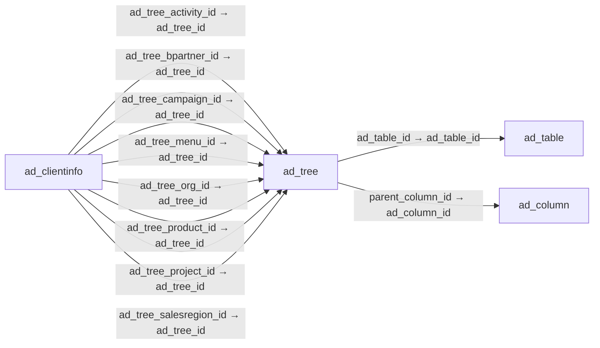

# ad_tree — 계층 트리

[전체 일람](../TABLE_INDEX.md) · [분류 일람](README.md) · [AI 사용 안내](../README.md) · [외래키 읽는 법](../RELATIONSHIPS.md)

## 기본 정보

| 항목 | 내용 |
|---|---|
| 물리명 | `adempiere.ad_tree` |
| 한국어 논리명(문서용 해석) | 계층 트리 |
| 원본 논리명 | Tree |
| 원본 사전 ID | 288 |
| 분류 | `ad` — 애플리케이션 사전·화면·권한·시스템 |
| 전체 테넌트 행 수 | 23 |
| 물리 열 수 | 20 |
| 나가는 FK / 들어오는 FK | 2 / 36 |
| 구조·행 수 확인 시점 | 2026-11-03T23:29:01+09:00 |

## 의미와 쓰임

계층 구조를 표현하는 트리를 정의한다.

- 설명 근거: 원본 애플리케이션 사전 명칭·설명을 한국어로 해석.
- 한국어 이름과 개요는 문서용 해석입니다. 공식 한국어 번역으로 간주하지 않습니다.
- 원본 설명: Identifies a Tree
- 원본 도움말: —
- PostgreSQL 테이블 주석: —

## 키와 열

### 기본키·고유 제약조건

| 종류 | 제약조건 | 열(순서 유지) |
|---|---|---|
| PRIMARY KEY | `ad_tree_pkey` | `ad_tree_id` |
| UNIQUE | `ad_tree_uu_idx` | `ad_tree_uu` |

### 별도 고유 인덱스

PK·UNIQUE 제약조건의 인덱스와 별도로 존재하는 고유 인덱스입니다. 식·조건·열 순서는 원본 정의를 따릅니다.

- `ad_tree_name`: `CREATE UNIQUE INDEX ad_tree_name ON adempiere.ad_tree USING btree (ad_client_id, name)`

### 열 목록

원본 논리명·설명은 `AD_Column`에서 가져왔습니다. 기본값은 실제 PostgreSQL 메타데이터이며, 비어 있는 항목은 `—`로 표시합니다.

| 순서 | 물리명 | 원본 논리명 | PostgreSQL 타입 | NULL | PK | 기본값 | 설명 |
|---:|---|---|---|---|---|---|---|
| 1 | `ad_tree_id` | Tree | numeric(10,0) | 불가 | 예 | — | Identifies a Tree |
| 2 | `ad_client_id` | Tenant | numeric(10,0) | 불가 | — | — | Tenant for this installation. |
| 3 | `ad_org_id` | Organization | numeric(10,0) | 불가 | — | — | Organizational entity within tenant |
| 4 | `created` | Created | timestamp without time zone | 불가 | — | now() | Date this record was created |
| 5 | `createdby` | Created By | numeric(10,0) | 불가 | — | — | User who created this records |
| 6 | `updated` | Updated | timestamp without time zone | 불가 | — | now() | Date this record was updated |
| 7 | `updatedby` | Updated By | numeric(10,0) | 불가 | — | — | User who updated this records |
| 8 | `isactive` | Active | character(1) | 불가 | — | 'Y'::bpchar | The record is active in the system |
| 9 | `name` | Name | character varying(60) | 불가 | — | — | Alphanumeric identifier of the entity |
| 10 | `description` | Description | character varying(255) | 허용 | — | — | Optional short description of the record |
| 11 | `treetype` | Type &#124; Area | character(2) | 불가 | — | — | Element this tree is built on (i.e Product, Business Partner) |
| 12 | `isallnodes` | All Nodes | character(1) | 불가 | — | 'Y'::bpchar | All Nodes are included (Complete Tree) |
| 13 | `processing` | Process Now | character(1) | 허용 | — | — | — |
| 14 | `isdefault` | Default | character(1) | 불가 | — | 'N'::bpchar | Default value |
| 15 | `ad_tree_uu` | AD_Tree_UU | uuid | 허용 | — | — | — |
| 16 | `istreedrivenbyvalue` | Driven by Search Key | character(1) | 불가 | — | 'N'::bpchar | — |
| 17 | `ad_table_id` | Table | numeric(10,0) | 허용 | — | NULL::numeric | Database Table information |
| 18 | `isloadallnodesimmediately` | Loads directly all nodes | character(1) | 불가 | — | 'Y'::bpchar | If checked, all nodes are loaded before tree is displayed |
| 19 | `isvaluedisplayed` | Display Value | character(1) | 불가 | — | 'N'::bpchar | Displays Value column with the Display column |
| 20 | `parent_column_id` | Parent Column | numeric(10,0) | 허용 | — | NULL::numeric | The link column on the parent tab. |

## 외래키 흐름

화살표는 **FK를 가진 자식 → 참조되는 부모**입니다. 업무 처리의 시간 순서나 무조건적인 1:N 관계를 뜻하지 않습니다.

주변 관계 38개 중 10개를 그림으로 표시합니다. **전체 관계는 아래 두 표에 모두 포함**합니다.

### 이 테이블이 참조하는 부모 — 나가는 FK

| 제약조건 | 참조하는 쪽(자식) | 자식 열 | 참조받는 쪽(부모) | 부모 열 | 삭제 / 갱신 | 검증 / 지연 가능 |
|---|---|---|---|---|---|---|
| `adtable_adtree` <!-- FK_OUT: adempiere.ad_tree.adtable_adtree --> | [`ad_tree`](ad_tree.md) | `ad_table_id` | [`ad_table`](ad_table.md) | `ad_table_id` | NO ACTION / NO ACTION | 완료 / 가능 (초기 지연) |
| `parentcolumn_adtree` <!-- FK_OUT: adempiere.ad_tree.parentcolumn_adtree --> | [`ad_tree`](ad_tree.md) | `parent_column_id` | [`ad_column`](ad_column.md) | `ad_column_id` | NO ACTION / NO ACTION | 완료 / 가능 (초기 지연) |

### 이 테이블을 참조하는 자식 — 들어오는 FK

| 제약조건 | 참조하는 쪽(자식) | 자식 열 | 참조받는 쪽(부모) | 부모 열 | 삭제 / 갱신 | 검증 / 지연 가능 |
|---|---|---|---|---|---|---|
| `adtreeactivity_adclientinfo` <!-- FK_IN: adempiere.ad_clientinfo.adtreeactivity_adclientinfo --> | [`ad_clientinfo`](ad_clientinfo.md) | `ad_tree_activity_id` | [`ad_tree`](ad_tree.md) | `ad_tree_id` | NO ACTION / NO ACTION | 완료 / 가능 (초기 지연) |
| `adtreebpartner_adclientinfo` <!-- FK_IN: adempiere.ad_clientinfo.adtreebpartner_adclientinfo --> | [`ad_clientinfo`](ad_clientinfo.md) | `ad_tree_bpartner_id` | [`ad_tree`](ad_tree.md) | `ad_tree_id` | NO ACTION / NO ACTION | 완료 / 가능 (초기 지연) |
| `adtreecampaign_adclientinfo` <!-- FK_IN: adempiere.ad_clientinfo.adtreecampaign_adclientinfo --> | [`ad_clientinfo`](ad_clientinfo.md) | `ad_tree_campaign_id` | [`ad_tree`](ad_tree.md) | `ad_tree_id` | NO ACTION / NO ACTION | 완료 / 가능 (초기 지연) |
| `adtreemenu_adclientinfo` <!-- FK_IN: adempiere.ad_clientinfo.adtreemenu_adclientinfo --> | [`ad_clientinfo`](ad_clientinfo.md) | `ad_tree_menu_id` | [`ad_tree`](ad_tree.md) | `ad_tree_id` | NO ACTION / NO ACTION | 완료 / 가능 (초기 지연) |
| `adtreeorg_adclientinfo` <!-- FK_IN: adempiere.ad_clientinfo.adtreeorg_adclientinfo --> | [`ad_clientinfo`](ad_clientinfo.md) | `ad_tree_org_id` | [`ad_tree`](ad_tree.md) | `ad_tree_id` | NO ACTION / NO ACTION | 완료 / 가능 (초기 지연) |
| `adtreeproduct_adclientinfo` <!-- FK_IN: adempiere.ad_clientinfo.adtreeproduct_adclientinfo --> | [`ad_clientinfo`](ad_clientinfo.md) | `ad_tree_product_id` | [`ad_tree`](ad_tree.md) | `ad_tree_id` | NO ACTION / NO ACTION | 완료 / 가능 (초기 지연) |
| `adtreeproject_adclientinfo` <!-- FK_IN: adempiere.ad_clientinfo.adtreeproject_adclientinfo --> | [`ad_clientinfo`](ad_clientinfo.md) | `ad_tree_project_id` | [`ad_tree`](ad_tree.md) | `ad_tree_id` | NO ACTION / NO ACTION | 완료 / 가능 (초기 지연) |
| `adtreesalesreg_adclientinfo` <!-- FK_IN: adempiere.ad_clientinfo.adtreesalesreg_adclientinfo --> | [`ad_clientinfo`](ad_clientinfo.md) | `ad_tree_salesregion_id` | [`ad_tree`](ad_tree.md) | `ad_tree_id` | NO ACTION / NO ACTION | 완료 / 가능 (초기 지연) |
| `adtree_adrole` <!-- FK_IN: adempiere.ad_role.adtree_adrole --> | [`ad_role`](ad_role.md) | `ad_tree_menu_id` | [`ad_tree`](ad_tree.md) | `ad_tree_id` | NO ACTION / NO ACTION | 완료 / 가능 (초기 지연) |
| `adtreeorg_adrole` <!-- FK_IN: adempiere.ad_role.adtreeorg_adrole --> | [`ad_role`](ad_role.md) | `ad_tree_org_id` | [`ad_tree`](ad_tree.md) | `ad_tree_id` | NO ACTION / NO ACTION | 완료 / 가능 (초기 지연) |
| `adtree_adtreebar` <!-- FK_IN: adempiere.ad_treebar.adtree_adtreebar --> | [`ad_treebar`](ad_treebar.md) | `ad_tree_id` | [`ad_tree`](ad_tree.md) | `ad_tree_id` | CASCADE / NO ACTION | 완료 / 가능 (초기 지연) |
| `adtree_adtreenode` <!-- FK_IN: adempiere.ad_treenode.adtree_adtreenode --> | [`ad_treenode`](ad_treenode.md) | `ad_tree_id` | [`ad_tree`](ad_tree.md) | `ad_tree_id` | CASCADE / NO ACTION | 완료 / 가능 (초기 지연) |
| `adtree_adtreenodebp` <!-- FK_IN: adempiere.ad_treenodebp.adtree_adtreenodebp --> | [`ad_treenodebp`](ad_treenodebp.md) | `ad_tree_id` | [`ad_tree`](ad_tree.md) | `ad_tree_id` | CASCADE / NO ACTION | 완료 / 가능 (초기 지연) |
| `adtree_adtreenodecmc` <!-- FK_IN: adempiere.ad_treenodecmc.adtree_adtreenodecmc --> | [`ad_treenodecmc`](ad_treenodecmc.md) | `ad_tree_id` | [`ad_tree`](ad_tree.md) | `ad_tree_id` | NO ACTION / NO ACTION | 완료 / 가능 (초기 지연) |
| `adtree_adtreenodecmm` <!-- FK_IN: adempiere.ad_treenodecmm.adtree_adtreenodecmm --> | [`ad_treenodecmm`](ad_treenodecmm.md) | `ad_tree_id` | [`ad_tree`](ad_tree.md) | `ad_tree_id` | CASCADE / NO ACTION | 완료 / 가능 (초기 지연) |
| `adtree_adtreenodecms` <!-- FK_IN: adempiere.ad_treenodecms.adtree_adtreenodecms --> | [`ad_treenodecms`](ad_treenodecms.md) | `ad_tree_id` | [`ad_tree`](ad_tree.md) | `ad_tree_id` | CASCADE / NO ACTION | 완료 / 가능 (초기 지연) |
| `adtree_adtreenodecmt` <!-- FK_IN: adempiere.ad_treenodecmt.adtree_adtreenodecmt --> | [`ad_treenodecmt`](ad_treenodecmt.md) | `ad_tree_id` | [`ad_tree`](ad_tree.md) | `ad_tree_id` | CASCADE / NO ACTION | 완료 / 가능 (초기 지연) |
| `adtree_adtreenodemm` <!-- FK_IN: adempiere.ad_treenodemm.adtree_adtreenodemm --> | [`ad_treenodemm`](ad_treenodemm.md) | `ad_tree_id` | [`ad_tree`](ad_tree.md) | `ad_tree_id` | CASCADE / NO ACTION | 완료 / 가능 (초기 지연) |
| `adtree_adtreenodepr` <!-- FK_IN: adempiere.ad_treenodepr.adtree_adtreenodepr --> | [`ad_treenodepr`](ad_treenodepr.md) | `ad_tree_id` | [`ad_tree`](ad_tree.md) | `ad_tree_id` | CASCADE / NO ACTION | 완료 / 가능 (초기 지연) |
| `adtree_adtreenodeu1` <!-- FK_IN: adempiere.ad_treenodeu1.adtree_adtreenodeu1 --> | [`ad_treenodeu1`](ad_treenodeu1.md) | `ad_tree_id` | [`ad_tree`](ad_tree.md) | `ad_tree_id` | CASCADE / NO ACTION | 완료 / 가능 (초기 지연) |
| `adtree_adtreenodeu2` <!-- FK_IN: adempiere.ad_treenodeu2.adtree_adtreenodeu2 --> | [`ad_treenodeu2`](ad_treenodeu2.md) | `ad_tree_id` | [`ad_tree`](ad_tree.md) | `ad_tree_id` | CASCADE / NO ACTION | 완료 / 가능 (초기 지연) |
| `adtree_adtreenodeu3` <!-- FK_IN: adempiere.ad_treenodeu3.adtree_adtreenodeu3 --> | [`ad_treenodeu3`](ad_treenodeu3.md) | `ad_tree_id` | [`ad_tree`](ad_tree.md) | `ad_tree_id` | CASCADE / NO ACTION | 완료 / 가능 (초기 지연) |
| `adtree_adtreenodeu4` <!-- FK_IN: adempiere.ad_treenodeu4.adtree_adtreenodeu4 --> | [`ad_treenodeu4`](ad_treenodeu4.md) | `ad_tree_id` | [`ad_tree`](ad_tree.md) | `ad_tree_id` | CASCADE / NO ACTION | 완료 / 가능 (초기 지연) |
| `adtree_celement` <!-- FK_IN: adempiere.c_element.adtree_celement --> | [`c_element`](../c/c_element.md) | `ad_tree_id` | [`ad_tree`](ad_tree.md) | `ad_tree_id` | SET NULL / NO ACTION | 완료 / 가능 (초기 지연) |
| `adtreecmc_cmwebproject` <!-- FK_IN: adempiere.cm_webproject.adtreecmc_cmwebproject --> | [`cm_webproject`](../cm/cm_webproject.md) | `ad_treecmc_id` | [`ad_tree`](ad_tree.md) | `ad_tree_id` | NO ACTION / NO ACTION | 완료 / 가능 (초기 지연) |
| `adtreecmm_cmwebproject` <!-- FK_IN: adempiere.cm_webproject.adtreecmm_cmwebproject --> | [`cm_webproject`](../cm/cm_webproject.md) | `ad_treecmm_id` | [`ad_tree`](ad_tree.md) | `ad_tree_id` | NO ACTION / NO ACTION | 완료 / 가능 (초기 지연) |
| `adtreecms_cmwebproject` <!-- FK_IN: adempiere.cm_webproject.adtreecms_cmwebproject --> | [`cm_webproject`](../cm/cm_webproject.md) | `ad_treecms_id` | [`ad_tree`](ad_tree.md) | `ad_tree_id` | NO ACTION / NO ACTION | 완료 / 가능 (초기 지연) |
| `adtreecmt_cmwebproject` <!-- FK_IN: adempiere.cm_webproject.adtreecmt_cmwebproject --> | [`cm_webproject`](../cm/cm_webproject.md) | `ad_treecmt_id` | [`ad_tree`](ad_tree.md) | `ad_tree_id` | NO ACTION / NO ACTION | 완료 / 가능 (초기 지연) |
| `adtreeaccount_pahierarchy` <!-- FK_IN: adempiere.pa_hierarchy.adtreeaccount_pahierarchy --> | [`pa_hierarchy`](../pa/pa_hierarchy.md) | `ad_tree_account_id` | [`ad_tree`](ad_tree.md) | `ad_tree_id` | NO ACTION / NO ACTION | 완료 / 가능 (초기 지연) |
| `adtreeactivity_pahierarchy` <!-- FK_IN: adempiere.pa_hierarchy.adtreeactivity_pahierarchy --> | [`pa_hierarchy`](../pa/pa_hierarchy.md) | `ad_tree_activity_id` | [`ad_tree`](ad_tree.md) | `ad_tree_id` | NO ACTION / NO ACTION | 완료 / 가능 (초기 지연) |
| `adtreebpartner_pahierarchy` <!-- FK_IN: adempiere.pa_hierarchy.adtreebpartner_pahierarchy --> | [`pa_hierarchy`](../pa/pa_hierarchy.md) | `ad_tree_bpartner_id` | [`ad_tree`](ad_tree.md) | `ad_tree_id` | NO ACTION / NO ACTION | 완료 / 가능 (초기 지연) |
| `adtreecampaign_pahierarchy` <!-- FK_IN: adempiere.pa_hierarchy.adtreecampaign_pahierarchy --> | [`pa_hierarchy`](../pa/pa_hierarchy.md) | `ad_tree_campaign_id` | [`ad_tree`](ad_tree.md) | `ad_tree_id` | NO ACTION / NO ACTION | 완료 / 가능 (초기 지연) |
| `adtreeorg_pahierarchy` <!-- FK_IN: adempiere.pa_hierarchy.adtreeorg_pahierarchy --> | [`pa_hierarchy`](../pa/pa_hierarchy.md) | `ad_tree_org_id` | [`ad_tree`](ad_tree.md) | `ad_tree_id` | NO ACTION / NO ACTION | 완료 / 가능 (초기 지연) |
| `adtreeproduct_pahierarchy` <!-- FK_IN: adempiere.pa_hierarchy.adtreeproduct_pahierarchy --> | [`pa_hierarchy`](../pa/pa_hierarchy.md) | `ad_tree_product_id` | [`ad_tree`](ad_tree.md) | `ad_tree_id` | NO ACTION / NO ACTION | 완료 / 가능 (초기 지연) |
| `adtreeproject_pahierarchy` <!-- FK_IN: adempiere.pa_hierarchy.adtreeproject_pahierarchy --> | [`pa_hierarchy`](../pa/pa_hierarchy.md) | `ad_tree_project_id` | [`ad_tree`](ad_tree.md) | `ad_tree_id` | NO ACTION / NO ACTION | 완료 / 가능 (초기 지연) |
| `adtreesr_pahierarchy` <!-- FK_IN: adempiere.pa_hierarchy.adtreesr_pahierarchy --> | [`pa_hierarchy`](../pa/pa_hierarchy.md) | `ad_tree_salesregion_id` | [`ad_tree`](ad_tree.md) | `ad_tree_id` | NO ACTION / NO ACTION | 완료 / 가능 (초기 지연) |

## 조회 시 주의

- FK 표의 자식 열과 부모 열을 같은 순서로 대응시킵니다. 복합 FK는 모든 열의 동등 조건을 `AND`로 연결합니다.
- 테이블 이름이나 `_id` 열 이름만으로 물리 FK가 있다고 가정하지 않습니다. FK 미선언은 업무 관계가 없다는 뜻도 아닙니다.
- 자식이 여러 행인 테이블과 조인하면 부모의 금액·건수가 중복될 수 있습니다. 집계 단위를 먼저 정합니다.
- `ad_client_id`가 있습니다. 업무 분석에서는 대상 테넌트를 명시합니다. GardenWorld는 `11`, 시스템 공통 설정은 `0`일 수 있으므로 일괄 필터 적용 전에 테이블 역할을 확인합니다.
- 행 수는 위 확인 시점의 전체 테넌트 값입니다. 최신 업무 실적이나 현재 실행 결과로 재사용하지 않습니다.
