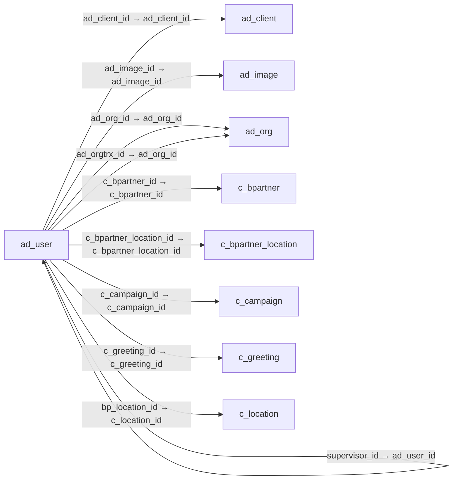

# ad_user — 사용자·거래처 담당자

[전체 일람](../TABLE_INDEX.md) · [분류 일람](README.md) · [AI 사용 안내](../README.md) · [외래키 읽는 법](../RELATIONSHIPS.md)

## 기본 정보

| 항목 | 내용 |
|---|---|
| 물리명 | `adempiere.ad_user` |
| 한국어 논리명(문서용 해석) | 사용자·거래처 담당자 |
| 원본 논리명 | User/Contact |
| 원본 사전 ID | 114 |
| 분류 | `ad` — 애플리케이션 사전·화면·권한·시스템 |
| 전체 테넌트 행 수 | 9 |
| 물리 열 수 | 71 |
| 나가는 FK / 들어오는 FK | 14 / 252 |
| 구조·행 수 확인 시점 | 2026-11-03T23:29:01+09:00 |

## 의미와 쓰임

내부 시스템 사용자와 거래처 연락 담당자를 관리한다.

- 설명 근거: 원본 애플리케이션 사전 명칭·설명을 한국어로 해석.
- 한국어 이름과 개요는 문서용 해석입니다. 공식 한국어 번역으로 간주하지 않습니다.
- 원본 설명: User within the system - Internal or Business Partner Contact
- 원본 도움말: —
- PostgreSQL 테이블 주석: —

## 키와 열

### 기본키·고유 제약조건

| 종류 | 제약조건 | 열(순서 유지) |
|---|---|---|
| PRIMARY KEY | `ad_user_pkey` | `ad_user_id` |
| UNIQUE | `ad_user_uu_idx` | `ad_user_uu` |

### 열 목록

원본 논리명·설명은 `AD_Column`에서 가져왔습니다. 기본값은 실제 PostgreSQL 메타데이터이며, 비어 있는 항목은 `—`로 표시합니다.

| 순서 | 물리명 | 원본 논리명 | PostgreSQL 타입 | NULL | PK | 기본값 | 설명 |
|---:|---|---|---|---|---|---|---|
| 1 | `ad_user_id` | User/Contact | numeric(10,0) | 불가 | 예 | — | User within the system - Internal or Business Partner Contact |
| 2 | `ad_client_id` | Tenant | numeric(10,0) | 불가 | — | — | Tenant for this installation. |
| 3 | `ad_org_id` | Organization | numeric(10,0) | 불가 | — | — | Organizational entity within tenant |
| 4 | `isactive` | Active | character(1) | 불가 | — | 'Y'::bpchar | The record is active in the system |
| 5 | `created` | Created | timestamp without time zone | 불가 | — | now() | Date this record was created |
| 6 | `createdby` | Created By | numeric(10,0) | 불가 | — | — | User who created this records |
| 7 | `updated` | Updated | timestamp without time zone | 불가 | — | now() | Date this record was updated |
| 8 | `updatedby` | Updated By | numeric(10,0) | 불가 | — | — | User who updated this records |
| 9 | `name` | Name | character varying(60) | 불가 | — | — | Alphanumeric identifier of the entity |
| 10 | `description` | Description | character varying(255) | 허용 | — | — | Optional short description of the record |
| 11 | `password` | Password | character varying(1024) | 허용 | — | — | Password of any length (case sensitive) |
| 12 | `email` | EMail Address | character varying(60) | 허용 | — | — | Electronic Mail Address |
| 13 | `supervisor_id` | Supervisor | numeric(10,0) | 허용 | — | — | Supervisor for this user/organization - used for escalation and approval |
| 14 | `c_bpartner_id` | Business Partner | numeric(10,0) | 허용 | — | — | Identifies a Business Partner |
| 15 | `processing` | Process Now | character(1) | 허용 | — | — | — |
| 16 | `emailuser` | EMail User ID | character varying(60) | 허용 | — | — | User Name (ID) in the Mail System |
| 17 | `emailuserpw` | EMail User Password | character varying(255) | 허용 | — | — | Password of your email user id |
| 18 | `c_bpartner_location_id` | Partner Location | numeric(10,0) | 허용 | — | — | Identifies the (ship to) address for this Business Partner |
| 19 | `c_greeting_id` | Greeting | numeric(10,0) | 허용 | — | — | Greeting to print on correspondence |
| 20 | `title` | Title | character varying(40) | 허용 | — | — | Name this entity is referred to as |
| 21 | `comments` | Comments | character varying(2000) | 허용 | — | — | Comments or additional information |
| 22 | `phone` | Phone | character varying(40) | 허용 | — | — | Identifies a telephone number |
| 23 | `phone2` | 2nd Phone | character varying(40) | 허용 | — | — | Identifies an alternate telephone number. |
| 24 | `fax` | Fax | character varying(40) | 허용 | — | — | Facsimile number |
| 25 | `lastcontact` | Last Contact | timestamp without time zone | 허용 | — | — | Date this individual was last contacted |
| 26 | `lastresult` | Last Result | character varying(255) | 허용 | — | — | Result of last contact |
| 27 | `birthday` | Birthday | timestamp without time zone | 허용 | — | — | Birthday or Anniversary day |
| 28 | `ad_orgtrx_id` | Trx Organization | numeric(10,0) | 허용 | — | — | Performing or initiating organization |
| 29 | `emailverify` | Verification Info | character varying(40) | 허용 | — | — | Verification information of EMail Address |
| 30 | `emailverifydate` | EMail Verify | timestamp without time zone | 허용 | — | — | Date Email was verified |
| 31 | `notificationtype` | Notification Type | character(1) | 불가 | — | 'X'::bpchar | Type of Notifications |
| 32 | `isfullbpaccess` | Full BP Access | character(1) | 불가 | — | 'Y'::bpchar | The user/contact has full access to Business Partner information and resources |
| 33 | `c_job_id` | Position | numeric(10,0) | 허용 | — | — | Job Position |
| 34 | `ldapuser` | LDAP User Name | character varying(60) | 허용 | — | — | User Name used for authorization via LDAP (directory) services |
| 35 | `connectionprofile` | Connection Profile | character(1) | 허용 | — | — | How a Java Tenant connects to the server(s) |
| 36 | `value` | Search Key | character varying(40) | 허용 | — | — | Search key for the record in the format required - must be unique |
| 37 | `userpin` | User PIN | character varying(20) | 허용 | — | — | — |
| 38 | `isinpayroll` | Is In Payroll | character(1) | 불가 | — | 'N'::bpchar | Defined if any User Contact will be used for Calculate Payroll |
| 39 | `ad_user_uu` | AD_User_UU | uuid | 허용 | — | — | — |
| 40 | `ismenuautoexpand` | Auto expand menu | character(1) | 허용 | — | — | If ticked, the menu is automatically expanded |
| 41 | `salt` | Salt | character varying(32) | 허용 | — | — | Random data added to improve password hash effectiveness |
| 42 | `islocked` | Locked | character(1) | 불가 | — | 'N'::bpchar | — |
| 43 | `dateaccountlocked` | Date Account Locked | timestamp without time zone | 허용 | — | — | — |
| 44 | `failedlogincount` | Failed Login Count | numeric(10,0) | 불가 | — | (0)::numeric | — |
| 45 | `datepasswordchanged` | Date Password Changed | timestamp without time zone | 허용 | — | — | — |
| 46 | `datelastlogin` | Date Last Login | timestamp without time zone | 허용 | — | — | — |
| 47 | `isnopasswordreset` | No Password Reset | character(1) | 불가 | — | 'N'::bpchar | — |
| 48 | `isexpired` | Expired | character(1) | 불가 | — | 'N'::bpchar | — |
| 49 | `securityquestion` | Security Question | character varying(1024) | 허용 | — | — | — |
| 50 | `answer` | Answer | character varying(1024) | 허용 | — | NULL::character varying | — |
| 51 | `issaleslead` | Sales Lead | character(1) | 불가 | — | 'N'::bpchar | This contact is a sales lead |
| 52 | `c_location_id` | Address | numeric(10,0) | 허용 | — | NULL::numeric | Location or Address |
| 53 | `leadsource` | Lead Source | character varying(10) | 허용 | — | NULL::character varying | The source of this lead/opportunity |
| 54 | `leadstatus` | Lead Status | character varying(10) | 허용 | — | NULL::character varying | The status of this lead/opportunity in the sales cycle |
| 55 | `leadsourcedescription` | Lead Source Description | character varying(255) | 허용 | — | NULL::character varying | Additional information on the source of this lead/opportunity |
| 56 | `leadstatusdescription` | Lead Status Description | character varying(255) | 허용 | — | NULL::character varying | Additional information on the status of this lead/opportunity |
| 57 | `c_campaign_id` | Campaign | numeric(10,0) | 허용 | — | NULL::numeric | Marketing Campaign |
| 58 | `salesrep_id` | Sales Representative | numeric(10,0) | 허용 | — | NULL::numeric | Sales Representative or Company Agent |
| 59 | `bpname` | BP Name | character varying(60) | 허용 | — | NULL::character varying | — |
| 60 | `bp_location_id` | BP Address | numeric(10,0) | 허용 | — | NULL::numeric | Address of the Business Partner |
| 61 | `isaddmailtextautomatically` | Add Mail Text Automatically | character(1) | 불가 | — | 'N'::bpchar | The selected mail template will be automatically inserted when creating an email |
| 62 | `r_defaultmailtext_id` | Default mail template | numeric(10,0) | 허용 | — | NULL::numeric | — |
| 63 | `ad_image_id` | Image | numeric(10,0) | 허용 | — | NULL::numeric | Image or Icon |
| 64 | `isnoexpire` | No Expire | character(1) | 불가 | — | 'N'::bpchar | — |
| 65 | `issupportuser` | Support User | character(1) | 불가 | — | 'N'::bpchar | — |
| 66 | `isbillto` | Invoice Address | character(1) | 불가 | — | 'N'::bpchar | Business Partner Invoice/Bill Address |
| 67 | `isshipto` | Ship Address | character(1) | 불가 | — | 'N'::bpchar | Business Partner Shipment Address |
| 68 | `isvendorlead` | Vendor Lead | character(1) | 불가 | — | 'N'::bpchar | This contact is a vendor lead |
| 69 | `authenticationtype` | Authentication Type | character varying(10) | 허용 | — | NULL::character varying | — |
| 70 | `passwordhashalgorithm` | Password Hash Algorithm | character varying(40) | 허용 | — | NULL::character varying | Algorithm use to perform hashing of password |
| 71 | `saltalgorithm` | Salt Algorithm | character varying(40) | 허용 | — | NULL::character varying | Secure random algorithm use to generate password salt |

## 외래키 흐름

화살표는 **FK를 가진 자식 → 참조되는 부모**입니다. 업무 처리의 시간 순서나 무조건적인 1:N 관계를 뜻하지 않습니다.

주변 관계 264개 중 10개를 그림으로 표시합니다. **전체 관계는 아래 두 표에 모두 포함**합니다.

### 이 테이블이 참조하는 부모 — 나가는 FK

| 제약조건 | 참조하는 쪽(자식) | 자식 열 | 참조받는 쪽(부모) | 부모 열 | 삭제 / 갱신 | 검증 / 지연 가능 |
|---|---|---|---|---|---|---|
| `ad_user_client` <!-- FK_OUT: adempiere.ad_user.ad_user_client --> | [`ad_user`](ad_user.md) | `ad_client_id` | [`ad_client`](ad_client.md) | `ad_client_id` | NO ACTION / NO ACTION | 완료 / 가능 (초기 지연) |
| `ad_user_org` <!-- FK_OUT: adempiere.ad_user.ad_user_org --> | [`ad_user`](ad_user.md) | `ad_org_id` | [`ad_org`](ad_org.md) | `ad_org_id` | NO ACTION / NO ACTION | 완료 / 가능 (초기 지연) |
| `adimage_aduser` <!-- FK_OUT: adempiere.ad_user.adimage_aduser --> | [`ad_user`](ad_user.md) | `ad_image_id` | [`ad_image`](ad_image.md) | `ad_image_id` | NO ACTION / NO ACTION | 완료 / 가능 (초기 지연) |
| `adorgtrx_aduser` <!-- FK_OUT: adempiere.ad_user.adorgtrx_aduser --> | [`ad_user`](ad_user.md) | `ad_orgtrx_id` | [`ad_org`](ad_org.md) | `ad_org_id` | NO ACTION / NO ACTION | 완료 / 가능 (초기 지연) |
| `aduser_supervisor` <!-- FK_OUT: adempiere.ad_user.aduser_supervisor --> | [`ad_user`](ad_user.md) | `supervisor_id` | [`ad_user`](ad_user.md) | `ad_user_id` | NO ACTION / NO ACTION | 완료 / 가능 (초기 지연) |
| `bplocation_aduser` <!-- FK_OUT: adempiere.ad_user.bplocation_aduser --> | [`ad_user`](ad_user.md) | `bp_location_id` | [`c_location`](../c/c_location.md) | `c_location_id` | NO ACTION / NO ACTION | 완료 / 가능 (초기 지연) |
| `cbpartner_aduser` <!-- FK_OUT: adempiere.ad_user.cbpartner_aduser --> | [`ad_user`](ad_user.md) | `c_bpartner_id` | [`c_bpartner`](../c/c_bpartner.md) | `c_bpartner_id` | CASCADE / NO ACTION | 완료 / 가능 (초기 지연) |
| `cbplocation_aduser` <!-- FK_OUT: adempiere.ad_user.cbplocation_aduser --> | [`ad_user`](ad_user.md) | `c_bpartner_location_id` | [`c_bpartner_location`](../c/c_bpartner_location.md) | `c_bpartner_location_id` | NO ACTION / NO ACTION | 완료 / 가능 (초기 지연) |
| `ccampaign_aduser` <!-- FK_OUT: adempiere.ad_user.ccampaign_aduser --> | [`ad_user`](ad_user.md) | `c_campaign_id` | [`c_campaign`](../c/c_campaign.md) | `c_campaign_id` | NO ACTION / NO ACTION | 완료 / 가능 (초기 지연) |
| `cgreeting_aduser` <!-- FK_OUT: adempiere.ad_user.cgreeting_aduser --> | [`ad_user`](ad_user.md) | `c_greeting_id` | [`c_greeting`](../c/c_greeting.md) | `c_greeting_id` | NO ACTION / NO ACTION | 완료 / 가능 (초기 지연) |
| `cjob_aduser` <!-- FK_OUT: adempiere.ad_user.cjob_aduser --> | [`ad_user`](ad_user.md) | `c_job_id` | [`c_job`](../c/c_job.md) | `c_job_id` | NO ACTION / NO ACTION | 완료 / 가능 (초기 지연) |
| `clocation_aduser` <!-- FK_OUT: adempiere.ad_user.clocation_aduser --> | [`ad_user`](ad_user.md) | `c_location_id` | [`c_location`](../c/c_location.md) | `c_location_id` | NO ACTION / NO ACTION | 완료 / 가능 (초기 지연) |
| `rdefaultmailtext_aduser` <!-- FK_OUT: adempiere.ad_user.rdefaultmailtext_aduser --> | [`ad_user`](ad_user.md) | `r_defaultmailtext_id` | [`r_mailtext`](../r/r_mailtext.md) | `r_mailtext_id` | NO ACTION / NO ACTION | 완료 / 가능 (초기 지연) |
| `salesrep_aduser` <!-- FK_OUT: adempiere.ad_user.salesrep_aduser --> | [`ad_user`](ad_user.md) | `salesrep_id` | [`ad_user`](ad_user.md) | `ad_user_id` | NO ACTION / NO ACTION | 완료 / 가능 (초기 지연) |

### 이 테이블을 참조하는 자식 — 들어오는 FK

| 제약조건 | 참조하는 쪽(자식) | 자식 열 | 참조받는 쪽(부모) | 부모 열 | 삭제 / 갱신 | 검증 / 지연 가능 |
|---|---|---|---|---|---|---|
| `aduser_aasset` <!-- FK_IN: adempiere.a_asset.aduser_aasset --> | [`a_asset`](../a/a_asset.md) | `ad_user_id` | [`ad_user`](ad_user.md) | `ad_user_id` | NO ACTION / NO ACTION | 완료 / 가능 (초기 지연) |
| `aduser_aassetchange` <!-- FK_IN: adempiere.a_asset_change.aduser_aassetchange --> | [`a_asset_change`](../a/a_asset_change.md) | `ad_user_id` | [`ad_user`](ad_user.md) | `ad_user_id` | NO ACTION / NO ACTION | 완료 / 가능 (초기 지연) |
| `aduser_aassetdelivery` <!-- FK_IN: adempiere.a_asset_delivery.aduser_aassetdelivery --> | [`a_asset_delivery`](../a/a_asset_delivery.md) | `ad_user_id` | [`ad_user`](ad_user.md) | `ad_user_id` | NO ACTION / NO ACTION | 완료 / 가능 (초기 지연) |
| `createdby_aassetgrouptrl` <!-- FK_IN: adempiere.a_asset_group_trl.createdby_aassetgrouptrl --> | [`a_asset_group_trl`](../a/a_asset_group_trl.md) | `createdby` | [`ad_user`](ad_user.md) | `ad_user_id` | NO ACTION / NO ACTION | 완료 / 가능 (초기 지연) |
| `updatedby_aassetgrouptrl` <!-- FK_IN: adempiere.a_asset_group_trl.updatedby_aassetgrouptrl --> | [`a_asset_group_trl`](../a/a_asset_group_trl.md) | `updatedby` | [`ad_user`](ad_user.md) | `ad_user_id` | NO ACTION / NO ACTION | 완료 / 가능 (초기 지연) |
| `aduser_aregistration` <!-- FK_IN: adempiere.a_registration.aduser_aregistration --> | [`a_registration`](../a/a_registration.md) | `ad_user_id` | [`ad_user`](ad_user.md) | `ad_user_id` | NO ACTION / NO ACTION | 완료 / 가능 (초기 지연) |
| `aduser_calertprocessor` <!-- FK_IN: adempiere.ad_alertprocessor.aduser_calertprocessor --> | [`ad_alertprocessor`](ad_alertprocessor.md) | `supervisor_id` | [`ad_user`](ad_user.md) | `ad_user_id` | NO ACTION / NO ACTION | 완료 / 가능 (초기 지연) |
| `aduser_adalertrecipient` <!-- FK_IN: adempiere.ad_alertrecipient.aduser_adalertrecipient --> | [`ad_alertrecipient`](ad_alertrecipient.md) | `ad_user_id` | [`ad_user`](ad_user.md) | `ad_user_id` | NO ACTION / NO ACTION | 완료 / 가능 (초기 지연) |
| `createdby_adattachmentfile` <!-- FK_IN: adempiere.ad_attachmentfile.createdby_adattachmentfile --> | [`ad_attachmentfile`](ad_attachmentfile.md) | `createdby` | [`ad_user`](ad_user.md) | `ad_user_id` | NO ACTION / NO ACTION | 완료 / 가능 (초기 지연) |
| `updatedby_adattachmentfile` <!-- FK_IN: adempiere.ad_attachmentfile.updatedby_adattachmentfile --> | [`ad_attachmentfile`](ad_attachmentfile.md) | `updatedby` | [`ad_user`](ad_user.md) | `ad_user_id` | NO ACTION / NO ACTION | 완료 / 가능 (초기 지연) |
| `aduser_adattachmentnote` <!-- FK_IN: adempiere.ad_attachmentnote.aduser_adattachmentnote --> | [`ad_attachmentnote`](ad_attachmentnote.md) | `ad_user_id` | [`ad_user`](ad_user.md) | `ad_user_id` | NO ACTION / NO ACTION | 완료 / 가능 (초기 지연) |
| `aduser_adauthorizationaccount` <!-- FK_IN: adempiere.ad_authorizationaccount.aduser_adauthorizationaccount --> | [`ad_authorizationaccount`](ad_authorizationaccount.md) | `ad_user_id` | [`ad_user`](ad_user.md) | `ad_user_id` | NO ACTION / NO ACTION | 완료 / 가능 (초기 지연) |
| `aduser_adbroadcastmessage` <!-- FK_IN: adempiere.ad_broadcastmessage.aduser_adbroadcastmessage --> | [`ad_broadcastmessage`](ad_broadcastmessage.md) | `ad_user_id` | [`ad_user`](ad_user.md) | `ad_user_id` | NO ACTION / NO ACTION | 완료 / 가능 (초기 지연) |
| `createdby_adbroadcastmessagetr` <!-- FK_IN: adempiere.ad_broadcastmessage_trl.createdby_adbroadcastmessagetr --> | [`ad_broadcastmessage_trl`](ad_broadcastmessage_trl.md) | `createdby` | [`ad_user`](ad_user.md) | `ad_user_id` | NO ACTION / NO ACTION | 완료 / 가능 (초기 지연) |
| `updatedby_adbroadcastmessagetr` <!-- FK_IN: adempiere.ad_broadcastmessage_trl.updatedby_adbroadcastmessagetr --> | [`ad_broadcastmessage_trl`](ad_broadcastmessage_trl.md) | `updatedby` | [`ad_user`](ad_user.md) | `ad_user_id` | NO ACTION / NO ACTION | 완료 / 가능 (초기 지연) |
| `createdby_adcharttrl` <!-- FK_IN: adempiere.ad_chart_trl.createdby_adcharttrl --> | [`ad_chart_trl`](ad_chart_trl.md) | `createdby` | [`ad_user`](ad_user.md) | `ad_user_id` | NO ACTION / NO ACTION | 완료 / 가능 (초기 지연) |
| `updatedby_adcharttrl` <!-- FK_IN: adempiere.ad_chart_trl.updatedby_adcharttrl --> | [`ad_chart_trl`](ad_chart_trl.md) | `updatedby` | [`ad_user`](ad_user.md) | `ad_user_id` | NO ACTION / NO ACTION | 완료 / 가능 (초기 지연) |
| `createdby_adcolortrl` <!-- FK_IN: adempiere.ad_color_trl.createdby_adcolortrl --> | [`ad_color_trl`](ad_color_trl.md) | `createdby` | [`ad_user`](ad_user.md) | `ad_user_id` | NO ACTION / NO ACTION | 완료 / 가능 (초기 지연) |
| `updatedby_adcolortrl` <!-- FK_IN: adempiere.ad_color_trl.updatedby_adcolortrl --> | [`ad_color_trl`](ad_color_trl.md) | `updatedby` | [`ad_user`](ad_user.md) | `ad_user_id` | NO ACTION / NO ACTION | 완료 / 가능 (초기 지연) |
| `aduser_adctxhelpsuggestion` <!-- FK_IN: adempiere.ad_ctxhelpsuggestion.aduser_adctxhelpsuggestion --> | [`ad_ctxhelpsuggestion`](ad_ctxhelpsuggestion.md) | `ad_user_id` | [`ad_user`](ad_user.md) | `ad_user_id` | NO ACTION / NO ACTION | 완료 / 가능 (초기 지연) |
| `aduser_adfieldsuggestion` <!-- FK_IN: adempiere.ad_fieldsuggestion.aduser_adfieldsuggestion --> | [`ad_fieldsuggestion`](ad_fieldsuggestion.md) | `ad_user_id` | [`ad_user`](ad_user.md) | `ad_user_id` | NO ACTION / NO ACTION | 완료 / 가능 (초기 지연) |
| `createdby_adimporttemplate` <!-- FK_IN: adempiere.ad_importtemplate.createdby_adimporttemplate --> | [`ad_importtemplate`](ad_importtemplate.md) | `createdby` | [`ad_user`](ad_user.md) | `ad_user_id` | NO ACTION / NO ACTION | 완료 / 가능 (초기 지연) |
| `updatedby_adimporttemplate` <!-- FK_IN: adempiere.ad_importtemplate.updatedby_adimporttemplate --> | [`ad_importtemplate`](ad_importtemplate.md) | `updatedby` | [`ad_user`](ad_user.md) | `ad_user_id` | NO ACTION / NO ACTION | 완료 / 가능 (초기 지연) |
| `createdby_adimporttemplateacce` <!-- FK_IN: adempiere.ad_importtemplateaccess.createdby_adimporttemplateacce --> | [`ad_importtemplateaccess`](ad_importtemplateaccess.md) | `createdby` | [`ad_user`](ad_user.md) | `ad_user_id` | NO ACTION / NO ACTION | 완료 / 가능 (초기 지연) |
| `updatedby_adimporttemplateacce` <!-- FK_IN: adempiere.ad_importtemplateaccess.updatedby_adimporttemplateacce --> | [`ad_importtemplateaccess`](ad_importtemplateaccess.md) | `updatedby` | [`ad_user`](ad_user.md) | `ad_user_id` | NO ACTION / NO ACTION | 완료 / 가능 (초기 지연) |
| `createdby_adinforelated` <!-- FK_IN: adempiere.ad_inforelated.createdby_adinforelated --> | [`ad_inforelated`](ad_inforelated.md) | `createdby` | [`ad_user`](ad_user.md) | `ad_user_id` | NO ACTION / NO ACTION | 완료 / 가능 (초기 지연) |
| `updatedby_adinforelated` <!-- FK_IN: adempiere.ad_inforelated.updatedby_adinforelated --> | [`ad_inforelated`](ad_inforelated.md) | `updatedby` | [`ad_user`](ad_user.md) | `ad_user_id` | NO ACTION / NO ACTION | 완료 / 가능 (초기 지연) |
| `createdby_adlabeltrl` <!-- FK_IN: adempiere.ad_label_trl.createdby_adlabeltrl --> | [`ad_label_trl`](ad_label_trl.md) | `createdby` | [`ad_user`](ad_user.md) | `ad_user_id` | NO ACTION / NO ACTION | 완료 / 가능 (초기 지연) |
| `updatedby_adlabeltrl` <!-- FK_IN: adempiere.ad_label_trl.updatedby_adlabeltrl --> | [`ad_label_trl`](ad_label_trl.md) | `updatedby` | [`ad_user`](ad_user.md) | `ad_user_id` | NO ACTION / NO ACTION | 완료 / 가능 (초기 지연) |
| `createdby_adlabelcategorytrl` <!-- FK_IN: adempiere.ad_labelcategory_trl.createdby_adlabelcategorytrl --> | [`ad_labelcategory_trl`](ad_labelcategory_trl.md) | `createdby` | [`ad_user`](ad_user.md) | `ad_user_id` | NO ACTION / NO ACTION | 완료 / 가능 (초기 지연) |
| `updatedby_adlabelcategorytrl` <!-- FK_IN: adempiere.ad_labelcategory_trl.updatedby_adlabelcategorytrl --> | [`ad_labelcategory_trl`](ad_labelcategory_trl.md) | `updatedby` | [`ad_user`](ad_user.md) | `ad_user_id` | NO ACTION / NO ACTION | 완료 / 가능 (초기 지연) |
| `aduser_adldapaccess` <!-- FK_IN: adempiere.ad_ldapaccess.aduser_adldapaccess --> | [`ad_ldapaccess`](ad_ldapaccess.md) | `ad_user_id` | [`ad_user`](ad_user.md) | `ad_user_id` | NO ACTION / NO ACTION | 완료 / 가능 (초기 지연) |
| `aduser_adldapprocessor` <!-- FK_IN: adempiere.ad_ldapprocessor.aduser_adldapprocessor --> | [`ad_ldapprocessor`](ad_ldapprocessor.md) | `supervisor_id` | [`ad_user`](ad_user.md) | `ad_user_id` | NO ACTION / NO ACTION | 완료 / 가능 (초기 지연) |
| `createdby_admodelgeneratortemp` <!-- FK_IN: adempiere.ad_modelgeneratortemplate.createdby_admodelgeneratortemp --> | [`ad_modelgeneratortemplate`](ad_modelgeneratortemplate.md) | `createdby` | [`ad_user`](ad_user.md) | `ad_user_id` | NO ACTION / NO ACTION | 완료 / 가능 (초기 지연) |
| `updatedby_admodelgeneratortemp` <!-- FK_IN: adempiere.ad_modelgeneratortemplate.updatedby_admodelgeneratortemp --> | [`ad_modelgeneratortemplate`](ad_modelgeneratortemplate.md) | `updatedby` | [`ad_user`](ad_user.md) | `ad_user_id` | NO ACTION / NO ACTION | 완료 / 가능 (초기 지연) |
| `aduser_adnote` <!-- FK_IN: adempiere.ad_note.aduser_adnote --> | [`ad_note`](ad_note.md) | `ad_user_id` | [`ad_user`](ad_user.md) | `ad_user_id` | NO ACTION / NO ACTION | 완료 / 가능 (초기 지연) |
| `aduser_adorginfo` <!-- FK_IN: adempiere.ad_orginfo.aduser_adorginfo --> | [`ad_orginfo`](ad_orginfo.md) | `supervisor_id` | [`ad_user`](ad_user.md) | `ad_user_id` | SET NULL / NO ACTION | 완료 / 가능 (초기 지연) |
| `aduser_adpasswordhistory` <!-- FK_IN: adempiere.ad_password_history.aduser_adpasswordhistory --> | [`ad_password_history`](ad_password_history.md) | `ad_user_id` | [`ad_user`](ad_user.md) | `ad_user_id` | NO ACTION / NO ACTION | 완료 / 가능 (초기 지연) |
| `createdby_adpasswordhistory` <!-- FK_IN: adempiere.ad_password_history.createdby_adpasswordhistory --> | [`ad_password_history`](ad_password_history.md) | `createdby` | [`ad_user`](ad_user.md) | `ad_user_id` | NO ACTION / NO ACTION | 완료 / 가능 (초기 지연) |
| `updatedby_adpasswordhistory` <!-- FK_IN: adempiere.ad_password_history.updatedby_adpasswordhistory --> | [`ad_password_history`](ad_password_history.md) | `updatedby` | [`ad_user`](ad_user.md) | `ad_user_id` | NO ACTION / NO ACTION | 완료 / 가능 (초기 지연) |
| `aduser_pinstance` <!-- FK_IN: adempiere.ad_pinstance.aduser_pinstance --> | [`ad_pinstance`](ad_pinstance.md) | `ad_user_id` | [`ad_user`](ad_user.md) | `ad_user_id` | NO ACTION / NO ACTION | 완료 / 가능 (초기 지연) |
| `createdby_adpostit` <!-- FK_IN: adempiere.ad_postit.createdby_adpostit --> | [`ad_postit`](ad_postit.md) | `createdby` | [`ad_user`](ad_user.md) | `ad_user_id` | NO ACTION / NO ACTION | 완료 / 가능 (초기 지연) |
| `updatedby_adpostit` <!-- FK_IN: adempiere.ad_postit.updatedby_adpostit --> | [`ad_postit`](ad_postit.md) | `updatedby` | [`ad_user`](ad_user.md) | `ad_user_id` | NO ACTION / NO ACTION | 완료 / 가능 (초기 지연) |
| `ad_user_preference` <!-- FK_IN: adempiere.ad_preference.ad_user_preference --> | [`ad_preference`](ad_preference.md) | `ad_user_id` | [`ad_user`](ad_user.md) | `ad_user_id` | NO ACTION / NO ACTION | 완료 / 가능 (초기 지연) |
| `createdby_adprintcolortrl` <!-- FK_IN: adempiere.ad_printcolor_trl.createdby_adprintcolortrl --> | [`ad_printcolor_trl`](ad_printcolor_trl.md) | `createdby` | [`ad_user`](ad_user.md) | `ad_user_id` | NO ACTION / NO ACTION | 완료 / 가능 (초기 지연) |
| `updatedby_adprintcolortrl` <!-- FK_IN: adempiere.ad_printcolor_trl.updatedby_adprintcolortrl --> | [`ad_printcolor_trl`](ad_printcolor_trl.md) | `updatedby` | [`ad_user`](ad_user.md) | `ad_user_id` | NO ACTION / NO ACTION | 완료 / 가능 (초기 지연) |
| `aduser_adprivateaccess` <!-- FK_IN: adempiere.ad_private_access.aduser_adprivateaccess --> | [`ad_private_access`](ad_private_access.md) | `ad_user_id` | [`ad_user`](ad_user.md) | `ad_user_id` | NO ACTION / NO ACTION | 완료 / 가능 (초기 지연) |
| `aduser_adrecentitem` <!-- FK_IN: adempiere.ad_recentitem.aduser_adrecentitem --> | [`ad_recentitem`](ad_recentitem.md) | `ad_user_id` | [`ad_user`](ad_user.md) | `ad_user_id` | CASCADE / NO ACTION | 완료 / 가능 (초기 지연) |
| `createdby_adreportviewcolumn` <!-- FK_IN: adempiere.ad_reportview_column.createdby_adreportviewcolumn --> | [`ad_reportview_column`](ad_reportview_column.md) | `createdby` | [`ad_user`](ad_user.md) | `ad_user_id` | NO ACTION / NO ACTION | 완료 / 가능 (초기 지연) |
| `updatedby_adreportviewcolumn` <!-- FK_IN: adempiere.ad_reportview_column.updatedby_adreportviewcolumn --> | [`ad_reportview_column`](ad_reportview_column.md) | `updatedby` | [`ad_user`](ad_user.md) | `ad_user_id` | NO ACTION / NO ACTION | 완료 / 가능 (초기 지연) |
| `createdby_adrequiredplugin` <!-- FK_IN: adempiere.ad_requiredplugin.createdby_adrequiredplugin --> | [`ad_requiredplugin`](ad_requiredplugin.md) | `createdby` | [`ad_user`](ad_user.md) | `ad_user_id` | NO ACTION / NO ACTION | 완료 / 가능 (초기 지연) |
| `updatedby_adrequiredplugin` <!-- FK_IN: adempiere.ad_requiredplugin.updatedby_adrequiredplugin --> | [`ad_requiredplugin`](ad_requiredplugin.md) | `updatedby` | [`ad_user`](ad_user.md) | `ad_user_id` | NO ACTION / NO ACTION | 완료 / 가능 (초기 지연) |
| `adusersupervisor_adrole` <!-- FK_IN: adempiere.ad_role.adusersupervisor_adrole --> | [`ad_role`](ad_role.md) | `supervisor_id` | [`ad_user`](ad_user.md) | `ad_user_id` | NO ACTION / NO ACTION | 완료 / 가능 (초기 지연) |
| `aduser_adscheduler` <!-- FK_IN: adempiere.ad_scheduler.aduser_adscheduler --> | [`ad_scheduler`](ad_scheduler.md) | `supervisor_id` | [`ad_user`](ad_user.md) | `ad_user_id` | NO ACTION / NO ACTION | 완료 / 가능 (초기 지연) |
| `aduser_adschedulerrecipient` <!-- FK_IN: adempiere.ad_schedulerrecipient.aduser_adschedulerrecipient --> | [`ad_schedulerrecipient`](ad_schedulerrecipient.md) | `ad_user_id` | [`ad_user`](ad_user.md) | `ad_user_id` | NO ACTION / NO ACTION | 완료 / 가능 (초기 지연) |
| `createdby_adstatusline` <!-- FK_IN: adempiere.ad_statusline.createdby_adstatusline --> | [`ad_statusline`](ad_statusline.md) | `createdby` | [`ad_user`](ad_user.md) | `ad_user_id` | NO ACTION / NO ACTION | 완료 / 가능 (초기 지연) |
| `updatedby_adstatusline` <!-- FK_IN: adempiere.ad_statusline.updatedby_adstatusline --> | [`ad_statusline`](ad_statusline.md) | `updatedby` | [`ad_user`](ad_user.md) | `ad_user_id` | NO ACTION / NO ACTION | 완료 / 가능 (초기 지연) |
| `createdby_adstatuslineusedin` <!-- FK_IN: adempiere.ad_statuslineusedin.createdby_adstatuslineusedin --> | [`ad_statuslineusedin`](ad_statuslineusedin.md) | `createdby` | [`ad_user`](ad_user.md) | `ad_user_id` | NO ACTION / NO ACTION | 완료 / 가능 (초기 지연) |
| `updatedby_adstatuslineusedin` <!-- FK_IN: adempiere.ad_statuslineusedin.updatedby_adstatuslineusedin --> | [`ad_statuslineusedin`](ad_statuslineusedin.md) | `updatedby` | [`ad_user`](ad_user.md) | `ad_user_id` | NO ACTION / NO ACTION | 완료 / 가능 (초기 지연) |
| `aduser_adtabcustomization` <!-- FK_IN: adempiere.ad_tab_customization.aduser_adtabcustomization --> | [`ad_tab_customization`](ad_tab_customization.md) | `ad_user_id` | [`ad_user`](ad_user.md) | `ad_user_id` | CASCADE / NO ACTION | 완료 / 가능 (초기 지연) |
| `createdby_adtableattributeset` <!-- FK_IN: adempiere.ad_tableattributeset.createdby_adtableattributeset --> | [`ad_tableattributeset`](ad_tableattributeset.md) | `createdby` | [`ad_user`](ad_user.md) | `ad_user_id` | NO ACTION / NO ACTION | 완료 / 가능 (초기 지연) |
| `updatedby_adtableattributeset` <!-- FK_IN: adempiere.ad_tableattributeset.updatedby_adtableattributeset --> | [`ad_tableattributeset`](ad_tableattributeset.md) | `updatedby` | [`ad_user`](ad_user.md) | `ad_user_id` | NO ACTION / NO ACTION | 완료 / 가능 (초기 지연) |
| `aduser_adtablevalrule` <!-- FK_IN: adempiere.ad_tablevalrule.aduser_adtablevalrule --> | [`ad_tablevalrule`](ad_tablevalrule.md) | `ad_user_id` | [`ad_user`](ad_user.md) | `ad_user_id` | NO ACTION / NO ACTION | 완료 / 가능 (초기 지연) |
| `createdby_adtablevalrule` <!-- FK_IN: adempiere.ad_tablevalrule.createdby_adtablevalrule --> | [`ad_tablevalrule`](ad_tablevalrule.md) | `createdby` | [`ad_user`](ad_user.md) | `ad_user_id` | NO ACTION / NO ACTION | 완료 / 가능 (초기 지연) |
| `updatedby_adtablevalrule` <!-- FK_IN: adempiere.ad_tablevalrule.updatedby_adtablevalrule --> | [`ad_tablevalrule`](ad_tablevalrule.md) | `updatedby` | [`ad_user`](ad_user.md) | `ad_user_id` | NO ACTION / NO ACTION | 완료 / 가능 (초기 지연) |
| `aduser_adtreefavorite` <!-- FK_IN: adempiere.ad_tree_favorite.aduser_adtreefavorite --> | [`ad_tree_favorite`](ad_tree_favorite.md) | `ad_user_id` | [`ad_user`](ad_user.md) | `ad_user_id` | NO ACTION / NO ACTION | 완료 / 가능 (초기 지연) |
| `aduser_adtreebar` <!-- FK_IN: adempiere.ad_treebar.aduser_adtreebar --> | [`ad_treebar`](ad_treebar.md) | `ad_user_id` | [`ad_user`](ad_user.md) | `ad_user_id` | CASCADE / NO ACTION | 완료 / 가능 (초기 지연) |
| `aduser_supervisor` <!-- FK_IN: adempiere.ad_user.aduser_supervisor --> | [`ad_user`](ad_user.md) | `supervisor_id` | [`ad_user`](ad_user.md) | `ad_user_id` | NO ACTION / NO ACTION | 완료 / 가능 (초기 지연) |
| `salesrep_aduser` <!-- FK_IN: adempiere.ad_user.salesrep_aduser --> | [`ad_user`](ad_user.md) | `salesrep_id` | [`ad_user`](ad_user.md) | `ad_user_id` | NO ACTION / NO ACTION | 완료 / 가능 (초기 지연) |
| `aduser_aduserorgaccess` <!-- FK_IN: adempiere.ad_user_orgaccess.aduser_aduserorgaccess --> | [`ad_user_orgaccess`](ad_user_orgaccess.md) | `ad_user_id` | [`ad_user`](ad_user.md) | `ad_user_id` | NO ACTION / NO ACTION | 완료 / 가능 (초기 지연) |
| `aduser_userroles` <!-- FK_IN: adempiere.ad_user_roles.aduser_userroles --> | [`ad_user_roles`](ad_user_roles.md) | `ad_user_id` | [`ad_user`](ad_user.md) | `ad_user_id` | CASCADE / NO ACTION | 완료 / 가능 (초기 지연) |
| `aduser_adusersub` <!-- FK_IN: adempiere.ad_user_substitute.aduser_adusersub --> | [`ad_user_substitute`](ad_user_substitute.md) | `ad_user_id` | [`ad_user`](ad_user.md) | `ad_user_id` | CASCADE / NO ACTION | 완료 / 가능 (초기 지연) |
| `adusersub_ad_usersub` <!-- FK_IN: adempiere.ad_user_substitute.adusersub_ad_usersub --> | [`ad_user_substitute`](ad_user_substitute.md) | `substitute_id` | [`ad_user`](ad_user.md) | `ad_user_id` | CASCADE / NO ACTION | 완료 / 가능 (초기 지연) |
| `aduser_aduserbpaccess` <!-- FK_IN: adempiere.ad_userbpaccess.aduser_aduserbpaccess --> | [`ad_userbpaccess`](ad_userbpaccess.md) | `ad_user_id` | [`ad_user`](ad_user.md) | `ad_user_id` | CASCADE / NO ACTION | 완료 / 가능 (초기 지연) |
| `aduser_aduserdefinfo` <!-- FK_IN: adempiere.ad_userdef_info.aduser_aduserdefinfo --> | [`ad_userdef_info`](ad_userdef_info.md) | `ad_user_id` | [`ad_user`](ad_user.md) | `ad_user_id` | NO ACTION / NO ACTION | 완료 / 가능 (초기 지연) |
| `aduser_aduserdefproc` <!-- FK_IN: adempiere.ad_userdef_proc.aduser_aduserdefproc --> | [`ad_userdef_proc`](ad_userdef_proc.md) | `ad_user_id` | [`ad_user`](ad_user.md) | `ad_user_id` | NO ACTION / NO ACTION | 완료 / 가능 (초기 지연) |
| `aduser_aduserdeftheme` <!-- FK_IN: adempiere.ad_userdef_theme.aduser_aduserdeftheme --> | [`ad_userdef_theme`](ad_userdef_theme.md) | `ad_user_id` | [`ad_user`](ad_user.md) | `ad_user_id` | NO ACTION / NO ACTION | 완료 / 가능 (초기 지연) |
| `createdby_aduserdeftheme` <!-- FK_IN: adempiere.ad_userdef_theme.createdby_aduserdeftheme --> | [`ad_userdef_theme`](ad_userdef_theme.md) | `createdby` | [`ad_user`](ad_user.md) | `ad_user_id` | NO ACTION / NO ACTION | 완료 / 가능 (초기 지연) |
| `updatedby_aduserdeftheme` <!-- FK_IN: adempiere.ad_userdef_theme.updatedby_aduserdeftheme --> | [`ad_userdef_theme`](ad_userdef_theme.md) | `updatedby` | [`ad_user`](ad_user.md) | `ad_user_id` | NO ACTION / NO ACTION | 완료 / 가능 (초기 지연) |
| `createdby_aduserdefthemedetail` <!-- FK_IN: adempiere.ad_userdef_theme_detail.createdby_aduserdefthemedetail --> | [`ad_userdef_theme_detail`](ad_userdef_theme_detail.md) | `createdby` | [`ad_user`](ad_user.md) | `ad_user_id` | NO ACTION / NO ACTION | 완료 / 가능 (초기 지연) |
| `updatedby_aduserdefthemedetail` <!-- FK_IN: adempiere.ad_userdef_theme_detail.updatedby_aduserdefthemedetail --> | [`ad_userdef_theme_detail`](ad_userdef_theme_detail.md) | `updatedby` | [`ad_user`](ad_user.md) | `ad_user_id` | NO ACTION / NO ACTION | 완료 / 가능 (초기 지연) |
| `aduser_aduserdefwin` <!-- FK_IN: adempiere.ad_userdef_win.aduser_aduserdefwin --> | [`ad_userdef_win`](ad_userdef_win.md) | `ad_user_id` | [`ad_user`](ad_user.md) | `ad_user_id` | NO ACTION / NO ACTION | 완료 / 가능 (초기 지연) |
| `aduser_adusermail` <!-- FK_IN: adempiere.ad_usermail.aduser_adusermail --> | [`ad_usermail`](ad_usermail.md) | `ad_user_id` | [`ad_user`](ad_user.md) | `ad_user_id` | CASCADE / NO ACTION | 완료 / 가능 (초기 지연) |
| `aduser_aduserpreference` <!-- FK_IN: adempiere.ad_userpreference.aduser_aduserpreference --> | [`ad_userpreference`](ad_userpreference.md) | `ad_user_id` | [`ad_user`](ad_user.md) | `ad_user_id` | CASCADE / NO ACTION | 완료 / 가능 (초기 지연) |
| `createdby_aduserpreference` <!-- FK_IN: adempiere.ad_userpreference.createdby_aduserpreference --> | [`ad_userpreference`](ad_userpreference.md) | `createdby` | [`ad_user`](ad_user.md) | `ad_user_id` | NO ACTION / NO ACTION | 완료 / 가능 (초기 지연) |
| `updatedby_aduserpreference` <!-- FK_IN: adempiere.ad_userpreference.updatedby_aduserpreference --> | [`ad_userpreference`](ad_userpreference.md) | `updatedby` | [`ad_user`](ad_user.md) | `ad_user_id` | NO ACTION / NO ACTION | 완료 / 가능 (초기 지연) |
| `aduser_aduserquery` <!-- FK_IN: adempiere.ad_userquery.aduser_aduserquery --> | [`ad_userquery`](ad_userquery.md) | `ad_user_id` | [`ad_user`](ad_user.md) | `ad_user_id` | CASCADE / NO ACTION | 완료 / 가능 (초기 지연) |
| `createdby_adverifymigration` <!-- FK_IN: adempiere.ad_verifymigration.createdby_adverifymigration --> | [`ad_verifymigration`](ad_verifymigration.md) | `createdby` | [`ad_user`](ad_user.md) | `ad_user_id` | NO ACTION / NO ACTION | 완료 / 가능 (초기 지연) |
| `updatedby_adverifymigration` <!-- FK_IN: adempiere.ad_verifymigration.updatedby_adverifymigration --> | [`ad_verifymigration`](ad_verifymigration.md) | `updatedby` | [`ad_user`](ad_user.md) | `ad_user_id` | NO ACTION / NO ACTION | 완료 / 가능 (초기 지연) |
| `aduser_adwfactivity` <!-- FK_IN: adempiere.ad_wf_activity.aduser_adwfactivity --> | [`ad_wf_activity`](ad_wf_activity.md) | `ad_user_id` | [`ad_user`](ad_user.md) | `ad_user_id` | SET NULL / NO ACTION | 완료 / 가능 (초기 지연) |
| `aduser_adwfactivityapprover` <!-- FK_IN: adempiere.ad_wf_activityapprover.aduser_adwfactivityapprover --> | [`ad_wf_activityapprover`](ad_wf_activityapprover.md) | `ad_user_id` | [`ad_user`](ad_user.md) | `ad_user_id` | NO ACTION / NO ACTION | 완료 / 가능 (초기 지연) |
| `aduser_adwfeventaudit` <!-- FK_IN: adempiere.ad_wf_eventaudit.aduser_adwfeventaudit --> | [`ad_wf_eventaudit`](ad_wf_eventaudit.md) | `ad_user_id` | [`ad_user`](ad_user.md) | `ad_user_id` | NO ACTION / NO ACTION | 완료 / 가능 (초기 지연) |
| `aduser_adwfprocess` <!-- FK_IN: adempiere.ad_wf_process.aduser_adwfprocess --> | [`ad_wf_process`](ad_wf_process.md) | `ad_user_id` | [`ad_user`](ad_user.md) | `ad_user_id` | NO ACTION / NO ACTION | 완료 / 가능 (초기 지연) |
| `aduser_adwfresponsible` <!-- FK_IN: adempiere.ad_wf_responsible.aduser_adwfresponsible --> | [`ad_wf_responsible`](ad_wf_responsible.md) | `ad_user_id` | [`ad_user`](ad_user.md) | `ad_user_id` | NO ACTION / NO ACTION | 완료 / 가능 (초기 지연) |
| `aduser_adwizardprocess` <!-- FK_IN: adempiere.ad_wizardprocess.aduser_adwizardprocess --> | [`ad_wizardprocess`](ad_wizardprocess.md) | `ad_user_id` | [`ad_user`](ad_user.md) | `ad_user_id` | NO ACTION / NO ACTION | 완료 / 가능 (초기 지연) |
| `aduser_adwlistboxcustomization` <!-- FK_IN: adempiere.ad_wlistbox_customization.aduser_adwlistboxcustomization --> | [`ad_wlistbox_customization`](ad_wlistbox_customization.md) | `ad_user_id` | [`ad_user`](ad_user.md) | `ad_user_id` | NO ACTION / NO ACTION | 완료 / 가능 (초기 지연) |
| `aduser_adworkflowprocessor` <!-- FK_IN: adempiere.ad_workflowprocessor.aduser_adworkflowprocessor --> | [`ad_workflowprocessor`](ad_workflowprocessor.md) | `supervisor_id` | [`ad_user`](ad_user.md) | `ad_user_id` | NO ACTION / NO ACTION | 완료 / 가능 (초기 지연) |
| `aduser_bbid` <!-- FK_IN: adempiere.b_bid.aduser_bbid --> | [`b_bid`](../b/b_bid.md) | `ad_user_id` | [`ad_user`](ad_user.md) | `ad_user_id` | NO ACTION / NO ACTION | 완료 / 가능 (초기 지연) |
| `aduser_bidcomment` <!-- FK_IN: adempiere.b_bidcomment.aduser_bidcomment --> | [`b_bidcomment`](../b/b_bidcomment.md) | `ad_user_id` | [`ad_user`](ad_user.md) | `ad_user_id` | NO ACTION / NO ACTION | 완료 / 가능 (초기 지연) |
| `aduser_bbuyer` <!-- FK_IN: adempiere.b_buyer.aduser_bbuyer --> | [`b_buyer`](../b/b_buyer.md) | `ad_user_id` | [`ad_user`](ad_user.md) | `ad_user_id` | NO ACTION / NO ACTION | 완료 / 가능 (초기 지연) |
| `aduser_bbuyerfunds` <!-- FK_IN: adempiere.b_buyerfunds.aduser_bbuyerfunds --> | [`b_buyerfunds`](../b/b_buyerfunds.md) | `ad_user_id` | [`ad_user`](ad_user.md) | `ad_user_id` | NO ACTION / NO ACTION | 완료 / 가능 (초기 지연) |
| `aduser_boffer` <!-- FK_IN: adempiere.b_offer.aduser_boffer --> | [`b_offer`](../b/b_offer.md) | `ad_user_id` | [`ad_user`](ad_user.md) | `ad_user_id` | NO ACTION / NO ACTION | 완료 / 가능 (초기 지연) |
| `aduser_bseller` <!-- FK_IN: adempiere.b_seller.aduser_bseller --> | [`b_seller`](../b/b_seller.md) | `ad_user_id` | [`ad_user`](ad_user.md) | `ad_user_id` | NO ACTION / NO ACTION | 완료 / 가능 (초기 지연) |
| `aduser_bsellerfunds` <!-- FK_IN: adempiere.b_sellerfunds.aduser_bsellerfunds --> | [`b_sellerfunds`](../b/b_sellerfunds.md) | `ad_user_id` | [`ad_user`](ad_user.md) | `ad_user_id` | NO ACTION / NO ACTION | 완료 / 가능 (초기 지연) |
| `aduser_cacctprocessor` <!-- FK_IN: adempiere.c_acctprocessor.aduser_cacctprocessor --> | [`c_acctprocessor`](../c/c_acctprocessor.md) | `supervisor_id` | [`ad_user`](ad_user.md) | `ad_user_id` | NO ACTION / NO ACTION | 완료 / 가능 (초기 지연) |
| `createdby_cactivitytrl` <!-- FK_IN: adempiere.c_activity_trl.createdby_cactivitytrl --> | [`c_activity_trl`](../c/c_activity_trl.md) | `createdby` | [`ad_user`](ad_user.md) | `ad_user_id` | NO ACTION / NO ACTION | 완료 / 가능 (초기 지연) |
| `updatedby_cactivitytrl` <!-- FK_IN: adempiere.c_activity_trl.updatedby_cactivitytrl --> | [`c_activity_trl`](../c/c_activity_trl.md) | `updatedby` | [`ad_user`](ad_user.md) | `ad_user_id` | NO ACTION / NO ACTION | 완료 / 가능 (초기 지연) |
| `createdby_caddresstransaction` <!-- FK_IN: adempiere.c_addresstransaction.createdby_caddresstransaction --> | [`c_addresstransaction`](../c/c_addresstransaction.md) | `createdby` | [`ad_user`](ad_user.md) | `ad_user_id` | NO ACTION / NO ACTION | 완료 / 가능 (초기 지연) |
| `updatedby_caddresstransaction` <!-- FK_IN: adempiere.c_addresstransaction.updatedby_caddresstransaction --> | [`c_addresstransaction`](../c/c_addresstransaction.md) | `updatedby` | [`ad_user`](ad_user.md) | `ad_user_id` | NO ACTION / NO ACTION | 완료 / 가능 (초기 지연) |
| `createdby_caddressvalidation` <!-- FK_IN: adempiere.c_addressvalidation.createdby_caddressvalidation --> | [`c_addressvalidation`](../c/c_addressvalidation.md) | `createdby` | [`ad_user`](ad_user.md) | `ad_user_id` | NO ACTION / NO ACTION | 완료 / 가능 (초기 지연) |
| `updatedby_caddressvalidation` <!-- FK_IN: adempiere.c_addressvalidation.updatedby_caddressvalidation --> | [`c_addressvalidation`](../c/c_addressvalidation.md) | `updatedby` | [`ad_user`](ad_user.md) | `ad_user_id` | NO ACTION / NO ACTION | 완료 / 가능 (초기 지연) |
| `createdby_caddressvalidationcf` <!-- FK_IN: adempiere.c_addressvalidationcfg.createdby_caddressvalidationcf --> | [`c_addressvalidationcfg`](../c/c_addressvalidationcfg.md) | `createdby` | [`ad_user`](ad_user.md) | `ad_user_id` | NO ACTION / NO ACTION | 완료 / 가능 (초기 지연) |
| `updatedby_caddressvalidationcf` <!-- FK_IN: adempiere.c_addressvalidationcfg.updatedby_caddressvalidationcf --> | [`c_addressvalidationcfg`](../c/c_addressvalidationcfg.md) | `updatedby` | [`ad_user`](ad_user.md) | `ad_user_id` | NO ACTION / NO ACTION | 완료 / 가능 (초기 지연) |
| `aduser_cbpbankaccount` <!-- FK_IN: adempiere.c_bp_bankaccount.aduser_cbpbankaccount --> | [`c_bp_bankaccount`](../c/c_bp_bankaccount.md) | `ad_user_id` | [`ad_user`](ad_user.md) | `ad_user_id` | NO ACTION / NO ACTION | 완료 / 가능 (초기 지연) |
| `adusersalesrep_cbpartner` <!-- FK_IN: adempiere.c_bpartner.adusersalesrep_cbpartner --> | [`c_bpartner`](../c/c_bpartner.md) | `salesrep_id` | [`ad_user`](ad_user.md) | `ad_user_id` | SET NULL / NO ACTION | 완료 / 가능 (초기 지연) |
| `createdby_ccampaigntrl` <!-- FK_IN: adempiere.c_campaign_trl.createdby_ccampaigntrl --> | [`c_campaign_trl`](../c/c_campaign_trl.md) | `createdby` | [`ad_user`](ad_user.md) | `ad_user_id` | NO ACTION / NO ACTION | 완료 / 가능 (초기 지연) |
| `updatedby_ccampaigntrl` <!-- FK_IN: adempiere.c_campaign_trl.updatedby_ccampaigntrl --> | [`c_campaign_trl`](../c/c_campaign_trl.md) | `updatedby` | [`ad_user`](ad_user.md) | `ad_user_id` | NO ACTION / NO ACTION | 완료 / 가능 (초기 지연) |
| `aduser_ccontactactivity` <!-- FK_IN: adempiere.c_contactactivity.aduser_ccontactactivity --> | [`c_contactactivity`](../c/c_contactactivity.md) | `ad_user_id` | [`ad_user`](ad_user.md) | `ad_user_id` | NO ACTION / NO ACTION | 완료 / 가능 (초기 지연) |
| `salesrep_ccontactactivity` <!-- FK_IN: adempiere.c_contactactivity.salesrep_ccontactactivity --> | [`c_contactactivity`](../c/c_contactactivity.md) | `salesrep_id` | [`ad_user`](ad_user.md) | `ad_user_id` | NO ACTION / NO ACTION | 완료 / 가능 (초기 지연) |
| `createdby_ccountrygroup` <!-- FK_IN: adempiere.c_countrygroup.createdby_ccountrygroup --> | [`c_countrygroup`](../c/c_countrygroup.md) | `createdby` | [`ad_user`](ad_user.md) | `ad_user_id` | NO ACTION / NO ACTION | 완료 / 가능 (초기 지연) |
| `updatedby_ccountrygroup` <!-- FK_IN: adempiere.c_countrygroup.updatedby_ccountrygroup --> | [`c_countrygroup`](../c/c_countrygroup.md) | `updatedby` | [`ad_user`](ad_user.md) | `ad_user_id` | NO ACTION / NO ACTION | 완료 / 가능 (초기 지연) |
| `createdby_ccountrygrouptrl` <!-- FK_IN: adempiere.c_countrygroup_trl.createdby_ccountrygrouptrl --> | [`c_countrygroup_trl`](../c/c_countrygroup_trl.md) | `createdby` | [`ad_user`](ad_user.md) | `ad_user_id` | NO ACTION / NO ACTION | 완료 / 가능 (초기 지연) |
| `updatedby_ccountrygrouptrl` <!-- FK_IN: adempiere.c_countrygroup_trl.updatedby_ccountrygrouptrl --> | [`c_countrygroup_trl`](../c/c_countrygroup_trl.md) | `updatedby` | [`ad_user`](ad_user.md) | `ad_user_id` | NO ACTION / NO ACTION | 완료 / 가능 (초기 지연) |
| `createdby_ccountrygroupcountry` <!-- FK_IN: adempiere.c_countrygroupcountry.createdby_ccountrygroupcountry --> | [`c_countrygroupcountry`](../c/c_countrygroupcountry.md) | `createdby` | [`ad_user`](ad_user.md) | `ad_user_id` | NO ACTION / NO ACTION | 완료 / 가능 (초기 지연) |
| `updatedby_ccountrygroupcountry` <!-- FK_IN: adempiere.c_countrygroupcountry.updatedby_ccountrygroupcountry --> | [`c_countrygroupcountry`](../c/c_countrygroupcountry.md) | `updatedby` | [`ad_user`](ad_user.md) | `ad_user_id` | NO ACTION / NO ACTION | 완료 / 가능 (초기 지연) |
| `createdby_cperioddocgroup` <!-- FK_IN: adempiere.c_docbasegroup.createdby_cperioddocgroup --> | [`c_docbasegroup`](../c/c_docbasegroup.md) | `createdby` | [`ad_user`](ad_user.md) | `ad_user_id` | NO ACTION / NO ACTION | 완료 / 가능 (초기 지연) |
| `updatedby_cperioddocgroup` <!-- FK_IN: adempiere.c_docbasegroup.updatedby_cperioddocgroup --> | [`c_docbasegroup`](../c/c_docbasegroup.md) | `updatedby` | [`ad_user`](ad_user.md) | `ad_user_id` | NO ACTION / NO ACTION | 완료 / 가능 (초기 지연) |
| `createdby_cperioddocgroupline` <!-- FK_IN: adempiere.c_docbasegroupline.createdby_cperioddocgroupline --> | [`c_docbasegroupline`](../c/c_docbasegroupline.md) | `createdby` | [`ad_user`](ad_user.md) | `ad_user_id` | NO ACTION / NO ACTION | 완료 / 가능 (초기 지연) |
| `updatedby_cperioddocgroupline` <!-- FK_IN: adempiere.c_docbasegroupline.updatedby_cperioddocgroupline --> | [`c_docbasegroupline`](../c/c_docbasegroupline.md) | `updatedby` | [`ad_user`](ad_user.md) | `ad_user_id` | NO ACTION / NO ACTION | 완료 / 가능 (초기 지연) |
| `aduser_cdunningrunentry` <!-- FK_IN: adempiere.c_dunningrunentry.aduser_cdunningrunentry --> | [`c_dunningrunentry`](../c/c_dunningrunentry.md) | `ad_user_id` | [`ad_user`](ad_user.md) | `ad_user_id` | NO ACTION / NO ACTION | 완료 / 가능 (초기 지연) |
| `salesrep_cdunningrunentry` <!-- FK_IN: adempiere.c_dunningrunentry.salesrep_cdunningrunentry --> | [`c_dunningrunentry`](../c/c_dunningrunentry.md) | `salesrep_id` | [`ad_user`](ad_user.md) | `ad_user_id` | NO ACTION / NO ACTION | 완료 / 가능 (초기 지연) |
| `aduser_cinvoice` <!-- FK_IN: adempiere.c_invoice.aduser_cinvoice --> | [`c_invoice`](../c/c_invoice.md) | `ad_user_id` | [`ad_user`](ad_user.md) | `ad_user_id` | NO ACTION / NO ACTION | 완료 / 가능 (초기 지연) |
| `aduser_sr_cinvoice` <!-- FK_IN: adempiere.c_invoice.aduser_sr_cinvoice --> | [`c_invoice`](../c/c_invoice.md) | `salesrep_id` | [`ad_user`](ad_user.md) | `ad_user_id` | NO ACTION / NO ACTION | 완료 / 가능 (초기 지연) |
| `aduser_cinvoicebatch` <!-- FK_IN: adempiere.c_invoicebatch.aduser_cinvoicebatch --> | [`c_invoicebatch`](../c/c_invoicebatch.md) | `salesrep_id` | [`ad_user`](ad_user.md) | `ad_user_id` | NO ACTION / NO ACTION | 완료 / 가능 (초기 지연) |
| `aduser_cinvoicebatchline` <!-- FK_IN: adempiere.c_invoicebatchline.aduser_cinvoicebatchline --> | [`c_invoicebatchline`](../c/c_invoicebatchline.md) | `ad_user_id` | [`ad_user`](ad_user.md) | `ad_user_id` | NO ACTION / NO ACTION | 완료 / 가능 (초기 지연) |
| `aduser_cjobassignment` <!-- FK_IN: adempiere.c_jobassignment.aduser_cjobassignment --> | [`c_jobassignment`](../c/c_jobassignment.md) | `ad_user_id` | [`ad_user`](ad_user.md) | `ad_user_id` | NO ACTION / NO ACTION | 완료 / 가능 (초기 지연) |
| `aduser_copportunity` <!-- FK_IN: adempiere.c_opportunity.aduser_copportunity --> | [`c_opportunity`](../c/c_opportunity.md) | `ad_user_id` | [`ad_user`](ad_user.md) | `ad_user_id` | NO ACTION / NO ACTION | 완료 / 가능 (초기 지연) |
| `salesrep_copportunity` <!-- FK_IN: adempiere.c_opportunity.salesrep_copportunity --> | [`c_opportunity`](../c/c_opportunity.md) | `salesrep_id` | [`ad_user`](ad_user.md) | `ad_user_id` | NO ACTION / NO ACTION | 완료 / 가능 (초기 지연) |
| `aduser_corder` <!-- FK_IN: adempiere.c_order.aduser_corder --> | [`c_order`](../c/c_order.md) | `ad_user_id` | [`ad_user`](ad_user.md) | `ad_user_id` | NO ACTION / NO ACTION | 완료 / 가능 (초기 지연) |
| `aduser_sr_corder` <!-- FK_IN: adempiere.c_order.aduser_sr_corder --> | [`c_order`](../c/c_order.md) | `salesrep_id` | [`ad_user`](ad_user.md) | `ad_user_id` | NO ACTION / NO ACTION | 완료 / 가능 (초기 지연) |
| `aduserbill_corder` <!-- FK_IN: adempiere.c_order.aduserbill_corder --> | [`c_order`](../c/c_order.md) | `bill_user_id` | [`ad_user`](ad_user.md) | `ad_user_id` | NO ACTION / NO ACTION | 완료 / 가능 (초기 지연) |
| `dropshipuser_corder` <!-- FK_IN: adempiere.c_order.dropshipuser_corder --> | [`c_order`](../c/c_order.md) | `dropship_user_id` | [`ad_user`](ad_user.md) | `ad_user_id` | NO ACTION / NO ACTION | 완료 / 가능 (초기 지연) |
| `aduser1_cordersource` <!-- FK_IN: adempiere.c_ordersource.aduser1_cordersource --> | [`c_ordersource`](../c/c_ordersource.md) | `createdby` | [`ad_user`](ad_user.md) | `ad_user_id` | NO ACTION / NO ACTION | 완료 / 가능 (초기 지연) |
| `aduser2_cordersource` <!-- FK_IN: adempiere.c_ordersource.aduser2_cordersource --> | [`c_ordersource`](../c/c_ordersource.md) | `updatedby` | [`ad_user`](ad_user.md) | `ad_user_id` | NO ACTION / NO ACTION | 완료 / 가능 (초기 지연) |
| `aduser_corgassignment` <!-- FK_IN: adempiere.c_orgassignment.aduser_corgassignment --> | [`c_orgassignment`](../c/c_orgassignment.md) | `ad_user_id` | [`ad_user`](ad_user.md) | `ad_user_id` | NO ACTION / NO ACTION | 완료 / 가능 (초기 지연) |
| `aduser_cpos` <!-- FK_IN: adempiere.c_pos.aduser_cpos --> | [`c_pos`](../c/c_pos.md) | `salesrep_id` | [`ad_user`](ad_user.md) | `ad_user_id` | NO ACTION / NO ACTION | 완료 / 가능 (초기 지연) |
| `aduser_cproject` <!-- FK_IN: adempiere.c_project.aduser_cproject --> | [`c_project`](../c/c_project.md) | `ad_user_id` | [`ad_user`](ad_user.md) | `ad_user_id` | SET NULL / NO ACTION | 완료 / 가능 (초기 지연) |
| `aduser_sr_cproject` <!-- FK_IN: adempiere.c_project.aduser_sr_cproject --> | [`c_project`](../c/c_project.md) | `salesrep_id` | [`ad_user`](ad_user.md) | `ad_user_id` | NO ACTION / NO ACTION | 완료 / 가능 (초기 지연) |
| `createdby_crecurringgroup` <!-- FK_IN: adempiere.c_recurringgroup.createdby_crecurringgroup --> | [`c_recurringgroup`](../c/c_recurringgroup.md) | `createdby` | [`ad_user`](ad_user.md) | `ad_user_id` | NO ACTION / NO ACTION | 완료 / 가능 (초기 지연) |
| `updatedby_crecurringgroup` <!-- FK_IN: adempiere.c_recurringgroup.updatedby_crecurringgroup --> | [`c_recurringgroup`](../c/c_recurringgroup.md) | `updatedby` | [`ad_user`](ad_user.md) | `ad_user_id` | NO ACTION / NO ACTION | 완료 / 가능 (초기 지연) |
| `createdby_cregiontrl` <!-- FK_IN: adempiere.c_region_trl.createdby_cregiontrl --> | [`c_region_trl`](../c/c_region_trl.md) | `createdby` | [`ad_user`](ad_user.md) | `ad_user_id` | NO ACTION / NO ACTION | 완료 / 가능 (초기 지연) |
| `updatedby_cregiontrl` <!-- FK_IN: adempiere.c_region_trl.updatedby_cregiontrl --> | [`c_region_trl`](../c/c_region_trl.md) | `updatedby` | [`ad_user`](ad_user.md) | `ad_user_id` | NO ACTION / NO ACTION | 완료 / 가능 (초기 지연) |
| `createdby_crevenuerecogservice` <!-- FK_IN: adempiere.c_revenuerecog_service.createdby_crevenuerecogservice --> | [`c_revenuerecog_service`](../c/c_revenuerecog_service.md) | `createdby` | [`ad_user`](ad_user.md) | `ad_user_id` | NO ACTION / NO ACTION | 완료 / 가능 (초기 지연) |
| `updatedby_crevenuerecogservice` <!-- FK_IN: adempiere.c_revenuerecog_service.updatedby_crevenuerecogservice --> | [`c_revenuerecog_service`](../c/c_revenuerecog_service.md) | `updatedby` | [`ad_user`](ad_user.md) | `ad_user_id` | NO ACTION / NO ACTION | 완료 / 가능 (초기 지연) |
| `aduser_crfq` <!-- FK_IN: adempiere.c_rfq.aduser_crfq --> | [`c_rfq`](../c/c_rfq.md) | `ad_user_id` | [`ad_user`](ad_user.md) | `ad_user_id` | NO ACTION / NO ACTION | 완료 / 가능 (초기 지연) |
| `adusersalesrep_crfq` <!-- FK_IN: adempiere.c_rfq.adusersalesrep_crfq --> | [`c_rfq`](../c/c_rfq.md) | `salesrep_id` | [`ad_user`](ad_user.md) | `ad_user_id` | NO ACTION / NO ACTION | 완료 / 가능 (초기 지연) |
| `aduser_arfqtopicsubcr` <!-- FK_IN: adempiere.c_rfq_topicsubscriber.aduser_arfqtopicsubcr --> | [`c_rfq_topicsubscriber`](../c/c_rfq_topicsubscriber.md) | `ad_user_id` | [`ad_user`](ad_user.md) | `ad_user_id` | NO ACTION / NO ACTION | 완료 / 가능 (초기 지연) |
| `aduser_crfqresponse` <!-- FK_IN: adempiere.c_rfqresponse.aduser_crfqresponse --> | [`c_rfqresponse`](../c/c_rfqresponse.md) | `ad_user_id` | [`ad_user`](ad_user.md) | `ad_user_id` | NO ACTION / NO ACTION | 완료 / 가능 (초기 지연) |
| `salesrep_csalesregion` <!-- FK_IN: adempiere.c_salesregion.salesrep_csalesregion --> | [`c_salesregion`](../c/c_salesregion.md) | `salesrep_id` | [`ad_user`](ad_user.md) | `ad_user_id` | NO ACTION / NO ACTION | 완료 / 가능 (초기 지연) |
| `createdby_csalesregiontrl` <!-- FK_IN: adempiere.c_salesregion_trl.createdby_csalesregiontrl --> | [`c_salesregion_trl`](../c/c_salesregion_trl.md) | `createdby` | [`ad_user`](ad_user.md) | `ad_user_id` | NO ACTION / NO ACTION | 완료 / 가능 (초기 지연) |
| `updatedby_csalesregiontrl` <!-- FK_IN: adempiere.c_salesregion_trl.updatedby_csalesregiontrl --> | [`c_salesregion_trl`](../c/c_salesregion_trl.md) | `updatedby` | [`ad_user`](ad_user.md) | `ad_user_id` | NO ACTION / NO ACTION | 완료 / 가능 (초기 지연) |
| `createdby_csalesstagetrl` <!-- FK_IN: adempiere.c_salesstage_trl.createdby_csalesstagetrl --> | [`c_salesstage_trl`](../c/c_salesstage_trl.md) | `createdby` | [`ad_user`](ad_user.md) | `ad_user_id` | NO ACTION / NO ACTION | 완료 / 가능 (초기 지연) |
| `updatedby_csalesstagetrl` <!-- FK_IN: adempiere.c_salesstage_trl.updatedby_csalesstagetrl --> | [`c_salesstage_trl`](../c/c_salesstage_trl.md) | `updatedby` | [`ad_user`](ad_user.md) | `ad_user_id` | NO ACTION / NO ACTION | 완료 / 가능 (초기 지연) |
| `createdby_ctaxprovider` <!-- FK_IN: adempiere.c_taxprovider.createdby_ctaxprovider --> | [`c_taxprovider`](../c/c_taxprovider.md) | `createdby` | [`ad_user`](ad_user.md) | `ad_user_id` | NO ACTION / NO ACTION | 완료 / 가능 (초기 지연) |
| `updatedby_ctaxprovider` <!-- FK_IN: adempiere.c_taxprovider.updatedby_ctaxprovider --> | [`c_taxprovider`](../c/c_taxprovider.md) | `updatedby` | [`ad_user`](ad_user.md) | `ad_user_id` | NO ACTION / NO ACTION | 완료 / 가능 (초기 지연) |
| `createdby_adtaxprovider` <!-- FK_IN: adempiere.c_taxprovidercfg.createdby_adtaxprovider --> | [`c_taxprovidercfg`](../c/c_taxprovidercfg.md) | `createdby` | [`ad_user`](ad_user.md) | `ad_user_id` | NO ACTION / NO ACTION | 완료 / 가능 (초기 지연) |
| `updatedby_adtaxprovider` <!-- FK_IN: adempiere.c_taxprovidercfg.updatedby_adtaxprovider --> | [`c_taxprovidercfg`](../c/c_taxprovidercfg.md) | `updatedby` | [`ad_user`](ad_user.md) | `ad_user_id` | NO ACTION / NO ACTION | 완료 / 가능 (초기 지연) |
| `aduser_cuserremuneration` <!-- FK_IN: adempiere.c_userremuneration.aduser_cuserremuneration --> | [`c_userremuneration`](../c/c_userremuneration.md) | `ad_user_id` | [`ad_user`](ad_user.md) | `ad_user_id` | NO ACTION / NO ACTION | 완료 / 가능 (초기 지연) |
| `aduser_cmchatentry` <!-- FK_IN: adempiere.cm_chatentry.aduser_cmchatentry --> | [`cm_chatentry`](../cm/cm_chatentry.md) | `ad_user_id` | [`ad_user`](ad_user.md) | `ad_user_id` | NO ACTION / NO ACTION | 완료 / 가능 (초기 지연) |
| `aduser_cmchattypeupdate` <!-- FK_IN: adempiere.cm_chattypeupdate.aduser_cmchattypeupdate --> | [`cm_chattypeupdate`](../cm/cm_chattypeupdate.md) | `ad_user_id` | [`ad_user`](ad_user.md) | `ad_user_id` | CASCADE / NO ACTION | 완료 / 가능 (초기 지연) |
| `aduser_cmchatupdate` <!-- FK_IN: adempiere.cm_chatupdate.aduser_cmchatupdate --> | [`cm_chatupdate`](../cm/cm_chatupdate.md) | `ad_user_id` | [`ad_user`](ad_user.md) | `ad_user_id` | CASCADE / NO ACTION | 완료 / 가능 (초기 지연) |
| `aduser_cmwebaccesslog` <!-- FK_IN: adempiere.cm_webaccesslog.aduser_cmwebaccesslog --> | [`cm_webaccesslog`](../cm/cm_webaccesslog.md) | `ad_user_id` | [`ad_user`](ad_user.md) | `ad_user_id` | NO ACTION / NO ACTION | 완료 / 가능 (초기 지연) |
| `aduser_ddorder` <!-- FK_IN: adempiere.dd_order.aduser_ddorder --> | [`dd_order`](../dd/dd_order.md) | `ad_user_id` | [`ad_user`](ad_user.md) | `ad_user_id` | NO ACTION / NO ACTION | 완료 / 가능 (초기 지연) |
| `salesrep_ddorder` <!-- FK_IN: adempiere.dd_order.salesrep_ddorder --> | [`dd_order`](../dd/dd_order.md) | `salesrep_id` | [`ad_user`](ad_user.md) | `ad_user_id` | NO ACTION / NO ACTION | 완료 / 가능 (초기 지연) |
| `createdby_glcategorytrl` <!-- FK_IN: adempiere.gl_category_trl.createdby_glcategorytrl --> | [`gl_category_trl`](../gl/gl_category_trl.md) | `createdby` | [`ad_user`](ad_user.md) | `ad_user_id` | NO ACTION / NO ACTION | 완료 / 가능 (초기 지연) |
| `updatedby_glcategorytrl` <!-- FK_IN: adempiere.gl_category_trl.updatedby_glcategorytrl --> | [`gl_category_trl`](../gl/gl_category_trl.md) | `updatedby` | [`ad_user`](ad_user.md) | `ad_user_id` | NO ACTION / NO ACTION | 완료 / 가능 (초기 지연) |
| `supervisor_hrjob` <!-- FK_IN: adempiere.hr_job.supervisor_hrjob --> | [`hr_job`](../hr/hr_job.md) | `supervisor_id` | [`ad_user`](ad_user.md) | `ad_user_id` | NO ACTION / NO ACTION | 완료 / 가능 (초기 지연) |
| `aduser_ibpartner` <!-- FK_IN: adempiere.i_bpartner.aduser_ibpartner --> | [`i_bpartner`](../i/i_bpartner.md) | `ad_user_id` | [`ad_user`](ad_user.md) | `ad_user_id` | SET NULL / NO ACTION | 완료 / 가능 (초기 지연) |
| `aduser_iinvoice` <!-- FK_IN: adempiere.i_invoice.aduser_iinvoice --> | [`i_invoice`](../i/i_invoice.md) | `ad_user_id` | [`ad_user`](ad_user.md) | `ad_user_id` | SET NULL / NO ACTION | 완료 / 가능 (초기 지연) |
| `adusersalesrep_iinvoice` <!-- FK_IN: adempiere.i_invoice.adusersalesrep_iinvoice --> | [`i_invoice`](../i/i_invoice.md) | `salesrep_id` | [`ad_user`](ad_user.md) | `ad_user_id` | SET NULL / NO ACTION | 완료 / 가능 (초기 지연) |
| `aduser_imovement` <!-- FK_IN: adempiere.i_movement.aduser_imovement --> | [`i_movement`](../i/i_movement.md) | `ad_user_id` | [`ad_user`](ad_user.md) | `ad_user_id` | NO ACTION / NO ACTION | 완료 / 가능 (초기 지연) |
| `aduser_iorder` <!-- FK_IN: adempiere.i_order.aduser_iorder --> | [`i_order`](../i/i_order.md) | `ad_user_id` | [`ad_user`](ad_user.md) | `ad_user_id` | SET NULL / NO ACTION | 완료 / 가능 (초기 지연) |
| `adusersalesrep_iorder` <!-- FK_IN: adempiere.i_order.adusersalesrep_iorder --> | [`i_order`](../i/i_order.md) | `salesrep_id` | [`ad_user`](ad_user.md) | `ad_user_id` | SET NULL / NO ACTION | 완료 / 가능 (초기 지연) |
| `planner_iproductplanning` <!-- FK_IN: adempiere.i_productplanning.planner_iproductplanning --> | [`i_productplanning`](../i/i_productplanning.md) | `planner_id` | [`ad_user`](ad_user.md) | `ad_user_id` | NO ACTION / NO ACTION | 완료 / 가능 (초기 지연) |
| `salesrep_iproductplanning` <!-- FK_IN: adempiere.i_productplanning.salesrep_iproductplanning --> | [`i_productplanning`](../i/i_productplanning.md) | `salesrep_id` | [`ad_user`](ad_user.md) | `ad_user_id` | NO ACTION / NO ACTION | 완료 / 가능 (초기 지연) |
| `createdby_mattributeinstanceli` <!-- FK_IN: adempiere.m_attributeinstanceline.createdby_mattributeinstanceli --> | [`m_attributeinstanceline`](../m/m_attributeinstanceline.md) | `createdby` | [`ad_user`](ad_user.md) | `ad_user_id` | NO ACTION / NO ACTION | 완료 / 가능 (초기 지연) |
| `updatedby_mattributeinstanceli` <!-- FK_IN: adempiere.m_attributeinstanceline.updatedby_mattributeinstanceli --> | [`m_attributeinstanceline`](../m/m_attributeinstanceline.md) | `updatedby` | [`ad_user`](ad_user.md) | `ad_user_id` | NO ACTION / NO ACTION | 완료 / 가능 (초기 지연) |
| `salesrep_mforecastline` <!-- FK_IN: adempiere.m_forecastline.salesrep_mforecastline --> | [`m_forecastline`](../m/m_forecastline.md) | `salesrep_id` | [`ad_user`](ad_user.md) | `ad_user_id` | NO ACTION / NO ACTION | 완료 / 가능 (초기 지연) |
| `aduser_minout` <!-- FK_IN: adempiere.m_inout.aduser_minout --> | [`m_inout`](../m/m_inout.md) | `ad_user_id` | [`ad_user`](ad_user.md) | `ad_user_id` | NO ACTION / NO ACTION | 완료 / 가능 (초기 지연) |
| `aduser_sr_minout` <!-- FK_IN: adempiere.m_inout.aduser_sr_minout --> | [`m_inout`](../m/m_inout.md) | `salesrep_id` | [`ad_user`](ad_user.md) | `ad_user_id` | NO ACTION / NO ACTION | 완료 / 가능 (초기 지연) |
| `dropshipuser_minout` <!-- FK_IN: adempiere.m_inout.dropshipuser_minout --> | [`m_inout`](../m/m_inout.md) | `dropship_user_id` | [`ad_user`](ad_user.md) | `ad_user_id` | NO ACTION / NO ACTION | 완료 / 가능 (초기 지연) |
| `returnuser_minout` <!-- FK_IN: adempiere.m_inout.returnuser_minout --> | [`m_inout`](../m/m_inout.md) | `returnuser_id` | [`ad_user`](ad_user.md) | `ad_user_id` | NO ACTION / NO ACTION | 완료 / 가능 (초기 지연) |
| `createdby_mlocatortype` <!-- FK_IN: adempiere.m_locatortype.createdby_mlocatortype --> | [`m_locatortype`](../m/m_locatortype.md) | `createdby` | [`ad_user`](ad_user.md) | `ad_user_id` | NO ACTION / NO ACTION | 완료 / 가능 (초기 지연) |
| `updatedby_mlocatortype` <!-- FK_IN: adempiere.m_locatortype.updatedby_mlocatortype --> | [`m_locatortype`](../m/m_locatortype.md) | `updatedby` | [`ad_user`](ad_user.md) | `ad_user_id` | NO ACTION / NO ACTION | 완료 / 가능 (초기 지연) |
| `aduser_mmovement` <!-- FK_IN: adempiere.m_movement.aduser_mmovement --> | [`m_movement`](../m/m_movement.md) | `ad_user_id` | [`ad_user`](ad_user.md) | `ad_user_id` | NO ACTION / NO ACTION | 완료 / 가능 (초기 지연) |
| `salesrep_mmovement` <!-- FK_IN: adempiere.m_movement.salesrep_mmovement --> | [`m_movement`](../m/m_movement.md) | `salesrep_id` | [`ad_user`](ad_user.md) | `ad_user_id` | NO ACTION / NO ACTION | 완료 / 가능 (초기 지연) |
| `createdby_mpricelisttrl` <!-- FK_IN: adempiere.m_pricelist_trl.createdby_mpricelisttrl --> | [`m_pricelist_trl`](../m/m_pricelist_trl.md) | `createdby` | [`ad_user`](ad_user.md) | `ad_user_id` | NO ACTION / NO ACTION | 완료 / 가능 (초기 지연) |
| `updatedby_mpricelisttrl` <!-- FK_IN: adempiere.m_pricelist_trl.updatedby_mpricelisttrl --> | [`m_pricelist_trl`](../m/m_pricelist_trl.md) | `updatedby` | [`ad_user`](ad_user.md) | `ad_user_id` | NO ACTION / NO ACTION | 완료 / 가능 (초기 지연) |
| `createdby_mpricelistversiontrl` <!-- FK_IN: adempiere.m_pricelist_version_trl.createdby_mpricelistversiontrl --> | [`m_pricelist_version_trl`](../m/m_pricelist_version_trl.md) | `createdby` | [`ad_user`](ad_user.md) | `ad_user_id` | NO ACTION / NO ACTION | 완료 / 가능 (초기 지연) |
| `updatedby_mpricelistversiontrl` <!-- FK_IN: adempiere.m_pricelist_version_trl.updatedby_mpricelistversiontrl --> | [`m_pricelist_version_trl`](../m/m_pricelist_version_trl.md) | `updatedby` | [`ad_user`](ad_user.md) | `ad_user_id` | NO ACTION / NO ACTION | 완료 / 가능 (초기 지연) |
| `salesrep_mproduct` <!-- FK_IN: adempiere.m_product.salesrep_mproduct --> | [`m_product`](../m/m_product.md) | `salesrep_id` | [`ad_user`](ad_user.md) | `ad_user_id` | NO ACTION / NO ACTION | 완료 / 가능 (초기 지연) |
| `createdby_mproductcategorytrl` <!-- FK_IN: adempiere.m_product_category_trl.createdby_mproductcategorytrl --> | [`m_product_category_trl`](../m/m_product_category_trl.md) | `createdby` | [`ad_user`](ad_user.md) | `ad_user_id` | NO ACTION / NO ACTION | 완료 / 가능 (초기 지연) |
| `updatedby_mproductcategorytrl` <!-- FK_IN: adempiere.m_product_category_trl.updatedby_mproductcategorytrl --> | [`m_product_category_trl`](../m/m_product_category_trl.md) | `updatedby` | [`ad_user`](ad_user.md) | `ad_user_id` | NO ACTION / NO ACTION | 완료 / 가능 (초기 지연) |
| `aduser_mrequisition` <!-- FK_IN: adempiere.m_requisition.aduser_mrequisition --> | [`m_requisition`](../m/m_requisition.md) | `ad_user_id` | [`ad_user`](ad_user.md) | `ad_user_id` | NO ACTION / NO ACTION | 완료 / 가능 (초기 지연) |
| `salesrep_mrma` <!-- FK_IN: adempiere.m_rma.salesrep_mrma --> | [`m_rma`](../m/m_rma.md) | `salesrep_id` | [`ad_user`](ad_user.md) | `ad_user_id` | NO ACTION / NO ACTION | 완료 / 가능 (초기 지연) |
| `aduser_mshippingtransaction` <!-- FK_IN: adempiere.m_shippingtransaction.aduser_mshippingtransaction --> | [`m_shippingtransaction`](../m/m_shippingtransaction.md) | `ad_user_id` | [`ad_user`](ad_user.md) | `ad_user_id` | NO ACTION / NO ACTION | 완료 / 가능 (초기 지연) |
| `returnuser_mshippingtransactio` <!-- FK_IN: adempiere.m_shippingtransaction.returnuser_mshippingtransactio --> | [`m_shippingtransaction`](../m/m_shippingtransaction.md) | `returnuser_id` | [`ad_user`](ad_user.md) | `ad_user_id` | NO ACTION / NO ACTION | 완료 / 가능 (초기 지연) |
| `salesrep_mshippingtransaction` <!-- FK_IN: adempiere.m_shippingtransaction.salesrep_mshippingtransaction --> | [`m_shippingtransaction`](../m/m_shippingtransaction.md) | `salesrep_id` | [`ad_user`](ad_user.md) | `ad_user_id` | NO ACTION / NO ACTION | 완료 / 가능 (초기 지연) |
| `createdby_mstoragereservationl` <!-- FK_IN: adempiere.m_storagereservationlog.createdby_mstoragereservationl --> | [`m_storagereservationlog`](../m/m_storagereservationlog.md) | `createdby` | [`ad_user`](ad_user.md) | `ad_user_id` | NO ACTION / NO ACTION | 완료 / 가능 (초기 지연) |
| `updatedby_mstoragereservationl` <!-- FK_IN: adempiere.m_storagereservationlog.updatedby_mstoragereservationl --> | [`m_storagereservationlog`](../m/m_storagereservationlog.md) | `updatedby` | [`ad_user`](ad_user.md) | `ad_user_id` | NO ACTION / NO ACTION | 완료 / 가능 (초기 지연) |
| `aduser_mfaregistereddevice` <!-- FK_IN: adempiere.mfa_registereddevice.aduser_mfaregistereddevice --> | [`mfa_registereddevice`](../mfa/mfa_registereddevice.md) | `ad_user_id` | [`ad_user`](ad_user.md) | `ad_user_id` | NO ACTION / NO ACTION | 완료 / 가능 (초기 지연) |
| `aduser_mfaregistration` <!-- FK_IN: adempiere.mfa_registration.aduser_mfaregistration --> | [`mfa_registration`](../mfa/mfa_registration.md) | `ad_user_id` | [`ad_user`](ad_user.md) | `ad_user_id` | NO ACTION / NO ACTION | 완료 / 가능 (초기 지연) |
| `aduser_padashboardcontent` <!-- FK_IN: adempiere.pa_dashboardcontent.aduser_padashboardcontent --> | [`pa_dashboardcontent`](../pa/pa_dashboardcontent.md) | `ad_user_id` | [`ad_user`](ad_user.md) | `ad_user_id` | NO ACTION / NO ACTION | 완료 / 가능 (초기 지연) |
| `aduser_padashboardcontentacces` <!-- FK_IN: adempiere.pa_dashboardcontent_access.aduser_padashboardcontentacces --> | [`pa_dashboardcontent_access`](../pa/pa_dashboardcontent_access.md) | `ad_user_id` | [`ad_user`](ad_user.md) | `ad_user_id` | NO ACTION / NO ACTION | 완료 / 가능 (초기 지연) |
| `createdby_padashboardcontentac` <!-- FK_IN: adempiere.pa_dashboardcontent_access.createdby_padashboardcontentac --> | [`pa_dashboardcontent_access`](../pa/pa_dashboardcontent_access.md) | `createdby` | [`ad_user`](ad_user.md) | `ad_user_id` | NO ACTION / NO ACTION | 완료 / 가능 (초기 지연) |
| `updatedby_padashboardcontentac` <!-- FK_IN: adempiere.pa_dashboardcontent_access.updatedby_padashboardcontentac --> | [`pa_dashboardcontent_access`](../pa/pa_dashboardcontent_access.md) | `updatedby` | [`ad_user`](ad_user.md) | `ad_user_id` | NO ACTION / NO ACTION | 완료 / 가능 (초기 지연) |
| `aduser_padashboardpreference` <!-- FK_IN: adempiere.pa_dashboardpreference.aduser_padashboardpreference --> | [`pa_dashboardpreference`](../pa/pa_dashboardpreference.md) | `ad_user_id` | [`ad_user`](ad_user.md) | `ad_user_id` | NO ACTION / NO ACTION | 완료 / 가능 (초기 지연) |
| `aduser_padocumentstatus` <!-- FK_IN: adempiere.pa_documentstatus.aduser_padocumentstatus --> | [`pa_documentstatus`](../pa/pa_documentstatus.md) | `ad_user_id` | [`ad_user`](ad_user.md) | `ad_user_id` | NO ACTION / NO ACTION | 완료 / 가능 (초기 지연) |
| `aduser_padocumentstatusaccess` <!-- FK_IN: adempiere.pa_documentstatusaccess.aduser_padocumentstatusaccess --> | [`pa_documentstatusaccess`](../pa/pa_documentstatusaccess.md) | `ad_user_id` | [`ad_user`](ad_user.md) | `ad_user_id` | NO ACTION / NO ACTION | 완료 / 가능 (초기 지연) |
| `aduser_pagoal` <!-- FK_IN: adempiere.pa_goal.aduser_pagoal --> | [`pa_goal`](../pa/pa_goal.md) | `ad_user_id` | [`ad_user`](ad_user.md) | `ad_user_id` | NO ACTION / NO ACTION | 완료 / 가능 (초기 지연) |
| `aduser_ppcostcollector` <!-- FK_IN: adempiere.pp_cost_collector.aduser_ppcostcollector --> | [`pp_cost_collector`](../pp/pp_cost_collector.md) | `ad_user_id` | [`ad_user`](ad_user.md) | `ad_user_id` | NO ACTION / NO ACTION | 완료 / 가능 (초기 지연) |
| `user1_ppcostcollector` <!-- FK_IN: adempiere.pp_cost_collector.user1_ppcostcollector --> | [`pp_cost_collector`](../pp/pp_cost_collector.md) | `user1_id` | [`ad_user`](ad_user.md) | `ad_user_id` | NO ACTION / NO ACTION | 완료 / 가능 (초기 지연) |
| `user2_ppcostcollector` <!-- FK_IN: adempiere.pp_cost_collector.user2_ppcostcollector --> | [`pp_cost_collector`](../pp/pp_cost_collector.md) | `user2_id` | [`ad_user`](ad_user.md) | `ad_user_id` | NO ACTION / NO ACTION | 완료 / 가능 (초기 지연) |
| `planner_ppmrp` <!-- FK_IN: adempiere.pp_mrp.planner_ppmrp --> | [`pp_mrp`](../pp/pp_mrp.md) | `planner_id` | [`ad_user`](ad_user.md) | `ad_user_id` | NO ACTION / NO ACTION | 완료 / 가능 (초기 지연) |
| `planner_pporder` <!-- FK_IN: adempiere.pp_order.planner_pporder --> | [`pp_order`](../pp/pp_order.md) | `planner_id` | [`ad_user`](ad_user.md) | `ad_user_id` | NO ACTION / NO ACTION | 완료 / 가능 (초기 지연) |
| `aduser_pporderbomline` <!-- FK_IN: adempiere.pp_order_bomline.aduser_pporderbomline --> | [`pp_order_bomline`](../pp/pp_order_bomline.md) | `ad_user_id` | [`ad_user`](ad_user.md) | `ad_user_id` | NO ACTION / NO ACTION | 완료 / 가능 (초기 지연) |
| `planner_ppproductplanning` <!-- FK_IN: adempiere.pp_product_planning.planner_ppproductplanning --> | [`pp_product_planning`](../pp/pp_product_planning.md) | `planner_id` | [`ad_user`](ad_user.md) | `ad_user_id` | NO ACTION / NO ACTION | 완료 / 가능 (초기 지연) |
| `aduser_rcategoryupdates` <!-- FK_IN: adempiere.r_categoryupdates.aduser_rcategoryupdates --> | [`r_categoryupdates`](../r/r_categoryupdates.md) | `ad_user_id` | [`ad_user`](ad_user.md) | `ad_user_id` | NO ACTION / NO ACTION | 완료 / 가능 (초기 지연) |
| `aduser_rcontactinterest` <!-- FK_IN: adempiere.r_contactinterest.aduser_rcontactinterest --> | [`r_contactinterest`](../r/r_contactinterest.md) | `ad_user_id` | [`ad_user`](ad_user.md) | `ad_user_id` | NO ACTION / NO ACTION | 완료 / 가능 (초기 지연) |
| `aduser_ruserupdates` <!-- FK_IN: adempiere.r_groupupdates.aduser_ruserupdates --> | [`r_groupupdates`](../r/r_groupupdates.md) | `ad_user_id` | [`ad_user`](ad_user.md) | `ad_user_id` | NO ACTION / NO ACTION | 완료 / 가능 (초기 지연) |
| `aduser_rissueuser` <!-- FK_IN: adempiere.r_issueuser.aduser_rissueuser --> | [`r_issueuser`](../r/r_issueuser.md) | `ad_user_id` | [`ad_user`](ad_user.md) | `ad_user_id` | NO ACTION / NO ACTION | 완료 / 가능 (초기 지연) |
| `aduser_rrequest` <!-- FK_IN: adempiere.r_request.aduser_rrequest --> | [`r_request`](../r/r_request.md) | `ad_user_id` | [`ad_user`](ad_user.md) | `ad_user_id` | NO ACTION / NO ACTION | 완료 / 가능 (초기 지연) |
| `adusersr_rrequest` <!-- FK_IN: adempiere.r_request.adusersr_rrequest --> | [`r_request`](../r/r_request.md) | `salesrep_id` | [`ad_user`](ad_user.md) | `ad_user_id` | NO ACTION / NO ACTION | 완료 / 가능 (초기 지연) |
| `aduser_rrequestaction` <!-- FK_IN: adempiere.r_requestaction.aduser_rrequestaction --> | [`r_requestaction`](../r/r_requestaction.md) | `ad_user_id` | [`ad_user`](ad_user.md) | `ad_user_id` | NO ACTION / NO ACTION | 완료 / 가능 (초기 지연) |
| `adusersr_rrequestaction` <!-- FK_IN: adempiere.r_requestaction.adusersr_rrequestaction --> | [`r_requestaction`](../r/r_requestaction.md) | `salesrep_id` | [`ad_user`](ad_user.md) | `ad_user_id` | NO ACTION / NO ACTION | 완료 / 가능 (초기 지연) |
| `aduser_rrequestprocessor` <!-- FK_IN: adempiere.r_requestprocessor.aduser_rrequestprocessor --> | [`r_requestprocessor`](../r/r_requestprocessor.md) | `supervisor_id` | [`ad_user`](ad_user.md) | `ad_user_id` | NO ACTION / NO ACTION | 완료 / 가능 (초기 지연) |
| `aduser_rrequestprocessorroute` <!-- FK_IN: adempiere.r_requestprocessor_route.aduser_rrequestprocessorroute --> | [`r_requestprocessor_route`](../r/r_requestprocessor_route.md) | `ad_user_id` | [`ad_user`](ad_user.md) | `ad_user_id` | NO ACTION / NO ACTION | 완료 / 가능 (초기 지연) |
| `aduser_rrequesttypeupdates` <!-- FK_IN: adempiere.r_requesttypeupdates.aduser_rrequesttypeupdates --> | [`r_requesttypeupdates`](../r/r_requesttypeupdates.md) | `ad_user_id` | [`ad_user`](ad_user.md) | `ad_user_id` | NO ACTION / NO ACTION | 완료 / 가능 (초기 지연) |
| `aduser_rrequestupdates` <!-- FK_IN: adempiere.r_requestupdates.aduser_rrequestupdates --> | [`r_requestupdates`](../r/r_requestupdates.md) | `ad_user_id` | [`ad_user`](ad_user.md) | `ad_user_id` | NO ACTION / NO ACTION | 완료 / 가능 (초기 지연) |
| `aduser_sresource` <!-- FK_IN: adempiere.s_resource.aduser_sresource --> | [`s_resource`](../s/s_resource.md) | `ad_user_id` | [`ad_user`](ad_user.md) | `ad_user_id` | NO ACTION / NO ACTION | 완료 / 가능 (초기 지연) |
| `createdby_testuu` <!-- FK_IN: adempiere.testuu.createdby_testuu --> | [`testuu`](../other/testuu.md) | `createdby` | [`ad_user`](ad_user.md) | `ad_user_id` | NO ACTION / NO ACTION | 완료 / 가능 (초기 지연) |
| `updatedby_testuu` <!-- FK_IN: adempiere.testuu.updatedby_testuu --> | [`testuu`](../other/testuu.md) | `updatedby` | [`ad_user`](ad_user.md) | `ad_user_id` | NO ACTION / NO ACTION | 완료 / 가능 (초기 지연) |
| `createdby_testuutrl` <!-- FK_IN: adempiere.testuu_trl.createdby_testuutrl --> | [`testuu_trl`](../testuu/testuu_trl.md) | `createdby` | [`ad_user`](ad_user.md) | `ad_user_id` | NO ACTION / NO ACTION | 완료 / 가능 (초기 지연) |
| `updatedby_testuutrl` <!-- FK_IN: adempiere.testuu_trl.updatedby_testuutrl --> | [`testuu_trl`](../testuu/testuu_trl.md) | `updatedby` | [`ad_user`](ad_user.md) | `ad_user_id` | NO ACTION / NO ACTION | 완료 / 가능 (초기 지연) |
| `createdby_testuudet` <!-- FK_IN: adempiere.testuudet.createdby_testuudet --> | [`testuudet`](../other/testuudet.md) | `createdby` | [`ad_user`](ad_user.md) | `ad_user_id` | NO ACTION / NO ACTION | 완료 / 가능 (초기 지연) |
| `updatedby_testuudet` <!-- FK_IN: adempiere.testuudet.updatedby_testuudet --> | [`testuudet`](../other/testuudet.md) | `updatedby` | [`ad_user`](ad_user.md) | `ad_user_id` | NO ACTION / NO ACTION | 완료 / 가능 (초기 지연) |
| `salesrep_uposterminal` <!-- FK_IN: adempiere.u_posterminal.salesrep_uposterminal --> | [`u_posterminal`](../u/u_posterminal.md) | `salesrep_id` | [`ad_user`](ad_user.md) | `ad_user_id` | NO ACTION / NO ACTION | 완료 / 가능 (초기 지연) |
| `aduser_wadvertisement` <!-- FK_IN: adempiere.w_advertisement.aduser_wadvertisement --> | [`w_advertisement`](../w/w_advertisement.md) | `ad_user_id` | [`ad_user`](ad_user.md) | `ad_user_id` | NO ACTION / NO ACTION | 완료 / 가능 (초기 지연) |
| `aduser_wbasket` <!-- FK_IN: adempiere.w_basket.aduser_wbasket --> | [`w_basket`](../w/w_basket.md) | `ad_user_id` | [`ad_user`](ad_user.md) | `ad_user_id` | NO ACTION / NO ACTION | 완료 / 가능 (초기 지연) |
| `aduser_wclick` <!-- FK_IN: adempiere.w_click.aduser_wclick --> | [`w_click`](../w/w_click.md) | `ad_user_id` | [`ad_user`](ad_user.md) | `ad_user_id` | NO ACTION / NO ACTION | 완료 / 가능 (초기 지연) |
| `aduser_wcounter` <!-- FK_IN: adempiere.w_counter.aduser_wcounter --> | [`w_counter`](../w/w_counter.md) | `ad_user_id` | [`ad_user`](ad_user.md) | `ad_user_id` | NO ACTION / NO ACTION | 완료 / 가능 (초기 지연) |
| `salesrep_wstore` <!-- FK_IN: adempiere.w_store.salesrep_wstore --> | [`w_store`](../w/w_store.md) | `salesrep_id` | [`ad_user`](ad_user.md) | `ad_user_id` | NO ACTION / NO ACTION | 완료 / 가능 (초기 지연) |

## 조회 시 주의

- FK 표의 자식 열과 부모 열을 같은 순서로 대응시킵니다. 복합 FK는 모든 열의 동등 조건을 `AND`로 연결합니다.
- 테이블 이름이나 `_id` 열 이름만으로 물리 FK가 있다고 가정하지 않습니다. FK 미선언은 업무 관계가 없다는 뜻도 아닙니다.
- 자식이 여러 행인 테이블과 조인하면 부모의 금액·건수가 중복될 수 있습니다. 집계 단위를 먼저 정합니다.
- `ad_client_id`가 있습니다. 업무 분석에서는 대상 테넌트를 명시합니다. GardenWorld는 `11`, 시스템 공통 설정은 `0`일 수 있으므로 일괄 필터 적용 전에 테이블 역할을 확인합니다.
- 행 수는 위 확인 시점의 전체 테넌트 값입니다. 최신 업무 실적이나 현재 실행 결과로 재사용하지 않습니다.
