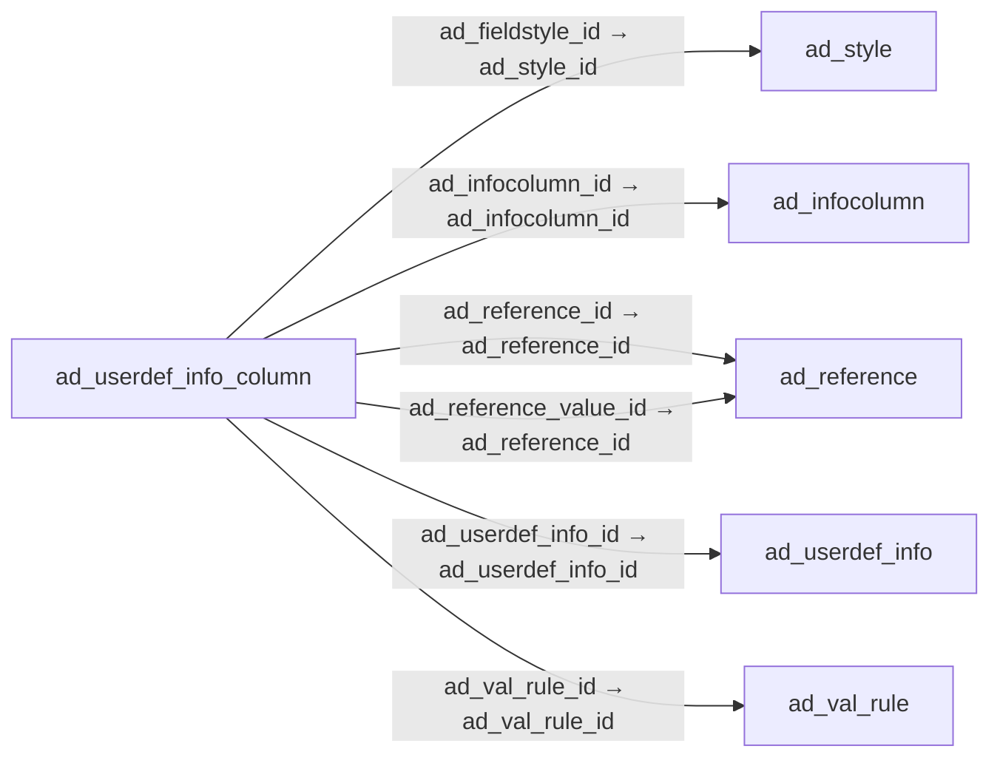

# ad_userdef_info_column — 사용자 정의 조회 열

[전체 일람](../TABLE_INDEX.md) · [분류 일람](README.md) · [AI 사용 안내](../README.md) · [외래키 읽는 법](../RELATIONSHIPS.md)

## 기본 정보

| 항목 | 내용 |
|---|---|
| 물리명 | `adempiere.ad_userdef_info_column` |
| 한국어 논리명(문서용 해석) | 사용자 정의 조회 열 |
| 원본 논리명 | User defined Info Column |
| 원본 사전 ID | 200268 |
| 분류 | `ad` — 애플리케이션 사전·화면·권한·시스템 |
| 전체 테넌트 행 수 | 0 |
| 물리 열 수 | 32 |
| 나가는 FK / 들어오는 FK | 6 / 0 |
| 구조·행 수 확인 시점 | 2026-11-03T23:29:01+09:00 |

## 의미와 쓰임

사용자 정의 조회 창에서 열 표시·검색 조건·기본값·입력 검증을 재설정한다.

- 설명 근거: 물리명·열·외래키 구조를 근거로 보수적으로 해석.
- 한국어 이름과 개요는 문서용 해석입니다. 공식 한국어 번역으로 간주하지 않습니다.
- 원본 설명: —
- 원본 도움말: —
- PostgreSQL 테이블 주석: —

## 키와 열

### 기본키·고유 제약조건

| 종류 | 제약조건 | 열(순서 유지) |
|---|---|---|
| PRIMARY KEY | `ad_userdef_info_column_key` | `ad_userdef_info_column_id` |
| UNIQUE | `ad_userdef_info_column_uu_idx` | `ad_userdef_info_column_uu` |

### 별도 고유 인덱스

PK·UNIQUE 제약조건의 인덱스와 별도로 존재하는 고유 인덱스입니다. 식·조건·열 순서는 원본 정의를 따릅니다.

- `ad_userdef_infocolumn_unique`: `CREATE UNIQUE INDEX ad_userdef_infocolumn_unique ON adempiere.ad_userdef_info_column USING btree (ad_userdef_info_id, ad_infocolumn_id)`

### 열 목록

원본 논리명·설명은 `AD_Column`에서 가져왔습니다. 기본값은 실제 PostgreSQL 메타데이터이며, 비어 있는 항목은 `—`로 표시합니다.

| 순서 | 물리명 | 원본 논리명 | PostgreSQL 타입 | NULL | PK | 기본값 | 설명 |
|---:|---|---|---|---|---|---|---|
| 1 | `ad_userdef_info_column_id` | User defined Info Column | numeric(10,0) | 불가 | 예 | — | — |
| 2 | `ad_client_id` | Tenant | numeric(10,0) | 불가 | — | — | Tenant for this installation. |
| 3 | `ad_org_id` | Organization | numeric(10,0) | 불가 | — | — | Organizational entity within tenant |
| 4 | `isactive` | Active | character(1) | 불가 | — | 'Y'::bpchar | The record is active in the system |
| 5 | `created` | Created | timestamp without time zone | 불가 | — | statement_timestamp() | Date this record was created |
| 6 | `createdby` | Created By | numeric(10,0) | 불가 | — | — | User who created this records |
| 7 | `updated` | Updated | timestamp without time zone | 불가 | — | statement_timestamp() | Date this record was updated |
| 8 | `updatedby` | Updated By | numeric(10,0) | 불가 | — | — | User who updated this records |
| 9 | `ad_infocolumn_id` | Info Column | numeric(10,0) | 불가 | — | — | Info Window Column |
| 10 | `name` | Name | character varying(60) | 허용 | — | NULL::character varying | Alphanumeric identifier of the entity |
| 11 | `description` | Description | character varying(255) | 허용 | — | NULL::character varying | Optional short description of the record |
| 12 | `help` | Comment/Help | character varying(2000) | 허용 | — | NULL::character varying | Comment or Hint |
| 13 | `ad_userdef_info_column_uu` | AD_UserDef_Info_Column_UU | uuid | 허용 | — | — | — |
| 14 | `seqno` | Sequence | numeric(10,0) | 허용 | — | — | Method of ordering records; lowest number comes first |
| 15 | `isdisplayed` | Displayed | character(1) | 허용 | — | NULL::bpchar | Determines, if this field is displayed |
| 16 | `isquerycriteria` | Query Criteria | character(1) | 허용 | — | NULL::bpchar | The column is also used as a query criteria |
| 17 | `ad_reference_id` | Reference | numeric(10,0) | 허용 | — | NULL::numeric | System Reference and Validation |
| 18 | `ad_reference_value_id` | Reference Key | numeric(10,0) | 허용 | — | NULL::numeric | Required to specify, if data type is Table or List |
| 19 | `ad_val_rule_id` | Dynamic Validation | numeric(10,0) | 허용 | — | NULL::numeric | Dynamic Validation Rule |
| 20 | `displaylogic` | Display Logic | character varying(2000) | 허용 | — | NULL::character varying | If the Field is displayed, the result determines if the field is actually displayed |
| 21 | `queryoperator` | Query Operator | character varying(10) | 허용 | — | NULL::character varying | Operator for database query |
| 22 | `queryfunction` | Query Function | character varying(2000) | 허용 | — | NULL::character varying | Database function for query |
| 23 | `seqnoselection` | Selection Column Sequence | numeric(10,0) | 허용 | — | '0'::numeric | Selection Column Sequence |
| 24 | `defaultvalue` | Default Logic | character varying(2000) | 허용 | — | NULL::character varying | Default value hierarchy, separated by ; |
| 25 | `ismandatory` | Mandatory | character(1) | 허용 | — | NULL::bpchar | Data entry is required in this column |
| 26 | `isreadonly` | Read Only | character(1) | 허용 | — | NULL::bpchar | Field is read only |
| 27 | `placeholder` | Placeholder | character varying(255) | 허용 | — | NULL::character varying | — |
| 28 | `inputfieldvalidation` | Input field validation | character varying(2000) | 허용 | — | NULL::character varying | Input field validation query |
| 29 | `ad_fieldstyle_id` | Field Style | numeric(10,0) | 허용 | — | NULL::numeric | Field CSS Style  |
| 30 | `isautocomplete` | Auto complete | character(1) | 허용 | — | NULL::bpchar | Automatic completion for text fields |
| 31 | `ad_userdef_info_id` | User defined Info Window | numeric(10,0) | 불가 | — | — | — |
| 32 | `isqueryafterchange` | Query After Change | character(1) | 허용 | — | NULL::bpchar | Issues a query request after the user has made changes to the field |

## 외래키 흐름

화살표는 **FK를 가진 자식 → 참조되는 부모**입니다. 업무 처리의 시간 순서나 무조건적인 1:N 관계를 뜻하지 않습니다.

주변 관계 6개 중 6개를 그림으로 표시합니다. **전체 관계는 아래 두 표에 모두 포함**합니다.

### 이 테이블이 참조하는 부모 — 나가는 FK

| 제약조건 | 참조하는 쪽(자식) | 자식 열 | 참조받는 쪽(부모) | 부모 열 | 삭제 / 갱신 | 검증 / 지연 가능 |
|---|---|---|---|---|---|---|
| `adfieldstyle_aduserdefinfocolu` <!-- FK_OUT: adempiere.ad_userdef_info_column.adfieldstyle_aduserdefinfocolu --> | [`ad_userdef_info_column`](ad_userdef_info_column.md) | `ad_fieldstyle_id` | [`ad_style`](ad_style.md) | `ad_style_id` | NO ACTION / NO ACTION | 완료 / 가능 (초기 지연) |
| `adinfocolumn_aduserdefinfocolu` <!-- FK_OUT: adempiere.ad_userdef_info_column.adinfocolumn_aduserdefinfocolu --> | [`ad_userdef_info_column`](ad_userdef_info_column.md) | `ad_infocolumn_id` | [`ad_infocolumn`](ad_infocolumn.md) | `ad_infocolumn_id` | NO ACTION / NO ACTION | 완료 / 가능 (초기 지연) |
| `adreference_aduserdefcolumn` <!-- FK_OUT: adempiere.ad_userdef_info_column.adreference_aduserdefcolumn --> | [`ad_userdef_info_column`](ad_userdef_info_column.md) | `ad_reference_id` | [`ad_reference`](ad_reference.md) | `ad_reference_id` | NO ACTION / NO ACTION | 완료 / 가능 (초기 지연) |
| `adreferencevalue_aduserdefinfo` <!-- FK_OUT: adempiere.ad_userdef_info_column.adreferencevalue_aduserdefinfo --> | [`ad_userdef_info_column`](ad_userdef_info_column.md) | `ad_reference_value_id` | [`ad_reference`](ad_reference.md) | `ad_reference_id` | NO ACTION / NO ACTION | 완료 / 가능 (초기 지연) |
| `aduserdefinfo_aduserdefinfocol` <!-- FK_OUT: adempiere.ad_userdef_info_column.aduserdefinfo_aduserdefinfocol --> | [`ad_userdef_info_column`](ad_userdef_info_column.md) | `ad_userdef_info_id` | [`ad_userdef_info`](ad_userdef_info.md) | `ad_userdef_info_id` | NO ACTION / NO ACTION | 완료 / 가능 (초기 지연) |
| `advalrule_aduserdefinfocolumn` <!-- FK_OUT: adempiere.ad_userdef_info_column.advalrule_aduserdefinfocolumn --> | [`ad_userdef_info_column`](ad_userdef_info_column.md) | `ad_val_rule_id` | [`ad_val_rule`](ad_val_rule.md) | `ad_val_rule_id` | NO ACTION / NO ACTION | 완료 / 가능 (초기 지연) |

### 이 테이블을 참조하는 자식 — 들어오는 FK

해당 방향의 물리 FK 제약조건은 없습니다. 이름이 비슷한 열만으로 관계를 추가하지 않습니다.

## 조회 시 주의

- FK 표의 자식 열과 부모 열을 같은 순서로 대응시킵니다. 복합 FK는 모든 열의 동등 조건을 `AND`로 연결합니다.
- 테이블 이름이나 `_id` 열 이름만으로 물리 FK가 있다고 가정하지 않습니다. FK 미선언은 업무 관계가 없다는 뜻도 아닙니다.
- 자식이 여러 행인 테이블과 조인하면 부모의 금액·건수가 중복될 수 있습니다. 집계 단위를 먼저 정합니다.
- `ad_client_id`가 있습니다. 업무 분석에서는 대상 테넌트를 명시합니다. GardenWorld는 `11`, 시스템 공통 설정은 `0`일 수 있으므로 일괄 필터 적용 전에 테이블 역할을 확인합니다.
- 수집 시점에 0행입니다. 이 표만으로 거래 실적·처리 결과를 계산할 수 없습니다.
- 행 수는 위 확인 시점의 전체 테넌트 값입니다. 최신 업무 실적이나 현재 실행 결과로 재사용하지 않습니다.
