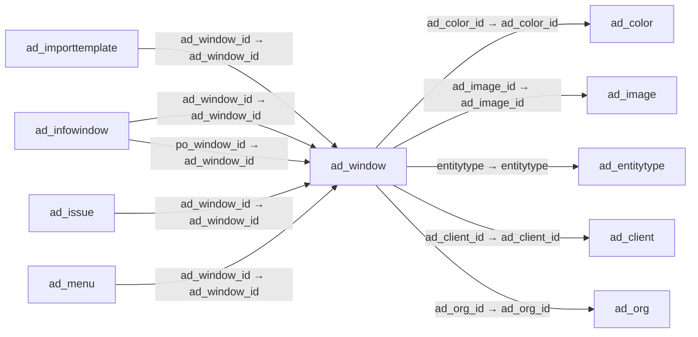

# ad_window — 데이터 입력·조회 창

[전체 일람](../TABLE_INDEX.md) · [분류 일람](README.md) · [AI 사용 안내](../README.md) · [외래키 읽는 법](../RELATIONSHIPS.md)

## 기본 정보

| 항목 | 내용 |
|---|---|
| 물리명 | `adempiere.ad_window` |
| 한국어 논리명(문서용 해석) | 데이터 입력·조회 창 |
| 원본 논리명 | Window |
| 원본 사전 ID | 105 |
| 분류 | `ad` — 애플리케이션 사전·화면·권한·시스템 |
| 전체 테넌트 행 수 | 452 |
| 물리 열 수 | 24 |
| 나가는 FK / 들어오는 FK | 5 / 32 |
| 구조·행 수 확인 시점 | 2026-11-03T23:29:01+09:00 |

## 의미와 쓰임

데이터를 입력하거나 표시하는 창을 정의한다.

- 설명 근거: 원본 애플리케이션 사전 명칭·설명을 한국어로 해석.
- 한국어 이름과 개요는 문서용 해석입니다. 공식 한국어 번역으로 간주하지 않습니다.
- 원본 설명: Data entry or display window
- 원본 도움말: —
- PostgreSQL 테이블 주석: —

## 키와 열

### 기본키·고유 제약조건

| 종류 | 제약조건 | 열(순서 유지) |
|---|---|---|
| PRIMARY KEY | `ad_window_pkey` | `ad_window_id` |
| UNIQUE | `ad_window_uu_idx` | `ad_window_uu` |

### 별도 고유 인덱스

PK·UNIQUE 제약조건의 인덱스와 별도로 존재하는 고유 인덱스입니다. 식·조건·열 순서는 원본 정의를 따릅니다.

- `ad_window_name`: `CREATE UNIQUE INDEX ad_window_name ON adempiere.ad_window USING btree (ad_client_id, name)`

### 열 목록

원본 논리명·설명은 `AD_Column`에서 가져왔습니다. 기본값은 실제 PostgreSQL 메타데이터이며, 비어 있는 항목은 `—`로 표시합니다.

| 순서 | 물리명 | 원본 논리명 | PostgreSQL 타입 | NULL | PK | 기본값 | 설명 |
|---:|---|---|---|---|---|---|---|
| 1 | `ad_window_id` | Window | numeric(10,0) | 불가 | 예 | — | Data entry or display window |
| 2 | `ad_client_id` | Tenant | numeric(10,0) | 불가 | — | — | Tenant for this installation. |
| 3 | `ad_org_id` | Organization | numeric(10,0) | 불가 | — | — | Organizational entity within tenant |
| 4 | `isactive` | Active | character(1) | 불가 | — | 'Y'::bpchar | The record is active in the system |
| 5 | `created` | Created | timestamp without time zone | 불가 | — | now() | Date this record was created |
| 6 | `createdby` | Created By | numeric(10,0) | 불가 | — | — | User who created this records |
| 7 | `updated` | Updated | timestamp without time zone | 불가 | — | now() | Date this record was updated |
| 8 | `updatedby` | Updated By | numeric(10,0) | 불가 | — | — | User who updated this records |
| 9 | `name` | Name | character varying(60) | 불가 | — | — | Alphanumeric identifier of the entity |
| 10 | `description` | Description | character varying(255) | 허용 | — | — | Optional short description of the record |
| 11 | `help` | Comment/Help | character varying(2000) | 허용 | — | — | Comment or Hint |
| 12 | `windowtype` | Window Type | character(1) | 허용 | — | — | Type or classification of a Window |
| 13 | `issotrx` | Sales Transaction | character(1) | 불가 | — | 'Y'::bpchar | This is a Sales Transaction |
| 14 | `entitytype` | Entity Type | character varying(40) | 불가 | — | 'D'::character varying | Dictionary Entity Type; Determines ownership and synchronization |
| 15 | `processing` | Process Now | character(1) | 허용 | — | — | — |
| 16 | `ad_image_id` | Image | numeric(10,0) | 허용 | — | — | Image or Icon |
| 17 | `ad_color_id` | System Color | numeric(10,0) | 허용 | — | — | Color for backgrounds or indicators |
| 18 | `isdefault` | Default | character(1) | 불가 | — | 'N'::bpchar | Default value |
| 19 | `winheight` | Window Height | numeric(10,0) | 허용 | — | — | — |
| 20 | `winwidth` | Window Width | numeric(10,0) | 허용 | — | — | — |
| 21 | `isbetafunctionality` | Beta Functionality | character(1) | 불가 | — | 'N'::bpchar | This functionality is considered Beta |
| 22 | `ad_window_uu` | AD_Window_UU | uuid | 허용 | — | — | — |
| 23 | `titlelogic` | Title Logic | character varying(255) | 허용 | — | NULL::character varying | The result determines the title to be displayed for this window |
| 24 | `predefinedcontextvariables` | Predefined Context Variables | character varying(4000) | 허용 | — | NULL::character varying | Predefined context variables to inject when opening a menu entry or a window |

## 외래키 흐름

화살표는 **FK를 가진 자식 → 참조되는 부모**입니다. 업무 처리의 시간 순서나 무조건적인 1:N 관계를 뜻하지 않습니다.

주변 관계 37개 중 10개를 그림으로 표시합니다. **전체 관계는 아래 두 표에 모두 포함**합니다.

### 이 테이블이 참조하는 부모 — 나가는 FK

| 제약조건 | 참조하는 쪽(자식) | 자식 열 | 참조받는 쪽(부모) | 부모 열 | 삭제 / 갱신 | 검증 / 지연 가능 |
|---|---|---|---|---|---|---|
| `adcolor_adwindow` <!-- FK_OUT: adempiere.ad_window.adcolor_adwindow --> | [`ad_window`](ad_window.md) | `ad_color_id` | [`ad_color`](ad_color.md) | `ad_color_id` | NO ACTION / NO ACTION | 완료 / 가능 (초기 지연) |
| `adimage_adwindow` <!-- FK_OUT: adempiere.ad_window.adimage_adwindow --> | [`ad_window`](ad_window.md) | `ad_image_id` | [`ad_image`](ad_image.md) | `ad_image_id` | NO ACTION / NO ACTION | 완료 / 가능 (초기 지연) |
| `entityt_adwindow` <!-- FK_OUT: adempiere.ad_window.entityt_adwindow --> | [`ad_window`](ad_window.md) | `entitytype` | [`ad_entitytype`](ad_entitytype.md) | `entitytype` | NO ACTION / NO ACTION | 완료 / 가능 (초기 지연) |
| `windowclient` <!-- FK_OUT: adempiere.ad_window.windowclient --> | [`ad_window`](ad_window.md) | `ad_client_id` | [`ad_client`](ad_client.md) | `ad_client_id` | NO ACTION / NO ACTION | 완료 / 가능 (초기 지연) |
| `windoworg` <!-- FK_OUT: adempiere.ad_window.windoworg --> | [`ad_window`](ad_window.md) | `ad_org_id` | [`ad_org`](ad_org.md) | `ad_org_id` | NO ACTION / NO ACTION | 완료 / 가능 (초기 지연) |

### 이 테이블을 참조하는 자식 — 들어오는 FK

| 제약조건 | 참조하는 쪽(자식) | 자식 열 | 참조받는 쪽(부모) | 부모 열 | 삭제 / 갱신 | 검증 / 지연 가능 |
|---|---|---|---|---|---|---|
| `adwindow_adimporttemplate` <!-- FK_IN: adempiere.ad_importtemplate.adwindow_adimporttemplate --> | [`ad_importtemplate`](ad_importtemplate.md) | `ad_window_id` | [`ad_window`](ad_window.md) | `ad_window_id` | NO ACTION / NO ACTION | 완료 / 가능 (초기 지연) |
| `adwindow_adinfowindow` <!-- FK_IN: adempiere.ad_infowindow.adwindow_adinfowindow --> | [`ad_infowindow`](ad_infowindow.md) | `ad_window_id` | [`ad_window`](ad_window.md) | `ad_window_id` | NO ACTION / NO ACTION | 완료 / 가능 (초기 지연) |
| `powindow_adinfowindow` <!-- FK_IN: adempiere.ad_infowindow.powindow_adinfowindow --> | [`ad_infowindow`](ad_infowindow.md) | `po_window_id` | [`ad_window`](ad_window.md) | `ad_window_id` | NO ACTION / NO ACTION | 완료 / 가능 (초기 지연) |
| `adwindow_adissue` <!-- FK_IN: adempiere.ad_issue.adwindow_adissue --> | [`ad_issue`](ad_issue.md) | `ad_window_id` | [`ad_window`](ad_window.md) | `ad_window_id` | SET NULL / NO ACTION | 완료 / 가능 (초기 지연) |
| `adwindow_admenu` <!-- FK_IN: adempiere.ad_menu.adwindow_admenu --> | [`ad_menu`](ad_menu.md) | `ad_window_id` | [`ad_window`](ad_window.md) | `ad_window_id` | NO ACTION / NO ACTION | 완료 / 가능 (초기 지연) |
| `adwindow_adpackageexpcommon` <!-- FK_IN: adempiere.ad_package_exp_common.adwindow_adpackageexpcommon --> | [`ad_package_exp_common`](ad_package_exp_common.md) | `ad_window_id` | [`ad_window`](ad_window.md) | `ad_window_id` | NO ACTION / NO ACTION | 완료 / 가능 (초기 지연) |
| `adwindow_adpackageexpdetail` <!-- FK_IN: adempiere.ad_package_exp_detail.adwindow_adpackageexpdetail --> | [`ad_package_exp_detail`](ad_package_exp_detail.md) | `ad_window_id` | [`ad_window`](ad_window.md) | `ad_window_id` | NO ACTION / NO ACTION | 완료 / 가능 (초기 지연) |
| `ad_window_preference` <!-- FK_IN: adempiere.ad_preference.ad_window_preference --> | [`ad_preference`](ad_preference.md) | `ad_window_id` | [`ad_window`](ad_window.md) | `ad_window_id` | NO ACTION / NO ACTION | 완료 / 가능 (초기 지연) |
| `adwindow_adprintformat` <!-- FK_IN: adempiere.ad_printformat.adwindow_adprintformat --> | [`ad_printformat`](ad_printformat.md) | `ad_window_id` | [`ad_window`](ad_window.md) | `ad_window_id` | NO ACTION / NO ACTION | 완료 / 가능 (초기 지연) |
| `adwindow_adrecentitem` <!-- FK_IN: adempiere.ad_recentitem.adwindow_adrecentitem --> | [`ad_recentitem`](ad_recentitem.md) | `ad_window_id` | [`ad_window`](ad_window.md) | `ad_window_id` | CASCADE / NO ACTION | 완료 / 가능 (초기 지연) |
| `adwindow_adreftable` <!-- FK_IN: adempiere.ad_ref_table.adwindow_adreftable --> | [`ad_ref_table`](ad_ref_table.md) | `ad_window_id` | [`ad_window`](ad_window.md) | `ad_window_id` | NO ACTION / NO ACTION | 완료 / 가능 (초기 지연) |
| `adwindow_adsearchdefinition` <!-- FK_IN: adempiere.ad_searchdefinition.adwindow_adsearchdefinition --> | [`ad_searchdefinition`](ad_searchdefinition.md) | `ad_window_id` | [`ad_window`](ad_window.md) | `ad_window_id` | NO ACTION / NO ACTION | 완료 / 가능 (초기 지연) |
| `powindow_adsearchdefinition` <!-- FK_IN: adempiere.ad_searchdefinition.powindow_adsearchdefinition --> | [`ad_searchdefinition`](ad_searchdefinition.md) | `po_window_id` | [`ad_window`](ad_window.md) | `ad_window_id` | NO ACTION / NO ACTION | 완료 / 가능 (초기 지연) |
| `adwindow_adstatuslineusedin` <!-- FK_IN: adempiere.ad_statuslineusedin.adwindow_adstatuslineusedin --> | [`ad_statuslineusedin`](ad_statuslineusedin.md) | `ad_window_id` | [`ad_window`](ad_window.md) | `ad_window_id` | NO ACTION / NO ACTION | 완료 / 가능 (초기 지연) |
| `ad_window_tab` <!-- FK_IN: adempiere.ad_tab.ad_window_tab --> | [`ad_tab`](ad_tab.md) | `ad_window_id` | [`ad_window`](ad_window.md) | `ad_window_id` | CASCADE / NO ACTION | 완료 / 가능 (초기 지연) |
| `ad_window_table` <!-- FK_IN: adempiere.ad_table.ad_window_table --> | [`ad_table`](ad_table.md) | `ad_window_id` | [`ad_window`](ad_window.md) | `ad_window_id` | SET NULL / NO ACTION | 완료 / 가능 (초기 지연) |
| `adwindowpo_adtable` <!-- FK_IN: adempiere.ad_table.adwindowpo_adtable --> | [`ad_table`](ad_table.md) | `po_window_id` | [`ad_window`](ad_window.md) | `ad_window_id` | NO ACTION / NO ACTION | 완료 / 가능 (초기 지연) |
| `adwindow_adtoolbarbuttonrestri` <!-- FK_IN: adempiere.ad_toolbarbuttonrestrict.adwindow_adtoolbarbuttonrestri --> | [`ad_toolbarbuttonrestrict`](ad_toolbarbuttonrestrict.md) | `ad_window_id` | [`ad_window`](ad_window.md) | `ad_window_id` | NO ACTION / NO ACTION | 완료 / 가능 (초기 지연) |
| `adwindow_aduserdefinfo` <!-- FK_IN: adempiere.ad_userdef_info.adwindow_aduserdefinfo --> | [`ad_userdef_info`](ad_userdef_info.md) | `ad_window_id` | [`ad_window`](ad_window.md) | `ad_window_id` | NO ACTION / NO ACTION | 완료 / 가능 (초기 지연) |
| `powindow_aduserdefinfo` <!-- FK_IN: adempiere.ad_userdef_info.powindow_aduserdefinfo --> | [`ad_userdef_info`](ad_userdef_info.md) | `po_window_id` | [`ad_window`](ad_window.md) | `ad_window_id` | NO ACTION / NO ACTION | 완료 / 가능 (초기 지연) |
| `adwindow_aduserdefwin` <!-- FK_IN: adempiere.ad_userdef_win.adwindow_aduserdefwin --> | [`ad_userdef_win`](ad_userdef_win.md) | `ad_window_id` | [`ad_window`](ad_window.md) | `ad_window_id` | NO ACTION / NO ACTION | 완료 / 가능 (초기 지연) |
| `adwindow_aduserquery` <!-- FK_IN: adempiere.ad_userquery.adwindow_aduserquery --> | [`ad_userquery`](ad_userquery.md) | `ad_window_id` | [`ad_window`](ad_window.md) | `ad_window_id` | NO ACTION / NO ACTION | 완료 / 가능 (초기 지연) |
| `adwindow_adwfnode` <!-- FK_IN: adempiere.ad_wf_node.adwindow_adwfnode --> | [`ad_wf_node`](ad_wf_node.md) | `ad_window_id` | [`ad_window`](ad_window.md) | `ad_window_id` | NO ACTION / NO ACTION | 완료 / 가능 (초기 지연) |
| `adwindow_adwindowaccess` <!-- FK_IN: adempiere.ad_window_access.adwindow_adwindowaccess --> | [`ad_window_access`](ad_window_access.md) | `ad_window_id` | [`ad_window`](ad_window.md) | `ad_window_id` | CASCADE / NO ACTION | 완료 / 가능 (초기 지연) |
| `ad_windowtrl` <!-- FK_IN: adempiere.ad_window_trl.ad_windowtrl --> | [`ad_window_trl`](ad_window_trl.md) | `ad_window_id` | [`ad_window`](ad_window.md) | `ad_window_id` | CASCADE / NO ACTION | 완료 / 가능 (초기 지연) |
| `adwindow_adworkbenchwindow` <!-- FK_IN: adempiere.ad_workbenchwindow.adwindow_adworkbenchwindow --> | [`ad_workbenchwindow`](ad_workbenchwindow.md) | `ad_window_id` | [`ad_window`](ad_window.md) | `ad_window_id` | NO ACTION / NO ACTION | 완료 / 가능 (초기 지연) |
| `adwindow_adzoomcondition` <!-- FK_IN: adempiere.ad_zoomcondition.adwindow_adzoomcondition --> | [`ad_zoomcondition`](ad_zoomcondition.md) | `ad_window_id` | [`ad_window`](ad_window.md) | `ad_window_id` | NO ACTION / NO ACTION | 완료 / 가능 (초기 지연) |
| `adwindow_aspclientexception` <!-- FK_IN: adempiere.asp_clientexception.adwindow_aspclientexception --> | [`asp_clientexception`](../asp/asp_clientexception.md) | `ad_window_id` | [`ad_window`](ad_window.md) | `ad_window_id` | NO ACTION / NO ACTION | 완료 / 가능 (초기 지연) |
| `adwindow_aspwindow` <!-- FK_IN: adempiere.asp_window.adwindow_aspwindow --> | [`asp_window`](../asp/asp_window.md) | `ad_window_id` | [`ad_window`](ad_window.md) | `ad_window_id` | NO ACTION / NO ACTION | 완료 / 가능 (초기 지연) |
| `adwindow_padashboardcontent` <!-- FK_IN: adempiere.pa_dashboardcontent.adwindow_padashboardcontent --> | [`pa_dashboardcontent`](../pa/pa_dashboardcontent.md) | `ad_window_id` | [`ad_window`](ad_window.md) | `ad_window_id` | NO ACTION / NO ACTION | 완료 / 가능 (초기 지연) |
| `adwindow_padocumentstatus` <!-- FK_IN: adempiere.pa_documentstatus.adwindow_padocumentstatus --> | [`pa_documentstatus`](../pa/pa_documentstatus.md) | `ad_window_id` | [`ad_window`](ad_window.md) | `ad_window_id` | NO ACTION / NO ACTION | 완료 / 가능 (초기 지연) |
| `adwindow_ppordernode` <!-- FK_IN: adempiere.pp_order_node.adwindow_ppordernode --> | [`pp_order_node`](../pp/pp_order_node.md) | `ad_window_id` | [`ad_window`](ad_window.md) | `ad_window_id` | NO ACTION / NO ACTION | 완료 / 가능 (초기 지연) |

## 조회 시 주의

- FK 표의 자식 열과 부모 열을 같은 순서로 대응시킵니다. 복합 FK는 모든 열의 동등 조건을 `AND`로 연결합니다.
- 테이블 이름이나 `_id` 열 이름만으로 물리 FK가 있다고 가정하지 않습니다. FK 미선언은 업무 관계가 없다는 뜻도 아닙니다.
- 자식이 여러 행인 테이블과 조인하면 부모의 금액·건수가 중복될 수 있습니다. 집계 단위를 먼저 정합니다.
- `ad_client_id`가 있습니다. 업무 분석에서는 대상 테넌트를 명시합니다. GardenWorld는 `11`, 시스템 공통 설정은 `0`일 수 있으므로 일괄 필터 적용 전에 테이블 역할을 확인합니다.
- `issotrx`가 있습니다. 판매(`Y`)와 구매(`N`)를 구분해서 분석합니다.
- 행 수는 위 확인 시점의 전체 테넌트 값입니다. 최신 업무 실적이나 현재 실행 결과로 재사용하지 않습니다.
