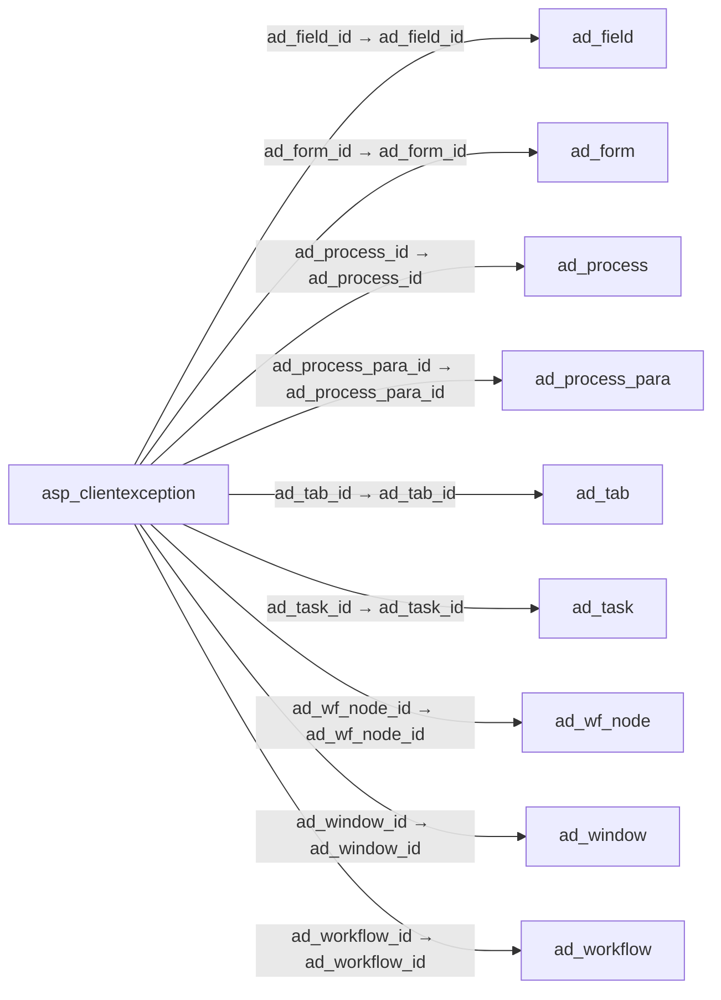

# asp_clientexception — 테넌트별 ASP 예외

[전체 일람](../TABLE_INDEX.md) · [분류 일람](README.md) · [AI 사용 안내](../README.md) · [외래키 읽는 법](../RELATIONSHIPS.md)

## 기본 정보

| 항목 | 내용 |
|---|---|
| 물리명 | `adempiere.asp_clientexception` |
| 한국어 논리명(문서용 해석) | 테넌트별 ASP 예외 |
| 원본 논리명 | Tenant Exception |
| 원본 사전 ID | 53057 |
| 분류 | `asp` — ASP 구독·기능 제공 설정 |
| 전체 테넌트 행 수 | 0 |
| 물리 열 수 | 19 |
| 나가는 FK / 들어오는 FK | 9 / 0 |
| 구조·행 수 확인 시점 | 2026-11-03T23:29:01+09:00 |

## 의미와 쓰임

테넌트의 화면·탭·필드·프로세스 등 구성요소별 ASP 적용 예외 상태를 관리한다.

- 설명 근거: 물리명·열·외래키 구조를 근거로 보수적으로 해석.
- 한국어 이름과 개요는 문서용 해석입니다. 공식 한국어 번역으로 간주하지 않습니다.
- 원본 설명: —
- 원본 도움말: —
- PostgreSQL 테이블 주석: —

## 키와 열

### 기본키·고유 제약조건

| 종류 | 제약조건 | 열(순서 유지) |
|---|---|---|
| PRIMARY KEY | `asp_clientexception_key` | `asp_clientexception_id` |
| UNIQUE | `asp_clientexception_uu_idx` | `asp_clientexception_uu` |

### 별도 고유 인덱스

PK·UNIQUE 제약조건의 인덱스와 별도로 존재하는 고유 인덱스입니다. 식·조건·열 순서는 원본 정의를 따릅니다.

- `asp_clientexception_unq`: `CREATE UNIQUE INDEX asp_clientexception_unq ON adempiere.asp_clientexception USING btree (ad_client_id, COALESCE(ad_field_id, (0)::numeric), COALESCE(ad_form_id, (0)::numeric), COALESCE(ad_process_id, (0)::numeric), COALESCE(ad_process_para_id, (0)::numeric), COALESCE(ad_tab_id, (0)::numeric), COALESCE(ad_task_id, (0)::numeric), COALESCE(ad_workflow_id, (0)::numeric), COALESCE(ad_wf_node_id, (0)::numeric), COALESCE(ad_window_id, (0)::numeric))`

### 열 목록

원본 논리명·설명은 `AD_Column`에서 가져왔습니다. 기본값은 실제 PostgreSQL 메타데이터이며, 비어 있는 항목은 `—`로 표시합니다.

| 순서 | 물리명 | 원본 논리명 | PostgreSQL 타입 | NULL | PK | 기본값 | 설명 |
|---:|---|---|---|---|---|---|---|
| 1 | `ad_client_id` | Tenant | numeric(10,0) | 불가 | — | — | Tenant for this installation. |
| 2 | `ad_field_id` | Field | numeric(10,0) | 허용 | — | — | Field on a database table |
| 3 | `ad_form_id` | Special Form | numeric(10,0) | 허용 | — | — | Special Form |
| 4 | `ad_org_id` | Organization | numeric(10,0) | 불가 | — | 0 | Organizational entity within tenant |
| 5 | `ad_process_id` | Process | numeric(10,0) | 허용 | — | — | Process or Report |
| 6 | `ad_process_para_id` | Process Parameter | numeric(10,0) | 허용 | — | — | — |
| 7 | `ad_tab_id` | Tab | numeric(10,0) | 허용 | — | — | Tab within a Window |
| 8 | `ad_task_id` | OS Task | numeric(10,0) | 허용 | — | — | Operation System Task |
| 9 | `ad_wf_node_id` | Node | numeric(10,0) | 허용 | — | — | Workflow Node (activity), step or process |
| 10 | `ad_window_id` | Window | numeric(10,0) | 허용 | — | — | Data entry or display window |
| 11 | `ad_workflow_id` | Workflow | numeric(10,0) | 허용 | — | — | Workflow or combination of tasks |
| 12 | `asp_clientexception_id` | Tenant Exception | numeric(10,0) | 불가 | 예 | — | — |
| 13 | `asp_status` | ASP Status | character(1) | 불가 | — | 'U'::bpchar | — |
| 14 | `created` | Created | timestamp without time zone | 불가 | — | statement_timestamp() | Date this record was created |
| 15 | `createdby` | Created By | numeric(10,0) | 불가 | — | — | User who created this records |
| 16 | `isactive` | Active | character(1) | 불가 | — | 'Y'::bpchar | The record is active in the system |
| 17 | `updated` | Updated | timestamp without time zone | 불가 | — | statement_timestamp() | Date this record was updated |
| 18 | `updatedby` | Updated By | numeric(10,0) | 불가 | — | — | User who updated this records |
| 19 | `asp_clientexception_uu` | ASP_ClientException_UU | uuid | 허용 | — | — | — |

## 외래키 흐름

화살표는 **FK를 가진 자식 → 참조되는 부모**입니다. 업무 처리의 시간 순서나 무조건적인 1:N 관계를 뜻하지 않습니다.

주변 관계 9개 중 9개를 그림으로 표시합니다. **전체 관계는 아래 두 표에 모두 포함**합니다.

### 이 테이블이 참조하는 부모 — 나가는 FK

| 제약조건 | 참조하는 쪽(자식) | 자식 열 | 참조받는 쪽(부모) | 부모 열 | 삭제 / 갱신 | 검증 / 지연 가능 |
|---|---|---|---|---|---|---|
| `adfield_aspclientexception` <!-- FK_OUT: adempiere.asp_clientexception.adfield_aspclientexception --> | [`asp_clientexception`](asp_clientexception.md) | `ad_field_id` | [`ad_field`](../ad/ad_field.md) | `ad_field_id` | NO ACTION / NO ACTION | 완료 / 가능 (초기 지연) |
| `adform_aspclientexception` <!-- FK_OUT: adempiere.asp_clientexception.adform_aspclientexception --> | [`asp_clientexception`](asp_clientexception.md) | `ad_form_id` | [`ad_form`](../ad/ad_form.md) | `ad_form_id` | NO ACTION / NO ACTION | 완료 / 가능 (초기 지연) |
| `adprocess_aspclientexception` <!-- FK_OUT: adempiere.asp_clientexception.adprocess_aspclientexception --> | [`asp_clientexception`](asp_clientexception.md) | `ad_process_id` | [`ad_process`](../ad/ad_process.md) | `ad_process_id` | NO ACTION / NO ACTION | 완료 / 가능 (초기 지연) |
| `adprocesspara_aspclientexcepti` <!-- FK_OUT: adempiere.asp_clientexception.adprocesspara_aspclientexcepti --> | [`asp_clientexception`](asp_clientexception.md) | `ad_process_para_id` | [`ad_process_para`](../ad/ad_process_para.md) | `ad_process_para_id` | NO ACTION / NO ACTION | 완료 / 가능 (초기 지연) |
| `adtab_aspclientexception` <!-- FK_OUT: adempiere.asp_clientexception.adtab_aspclientexception --> | [`asp_clientexception`](asp_clientexception.md) | `ad_tab_id` | [`ad_tab`](../ad/ad_tab.md) | `ad_tab_id` | NO ACTION / NO ACTION | 완료 / 가능 (초기 지연) |
| `adtask_aspclientexception` <!-- FK_OUT: adempiere.asp_clientexception.adtask_aspclientexception --> | [`asp_clientexception`](asp_clientexception.md) | `ad_task_id` | [`ad_task`](../ad/ad_task.md) | `ad_task_id` | NO ACTION / NO ACTION | 완료 / 가능 (초기 지연) |
| `adwfnode_aspclientexception` <!-- FK_OUT: adempiere.asp_clientexception.adwfnode_aspclientexception --> | [`asp_clientexception`](asp_clientexception.md) | `ad_wf_node_id` | [`ad_wf_node`](../ad/ad_wf_node.md) | `ad_wf_node_id` | NO ACTION / NO ACTION | 완료 / 가능 (초기 지연) |
| `adwindow_aspclientexception` <!-- FK_OUT: adempiere.asp_clientexception.adwindow_aspclientexception --> | [`asp_clientexception`](asp_clientexception.md) | `ad_window_id` | [`ad_window`](../ad/ad_window.md) | `ad_window_id` | NO ACTION / NO ACTION | 완료 / 가능 (초기 지연) |
| `adworkflow_aspclientexception` <!-- FK_OUT: adempiere.asp_clientexception.adworkflow_aspclientexception --> | [`asp_clientexception`](asp_clientexception.md) | `ad_workflow_id` | [`ad_workflow`](../ad/ad_workflow.md) | `ad_workflow_id` | NO ACTION / NO ACTION | 완료 / 가능 (초기 지연) |

### 이 테이블을 참조하는 자식 — 들어오는 FK

해당 방향의 물리 FK 제약조건은 없습니다. 이름이 비슷한 열만으로 관계를 추가하지 않습니다.

## 조회 시 주의

- FK 표의 자식 열과 부모 열을 같은 순서로 대응시킵니다. 복합 FK는 모든 열의 동등 조건을 `AND`로 연결합니다.
- 테이블 이름이나 `_id` 열 이름만으로 물리 FK가 있다고 가정하지 않습니다. FK 미선언은 업무 관계가 없다는 뜻도 아닙니다.
- 자식이 여러 행인 테이블과 조인하면 부모의 금액·건수가 중복될 수 있습니다. 집계 단위를 먼저 정합니다.
- `ad_client_id`가 있습니다. 업무 분석에서는 대상 테넌트를 명시합니다. GardenWorld는 `11`, 시스템 공통 설정은 `0`일 수 있으므로 일괄 필터 적용 전에 테이블 역할을 확인합니다.
- 수집 시점에 0행입니다. 이 표만으로 거래 실적·처리 결과를 계산할 수 없습니다.
- 행 수는 위 확인 시점의 전체 테넌트 값입니다. 최신 업무 실적이나 현재 실행 결과로 재사용하지 않습니다.
