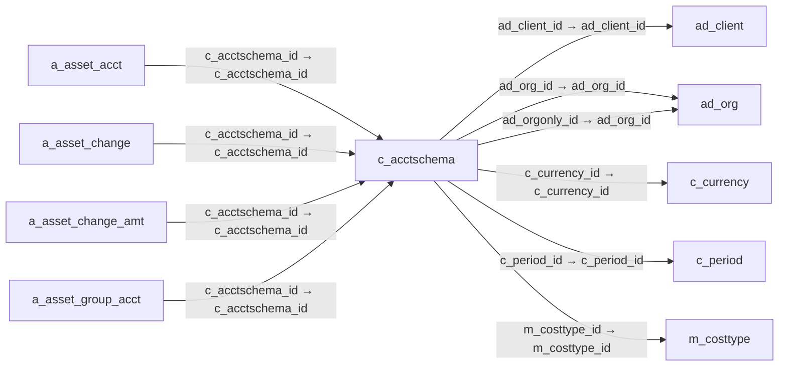

# c_acctschema — 회계 스키마

[전체 일람](../TABLE_INDEX.md) · [분류 일람](README.md) · [AI 사용 안내](../README.md) · [외래키 읽는 법](../RELATIONSHIPS.md)

## 기본 정보

| 항목 | 내용 |
|---|---|
| 물리명 | `adempiere.c_acctschema` |
| 한국어 논리명(문서용 해석) | 회계 스키마 |
| 원본 논리명 | Accounting Schema |
| 원본 사전 ID | 265 |
| 분류 | `c` — 거래처·주문·청구·결제·회계 기준 |
| 전체 테넌트 행 수 | 2 |
| 물리 열 수 | 38 |
| 나가는 FK / 들어오는 FK | 6 / 51 |
| 구조·행 수 확인 시점 | 2026-11-03T23:29:01+09:00 |

## 의미와 쓰임

회계 처리 규칙을 정의하며 계정 구성요소와 기본 계정 설정의 상위 기준이 된다.

- 설명 근거: 원본 애플리케이션 사전 명칭·설명을 한국어로 해석.
- 한국어 이름과 개요는 문서용 해석입니다. 공식 한국어 번역으로 간주하지 않습니다.
- 원본 설명: Rules for accounting
- 원본 도움말: —
- PostgreSQL 테이블 주석: —

## 키와 열

### 기본키·고유 제약조건

| 종류 | 제약조건 | 열(순서 유지) |
|---|---|---|
| PRIMARY KEY | `c_acctschema_pkey` | `c_acctschema_id` |
| UNIQUE | `c_acctschema_uu_idx` | `c_acctschema_uu` |

### 별도 고유 인덱스

PK·UNIQUE 제약조건의 인덱스와 별도로 존재하는 고유 인덱스입니다. 식·조건·열 순서는 원본 정의를 따릅니다.

- `c_acctschema_name`: `CREATE UNIQUE INDEX c_acctschema_name ON adempiere.c_acctschema USING btree (ad_client_id, name)`

### 열 목록

원본 논리명·설명은 `AD_Column`에서 가져왔습니다. 기본값은 실제 PostgreSQL 메타데이터이며, 비어 있는 항목은 `—`로 표시합니다.

| 순서 | 물리명 | 원본 논리명 | PostgreSQL 타입 | NULL | PK | 기본값 | 설명 |
|---:|---|---|---|---|---|---|---|
| 1 | `c_acctschema_id` | Accounting Schema | numeric(10,0) | 불가 | 예 | — | Rules for accounting |
| 2 | `ad_client_id` | Tenant | numeric(10,0) | 불가 | — | — | Tenant for this installation. |
| 3 | `ad_org_id` | Organization | numeric(10,0) | 불가 | — | — | Organizational entity within tenant |
| 4 | `isactive` | Active | character(1) | 불가 | — | 'Y'::bpchar | The record is active in the system |
| 5 | `created` | Created | timestamp without time zone | 불가 | — | now() | Date this record was created |
| 6 | `createdby` | Created By | numeric(10,0) | 불가 | — | — | User who created this records |
| 7 | `updated` | Updated | timestamp without time zone | 불가 | — | now() | Date this record was updated |
| 8 | `updatedby` | Updated By | numeric(10,0) | 불가 | — | — | User who updated this records |
| 9 | `name` | Name | character varying(60) | 불가 | — | — | Alphanumeric identifier of the entity |
| 10 | `description` | Description | character varying(255) | 허용 | — | — | Optional short description of the record |
| 11 | `gaap` | GAAP | character(2) | 불가 | — | — | Generally Accepted Accounting Principles |
| 12 | `isaccrual` | Accrual | character(1) | 불가 | — | 'Y'::bpchar | Indicates if Accrual or Cash Based accounting will be used |
| 13 | `costingmethod` | Costing Method | character(1) | 불가 | — | — | Indicates how Costs will be calculated |
| 14 | `c_currency_id` | Currency | numeric(10,0) | 불가 | — | — | The Currency for this record |
| 15 | `autoperiodcontrol` | Automatic Period Control | character(1) | 불가 | — | 'N'::bpchar | If selected, the periods are automatically opened and closed |
| 16 | `c_period_id` | Period | numeric(10,0) | 허용 | — | — | Period of the Calendar |
| 17 | `period_openhistory` | History Days | numeric(10,0) | 허용 | — | — | Number of days to be able to post in the past (based on system date) |
| 18 | `period_openfuture` | Future Days | numeric(10,0) | 허용 | — | — | Number of days to be able to post to a future date (based on system date) |
| 19 | `separator` | Element Separator | character(1) | 불가 | — | — | Element Separator |
| 20 | `hasalias` | Use Account Alias | character(1) | 불가 | — | 'Y'::bpchar | Ability to select (partial) account combinations by an Alias |
| 21 | `hascombination` | Use Account Combination Control | character(1) | 불가 | — | 'Y'::bpchar | Combination of account elements are checked |
| 22 | `istradediscountposted` | Post Trade Discount | character(1) | 불가 | — | 'N'::bpchar | Generate postings for trade discounts |
| 23 | `isdiscountcorrectstax` | Correct tax for Discounts/Charges | character(1) | 불가 | — | 'N'::bpchar | Correct the tax for payment discount and charges |
| 24 | `m_costtype_id` | Cost Type | numeric(10,0) | 허용 | — | — | Type of Cost (e.g. Current, Plan, Future) |
| 25 | `costinglevel` | Costing Level | character(1) | 불가 | — | 'C'::bpchar | The lowest level to accumulate Costing Information |
| 26 | `isadjustcogs` | Adjust COGS | character(1) | 불가 | — | 'N'::bpchar | Adjust Cost of Good Sold |
| 27 | `ad_orgonly_id` | Only Organization | numeric(10,0) | 허용 | — | — | Create posting entries only for this organization |
| 28 | `ispostservices` | Post Services Separately | character(1) | 불가 | — | 'N'::bpchar | Differentiate between Services and Product Receivable/Payables |
| 29 | `isexplicitcostadjustment` | Explicit Cost Adjustment | character(1) | 불가 | — | 'N'::bpchar | Post the cost adjustment explicitly |
| 30 | `commitmenttype` | Commitment Type | character(1) | 불가 | — | 'N'::bpchar | Create Commitment and/or Reservations for Budget Control |
| 31 | `processing` | Process Now | character(1) | 허용 | — | — | — |
| 32 | `taxcorrectiontype` | Tax Correction | character(1) | 허용 | — | — | Type of Tax Correction |
| 33 | `isallownegativeposting` | Allow Negative Posting | character(1) | 허용 | — | 'Y'::bpchar | Allow to post negative accounting values |
| 34 | `ispostifclearingequal` | Post if Clearing Equal | character(1) | 허용 | — | 'Y'::bpchar | This flag controls if Adempiere must post when clearing (transit) and final accounts are the same |
| 35 | `c_acctschema_uu` | C_AcctSchema_UU | uuid | 허용 | — | — | — |
| 36 | `backdateday` | Back-Date Days | numeric(10,0) | 허용 | — | NULL::numeric | Number of days to be able to post a back-date transaction (based on system date) |
| 37 | `startdate` | Start Date | timestamp without time zone | 허용 | — | — | First effective day (inclusive) |
| 38 | `enddate` | End Date | timestamp without time zone | 허용 | — | — | Last effective date (inclusive) |

## 외래키 흐름

화살표는 **FK를 가진 자식 → 참조되는 부모**입니다. 업무 처리의 시간 순서나 무조건적인 1:N 관계를 뜻하지 않습니다.

주변 관계 57개 중 10개를 그림으로 표시합니다. **전체 관계는 아래 두 표에 모두 포함**합니다.

### 이 테이블이 참조하는 부모 — 나가는 FK

| 제약조건 | 참조하는 쪽(자식) | 자식 열 | 참조받는 쪽(부모) | 부모 열 | 삭제 / 갱신 | 검증 / 지연 가능 |
|---|---|---|---|---|---|---|
| `ad_client_c_acctschema` <!-- FK_OUT: adempiere.c_acctschema.ad_client_c_acctschema --> | [`c_acctschema`](c_acctschema.md) | `ad_client_id` | [`ad_client`](../ad/ad_client.md) | `ad_client_id` | NO ACTION / NO ACTION | 완료 / 가능 (초기 지연) |
| `ad_org_c_acctschema` <!-- FK_OUT: adempiere.c_acctschema.ad_org_c_acctschema --> | [`c_acctschema`](c_acctschema.md) | `ad_org_id` | [`ad_org`](../ad/ad_org.md) | `ad_org_id` | NO ACTION / NO ACTION | 완료 / 가능 (초기 지연) |
| `adorgonly_cacctschema` <!-- FK_OUT: adempiere.c_acctschema.adorgonly_cacctschema --> | [`c_acctschema`](c_acctschema.md) | `ad_orgonly_id` | [`ad_org`](../ad/ad_org.md) | `ad_org_id` | NO ACTION / NO ACTION | 완료 / 가능 (초기 지연) |
| `c_currency_c_acctschema` <!-- FK_OUT: adempiere.c_acctschema.c_currency_c_acctschema --> | [`c_acctschema`](c_acctschema.md) | `c_currency_id` | [`c_currency`](c_currency.md) | `c_currency_id` | NO ACTION / NO ACTION | 완료 / 가능 (초기 지연) |
| `cperiod_cacctschema` <!-- FK_OUT: adempiere.c_acctschema.cperiod_cacctschema --> | [`c_acctschema`](c_acctschema.md) | `c_period_id` | [`c_period`](c_period.md) | `c_period_id` | NO ACTION / NO ACTION | 완료 / 가능 (초기 지연) |
| `mcosttype_cacctschema` <!-- FK_OUT: adempiere.c_acctschema.mcosttype_cacctschema --> | [`c_acctschema`](c_acctschema.md) | `m_costtype_id` | [`m_costtype`](../m/m_costtype.md) | `m_costtype_id` | NO ACTION / NO ACTION | 완료 / 가능 (초기 지연) |

### 이 테이블을 참조하는 자식 — 들어오는 FK

| 제약조건 | 참조하는 쪽(자식) | 자식 열 | 참조받는 쪽(부모) | 부모 열 | 삭제 / 갱신 | 검증 / 지연 가능 |
|---|---|---|---|---|---|---|
| `cacctschema_aassetacct` <!-- FK_IN: adempiere.a_asset_acct.cacctschema_aassetacct --> | [`a_asset_acct`](../a/a_asset_acct.md) | `c_acctschema_id` | [`c_acctschema`](c_acctschema.md) | `c_acctschema_id` | NO ACTION / NO ACTION | 완료 / 가능 (초기 지연) |
| `cacctschema_aassetchange` <!-- FK_IN: adempiere.a_asset_change.cacctschema_aassetchange --> | [`a_asset_change`](../a/a_asset_change.md) | `c_acctschema_id` | [`c_acctschema`](c_acctschema.md) | `c_acctschema_id` | NO ACTION / NO ACTION | 완료 / 가능 (초기 지연) |
| `cacctschema_aassetchangeamt` <!-- FK_IN: adempiere.a_asset_change_amt.cacctschema_aassetchangeamt --> | [`a_asset_change_amt`](../a/a_asset_change_amt.md) | `c_acctschema_id` | [`c_acctschema`](c_acctschema.md) | `c_acctschema_id` | NO ACTION / NO ACTION | 완료 / 가능 (초기 지연) |
| `cacctschema_aassetgroupacct` <!-- FK_IN: adempiere.a_asset_group_acct.cacctschema_aassetgroupacct --> | [`a_asset_group_acct`](../a/a_asset_group_acct.md) | `c_acctschema_id` | [`c_acctschema`](c_acctschema.md) | `c_acctschema_id` | NO ACTION / NO ACTION | 완료 / 가능 (초기 지연) |
| `cacctschema_aassetrevalentry` <!-- FK_IN: adempiere.a_asset_reval_entry.cacctschema_aassetrevalentry --> | [`a_asset_reval_entry`](../a/a_asset_reval_entry.md) | `c_acctschema_id` | [`c_acctschema`](c_acctschema.md) | `c_acctschema_id` | NO ACTION / NO ACTION | 완료 / 가능 (초기 지연) |
| `cacctschema_aassettransfer` <!-- FK_IN: adempiere.a_asset_transfer.cacctschema_aassettransfer --> | [`a_asset_transfer`](../a/a_asset_transfer.md) | `c_acctschema_id` | [`c_acctschema`](c_acctschema.md) | `c_acctschema_id` | NO ACTION / NO ACTION | 완료 / 가능 (초기 지연) |
| `cacctschema_adepreciationentry` <!-- FK_IN: adempiere.a_depreciation_entry.cacctschema_adepreciationentry --> | [`a_depreciation_entry`](../a/a_depreciation_entry.md) | `c_acctschema_id` | [`c_acctschema`](c_acctschema.md) | `c_acctschema_id` | NO ACTION / NO ACTION | 완료 / 가능 (초기 지연) |
| `cacctschema_adepreciationexp` <!-- FK_IN: adempiere.a_depreciation_exp.cacctschema_adepreciationexp --> | [`a_depreciation_exp`](../a/a_depreciation_exp.md) | `c_acctschema_id` | [`c_acctschema`](c_acctschema.md) | `c_acctschema_id` | CASCADE / NO ACTION | 완료 / 가능 (초기 지연) |
| `cacctschema_adepreciationworkf` <!-- FK_IN: adempiere.a_depreciation_workfile.cacctschema_adepreciationworkf --> | [`a_depreciation_workfile`](../a/a_depreciation_workfile.md) | `c_acctschema_id` | [`c_acctschema`](c_acctschema.md) | `c_acctschema_id` | CASCADE / NO ACTION | 완료 / 가능 (초기 지연) |
| `cacctschema_afundingmodeacct` <!-- FK_IN: adempiere.a_fundingmode_acct.cacctschema_afundingmodeacct --> | [`a_fundingmode_acct`](../a/a_fundingmode_acct.md) | `c_acctschema_id` | [`c_acctschema`](c_acctschema.md) | `c_acctschema_id` | NO ACTION / NO ACTION | 완료 / 가능 (초기 지연) |
| `cacctschema1_adclientinfo` <!-- FK_IN: adempiere.ad_clientinfo.cacctschema1_adclientinfo --> | [`ad_clientinfo`](../ad/ad_clientinfo.md) | `c_acctschema1_id` | [`c_acctschema`](c_acctschema.md) | `c_acctschema_id` | NO ACTION / NO ACTION | 완료 / 가능 (초기 지연) |
| `cacctschema_cacctprocessor` <!-- FK_IN: adempiere.c_acctprocessor.cacctschema_cacctprocessor --> | [`c_acctprocessor`](c_acctprocessor.md) | `c_acctschema_id` | [`c_acctschema`](c_acctschema.md) | `c_acctschema_id` | NO ACTION / NO ACTION | 완료 / 가능 (초기 지연) |
| `cacctschema_default` <!-- FK_IN: adempiere.c_acctschema_default.cacctschema_default --> | [`c_acctschema_default`](c_acctschema_default.md) | `c_acctschema_id` | [`c_acctschema`](c_acctschema.md) | `c_acctschema_id` | CASCADE / NO ACTION | 완료 / 가능 (초기 지연) |
| `cacctschema_caschemaelement` <!-- FK_IN: adempiere.c_acctschema_element.cacctschema_caschemaelement --> | [`c_acctschema_element`](c_acctschema_element.md) | `c_acctschema_id` | [`c_acctschema`](c_acctschema.md) | `c_acctschema_id` | CASCADE / NO ACTION | 완료 / 가능 (초기 지연) |
| `cacctschema_cacctschemagl` <!-- FK_IN: adempiere.c_acctschema_gl.cacctschema_cacctschemagl --> | [`c_acctschema_gl`](c_acctschema_gl.md) | `c_acctschema_id` | [`c_acctschema`](c_acctschema.md) | `c_acctschema_id` | CASCADE / NO ACTION | 완료 / 가능 (초기 지연) |
| `cacctschema_cbankaccountacct` <!-- FK_IN: adempiere.c_bankaccount_acct.cacctschema_cbankaccountacct --> | [`c_bankaccount_acct`](c_bankaccount_acct.md) | `c_acctschema_id` | [`c_acctschema`](c_acctschema.md) | `c_acctschema_id` | CASCADE / NO ACTION | 완료 / 가능 (초기 지연) |
| `cacctschema_cbpcustomeracct` <!-- FK_IN: adempiere.c_bp_customer_acct.cacctschema_cbpcustomeracct --> | [`c_bp_customer_acct`](c_bp_customer_acct.md) | `c_acctschema_id` | [`c_acctschema`](c_acctschema.md) | `c_acctschema_id` | CASCADE / NO ACTION | 완료 / 가능 (초기 지연) |
| `cacctschema_cbpemployeeacct` <!-- FK_IN: adempiere.c_bp_employee_acct.cacctschema_cbpemployeeacct --> | [`c_bp_employee_acct`](c_bp_employee_acct.md) | `c_acctschema_id` | [`c_acctschema`](c_acctschema.md) | `c_acctschema_id` | CASCADE / NO ACTION | 완료 / 가능 (초기 지연) |
| `cacctschema_cbpgroupacct` <!-- FK_IN: adempiere.c_bp_group_acct.cacctschema_cbpgroupacct --> | [`c_bp_group_acct`](c_bp_group_acct.md) | `c_acctschema_id` | [`c_acctschema`](c_acctschema.md) | `c_acctschema_id` | CASCADE / NO ACTION | 완료 / 가능 (초기 지연) |
| `cacctschema_cbpvendoracct` <!-- FK_IN: adempiere.c_bp_vendor_acct.cacctschema_cbpvendoracct --> | [`c_bp_vendor_acct`](c_bp_vendor_acct.md) | `c_acctschema_id` | [`c_acctschema`](c_acctschema.md) | `c_acctschema_id` | CASCADE / NO ACTION | 완료 / 가능 (초기 지연) |
| `cacctschema_ccashbookacct` <!-- FK_IN: adempiere.c_cashbook_acct.cacctschema_ccashbookacct --> | [`c_cashbook_acct`](c_cashbook_acct.md) | `c_acctschema_id` | [`c_acctschema`](c_acctschema.md) | `c_acctschema_id` | CASCADE / NO ACTION | 완료 / 가능 (초기 지연) |
| `cacctschema_cchargeacct` <!-- FK_IN: adempiere.c_charge_acct.cacctschema_cchargeacct --> | [`c_charge_acct`](c_charge_acct.md) | `c_acctschema_id` | [`c_acctschema`](c_acctschema.md) | `c_acctschema_id` | CASCADE / NO ACTION | 완료 / 가능 (초기 지연) |
| `cacctschema_ccurrencyacct` <!-- FK_IN: adempiere.c_currency_acct.cacctschema_ccurrencyacct --> | [`c_currency_acct`](c_currency_acct.md) | `c_acctschema_id` | [`c_acctschema`](c_acctschema.md) | `c_acctschema_id` | CASCADE / NO ACTION | 완료 / 가능 (초기 지연) |
| `cacctschema_cinterorgacct` <!-- FK_IN: adempiere.c_interorg_acct.cacctschema_cinterorgacct --> | [`c_interorg_acct`](c_interorg_acct.md) | `c_acctschema_id` | [`c_acctschema`](c_acctschema.md) | `c_acctschema_id` | CASCADE / NO ACTION | 완료 / 가능 (초기 지연) |
| `cacctschema_cprojectacct` <!-- FK_IN: adempiere.c_project_acct.cacctschema_cprojectacct --> | [`c_project_acct`](c_project_acct.md) | `c_acctschema_id` | [`c_acctschema`](c_acctschema.md) | `c_acctschema_id` | CASCADE / NO ACTION | 완료 / 가능 (초기 지연) |
| `cacctschema_crevrecplan` <!-- FK_IN: adempiere.c_revenuerecognition_plan.cacctschema_crevrecplan --> | [`c_revenuerecognition_plan`](c_revenuerecognition_plan.md) | `c_acctschema_id` | [`c_acctschema`](c_acctschema.md) | `c_acctschema_id` | NO ACTION / NO ACTION | 완료 / 가능 (초기 지연) |
| `cacctschema_ctaxacct` <!-- FK_IN: adempiere.c_tax_acct.cacctschema_ctaxacct --> | [`c_tax_acct`](c_tax_acct.md) | `c_acctschema_id` | [`c_acctschema`](c_acctschema.md) | `c_acctschema_id` | CASCADE / NO ACTION | 완료 / 가능 (초기 지연) |
| `cacctschema_ctaxdeclacct` <!-- FK_IN: adempiere.c_taxdeclarationacct.cacctschema_ctaxdeclacct --> | [`c_taxdeclarationacct`](c_taxdeclarationacct.md) | `c_acctschema_id` | [`c_acctschema`](c_acctschema.md) | `c_acctschema_id` | CASCADE / NO ACTION | 완료 / 가능 (초기 지연) |
| `cacctschema_cvalidcombination` <!-- FK_IN: adempiere.c_validcombination.cacctschema_cvalidcombination --> | [`c_validcombination`](c_validcombination.md) | `c_acctschema_id` | [`c_acctschema`](c_acctschema.md) | `c_acctschema_id` | CASCADE / NO ACTION | 완료 / 가능 (초기 지연) |
| `cacctschema_cwithholdingacct` <!-- FK_IN: adempiere.c_withholding_acct.cacctschema_cwithholdingacct --> | [`c_withholding_acct`](c_withholding_acct.md) | `c_acctschema_id` | [`c_acctschema`](c_acctschema.md) | `c_acctschema_id` | CASCADE / NO ACTION | 완료 / 가능 (초기 지연) |
| `cacctschema_factacct` <!-- FK_IN: adempiere.fact_acct.cacctschema_factacct --> | [`fact_acct`](../fact/fact_acct.md) | `c_acctschema_id` | [`c_acctschema`](c_acctschema.md) | `c_acctschema_id` | CASCADE / NO ACTION | 완료 / 가능 (초기 지연) |
| `cacctschema_factacctsummary` <!-- FK_IN: adempiere.fact_acct_summary.cacctschema_factacctsummary --> | [`fact_acct_summary`](../fact/fact_acct_summary.md) | `c_acctschema_id` | [`c_acctschema`](c_acctschema.md) | `c_acctschema_id` | NO ACTION / NO ACTION | 완료 / 가능 (초기 지연) |
| `cacctschema_glbudgetcontrol` <!-- FK_IN: adempiere.gl_budgetcontrol.cacctschema_glbudgetcontrol --> | [`gl_budgetcontrol`](../gl/gl_budgetcontrol.md) | `c_acctschema_id` | [`c_acctschema`](c_acctschema.md) | `c_acctschema_id` | NO ACTION / NO ACTION | 완료 / 가능 (초기 지연) |
| `cacctschema_gldist` <!-- FK_IN: adempiere.gl_distribution.cacctschema_gldist --> | [`gl_distribution`](../gl/gl_distribution.md) | `c_acctschema_id` | [`c_acctschema`](c_acctschema.md) | `c_acctschema_id` | NO ACTION / NO ACTION | 완료 / 가능 (초기 지연) |
| `cacctschema_glfund` <!-- FK_IN: adempiere.gl_fund.cacctschema_glfund --> | [`gl_fund`](../gl/gl_fund.md) | `c_acctschema_id` | [`c_acctschema`](c_acctschema.md) | `c_acctschema_id` | NO ACTION / NO ACTION | 완료 / 가능 (초기 지연) |
| `c_acctschema_gl_journal` <!-- FK_IN: adempiere.gl_journal.c_acctschema_gl_journal --> | [`gl_journal`](../gl/gl_journal.md) | `c_acctschema_id` | [`c_acctschema`](c_acctschema.md) | `c_acctschema_id` | NO ACTION / NO ACTION | 완료 / 가능 (초기 지연) |
| `cacctschema_qssjournalgenerato` <!-- FK_IN: adempiere.gl_journalgenerator.cacctschema_qssjournalgenerato --> | [`gl_journalgenerator`](../gl/gl_journalgenerator.md) | `c_acctschema_id` | [`c_acctschema`](c_acctschema.md) | `c_acctschema_id` | NO ACTION / NO ACTION | 완료 / 가능 (초기 지연) |
| `cacctschema_hrconceptacct` <!-- FK_IN: adempiere.hr_concept_acct.cacctschema_hrconceptacct --> | [`hr_concept_acct`](../hr/hr_concept_acct.md) | `c_acctschema_id` | [`c_acctschema`](c_acctschema.md) | `c_acctschema_id` | NO ACTION / NO ACTION | 완료 / 가능 (초기 지연) |
| `cacctschema_iasset` <!-- FK_IN: adempiere.i_asset.cacctschema_iasset --> | [`i_asset`](../i/i_asset.md) | `c_acctschema_id` | [`c_acctschema`](c_acctschema.md) | `c_acctschema_id` | NO ACTION / NO ACTION | 완료 / 가능 (초기 지연) |
| `cacctschema_ifajournal` <!-- FK_IN: adempiere.i_fajournal.cacctschema_ifajournal --> | [`i_fajournal`](../i/i_fajournal.md) | `c_acctschema_id` | [`c_acctschema`](c_acctschema.md) | `c_acctschema_id` | NO ACTION / NO ACTION | 완료 / 가능 (초기 지연) |
| `cacctschema_ifixedasset` <!-- FK_IN: adempiere.i_fixedasset.cacctschema_ifixedasset --> | [`i_fixedasset`](../i/i_fixedasset.md) | `c_acctschema_id` | [`c_acctschema`](c_acctschema.md) | `c_acctschema_id` | CASCADE / NO ACTION | 완료 / 가능 (초기 지연) |
| `cacctschema_igljournal` <!-- FK_IN: adempiere.i_gljournal.cacctschema_igljournal --> | [`i_gljournal`](../i/i_gljournal.md) | `c_acctschema_id` | [`c_acctschema`](c_acctschema.md) | `c_acctschema_id` | SET NULL / NO ACTION | 완료 / 가능 (초기 지연) |
| `cacctschema_mcost` <!-- FK_IN: adempiere.m_cost.cacctschema_mcost --> | [`m_cost`](../m/m_cost.md) | `c_acctschema_id` | [`c_acctschema`](c_acctschema.md) | `c_acctschema_id` | CASCADE / NO ACTION | 완료 / 가능 (초기 지연) |
| `cacctschema_mcostdetail` <!-- FK_IN: adempiere.m_costdetail.cacctschema_mcostdetail --> | [`m_costdetail`](../m/m_costdetail.md) | `c_acctschema_id` | [`c_acctschema`](c_acctschema.md) | `c_acctschema_id` | NO ACTION / NO ACTION | 완료 / 가능 (초기 지연) |
| `cacctschema_mcostqueue` <!-- FK_IN: adempiere.m_costqueue.cacctschema_mcostqueue --> | [`m_costqueue`](../m/m_costqueue.md) | `c_acctschema_id` | [`c_acctschema`](c_acctschema.md) | `c_acctschema_id` | CASCADE / NO ACTION | 완료 / 가능 (초기 지연) |
| `cacctschema_mproductacct` <!-- FK_IN: adempiere.m_product_acct.cacctschema_mproductacct --> | [`m_product_acct`](../m/m_product_acct.md) | `c_acctschema_id` | [`c_acctschema`](c_acctschema.md) | `c_acctschema_id` | CASCADE / NO ACTION | 완료 / 가능 (초기 지연) |
| `cacctschema_mprodcatacct` <!-- FK_IN: adempiere.m_product_category_acct.cacctschema_mprodcatacct --> | [`m_product_category_acct`](../m/m_product_category_acct.md) | `c_acctschema_id` | [`c_acctschema`](c_acctschema.md) | `c_acctschema_id` | CASCADE / NO ACTION | 완료 / 가능 (초기 지연) |
| `cacctschema_mwarehouseacct` <!-- FK_IN: adempiere.m_warehouse_acct.cacctschema_mwarehouseacct --> | [`m_warehouse_acct`](../m/m_warehouse_acct.md) | `c_acctschema_id` | [`c_acctschema`](c_acctschema.md) | `c_acctschema_id` | CASCADE / NO ACTION | 완료 / 가능 (초기 지연) |
| `cacctschema_paratio` <!-- FK_IN: adempiere.pa_ratio.cacctschema_paratio --> | [`pa_ratio`](../pa/pa_ratio.md) | `c_acctschema_id` | [`c_acctschema`](c_acctschema.md) | `c_acctschema_id` | NO ACTION / NO ACTION | 완료 / 가능 (초기 지연) |
| `cacctschema_pareport` <!-- FK_IN: adempiere.pa_report.cacctschema_pareport --> | [`pa_report`](../pa/pa_report.md) | `c_acctschema_id` | [`c_acctschema`](c_acctschema.md) | `c_acctschema_id` | NO ACTION / NO ACTION | 완료 / 가능 (초기 지연) |
| `cacctschema_ppordercost` <!-- FK_IN: adempiere.pp_order_cost.cacctschema_ppordercost --> | [`pp_order_cost`](../pp/pp_order_cost.md) | `c_acctschema_id` | [`c_acctschema`](c_acctschema.md) | `c_acctschema_id` | NO ACTION / NO ACTION | 완료 / 가능 (초기 지연) |

## 조회 시 주의

- FK 표의 자식 열과 부모 열을 같은 순서로 대응시킵니다. 복합 FK는 모든 열의 동등 조건을 `AND`로 연결합니다.
- 테이블 이름이나 `_id` 열 이름만으로 물리 FK가 있다고 가정하지 않습니다. FK 미선언은 업무 관계가 없다는 뜻도 아닙니다.
- 자식이 여러 행인 테이블과 조인하면 부모의 금액·건수가 중복될 수 있습니다. 집계 단위를 먼저 정합니다.
- `ad_client_id`가 있습니다. 업무 분석에서는 대상 테넌트를 명시합니다. GardenWorld는 `11`, 시스템 공통 설정은 `0`일 수 있으므로 일괄 필터 적용 전에 테이블 역할을 확인합니다.
- 행 수는 위 확인 시점의 전체 테넌트 값입니다. 최신 업무 실적이나 현재 실행 결과로 재사용하지 않습니다.
