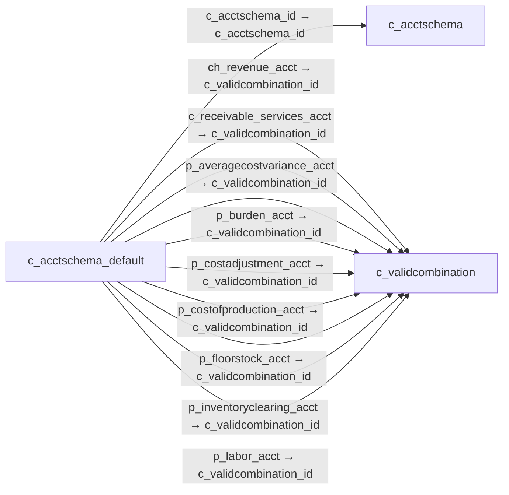

# c_acctschema_default — 회계 스키마 기본 계정

[전체 일람](../TABLE_INDEX.md) · [분류 일람](README.md) · [AI 사용 안내](../README.md) · [외래키 읽는 법](../RELATIONSHIPS.md)

## 기본 정보

| 항목 | 내용 |
|---|---|
| 물리명 | `adempiere.c_acctschema_default` |
| 한국어 논리명(문서용 해석) | 회계 스키마 기본 계정 |
| 원본 논리명 | C_AcctSchema_Default |
| 원본 사전 ID | 315 |
| 분류 | `c` — 거래처·주문·청구·결제·회계 기준 |
| 전체 테넌트 행 수 | 2 |
| 물리 열 수 | 84 |
| 나가는 FK / 들어오는 FK | 75 / 0 |
| 구조·행 수 확인 시점 | 2026-11-03T23:29:01+09:00 |

## 의미와 쓰임

회계 스키마별 매출·비용·재고·채권·채무·세금 등의 업무별 기본 계정 조합을 지정한다.

- 설명 근거: 물리명·열·외래키 구조를 근거로 보수적으로 해석.
- 한국어 이름과 개요는 문서용 해석입니다. 공식 한국어 번역으로 간주하지 않습니다.
- 원본 설명: —
- 원본 도움말: —
- PostgreSQL 테이블 주석: —

## 키와 열

### 기본키·고유 제약조건

| 종류 | 제약조건 | 열(순서 유지) |
|---|---|---|
| PRIMARY KEY | `c_acctschema_default_pkey` | `c_acctschema_id` |
| UNIQUE | `c_acctschema_default_uu_idx` | `c_acctschema_default_uu` |

### 열 목록

원본 논리명·설명은 `AD_Column`에서 가져왔습니다. 기본값은 실제 PostgreSQL 메타데이터이며, 비어 있는 항목은 `—`로 표시합니다.

| 순서 | 물리명 | 원본 논리명 | PostgreSQL 타입 | NULL | PK | 기본값 | 설명 |
|---:|---|---|---|---|---|---|---|
| 1 | `c_acctschema_id` | Accounting Schema | numeric(10,0) | 불가 | 예 | — | Rules for accounting |
| 2 | `ad_client_id` | Tenant | numeric(10,0) | 불가 | — | — | Tenant for this installation. |
| 3 | `ad_org_id` | Organization | numeric(10,0) | 불가 | — | — | Organizational entity within tenant |
| 4 | `isactive` | Active | character(1) | 불가 | — | 'Y'::bpchar | The record is active in the system |
| 5 | `created` | Created | timestamp without time zone | 불가 | — | now() | Date this record was created |
| 6 | `createdby` | Created By | numeric(10,0) | 불가 | — | — | User who created this records |
| 7 | `updated` | Updated | timestamp without time zone | 불가 | — | now() | Date this record was updated |
| 8 | `updatedby` | Updated By | numeric(10,0) | 불가 | — | — | User who updated this records |
| 9 | `w_inventory_acct` | (Not Used) | numeric(10,0) | 허용 | — | — | Warehouse Inventory Asset Account - Currently not used |
| 10 | `w_invactualadjust_acct` | Inventory Adjustment | numeric(10,0) | 허용 | — | — | Account for Inventory value adjustments for Actual Costing |
| 11 | `w_differences_acct` | Warehouse Differences | numeric(10,0) | 불가 | — | — | Warehouse Differences Account |
| 12 | `w_revaluation_acct` | Inventory Revaluation | numeric(10,0) | 허용 | — | — | Account for Inventory Revaluation |
| 13 | `p_revenue_acct` | Product Revenue | numeric(10,0) | 불가 | — | — | Account for Product Revenue (Sales Account) |
| 14 | `p_expense_acct` | Product Expense | numeric(10,0) | 불가 | — | — | Account for Product Expense |
| 15 | `p_asset_acct` | Product Asset | numeric(10,0) | 불가 | — | — | Account for Product Asset (Inventory) |
| 16 | `p_purchasepricevariance_acct` | Purchase Price Variance | numeric(10,0) | 불가 | — | — | Difference between Standard Cost and Purchase Price (PPV) |
| 17 | `p_invoicepricevariance_acct` | Invoice Price Variance | numeric(10,0) | 불가 | — | — | Difference between Costs and Invoice Price (IPV) |
| 18 | `p_tradediscountrec_acct` | Trade Discount Received | numeric(10,0) | 불가 | — | — | Trade Discount Receivable Account |
| 19 | `p_tradediscountgrant_acct` | Trade Discount Granted | numeric(10,0) | 불가 | — | — | Trade Discount Granted Account |
| 20 | `p_cogs_acct` | Product COGS | numeric(10,0) | 불가 | — | — | Account for Cost of Goods Sold |
| 21 | `c_receivable_acct` | Customer Receivables | numeric(10,0) | 불가 | — | — | Account for Customer Receivables |
| 22 | `c_prepayment_acct` | Customer Prepayment | numeric(10,0) | 불가 | — | — | Account for customer prepayments |
| 23 | `v_liability_acct` | Vendor Liability | numeric(10,0) | 불가 | — | — | Account for Vendor Liability |
| 24 | `v_liability_services_acct` | Vendor Service Liability | numeric(10,0) | 허용 | — | — | Account for Vendor Service Liability |
| 25 | `v_prepayment_acct` | Vendor Prepayment | numeric(10,0) | 불가 | — | — | Account for Vendor Prepayments |
| 26 | `paydiscount_exp_acct` | Payment Discount Expense | numeric(10,0) | 불가 | — | — | Payment Discount Expense Account |
| 27 | `writeoff_acct` | Write-off | numeric(10,0) | 불가 | — | — | Account for Receivables write-off |
| 28 | `paydiscount_rev_acct` | Payment Discount Revenue | numeric(10,0) | 불가 | — | — | Payment Discount Revenue Account |
| 29 | `unrealizedgain_acct` | Unrealized Gain Acct | numeric(10,0) | 불가 | — | — | Unrealized Gain Account for currency revaluation |
| 30 | `unrealizedloss_acct` | Unrealized Loss Acct | numeric(10,0) | 불가 | — | — | Unrealized Loss Account for currency revaluation |
| 31 | `realizedgain_acct` | Realized Gain Acct | numeric(10,0) | 불가 | — | — | Realized Gain Account |
| 32 | `realizedloss_acct` | Realized Loss Acct | numeric(10,0) | 불가 | — | — | Realized Loss Account |
| 33 | `withholding_acct` | Withholding | numeric(10,0) | 허용 | — | — | Account for Withholdings |
| 34 | `e_prepayment_acct` | Employee Prepayment | numeric(10,0) | 허용 | — | — | Account for Employee Expense Prepayments |
| 35 | `e_expense_acct` | Employee Expense | numeric(10,0) | 허용 | — | — | Account for Employee Expenses |
| 36 | `pj_asset_acct` | Project Asset | numeric(10,0) | 불가 | — | — | Project Asset Account |
| 37 | `pj_wip_acct` | Work In Progress | numeric(10,0) | 불가 | — | — | Account for Work in Progress |
| 38 | `t_expense_acct` | Tax Expense | numeric(10,0) | 불가 | — | — | Account for paid tax you cannot reclaim |
| 39 | `t_liability_acct` | Tax Liability | numeric(10,0) | 허용 | — | — | Account for Tax declaration liability |
| 40 | `t_receivables_acct` | Tax Receivables | numeric(10,0) | 허용 | — | — | Account for Tax credit after tax declaration |
| 41 | `t_due_acct` | Tax Due | numeric(10,0) | 불가 | — | — | Account for Tax you have to pay |
| 42 | `t_credit_acct` | Tax Credit | numeric(10,0) | 불가 | — | — | Account for Tax you can reclaim |
| 43 | `b_intransit_acct` | Bank In Transit | numeric(10,0) | 불가 | — | — | Bank In Transit Account |
| 44 | `b_asset_acct` | Bank Asset | numeric(10,0) | 불가 | — | — | Bank Asset Account |
| 45 | `b_expense_acct` | Bank Expense | numeric(10,0) | 허용 | — | — | Bank Expense Account |
| 46 | `b_interestrev_acct` | Bank Interest Revenue | numeric(10,0) | 불가 | — | — | Bank Interest Revenue Account |
| 47 | `b_interestexp_acct` | Bank Interest Expense | numeric(10,0) | 불가 | — | — | Bank Interest Expense Account |
| 48 | `b_unidentified_acct` | Bank Unidentified Receipts | numeric(10,0) | 허용 | — | — | Bank Unidentified Receipts Account |
| 49 | `b_unallocatedcash_acct` | Unallocated Cash | numeric(10,0) | 불가 | — | — | Unallocated Cash Clearing Account |
| 50 | `b_paymentselect_acct` | Payment Selection | numeric(10,0) | 불가 | — | — | AP Payment Selection Clearing Account |
| 51 | `b_settlementgain_acct` | Bank Settlement Gain | numeric(10,0) | 허용 | — | — | Bank Settlement Gain Account |
| 52 | `b_settlementloss_acct` | Bank Settlement Loss | numeric(10,0) | 허용 | — | — | Bank Settlement Loss Account |
| 53 | `b_revaluationgain_acct` | Bank Revaluation Gain | numeric(10,0) | 허용 | — | — | Bank Revaluation Gain Account |
| 54 | `b_revaluationloss_acct` | Bank Revaluation Loss | numeric(10,0) | 허용 | — | — | Bank Revaluation Loss Account |
| 55 | `ch_expense_acct` | Charge Account | numeric(10,0) | 불가 | — | — | Charge Account |
| 56 | `ch_revenue_acct` | Charge Revenue (Deprecated) | numeric(10,0) | 허용 | — | — | Charge Revenue Account |
| 57 | `unearnedrevenue_acct` | Unearned Revenue | numeric(10,0) | 허용 | — | — | Account for unearned revenue |
| 58 | `notinvoicedreceivables_acct` | Not-invoiced Receivables | numeric(10,0) | 허용 | — | — | Account for not invoiced Receivables |
| 59 | `notinvoicedrevenue_acct` | Not-invoiced Revenue | numeric(10,0) | 허용 | — | — | Account for not invoiced Revenue |
| 60 | `notinvoicedreceipts_acct` | Not-invoiced Receipts | numeric(10,0) | 불가 | — | — | Account for not-invoiced Material Receipts |
| 61 | `cb_asset_acct` | Cash Book Asset | numeric(10,0) | 허용 | — | — | Cash Book Asset Account |
| 62 | `cb_cashtransfer_acct` | Cash Transfer | numeric(10,0) | 허용 | — | — | Cash Transfer Clearing Account |
| 63 | `cb_differences_acct` | Cash Book Differences | numeric(10,0) | 허용 | — | — | Cash Book Differences Account |
| 64 | `cb_expense_acct` | Cash Book Expense | numeric(10,0) | 허용 | — | — | Cash Book Expense Account |
| 65 | `cb_receipt_acct` | Cash Book Receipt | numeric(10,0) | 허용 | — | — | Cash Book Receipts Account |
| 66 | `processing` | Process Now | character(1) | 허용 | — | — | — |
| 67 | `c_receivable_services_acct` | Receivable Services | numeric(10,0) | 허용 | — | — | Customer Accounts Receivables Services Account |
| 68 | `p_inventoryclearing_acct` | Inventory Clearing | numeric(10,0) | 불가 | — | — | Product Inventory Clearing Account |
| 69 | `p_costadjustment_acct` | Cost Adjustment | numeric(10,0) | 불가 | — | — | Product Cost Adjustment Account |
| 70 | `p_wip_acct` | Work In Process | numeric(10,0) | 허용 | — | — | The Work in Process account is the account used Manufacturing Order |
| 71 | `p_methodchangevariance_acct` | Method Change Variance | numeric(10,0) | 허용 | — | — | The Method Change Variance account is the account used Manufacturing Order |
| 72 | `p_usagevariance_acct` | Usage Variance | numeric(10,0) | 허용 | — | — | The Usage Variance account is the account used Manufacturing Order |
| 73 | `p_ratevariance_acct` | Rate Variance | numeric(10,0) | 허용 | — | — | The Rate Variance account is the account used Manufacturing Order |
| 74 | `p_mixvariance_acct` | Mix Variance | numeric(10,0) | 허용 | — | — | The Mix Variance account is the account used Manufacturing Order |
| 75 | `p_floorstock_acct` | Floor Stock | numeric(10,0) | 허용 | — | — | The Floor Stock account is the account used Manufacturing Order |
| 76 | `p_costofproduction_acct` | Cost Of Production | numeric(10,0) | 허용 | — | — | The Cost Of Production account is the account used Manufacturing Order |
| 77 | `p_labor_acct` | Labor | numeric(10,0) | 허용 | — | — | The Labor account is the account used Manufacturing Order |
| 78 | `p_burden_acct` | Burden | numeric(10,0) | 허용 | — | — | The Burden account is the account used Manufacturing Order |
| 79 | `p_outsideprocessing_acct` | Outside Processing | numeric(10,0) | 허용 | — | — | The Outside Processing Account is the account used in Manufacturing Order |
| 80 | `p_overhead_acct` | Overhead | numeric(10,0) | 허용 | — | — | The Overhead account is the account used  in Manufacturing Order  |
| 81 | `p_scrap_acct` | Scrap | numeric(10,0) | 허용 | — | — | The Scrap account is the account used  in Manufacturing Order  |
| 82 | `p_averagecostvariance_acct` | Average Cost Variance | numeric(10,0) | 허용 | — | NULL::numeric | Average Cost Variance |
| 83 | `c_acctschema_default_uu` | C_AcctSchema_Default_UU | uuid | 허용 | — | — | — |
| 84 | `p_landedcostclearing_acct` | Landed Cost Clearing | numeric(10,0) | 허용 | — | NULL::numeric | Product Landed Cost Clearing Account |

## 외래키 흐름

화살표는 **FK를 가진 자식 → 참조되는 부모**입니다. 업무 처리의 시간 순서나 무조건적인 1:N 관계를 뜻하지 않습니다.

주변 관계 75개 중 10개를 그림으로 표시합니다. **전체 관계는 아래 두 표에 모두 포함**합니다.

### 이 테이블이 참조하는 부모 — 나가는 FK

| 제약조건 | 참조하는 쪽(자식) | 자식 열 | 참조받는 쪽(부모) | 부모 열 | 삭제 / 갱신 | 검증 / 지연 가능 |
|---|---|---|---|---|---|---|
| `cacctschema_default` <!-- FK_OUT: adempiere.c_acctschema_default.cacctschema_default --> | [`c_acctschema_default`](c_acctschema_default.md) | `c_acctschema_id` | [`c_acctschema`](c_acctschema.md) | `c_acctschema_id` | CASCADE / NO ACTION | 완료 / 가능 (초기 지연) |
| `chrevenue_cacctschemadefault` <!-- FK_OUT: adempiere.c_acctschema_default.chrevenue_cacctschemadefault --> | [`c_acctschema_default`](c_acctschema_default.md) | `ch_revenue_acct` | [`c_validcombination`](c_validcombination.md) | `c_validcombination_id` | NO ACTION / NO ACTION | 완료 / 가능 (초기 지연) |
| `creceivableservices_cacctschem` <!-- FK_OUT: adempiere.c_acctschema_default.creceivableservices_cacctschem --> | [`c_acctschema_default`](c_acctschema_default.md) | `c_receivable_services_acct` | [`c_validcombination`](c_validcombination.md) | `c_validcombination_id` | NO ACTION / NO ACTION | 완료 / 가능 (초기 지연) |
| `paveragecostvariance_cacctsche` <!-- FK_OUT: adempiere.c_acctschema_default.paveragecostvariance_cacctsche --> | [`c_acctschema_default`](c_acctschema_default.md) | `p_averagecostvariance_acct` | [`c_validcombination`](c_validcombination.md) | `c_validcombination_id` | NO ACTION / NO ACTION | 완료 / 가능 (초기 지연) |
| `pburden_cacctschemadefault` <!-- FK_OUT: adempiere.c_acctschema_default.pburden_cacctschemadefault --> | [`c_acctschema_default`](c_acctschema_default.md) | `p_burden_acct` | [`c_validcombination`](c_validcombination.md) | `c_validcombination_id` | NO ACTION / NO ACTION | 완료 / 가능 (초기 지연) |
| `pcostadjustment_cacctschemadef` <!-- FK_OUT: adempiere.c_acctschema_default.pcostadjustment_cacctschemadef --> | [`c_acctschema_default`](c_acctschema_default.md) | `p_costadjustment_acct` | [`c_validcombination`](c_validcombination.md) | `c_validcombination_id` | NO ACTION / NO ACTION | 완료 / 가능 (초기 지연) |
| `pcostofproduction_cacctschemad` <!-- FK_OUT: adempiere.c_acctschema_default.pcostofproduction_cacctschemad --> | [`c_acctschema_default`](c_acctschema_default.md) | `p_costofproduction_acct` | [`c_validcombination`](c_validcombination.md) | `c_validcombination_id` | NO ACTION / NO ACTION | 완료 / 가능 (초기 지연) |
| `pfloorstock_cacctschemadefault` <!-- FK_OUT: adempiere.c_acctschema_default.pfloorstock_cacctschemadefault --> | [`c_acctschema_default`](c_acctschema_default.md) | `p_floorstock_acct` | [`c_validcombination`](c_validcombination.md) | `c_validcombination_id` | NO ACTION / NO ACTION | 완료 / 가능 (초기 지연) |
| `pinventoryclearing_cacctschema` <!-- FK_OUT: adempiere.c_acctschema_default.pinventoryclearing_cacctschema --> | [`c_acctschema_default`](c_acctschema_default.md) | `p_inventoryclearing_acct` | [`c_validcombination`](c_validcombination.md) | `c_validcombination_id` | NO ACTION / NO ACTION | 완료 / 가능 (초기 지연) |
| `plabor_cacctschemadefault` <!-- FK_OUT: adempiere.c_acctschema_default.plabor_cacctschemadefault --> | [`c_acctschema_default`](c_acctschema_default.md) | `p_labor_acct` | [`c_validcombination`](c_validcombination.md) | `c_validcombination_id` | NO ACTION / NO ACTION | 완료 / 가능 (초기 지연) |
| `plandedcostclearingvc_cacctsch` <!-- FK_OUT: adempiere.c_acctschema_default.plandedcostclearingvc_cacctsch --> | [`c_acctschema_default`](c_acctschema_default.md) | `p_landedcostclearing_acct` | [`c_validcombination`](c_validcombination.md) | `c_validcombination_id` | NO ACTION / NO ACTION | 완료 / 가능 (초기 지연) |
| `pmethodchangevariance_cacctsch` <!-- FK_OUT: adempiere.c_acctschema_default.pmethodchangevariance_cacctsch --> | [`c_acctschema_default`](c_acctschema_default.md) | `p_methodchangevariance_acct` | [`c_validcombination`](c_validcombination.md) | `c_validcombination_id` | NO ACTION / NO ACTION | 완료 / 가능 (초기 지연) |
| `pmixvariance_cacctschemadefaul` <!-- FK_OUT: adempiere.c_acctschema_default.pmixvariance_cacctschemadefaul --> | [`c_acctschema_default`](c_acctschema_default.md) | `p_mixvariance_acct` | [`c_validcombination`](c_validcombination.md) | `c_validcombination_id` | NO ACTION / NO ACTION | 완료 / 가능 (초기 지연) |
| `poutsideprocessing_cacctschema` <!-- FK_OUT: adempiere.c_acctschema_default.poutsideprocessing_cacctschema --> | [`c_acctschema_default`](c_acctschema_default.md) | `p_outsideprocessing_acct` | [`c_validcombination`](c_validcombination.md) | `c_validcombination_id` | NO ACTION / NO ACTION | 완료 / 가능 (초기 지연) |
| `poverhead_cacctschemadefault` <!-- FK_OUT: adempiere.c_acctschema_default.poverhead_cacctschemadefault --> | [`c_acctschema_default`](c_acctschema_default.md) | `p_overhead_acct` | [`c_validcombination`](c_validcombination.md) | `c_validcombination_id` | NO ACTION / NO ACTION | 완료 / 가능 (초기 지연) |
| `pratevariance_cacctschemadefau` <!-- FK_OUT: adempiere.c_acctschema_default.pratevariance_cacctschemadefau --> | [`c_acctschema_default`](c_acctschema_default.md) | `p_ratevariance_acct` | [`c_validcombination`](c_validcombination.md) | `c_validcombination_id` | NO ACTION / NO ACTION | 완료 / 가능 (초기 지연) |
| `pscrap_cacctschemadefault` <!-- FK_OUT: adempiere.c_acctschema_default.pscrap_cacctschemadefault --> | [`c_acctschema_default`](c_acctschema_default.md) | `p_scrap_acct` | [`c_validcombination`](c_validcombination.md) | `c_validcombination_id` | NO ACTION / NO ACTION | 완료 / 가능 (초기 지연) |
| `pusagevariance_cacctschemadefa` <!-- FK_OUT: adempiere.c_acctschema_default.pusagevariance_cacctschemadefa --> | [`c_acctschema_default`](c_acctschema_default.md) | `p_usagevariance_acct` | [`c_validcombination`](c_validcombination.md) | `c_validcombination_id` | NO ACTION / NO ACTION | 완료 / 가능 (초기 지연) |
| `pwip_cacctschemadefault` <!-- FK_OUT: adempiere.c_acctschema_default.pwip_cacctschemadefault --> | [`c_acctschema_default`](c_acctschema_default.md) | `p_wip_acct` | [`c_validcombination`](c_validcombination.md) | `c_validcombination_id` | NO ACTION / NO ACTION | 완료 / 가능 (초기 지연) |
| `vc_basset_cschemadefault` <!-- FK_OUT: adempiere.c_acctschema_default.vc_basset_cschemadefault --> | [`c_acctschema_default`](c_acctschema_default.md) | `b_asset_acct` | [`c_validcombination`](c_validcombination.md) | `c_validcombination_id` | NO ACTION / NO ACTION | 완료 / 가능 (초기 지연) |
| `vc_bexpense_cschemadefault` <!-- FK_OUT: adempiere.c_acctschema_default.vc_bexpense_cschemadefault --> | [`c_acctschema_default`](c_acctschema_default.md) | `b_expense_acct` | [`c_validcombination`](c_validcombination.md) | `c_validcombination_id` | NO ACTION / NO ACTION | 완료 / 가능 (초기 지연) |
| `vc_binterestexp_cschemadefault` <!-- FK_OUT: adempiere.c_acctschema_default.vc_binterestexp_cschemadefault --> | [`c_acctschema_default`](c_acctschema_default.md) | `b_interestexp_acct` | [`c_validcombination`](c_validcombination.md) | `c_validcombination_id` | NO ACTION / NO ACTION | 완료 / 가능 (초기 지연) |
| `vc_binterestrev_cschemadefault` <!-- FK_OUT: adempiere.c_acctschema_default.vc_binterestrev_cschemadefault --> | [`c_acctschema_default`](c_acctschema_default.md) | `b_interestrev_acct` | [`c_validcombination`](c_validcombination.md) | `c_validcombination_id` | NO ACTION / NO ACTION | 완료 / 가능 (초기 지연) |
| `vc_bintransit_cschemadefault` <!-- FK_OUT: adempiere.c_acctschema_default.vc_bintransit_cschemadefault --> | [`c_acctschema_default`](c_acctschema_default.md) | `b_intransit_acct` | [`c_validcombination`](c_validcombination.md) | `c_validcombination_id` | NO ACTION / NO ACTION | 완료 / 가능 (초기 지연) |
| `vc_bpaymentselect_cschemadefau` <!-- FK_OUT: adempiere.c_acctschema_default.vc_bpaymentselect_cschemadefau --> | [`c_acctschema_default`](c_acctschema_default.md) | `b_paymentselect_acct` | [`c_validcombination`](c_validcombination.md) | `c_validcombination_id` | NO ACTION / NO ACTION | 완료 / 가능 (초기 지연) |
| `vc_brevaluationgain_cschemadef` <!-- FK_OUT: adempiere.c_acctschema_default.vc_brevaluationgain_cschemadef --> | [`c_acctschema_default`](c_acctschema_default.md) | `b_revaluationgain_acct` | [`c_validcombination`](c_validcombination.md) | `c_validcombination_id` | NO ACTION / NO ACTION | 완료 / 가능 (초기 지연) |
| `vc_brevaluationloss_cschemadef` <!-- FK_OUT: adempiere.c_acctschema_default.vc_brevaluationloss_cschemadef --> | [`c_acctschema_default`](c_acctschema_default.md) | `b_revaluationloss_acct` | [`c_validcombination`](c_validcombination.md) | `c_validcombination_id` | NO ACTION / NO ACTION | 완료 / 가능 (초기 지연) |
| `vc_bsettlementgain_cschemadefa` <!-- FK_OUT: adempiere.c_acctschema_default.vc_bsettlementgain_cschemadefa --> | [`c_acctschema_default`](c_acctschema_default.md) | `b_settlementgain_acct` | [`c_validcombination`](c_validcombination.md) | `c_validcombination_id` | NO ACTION / NO ACTION | 완료 / 가능 (초기 지연) |
| `vc_bsettlementloss_cschemadefa` <!-- FK_OUT: adempiere.c_acctschema_default.vc_bsettlementloss_cschemadefa --> | [`c_acctschema_default`](c_acctschema_default.md) | `b_settlementloss_acct` | [`c_validcombination`](c_validcombination.md) | `c_validcombination_id` | NO ACTION / NO ACTION | 완료 / 가능 (초기 지연) |
| `vc_bunallocatedcash_cschemadef` <!-- FK_OUT: adempiere.c_acctschema_default.vc_bunallocatedcash_cschemadef --> | [`c_acctschema_default`](c_acctschema_default.md) | `b_unallocatedcash_acct` | [`c_validcombination`](c_validcombination.md) | `c_validcombination_id` | NO ACTION / NO ACTION | 완료 / 가능 (초기 지연) |
| `vc_bunidentified_cschemadefaul` <!-- FK_OUT: adempiere.c_acctschema_default.vc_bunidentified_cschemadefaul --> | [`c_acctschema_default`](c_acctschema_default.md) | `b_unidentified_acct` | [`c_validcombination`](c_validcombination.md) | `c_validcombination_id` | NO ACTION / NO ACTION | 완료 / 가능 (초기 지연) |
| `vc_cbasset_cschemadefault` <!-- FK_OUT: adempiere.c_acctschema_default.vc_cbasset_cschemadefault --> | [`c_acctschema_default`](c_acctschema_default.md) | `cb_asset_acct` | [`c_validcombination`](c_validcombination.md) | `c_validcombination_id` | NO ACTION / NO ACTION | 완료 / 가능 (초기 지연) |
| `vc_cbcashtransfer_cschemadefau` <!-- FK_OUT: adempiere.c_acctschema_default.vc_cbcashtransfer_cschemadefau --> | [`c_acctschema_default`](c_acctschema_default.md) | `cb_cashtransfer_acct` | [`c_validcombination`](c_validcombination.md) | `c_validcombination_id` | NO ACTION / NO ACTION | 완료 / 가능 (초기 지연) |
| `vc_cbdifferences_cschemadefaul` <!-- FK_OUT: adempiere.c_acctschema_default.vc_cbdifferences_cschemadefaul --> | [`c_acctschema_default`](c_acctschema_default.md) | `cb_differences_acct` | [`c_validcombination`](c_validcombination.md) | `c_validcombination_id` | NO ACTION / NO ACTION | 완료 / 가능 (초기 지연) |
| `vc_cbexpense_cschemadefault` <!-- FK_OUT: adempiere.c_acctschema_default.vc_cbexpense_cschemadefault --> | [`c_acctschema_default`](c_acctschema_default.md) | `cb_expense_acct` | [`c_validcombination`](c_validcombination.md) | `c_validcombination_id` | NO ACTION / NO ACTION | 완료 / 가능 (초기 지연) |
| `vc_cbreceipt_cschemadefault` <!-- FK_OUT: adempiere.c_acctschema_default.vc_cbreceipt_cschemadefault --> | [`c_acctschema_default`](c_acctschema_default.md) | `cb_receipt_acct` | [`c_validcombination`](c_validcombination.md) | `c_validcombination_id` | NO ACTION / NO ACTION | 완료 / 가능 (초기 지연) |
| `vc_chexpense_cschemadefault` <!-- FK_OUT: adempiere.c_acctschema_default.vc_chexpense_cschemadefault --> | [`c_acctschema_default`](c_acctschema_default.md) | `ch_expense_acct` | [`c_validcombination`](c_validcombination.md) | `c_validcombination_id` | NO ACTION / NO ACTION | 완료 / 가능 (초기 지연) |
| `vc_cprepayment_cschemadefault` <!-- FK_OUT: adempiere.c_acctschema_default.vc_cprepayment_cschemadefault --> | [`c_acctschema_default`](c_acctschema_default.md) | `c_prepayment_acct` | [`c_validcombination`](c_validcombination.md) | `c_validcombination_id` | NO ACTION / NO ACTION | 완료 / 가능 (초기 지연) |
| `vc_creceivable_cschemadefault` <!-- FK_OUT: adempiere.c_acctschema_default.vc_creceivable_cschemadefault --> | [`c_acctschema_default`](c_acctschema_default.md) | `c_receivable_acct` | [`c_validcombination`](c_validcombination.md) | `c_validcombination_id` | NO ACTION / NO ACTION | 완료 / 가능 (초기 지연) |
| `vc_eexpense_cschemadefault` <!-- FK_OUT: adempiere.c_acctschema_default.vc_eexpense_cschemadefault --> | [`c_acctschema_default`](c_acctschema_default.md) | `e_expense_acct` | [`c_validcombination`](c_validcombination.md) | `c_validcombination_id` | NO ACTION / NO ACTION | 완료 / 가능 (초기 지연) |
| `vc_eprepayment_cschemadefault` <!-- FK_OUT: adempiere.c_acctschema_default.vc_eprepayment_cschemadefault --> | [`c_acctschema_default`](c_acctschema_default.md) | `e_prepayment_acct` | [`c_validcombination`](c_validcombination.md) | `c_validcombination_id` | NO ACTION / NO ACTION | 완료 / 가능 (초기 지연) |
| `vc_notinvoicedrec_cschemadefau` <!-- FK_OUT: adempiere.c_acctschema_default.vc_notinvoicedrec_cschemadefau --> | [`c_acctschema_default`](c_acctschema_default.md) | `notinvoicedreceivables_acct` | [`c_validcombination`](c_validcombination.md) | `c_validcombination_id` | NO ACTION / NO ACTION | 완료 / 가능 (초기 지연) |
| `vc_notinvoicedreceipts_cschema` <!-- FK_OUT: adempiere.c_acctschema_default.vc_notinvoicedreceipts_cschema --> | [`c_acctschema_default`](c_acctschema_default.md) | `notinvoicedreceipts_acct` | [`c_validcombination`](c_validcombination.md) | `c_validcombination_id` | NO ACTION / NO ACTION | 완료 / 가능 (초기 지연) |
| `vc_notinvoicedrevenue_cschemad` <!-- FK_OUT: adempiere.c_acctschema_default.vc_notinvoicedrevenue_cschemad --> | [`c_acctschema_default`](c_acctschema_default.md) | `notinvoicedrevenue_acct` | [`c_validcombination`](c_validcombination.md) | `c_validcombination_id` | NO ACTION / NO ACTION | 완료 / 가능 (초기 지연) |
| `vc_passet_cschemadefault` <!-- FK_OUT: adempiere.c_acctschema_default.vc_passet_cschemadefault --> | [`c_acctschema_default`](c_acctschema_default.md) | `p_asset_acct` | [`c_validcombination`](c_validcombination.md) | `c_validcombination_id` | NO ACTION / NO ACTION | 완료 / 가능 (초기 지연) |
| `vc_paydiscountexp_cschemadefau` <!-- FK_OUT: adempiere.c_acctschema_default.vc_paydiscountexp_cschemadefau --> | [`c_acctschema_default`](c_acctschema_default.md) | `paydiscount_exp_acct` | [`c_validcombination`](c_validcombination.md) | `c_validcombination_id` | NO ACTION / NO ACTION | 완료 / 가능 (초기 지연) |
| `vc_paydiscountrev_cschemadefau` <!-- FK_OUT: adempiere.c_acctschema_default.vc_paydiscountrev_cschemadefau --> | [`c_acctschema_default`](c_acctschema_default.md) | `paydiscount_rev_acct` | [`c_validcombination`](c_validcombination.md) | `c_validcombination_id` | NO ACTION / NO ACTION | 완료 / 가능 (초기 지연) |
| `vc_pcogs_cschemadefault` <!-- FK_OUT: adempiere.c_acctschema_default.vc_pcogs_cschemadefault --> | [`c_acctschema_default`](c_acctschema_default.md) | `p_cogs_acct` | [`c_validcombination`](c_validcombination.md) | `c_validcombination_id` | NO ACTION / NO ACTION | 완료 / 가능 (초기 지연) |
| `vc_pexpense_cschemadefault` <!-- FK_OUT: adempiere.c_acctschema_default.vc_pexpense_cschemadefault --> | [`c_acctschema_default`](c_acctschema_default.md) | `p_expense_acct` | [`c_validcombination`](c_validcombination.md) | `c_validcombination_id` | NO ACTION / NO ACTION | 완료 / 가능 (초기 지연) |
| `vc_pinvoicepv_cschemadefault` <!-- FK_OUT: adempiere.c_acctschema_default.vc_pinvoicepv_cschemadefault --> | [`c_acctschema_default`](c_acctschema_default.md) | `p_invoicepricevariance_acct` | [`c_validcombination`](c_validcombination.md) | `c_validcombination_id` | NO ACTION / NO ACTION | 완료 / 가능 (초기 지연) |
| `vc_pjasset_cschemadefault` <!-- FK_OUT: adempiere.c_acctschema_default.vc_pjasset_cschemadefault --> | [`c_acctschema_default`](c_acctschema_default.md) | `pj_asset_acct` | [`c_validcombination`](c_validcombination.md) | `c_validcombination_id` | NO ACTION / NO ACTION | 완료 / 가능 (초기 지연) |
| `vc_pjwip_cschemadefault` <!-- FK_OUT: adempiere.c_acctschema_default.vc_pjwip_cschemadefault --> | [`c_acctschema_default`](c_acctschema_default.md) | `pj_wip_acct` | [`c_validcombination`](c_validcombination.md) | `c_validcombination_id` | NO ACTION / NO ACTION | 완료 / 가능 (초기 지연) |
| `vc_ppurchasepv_cschemadefault` <!-- FK_OUT: adempiere.c_acctschema_default.vc_ppurchasepv_cschemadefault --> | [`c_acctschema_default`](c_acctschema_default.md) | `p_purchasepricevariance_acct` | [`c_validcombination`](c_validcombination.md) | `c_validcombination_id` | NO ACTION / NO ACTION | 완료 / 가능 (초기 지연) |
| `vc_prevenue_cschemadefault` <!-- FK_OUT: adempiere.c_acctschema_default.vc_prevenue_cschemadefault --> | [`c_acctschema_default`](c_acctschema_default.md) | `p_revenue_acct` | [`c_validcombination`](c_validcombination.md) | `c_validcombination_id` | NO ACTION / NO ACTION | 완료 / 가능 (초기 지연) |
| `vc_ptdiscountgrant_cschemadefa` <!-- FK_OUT: adempiere.c_acctschema_default.vc_ptdiscountgrant_cschemadefa --> | [`c_acctschema_default`](c_acctschema_default.md) | `p_tradediscountgrant_acct` | [`c_validcombination`](c_validcombination.md) | `c_validcombination_id` | NO ACTION / NO ACTION | 완료 / 가능 (초기 지연) |
| `vc_ptdiscountrec_cschemadefaul` <!-- FK_OUT: adempiere.c_acctschema_default.vc_ptdiscountrec_cschemadefaul --> | [`c_acctschema_default`](c_acctschema_default.md) | `p_tradediscountrec_acct` | [`c_validcombination`](c_validcombination.md) | `c_validcombination_id` | NO ACTION / NO ACTION | 완료 / 가능 (초기 지연) |
| `vc_realizedgain_cschemadefault` <!-- FK_OUT: adempiere.c_acctschema_default.vc_realizedgain_cschemadefault --> | [`c_acctschema_default`](c_acctschema_default.md) | `realizedgain_acct` | [`c_validcombination`](c_validcombination.md) | `c_validcombination_id` | NO ACTION / NO ACTION | 완료 / 가능 (초기 지연) |
| `vc_realizedloss_cschemadefault` <!-- FK_OUT: adempiere.c_acctschema_default.vc_realizedloss_cschemadefault --> | [`c_acctschema_default`](c_acctschema_default.md) | `realizedloss_acct` | [`c_validcombination`](c_validcombination.md) | `c_validcombination_id` | NO ACTION / NO ACTION | 완료 / 가능 (초기 지연) |
| `vc_tcredit_cschemadefault` <!-- FK_OUT: adempiere.c_acctschema_default.vc_tcredit_cschemadefault --> | [`c_acctschema_default`](c_acctschema_default.md) | `t_credit_acct` | [`c_validcombination`](c_validcombination.md) | `c_validcombination_id` | NO ACTION / NO ACTION | 완료 / 가능 (초기 지연) |
| `vc_tdue_cschemadefault` <!-- FK_OUT: adempiere.c_acctschema_default.vc_tdue_cschemadefault --> | [`c_acctschema_default`](c_acctschema_default.md) | `t_due_acct` | [`c_validcombination`](c_validcombination.md) | `c_validcombination_id` | NO ACTION / NO ACTION | 완료 / 가능 (초기 지연) |
| `vc_texpense_cschemadefault` <!-- FK_OUT: adempiere.c_acctschema_default.vc_texpense_cschemadefault --> | [`c_acctschema_default`](c_acctschema_default.md) | `t_expense_acct` | [`c_validcombination`](c_validcombination.md) | `c_validcombination_id` | NO ACTION / NO ACTION | 완료 / 가능 (초기 지연) |
| `vc_tliability_cschemadefault` <!-- FK_OUT: adempiere.c_acctschema_default.vc_tliability_cschemadefault --> | [`c_acctschema_default`](c_acctschema_default.md) | `t_liability_acct` | [`c_validcombination`](c_validcombination.md) | `c_validcombination_id` | NO ACTION / NO ACTION | 완료 / 가능 (초기 지연) |
| `vc_trec_cschemadefault` <!-- FK_OUT: adempiere.c_acctschema_default.vc_trec_cschemadefault --> | [`c_acctschema_default`](c_acctschema_default.md) | `t_receivables_acct` | [`c_validcombination`](c_validcombination.md) | `c_validcombination_id` | NO ACTION / NO ACTION | 완료 / 가능 (초기 지연) |
| `vc_unearnedrevenue_cschemadefa` <!-- FK_OUT: adempiere.c_acctschema_default.vc_unearnedrevenue_cschemadefa --> | [`c_acctschema_default`](c_acctschema_default.md) | `unearnedrevenue_acct` | [`c_validcombination`](c_validcombination.md) | `c_validcombination_id` | NO ACTION / NO ACTION | 완료 / 가능 (초기 지연) |
| `vc_unrealizedgain_cschemadefau` <!-- FK_OUT: adempiere.c_acctschema_default.vc_unrealizedgain_cschemadefau --> | [`c_acctschema_default`](c_acctschema_default.md) | `unrealizedgain_acct` | [`c_validcombination`](c_validcombination.md) | `c_validcombination_id` | NO ACTION / NO ACTION | 완료 / 가능 (초기 지연) |
| `vc_unrealizedloss_cschemadefau` <!-- FK_OUT: adempiere.c_acctschema_default.vc_unrealizedloss_cschemadefau --> | [`c_acctschema_default`](c_acctschema_default.md) | `unrealizedloss_acct` | [`c_validcombination`](c_validcombination.md) | `c_validcombination_id` | NO ACTION / NO ACTION | 완료 / 가능 (초기 지연) |
| `vc_vliability_cschemadefault` <!-- FK_OUT: adempiere.c_acctschema_default.vc_vliability_cschemadefault --> | [`c_acctschema_default`](c_acctschema_default.md) | `v_liability_acct` | [`c_validcombination`](c_validcombination.md) | `c_validcombination_id` | NO ACTION / NO ACTION | 완료 / 가능 (초기 지연) |
| `vc_vliabilityservices_cschemad` <!-- FK_OUT: adempiere.c_acctschema_default.vc_vliabilityservices_cschemad --> | [`c_acctschema_default`](c_acctschema_default.md) | `v_liability_services_acct` | [`c_validcombination`](c_validcombination.md) | `c_validcombination_id` | NO ACTION / NO ACTION | 완료 / 가능 (초기 지연) |
| `vc_vprepayment_cschemadefault` <!-- FK_OUT: adempiere.c_acctschema_default.vc_vprepayment_cschemadefault --> | [`c_acctschema_default`](c_acctschema_default.md) | `v_prepayment_acct` | [`c_validcombination`](c_validcombination.md) | `c_validcombination_id` | NO ACTION / NO ACTION | 완료 / 가능 (초기 지연) |
| `vc_wdifferences_cschemadefault` <!-- FK_OUT: adempiere.c_acctschema_default.vc_wdifferences_cschemadefault --> | [`c_acctschema_default`](c_acctschema_default.md) | `w_differences_acct` | [`c_validcombination`](c_validcombination.md) | `c_validcombination_id` | NO ACTION / NO ACTION | 완료 / 가능 (초기 지연) |
| `vc_winvactualadjust_cschemadef` <!-- FK_OUT: adempiere.c_acctschema_default.vc_winvactualadjust_cschemadef --> | [`c_acctschema_default`](c_acctschema_default.md) | `w_invactualadjust_acct` | [`c_validcombination`](c_validcombination.md) | `c_validcombination_id` | NO ACTION / NO ACTION | 완료 / 가능 (초기 지연) |
| `vc_winventory_cschemadefault` <!-- FK_OUT: adempiere.c_acctschema_default.vc_winventory_cschemadefault --> | [`c_acctschema_default`](c_acctschema_default.md) | `w_inventory_acct` | [`c_validcombination`](c_validcombination.md) | `c_validcombination_id` | NO ACTION / NO ACTION | 완료 / 가능 (초기 지연) |
| `vc_withholding_cschemadefault` <!-- FK_OUT: adempiere.c_acctschema_default.vc_withholding_cschemadefault --> | [`c_acctschema_default`](c_acctschema_default.md) | `withholding_acct` | [`c_validcombination`](c_validcombination.md) | `c_validcombination_id` | NO ACTION / NO ACTION | 완료 / 가능 (초기 지연) |
| `vc_wrevaluation_cschemadefault` <!-- FK_OUT: adempiere.c_acctschema_default.vc_wrevaluation_cschemadefault --> | [`c_acctschema_default`](c_acctschema_default.md) | `w_revaluation_acct` | [`c_validcombination`](c_validcombination.md) | `c_validcombination_id` | NO ACTION / NO ACTION | 완료 / 가능 (초기 지연) |
| `vc_writeoff_cschemadefault` <!-- FK_OUT: adempiere.c_acctschema_default.vc_writeoff_cschemadefault --> | [`c_acctschema_default`](c_acctschema_default.md) | `writeoff_acct` | [`c_validcombination`](c_validcombination.md) | `c_validcombination_id` | NO ACTION / NO ACTION | 완료 / 가능 (초기 지연) |

### 이 테이블을 참조하는 자식 — 들어오는 FK

해당 방향의 물리 FK 제약조건은 없습니다. 이름이 비슷한 열만으로 관계를 추가하지 않습니다.

## 조회 시 주의

- FK 표의 자식 열과 부모 열을 같은 순서로 대응시킵니다. 복합 FK는 모든 열의 동등 조건을 `AND`로 연결합니다.
- 테이블 이름이나 `_id` 열 이름만으로 물리 FK가 있다고 가정하지 않습니다. FK 미선언은 업무 관계가 없다는 뜻도 아닙니다.
- 자식이 여러 행인 테이블과 조인하면 부모의 금액·건수가 중복될 수 있습니다. 집계 단위를 먼저 정합니다.
- `ad_client_id`가 있습니다. 업무 분석에서는 대상 테넌트를 명시합니다. GardenWorld는 `11`, 시스템 공통 설정은 `0`일 수 있으므로 일괄 필터 적용 전에 테이블 역할을 확인합니다.
- 행 수는 위 확인 시점의 전체 테넌트 값입니다. 최신 업무 실적이나 현재 실행 결과로 재사용하지 않습니다.
