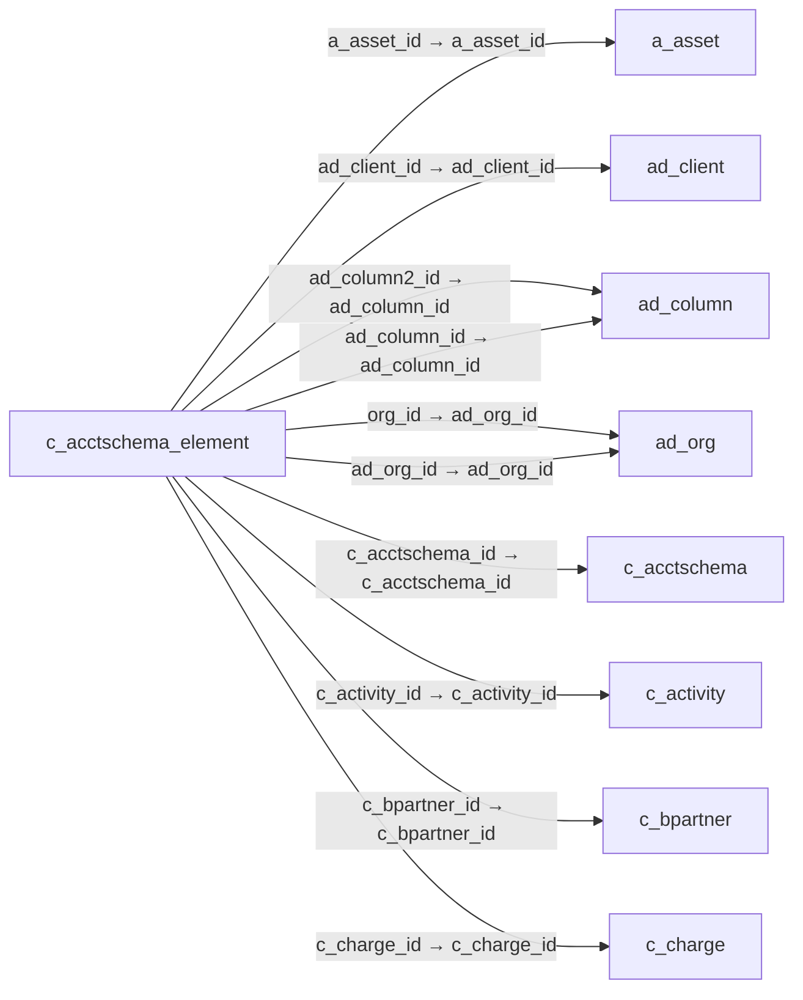

# c_acctschema_element — 회계 스키마 구성요소

[전체 일람](../TABLE_INDEX.md) · [분류 일람](README.md) · [AI 사용 안내](../README.md) · [외래키 읽는 법](../RELATIONSHIPS.md)

## 기본 정보

| 항목 | 내용 |
|---|---|
| 물리명 | `adempiere.c_acctschema_element` |
| 한국어 논리명(문서용 해석) | 회계 스키마 구성요소 |
| 원본 논리명 | Acct.Schema Element |
| 원본 사전 ID | 279 |
| 분류 | `c` — 거래처·주문·청구·결제·회계 기준 |
| 전체 테넌트 행 수 | 12 |
| 물리 열 수 | 34 |
| 나가는 FK / 들어오는 FK | 22 / 0 |
| 구조·행 수 확인 시점 | 2026-11-03T23:29:01+09:00 |

## 의미와 쓰임

회계 스키마의 계정·조직·상품·거래처 등 분석 요소와 순서·필수 여부를 정의한다.

- 설명 근거: 물리명·열·외래키 구조를 근거로 보수적으로 해석.
- 한국어 이름과 개요는 문서용 해석입니다. 공식 한국어 번역으로 간주하지 않습니다.
- 원본 설명: —
- 원본 도움말: —
- PostgreSQL 테이블 주석: —

## 키와 열

### 기본키·고유 제약조건

| 종류 | 제약조건 | 열(순서 유지) |
|---|---|---|
| PRIMARY KEY | `c_acctschema_element_pkey` | `c_acctschema_element_id` |
| UNIQUE | `c_acctschema_element_uu_idx` | `c_acctschema_element_uu` |

### 열 목록

원본 논리명·설명은 `AD_Column`에서 가져왔습니다. 기본값은 실제 PostgreSQL 메타데이터이며, 비어 있는 항목은 `—`로 표시합니다.

| 순서 | 물리명 | 원본 논리명 | PostgreSQL 타입 | NULL | PK | 기본값 | 설명 |
|---:|---|---|---|---|---|---|---|
| 1 | `c_acctschema_element_id` | Acct.Schema Element | numeric(10,0) | 불가 | 예 | — | — |
| 2 | `isactive` | Active | character(1) | 불가 | — | 'Y'::bpchar | The record is active in the system |
| 3 | `created` | Created | timestamp without time zone | 불가 | — | now() | Date this record was created |
| 4 | `createdby` | Created By | numeric(10,0) | 불가 | — | — | User who created this records |
| 5 | `updated` | Updated | timestamp without time zone | 불가 | — | now() | Date this record was updated |
| 6 | `ad_org_id` | Organization | numeric(10,0) | 불가 | — | — | Organizational entity within tenant |
| 7 | `updatedby` | Updated By | numeric(10,0) | 불가 | — | — | User who updated this records |
| 8 | `c_acctschema_id` | Accounting Schema | numeric(10,0) | 불가 | — | — | Rules for accounting |
| 9 | `elementtype` | Type | character(2) | 불가 | — | — | Element Type (account or user defined) |
| 10 | `name` | Name | character varying(60) | 불가 | — | — | Alphanumeric identifier of the entity |
| 11 | `seqno` | Sequence | numeric(10,0) | 불가 | — | — | Method of ordering records; lowest number comes first |
| 12 | `c_element_id` | Element | numeric(10,0) | 허용 | — | — | Accounting Element |
| 13 | `ad_client_id` | Tenant | numeric(10,0) | 불가 | — | — | Tenant for this installation. |
| 14 | `ismandatory` | Mandatory | character(1) | 불가 | — | 'N'::bpchar | Data entry is required in this column |
| 15 | `isbalanced` | Balanced | character(1) | 불가 | — | 'N'::bpchar | — |
| 16 | `org_id` | Organization | numeric(10,0) | 허용 | — | — | Organizational entity within tenant |
| 17 | `c_elementvalue_id` | Account Element | numeric(10,0) | 허용 | — | — | Account Element |
| 18 | `m_product_id` | Product | numeric(10,0) | 허용 | — | — | Product, Service, Item |
| 19 | `c_bpartner_id` | Business Partner | numeric(10,0) | 허용 | — | — | Identifies a Business Partner |
| 20 | `c_location_id` | Address | numeric(10,0) | 허용 | — | — | Location or Address |
| 21 | `c_salesregion_id` | Sales Region | numeric(10,0) | 허용 | — | — | Sales coverage region |
| 22 | `c_project_id` | Project | numeric(10,0) | 허용 | — | — | Financial Project |
| 23 | `c_campaign_id` | Campaign | numeric(10,0) | 허용 | — | — | Marketing Campaign |
| 24 | `c_activity_id` | Activity | numeric(10,0) | 허용 | — | — | Business Activity |
| 25 | `ad_column_id` | Column | numeric(10,0) | 허용 | — | — | Column in the table |
| 26 | `c_acctschema_element_uu` | C_AcctSchema_Element_UU | uuid | 허용 | — | — | — |
| 27 | `c_charge_id` | Charge | numeric(10,0) | 허용 | — | NULL::numeric | Additional document charges |
| 28 | `a_asset_id` | Asset | numeric(10,0) | 허용 | — | NULL::numeric | Asset used internally or by customers |
| 29 | `m_warehouse_id` | Warehouse | numeric(10,0) | 허용 | — | NULL::numeric | Storage Warehouse and Service Point |
| 30 | `ad_column2_id` | Column 2 | numeric(10,0) | 허용 | — | NULL::numeric | Column in the table |
| 31 | `c_employee_id` | Employee | numeric(10,0) | 허용 | — | NULL::numeric | Identifies a Business Partner |
| 32 | `c_costcenter_id` | Cost Center | numeric(10,0) | 허용 | — | — | — |
| 33 | `c_department_id` | Department | numeric(10,0) | 허용 | — | NULL::numeric | — |
| 34 | `m_attributesetinstance_id` | Attribute Set Instance | numeric(10,0) | 허용 | — | — | Product Attribute Set Instance |

## 외래키 흐름

화살표는 **FK를 가진 자식 → 참조되는 부모**입니다. 업무 처리의 시간 순서나 무조건적인 1:N 관계를 뜻하지 않습니다.

주변 관계 22개 중 10개를 그림으로 표시합니다. **전체 관계는 아래 두 표에 모두 포함**합니다.

### 이 테이블이 참조하는 부모 — 나가는 FK

| 제약조건 | 참조하는 쪽(자식) | 자식 열 | 참조받는 쪽(부모) | 부모 열 | 삭제 / 갱신 | 검증 / 지연 가능 |
|---|---|---|---|---|---|---|
| `aasset_cacctschemaelement` <!-- FK_OUT: adempiere.c_acctschema_element.aasset_cacctschemaelement --> | [`c_acctschema_element`](c_acctschema_element.md) | `a_asset_id` | [`a_asset`](../a/a_asset.md) | `a_asset_id` | NO ACTION / NO ACTION | 완료 / 가능 (초기 지연) |
| `adclient_caschemaelement` <!-- FK_OUT: adempiere.c_acctschema_element.adclient_caschemaelement --> | [`c_acctschema_element`](c_acctschema_element.md) | `ad_client_id` | [`ad_client`](../ad/ad_client.md) | `ad_client_id` | NO ACTION / NO ACTION | 완료 / 가능 (초기 지연) |
| `adcolumn2_cacctschemaelement` <!-- FK_OUT: adempiere.c_acctschema_element.adcolumn2_cacctschemaelement --> | [`c_acctschema_element`](c_acctschema_element.md) | `ad_column2_id` | [`ad_column`](../ad/ad_column.md) | `ad_column_id` | NO ACTION / NO ACTION | 완료 / 가능 (초기 지연) |
| `adcolumn_cacctschemaelement` <!-- FK_OUT: adempiere.c_acctschema_element.adcolumn_cacctschemaelement --> | [`c_acctschema_element`](c_acctschema_element.md) | `ad_column_id` | [`ad_column`](../ad/ad_column.md) | `ad_column_id` | NO ACTION / NO ACTION | 완료 / 가능 (초기 지연) |
| `adorg_caschemaelement` <!-- FK_OUT: adempiere.c_acctschema_element.adorg_caschemaelement --> | [`c_acctschema_element`](c_acctschema_element.md) | `org_id` | [`ad_org`](../ad/ad_org.md) | `ad_org_id` | NO ACTION / NO ACTION | 완료 / 가능 (초기 지연) |
| `adorgid_c_aschemaelement` <!-- FK_OUT: adempiere.c_acctschema_element.adorgid_c_aschemaelement --> | [`c_acctschema_element`](c_acctschema_element.md) | `ad_org_id` | [`ad_org`](../ad/ad_org.md) | `ad_org_id` | NO ACTION / NO ACTION | 완료 / 가능 (초기 지연) |
| `cacctschema_caschemaelement` <!-- FK_OUT: adempiere.c_acctschema_element.cacctschema_caschemaelement --> | [`c_acctschema_element`](c_acctschema_element.md) | `c_acctschema_id` | [`c_acctschema`](c_acctschema.md) | `c_acctschema_id` | CASCADE / NO ACTION | 완료 / 가능 (초기 지연) |
| `cactivity_cacctschemaelement` <!-- FK_OUT: adempiere.c_acctschema_element.cactivity_cacctschemaelement --> | [`c_acctschema_element`](c_acctschema_element.md) | `c_activity_id` | [`c_activity`](c_activity.md) | `c_activity_id` | NO ACTION / NO ACTION | 완료 / 가능 (초기 지연) |
| `cbuspartner_caschemaelement` <!-- FK_OUT: adempiere.c_acctschema_element.cbuspartner_caschemaelement --> | [`c_acctschema_element`](c_acctschema_element.md) | `c_bpartner_id` | [`c_bpartner`](c_bpartner.md) | `c_bpartner_id` | NO ACTION / NO ACTION | 완료 / 가능 (초기 지연) |
| `ccharge_cacctschemaelement` <!-- FK_OUT: adempiere.c_acctschema_element.ccharge_cacctschemaelement --> | [`c_acctschema_element`](c_acctschema_element.md) | `c_charge_id` | [`c_charge`](c_charge.md) | `c_charge_id` | NO ACTION / NO ACTION | 완료 / 가능 (초기 지연) |
| `ccostcenter_cacctschemaelement` <!-- FK_OUT: adempiere.c_acctschema_element.ccostcenter_cacctschemaelement --> | [`c_acctschema_element`](c_acctschema_element.md) | `c_costcenter_id` | [`c_costcenter`](c_costcenter.md) | `c_costcenter_id` | NO ACTION / NO ACTION | 완료 / 가능 (초기 지연) |
| `cdepartment_cacctschemaelement` <!-- FK_OUT: adempiere.c_acctschema_element.cdepartment_cacctschemaelement --> | [`c_acctschema_element`](c_acctschema_element.md) | `c_department_id` | [`c_department`](c_department.md) | `c_department_id` | NO ACTION / NO ACTION | 완료 / 가능 (초기 지연) |
| `celement_caschemaelement` <!-- FK_OUT: adempiere.c_acctschema_element.celement_caschemaelement --> | [`c_acctschema_element`](c_acctschema_element.md) | `c_element_id` | [`c_element`](c_element.md) | `c_element_id` | NO ACTION / NO ACTION | 완료 / 가능 (초기 지연) |
| `celementvalue_caschemaelement` <!-- FK_OUT: adempiere.c_acctschema_element.celementvalue_caschemaelement --> | [`c_acctschema_element`](c_acctschema_element.md) | `c_elementvalue_id` | [`c_elementvalue`](c_elementvalue.md) | `c_elementvalue_id` | NO ACTION / NO ACTION | 완료 / 가능 (초기 지연) |
| `cemployee_cacctschemae` <!-- FK_OUT: adempiere.c_acctschema_element.cemployee_cacctschemae --> | [`c_acctschema_element`](c_acctschema_element.md) | `c_employee_id` | [`c_bpartner`](c_bpartner.md) | `c_bpartner_id` | NO ACTION / NO ACTION | 완료 / 가능 (초기 지연) |
| `clocation_caschemaelement` <!-- FK_OUT: adempiere.c_acctschema_element.clocation_caschemaelement --> | [`c_acctschema_element`](c_acctschema_element.md) | `c_location_id` | [`c_location`](c_location.md) | `c_location_id` | NO ACTION / NO ACTION | 완료 / 가능 (초기 지연) |
| `cproject_caschemaelement` <!-- FK_OUT: adempiere.c_acctschema_element.cproject_caschemaelement --> | [`c_acctschema_element`](c_acctschema_element.md) | `c_project_id` | [`c_project`](c_project.md) | `c_project_id` | NO ACTION / NO ACTION | 완료 / 가능 (초기 지연) |
| `csalesregion_caschemaelement` <!-- FK_OUT: adempiere.c_acctschema_element.csalesregion_caschemaelement --> | [`c_acctschema_element`](c_acctschema_element.md) | `c_salesregion_id` | [`c_salesregion`](c_salesregion.md) | `c_salesregion_id` | NO ACTION / NO ACTION | 완료 / 가능 (초기 지연) |
| `mattributesetinstance_cacctschemaelement` <!-- FK_OUT: adempiere.c_acctschema_element.mattributesetinstance_cacctschemaelement --> | [`c_acctschema_element`](c_acctschema_element.md) | `m_attributesetinstance_id` | [`m_attributesetinstance`](../m/m_attributesetinstance.md) | `m_attributesetinstance_id` | NO ACTION / NO ACTION | 완료 / 가능 (초기 지연) |
| `mproduct_caschemaelement` <!-- FK_OUT: adempiere.c_acctschema_element.mproduct_caschemaelement --> | [`c_acctschema_element`](c_acctschema_element.md) | `m_product_id` | [`m_product`](../m/m_product.md) | `m_product_id` | NO ACTION / NO ACTION | 완료 / 가능 (초기 지연) |
| `mwarehouse_cacctschemaelement` <!-- FK_OUT: adempiere.c_acctschema_element.mwarehouse_cacctschemaelement --> | [`c_acctschema_element`](c_acctschema_element.md) | `m_warehouse_id` | [`m_warehouse`](../m/m_warehouse.md) | `m_warehouse_id` | NO ACTION / NO ACTION | 완료 / 가능 (초기 지연) |
| `socampaign_caschemaelement` <!-- FK_OUT: adempiere.c_acctschema_element.socampaign_caschemaelement --> | [`c_acctschema_element`](c_acctschema_element.md) | `c_campaign_id` | [`c_campaign`](c_campaign.md) | `c_campaign_id` | NO ACTION / NO ACTION | 완료 / 가능 (초기 지연) |

### 이 테이블을 참조하는 자식 — 들어오는 FK

해당 방향의 물리 FK 제약조건은 없습니다. 이름이 비슷한 열만으로 관계를 추가하지 않습니다.

## 조회 시 주의

- FK 표의 자식 열과 부모 열을 같은 순서로 대응시킵니다. 복합 FK는 모든 열의 동등 조건을 `AND`로 연결합니다.
- 테이블 이름이나 `_id` 열 이름만으로 물리 FK가 있다고 가정하지 않습니다. FK 미선언은 업무 관계가 없다는 뜻도 아닙니다.
- 자식이 여러 행인 테이블과 조인하면 부모의 금액·건수가 중복될 수 있습니다. 집계 단위를 먼저 정합니다.
- `ad_client_id`가 있습니다. 업무 분석에서는 대상 테넌트를 명시합니다. GardenWorld는 `11`, 시스템 공통 설정은 `0`일 수 있으므로 일괄 필터 적용 전에 테이블 역할을 확인합니다.
- 행 수는 위 확인 시점의 전체 테넌트 값입니다. 최신 업무 실적이나 현재 실행 결과로 재사용하지 않습니다.
