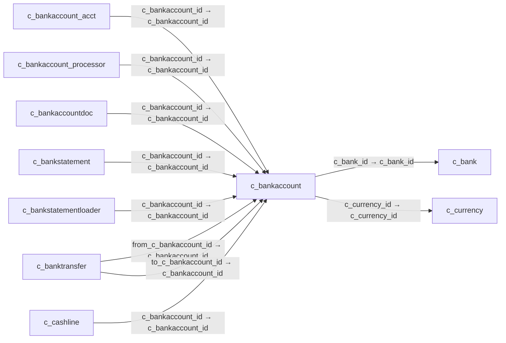

# c_bankaccount — 은행계좌

[전체 일람](../TABLE_INDEX.md) · [분류 일람](README.md) · [AI 사용 안내](../README.md) · [외래키 읽는 법](../RELATIONSHIPS.md)

## 기본 정보

| 항목 | 내용 |
|---|---|
| 물리명 | `adempiere.c_bankaccount` |
| 한국어 논리명(문서용 해석) | 은행계좌 |
| 원본 논리명 | Bank Account |
| 원본 사전 ID | 297 |
| 분류 | `c` — 거래처·주문·청구·결제·회계 기준 |
| 전체 테넌트 행 수 | 3 |
| 물리 열 수 | 22 |
| 나가는 FK / 들어오는 FK | 2 / 22 |
| 구조·행 수 확인 시점 | 2026-11-03T23:29:01+09:00 |

## 의미와 쓰임

은행에 개설된 계좌 정보를 관리하며 은행명세와 입출금 처리의 계좌 기준이 된다.

- 설명 근거: 원본 애플리케이션 사전 명칭·설명을 한국어로 해석.
- 한국어 이름과 개요는 문서용 해석입니다. 공식 한국어 번역으로 간주하지 않습니다.
- 원본 설명: Account at the Bank
- 원본 도움말: —
- PostgreSQL 테이블 주석: —

## 키와 열

### 기본키·고유 제약조건

| 종류 | 제약조건 | 열(순서 유지) |
|---|---|---|
| PRIMARY KEY | `c_bankaccount_pkey` | `c_bankaccount_id` |
| UNIQUE | `c_bankaccount_uu_idx` | `c_bankaccount_uu` |

### 열 목록

원본 논리명·설명은 `AD_Column`에서 가져왔습니다. 기본값은 실제 PostgreSQL 메타데이터이며, 비어 있는 항목은 `—`로 표시합니다.

| 순서 | 물리명 | 원본 논리명 | PostgreSQL 타입 | NULL | PK | 기본값 | 설명 |
|---:|---|---|---|---|---|---|---|
| 1 | `c_bankaccount_id` | Bank Account | numeric(10,0) | 불가 | 예 | — | Account at the Bank |
| 2 | `ad_client_id` | Tenant | numeric(10,0) | 불가 | — | — | Tenant for this installation. |
| 3 | `ad_org_id` | Organization | numeric(10,0) | 불가 | — | — | Organizational entity within tenant |
| 4 | `isactive` | Active | character(1) | 불가 | — | 'Y'::bpchar | The record is active in the system |
| 5 | `created` | Created | timestamp without time zone | 불가 | — | now() | Date this record was created |
| 6 | `createdby` | Created By | numeric(10,0) | 불가 | — | — | User who created this records |
| 7 | `updated` | Updated | timestamp without time zone | 불가 | — | now() | Date this record was updated |
| 8 | `updatedby` | Updated By | numeric(10,0) | 불가 | — | — | User who updated this records |
| 9 | `c_bank_id` | Bank | numeric(10,0) | 불가 | — | — | Bank |
| 10 | `c_currency_id` | Currency | numeric(10,0) | 불가 | — | — | The Currency for this record |
| 11 | `bankaccounttype` | Bank Account Type | character(1) | 불가 | — | — | Bank Account Type |
| 12 | `accountno` | Account No | character varying(20) | 불가 | — | — | Account Number |
| 13 | `currentbalance` | Current balance | numeric | 불가 | — | 0 | Current Balance |
| 14 | `creditlimit` | Credit limit | numeric | 불가 | — | 0 | Amount of Credit allowed |
| 15 | `isdefault` | Default | character(1) | 불가 | — | 'N'::bpchar | Default value |
| 16 | `iban` | IBAN | character varying(40) | 허용 | — | — | International Bank Account Number |
| 17 | `description` | Description | character varying(255) | 허용 | — | — | Optional short description of the record |
| 18 | `bban` | BBAN | character varying(40) | 허용 | — | — | Basic Bank Account Number |
| 19 | `paymentexportclass` | Payment Export Class | character varying(60) | 허용 | — | NULL::character varying | — |
| 20 | `c_bankaccount_uu` | C_BankAccount_UU | uuid | 허용 | — | — | — |
| 21 | `name` | Name | character varying(60) | 불가 | — | NULL::character varying | Alphanumeric identifier of the entity |
| 22 | `value` | Search Key | character varying(40) | 불가 | — | NULL::character varying | Search key for the record in the format required - must be unique |

## 외래키 흐름

화살표는 **FK를 가진 자식 → 참조되는 부모**입니다. 업무 처리의 시간 순서나 무조건적인 1:N 관계를 뜻하지 않습니다.

주변 관계 24개 중 10개를 그림으로 표시합니다. **전체 관계는 아래 두 표에 모두 포함**합니다.

### 이 테이블이 참조하는 부모 — 나가는 FK

| 제약조건 | 참조하는 쪽(자식) | 자식 열 | 참조받는 쪽(부모) | 부모 열 | 삭제 / 갱신 | 검증 / 지연 가능 |
|---|---|---|---|---|---|---|
| `cbank_cbankaccount` <!-- FK_OUT: adempiere.c_bankaccount.cbank_cbankaccount --> | [`c_bankaccount`](c_bankaccount.md) | `c_bank_id` | [`c_bank`](c_bank.md) | `c_bank_id` | CASCADE / NO ACTION | 완료 / 가능 (초기 지연) |
| `ccurrency_cbankaccount` <!-- FK_OUT: adempiere.c_bankaccount.ccurrency_cbankaccount --> | [`c_bankaccount`](c_bankaccount.md) | `c_currency_id` | [`c_currency`](c_currency.md) | `c_currency_id` | NO ACTION / NO ACTION | 완료 / 가능 (초기 지연) |

### 이 테이블을 참조하는 자식 — 들어오는 FK

| 제약조건 | 참조하는 쪽(자식) | 자식 열 | 참조받는 쪽(부모) | 부모 열 | 삭제 / 갱신 | 검증 / 지연 가능 |
|---|---|---|---|---|---|---|
| `cbankaccount_cbankacctacct` <!-- FK_IN: adempiere.c_bankaccount_acct.cbankaccount_cbankacctacct --> | [`c_bankaccount_acct`](c_bankaccount_acct.md) | `c_bankaccount_id` | [`c_bankaccount`](c_bankaccount.md) | `c_bankaccount_id` | CASCADE / NO ACTION | 완료 / 가능 (초기 지연) |
| `cbankaccount_cbankaccountproce` <!-- FK_IN: adempiere.c_bankaccount_processor.cbankaccount_cbankaccountproce --> | [`c_bankaccount_processor`](c_bankaccount_processor.md) | `c_bankaccount_id` | [`c_bankaccount`](c_bankaccount.md) | `c_bankaccount_id` | NO ACTION / NO ACTION | 완료 / 가능 (초기 지연) |
| `cbankaccount_cbadoc` <!-- FK_IN: adempiere.c_bankaccountdoc.cbankaccount_cbadoc --> | [`c_bankaccountdoc`](c_bankaccountdoc.md) | `c_bankaccount_id` | [`c_bankaccount`](c_bankaccount.md) | `c_bankaccount_id` | CASCADE / NO ACTION | 완료 / 가능 (초기 지연) |
| `cbankaccount_cbankstatement` <!-- FK_IN: adempiere.c_bankstatement.cbankaccount_cbankstatement --> | [`c_bankstatement`](c_bankstatement.md) | `c_bankaccount_id` | [`c_bankaccount`](c_bankaccount.md) | `c_bankaccount_id` | NO ACTION / NO ACTION | 완료 / 가능 (초기 지연) |
| `cbankacct_cbankstmtloader` <!-- FK_IN: adempiere.c_bankstatementloader.cbankacct_cbankstmtloader --> | [`c_bankstatementloader`](c_bankstatementloader.md) | `c_bankaccount_id` | [`c_bankaccount`](c_bankaccount.md) | `c_bankaccount_id` | NO ACTION / NO ACTION | 완료 / 가능 (초기 지연) |
| `fromcbankaccount_cbanktransfer` <!-- FK_IN: adempiere.c_banktransfer.fromcbankaccount_cbanktransfer --> | [`c_banktransfer`](c_banktransfer.md) | `from_c_bankaccount_id` | [`c_bankaccount`](c_bankaccount.md) | `c_bankaccount_id` | NO ACTION / NO ACTION | 완료 / 가능 (초기 지연) |
| `tocbankaccount_cbanktransfer` <!-- FK_IN: adempiere.c_banktransfer.tocbankaccount_cbanktransfer --> | [`c_banktransfer`](c_banktransfer.md) | `to_c_bankaccount_id` | [`c_bankaccount`](c_bankaccount.md) | `c_bankaccount_id` | NO ACTION / NO ACTION | 완료 / 가능 (초기 지연) |
| `cbankacct_ccashline` <!-- FK_IN: adempiere.c_cashline.cbankacct_ccashline --> | [`c_cashline`](c_cashline.md) | `c_bankaccount_id` | [`c_bankaccount`](c_bankaccount.md) | `c_bankaccount_id` | NO ACTION / NO ACTION | 완료 / 가능 (초기 지연) |
| `cbankaccount_cdepositbatch` <!-- FK_IN: adempiere.c_depositbatch.cbankaccount_cdepositbatch --> | [`c_depositbatch`](c_depositbatch.md) | `c_bankaccount_id` | [`c_bankaccount`](c_bankaccount.md) | `c_bankaccount_id` | NO ACTION / NO ACTION | 완료 / 가능 (초기 지연) |
| `cbankaccount_celementvalue` <!-- FK_IN: adempiere.c_elementvalue.cbankaccount_celementvalue --> | [`c_elementvalue`](c_elementvalue.md) | `c_bankaccount_id` | [`c_bankaccount`](c_bankaccount.md) | `c_bankaccount_id` | NO ACTION / NO ACTION | 완료 / 가능 (초기 지연) |
| `cbankaccount_cpayment` <!-- FK_IN: adempiere.c_payment.cbankaccount_cpayment --> | [`c_payment`](c_payment.md) | `c_bankaccount_id` | [`c_bankaccount`](c_bankaccount.md) | `c_bankaccount_id` | NO ACTION / NO ACTION | 완료 / 가능 (초기 지연) |
| `cbankaccount_cpaymtprocessor` <!-- FK_IN: adempiere.c_paymentprocessor.cbankaccount_cpaymtprocessor --> | [`c_paymentprocessor`](c_paymentprocessor.md) | `c_bankaccount_id` | [`c_bankaccount`](c_bankaccount.md) | `c_bankaccount_id` | NO ACTION / NO ACTION | 완료 / 가능 (초기 지연) |
| `cbankaccount_cpaymenttransacti` <!-- FK_IN: adempiere.c_paymenttransaction.cbankaccount_cpaymenttransacti --> | [`c_paymenttransaction`](c_paymenttransaction.md) | `c_bankaccount_id` | [`c_bankaccount`](c_bankaccount.md) | `c_bankaccount_id` | NO ACTION / NO ACTION | 완료 / 가능 (초기 지연) |
| `cbankaccount_cpayselection` <!-- FK_IN: adempiere.c_payselection.cbankaccount_cpayselection --> | [`c_payselection`](c_payselection.md) | `c_bankaccount_id` | [`c_bankaccount`](c_bankaccount.md) | `c_bankaccount_id` | NO ACTION / NO ACTION | 완료 / 가능 (초기 지연) |
| `cbankaccount_cpos` <!-- FK_IN: adempiere.c_pos.cbankaccount_cpos --> | [`c_pos`](c_pos.md) | `c_bankaccount_id` | [`c_bankaccount`](c_bankaccount.md) | `c_bankaccount_id` | NO ACTION / NO ACTION | 완료 / 가능 (초기 지연) |
| `cbankaccount_ibankstatement` <!-- FK_IN: adempiere.i_bankstatement.cbankaccount_ibankstatement --> | [`i_bankstatement`](../i/i_bankstatement.md) | `c_bankaccount_id` | [`c_bankaccount`](c_bankaccount.md) | `c_bankaccount_id` | SET NULL / NO ACTION | 완료 / 가능 (초기 지연) |
| `cbankaccount_ipayment` <!-- FK_IN: adempiere.i_payment.cbankaccount_ipayment --> | [`i_payment`](../i/i_payment.md) | `c_bankaccount_id` | [`c_bankaccount`](c_bankaccount.md) | `c_bankaccount_id` | SET NULL / NO ACTION | 완료 / 가능 (초기 지연) |
| `cardbankaccount_uposterminal` <!-- FK_IN: adempiere.u_posterminal.cardbankaccount_uposterminal --> | [`u_posterminal`](../u/u_posterminal.md) | `card_bankaccount_id` | [`c_bankaccount`](c_bankaccount.md) | `c_bankaccount_id` | NO ACTION / NO ACTION | 완료 / 가능 (초기 지연) |
| `cardtransferbankaccount_uposte` <!-- FK_IN: adempiere.u_posterminal.cardtransferbankaccount_uposte --> | [`u_posterminal`](../u/u_posterminal.md) | `cardtransferbankaccount_id` | [`c_bankaccount`](c_bankaccount.md) | `c_bankaccount_id` | NO ACTION / NO ACTION | 완료 / 가능 (초기 지연) |
| `cashtransferbankaccount_uposte` <!-- FK_IN: adempiere.u_posterminal.cashtransferbankaccount_uposte --> | [`u_posterminal`](../u/u_posterminal.md) | `cashtransferbankaccount_id` | [`c_bankaccount`](c_bankaccount.md) | `c_bankaccount_id` | NO ACTION / NO ACTION | 완료 / 가능 (초기 지연) |
| `checkbankaccount_uposterminal` <!-- FK_IN: adempiere.u_posterminal.checkbankaccount_uposterminal --> | [`u_posterminal`](../u/u_posterminal.md) | `check_bankaccount_id` | [`c_bankaccount`](c_bankaccount.md) | `c_bankaccount_id` | NO ACTION / NO ACTION | 완료 / 가능 (초기 지연) |
| `checktransferbankaccount_upost` <!-- FK_IN: adempiere.u_posterminal.checktransferbankaccount_upost --> | [`u_posterminal`](../u/u_posterminal.md) | `checktransferbankaccount_id` | [`c_bankaccount`](c_bankaccount.md) | `c_bankaccount_id` | NO ACTION / NO ACTION | 완료 / 가능 (초기 지연) |

## 조회 시 주의

- FK 표의 자식 열과 부모 열을 같은 순서로 대응시킵니다. 복합 FK는 모든 열의 동등 조건을 `AND`로 연결합니다.
- 테이블 이름이나 `_id` 열 이름만으로 물리 FK가 있다고 가정하지 않습니다. FK 미선언은 업무 관계가 없다는 뜻도 아닙니다.
- 자식이 여러 행인 테이블과 조인하면 부모의 금액·건수가 중복될 수 있습니다. 집계 단위를 먼저 정합니다.
- `ad_client_id`가 있습니다. 업무 분석에서는 대상 테넌트를 명시합니다. GardenWorld는 `11`, 시스템 공통 설정은 `0`일 수 있으므로 일괄 필터 적용 전에 테이블 역할을 확인합니다.
- 행 수는 위 확인 시점의 전체 테넌트 값입니다. 최신 업무 실적이나 현재 실행 결과로 재사용하지 않습니다.
