# c_banktransfer — 은행계좌 간 이체

[전체 일람](../TABLE_INDEX.md) · [분류 일람](README.md) · [AI 사용 안내](../README.md) · [외래키 읽는 법](../RELATIONSHIPS.md)

## 기본 정보

| 항목 | 내용 |
|---|---|
| 물리명 | `adempiere.c_banktransfer` |
| 한국어 논리명(문서용 해석) | 은행계좌 간 이체 |
| 원본 논리명 | Bank Transfer |
| 원본 사전 ID | 200246 |
| 분류 | `c` — 거래처·주문·청구·결제·회계 기준 |
| 전체 테넌트 행 수 | 0 |
| 물리 열 수 | 34 |
| 나가는 FK / 들어오는 FK | 11 / 2 |
| 구조·행 수 확인 시점 | 2026-11-03T23:29:01+09:00 |

## 의미와 쓰임

은행계좌 간 자금 이체를 관리한다.

- 설명 근거: 원본 애플리케이션 사전 명칭·설명을 한국어로 해석.
- 한국어 이름과 개요는 문서용 해석입니다. 공식 한국어 번역으로 간주하지 않습니다.
- 원본 설명: Bank Transfer
- 원본 도움말: —
- PostgreSQL 테이블 주석: —

## 키와 열

### 기본키·고유 제약조건

| 종류 | 제약조건 | 열(순서 유지) |
|---|---|---|
| PRIMARY KEY | `c_banktransfer_key` | `c_banktransfer_id` |
| UNIQUE | `c_banktransfer_uu_idx` | `c_banktransfer_uu` |

### 열 목록

원본 논리명·설명은 `AD_Column`에서 가져왔습니다. 기본값은 실제 PostgreSQL 메타데이터이며, 비어 있는 항목은 `—`로 표시합니다.

| 순서 | 물리명 | 원본 논리명 | PostgreSQL 타입 | NULL | PK | 기본값 | 설명 |
|---:|---|---|---|---|---|---|---|
| 1 | `c_banktransfer_id` | Bank Transfer | numeric(10,0) | 불가 | 예 | — | Bank Transfer |
| 2 | `ad_client_id` | Tenant | numeric(10,0) | 불가 | — | — | Tenant for this installation. |
| 3 | `ad_org_id` | Organization | numeric(10,0) | 불가 | — | — | Organizational entity within tenant |
| 4 | `created` | Created | timestamp without time zone | 불가 | — | statement_timestamp() | Date this record was created |
| 5 | `createdby` | Created By | numeric(10,0) | 불가 | — | — | User who created this records |
| 6 | `description` | Description | character varying(255) | 허용 | — | NULL::character varying | Optional short description of the record |
| 7 | `docaction` | Document Action | character(2) | 불가 | — | 'CO'::bpchar | The targeted status of the document |
| 8 | `docstatus` | Document Status | character(2) | 불가 | — | 'DR'::bpchar | The current status of the document |
| 9 | `documentno` | Document No | character varying(30) | 불가 | — | — | Document sequence number of the document |
| 10 | `isactive` | Active | character(1) | 불가 | — | 'Y'::bpchar | The record is active in the system |
| 11 | `c_banktransfer_uu` | C_BankTransfer_UU | uuid | 허용 | — | — | — |
| 12 | `processed` | Processed | character(1) | 불가 | — | — | The document has been processed |
| 13 | `processing` | Process Now | character(1) | 허용 | — | NULL::bpchar | — |
| 14 | `updated` | Updated | timestamp without time zone | 불가 | — | statement_timestamp() | Date this record was updated |
| 15 | `updatedby` | Updated By | numeric(10,0) | 불가 | — | — | User who updated this records |
| 16 | `paydate` | Payment date | timestamp without time zone | 불가 | — | — | Date Payment made |
| 17 | `from_c_bankaccount_id` | From Bank Account | numeric(10,0) | 불가 | — | — | — |
| 18 | `from_ad_org_id` | From Organization | numeric(10,0) | 불가 | — | — | — |
| 19 | `from_c_charge_id` | From Charge | numeric(10,0) | 불가 | — | — | — |
| 20 | `from_c_currency_id` | From Bank Currency | numeric(10,0) | 불가 | — | — | — |
| 21 | `from_amt` | From Amount | numeric | 불가 | — | — | — |
| 22 | `to_c_bankaccount_id` | To Bank Account | numeric(10,0) | 불가 | — | — | — |
| 23 | `to_ad_org_id` | To Organization | numeric(10,0) | 불가 | — | — | — |
| 24 | `to_c_charge_id` | To Charge | numeric(10,0) | 불가 | — | — | — |
| 25 | `to_c_currency_id` | To Bank Currency | numeric(10,0) | 불가 | — | — | — |
| 26 | `to_amt` | To Amount | numeric | 불가 | — | — | — |
| 27 | `rate` | Rate | numeric | 불가 | — | — | Rate or Tax or Exchange |
| 28 | `from_tendertype` | From Tender Type | character(1) | 불가 | — | 'A'::bpchar | — |
| 29 | `to_tendertype` | To Tender Type | character(1) | 불가 | — | 'D'::bpchar | — |
| 30 | `to_c_bpartner_id` | To Business Partner  | numeric(10,0) | 불가 | — | NULL::numeric | Identifies a Business Partner |
| 31 | `from_c_bpartner_id` | From Business Partner  | numeric(10,0) | 불가 | — | NULL::numeric | Identifies a Business Partner |
| 32 | `dateacct` | Account Date | timestamp without time zone | 불가 | — | — | Accounting Date |
| 33 | `c_conversiontype_id` | Currency Type | numeric(10,0) | 허용 | — | — | Currency Conversion Rate Type |
| 34 | `isoverridecurrencyrate` | Override Currency Conversion Rate | character(1) | 불가 | — | 'N'::bpchar | Override Currency Conversion Rate |

## 외래키 흐름

화살표는 **FK를 가진 자식 → 참조되는 부모**입니다. 업무 처리의 시간 순서나 무조건적인 1:N 관계를 뜻하지 않습니다.

주변 관계 13개 중 10개를 그림으로 표시합니다. **전체 관계는 아래 두 표에 모두 포함**합니다.

```mermaid
flowchart LR
    n0["ad_org"]
    n1["c_bankaccount"]
    n2["c_banktransfer"]
    n3["c_bpartner"]
    n4["c_charge"]
    n5["c_conversiontype"]
    n6["c_currency"]
    n2 -->|"c_conversiontype_id → c_conversiontype_id"| n5
    n2 -->|"from_ad_org_id → ad_org_id"| n0
    n2 -->|"from_c_bankaccount_id → c_bankaccount_id"| n1
    n2 -->|"from_c_bpartner_id → c_bpartner_id"| n3
    n2 -->|"from_c_charge_id → c_charge_id"| n4
    n2 -->|"from_c_currency_id → c_currency_id"| n6
    n2 -->|"to_ad_org_id → ad_org_id"| n0
    n2 -->|"to_c_bankaccount_id → c_bankaccount_id"| n1
    n2 -->|"to_c_bpartner_id → c_bpartner_id"| n3
    n2 -->|"to_c_charge_id → c_charge_id"| n4
```

### 이 테이블이 참조하는 부모 — 나가는 FK

| 제약조건 | 참조하는 쪽(자식) | 자식 열 | 참조받는 쪽(부모) | 부모 열 | 삭제 / 갱신 | 검증 / 지연 가능 |
|---|---|---|---|---|---|---|
| `cconversiontype_cbanktransfer` <!-- FK_OUT: adempiere.c_banktransfer.cconversiontype_cbanktransfer --> | [`c_banktransfer`](c_banktransfer.md) | `c_conversiontype_id` | [`c_conversiontype`](c_conversiontype.md) | `c_conversiontype_id` | NO ACTION / NO ACTION | 완료 / 가능 (초기 지연) |
| `fromadorg_cbanktransfer` <!-- FK_OUT: adempiere.c_banktransfer.fromadorg_cbanktransfer --> | [`c_banktransfer`](c_banktransfer.md) | `from_ad_org_id` | [`ad_org`](../ad/ad_org.md) | `ad_org_id` | NO ACTION / NO ACTION | 완료 / 가능 (초기 지연) |
| `fromcbankaccount_cbanktransfer` <!-- FK_OUT: adempiere.c_banktransfer.fromcbankaccount_cbanktransfer --> | [`c_banktransfer`](c_banktransfer.md) | `from_c_bankaccount_id` | [`c_bankaccount`](c_bankaccount.md) | `c_bankaccount_id` | NO ACTION / NO ACTION | 완료 / 가능 (초기 지연) |
| `fromcbpartner_cbanktransfer` <!-- FK_OUT: adempiere.c_banktransfer.fromcbpartner_cbanktransfer --> | [`c_banktransfer`](c_banktransfer.md) | `from_c_bpartner_id` | [`c_bpartner`](c_bpartner.md) | `c_bpartner_id` | NO ACTION / NO ACTION | 완료 / 가능 (초기 지연) |
| `fromccharge_cbanktransfer` <!-- FK_OUT: adempiere.c_banktransfer.fromccharge_cbanktransfer --> | [`c_banktransfer`](c_banktransfer.md) | `from_c_charge_id` | [`c_charge`](c_charge.md) | `c_charge_id` | NO ACTION / NO ACTION | 완료 / 가능 (초기 지연) |
| `fromccurrency_cbanktransfer` <!-- FK_OUT: adempiere.c_banktransfer.fromccurrency_cbanktransfer --> | [`c_banktransfer`](c_banktransfer.md) | `from_c_currency_id` | [`c_currency`](c_currency.md) | `c_currency_id` | NO ACTION / NO ACTION | 완료 / 가능 (초기 지연) |
| `toadorg_cbanktransfer` <!-- FK_OUT: adempiere.c_banktransfer.toadorg_cbanktransfer --> | [`c_banktransfer`](c_banktransfer.md) | `to_ad_org_id` | [`ad_org`](../ad/ad_org.md) | `ad_org_id` | NO ACTION / NO ACTION | 완료 / 가능 (초기 지연) |
| `tocbankaccount_cbanktransfer` <!-- FK_OUT: adempiere.c_banktransfer.tocbankaccount_cbanktransfer --> | [`c_banktransfer`](c_banktransfer.md) | `to_c_bankaccount_id` | [`c_bankaccount`](c_bankaccount.md) | `c_bankaccount_id` | NO ACTION / NO ACTION | 완료 / 가능 (초기 지연) |
| `tocbpartner_cbanktransfer` <!-- FK_OUT: adempiere.c_banktransfer.tocbpartner_cbanktransfer --> | [`c_banktransfer`](c_banktransfer.md) | `to_c_bpartner_id` | [`c_bpartner`](c_bpartner.md) | `c_bpartner_id` | NO ACTION / NO ACTION | 완료 / 가능 (초기 지연) |
| `toccharge_cbanktransfer` <!-- FK_OUT: adempiere.c_banktransfer.toccharge_cbanktransfer --> | [`c_banktransfer`](c_banktransfer.md) | `to_c_charge_id` | [`c_charge`](c_charge.md) | `c_charge_id` | NO ACTION / NO ACTION | 완료 / 가능 (초기 지연) |
| `toccurrency_cbanktransfer` <!-- FK_OUT: adempiere.c_banktransfer.toccurrency_cbanktransfer --> | [`c_banktransfer`](c_banktransfer.md) | `to_c_currency_id` | [`c_currency`](c_currency.md) | `c_currency_id` | NO ACTION / NO ACTION | 완료 / 가능 (초기 지연) |

### 이 테이블을 참조하는 자식 — 들어오는 FK

| 제약조건 | 참조하는 쪽(자식) | 자식 열 | 참조받는 쪽(부모) | 부모 열 | 삭제 / 갱신 | 검증 / 지연 가능 |
|---|---|---|---|---|---|---|
| `cbanktransfer_callocationline` <!-- FK_IN: adempiere.c_allocationline.cbanktransfer_callocationline --> | [`c_allocationline`](c_allocationline.md) | `c_banktransfer_id` | [`c_banktransfer`](c_banktransfer.md) | `c_banktransfer_id` | NO ACTION / NO ACTION | 완료 / 가능 (초기 지연) |
| `cbanktransfer_cpayment` <!-- FK_IN: adempiere.c_payment.cbanktransfer_cpayment --> | [`c_payment`](c_payment.md) | `c_banktransfer_id` | [`c_banktransfer`](c_banktransfer.md) | `c_banktransfer_id` | NO ACTION / NO ACTION | 완료 / 가능 (초기 지연) |

## 조회 시 주의

- FK 표의 자식 열과 부모 열을 같은 순서로 대응시킵니다. 복합 FK는 모든 열의 동등 조건을 `AND`로 연결합니다.
- 테이블 이름이나 `_id` 열 이름만으로 물리 FK가 있다고 가정하지 않습니다. FK 미선언은 업무 관계가 없다는 뜻도 아닙니다.
- 자식이 여러 행인 테이블과 조인하면 부모의 금액·건수가 중복될 수 있습니다. 집계 단위를 먼저 정합니다.
- `ad_client_id`가 있습니다. 업무 분석에서는 대상 테넌트를 명시합니다. GardenWorld는 `11`, 시스템 공통 설정은 `0`일 수 있으므로 일괄 필터 적용 전에 테이블 역할을 확인합니다.
- 수집 시점에 0행입니다. 이 표만으로 거래 실적·처리 결과를 계산할 수 없습니다.
- 행 수는 위 확인 시점의 전체 테넌트 값입니다. 최신 업무 실적이나 현재 실행 결과로 재사용하지 않습니다.
