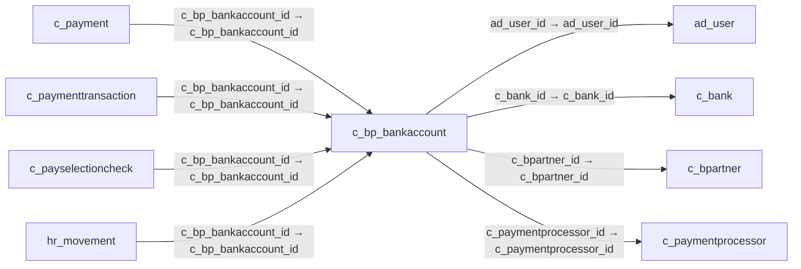

# c_bp_bankaccount — 거래처 은행계좌

[전체 일람](../TABLE_INDEX.md) · [분류 일람](README.md) · [AI 사용 안내](../README.md) · [외래키 읽는 법](../RELATIONSHIPS.md)

## 기본 정보

| 항목 | 내용 |
|---|---|
| 물리명 | `adempiere.c_bp_bankaccount` |
| 한국어 논리명(문서용 해석) | 거래처 은행계좌 |
| 원본 논리명 | Partner Bank Account |
| 원본 사전 ID | 298 |
| 분류 | `c` — 거래처·주문·청구·결제·회계 기준 |
| 전체 테넌트 행 수 | 1 |
| 물리 열 수 | 36 |
| 나가는 FK / 들어오는 FK | 4 / 4 |
| 구조·행 수 확인 시점 | 2026-11-03T23:29:01+09:00 |

## 의미와 쓰임

거래처의 은행계좌를 관리한다. 회사 자체 계좌 기준인 c_bankaccount와 구분한다.

- 설명 근거: 원본 애플리케이션 사전 명칭·설명을 한국어로 해석.
- 한국어 이름과 개요는 문서용 해석입니다. 공식 한국어 번역으로 간주하지 않습니다.
- 원본 설명: Bank Account of the Business Partner
- 원본 도움말: —
- PostgreSQL 테이블 주석: —

## 키와 열

### 기본키·고유 제약조건

| 종류 | 제약조건 | 열(순서 유지) |
|---|---|---|
| PRIMARY KEY | `c_bp_bankaccount_pkey` | `c_bp_bankaccount_id` |
| UNIQUE | `c_bp_bankaccount_uu_idx` | `c_bp_bankaccount_uu` |

### 열 목록

원본 논리명·설명은 `AD_Column`에서 가져왔습니다. 기본값은 실제 PostgreSQL 메타데이터이며, 비어 있는 항목은 `—`로 표시합니다.

| 순서 | 물리명 | 원본 논리명 | PostgreSQL 타입 | NULL | PK | 기본값 | 설명 |
|---:|---|---|---|---|---|---|---|
| 1 | `c_bp_bankaccount_id` | Partner Bank Account | numeric(10,0) | 불가 | 예 | — | Bank Account of the Business Partner |
| 2 | `ad_client_id` | Tenant | numeric(10,0) | 불가 | — | — | Tenant for this installation. |
| 3 | `ad_org_id` | Organization | numeric(10,0) | 불가 | — | — | Organizational entity within tenant |
| 4 | `created` | Created | timestamp without time zone | 불가 | — | now() | Date this record was created |
| 5 | `updated` | Updated | timestamp without time zone | 불가 | — | now() | Date this record was updated |
| 6 | `isactive` | Active | character(1) | 불가 | — | 'Y'::bpchar | The record is active in the system |
| 7 | `createdby` | Created By | numeric(10,0) | 불가 | — | — | User who created this records |
| 8 | `updatedby` | Updated By | numeric(10,0) | 불가 | — | — | User who updated this records |
| 9 | `c_bpartner_id` | Business Partner | numeric(10,0) | 불가 | — | — | Identifies a Business Partner |
| 10 | `c_bank_id` | Bank | numeric(10,0) | 허용 | — | — | Bank |
| 11 | `isach` | ACH | character(1) | 불가 | — | 'N'::bpchar | Automatic Clearing House |
| 12 | `bankaccounttype` | Bank Account Type | character(1) | 허용 | — | — | Bank Account Type |
| 13 | `routingno` | Routing No | character varying(20) | 허용 | — | — | Bank Routing Number |
| 14 | `accountno` | Account No | character varying(20) | 허용 | — | — | Account Number |
| 15 | `creditcardtype` | Credit Card | character(1) | 허용 | — | — | Credit Card (Visa, MC, AmEx) |
| 16 | `creditcardnumber` | Number | character varying(20) | 허용 | — | — | Credit Card Number  |
| 17 | `creditcardvv` | Verification Code | character varying(4) | 허용 | — | — | Credit Card Verification code on credit card |
| 18 | `creditcardexpmm` | Exp. Month | numeric(10,0) | 허용 | — | — | Expiry Month |
| 19 | `creditcardexpyy` | Exp. Year | numeric(10,0) | 허용 | — | — | Expiry Year |
| 20 | `a_name` | Account Name | character varying(60) | 허용 | — | — | Name on Credit Card or Account holder |
| 21 | `a_street` | Account Street | character varying(60) | 허용 | — | — | Street address of the Credit Card or Account holder |
| 22 | `a_city` | Account City | character varying(60) | 허용 | — | — | City or the Credit Card or Account Holder |
| 23 | `a_state` | Account State | character varying(40) | 허용 | — | — | State of the Credit Card or Account holder |
| 24 | `a_zip` | Account Zip/Postal | character varying(20) | 허용 | — | — | Zip Code of the Credit Card or Account Holder |
| 25 | `a_ident_dl` | Driver License | character varying(20) | 허용 | — | — | Payment Identification - Driver License |
| 26 | `a_email` | Account EMail | character varying(60) | 허용 | — | — | Email Address |
| 27 | `a_ident_ssn` | Social Security No | character varying(20) | 허용 | — | — | Payment Identification - Social Security No |
| 28 | `r_avsaddr` | Address verified | character(1) | 허용 | — | — | This address has been verified |
| 29 | `r_avszip` | Zip verified | character(1) | 허용 | — | — | The Zip Code has been verified |
| 30 | `a_country` | Account Country | character varying(40) | 허용 | — | — | Country |
| 31 | `ad_user_id` | User/Contact | numeric(10,0) | 허용 | — | — | User within the system - Internal or Business Partner Contact |
| 32 | `bpbankacctuse` | Account Usage | character(1) | 허용 | — | — | Business Partner Bank Account usage |
| 33 | `c_bp_bankaccount_uu` | C_BP_BankAccount_UU | uuid | 허용 | — | — | — |
| 34 | `customerpaymentprofileid` | Customer Payment Profile ID | character varying(60) | 허용 | — | NULL::character varying | — |
| 35 | `c_paymentprocessor_id` | Payment Processor | numeric(10,0) | 허용 | — | NULL::numeric | Payment processor for electronic payments |
| 36 | `iban` | IBAN | character varying(40) | 허용 | — | NULL::character varying | International Bank Account Number |

## 외래키 흐름

화살표는 **FK를 가진 자식 → 참조되는 부모**입니다. 업무 처리의 시간 순서나 무조건적인 1:N 관계를 뜻하지 않습니다.

주변 관계 8개 중 8개를 그림으로 표시합니다. **전체 관계는 아래 두 표에 모두 포함**합니다.

### 이 테이블이 참조하는 부모 — 나가는 FK

| 제약조건 | 참조하는 쪽(자식) | 자식 열 | 참조받는 쪽(부모) | 부모 열 | 삭제 / 갱신 | 검증 / 지연 가능 |
|---|---|---|---|---|---|---|
| `aduser_cbpbankaccount` <!-- FK_OUT: adempiere.c_bp_bankaccount.aduser_cbpbankaccount --> | [`c_bp_bankaccount`](c_bp_bankaccount.md) | `ad_user_id` | [`ad_user`](../ad/ad_user.md) | `ad_user_id` | NO ACTION / NO ACTION | 완료 / 가능 (초기 지연) |
| `cbank_cbpbankaccount` <!-- FK_OUT: adempiere.c_bp_bankaccount.cbank_cbpbankaccount --> | [`c_bp_bankaccount`](c_bp_bankaccount.md) | `c_bank_id` | [`c_bank`](c_bank.md) | `c_bank_id` | SET NULL / NO ACTION | 완료 / 가능 (초기 지연) |
| `cbpartner_cbpbankaccount` <!-- FK_OUT: adempiere.c_bp_bankaccount.cbpartner_cbpbankaccount --> | [`c_bp_bankaccount`](c_bp_bankaccount.md) | `c_bpartner_id` | [`c_bpartner`](c_bpartner.md) | `c_bpartner_id` | CASCADE / NO ACTION | 완료 / 가능 (초기 지연) |
| `cpaymentprocessor_cbpbankaccou` <!-- FK_OUT: adempiere.c_bp_bankaccount.cpaymentprocessor_cbpbankaccou --> | [`c_bp_bankaccount`](c_bp_bankaccount.md) | `c_paymentprocessor_id` | [`c_paymentprocessor`](c_paymentprocessor.md) | `c_paymentprocessor_id` | NO ACTION / NO ACTION | 완료 / 가능 (초기 지연) |

### 이 테이블을 참조하는 자식 — 들어오는 FK

| 제약조건 | 참조하는 쪽(자식) | 자식 열 | 참조받는 쪽(부모) | 부모 열 | 삭제 / 갱신 | 검증 / 지연 가능 |
|---|---|---|---|---|---|---|
| `cbpbankacct_cpayment` <!-- FK_IN: adempiere.c_payment.cbpbankacct_cpayment --> | [`c_payment`](c_payment.md) | `c_bp_bankaccount_id` | [`c_bp_bankaccount`](c_bp_bankaccount.md) | `c_bp_bankaccount_id` | SET NULL / NO ACTION | 완료 / 가능 (초기 지연) |
| `cbpbankaccount_cpaymenttransac` <!-- FK_IN: adempiere.c_paymenttransaction.cbpbankaccount_cpaymenttransac --> | [`c_paymenttransaction`](c_paymenttransaction.md) | `c_bp_bankaccount_id` | [`c_bp_bankaccount`](c_bp_bankaccount.md) | `c_bp_bankaccount_id` | NO ACTION / NO ACTION | 완료 / 가능 (초기 지연) |
| `cbpbankaccount_cpayselectionch` <!-- FK_IN: adempiere.c_payselectioncheck.cbpbankaccount_cpayselectionch --> | [`c_payselectioncheck`](c_payselectioncheck.md) | `c_bp_bankaccount_id` | [`c_bp_bankaccount`](c_bp_bankaccount.md) | `c_bp_bankaccount_id` | NO ACTION / NO ACTION | 완료 / 가능 (초기 지연) |
| `cbpbankaccount_hrmovement` <!-- FK_IN: adempiere.hr_movement.cbpbankaccount_hrmovement --> | [`hr_movement`](../hr/hr_movement.md) | `c_bp_bankaccount_id` | [`c_bp_bankaccount`](c_bp_bankaccount.md) | `c_bp_bankaccount_id` | NO ACTION / NO ACTION | 완료 / 가능 (초기 지연) |

## 조회 시 주의

- FK 표의 자식 열과 부모 열을 같은 순서로 대응시킵니다. 복합 FK는 모든 열의 동등 조건을 `AND`로 연결합니다.
- 테이블 이름이나 `_id` 열 이름만으로 물리 FK가 있다고 가정하지 않습니다. FK 미선언은 업무 관계가 없다는 뜻도 아닙니다.
- 자식이 여러 행인 테이블과 조인하면 부모의 금액·건수가 중복될 수 있습니다. 집계 단위를 먼저 정합니다.
- `ad_client_id`가 있습니다. 업무 분석에서는 대상 테넌트를 명시합니다. GardenWorld는 `11`, 시스템 공통 설정은 `0`일 수 있으므로 일괄 필터 적용 전에 테이블 역할을 확인합니다.
- 행 수는 위 확인 시점의 전체 테넌트 값입니다. 최신 업무 실적이나 현재 실행 결과로 재사용하지 않습니다.
