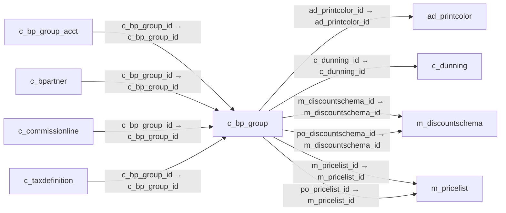

# c_bp_group — 거래처 그룹

[전체 일람](../TABLE_INDEX.md) · [분류 일람](README.md) · [AI 사용 안내](../README.md) · [외래키 읽는 법](../RELATIONSHIPS.md)

## 기본 정보

| 항목 | 내용 |
|---|---|
| 물리명 | `adempiere.c_bp_group` |
| 한국어 논리명(문서용 해석) | 거래처 그룹 |
| 원본 논리명 | Business Partner Group |
| 원본 사전 ID | 394 |
| 분류 | `c` — 거래처·주문·청구·결제·회계 기준 |
| 전체 테넌트 행 수 | 3 |
| 물리 열 수 | 23 |
| 나가는 FK / 들어오는 FK | 6 / 11 |
| 구조·행 수 확인 시점 | 2026-11-03T23:29:01+09:00 |

## 의미와 쓰임

고객·공급업체 등 거래처를 공통 그룹으로 분류한다.

- 설명 근거: 원본 애플리케이션 사전 명칭·설명을 한국어로 해석.
- 한국어 이름과 개요는 문서용 해석입니다. 공식 한국어 번역으로 간주하지 않습니다.
- 원본 설명: Business Partner Group
- 원본 도움말: —
- PostgreSQL 테이블 주석: —

## 키와 열

### 기본키·고유 제약조건

| 종류 | 제약조건 | 열(순서 유지) |
|---|---|---|
| PRIMARY KEY | `c_bp_group_pkey` | `c_bp_group_id` |
| UNIQUE | `c_bp_group_uu_idx` | `c_bp_group_uu` |

### 별도 고유 인덱스

PK·UNIQUE 제약조건의 인덱스와 별도로 존재하는 고유 인덱스입니다. 식·조건·열 순서는 원본 정의를 따릅니다.

- `c_bp_group_value`: `CREATE UNIQUE INDEX c_bp_group_value ON adempiere.c_bp_group USING btree (ad_client_id, value)`

### 열 목록

원본 논리명·설명은 `AD_Column`에서 가져왔습니다. 기본값은 실제 PostgreSQL 메타데이터이며, 비어 있는 항목은 `—`로 표시합니다.

| 순서 | 물리명 | 원본 논리명 | PostgreSQL 타입 | NULL | PK | 기본값 | 설명 |
|---:|---|---|---|---|---|---|---|
| 1 | `c_bp_group_id` | Business Partner Group | numeric(10,0) | 불가 | 예 | — | Business Partner Group |
| 2 | `ad_client_id` | Tenant | numeric(10,0) | 불가 | — | — | Tenant for this installation. |
| 3 | `ad_org_id` | Organization | numeric(10,0) | 불가 | — | — | Organizational entity within tenant |
| 4 | `isactive` | Active | character(1) | 불가 | — | 'Y'::bpchar | The record is active in the system |
| 5 | `created` | Created | timestamp without time zone | 불가 | — | now() | Date this record was created |
| 6 | `createdby` | Created By | numeric(10,0) | 불가 | — | — | User who created this records |
| 7 | `updated` | Updated | timestamp without time zone | 불가 | — | now() | Date this record was updated |
| 8 | `updatedby` | Updated By | numeric(10,0) | 불가 | — | — | User who updated this records |
| 9 | `value` | Search Key | character varying(40) | 불가 | — | — | Search key for the record in the format required - must be unique |
| 10 | `name` | Name | character varying(60) | 불가 | — | — | Alphanumeric identifier of the entity |
| 11 | `description` | Description | character varying(255) | 허용 | — | — | Optional short description of the record |
| 12 | `isdefault` | Default | character(1) | 불가 | — | 'N'::bpchar | Default value |
| 13 | `ad_printcolor_id` | Print Color | numeric(10,0) | 허용 | — | — | Color used for printing and display |
| 14 | `isconfidentialinfo` | Confidential Info | character(1) | 불가 | — | 'N'::bpchar | Can enter confidential information |
| 15 | `prioritybase` | Priority Base | character(1) | 허용 | — | — | Base of Priority |
| 16 | `m_pricelist_id` | Price List | numeric(10,0) | 허용 | — | — | Unique identifier of a Price List |
| 17 | `po_pricelist_id` | Purchase Price List | numeric(10,0) | 허용 | — | — | Price List used by this Business Partner |
| 18 | `m_discountschema_id` | Discount Schema | numeric(10,0) | 허용 | — | — | Schema to calculate the trade discount percentage |
| 19 | `po_discountschema_id` | PO Discount Schema | numeric(10,0) | 허용 | — | — | Schema to calculate the purchase trade discount percentage |
| 20 | `creditwatchpercent` | Credit Watch % | numeric | 허용 | — | — | Credit Watch - Percent of Credit Limit when OK switches to Watch |
| 21 | `pricematchtolerance` | Price Match Tolerance | numeric | 허용 | — | — | PO-Invoice Match Price Tolerance in percent of the purchase price |
| 22 | `c_dunning_id` | Dunning | numeric(10,0) | 허용 | — | — | Dunning Rules for overdue invoices |
| 23 | `c_bp_group_uu` | C_BP_Group_UU | uuid | 허용 | — | — | — |

## 외래키 흐름

화살표는 **FK를 가진 자식 → 참조되는 부모**입니다. 업무 처리의 시간 순서나 무조건적인 1:N 관계를 뜻하지 않습니다.

주변 관계 17개 중 10개를 그림으로 표시합니다. **전체 관계는 아래 두 표에 모두 포함**합니다.

### 이 테이블이 참조하는 부모 — 나가는 FK

| 제약조건 | 참조하는 쪽(자식) | 자식 열 | 참조받는 쪽(부모) | 부모 열 | 삭제 / 갱신 | 검증 / 지연 가능 |
|---|---|---|---|---|---|---|
| `adprintcolor_cbpgroup` <!-- FK_OUT: adempiere.c_bp_group.adprintcolor_cbpgroup --> | [`c_bp_group`](c_bp_group.md) | `ad_printcolor_id` | [`ad_printcolor`](../ad/ad_printcolor.md) | `ad_printcolor_id` | NO ACTION / NO ACTION | 완료 / 가능 (초기 지연) |
| `cdunning_cbpgroup` <!-- FK_OUT: adempiere.c_bp_group.cdunning_cbpgroup --> | [`c_bp_group`](c_bp_group.md) | `c_dunning_id` | [`c_dunning`](c_dunning.md) | `c_dunning_id` | NO ACTION / NO ACTION | 완료 / 가능 (초기 지연) |
| `mdiscountschema_cbpgroup` <!-- FK_OUT: adempiere.c_bp_group.mdiscountschema_cbpgroup --> | [`c_bp_group`](c_bp_group.md) | `m_discountschema_id` | [`m_discountschema`](../m/m_discountschema.md) | `m_discountschema_id` | SET NULL / NO ACTION | 완료 / 가능 (초기 지연) |
| `mdiscountschemapo_cbpgroup` <!-- FK_OUT: adempiere.c_bp_group.mdiscountschemapo_cbpgroup --> | [`c_bp_group`](c_bp_group.md) | `po_discountschema_id` | [`m_discountschema`](../m/m_discountschema.md) | `m_discountschema_id` | SET NULL / NO ACTION | 완료 / 가능 (초기 지연) |
| `mpricelist_cbpgroup` <!-- FK_OUT: adempiere.c_bp_group.mpricelist_cbpgroup --> | [`c_bp_group`](c_bp_group.md) | `m_pricelist_id` | [`m_pricelist`](../m/m_pricelist.md) | `m_pricelist_id` | SET NULL / NO ACTION | 완료 / 가능 (초기 지연) |
| `mpricelistpo_cbpgroup` <!-- FK_OUT: adempiere.c_bp_group.mpricelistpo_cbpgroup --> | [`c_bp_group`](c_bp_group.md) | `po_pricelist_id` | [`m_pricelist`](../m/m_pricelist.md) | `m_pricelist_id` | SET NULL / NO ACTION | 완료 / 가능 (초기 지연) |

### 이 테이블을 참조하는 자식 — 들어오는 FK

| 제약조건 | 참조하는 쪽(자식) | 자식 열 | 참조받는 쪽(부모) | 부모 열 | 삭제 / 갱신 | 검증 / 지연 가능 |
|---|---|---|---|---|---|---|
| `cbpgroup_cbpgroupacct` <!-- FK_IN: adempiere.c_bp_group_acct.cbpgroup_cbpgroupacct --> | [`c_bp_group_acct`](c_bp_group_acct.md) | `c_bp_group_id` | [`c_bp_group`](c_bp_group.md) | `c_bp_group_id` | CASCADE / NO ACTION | 완료 / 가능 (초기 지연) |
| `cbpgroup_cbpartner` <!-- FK_IN: adempiere.c_bpartner.cbpgroup_cbpartner --> | [`c_bpartner`](c_bpartner.md) | `c_bp_group_id` | [`c_bp_group`](c_bp_group.md) | `c_bp_group_id` | NO ACTION / NO ACTION | 완료 / 가능 (초기 지연) |
| `cbpgroup_commissionline` <!-- FK_IN: adempiere.c_commissionline.cbpgroup_commissionline --> | [`c_commissionline`](c_commissionline.md) | `c_bp_group_id` | [`c_bp_group`](c_bp_group.md) | `c_bp_group_id` | NO ACTION / NO ACTION | 완료 / 가능 (초기 지연) |
| `cbpgroup_ctaxdefinition` <!-- FK_IN: adempiere.c_taxdefinition.cbpgroup_ctaxdefinition --> | [`c_taxdefinition`](c_taxdefinition.md) | `c_bp_group_id` | [`c_bp_group`](c_bp_group.md) | `c_bp_group_id` | NO ACTION / NO ACTION | 완료 / 가능 (초기 지연) |
| `cbpgrpup_cmalistbpgroup` <!-- FK_IN: adempiere.cm_accesslistbpgroup.cbpgrpup_cmalistbpgroup --> | [`cm_accesslistbpgroup`](../cm/cm_accesslistbpgroup.md) | `c_bp_group_id` | [`c_bp_group`](c_bp_group.md) | `c_bp_group_id` | CASCADE / NO ACTION | 완료 / 가능 (초기 지연) |
| `cbpgroup_hrconceptacct` <!-- FK_IN: adempiere.hr_concept_acct.cbpgroup_hrconceptacct --> | [`hr_concept_acct`](../hr/hr_concept_acct.md) | `c_bp_group_id` | [`c_bp_group`](c_bp_group.md) | `c_bp_group_id` | NO ACTION / NO ACTION | 완료 / 가능 (초기 지연) |
| `cbpgroup_hrmovement` <!-- FK_IN: adempiere.hr_movement.cbpgroup_hrmovement --> | [`hr_movement`](../hr/hr_movement.md) | `c_bp_group_id` | [`c_bp_group`](c_bp_group.md) | `c_bp_group_id` | NO ACTION / NO ACTION | 완료 / 가능 (초기 지연) |
| `cbpgroup_ibpartner` <!-- FK_IN: adempiere.i_bpartner.cbpgroup_ibpartner --> | [`i_bpartner`](../i/i_bpartner.md) | `c_bp_group_id` | [`c_bp_group`](c_bp_group.md) | `c_bp_group_id` | SET NULL / NO ACTION | 완료 / 가능 (초기 지연) |
| `cbpgroup_mpromotionpreconditio` <!-- FK_IN: adempiere.m_promotionprecondition.cbpgroup_mpromotionpreconditio --> | [`m_promotionprecondition`](../m/m_promotionprecondition.md) | `c_bp_group_id` | [`c_bp_group`](c_bp_group.md) | `c_bp_group_id` | NO ACTION / NO ACTION | 완료 / 가능 (초기 지연) |
| `cbpgroup_pagoalrestriction` <!-- FK_IN: adempiere.pa_goalrestriction.cbpgroup_pagoalrestriction --> | [`pa_goalrestriction`](../pa/pa_goalrestriction.md) | `c_bp_group_id` | [`c_bp_group`](c_bp_group.md) | `c_bp_group_id` | NO ACTION / NO ACTION | 완료 / 가능 (초기 지연) |
| `cbpgroup_taging` <!-- FK_IN: adempiere.t_aging.cbpgroup_taging --> | [`t_aging`](../t/t_aging.md) | `c_bp_group_id` | [`c_bp_group`](c_bp_group.md) | `c_bp_group_id` | CASCADE / NO ACTION | 완료 / 가능 (초기 지연) |

## 조회 시 주의

- FK 표의 자식 열과 부모 열을 같은 순서로 대응시킵니다. 복합 FK는 모든 열의 동등 조건을 `AND`로 연결합니다.
- 테이블 이름이나 `_id` 열 이름만으로 물리 FK가 있다고 가정하지 않습니다. FK 미선언은 업무 관계가 없다는 뜻도 아닙니다.
- 자식이 여러 행인 테이블과 조인하면 부모의 금액·건수가 중복될 수 있습니다. 집계 단위를 먼저 정합니다.
- `ad_client_id`가 있습니다. 업무 분석에서는 대상 테넌트를 명시합니다. GardenWorld는 `11`, 시스템 공통 설정은 `0`일 수 있으므로 일괄 필터 적용 전에 테이블 역할을 확인합니다.
- 행 수는 위 확인 시점의 전체 테넌트 값입니다. 최신 업무 실적이나 현재 실행 결과로 재사용하지 않습니다.
