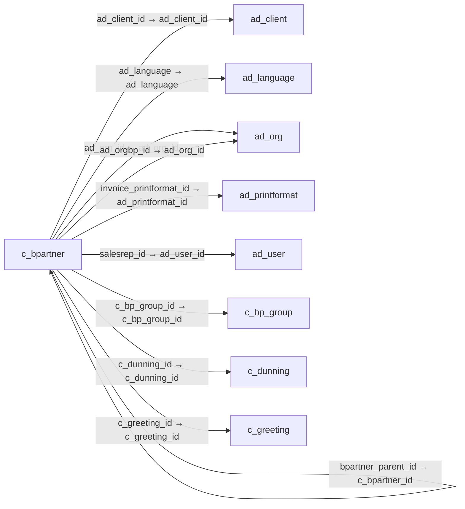

# c_bpartner — 거래처

[전체 일람](../TABLE_INDEX.md) · [분류 일람](README.md) · [AI 사용 안내](../README.md) · [외래키 읽는 법](../RELATIONSHIPS.md)

## 기본 정보

| 항목 | 내용 |
|---|---|
| 물리명 | `adempiere.c_bpartner` |
| 한국어 논리명(문서용 해석) | 거래처 |
| 원본 논리명 | Business Partner |
| 원본 사전 ID | 291 |
| 분류 | `c` — 거래처·주문·청구·결제·회계 기준 |
| 전체 테넌트 행 수 | 18 |
| 물리 열 수 | 74 |
| 나가는 FK / 들어오는 FK | 20 / 125 |
| 구조·행 수 확인 시점 | 2026-11-03T23:29:01+09:00 |

## 의미와 쓰임

고객·공급업체·직원 등 업무상 거래 상대방의 공통 기준정보를 관리한다.

- 설명 근거: 원본 애플리케이션 사전 명칭·설명을 한국어로 해석.
- 한국어 이름과 개요는 문서용 해석입니다. 공식 한국어 번역으로 간주하지 않습니다.
- 원본 설명: Identifies a Business Partner
- 원본 도움말: —
- PostgreSQL 테이블 주석: —

## 키와 열

### 기본키·고유 제약조건

| 종류 | 제약조건 | 열(순서 유지) |
|---|---|---|
| PRIMARY KEY | `c_bpartner_pkey` | `c_bpartner_id` |
| UNIQUE | `c_bpartner_uu_idx` | `c_bpartner_uu` |

### 별도 고유 인덱스

PK·UNIQUE 제약조건의 인덱스와 별도로 존재하는 고유 인덱스입니다. 식·조건·열 순서는 원본 정의를 따릅니다.

- `c_bpartner_value`: `CREATE UNIQUE INDEX c_bpartner_value ON adempiere.c_bpartner USING btree (ad_client_id, value)`

### 열 목록

원본 논리명·설명은 `AD_Column`에서 가져왔습니다. 기본값은 실제 PostgreSQL 메타데이터이며, 비어 있는 항목은 `—`로 표시합니다.

| 순서 | 물리명 | 원본 논리명 | PostgreSQL 타입 | NULL | PK | 기본값 | 설명 |
|---:|---|---|---|---|---|---|---|
| 1 | `c_bpartner_id` | Business Partner | numeric(10,0) | 불가 | 예 | — | Identifies a Business Partner |
| 2 | `ad_client_id` | Tenant | numeric(10,0) | 불가 | — | — | Tenant for this installation. |
| 3 | `ad_org_id` | Organization | numeric(10,0) | 불가 | — | — | Organizational entity within tenant |
| 4 | `isactive` | Active | character(1) | 불가 | — | 'Y'::bpchar | The record is active in the system |
| 5 | `created` | Created | timestamp without time zone | 불가 | — | now() | Date this record was created |
| 6 | `createdby` | Created By | numeric(10,0) | 불가 | — | — | User who created this records |
| 7 | `updated` | Updated | timestamp without time zone | 불가 | — | now() | Date this record was updated |
| 8 | `updatedby` | Updated By | numeric(10,0) | 불가 | — | — | User who updated this records |
| 9 | `value` | Search Key | character varying(40) | 불가 | — | — | Search key for the record in the format required - must be unique |
| 10 | `name` | Name | character varying(120) | 불가 | — | — | Alphanumeric identifier of the entity |
| 11 | `name2` | Name 2 | character varying(60) | 허용 | — | — | Additional Name |
| 12 | `description` | Description | character varying(255) | 허용 | — | — | Optional short description of the record |
| 13 | `issummary` | Summary Level | character(1) | 불가 | — | 'N'::bpchar | This is a summary entity |
| 14 | `c_bp_group_id` | Business Partner Group | numeric(10,0) | 불가 | — | — | Business Partner Group |
| 15 | `isonetime` | One time transaction | character(1) | 불가 | — | 'N'::bpchar | — |
| 16 | `isprospect` | Prospect | character(1) | 불가 | — | 'N'::bpchar | Indicates this is a Prospect |
| 17 | `isvendor` | Vendor | character(1) | 불가 | — | 'N'::bpchar | Indicates if this Business Partner is a Vendor |
| 18 | `iscustomer` | Customer | character(1) | 불가 | — | 'Y'::bpchar | Indicates if this Business Partner is a Customer |
| 19 | `isemployee` | Employee | character(1) | 불가 | — | 'N'::bpchar | Indicates if  this Business Partner is an employee |
| 20 | `issalesrep` | Sales Representative | character(1) | 불가 | — | 'N'::bpchar | Indicates if  the business partner is a sales representative or company agent |
| 21 | `referenceno` | Reference No | character varying(40) | 허용 | — | — | Your customer or vendor number at the Business Partner's site |
| 22 | `duns` | D-U-N-S | character varying(11) | 허용 | — | — | Dun &amp; Bradstreet Number |
| 23 | `url` | URL | character varying(120) | 허용 | — | — | Full URL address - e.g. http://www.idempiere.org |
| 24 | `ad_language` | Language | character varying(6) | 허용 | — | — | Language for this entity |
| 25 | `taxid` | Tax ID | character varying(20) | 허용 | — | — | Tax Identification |
| 26 | `istaxexempt` | SO Tax exempt | character(1) | 허용 | — | 'N'::bpchar | Business partner is exempt from tax on sales |
| 27 | `c_invoiceschedule_id` | Invoice Schedule | numeric(10,0) | 허용 | — | — | Schedule for generating Invoices |
| 28 | `rating` | Rating | character(1) | 허용 | — | — | Classification or Importance |
| 29 | `salesvolume` | Sales Volume in 1.000 | numeric(10,0) | 허용 | — | — | Total Volume of Sales in Thousands of Currency |
| 30 | `numberemployees` | Employees | numeric(10,0) | 허용 | — | — | Number of employees |
| 31 | `naics` | NAICS/SIC | character varying(6) | 허용 | — | — | Standard Industry Code or its successor NAIC - http://www.osha.gov/oshstats/sicser.html |
| 32 | `firstsale` | First Sale | timestamp without time zone | 허용 | — | — | Date of First Sale |
| 33 | `acqusitioncost` | Acquisition Cost | numeric | 허용 | — | 0 | The cost of gaining the prospect as a customer |
| 34 | `potentiallifetimevalue` | Potential Life Time Value | numeric | 허용 | — | 0 | Total Revenue expected |
| 35 | `actuallifetimevalue` | Actual Life Time Value | numeric | 허용 | — | 0 | Actual Life Time Revenue |
| 36 | `shareofcustomer` | Share | numeric(10,0) | 허용 | — | — | Share of Customer's business as a percentage |
| 37 | `paymentrule` | Payment Rule | character(1) | 허용 | — | — | How you pay the invoice |
| 38 | `so_creditlimit` | Credit Limit | numeric | 허용 | — | 0 | Total outstanding invoice amounts allowed |
| 39 | `so_creditused` | Credit Used | numeric | 허용 | — | 0 | Current open balance |
| 40 | `c_paymentterm_id` | Payment Term | numeric(10,0) | 허용 | — | — | The terms of Payment (timing, discount) |
| 41 | `m_pricelist_id` | Price List | numeric(10,0) | 허용 | — | — | Unique identifier of a Price List |
| 42 | `m_discountschema_id` | Discount Schema | numeric(10,0) | 허용 | — | — | Schema to calculate the trade discount percentage |
| 43 | `c_dunning_id` | Dunning | numeric(10,0) | 허용 | — | — | Dunning Rules for overdue invoices |
| 44 | `isdiscountprinted` | Discount Printed | character(1) | 허용 | — | 'Y'::bpchar | Print Discount on Invoice and Order |
| 45 | `so_description` | Order Description | character varying(255) | 허용 | — | — | Description to be used on orders |
| 46 | `poreference` | Order Reference | character varying(20) | 허용 | — | — | Transaction Reference Number (Sales Order, Purchase Order) of your Business Partner |
| 47 | `paymentrulepo` | Payment Rule | character(1) | 허용 | — | — | Purchase payment option |
| 48 | `po_pricelist_id` | Purchase Price List | numeric(10,0) | 허용 | — | — | Price List used by this Business Partner |
| 49 | `po_discountschema_id` | PO Discount Schema | numeric(10,0) | 허용 | — | — | Schema to calculate the purchase trade discount percentage |
| 50 | `po_paymentterm_id` | PO Payment Term | numeric(10,0) | 허용 | — | — | Payment rules for a purchase order |
| 51 | `documentcopies` | Document Copies | numeric(10,0) | 허용 | — | — | Number of copies to be printed |
| 52 | `c_greeting_id` | Greeting | numeric(10,0) | 허용 | — | — | Greeting to print on correspondence |
| 53 | `invoicerule` | Invoice Rule | character(1) | 허용 | — | — | Frequency and method of invoicing  |
| 54 | `deliveryrule` | Delivery Rule | character(1) | 허용 | — | — | Defines the timing of Delivery |
| 55 | `freightcostrule` | Freight Cost Rule | character(1) | 허용 | — | — | Method for charging Freight |
| 56 | `deliveryviarule` | Delivery Via | character(1) | 허용 | — | — | How the order will be delivered |
| 57 | `salesrep_id` | Sales Representative | numeric(10,0) | 허용 | — | — | Sales Representative or Company Agent |
| 58 | `sendemail` | Send EMail | character(1) | 불가 | — | 'N'::bpchar | Enable sending Document EMail |
| 59 | `bpartner_parent_id` | Partner Parent | numeric(10,0) | 허용 | — | — | Business Partner Parent |
| 60 | `invoice_printformat_id` | Invoice Print Format | numeric(10,0) | 허용 | — | — | Print Format for printing Invoices |
| 61 | `socreditstatus` | Credit Status | character(1) | 허용 | — | 'O'::bpchar | Business Partner Credit Status |
| 62 | `shelflifeminpct` | Min Shelf Life % | numeric(10,0) | 허용 | — | — | Minimum Shelf Life in percent based on Product Instance Guarantee Date |
| 63 | `ad_orgbp_id` | Linked Organization | numeric(10,0) | 허용 | — | — | The Business Partner is another Organization for explicit Inter-Org transactions |
| 64 | `flatdiscount` | Flat Discount % | numeric | 허용 | — | — | Flat discount percentage  |
| 65 | `totalopenbalance` | Open Balance | numeric | 허용 | — | — | Total Open Balance Amount in primary Accounting Currency |
| 66 | `dunninggrace` | Dunning Grace Date | timestamp without time zone | 허용 | — | — | — |
| 67 | `c_taxgroup_id` | Tax Group | numeric(10,0) | 허용 | — | — | — |
| 68 | `logo_id` | Logo | numeric(10,0) | 허용 | — | NULL::numeric | — |
| 69 | `ispotaxexempt` | PO Tax exempt | character(1) | 불가 | — | 'N'::bpchar | Business partner is exempt from tax on purchases |
| 70 | `ismanufacturer` | Is Manufacturer | character(1) | 허용 | — | 'N'::bpchar | Indicate role of this Business partner as Manufacturer |
| 71 | `c_bpartner_uu` | C_BPartner_UU | uuid | 허용 | — | — | — |
| 72 | `customerprofileid` | Customer Profile ID | character varying(60) | 허용 | — | NULL::character varying | — |
| 73 | `default1099box_id` | Default 1099 Box | numeric(10,0) | 허용 | — | NULL::numeric | — |
| 74 | `is1099vendor` | 1099 Vendor | character(1) | 불가 | — | 'N'::bpchar | — |

## 외래키 흐름

화살표는 **FK를 가진 자식 → 참조되는 부모**입니다. 업무 처리의 시간 순서나 무조건적인 1:N 관계를 뜻하지 않습니다.

주변 관계 144개 중 10개를 그림으로 표시합니다. **전체 관계는 아래 두 표에 모두 포함**합니다.

### 이 테이블이 참조하는 부모 — 나가는 FK

| 제약조건 | 참조하는 쪽(자식) | 자식 열 | 참조받는 쪽(부모) | 부모 열 | 삭제 / 갱신 | 검증 / 지연 가능 |
|---|---|---|---|---|---|---|
| `ad_language_c_buspartner` <!-- FK_OUT: adempiere.c_bpartner.ad_language_c_buspartner --> | [`c_bpartner`](c_bpartner.md) | `ad_language` | [`ad_language`](../ad/ad_language.md) | `ad_language` | NO ACTION / NO ACTION | 완료 / 가능 (초기 지연) |
| `adclient_cbpartner` <!-- FK_OUT: adempiere.c_bpartner.adclient_cbpartner --> | [`c_bpartner`](c_bpartner.md) | `ad_client_id` | [`ad_client`](../ad/ad_client.md) | `ad_client_id` | NO ACTION / NO ACTION | 완료 / 가능 (초기 지연) |
| `adorg_cbpartner` <!-- FK_OUT: adempiere.c_bpartner.adorg_cbpartner --> | [`c_bpartner`](c_bpartner.md) | `ad_org_id` | [`ad_org`](../ad/ad_org.md) | `ad_org_id` | NO ACTION / NO ACTION | 완료 / 가능 (초기 지연) |
| `adorg_cbpartnerorg` <!-- FK_OUT: adempiere.c_bpartner.adorg_cbpartnerorg --> | [`c_bpartner`](c_bpartner.md) | `ad_orgbp_id` | [`ad_org`](../ad/ad_org.md) | `ad_org_id` | NO ACTION / NO ACTION | 완료 / 가능 (초기 지연) |
| `adprintformatinv_cbpartner` <!-- FK_OUT: adempiere.c_bpartner.adprintformatinv_cbpartner --> | [`c_bpartner`](c_bpartner.md) | `invoice_printformat_id` | [`ad_printformat`](../ad/ad_printformat.md) | `ad_printformat_id` | NO ACTION / NO ACTION | 완료 / 가능 (초기 지연) |
| `adusersalesrep_cbpartner` <!-- FK_OUT: adempiere.c_bpartner.adusersalesrep_cbpartner --> | [`c_bpartner`](c_bpartner.md) | `salesrep_id` | [`ad_user`](../ad/ad_user.md) | `ad_user_id` | SET NULL / NO ACTION | 완료 / 가능 (초기 지연) |
| `cbpartner_cpbartnerparent` <!-- FK_OUT: adempiere.c_bpartner.cbpartner_cpbartnerparent --> | [`c_bpartner`](c_bpartner.md) | `bpartner_parent_id` | [`c_bpartner`](c_bpartner.md) | `c_bpartner_id` | NO ACTION / NO ACTION | 완료 / 가능 (초기 지연) |
| `cbpgroup_cbpartner` <!-- FK_OUT: adempiere.c_bpartner.cbpgroup_cbpartner --> | [`c_bpartner`](c_bpartner.md) | `c_bp_group_id` | [`c_bp_group`](c_bp_group.md) | `c_bp_group_id` | NO ACTION / NO ACTION | 완료 / 가능 (초기 지연) |
| `cdunning_cbpartner` <!-- FK_OUT: adempiere.c_bpartner.cdunning_cbpartner --> | [`c_bpartner`](c_bpartner.md) | `c_dunning_id` | [`c_dunning`](c_dunning.md) | `c_dunning_id` | NO ACTION / NO ACTION | 완료 / 가능 (초기 지연) |
| `cgreeting_cbpartner` <!-- FK_OUT: adempiere.c_bpartner.cgreeting_cbpartner --> | [`c_bpartner`](c_bpartner.md) | `c_greeting_id` | [`c_greeting`](c_greeting.md) | `c_greeting_id` | NO ACTION / NO ACTION | 완료 / 가능 (초기 지연) |
| `cinvoiceschedule_cbpartner` <!-- FK_OUT: adempiere.c_bpartner.cinvoiceschedule_cbpartner --> | [`c_bpartner`](c_bpartner.md) | `c_invoiceschedule_id` | [`c_invoiceschedule`](c_invoiceschedule.md) | `c_invoiceschedule_id` | NO ACTION / NO ACTION | 완료 / 가능 (초기 지연) |
| `cpaymentterm_cbpartner` <!-- FK_OUT: adempiere.c_bpartner.cpaymentterm_cbpartner --> | [`c_bpartner`](c_bpartner.md) | `c_paymentterm_id` | [`c_paymentterm`](c_paymentterm.md) | `c_paymentterm_id` | NO ACTION / NO ACTION | 완료 / 가능 (초기 지연) |
| `cpopaymentterm_cbpartner` <!-- FK_OUT: adempiere.c_bpartner.cpopaymentterm_cbpartner --> | [`c_bpartner`](c_bpartner.md) | `po_paymentterm_id` | [`c_paymentterm`](c_paymentterm.md) | `c_paymentterm_id` | NO ACTION / NO ACTION | 완료 / 가능 (초기 지연) |
| `ctaxgroup_cbpartner` <!-- FK_OUT: adempiere.c_bpartner.ctaxgroup_cbpartner --> | [`c_bpartner`](c_bpartner.md) | `c_taxgroup_id` | [`c_taxgroup`](c_taxgroup.md) | `c_taxgroup_id` | NO ACTION / NO ACTION | 완료 / 가능 (초기 지연) |
| `default1099box_cbpartner` <!-- FK_OUT: adempiere.c_bpartner.default1099box_cbpartner --> | [`c_bpartner`](c_bpartner.md) | `default1099box_id` | [`c_1099box`](c_1099box.md) | `c_1099box_id` | NO ACTION / NO ACTION | 완료 / 가능 (초기 지연) |
| `logo_cbpartner` <!-- FK_OUT: adempiere.c_bpartner.logo_cbpartner --> | [`c_bpartner`](c_bpartner.md) | `logo_id` | [`ad_image`](../ad/ad_image.md) | `ad_image_id` | NO ACTION / NO ACTION | 완료 / 가능 (초기 지연) |
| `mdiscounts_cbpartner` <!-- FK_OUT: adempiere.c_bpartner.mdiscounts_cbpartner --> | [`c_bpartner`](c_bpartner.md) | `m_discountschema_id` | [`m_discountschema`](../m/m_discountschema.md) | `m_discountschema_id` | NO ACTION / NO ACTION | 완료 / 가능 (초기 지연) |
| `mdiscountspo_cbpartner` <!-- FK_OUT: adempiere.c_bpartner.mdiscountspo_cbpartner --> | [`c_bpartner`](c_bpartner.md) | `po_discountschema_id` | [`m_discountschema`](../m/m_discountschema.md) | `m_discountschema_id` | NO ACTION / NO ACTION | 완료 / 가능 (초기 지연) |
| `mpricelist_cbpartner` <!-- FK_OUT: adempiere.c_bpartner.mpricelist_cbpartner --> | [`c_bpartner`](c_bpartner.md) | `m_pricelist_id` | [`m_pricelist`](../m/m_pricelist.md) | `m_pricelist_id` | SET NULL / NO ACTION | 완료 / 가능 (초기 지연) |
| `mpricelistpo_cbuspartner` <!-- FK_OUT: adempiere.c_bpartner.mpricelistpo_cbuspartner --> | [`c_bpartner`](c_bpartner.md) | `po_pricelist_id` | [`m_pricelist`](../m/m_pricelist.md) | `m_pricelist_id` | SET NULL / NO ACTION | 완료 / 가능 (초기 지연) |

### 이 테이블을 참조하는 자식 — 들어오는 FK

| 제약조건 | 참조하는 쪽(자식) | 자식 열 | 참조받는 쪽(부모) | 부모 열 | 삭제 / 갱신 | 검증 / 지연 가능 |
|---|---|---|---|---|---|---|
| `cbpartner_aasset` <!-- FK_IN: adempiere.a_asset.cbpartner_aasset --> | [`a_asset`](../a/a_asset.md) | `c_bpartner_id` | [`c_bpartner`](c_bpartner.md) | `c_bpartner_id` | NO ACTION / NO ACTION | 완료 / 가능 (초기 지연) |
| `cbpartnersr_aasset` <!-- FK_IN: adempiere.a_asset.cbpartnersr_aasset --> | [`a_asset`](../a/a_asset.md) | `c_bpartnersr_id` | [`c_bpartner`](c_bpartner.md) | `c_bpartner_id` | NO ACTION / NO ACTION | 완료 / 가능 (초기 지연) |
| `leasebpartner_aasset` <!-- FK_IN: adempiere.a_asset.leasebpartner_aasset --> | [`a_asset`](../a/a_asset.md) | `lease_bpartner_id` | [`c_bpartner`](c_bpartner.md) | `c_bpartner_id` | NO ACTION / NO ACTION | 완료 / 가능 (초기 지연) |
| `cbpartner_aassetchange` <!-- FK_IN: adempiere.a_asset_change.cbpartner_aassetchange --> | [`a_asset_change`](../a/a_asset_change.md) | `c_bpartner_id` | [`c_bpartner`](c_bpartner.md) | `c_bpartner_id` | NO ACTION / NO ACTION | 완료 / 가능 (초기 지연) |
| `cbpartner_aassetinfofin` <!-- FK_IN: adempiere.a_asset_info_fin.cbpartner_aassetinfofin --> | [`a_asset_info_fin`](../a/a_asset_info_fin.md) | `c_bpartner_id` | [`c_bpartner`](c_bpartner.md) | `c_bpartner_id` | NO ACTION / NO ACTION | 완료 / 가능 (초기 지연) |
| `cbpartner_aregistration` <!-- FK_IN: adempiere.a_registration.cbpartner_aregistration --> | [`a_registration`](../a/a_registration.md) | `c_bpartner_id` | [`c_bpartner`](c_bpartner.md) | `c_bpartner_id` | NO ACTION / NO ACTION | 완료 / 가능 (초기 지연) |
| `cbpartner_adarchive` <!-- FK_IN: adempiere.ad_archive.cbpartner_adarchive --> | [`ad_archive`](../ad/ad_archive.md) | `c_bpartner_id` | [`c_bpartner`](c_bpartner.md) | `c_bpartner_id` | NO ACTION / NO ACTION | 완료 / 가능 (초기 지연) |
| `cbpartnercashtrx_adclientinfo` <!-- FK_IN: adempiere.ad_clientinfo.cbpartnercashtrx_adclientinfo --> | [`ad_clientinfo`](../ad/ad_clientinfo.md) | `c_bpartnercashtrx_id` | [`c_bpartner`](c_bpartner.md) | `c_bpartner_id` | NO ACTION / NO ACTION | 완료 / 가능 (초기 지연) |
| `cbpartner_aduser` <!-- FK_IN: adempiere.ad_user.cbpartner_aduser --> | [`ad_user`](../ad/ad_user.md) | `c_bpartner_id` | [`c_bpartner`](c_bpartner.md) | `c_bpartner_id` | CASCADE / NO ACTION | 완료 / 가능 (초기 지연) |
| `cbpartner_adwfnode` <!-- FK_IN: adempiere.ad_wf_node.cbpartner_adwfnode --> | [`ad_wf_node`](../ad/ad_wf_node.md) | `c_bpartner_id` | [`c_bpartner`](c_bpartner.md) | `c_bpartner_id` | NO ACTION / NO ACTION | 완료 / 가능 (초기 지연) |
| `cbuspartner_caschemaelement` <!-- FK_IN: adempiere.c_acctschema_element.cbuspartner_caschemaelement --> | [`c_acctschema_element`](c_acctschema_element.md) | `c_bpartner_id` | [`c_bpartner`](c_bpartner.md) | `c_bpartner_id` | NO ACTION / NO ACTION | 완료 / 가능 (초기 지연) |
| `cemployee_cacctschemae` <!-- FK_IN: adempiere.c_acctschema_element.cemployee_cacctschemae --> | [`c_acctschema_element`](c_acctschema_element.md) | `c_employee_id` | [`c_bpartner`](c_bpartner.md) | `c_bpartner_id` | NO ACTION / NO ACTION | 완료 / 가능 (초기 지연) |
| `cbpartner_callocationline` <!-- FK_IN: adempiere.c_allocationline.cbpartner_callocationline --> | [`c_allocationline`](c_allocationline.md) | `c_bpartner_id` | [`c_bpartner`](c_bpartner.md) | `c_bpartner_id` | NO ACTION / NO ACTION | 완료 / 가능 (초기 지연) |
| `cbpartner_cbankstatementline` <!-- FK_IN: adempiere.c_bankstatementline.cbpartner_cbankstatementline --> | [`c_bankstatementline`](c_bankstatementline.md) | `c_bpartner_id` | [`c_bpartner`](c_bpartner.md) | `c_bpartner_id` | NO ACTION / NO ACTION | 완료 / 가능 (초기 지연) |
| `fromcbpartner_cbanktransfer` <!-- FK_IN: adempiere.c_banktransfer.fromcbpartner_cbanktransfer --> | [`c_banktransfer`](c_banktransfer.md) | `from_c_bpartner_id` | [`c_bpartner`](c_bpartner.md) | `c_bpartner_id` | NO ACTION / NO ACTION | 완료 / 가능 (초기 지연) |
| `tocbpartner_cbanktransfer` <!-- FK_IN: adempiere.c_banktransfer.tocbpartner_cbanktransfer --> | [`c_banktransfer`](c_banktransfer.md) | `to_c_bpartner_id` | [`c_bpartner`](c_bpartner.md) | `c_bpartner_id` | NO ACTION / NO ACTION | 완료 / 가능 (초기 지연) |
| `cbpartner_cbpbankaccount` <!-- FK_IN: adempiere.c_bp_bankaccount.cbpartner_cbpbankaccount --> | [`c_bp_bankaccount`](c_bp_bankaccount.md) | `c_bpartner_id` | [`c_bpartner`](c_bpartner.md) | `c_bpartner_id` | CASCADE / NO ACTION | 완료 / 가능 (초기 지연) |
| `cbuspartner_cbpcustomer_acct` <!-- FK_IN: adempiere.c_bp_customer_acct.cbuspartner_cbpcustomer_acct --> | [`c_bp_customer_acct`](c_bp_customer_acct.md) | `c_bpartner_id` | [`c_bpartner`](c_bpartner.md) | `c_bpartner_id` | CASCADE / NO ACTION | 완료 / 가능 (초기 지연) |
| `c_bpartner_cbpedi` <!-- FK_IN: adempiere.c_bp_edi.c_bpartner_cbpedi --> | [`c_bp_edi`](c_bp_edi.md) | `c_bpartner_id` | [`c_bpartner`](c_bpartner.md) | `c_bpartner_id` | NO ACTION / NO ACTION | 완료 / 가능 (초기 지연) |
| `cbuspartner_c_bpemployeeacct` <!-- FK_IN: adempiere.c_bp_employee_acct.cbuspartner_c_bpemployeeacct --> | [`c_bp_employee_acct`](c_bp_employee_acct.md) | `c_bpartner_id` | [`c_bpartner`](c_bpartner.md) | `c_bpartner_id` | CASCADE / NO ACTION | 완료 / 가능 (초기 지연) |
| `cbpartner_cbprelation` <!-- FK_IN: adempiere.c_bp_relation.cbpartner_cbprelation --> | [`c_bp_relation`](c_bp_relation.md) | `c_bpartner_id` | [`c_bpartner`](c_bpartner.md) | `c_bpartner_id` | NO ACTION / NO ACTION | 완료 / 가능 (초기 지연) |
| `cbpartner_cbprelationbp` <!-- FK_IN: adempiere.c_bp_relation.cbpartner_cbprelationbp --> | [`c_bp_relation`](c_bp_relation.md) | `c_bpartnerrelation_id` | [`c_bpartner`](c_bpartner.md) | `c_bpartner_id` | NO ACTION / NO ACTION | 완료 / 가능 (초기 지연) |
| `cbpartner_cbpshippingacct` <!-- FK_IN: adempiere.c_bp_shippingacct.cbpartner_cbpshippingacct --> | [`c_bp_shippingacct`](c_bp_shippingacct.md) | `c_bpartner_id` | [`c_bpartner`](c_bpartner.md) | `c_bpartner_id` | NO ACTION / NO ACTION | 완료 / 가능 (초기 지연) |
| `c_buspartner_c_bp_vendor_acct` <!-- FK_IN: adempiere.c_bp_vendor_acct.c_buspartner_c_bp_vendor_acct --> | [`c_bp_vendor_acct`](c_bp_vendor_acct.md) | `c_bpartner_id` | [`c_bpartner`](c_bpartner.md) | `c_bpartner_id` | CASCADE / NO ACTION | 완료 / 가능 (초기 지연) |
| `cbpartner_cbpwithholding` <!-- FK_IN: adempiere.c_bp_withholding.cbpartner_cbpwithholding --> | [`c_bp_withholding`](c_bp_withholding.md) | `c_bpartner_id` | [`c_bpartner`](c_bpartner.md) | `c_bpartner_id` | CASCADE / NO ACTION | 완료 / 가능 (초기 지연) |
| `cbpartner_cpbartnerparent` <!-- FK_IN: adempiere.c_bpartner.cbpartner_cpbartnerparent --> | [`c_bpartner`](c_bpartner.md) | `bpartner_parent_id` | [`c_bpartner`](c_bpartner.md) | `c_bpartner_id` | NO ACTION / NO ACTION | 완료 / 가능 (초기 지연) |
| `cbpartner_cbplocation` <!-- FK_IN: adempiere.c_bpartner_location.cbpartner_cbplocation --> | [`c_bpartner_location`](c_bpartner_location.md) | `c_bpartner_id` | [`c_bpartner`](c_bpartner.md) | `c_bpartner_id` | CASCADE / NO ACTION | 완료 / 가능 (초기 지연) |
| `cbpartner_cbpproduct` <!-- FK_IN: adempiere.c_bpartner_product.cbpartner_cbpproduct --> | [`c_bpartner_product`](c_bpartner_product.md) | `c_bpartner_id` | [`c_bpartner`](c_bpartner.md) | `c_bpartner_id` | CASCADE / NO ACTION | 완료 / 가능 (초기 지연) |
| `cbpartner_ccashplan` <!-- FK_IN: adempiere.c_cashplan.cbpartner_ccashplan --> | [`c_cashplan`](c_cashplan.md) | `c_bpartner_id` | [`c_bpartner`](c_bpartner.md) | `c_bpartner_id` | NO ACTION / NO ACTION | 완료 / 가능 (초기 지연) |
| `cbpartner_ccashplanline` <!-- FK_IN: adempiere.c_cashplanline.cbpartner_ccashplanline --> | [`c_cashplanline`](c_cashplanline.md) | `c_bpartner_id` | [`c_bpartner`](c_bpartner.md) | `c_bpartner_id` | NO ACTION / NO ACTION | 완료 / 가능 (초기 지연) |
| `cbpartner_ccharge` <!-- FK_IN: adempiere.c_charge.cbpartner_ccharge --> | [`c_charge`](c_charge.md) | `c_bpartner_id` | [`c_bpartner`](c_bpartner.md) | `c_bpartner_id` | NO ACTION / NO ACTION | 완료 / 가능 (초기 지연) |
| `cbpartner_ccommission` <!-- FK_IN: adempiere.c_commission.cbpartner_ccommission --> | [`c_commission`](c_commission.md) | `c_bpartner_id` | [`c_bpartner`](c_bpartner.md) | `c_bpartner_id` | NO ACTION / NO ACTION | 완료 / 가능 (초기 지연) |
| `cbpartner_ccommissionline` <!-- FK_IN: adempiere.c_commissionline.cbpartner_ccommissionline --> | [`c_commissionline`](c_commissionline.md) | `c_bpartner_id` | [`c_bpartner`](c_bpartner.md) | `c_bpartner_id` | NO ACTION / NO ACTION | 완료 / 가능 (초기 지연) |
| `cbpartner_cdunningrunentry` <!-- FK_IN: adempiere.c_dunningrunentry.cbpartner_cdunningrunentry --> | [`c_dunningrunentry`](c_dunningrunentry.md) | `c_bpartner_id` | [`c_bpartner`](c_bpartner.md) | `c_bpartner_id` | NO ACTION / NO ACTION | 완료 / 가능 (초기 지연) |
| `cbpartner_cinvoice` <!-- FK_IN: adempiere.c_invoice.cbpartner_cinvoice --> | [`c_invoice`](c_invoice.md) | `c_bpartner_id` | [`c_bpartner`](c_bpartner.md) | `c_bpartner_id` | NO ACTION / NO ACTION | 완료 / 가능 (초기 지연) |
| `cemployee_cinvoice` <!-- FK_IN: adempiere.c_invoice.cemployee_cinvoice --> | [`c_invoice`](c_invoice.md) | `c_employee_id` | [`c_bpartner`](c_bpartner.md) | `c_bpartner_id` | NO ACTION / NO ACTION | 완료 / 가능 (초기 지연) |
| `cbpartner_cinvoicebatchline` <!-- FK_IN: adempiere.c_invoicebatchline.cbpartner_cinvoicebatchline --> | [`c_invoicebatchline`](c_invoicebatchline.md) | `c_bpartner_id` | [`c_bpartner`](c_bpartner.md) | `c_bpartner_id` | NO ACTION / NO ACTION | 완료 / 가능 (초기 지연) |
| `cemployee_cinvoiceline` <!-- FK_IN: adempiere.c_invoiceline.cemployee_cinvoiceline --> | [`c_invoiceline`](c_invoiceline.md) | `c_employee_id` | [`c_bpartner`](c_bpartner.md) | `c_bpartner_id` | NO ACTION / NO ACTION | 완료 / 가능 (초기 지연) |
| `cbpartner_copportunity` <!-- FK_IN: adempiere.c_opportunity.cbpartner_copportunity --> | [`c_opportunity`](c_opportunity.md) | `c_bpartner_id` | [`c_bpartner`](c_bpartner.md) | `c_bpartner_id` | NO ACTION / NO ACTION | 완료 / 가능 (초기 지연) |
| `cbpartner_corder` <!-- FK_IN: adempiere.c_order.cbpartner_corder --> | [`c_order`](c_order.md) | `c_bpartner_id` | [`c_bpartner`](c_bpartner.md) | `c_bpartner_id` | NO ACTION / NO ACTION | 완료 / 가능 (초기 지연) |
| `cbpartnerbill_corder` <!-- FK_IN: adempiere.c_order.cbpartnerbill_corder --> | [`c_order`](c_order.md) | `bill_bpartner_id` | [`c_bpartner`](c_bpartner.md) | `c_bpartner_id` | NO ACTION / NO ACTION | 완료 / 가능 (초기 지연) |
| `cbpartnerpay_corder` <!-- FK_IN: adempiere.c_order.cbpartnerpay_corder --> | [`c_order`](c_order.md) | `pay_bpartner_id` | [`c_bpartner`](c_bpartner.md) | `c_bpartner_id` | NO ACTION / NO ACTION | 완료 / 가능 (초기 지연) |
| `dropshipbpartner_corder` <!-- FK_IN: adempiere.c_order.dropshipbpartner_corder --> | [`c_order`](c_order.md) | `dropship_bpartner_id` | [`c_bpartner`](c_bpartner.md) | `c_bpartner_id` | NO ACTION / NO ACTION | 완료 / 가능 (초기 지연) |
| `cbpartner_soline` <!-- FK_IN: adempiere.c_orderline.cbpartner_soline --> | [`c_orderline`](c_orderline.md) | `c_bpartner_id` | [`c_bpartner`](c_bpartner.md) | `c_bpartner_id` | NO ACTION / NO ACTION | 완료 / 가능 (초기 지연) |
| `cbpartner_cpayment` <!-- FK_IN: adempiere.c_payment.cbpartner_cpayment --> | [`c_payment`](c_payment.md) | `c_bpartner_id` | [`c_bpartner`](c_bpartner.md) | `c_bpartner_id` | NO ACTION / NO ACTION | 완료 / 가능 (초기 지연) |
| `cemployee_cpayment` <!-- FK_IN: adempiere.c_payment.cemployee_cpayment --> | [`c_payment`](c_payment.md) | `c_employee_id` | [`c_bpartner`](c_bpartner.md) | `c_bpartner_id` | NO ACTION / NO ACTION | 완료 / 가능 (초기 지연) |
| `cbpartner_cpaymenttransaction` <!-- FK_IN: adempiere.c_paymenttransaction.cbpartner_cpaymenttransaction --> | [`c_paymenttransaction`](c_paymenttransaction.md) | `c_bpartner_id` | [`c_bpartner`](c_bpartner.md) | `c_bpartner_id` | NO ACTION / NO ACTION | 완료 / 가능 (초기 지연) |
| `cbpartner_cpayselectioncheck` <!-- FK_IN: adempiere.c_payselectioncheck.cbpartner_cpayselectioncheck --> | [`c_payselectioncheck`](c_payselectioncheck.md) | `c_bpartner_id` | [`c_bpartner`](c_bpartner.md) | `c_bpartner_id` | NO ACTION / NO ACTION | 완료 / 가능 (초기 지연) |
| `cbpartnercashtrx_cpos` <!-- FK_IN: adempiere.c_pos.cbpartnercashtrx_cpos --> | [`c_pos`](c_pos.md) | `c_bpartnercashtrx_id` | [`c_bpartner`](c_bpartner.md) | `c_bpartner_id` | NO ACTION / NO ACTION | 완료 / 가능 (초기 지연) |
| `cbpartner_cproject` <!-- FK_IN: adempiere.c_project.cbpartner_cproject --> | [`c_project`](c_project.md) | `c_bpartner_id` | [`c_bpartner`](c_bpartner.md) | `c_bpartner_id` | NO ACTION / NO ACTION | 완료 / 가능 (초기 지연) |
| `cbpartnersr_cproject` <!-- FK_IN: adempiere.c_project.cbpartnersr_cproject --> | [`c_project`](c_project.md) | `c_bpartnersr_id` | [`c_bpartner`](c_bpartner.md) | `c_bpartner_id` | NO ACTION / NO ACTION | 완료 / 가능 (초기 지연) |
| `cbpartner_crfq` <!-- FK_IN: adempiere.c_rfq.cbpartner_crfq --> | [`c_rfq`](c_rfq.md) | `c_bpartner_id` | [`c_bpartner`](c_bpartner.md) | `c_bpartner_id` | NO ACTION / NO ACTION | 완료 / 가능 (초기 지연) |
| `cbpartner_crfqtopicsubr` <!-- FK_IN: adempiere.c_rfq_topicsubscriber.cbpartner_crfqtopicsubr --> | [`c_rfq_topicsubscriber`](c_rfq_topicsubscriber.md) | `c_bpartner_id` | [`c_bpartner`](c_bpartner.md) | `c_bpartner_id` | NO ACTION / NO ACTION | 완료 / 가능 (초기 지연) |
| `cbpartner_crfqresponse` <!-- FK_IN: adempiere.c_rfqresponse.cbpartner_crfqresponse --> | [`c_rfqresponse`](c_rfqresponse.md) | `c_bpartner_id` | [`c_bpartner`](c_bpartner.md) | `c_bpartner_id` | NO ACTION / NO ACTION | 완료 / 가능 (초기 지연) |
| `cbpartner_csubscription` <!-- FK_IN: adempiere.c_subscription.cbpartner_csubscription --> | [`c_subscription`](c_subscription.md) | `c_bpartner_id` | [`c_bpartner`](c_bpartner.md) | `c_bpartner_id` | NO ACTION / NO ACTION | 완료 / 가능 (초기 지연) |
| `cbpartner_ctaxdeclline` <!-- FK_IN: adempiere.c_taxdeclarationline.cbpartner_ctaxdeclline --> | [`c_taxdeclarationline`](c_taxdeclarationline.md) | `c_bpartner_id` | [`c_bpartner`](c_bpartner.md) | `c_bpartner_id` | NO ACTION / NO ACTION | 완료 / 가능 (초기 지연) |
| `cbpartner_ctaxdefinition` <!-- FK_IN: adempiere.c_taxdefinition.cbpartner_ctaxdefinition --> | [`c_taxdefinition`](c_taxdefinition.md) | `c_bpartner_id` | [`c_bpartner`](c_bpartner.md) | `c_bpartner_id` | NO ACTION / NO ACTION | 완료 / 가능 (초기 지연) |
| `cbpartner_vc` <!-- FK_IN: adempiere.c_validcombination.cbpartner_vc --> | [`c_validcombination`](c_validcombination.md) | `c_bpartner_id` | [`c_bpartner`](c_bpartner.md) | `c_bpartner_id` | NO ACTION / NO ACTION | 완료 / 가능 (초기 지연) |
| `benefici_cwithholding` <!-- FK_IN: adempiere.c_withholding.benefici_cwithholding --> | [`c_withholding`](c_withholding.md) | `beneficiary` | [`c_bpartner`](c_bpartner.md) | `c_bpartner_id` | NO ACTION / NO ACTION | 완료 / 가능 (초기 지연) |
| `cbpartner_ddorder` <!-- FK_IN: adempiere.dd_order.cbpartner_ddorder --> | [`dd_order`](../dd/dd_order.md) | `c_bpartner_id` | [`c_bpartner`](c_bpartner.md) | `c_bpartner_id` | NO ACTION / NO ACTION | 완료 / 가능 (초기 지연) |
| `c_buspartner_fact_acct` <!-- FK_IN: adempiere.fact_acct.c_buspartner_fact_acct --> | [`fact_acct`](../fact/fact_acct.md) | `c_bpartner_id` | [`c_bpartner`](c_bpartner.md) | `c_bpartner_id` | NO ACTION / NO ACTION | 완료 / 가능 (초기 지연) |
| `cemployee_factacct` <!-- FK_IN: adempiere.fact_acct.cemployee_factacct --> | [`fact_acct`](../fact/fact_acct.md) | `c_employee_id` | [`c_bpartner`](c_bpartner.md) | `c_bpartner_id` | NO ACTION / NO ACTION | 완료 / 가능 (초기 지연) |
| `cbpartner_factacctsummary` <!-- FK_IN: adempiere.fact_acct_summary.cbpartner_factacctsummary --> | [`fact_acct_summary`](../fact/fact_acct_summary.md) | `c_bpartner_id` | [`c_bpartner`](c_bpartner.md) | `c_bpartner_id` | NO ACTION / NO ACTION | 완료 / 가능 (초기 지연) |
| `cemployee_factacctsumm` <!-- FK_IN: adempiere.fact_acct_summary.cemployee_factacctsumm --> | [`fact_acct_summary`](../fact/fact_acct_summary.md) | `c_employee_id` | [`c_bpartner`](c_bpartner.md) | `c_bpartner_id` | NO ACTION / NO ACTION | 완료 / 가능 (초기 지연) |
| `cbpartner_gldist` <!-- FK_IN: adempiere.gl_distribution.cbpartner_gldist --> | [`gl_distribution`](../gl/gl_distribution.md) | `c_bpartner_id` | [`c_bpartner`](c_bpartner.md) | `c_bpartner_id` | NO ACTION / NO ACTION | 완료 / 가능 (초기 지연) |
| `cemployee_gldistribution` <!-- FK_IN: adempiere.gl_distribution.cemployee_gldistribution --> | [`gl_distribution`](../gl/gl_distribution.md) | `c_employee_id` | [`c_bpartner`](c_bpartner.md) | `c_bpartner_id` | NO ACTION / NO ACTION | 완료 / 가능 (초기 지연) |
| `cbpartner_gldistline` <!-- FK_IN: adempiere.gl_distributionline.cbpartner_gldistline --> | [`gl_distributionline`](../gl/gl_distributionline.md) | `c_bpartner_id` | [`c_bpartner`](c_bpartner.md) | `c_bpartner_id` | NO ACTION / NO ACTION | 완료 / 가능 (초기 지연) |
| `cemployee_gldistributionline` <!-- FK_IN: adempiere.gl_distributionline.cemployee_gldistributionline --> | [`gl_distributionline`](../gl/gl_distributionline.md) | `c_employee_id` | [`c_bpartner`](c_bpartner.md) | `c_bpartner_id` | NO ACTION / NO ACTION | 완료 / 가능 (초기 지연) |
| `cbpartner_qssjournalgeneratorl` <!-- FK_IN: adempiere.gl_journalgeneratorline.cbpartner_qssjournalgeneratorl --> | [`gl_journalgeneratorline`](../gl/gl_journalgeneratorline.md) | `c_bpartner_id` | [`c_bpartner`](c_bpartner.md) | `c_bpartner_id` | NO ACTION / NO ACTION | 완료 / 가능 (초기 지연) |
| `cbpartner_gljournalline` <!-- FK_IN: adempiere.gl_journalline.cbpartner_gljournalline --> | [`gl_journalline`](../gl/gl_journalline.md) | `c_bpartner_id` | [`c_bpartner`](c_bpartner.md) | `c_bpartner_id` | NO ACTION / NO ACTION | 완료 / 가능 (초기 지연) |
| `cemployee_gljournalline` <!-- FK_IN: adempiere.gl_journalline.cemployee_gljournalline --> | [`gl_journalline`](../gl/gl_journalline.md) | `c_employee_id` | [`c_bpartner`](c_bpartner.md) | `c_bpartner_id` | NO ACTION / NO ACTION | 완료 / 가능 (초기 지연) |
| `cbpartner_hrattribute` <!-- FK_IN: adempiere.hr_attribute.cbpartner_hrattribute --> | [`hr_attribute`](../hr/hr_attribute.md) | `c_bpartner_id` | [`c_bpartner`](c_bpartner.md) | `c_bpartner_id` | NO ACTION / NO ACTION | 완료 / 가능 (초기 지연) |
| `cbpartner_hrcontract` <!-- FK_IN: adempiere.hr_contract.cbpartner_hrcontract --> | [`hr_contract`](../hr/hr_contract.md) | `c_bpartner_id` | [`c_bpartner`](c_bpartner.md) | `c_bpartner_id` | NO ACTION / NO ACTION | 완료 / 가능 (초기 지연) |
| `cbpartner_hremployee` <!-- FK_IN: adempiere.hr_employee.cbpartner_hremployee --> | [`hr_employee`](../hr/hr_employee.md) | `c_bpartner_id` | [`c_bpartner`](c_bpartner.md) | `c_bpartner_id` | NO ACTION / NO ACTION | 완료 / 가능 (초기 지연) |
| `cbpartner_hrmovement` <!-- FK_IN: adempiere.hr_movement.cbpartner_hrmovement --> | [`hr_movement`](../hr/hr_movement.md) | `c_bpartner_id` | [`c_bpartner`](c_bpartner.md) | `c_bpartner_id` | NO ACTION / NO ACTION | 완료 / 가능 (초기 지연) |
| `cbpartner_hrprocess` <!-- FK_IN: adempiere.hr_process.cbpartner_hrprocess --> | [`hr_process`](../hr/hr_process.md) | `c_bpartner_id` | [`c_bpartner`](c_bpartner.md) | `c_bpartner_id` | NO ACTION / NO ACTION | 완료 / 가능 (초기 지연) |
| `cbpartner_iasset` <!-- FK_IN: adempiere.i_asset.cbpartner_iasset --> | [`i_asset`](../i/i_asset.md) | `c_bpartner_id` | [`c_bpartner`](c_bpartner.md) | `c_bpartner_id` | NO ACTION / NO ACTION | 완료 / 가능 (초기 지연) |
| `cbpartner_ibankstatement` <!-- FK_IN: adempiere.i_bankstatement.cbpartner_ibankstatement --> | [`i_bankstatement`](../i/i_bankstatement.md) | `c_bpartner_id` | [`c_bpartner`](c_bpartner.md) | `c_bpartner_id` | SET NULL / NO ACTION | 완료 / 가능 (초기 지연) |
| `cbpartner_ibpartner` <!-- FK_IN: adempiere.i_bpartner.cbpartner_ibpartner --> | [`i_bpartner`](../i/i_bpartner.md) | `c_bpartner_id` | [`c_bpartner`](c_bpartner.md) | `c_bpartner_id` | SET NULL / NO ACTION | 완료 / 가능 (초기 지연) |
| `cbpartner_ifajournal` <!-- FK_IN: adempiere.i_fajournal.cbpartner_ifajournal --> | [`i_fajournal`](../i/i_fajournal.md) | `c_bpartner_id` | [`c_bpartner`](c_bpartner.md) | `c_bpartner_id` | NO ACTION / NO ACTION | 완료 / 가능 (초기 지연) |
| `cbpartnersr_ifixedasset` <!-- FK_IN: adempiere.i_fixedasset.cbpartnersr_ifixedasset --> | [`i_fixedasset`](../i/i_fixedasset.md) | `c_bpartnersr_id` | [`c_bpartner`](c_bpartner.md) | `c_bpartner_id` | NO ACTION / NO ACTION | 완료 / 가능 (초기 지연) |
| `cbpartner_igljournal` <!-- FK_IN: adempiere.i_gljournal.cbpartner_igljournal --> | [`i_gljournal`](../i/i_gljournal.md) | `c_bpartner_id` | [`c_bpartner`](c_bpartner.md) | `c_bpartner_id` | SET NULL / NO ACTION | 완료 / 가능 (초기 지연) |
| `cbpartner_ihrmovement` <!-- FK_IN: adempiere.i_hr_movement.cbpartner_ihrmovement --> | [`i_hr_movement`](../i/i_hr_movement.md) | `c_bpartner_id` | [`c_bpartner`](c_bpartner.md) | `c_bpartner_id` | NO ACTION / NO ACTION | 완료 / 가능 (초기 지연) |
| `cbpartner_iinvoice` <!-- FK_IN: adempiere.i_invoice.cbpartner_iinvoice --> | [`i_invoice`](../i/i_invoice.md) | `c_bpartner_id` | [`c_bpartner`](c_bpartner.md) | `c_bpartner_id` | SET NULL / NO ACTION | 완료 / 가능 (초기 지연) |
| `cbpartner_imovement` <!-- FK_IN: adempiere.i_movement.cbpartner_imovement --> | [`i_movement`](../i/i_movement.md) | `c_bpartner_id` | [`c_bpartner`](c_bpartner.md) | `c_bpartner_id` | NO ACTION / NO ACTION | 완료 / 가능 (초기 지연) |
| `cbpartner_iorder` <!-- FK_IN: adempiere.i_order.cbpartner_iorder --> | [`i_order`](../i/i_order.md) | `c_bpartner_id` | [`c_bpartner`](c_bpartner.md) | `c_bpartner_id` | SET NULL / NO ACTION | 완료 / 가능 (초기 지연) |
| `cbpartner_ipayment` <!-- FK_IN: adempiere.i_payment.cbpartner_ipayment --> | [`i_payment`](../i/i_payment.md) | `c_bpartner_id` | [`c_bpartner`](c_bpartner.md) | `c_bpartner_id` | SET NULL / NO ACTION | 완료 / 가능 (초기 지연) |
| `cbpartner_ipricelist` <!-- FK_IN: adempiere.i_pricelist.cbpartner_ipricelist --> | [`i_pricelist`](../i/i_pricelist.md) | `c_bpartner_id` | [`c_bpartner`](c_bpartner.md) | `c_bpartner_id` | NO ACTION / NO ACTION | 완료 / 가능 (초기 지연) |
| `cbpartner_iproduct` <!-- FK_IN: adempiere.i_product.cbpartner_iproduct --> | [`i_product`](../i/i_product.md) | `c_bpartner_id` | [`c_bpartner`](c_bpartner.md) | `c_bpartner_id` | SET NULL / NO ACTION | 완료 / 가능 (초기 지연) |
| `cbpartner_iproductplanning` <!-- FK_IN: adempiere.i_productplanning.cbpartner_iproductplanning --> | [`i_productplanning`](../i/i_productplanning.md) | `c_bpartner_id` | [`c_bpartner`](c_bpartner.md) | `c_bpartner_id` | NO ACTION / NO ACTION | 완료 / 가능 (초기 지연) |
| `cbpartner_mbpprice` <!-- FK_IN: adempiere.m_bp_price.cbpartner_mbpprice --> | [`m_bp_price`](../m/m_bp_price.md) | `c_bpartner_id` | [`c_bpartner`](c_bpartner.md) | `c_bpartner_id` | NO ACTION / NO ACTION | 완료 / 가능 (초기 지연) |
| `cbpartner_mdiscountsline` <!-- FK_IN: adempiere.m_discountschemaline.cbpartner_mdiscountsline --> | [`m_discountschemaline`](../m/m_discountschemaline.md) | `c_bpartner_id` | [`c_bpartner`](c_bpartner.md) | `c_bpartner_id` | NO ACTION / NO ACTION | 완료 / 가능 (초기 지연) |
| `cbpartner_mdistlistline` <!-- FK_IN: adempiere.m_distributionlistline.cbpartner_mdistlistline --> | [`m_distributionlistline`](../m/m_distributionlistline.md) | `c_bpartner_id` | [`c_bpartner`](c_bpartner.md) | `c_bpartner_id` | NO ACTION / NO ACTION | 완료 / 가능 (초기 지연) |
| `cbpartner_mdistributionrun` <!-- FK_IN: adempiere.m_distributionrun.cbpartner_mdistributionrun --> | [`m_distributionrun`](../m/m_distributionrun.md) | `c_bpartner_id` | [`c_bpartner`](c_bpartner.md) | `c_bpartner_id` | NO ACTION / NO ACTION | 완료 / 가능 (초기 지연) |
| `cbpartner_minout` <!-- FK_IN: adempiere.m_inout.cbpartner_minout --> | [`m_inout`](../m/m_inout.md) | `c_bpartner_id` | [`c_bpartner`](c_bpartner.md) | `c_bpartner_id` | NO ACTION / NO ACTION | 완료 / 가능 (초기 지연) |
| `dropshipbpartner_minout` <!-- FK_IN: adempiere.m_inout.dropshipbpartner_minout --> | [`m_inout`](../m/m_inout.md) | `dropship_bpartner_id` | [`c_bpartner`](c_bpartner.md) | `c_bpartner_id` | NO ACTION / NO ACTION | 완료 / 가능 (초기 지연) |
| `returnbpartner_minout` <!-- FK_IN: adempiere.m_inout.returnbpartner_minout --> | [`m_inout`](../m/m_inout.md) | `returnbpartner_id` | [`c_bpartner`](c_bpartner.md) | `c_bpartner_id` | NO ACTION / NO ACTION | 완료 / 가능 (초기 지연) |
| `cbpartner_mmovement` <!-- FK_IN: adempiere.m_movement.cbpartner_mmovement --> | [`m_movement`](../m/m_movement.md) | `c_bpartner_id` | [`c_bpartner`](c_bpartner.md) | `c_bpartner_id` | NO ACTION / NO ACTION | 완료 / 가능 (초기 지연) |
| `c_buspartner_m_product_po` <!-- FK_IN: adempiere.m_product_po.c_buspartner_m_product_po --> | [`m_product_po`](../m/m_product_po.md) | `c_bpartner_id` | [`c_bpartner`](c_bpartner.md) | `c_bpartner_id` | NO ACTION / NO ACTION | 완료 / 가능 (초기 지연) |
| `cbpartner_mproduction` <!-- FK_IN: adempiere.m_production.cbpartner_mproduction --> | [`m_production`](../m/m_production.md) | `c_bpartner_id` | [`c_bpartner`](c_bpartner.md) | `c_bpartner_id` | NO ACTION / NO ACTION | 완료 / 가능 (초기 지연) |
| `cbpartner_mproductpricevendorb` <!-- FK_IN: adempiere.m_productpricevendorbreak.cbpartner_mproductpricevendorb --> | [`m_productpricevendorbreak`](../m/m_productpricevendorbreak.md) | `c_bpartner_id` | [`c_bpartner`](c_bpartner.md) | `c_bpartner_id` | NO ACTION / NO ACTION | 완료 / 가능 (초기 지연) |
| `cbpartner_mpromotionpreconditi` <!-- FK_IN: adempiere.m_promotionprecondition.cbpartner_mpromotionpreconditi --> | [`m_promotionprecondition`](../m/m_promotionprecondition.md) | `c_bpartner_id` | [`c_bpartner`](c_bpartner.md) | `c_bpartner_id` | NO ACTION / NO ACTION | 완료 / 가능 (초기 지연) |
| `cbpartner_mrequisitionline` <!-- FK_IN: adempiere.m_requisitionline.cbpartner_mrequisitionline --> | [`m_requisitionline`](../m/m_requisitionline.md) | `c_bpartner_id` | [`c_bpartner`](c_bpartner.md) | `c_bpartner_id` | NO ACTION / NO ACTION | 완료 / 가능 (초기 지연) |
| `cbpartner_mrma` <!-- FK_IN: adempiere.m_rma.cbpartner_mrma --> | [`m_rma`](../m/m_rma.md) | `c_bpartner_id` | [`c_bpartner`](c_bpartner.md) | `c_bpartner_id` | NO ACTION / NO ACTION | 완료 / 가능 (초기 지연) |
| `cbpartner_mshipper` <!-- FK_IN: adempiere.m_shipper.cbpartner_mshipper --> | [`m_shipper`](../m/m_shipper.md) | `c_bpartner_id` | [`c_bpartner`](c_bpartner.md) | `c_bpartner_id` | NO ACTION / NO ACTION | 완료 / 가능 (초기 지연) |
| `cbpartner_mshippingtransaction` <!-- FK_IN: adempiere.m_shippingtransaction.cbpartner_mshippingtransaction --> | [`m_shippingtransaction`](../m/m_shippingtransaction.md) | `c_bpartner_id` | [`c_bpartner`](c_bpartner.md) | `c_bpartner_id` | NO ACTION / NO ACTION | 완료 / 가능 (초기 지연) |
| `returnbpartner_mshippingtransa` <!-- FK_IN: adempiere.m_shippingtransaction.returnbpartner_mshippingtransa --> | [`m_shippingtransaction`](../m/m_shippingtransaction.md) | `returnbpartner_id` | [`c_bpartner`](c_bpartner.md) | `c_bpartner_id` | NO ACTION / NO ACTION | 완료 / 가능 (초기 지연) |
| `cbpartner_pagoalrestriction` <!-- FK_IN: adempiere.pa_goalrestriction.cbpartner_pagoalrestriction --> | [`pa_goalrestriction`](../pa/pa_goalrestriction.md) | `c_bpartner_id` | [`c_bpartner`](c_bpartner.md) | `c_bpartner_id` | NO ACTION / NO ACTION | 완료 / 가능 (초기 지연) |
| `cbpartner_pareportcolumn` <!-- FK_IN: adempiere.pa_reportcolumn.cbpartner_pareportcolumn --> | [`pa_reportcolumn`](../pa/pa_reportcolumn.md) | `c_bpartner_id` | [`c_bpartner`](c_bpartner.md) | `c_bpartner_id` | NO ACTION / NO ACTION | 완료 / 가능 (초기 지연) |
| `cbpartner_pareportsource` <!-- FK_IN: adempiere.pa_reportsource.cbpartner_pareportsource --> | [`pa_reportsource`](../pa/pa_reportsource.md) | `c_bpartner_id` | [`c_bpartner`](c_bpartner.md) | `c_bpartner_id` | NO ACTION / NO ACTION | 완료 / 가능 (초기 지연) |
| `cbpartner_paslagoal` <!-- FK_IN: adempiere.pa_sla_goal.cbpartner_paslagoal --> | [`pa_sla_goal`](../pa/pa_sla_goal.md) | `c_bpartner_id` | [`c_bpartner`](c_bpartner.md) | `c_bpartner_id` | NO ACTION / NO ACTION | 완료 / 가능 (초기 지연) |
| `cbpartner_ppmrp` <!-- FK_IN: adempiere.pp_mrp.cbpartner_ppmrp --> | [`pp_mrp`](../pp/pp_mrp.md) | `c_bpartner_id` | [`c_bpartner`](c_bpartner.md) | `c_bpartner_id` | NO ACTION / NO ACTION | 완료 / 가능 (초기 지연) |
| `cbpartner_ppordernode` <!-- FK_IN: adempiere.pp_order_node.cbpartner_ppordernode --> | [`pp_order_node`](../pp/pp_order_node.md) | `c_bpartner_id` | [`c_bpartner`](c_bpartner.md) | `c_bpartner_id` | NO ACTION / NO ACTION | 완료 / 가능 (초기 지연) |
| `c_bpartner_rrequest` <!-- FK_IN: adempiere.r_request.c_bpartner_rrequest --> | [`r_request`](../r/r_request.md) | `c_bpartner_id` | [`c_bpartner`](c_bpartner.md) | `c_bpartner_id` | NO ACTION / NO ACTION | 완료 / 가능 (초기 지연) |
| `cbpartner_rrequestaction` <!-- FK_IN: adempiere.r_requestaction.cbpartner_rrequestaction --> | [`r_requestaction`](../r/r_requestaction.md) | `c_bpartner_id` | [`c_bpartner`](c_bpartner.md) | `c_bpartner_id` | NO ACTION / NO ACTION | 완료 / 가능 (초기 지연) |
| `cbpartner_stimeexpense` <!-- FK_IN: adempiere.s_timeexpense.cbpartner_stimeexpense --> | [`s_timeexpense`](../s/s_timeexpense.md) | `c_bpartner_id` | [`c_bpartner`](c_bpartner.md) | `c_bpartner_id` | NO ACTION / NO ACTION | 완료 / 가능 (초기 지연) |
| `cbpartner_stimeexpenseline` <!-- FK_IN: adempiere.s_timeexpenseline.cbpartner_stimeexpenseline --> | [`s_timeexpenseline`](../s/s_timeexpenseline.md) | `c_bpartner_id` | [`c_bpartner`](c_bpartner.md) | `c_bpartner_id` | NO ACTION / NO ACTION | 완료 / 가능 (초기 지연) |
| `cbpartner_taging` <!-- FK_IN: adempiere.t_aging.cbpartner_taging --> | [`t_aging`](../t/t_aging.md) | `c_bpartner_id` | [`c_bpartner`](c_bpartner.md) | `c_bpartner_id` | CASCADE / NO ACTION | 완료 / 가능 (초기 지연) |
| `cbpartner_tdrdetail` <!-- FK_IN: adempiere.t_distributionrundetail.cbpartner_tdrdetail --> | [`t_distributionrundetail`](../t/t_distributionrundetail.md) | `c_bpartner_id` | [`c_bpartner`](c_bpartner.md) | `c_bpartner_id` | CASCADE / NO ACTION | 완료 / 가능 (초기 지연) |
| `ccashbpartner_uposterminal` <!-- FK_IN: adempiere.u_posterminal.ccashbpartner_uposterminal --> | [`u_posterminal`](../u/u_posterminal.md) | `c_cashbpartner_id` | [`c_bpartner`](c_bpartner.md) | `c_bpartner_id` | NO ACTION / NO ACTION | 완료 / 가능 (초기 지연) |
| `ctemplatebpartner_uposterminal` <!-- FK_IN: adempiere.u_posterminal.ctemplatebpartner_uposterminal --> | [`u_posterminal`](../u/u_posterminal.md) | `c_templatebpartner_id` | [`c_bpartner`](c_bpartner.md) | `c_bpartner_id` | NO ACTION / NO ACTION | 완료 / 가능 (초기 지연) |
| `cbpartner_wadvertisement` <!-- FK_IN: adempiere.w_advertisement.cbpartner_wadvertisement --> | [`w_advertisement`](../w/w_advertisement.md) | `c_bpartner_id` | [`c_bpartner`](c_bpartner.md) | `c_bpartner_id` | NO ACTION / NO ACTION | 완료 / 가능 (초기 지연) |
| `cbpartner_wbasket` <!-- FK_IN: adempiere.w_basket.cbpartner_wbasket --> | [`w_basket`](../w/w_basket.md) | `c_bpartner_id` | [`c_bpartner`](c_bpartner.md) | `c_bpartner_id` | NO ACTION / NO ACTION | 완료 / 가능 (초기 지연) |
| `cbpartner_wclickcount` <!-- FK_IN: adempiere.w_clickcount.cbpartner_wclickcount --> | [`w_clickcount`](../w/w_clickcount.md) | `c_bpartner_id` | [`c_bpartner`](c_bpartner.md) | `c_bpartner_id` | NO ACTION / NO ACTION | 완료 / 가능 (초기 지연) |
| `cbpartner_wcountercount` <!-- FK_IN: adempiere.w_countercount.cbpartner_wcountercount --> | [`w_countercount`](../w/w_countercount.md) | `c_bpartner_id` | [`c_bpartner`](c_bpartner.md) | `c_bpartner_id` | NO ACTION / NO ACTION | 완료 / 가능 (초기 지연) |

## 조회 시 주의

- FK 표의 자식 열과 부모 열을 같은 순서로 대응시킵니다. 복합 FK는 모든 열의 동등 조건을 `AND`로 연결합니다.
- 테이블 이름이나 `_id` 열 이름만으로 물리 FK가 있다고 가정하지 않습니다. FK 미선언은 업무 관계가 없다는 뜻도 아닙니다.
- 자식이 여러 행인 테이블과 조인하면 부모의 금액·건수가 중복될 수 있습니다. 집계 단위를 먼저 정합니다.
- `ad_client_id`가 있습니다. 업무 분석에서는 대상 테넌트를 명시합니다. GardenWorld는 `11`, 시스템 공통 설정은 `0`일 수 있으므로 일괄 필터 적용 전에 테이블 역할을 확인합니다.
- 행 수는 위 확인 시점의 전체 테넌트 값입니다. 최신 업무 실적이나 현재 실행 결과로 재사용하지 않습니다.
