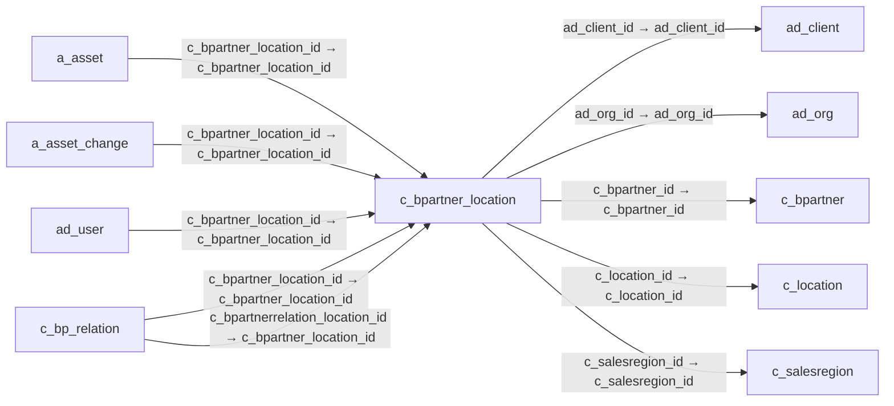

# c_bpartner_location — 거래처 주소 연결

[전체 일람](../TABLE_INDEX.md) · [분류 일람](README.md) · [AI 사용 안내](../README.md) · [외래키 읽는 법](../RELATIONSHIPS.md)

## 기본 정보

| 항목 | 내용 |
|---|---|
| 물리명 | `adempiere.c_bpartner_location` |
| 한국어 논리명(문서용 해석) | 거래처 주소 연결 |
| 원본 논리명 | Partner Location |
| 원본 사전 ID | 293 |
| 분류 | `c` — 거래처·주문·청구·결제·회계 기준 |
| 전체 테넌트 행 수 | 16 |
| 물리 열 수 | 23 |
| 나가는 FK / 들어오는 FK | 5 / 37 |
| 구조·행 수 확인 시점 | 2026-11-03T23:29:01+09:00 |

## 의미와 쓰임

거래처의 배송지 등 주소 용도를 관리하며 공통 주소와 거래처를 연결한다.

- 설명 근거: 원본 애플리케이션 사전 명칭·설명을 한국어로 해석.
- 한국어 이름과 개요는 문서용 해석입니다. 공식 한국어 번역으로 간주하지 않습니다.
- 원본 설명: Identifies the (ship to) address for this Business Partner
- 원본 도움말: —
- PostgreSQL 테이블 주석: —

## 키와 열

### 기본키·고유 제약조건

| 종류 | 제약조건 | 열(순서 유지) |
|---|---|---|
| PRIMARY KEY | `c_bpartner_location_pkey` | `c_bpartner_location_id` |
| UNIQUE | `c_bpartner_location_uu_idx` | `c_bpartner_location_uu` |

### 열 목록

원본 논리명·설명은 `AD_Column`에서 가져왔습니다. 기본값은 실제 PostgreSQL 메타데이터이며, 비어 있는 항목은 `—`로 표시합니다.

| 순서 | 물리명 | 원본 논리명 | PostgreSQL 타입 | NULL | PK | 기본값 | 설명 |
|---:|---|---|---|---|---|---|---|
| 1 | `c_bpartner_location_id` | Partner Location | numeric(10,0) | 불가 | 예 | — | Identifies the (ship to) address for this Business Partner |
| 2 | `ad_client_id` | Tenant | numeric(10,0) | 불가 | — | — | Tenant for this installation. |
| 3 | `ad_org_id` | Organization | numeric(10,0) | 불가 | — | — | Organizational entity within tenant |
| 4 | `isactive` | Active | character(1) | 불가 | — | 'Y'::bpchar | The record is active in the system |
| 5 | `created` | Created | timestamp without time zone | 불가 | — | now() | Date this record was created |
| 6 | `createdby` | Created By | numeric(10,0) | 불가 | — | — | User who created this records |
| 7 | `updated` | Updated | timestamp without time zone | 불가 | — | now() | Date this record was updated |
| 8 | `updatedby` | Updated By | numeric(10,0) | 불가 | — | — | User who updated this records |
| 9 | `name` | Name | character varying(60) | 불가 | — | — | Alphanumeric identifier of the entity |
| 10 | `isbillto` | Invoice Address | character(1) | 불가 | — | 'Y'::bpchar | Business Partner Invoice/Bill Address |
| 11 | `isshipto` | Ship Address | character(1) | 불가 | — | 'Y'::bpchar | Business Partner Shipment Address |
| 12 | `ispayfrom` | Pay-From | character(1) | 불가 | — | 'Y'::bpchar | Business Partner can pay invoices from the related Business Partner |
| 13 | `isremitto` | Remit-To Address | character(1) | 불가 | — | 'Y'::bpchar | Business Partner payment address |
| 14 | `phone` | Phone | character varying(40) | 허용 | — | — | Identifies a telephone number |
| 15 | `phone2` | 2nd Phone | character varying(40) | 허용 | — | — | Identifies an alternate telephone number. |
| 16 | `fax` | Fax | character varying(40) | 허용 | — | — | Facsimile number |
| 17 | `isdn` | ISDN | character varying(40) | 허용 | — | — | ISDN or modem line |
| 18 | `c_salesregion_id` | Sales Region | numeric(10,0) | 허용 | — | — | Sales coverage region |
| 19 | `c_bpartner_id` | Business Partner | numeric(10,0) | 불가 | — | — | Identifies a Business Partner |
| 20 | `c_location_id` | Address | numeric(10,0) | 허용 | — | — | Location or Address |
| 21 | `c_bpartner_location_uu` | C_BPartner_Location_UU | uuid | 허용 | — | — | — |
| 22 | `customeraddressid` | Customer Address ID | character varying(60) | 허용 | — | NULL::character varying | — |
| 23 | `ispreservecustomname` | Preserve custom name | character(1) | 불가 | — | 'N'::bpchar | — |

## 외래키 흐름

화살표는 **FK를 가진 자식 → 참조되는 부모**입니다. 업무 처리의 시간 순서나 무조건적인 1:N 관계를 뜻하지 않습니다.

주변 관계 42개 중 10개를 그림으로 표시합니다. **전체 관계는 아래 두 표에 모두 포함**합니다.

### 이 테이블이 참조하는 부모 — 나가는 FK

| 제약조건 | 참조하는 쪽(자식) | 자식 열 | 참조받는 쪽(부모) | 부모 열 | 삭제 / 갱신 | 검증 / 지연 가능 |
|---|---|---|---|---|---|---|
| `c_buspartner_locationclient` <!-- FK_OUT: adempiere.c_bpartner_location.c_buspartner_locationclient --> | [`c_bpartner_location`](c_bpartner_location.md) | `ad_client_id` | [`ad_client`](../ad/ad_client.md) | `ad_client_id` | NO ACTION / NO ACTION | 완료 / 가능 (초기 지연) |
| `c_buspartner_locationorg` <!-- FK_OUT: adempiere.c_bpartner_location.c_buspartner_locationorg --> | [`c_bpartner_location`](c_bpartner_location.md) | `ad_org_id` | [`ad_org`](../ad/ad_org.md) | `ad_org_id` | NO ACTION / NO ACTION | 완료 / 가능 (초기 지연) |
| `cbpartner_cbplocation` <!-- FK_OUT: adempiere.c_bpartner_location.cbpartner_cbplocation --> | [`c_bpartner_location`](c_bpartner_location.md) | `c_bpartner_id` | [`c_bpartner`](c_bpartner.md) | `c_bpartner_id` | CASCADE / NO ACTION | 완료 / 가능 (초기 지연) |
| `clocation_cbplocation` <!-- FK_OUT: adempiere.c_bpartner_location.clocation_cbplocation --> | [`c_bpartner_location`](c_bpartner_location.md) | `c_location_id` | [`c_location`](c_location.md) | `c_location_id` | NO ACTION / NO ACTION | 완료 / 가능 (초기 지연) |
| `csalesregion_bpartnerlocation` <!-- FK_OUT: adempiere.c_bpartner_location.csalesregion_bpartnerlocation --> | [`c_bpartner_location`](c_bpartner_location.md) | `c_salesregion_id` | [`c_salesregion`](c_salesregion.md) | `c_salesregion_id` | SET NULL / NO ACTION | 완료 / 가능 (초기 지연) |

### 이 테이블을 참조하는 자식 — 들어오는 FK

| 제약조건 | 참조하는 쪽(자식) | 자식 열 | 참조받는 쪽(부모) | 부모 열 | 삭제 / 갱신 | 검증 / 지연 가능 |
|---|---|---|---|---|---|---|
| `cbplocation_aasset` <!-- FK_IN: adempiere.a_asset.cbplocation_aasset --> | [`a_asset`](../a/a_asset.md) | `c_bpartner_location_id` | [`c_bpartner_location`](c_bpartner_location.md) | `c_bpartner_location_id` | NO ACTION / NO ACTION | 완료 / 가능 (초기 지연) |
| `cbpartnerlocation_aassetchange` <!-- FK_IN: adempiere.a_asset_change.cbpartnerlocation_aassetchange --> | [`a_asset_change`](../a/a_asset_change.md) | `c_bpartner_location_id` | [`c_bpartner_location`](c_bpartner_location.md) | `c_bpartner_location_id` | NO ACTION / NO ACTION | 완료 / 가능 (초기 지연) |
| `cbplocation_aduser` <!-- FK_IN: adempiere.ad_user.cbplocation_aduser --> | [`ad_user`](../ad/ad_user.md) | `c_bpartner_location_id` | [`c_bpartner_location`](c_bpartner_location.md) | `c_bpartner_location_id` | NO ACTION / NO ACTION | 완료 / 가능 (초기 지연) |
| `cbplocation_cbprelation` <!-- FK_IN: adempiere.c_bp_relation.cbplocation_cbprelation --> | [`c_bp_relation`](c_bp_relation.md) | `c_bpartner_location_id` | [`c_bpartner_location`](c_bpartner_location.md) | `c_bpartner_location_id` | NO ACTION / NO ACTION | 완료 / 가능 (초기 지연) |
| `cbplocation_cbprelationbp` <!-- FK_IN: adempiere.c_bp_relation.cbplocation_cbprelationbp --> | [`c_bp_relation`](c_bp_relation.md) | `c_bpartnerrelation_location_id` | [`c_bpartner_location`](c_bpartner_location.md) | `c_bpartner_location_id` | NO ACTION / NO ACTION | 완료 / 가능 (초기 지연) |
| `cbpartnerlocation_cbpshippinga` <!-- FK_IN: adempiere.c_bp_shippingacct.cbpartnerlocation_cbpshippinga --> | [`c_bp_shippingacct`](c_bp_shippingacct.md) | `c_bpartner_location_id` | [`c_bpartner_location`](c_bpartner_location.md) | `c_bpartner_location_id` | NO ACTION / NO ACTION | 완료 / 가능 (초기 지연) |
| `cbpartnerlocation_cdunningrune` <!-- FK_IN: adempiere.c_dunningrunentry.cbpartnerlocation_cdunningrune --> | [`c_dunningrunentry`](c_dunningrunentry.md) | `c_bpartner_location_id` | [`c_bpartner_location`](c_bpartner_location.md) | `c_bpartner_location_id` | NO ACTION / NO ACTION | 완료 / 가능 (초기 지연) |
| `c_bplocation_cinvoice` <!-- FK_IN: adempiere.c_invoice.c_bplocation_cinvoice --> | [`c_invoice`](c_invoice.md) | `c_bpartner_location_id` | [`c_bpartner_location`](c_bpartner_location.md) | `c_bpartner_location_id` | NO ACTION / NO ACTION | 완료 / 가능 (초기 지연) |
| `cbplocation_cinvoicebline` <!-- FK_IN: adempiere.c_invoicebatchline.cbplocation_cinvoicebline --> | [`c_invoicebatchline`](c_invoicebatchline.md) | `c_bpartner_location_id` | [`c_bpartner_location`](c_bpartner_location.md) | `c_bpartner_location_id` | NO ACTION / NO ACTION | 완료 / 가능 (초기 지연) |
| `cbpartnerlocation_corder` <!-- FK_IN: adempiere.c_order.cbpartnerlocation_corder --> | [`c_order`](c_order.md) | `c_bpartner_location_id` | [`c_bpartner_location`](c_bpartner_location.md) | `c_bpartner_location_id` | NO ACTION / NO ACTION | 완료 / 가능 (초기 지연) |
| `cbplocationbill_corder` <!-- FK_IN: adempiere.c_order.cbplocationbill_corder --> | [`c_order`](c_order.md) | `bill_location_id` | [`c_bpartner_location`](c_bpartner_location.md) | `c_bpartner_location_id` | NO ACTION / NO ACTION | 완료 / 가능 (초기 지연) |
| `cbplocationpay_corder` <!-- FK_IN: adempiere.c_order.cbplocationpay_corder --> | [`c_order`](c_order.md) | `pay_location_id` | [`c_bpartner_location`](c_bpartner_location.md) | `c_bpartner_location_id` | NO ACTION / NO ACTION | 완료 / 가능 (초기 지연) |
| `dropshiplocation_corder` <!-- FK_IN: adempiere.c_order.dropshiplocation_corder --> | [`c_order`](c_order.md) | `dropship_location_id` | [`c_bpartner_location`](c_bpartner_location.md) | `c_bpartner_location_id` | NO ACTION / NO ACTION | 완료 / 가능 (초기 지연) |
| `cbpartnerlocation_soline` <!-- FK_IN: adempiere.c_orderline.cbpartnerlocation_soline --> | [`c_orderline`](c_orderline.md) | `c_bpartner_location_id` | [`c_bpartner_location`](c_bpartner_location.md) | `c_bpartner_location_id` | NO ACTION / NO ACTION | 완료 / 가능 (초기 지연) |
| `cbplocation_cproject` <!-- FK_IN: adempiere.c_project.cbplocation_cproject --> | [`c_project`](c_project.md) | `c_bpartner_location_id` | [`c_bpartner_location`](c_bpartner_location.md) | `c_bpartner_location_id` | NO ACTION / NO ACTION | 완료 / 가능 (초기 지연) |
| `cbplocation_crfq` <!-- FK_IN: adempiere.c_rfq.cbplocation_crfq --> | [`c_rfq`](c_rfq.md) | `c_bpartner_location_id` | [`c_bpartner_location`](c_bpartner_location.md) | `c_bpartner_location_id` | NO ACTION / NO ACTION | 완료 / 가능 (초기 지연) |
| `cbpartnerloc_crfqtopicsubr` <!-- FK_IN: adempiere.c_rfq_topicsubscriber.cbpartnerloc_crfqtopicsubr --> | [`c_rfq_topicsubscriber`](c_rfq_topicsubscriber.md) | `c_bpartner_location_id` | [`c_bpartner_location`](c_bpartner_location.md) | `c_bpartner_location_id` | NO ACTION / NO ACTION | 완료 / 가능 (초기 지연) |
| `cbplocation_crfqresponse` <!-- FK_IN: adempiere.c_rfqresponse.cbplocation_crfqresponse --> | [`c_rfqresponse`](c_rfqresponse.md) | `c_bpartner_location_id` | [`c_bpartner_location`](c_bpartner_location.md) | `c_bpartner_location_id` | NO ACTION / NO ACTION | 완료 / 가능 (초기 지연) |
| `cbpartnerlocation_ddorder` <!-- FK_IN: adempiere.dd_order.cbpartnerlocation_ddorder --> | [`dd_order`](../dd/dd_order.md) | `c_bpartner_location_id` | [`c_bpartner_location`](c_bpartner_location.md) | `c_bpartner_location_id` | NO ACTION / NO ACTION | 완료 / 가능 (초기 지연) |
| `cbpartnerlocation_iasset` <!-- FK_IN: adempiere.i_asset.cbpartnerlocation_iasset --> | [`i_asset`](../i/i_asset.md) | `c_bpartner_location_id` | [`c_bpartner_location`](c_bpartner_location.md) | `c_bpartner_location_id` | NO ACTION / NO ACTION | 완료 / 가능 (초기 지연) |
| `cbpartnerlocation_ibpartner` <!-- FK_IN: adempiere.i_bpartner.cbpartnerlocation_ibpartner --> | [`i_bpartner`](../i/i_bpartner.md) | `c_bpartner_location_id` | [`c_bpartner_location`](c_bpartner_location.md) | `c_bpartner_location_id` | SET NULL / NO ACTION | 완료 / 가능 (초기 지연) |
| `cbplocation_iinvoice` <!-- FK_IN: adempiere.i_invoice.cbplocation_iinvoice --> | [`i_invoice`](../i/i_invoice.md) | `c_bpartner_location_id` | [`c_bpartner_location`](c_bpartner_location.md) | `c_bpartner_location_id` | SET NULL / NO ACTION | 완료 / 가능 (초기 지연) |
| `cbolocation_iorder` <!-- FK_IN: adempiere.i_order.cbolocation_iorder --> | [`i_order`](../i/i_order.md) | `c_bpartner_location_id` | [`c_bpartner_location`](c_bpartner_location.md) | `c_bpartner_location_id` | SET NULL / NO ACTION | 완료 / 가능 (초기 지연) |
| `cbpartnerlocbillto_iorder` <!-- FK_IN: adempiere.i_order.cbpartnerlocbillto_iorder --> | [`i_order`](../i/i_order.md) | `billto_id` | [`c_bpartner_location`](c_bpartner_location.md) | `c_bpartner_location_id` | SET NULL / NO ACTION | 완료 / 가능 (초기 지연) |
| `cbpartnerloc_mdistlistline` <!-- FK_IN: adempiere.m_distributionlistline.cbpartnerloc_mdistlistline --> | [`m_distributionlistline`](../m/m_distributionlistline.md) | `c_bpartner_location_id` | [`c_bpartner_location`](c_bpartner_location.md) | `c_bpartner_location_id` | NO ACTION / NO ACTION | 완료 / 가능 (초기 지연) |
| `cbplocation_mdistributionrun` <!-- FK_IN: adempiere.m_distributionrun.cbplocation_mdistributionrun --> | [`m_distributionrun`](../m/m_distributionrun.md) | `c_bpartner_location_id` | [`c_bpartner_location`](c_bpartner_location.md) | `c_bpartner_location_id` | NO ACTION / NO ACTION | 완료 / 가능 (초기 지연) |
| `dropshiplocation_minout` <!-- FK_IN: adempiere.m_inout.dropshiplocation_minout --> | [`m_inout`](../m/m_inout.md) | `dropship_location_id` | [`c_bpartner_location`](c_bpartner_location.md) | `c_bpartner_location_id` | NO ACTION / NO ACTION | 완료 / 가능 (초기 지연) |
| `returnlocation_minout` <!-- FK_IN: adempiere.m_inout.returnlocation_minout --> | [`m_inout`](../m/m_inout.md) | `returnlocation_id` | [`c_bpartner_location`](c_bpartner_location.md) | `c_bpartner_location_id` | NO ACTION / NO ACTION | 완료 / 가능 (초기 지연) |
| `vbplocation_minout` <!-- FK_IN: adempiere.m_inout.vbplocation_minout --> | [`m_inout`](../m/m_inout.md) | `c_bpartner_location_id` | [`c_bpartner_location`](c_bpartner_location.md) | `c_bpartner_location_id` | NO ACTION / NO ACTION | 완료 / 가능 (초기 지연) |
| `cbpartnerlocation_mmovement` <!-- FK_IN: adempiere.m_movement.cbpartnerlocation_mmovement --> | [`m_movement`](../m/m_movement.md) | `c_bpartner_location_id` | [`c_bpartner_location`](c_bpartner_location.md) | `c_bpartner_location_id` | NO ACTION / NO ACTION | 완료 / 가능 (초기 지연) |
| `cbpartnerlocation_mpackage` <!-- FK_IN: adempiere.m_package.cbpartnerlocation_mpackage --> | [`m_package`](../m/m_package.md) | `c_bpartner_location_id` | [`c_bpartner_location`](c_bpartner_location.md) | `c_bpartner_location_id` | NO ACTION / NO ACTION | 완료 / 가능 (초기 지연) |
| `holdaddress_mpackage` <!-- FK_IN: adempiere.m_package.holdaddress_mpackage --> | [`m_package`](../m/m_package.md) | `holdaddress_id` | [`c_bpartner_location`](c_bpartner_location.md) | `c_bpartner_location_id` | NO ACTION / NO ACTION | 완료 / 가능 (초기 지연) |
| `billlocation_mshippingtransact` <!-- FK_IN: adempiere.m_shippingtransaction.billlocation_mshippingtransact --> | [`m_shippingtransaction`](../m/m_shippingtransaction.md) | `bill_location_id` | [`c_bpartner_location`](c_bpartner_location.md) | `c_bpartner_location_id` | NO ACTION / NO ACTION | 완료 / 가능 (초기 지연) |
| `cbpartnerlocation_mshippingtra` <!-- FK_IN: adempiere.m_shippingtransaction.cbpartnerlocation_mshippingtra --> | [`m_shippingtransaction`](../m/m_shippingtransaction.md) | `c_bpartner_location_id` | [`c_bpartner_location`](c_bpartner_location.md) | `c_bpartner_location_id` | NO ACTION / NO ACTION | 완료 / 가능 (초기 지연) |
| `holdaddress_mshippingtransacti` <!-- FK_IN: adempiere.m_shippingtransaction.holdaddress_mshippingtransacti --> | [`m_shippingtransaction`](../m/m_shippingtransaction.md) | `holdaddress_id` | [`c_bpartner_location`](c_bpartner_location.md) | `c_bpartner_location_id` | NO ACTION / NO ACTION | 완료 / 가능 (초기 지연) |
| `returnlocation_mshippingtransa` <!-- FK_IN: adempiere.m_shippingtransaction.returnlocation_mshippingtransa --> | [`m_shippingtransaction`](../m/m_shippingtransaction.md) | `returnlocation_id` | [`c_bpartner_location`](c_bpartner_location.md) | `c_bpartner_location_id` | NO ACTION / NO ACTION | 완료 / 가능 (초기 지연) |
| `cbpartnerlocation_tdrdetail` <!-- FK_IN: adempiere.t_distributionrundetail.cbpartnerlocation_tdrdetail --> | [`t_distributionrundetail`](../t/t_distributionrundetail.md) | `c_bpartner_location_id` | [`c_bpartner_location`](c_bpartner_location.md) | `c_bpartner_location_id` | CASCADE / NO ACTION | 완료 / 가능 (초기 지연) |

## 조회 시 주의

- FK 표의 자식 열과 부모 열을 같은 순서로 대응시킵니다. 복합 FK는 모든 열의 동등 조건을 `AND`로 연결합니다.
- 테이블 이름이나 `_id` 열 이름만으로 물리 FK가 있다고 가정하지 않습니다. FK 미선언은 업무 관계가 없다는 뜻도 아닙니다.
- 자식이 여러 행인 테이블과 조인하면 부모의 금액·건수가 중복될 수 있습니다. 집계 단위를 먼저 정합니다.
- `ad_client_id`가 있습니다. 업무 분석에서는 대상 테넌트를 명시합니다. GardenWorld는 `11`, 시스템 공통 설정은 `0`일 수 있으므로 일괄 필터 적용 전에 테이블 역할을 확인합니다.
- 행 수는 위 확인 시점의 전체 테넌트 값입니다. 최신 업무 실적이나 현재 실행 결과로 재사용하지 않습니다.
