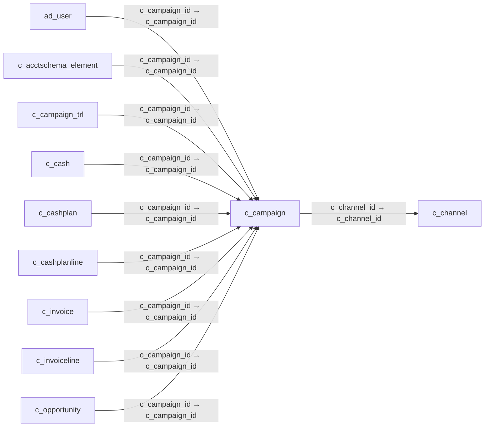

# c_campaign — 마케팅 캠페인

[전체 일람](../TABLE_INDEX.md) · [분류 일람](README.md) · [AI 사용 안내](../README.md) · [외래키 읽는 법](../RELATIONSHIPS.md)

## 기본 정보

| 항목 | 내용 |
|---|---|
| 물리명 | `adempiere.c_campaign` |
| 한국어 논리명(문서용 해석) | 마케팅 캠페인 |
| 원본 논리명 | Campaign |
| 원본 사전 ID | 274 |
| 분류 | `c` — 거래처·주문·청구·결제·회계 기준 |
| 전체 테넌트 행 수 | 2 |
| 물리 열 수 | 17 |
| 나가는 FK / 들어오는 FK | 1 / 42 |
| 구조·행 수 확인 시점 | 2026-11-03T23:29:01+09:00 |

## 의미와 쓰임

마케팅 캠페인을 정의하고 관련 영업 및 거래를 캠페인별로 구분한다.

- 설명 근거: 원본 애플리케이션 사전 명칭·설명을 한국어로 해석.
- 한국어 이름과 개요는 문서용 해석입니다. 공식 한국어 번역으로 간주하지 않습니다.
- 원본 설명: Marketing Campaign
- 원본 도움말: —
- PostgreSQL 테이블 주석: —

## 키와 열

### 기본키·고유 제약조건

| 종류 | 제약조건 | 열(순서 유지) |
|---|---|---|
| PRIMARY KEY | `c_campaign_pkey` | `c_campaign_id` |
| UNIQUE | `c_campaign_uu_idx` | `c_campaign_uu` |

### 별도 고유 인덱스

PK·UNIQUE 제약조건의 인덱스와 별도로 존재하는 고유 인덱스입니다. 식·조건·열 순서는 원본 정의를 따릅니다.

- `c_campaign_value`: `CREATE UNIQUE INDEX c_campaign_value ON adempiere.c_campaign USING btree (ad_client_id, value)`

### 열 목록

원본 논리명·설명은 `AD_Column`에서 가져왔습니다. 기본값은 실제 PostgreSQL 메타데이터이며, 비어 있는 항목은 `—`로 표시합니다.

| 순서 | 물리명 | 원본 논리명 | PostgreSQL 타입 | NULL | PK | 기본값 | 설명 |
|---:|---|---|---|---|---|---|---|
| 1 | `c_campaign_id` | Campaign | numeric(10,0) | 불가 | 예 | — | Marketing Campaign |
| 2 | `ad_client_id` | Tenant | numeric(10,0) | 불가 | — | — | Tenant for this installation. |
| 3 | `ad_org_id` | Organization | numeric(10,0) | 불가 | — | — | Organizational entity within tenant |
| 4 | `isactive` | Active | character(1) | 불가 | — | 'Y'::bpchar | The record is active in the system |
| 5 | `created` | Created | timestamp without time zone | 불가 | — | now() | Date this record was created |
| 6 | `createdby` | Created By | numeric(10,0) | 불가 | — | — | User who created this records |
| 7 | `updated` | Updated | timestamp without time zone | 불가 | — | now() | Date this record was updated |
| 8 | `updatedby` | Updated By | numeric(10,0) | 불가 | — | — | User who updated this records |
| 9 | `value` | Search Key | character varying(40) | 불가 | — | — | Search key for the record in the format required - must be unique |
| 10 | `name` | Name | character varying(60) | 불가 | — | — | Alphanumeric identifier of the entity |
| 11 | `description` | Description | character varying(255) | 허용 | — | — | Optional short description of the record |
| 12 | `c_channel_id` | Channel | numeric(10,0) | 허용 | — | — | Sales Channel |
| 13 | `startdate` | Start Date | timestamp without time zone | 허용 | — | — | First effective day (inclusive) |
| 14 | `enddate` | End Date | timestamp without time zone | 허용 | — | — | Last effective date (inclusive) |
| 15 | `costs` | Costs | numeric | 불가 | — | 0 | Costs in accounting currency |
| 16 | `issummary` | Summary Level | character(1) | 불가 | — | 'N'::bpchar | This is a summary entity |
| 17 | `c_campaign_uu` | C_Campaign_UU | uuid | 허용 | — | — | — |

## 외래키 흐름

화살표는 **FK를 가진 자식 → 참조되는 부모**입니다. 업무 처리의 시간 순서나 무조건적인 1:N 관계를 뜻하지 않습니다.

주변 관계 43개 중 10개를 그림으로 표시합니다. **전체 관계는 아래 두 표에 모두 포함**합니다.

### 이 테이블이 참조하는 부모 — 나가는 FK

| 제약조건 | 참조하는 쪽(자식) | 자식 열 | 참조받는 쪽(부모) | 부모 열 | 삭제 / 갱신 | 검증 / 지연 가능 |
|---|---|---|---|---|---|---|
| `cchannel_ccampaign` <!-- FK_OUT: adempiere.c_campaign.cchannel_ccampaign --> | [`c_campaign`](c_campaign.md) | `c_channel_id` | [`c_channel`](c_channel.md) | `c_channel_id` | NO ACTION / NO ACTION | 완료 / 가능 (초기 지연) |

### 이 테이블을 참조하는 자식 — 들어오는 FK

| 제약조건 | 참조하는 쪽(자식) | 자식 열 | 참조받는 쪽(부모) | 부모 열 | 삭제 / 갱신 | 검증 / 지연 가능 |
|---|---|---|---|---|---|---|
| `ccampaign_aduser` <!-- FK_IN: adempiere.ad_user.ccampaign_aduser --> | [`ad_user`](../ad/ad_user.md) | `c_campaign_id` | [`c_campaign`](c_campaign.md) | `c_campaign_id` | NO ACTION / NO ACTION | 완료 / 가능 (초기 지연) |
| `socampaign_caschemaelement` <!-- FK_IN: adempiere.c_acctschema_element.socampaign_caschemaelement --> | [`c_acctschema_element`](c_acctschema_element.md) | `c_campaign_id` | [`c_campaign`](c_campaign.md) | `c_campaign_id` | NO ACTION / NO ACTION | 완료 / 가능 (초기 지연) |
| `ccampaign_ccampaigntrl` <!-- FK_IN: adempiere.c_campaign_trl.ccampaign_ccampaigntrl --> | [`c_campaign_trl`](c_campaign_trl.md) | `c_campaign_id` | [`c_campaign`](c_campaign.md) | `c_campaign_id` | CASCADE / NO ACTION | 완료 / 가능 (초기 지연) |
| `ccampaign_ccash` <!-- FK_IN: adempiere.c_cash.ccampaign_ccash --> | [`c_cash`](c_cash.md) | `c_campaign_id` | [`c_campaign`](c_campaign.md) | `c_campaign_id` | NO ACTION / NO ACTION | 완료 / 가능 (초기 지연) |
| `ccampaign_ccashplan` <!-- FK_IN: adempiere.c_cashplan.ccampaign_ccashplan --> | [`c_cashplan`](c_cashplan.md) | `c_campaign_id` | [`c_campaign`](c_campaign.md) | `c_campaign_id` | NO ACTION / NO ACTION | 완료 / 가능 (초기 지연) |
| `ccampaign_ccashplanline` <!-- FK_IN: adempiere.c_cashplanline.ccampaign_ccashplanline --> | [`c_cashplanline`](c_cashplanline.md) | `c_campaign_id` | [`c_campaign`](c_campaign.md) | `c_campaign_id` | NO ACTION / NO ACTION | 완료 / 가능 (초기 지연) |
| `ccampaign_cinvoice` <!-- FK_IN: adempiere.c_invoice.ccampaign_cinvoice --> | [`c_invoice`](c_invoice.md) | `c_campaign_id` | [`c_campaign`](c_campaign.md) | `c_campaign_id` | NO ACTION / NO ACTION | 완료 / 가능 (초기 지연) |
| `ccampaign_cinvoiceline` <!-- FK_IN: adempiere.c_invoiceline.ccampaign_cinvoiceline --> | [`c_invoiceline`](c_invoiceline.md) | `c_campaign_id` | [`c_campaign`](c_campaign.md) | `c_campaign_id` | NO ACTION / NO ACTION | 완료 / 가능 (초기 지연) |
| `ccampaign_copportunity` <!-- FK_IN: adempiere.c_opportunity.ccampaign_copportunity --> | [`c_opportunity`](c_opportunity.md) | `c_campaign_id` | [`c_campaign`](c_campaign.md) | `c_campaign_id` | NO ACTION / NO ACTION | 완료 / 가능 (초기 지연) |
| `ccampaign_corder` <!-- FK_IN: adempiere.c_order.ccampaign_corder --> | [`c_order`](c_order.md) | `c_campaign_id` | [`c_campaign`](c_campaign.md) | `c_campaign_id` | NO ACTION / NO ACTION | 완료 / 가능 (초기 지연) |
| `ccampaign_corderline` <!-- FK_IN: adempiere.c_orderline.ccampaign_corderline --> | [`c_orderline`](c_orderline.md) | `c_campaign_id` | [`c_campaign`](c_campaign.md) | `c_campaign_id` | NO ACTION / NO ACTION | 완료 / 가능 (초기 지연) |
| `ccampaign_cpayment` <!-- FK_IN: adempiere.c_payment.ccampaign_cpayment --> | [`c_payment`](c_payment.md) | `c_campaign_id` | [`c_campaign`](c_campaign.md) | `c_campaign_id` | NO ACTION / NO ACTION | 완료 / 가능 (초기 지연) |
| `ccampaign_cpaymenttransaction` <!-- FK_IN: adempiere.c_paymenttransaction.ccampaign_cpaymenttransaction --> | [`c_paymenttransaction`](c_paymenttransaction.md) | `c_campaign_id` | [`c_campaign`](c_campaign.md) | `c_campaign_id` | NO ACTION / NO ACTION | 완료 / 가능 (초기 지연) |
| `ccampaign_cproject` <!-- FK_IN: adempiere.c_project.ccampaign_cproject --> | [`c_project`](c_project.md) | `c_campaign_id` | [`c_campaign`](c_campaign.md) | `c_campaign_id` | NO ACTION / NO ACTION | 완료 / 가능 (초기 지연) |
| `socampaign_vc` <!-- FK_IN: adempiere.c_validcombination.socampaign_vc --> | [`c_validcombination`](c_validcombination.md) | `c_campaign_id` | [`c_campaign`](c_campaign.md) | `c_campaign_id` | NO ACTION / NO ACTION | 완료 / 가능 (초기 지연) |
| `ccampaign_ddorder` <!-- FK_IN: adempiere.dd_order.ccampaign_ddorder --> | [`dd_order`](../dd/dd_order.md) | `c_campaign_id` | [`c_campaign`](c_campaign.md) | `c_campaign_id` | NO ACTION / NO ACTION | 완료 / 가능 (초기 지연) |
| `ccampaign_ddorderline` <!-- FK_IN: adempiere.dd_orderline.ccampaign_ddorderline --> | [`dd_orderline`](../dd/dd_orderline.md) | `c_campaign_id` | [`c_campaign`](c_campaign.md) | `c_campaign_id` | NO ACTION / NO ACTION | 완료 / 가능 (초기 지연) |
| `so_campaign_fact_acct` <!-- FK_IN: adempiere.fact_acct.so_campaign_fact_acct --> | [`fact_acct`](../fact/fact_acct.md) | `c_campaign_id` | [`c_campaign`](c_campaign.md) | `c_campaign_id` | NO ACTION / NO ACTION | 완료 / 가능 (초기 지연) |
| `ccampaign_factacctsummary` <!-- FK_IN: adempiere.fact_acct_summary.ccampaign_factacctsummary --> | [`fact_acct_summary`](../fact/fact_acct_summary.md) | `c_campaign_id` | [`c_campaign`](c_campaign.md) | `c_campaign_id` | NO ACTION / NO ACTION | 완료 / 가능 (초기 지연) |
| `ccampaign_gldist` <!-- FK_IN: adempiere.gl_distribution.ccampaign_gldist --> | [`gl_distribution`](../gl/gl_distribution.md) | `c_campaign_id` | [`c_campaign`](c_campaign.md) | `c_campaign_id` | NO ACTION / NO ACTION | 완료 / 가능 (초기 지연) |
| `ccampaign_gldistline` <!-- FK_IN: adempiere.gl_distributionline.ccampaign_gldistline --> | [`gl_distributionline`](../gl/gl_distributionline.md) | `c_campaign_id` | [`c_campaign`](c_campaign.md) | `c_campaign_id` | NO ACTION / NO ACTION | 완료 / 가능 (초기 지연) |
| `ccampaign_gljournalline` <!-- FK_IN: adempiere.gl_journalline.ccampaign_gljournalline --> | [`gl_journalline`](../gl/gl_journalline.md) | `c_campaign_id` | [`c_campaign`](c_campaign.md) | `c_campaign_id` | NO ACTION / NO ACTION | 완료 / 가능 (초기 지연) |
| `ccampaign_hrcontract` <!-- FK_IN: adempiere.hr_contract.ccampaign_hrcontract --> | [`hr_contract`](../hr/hr_contract.md) | `c_campaign_id` | [`c_campaign`](c_campaign.md) | `c_campaign_id` | NO ACTION / NO ACTION | 완료 / 가능 (초기 지연) |
| `ccampaign_hrmovement` <!-- FK_IN: adempiere.hr_movement.ccampaign_hrmovement --> | [`hr_movement`](../hr/hr_movement.md) | `c_campaign_id` | [`c_campaign`](c_campaign.md) | `c_campaign_id` | NO ACTION / NO ACTION | 완료 / 가능 (초기 지연) |
| `ccampaign_ifajournal` <!-- FK_IN: adempiere.i_fajournal.ccampaign_ifajournal --> | [`i_fajournal`](../i/i_fajournal.md) | `c_campaign_id` | [`c_campaign`](c_campaign.md) | `c_campaign_id` | NO ACTION / NO ACTION | 완료 / 가능 (초기 지연) |
| `ccampaign_igljournal` <!-- FK_IN: adempiere.i_gljournal.ccampaign_igljournal --> | [`i_gljournal`](../i/i_gljournal.md) | `c_campaign_id` | [`c_campaign`](c_campaign.md) | `c_campaign_id` | SET NULL / NO ACTION | 완료 / 가능 (초기 지연) |
| `ccampaign_iinvoice` <!-- FK_IN: adempiere.i_invoice.ccampaign_iinvoice --> | [`i_invoice`](../i/i_invoice.md) | `c_campaign_id` | [`c_campaign`](c_campaign.md) | `c_campaign_id` | SET NULL / NO ACTION | 완료 / 가능 (초기 지연) |
| `ccampaign_imovement` <!-- FK_IN: adempiere.i_movement.ccampaign_imovement --> | [`i_movement`](../i/i_movement.md) | `c_campaign_id` | [`c_campaign`](c_campaign.md) | `c_campaign_id` | NO ACTION / NO ACTION | 완료 / 가능 (초기 지연) |
| `ccampaign_iorder` <!-- FK_IN: adempiere.i_order.ccampaign_iorder --> | [`i_order`](../i/i_order.md) | `c_campaign_id` | [`c_campaign`](c_campaign.md) | `c_campaign_id` | SET NULL / NO ACTION | 완료 / 가능 (초기 지연) |
| `ccampaign_minout` <!-- FK_IN: adempiere.m_inout.ccampaign_minout --> | [`m_inout`](../m/m_inout.md) | `c_campaign_id` | [`c_campaign`](c_campaign.md) | `c_campaign_id` | NO ACTION / NO ACTION | 완료 / 가능 (초기 지연) |
| `ccampaign_minoutline` <!-- FK_IN: adempiere.m_inoutline.ccampaign_minoutline --> | [`m_inoutline`](../m/m_inoutline.md) | `c_campaign_id` | [`c_campaign`](c_campaign.md) | `c_campaign_id` | NO ACTION / NO ACTION | 완료 / 가능 (초기 지연) |
| `ccampaign_minventory` <!-- FK_IN: adempiere.m_inventory.ccampaign_minventory --> | [`m_inventory`](../m/m_inventory.md) | `c_campaign_id` | [`c_campaign`](c_campaign.md) | `c_campaign_id` | NO ACTION / NO ACTION | 완료 / 가능 (초기 지연) |
| `ccampaign_mmovement` <!-- FK_IN: adempiere.m_movement.ccampaign_mmovement --> | [`m_movement`](../m/m_movement.md) | `c_campaign_id` | [`c_campaign`](c_campaign.md) | `c_campaign_id` | NO ACTION / NO ACTION | 완료 / 가능 (초기 지연) |
| `ccampaign_mproduction` <!-- FK_IN: adempiere.m_production.ccampaign_mproduction --> | [`m_production`](../m/m_production.md) | `c_campaign_id` | [`c_campaign`](c_campaign.md) | `c_campaign_id` | NO ACTION / NO ACTION | 완료 / 가능 (초기 지연) |
| `ccampaign_mpromotion` <!-- FK_IN: adempiere.m_promotion.ccampaign_mpromotion --> | [`m_promotion`](../m/m_promotion.md) | `c_campaign_id` | [`c_campaign`](c_campaign.md) | `c_campaign_id` | NO ACTION / NO ACTION | 완료 / 가능 (초기 지연) |
| `ccampaign_pareportcolumn` <!-- FK_IN: adempiere.pa_reportcolumn.ccampaign_pareportcolumn --> | [`pa_reportcolumn`](../pa/pa_reportcolumn.md) | `c_campaign_id` | [`c_campaign`](c_campaign.md) | `c_campaign_id` | NO ACTION / NO ACTION | 완료 / 가능 (초기 지연) |
| `ccampaign_pareportsource` <!-- FK_IN: adempiere.pa_reportsource.ccampaign_pareportsource --> | [`pa_reportsource`](../pa/pa_reportsource.md) | `c_campaign_id` | [`c_campaign`](c_campaign.md) | `c_campaign_id` | NO ACTION / NO ACTION | 완료 / 가능 (초기 지연) |
| `ccampaign_ppcostcollector` <!-- FK_IN: adempiere.pp_cost_collector.ccampaign_ppcostcollector --> | [`pp_cost_collector`](../pp/pp_cost_collector.md) | `c_campaign_id` | [`c_campaign`](c_campaign.md) | `c_campaign_id` | NO ACTION / NO ACTION | 완료 / 가능 (초기 지연) |
| `ccampaign_pporder` <!-- FK_IN: adempiere.pp_order.ccampaign_pporder --> | [`pp_order`](../pp/pp_order.md) | `c_campaign_id` | [`c_campaign`](c_campaign.md) | `c_campaign_id` | NO ACTION / NO ACTION | 완료 / 가능 (초기 지연) |
| `ccampaign_rrequest` <!-- FK_IN: adempiere.r_request.ccampaign_rrequest --> | [`r_request`](../r/r_request.md) | `c_campaign_id` | [`c_campaign`](c_campaign.md) | `c_campaign_id` | NO ACTION / NO ACTION | 완료 / 가능 (초기 지연) |
| `ccampaign_stimeexpenseline` <!-- FK_IN: adempiere.s_timeexpenseline.ccampaign_stimeexpenseline --> | [`s_timeexpenseline`](../s/s_timeexpenseline.md) | `c_campaign_id` | [`c_campaign`](c_campaign.md) | `c_campaign_id` | NO ACTION / NO ACTION | 완료 / 가능 (초기 지연) |
| `ccampaign_taging` <!-- FK_IN: adempiere.t_aging.ccampaign_taging --> | [`t_aging`](../t/t_aging.md) | `c_campaign_id` | [`c_campaign`](c_campaign.md) | `c_campaign_id` | CASCADE / NO ACTION | 완료 / 가능 (초기 지연) |

## 조회 시 주의

- FK 표의 자식 열과 부모 열을 같은 순서로 대응시킵니다. 복합 FK는 모든 열의 동등 조건을 `AND`로 연결합니다.
- 테이블 이름이나 `_id` 열 이름만으로 물리 FK가 있다고 가정하지 않습니다. FK 미선언은 업무 관계가 없다는 뜻도 아닙니다.
- 자식이 여러 행인 테이블과 조인하면 부모의 금액·건수가 중복될 수 있습니다. 집계 단위를 먼저 정합니다.
- `ad_client_id`가 있습니다. 업무 분석에서는 대상 테넌트를 명시합니다. GardenWorld는 `11`, 시스템 공통 설정은 `0`일 수 있으므로 일괄 필터 적용 전에 테이블 역할을 확인합니다.
- 행 수는 위 확인 시점의 전체 테넌트 값입니다. 최신 업무 실적이나 현재 실행 결과로 재사용하지 않습니다.
