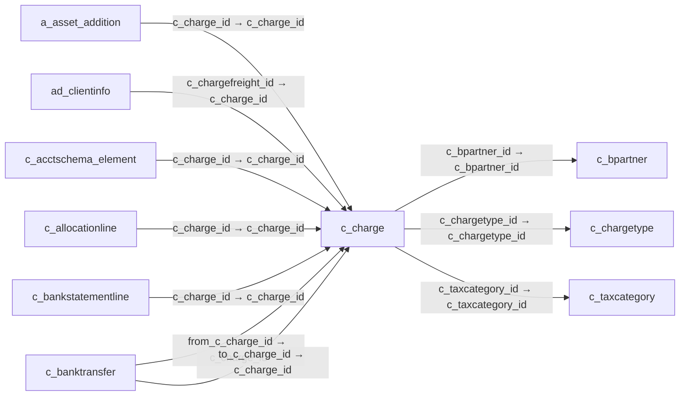

# c_charge — 부대 수익·비용 항목

[전체 일람](../TABLE_INDEX.md) · [분류 일람](README.md) · [AI 사용 안내](../README.md) · [외래키 읽는 법](../RELATIONSHIPS.md)

## 기본 정보

| 항목 | 내용 |
|---|---|
| 물리명 | `adempiere.c_charge` |
| 한국어 논리명(문서용 해석) | 부대 수익·비용 항목 |
| 원본 논리명 | Charge |
| 원본 사전 ID | 313 |
| 분류 | `c` — 거래처·주문·청구·결제·회계 기준 |
| 전체 테넌트 행 수 | 3 |
| 물리 열 수 | 19 |
| 나가는 FK / 들어오는 FK | 3 / 40 |
| 구조·행 수 확인 시점 | 2026-11-03T23:29:01+09:00 |

## 의미와 쓰임

거래 문서에 추가되는 요금이나 부대 수익·비용 항목을 정의한다.

- 설명 근거: 원본 애플리케이션 사전 명칭·설명을 한국어로 해석.
- 한국어 이름과 개요는 문서용 해석입니다. 공식 한국어 번역으로 간주하지 않습니다.
- 원본 설명: Additional document charges
- 원본 도움말: —
- PostgreSQL 테이블 주석: —

## 키와 열

### 기본키·고유 제약조건

| 종류 | 제약조건 | 열(순서 유지) |
|---|---|---|
| PRIMARY KEY | `c_charge_pkey` | `c_charge_id` |
| UNIQUE | `c_charge_uu_idx` | `c_charge_uu` |

### 별도 고유 인덱스

PK·UNIQUE 제약조건의 인덱스와 별도로 존재하는 고유 인덱스입니다. 식·조건·열 순서는 원본 정의를 따릅니다.

- `c_charge_name`: `CREATE UNIQUE INDEX c_charge_name ON adempiere.c_charge USING btree (ad_client_id, name)`

### 열 목록

원본 논리명·설명은 `AD_Column`에서 가져왔습니다. 기본값은 실제 PostgreSQL 메타데이터이며, 비어 있는 항목은 `—`로 표시합니다.

| 순서 | 물리명 | 원본 논리명 | PostgreSQL 타입 | NULL | PK | 기본값 | 설명 |
|---:|---|---|---|---|---|---|---|
| 1 | `c_charge_id` | Charge | numeric(10,0) | 불가 | 예 | — | Additional document charges |
| 2 | `ad_client_id` | Tenant | numeric(10,0) | 불가 | — | — | Tenant for this installation. |
| 3 | `ad_org_id` | Organization | numeric(10,0) | 불가 | — | — | Organizational entity within tenant |
| 4 | `isactive` | Active | character(1) | 불가 | — | 'Y'::bpchar | The record is active in the system |
| 5 | `created` | Created | timestamp without time zone | 불가 | — | now() | Date this record was created |
| 6 | `createdby` | Created By | numeric(10,0) | 불가 | — | — | User who created this records |
| 7 | `updated` | Updated | timestamp without time zone | 불가 | — | now() | Date this record was updated |
| 8 | `updatedby` | Updated By | numeric(10,0) | 불가 | — | — | User who updated this records |
| 9 | `name` | Name | character varying(60) | 불가 | — | — | Alphanumeric identifier of the entity |
| 10 | `description` | Description | character varying(255) | 허용 | — | — | Optional short description of the record |
| 11 | `chargeamt` | Charge amount | numeric | 불가 | — | 0 | Charge Amount |
| 12 | `issametax` | Same Tax | character(1) | 불가 | — | 'N'::bpchar | Use the same tax as the main transaction |
| 13 | `issamecurrency` | Same Currency | character(1) | 불가 | — | 'N'::bpchar | — |
| 14 | `c_taxcategory_id` | Tax Category | numeric(10,0) | 허용 | — | — | Tax Category |
| 15 | `istaxincluded` | Price includes Tax | character(1) | 불가 | — | 'N'::bpchar | Tax is included in the price  |
| 16 | `c_bpartner_id` | Business Partner | numeric(10,0) | 허용 | — | — | Identifies a Business Partner |
| 17 | `c_chargetype_id` | Charge Type | numeric(10,0) | 허용 | — | — | — |
| 18 | `c_charge_uu` | C_Charge_UU | uuid | 허용 | — | — | — |
| 19 | `isexcludedfromdiscount` | Exclude from Payment Discount | character(1) | 불가 | — | 'N'::bpchar | If selected, this charge is excluded from payment discount calculations. Only line amounts will be considered for discount. |

## 외래키 흐름

화살표는 **FK를 가진 자식 → 참조되는 부모**입니다. 업무 처리의 시간 순서나 무조건적인 1:N 관계를 뜻하지 않습니다.

주변 관계 43개 중 10개를 그림으로 표시합니다. **전체 관계는 아래 두 표에 모두 포함**합니다.

### 이 테이블이 참조하는 부모 — 나가는 FK

| 제약조건 | 참조하는 쪽(자식) | 자식 열 | 참조받는 쪽(부모) | 부모 열 | 삭제 / 갱신 | 검증 / 지연 가능 |
|---|---|---|---|---|---|---|
| `cbpartner_ccharge` <!-- FK_OUT: adempiere.c_charge.cbpartner_ccharge --> | [`c_charge`](c_charge.md) | `c_bpartner_id` | [`c_bpartner`](c_bpartner.md) | `c_bpartner_id` | NO ACTION / NO ACTION | 완료 / 가능 (초기 지연) |
| `cchargetype_ccharge` <!-- FK_OUT: adempiere.c_charge.cchargetype_ccharge --> | [`c_charge`](c_charge.md) | `c_chargetype_id` | [`c_chargetype`](c_chargetype.md) | `c_chargetype_id` | NO ACTION / NO ACTION | 완료 / 가능 (초기 지연) |
| `ctaxcategory_ccharge` <!-- FK_OUT: adempiere.c_charge.ctaxcategory_ccharge --> | [`c_charge`](c_charge.md) | `c_taxcategory_id` | [`c_taxcategory`](c_taxcategory.md) | `c_taxcategory_id` | NO ACTION / NO ACTION | 완료 / 가능 (초기 지연) |

### 이 테이블을 참조하는 자식 — 들어오는 FK

| 제약조건 | 참조하는 쪽(자식) | 자식 열 | 참조받는 쪽(부모) | 부모 열 | 삭제 / 갱신 | 검증 / 지연 가능 |
|---|---|---|---|---|---|---|
| `ccharge_aassetaddition` <!-- FK_IN: adempiere.a_asset_addition.ccharge_aassetaddition --> | [`a_asset_addition`](../a/a_asset_addition.md) | `c_charge_id` | [`c_charge`](c_charge.md) | `c_charge_id` | NO ACTION / NO ACTION | 완료 / 가능 (초기 지연) |
| `cchargefreight_adclientinfo` <!-- FK_IN: adempiere.ad_clientinfo.cchargefreight_adclientinfo --> | [`ad_clientinfo`](../ad/ad_clientinfo.md) | `c_chargefreight_id` | [`c_charge`](c_charge.md) | `c_charge_id` | NO ACTION / NO ACTION | 완료 / 가능 (초기 지연) |
| `ccharge_cacctschemaelement` <!-- FK_IN: adempiere.c_acctschema_element.ccharge_cacctschemaelement --> | [`c_acctschema_element`](c_acctschema_element.md) | `c_charge_id` | [`c_charge`](c_charge.md) | `c_charge_id` | NO ACTION / NO ACTION | 완료 / 가능 (초기 지연) |
| `ccharge_callocationline` <!-- FK_IN: adempiere.c_allocationline.ccharge_callocationline --> | [`c_allocationline`](c_allocationline.md) | `c_charge_id` | [`c_charge`](c_charge.md) | `c_charge_id` | NO ACTION / NO ACTION | 완료 / 가능 (초기 지연) |
| `ccharge_cbankstmtlime` <!-- FK_IN: adempiere.c_bankstatementline.ccharge_cbankstmtlime --> | [`c_bankstatementline`](c_bankstatementline.md) | `c_charge_id` | [`c_charge`](c_charge.md) | `c_charge_id` | NO ACTION / NO ACTION | 완료 / 가능 (초기 지연) |
| `fromccharge_cbanktransfer` <!-- FK_IN: adempiere.c_banktransfer.fromccharge_cbanktransfer --> | [`c_banktransfer`](c_banktransfer.md) | `from_c_charge_id` | [`c_charge`](c_charge.md) | `c_charge_id` | NO ACTION / NO ACTION | 완료 / 가능 (초기 지연) |
| `toccharge_cbanktransfer` <!-- FK_IN: adempiere.c_banktransfer.toccharge_cbanktransfer --> | [`c_banktransfer`](c_banktransfer.md) | `to_c_charge_id` | [`c_charge`](c_charge.md) | `c_charge_id` | NO ACTION / NO ACTION | 완료 / 가능 (초기 지연) |
| `ccharge_ccashline` <!-- FK_IN: adempiere.c_cashline.ccharge_ccashline --> | [`c_cashline`](c_cashline.md) | `c_charge_id` | [`c_charge`](c_charge.md) | `c_charge_id` | NO ACTION / NO ACTION | 완료 / 가능 (초기 지연) |
| `ccharge_ccashplanline` <!-- FK_IN: adempiere.c_cashplanline.ccharge_ccashplanline --> | [`c_cashplanline`](c_cashplanline.md) | `c_charge_id` | [`c_charge`](c_charge.md) | `c_charge_id` | NO ACTION / NO ACTION | 완료 / 가능 (초기 지연) |
| `cchrage_cchargeacct` <!-- FK_IN: adempiere.c_charge_acct.cchrage_cchargeacct --> | [`c_charge_acct`](c_charge_acct.md) | `c_charge_id` | [`c_charge`](c_charge.md) | `c_charge_id` | CASCADE / NO ACTION | 완료 / 가능 (초기 지연) |
| `ccharge_cchargetrl` <!-- FK_IN: adempiere.c_charge_trl.ccharge_cchargetrl --> | [`c_charge_trl`](c_charge_trl.md) | `c_charge_id` | [`c_charge`](c_charge.md) | `c_charge_id` | NO ACTION / NO ACTION | 완료 / 가능 (초기 지연) |
| `ccharge_ccommission` <!-- FK_IN: adempiere.c_commission.ccharge_ccommission --> | [`c_commission`](c_commission.md) | `c_charge_id` | [`c_charge`](c_charge.md) | `c_charge_id` | NO ACTION / NO ACTION | 완료 / 가능 (초기 지연) |
| `ccharge_cinvoice` <!-- FK_IN: adempiere.c_invoice.ccharge_cinvoice --> | [`c_invoice`](c_invoice.md) | `c_charge_id` | [`c_charge`](c_charge.md) | `c_charge_id` | NO ACTION / NO ACTION | 완료 / 가능 (초기 지연) |
| `ccharge_cinvoicebatchline` <!-- FK_IN: adempiere.c_invoicebatchline.ccharge_cinvoicebatchline --> | [`c_invoicebatchline`](c_invoicebatchline.md) | `c_charge_id` | [`c_charge`](c_charge.md) | `c_charge_id` | NO ACTION / NO ACTION | 완료 / 가능 (초기 지연) |
| `ccharge_cinvoiceline` <!-- FK_IN: adempiere.c_invoiceline.ccharge_cinvoiceline --> | [`c_invoiceline`](c_invoiceline.md) | `c_charge_id` | [`c_charge`](c_charge.md) | `c_charge_id` | NO ACTION / NO ACTION | 완료 / 가능 (초기 지연) |
| `ccharge_corder` <!-- FK_IN: adempiere.c_order.ccharge_corder --> | [`c_order`](c_order.md) | `c_charge_id` | [`c_charge`](c_charge.md) | `c_charge_id` | NO ACTION / NO ACTION | 완료 / 가능 (초기 지연) |
| `ccharge_corderline` <!-- FK_IN: adempiere.c_orderline.ccharge_corderline --> | [`c_orderline`](c_orderline.md) | `c_charge_id` | [`c_charge`](c_charge.md) | `c_charge_id` | NO ACTION / NO ACTION | 완료 / 가능 (초기 지연) |
| `ccharge_cpayment` <!-- FK_IN: adempiere.c_payment.ccharge_cpayment --> | [`c_payment`](c_payment.md) | `c_charge_id` | [`c_charge`](c_charge.md) | `c_charge_id` | NO ACTION / NO ACTION | 완료 / 가능 (초기 지연) |
| `ccharge_cpaymenttransaction` <!-- FK_IN: adempiere.c_paymenttransaction.ccharge_cpaymenttransaction --> | [`c_paymenttransaction`](c_paymenttransaction.md) | `c_charge_id` | [`c_charge`](c_charge.md) | `c_charge_id` | NO ACTION / NO ACTION | 완료 / 가능 (초기 지연) |
| `ccharge_ddorder` <!-- FK_IN: adempiere.dd_order.ccharge_ddorder --> | [`dd_order`](../dd/dd_order.md) | `c_charge_id` | [`c_charge`](c_charge.md) | `c_charge_id` | NO ACTION / NO ACTION | 완료 / 가능 (초기 지연) |
| `ccharge_ddorderline` <!-- FK_IN: adempiere.dd_orderline.ccharge_ddorderline --> | [`dd_orderline`](../dd/dd_orderline.md) | `c_charge_id` | [`c_charge`](c_charge.md) | `c_charge_id` | NO ACTION / NO ACTION | 완료 / 가능 (초기 지연) |
| `ccharge_factacct` <!-- FK_IN: adempiere.fact_acct.ccharge_factacct --> | [`fact_acct`](../fact/fact_acct.md) | `c_charge_id` | [`c_charge`](c_charge.md) | `c_charge_id` | NO ACTION / NO ACTION | 완료 / 가능 (초기 지연) |
| `ccharge_factacctsummary` <!-- FK_IN: adempiere.fact_acct_summary.ccharge_factacctsummary --> | [`fact_acct_summary`](../fact/fact_acct_summary.md) | `c_charge_id` | [`c_charge`](c_charge.md) | `c_charge_id` | NO ACTION / NO ACTION | 완료 / 가능 (초기 지연) |
| `ccharge_gldistribution` <!-- FK_IN: adempiere.gl_distribution.ccharge_gldistribution --> | [`gl_distribution`](../gl/gl_distribution.md) | `c_charge_id` | [`c_charge`](c_charge.md) | `c_charge_id` | NO ACTION / NO ACTION | 완료 / 가능 (초기 지연) |
| `ccharge_gldistributionline` <!-- FK_IN: adempiere.gl_distributionline.ccharge_gldistributionline --> | [`gl_distributionline`](../gl/gl_distributionline.md) | `c_charge_id` | [`c_charge`](c_charge.md) | `c_charge_id` | NO ACTION / NO ACTION | 완료 / 가능 (초기 지연) |
| `ccharge_gljournalline` <!-- FK_IN: adempiere.gl_journalline.ccharge_gljournalline --> | [`gl_journalline`](../gl/gl_journalline.md) | `c_charge_id` | [`c_charge`](c_charge.md) | `c_charge_id` | NO ACTION / NO ACTION | 완료 / 가능 (초기 지연) |
| `ccharge_hrpayroll` <!-- FK_IN: adempiere.hr_payroll.ccharge_hrpayroll --> | [`hr_payroll`](../hr/hr_payroll.md) | `c_charge_id` | [`c_charge`](c_charge.md) | `c_charge_id` | NO ACTION / NO ACTION | 완료 / 가능 (초기 지연) |
| `ccharge_hrprocess` <!-- FK_IN: adempiere.hr_process.ccharge_hrprocess --> | [`hr_process`](../hr/hr_process.md) | `c_charge_id` | [`c_charge`](c_charge.md) | `c_charge_id` | NO ACTION / NO ACTION | 완료 / 가능 (초기 지연) |
| `ccharge_ibankstmt` <!-- FK_IN: adempiere.i_bankstatement.ccharge_ibankstmt --> | [`i_bankstatement`](../i/i_bankstatement.md) | `c_charge_id` | [`c_charge`](c_charge.md) | `c_charge_id` | SET NULL / NO ACTION | 완료 / 가능 (초기 지연) |
| `ccharge_iinventory` <!-- FK_IN: adempiere.i_inventory.ccharge_iinventory --> | [`i_inventory`](../i/i_inventory.md) | `c_charge_id` | [`c_charge`](c_charge.md) | `c_charge_id` | NO ACTION / NO ACTION | 완료 / 가능 (초기 지연) |
| `ccharge_iinvoice` <!-- FK_IN: adempiere.i_invoice.ccharge_iinvoice --> | [`i_invoice`](../i/i_invoice.md) | `c_charge_id` | [`c_charge`](c_charge.md) | `c_charge_id` | NO ACTION / NO ACTION | 완료 / 가능 (초기 지연) |
| `ccharge_iorder` <!-- FK_IN: adempiere.i_order.ccharge_iorder --> | [`i_order`](../i/i_order.md) | `c_charge_id` | [`c_charge`](c_charge.md) | `c_charge_id` | NO ACTION / NO ACTION | 완료 / 가능 (초기 지연) |
| `ccharge_ipayment` <!-- FK_IN: adempiere.i_payment.ccharge_ipayment --> | [`i_payment`](../i/i_payment.md) | `c_charge_id` | [`c_charge`](c_charge.md) | `c_charge_id` | SET NULL / NO ACTION | 완료 / 가능 (초기 지연) |
| `ccharge_minout` <!-- FK_IN: adempiere.m_inout.ccharge_minout --> | [`m_inout`](../m/m_inout.md) | `c_charge_id` | [`c_charge`](c_charge.md) | `c_charge_id` | NO ACTION / NO ACTION | 완료 / 가능 (초기 지연) |
| `ccharge_minoutline` <!-- FK_IN: adempiere.m_inoutline.ccharge_minoutline --> | [`m_inoutline`](../m/m_inoutline.md) | `c_charge_id` | [`c_charge`](c_charge.md) | `c_charge_id` | NO ACTION / NO ACTION | 완료 / 가능 (초기 지연) |
| `ccharge_minventoryline` <!-- FK_IN: adempiere.m_inventoryline.ccharge_minventoryline --> | [`m_inventoryline`](../m/m_inventoryline.md) | `c_charge_id` | [`c_charge`](c_charge.md) | `c_charge_id` | NO ACTION / NO ACTION | 완료 / 가능 (초기 지연) |
| `ccharge_mmovement` <!-- FK_IN: adempiere.m_movement.ccharge_mmovement --> | [`m_movement`](../m/m_movement.md) | `c_charge_id` | [`c_charge`](c_charge.md) | `c_charge_id` | NO ACTION / NO ACTION | 완료 / 가능 (초기 지연) |
| `ccharge_mpromotionreward` <!-- FK_IN: adempiere.m_promotionreward.ccharge_mpromotionreward --> | [`m_promotionreward`](../m/m_promotionreward.md) | `c_charge_id` | [`c_charge`](c_charge.md) | `c_charge_id` | NO ACTION / NO ACTION | 완료 / 가능 (초기 지연) |
| `ccharge_mrequisitionline` <!-- FK_IN: adempiere.m_requisitionline.ccharge_mrequisitionline --> | [`m_requisitionline`](../m/m_requisitionline.md) | `c_charge_id` | [`c_charge`](c_charge.md) | `c_charge_id` | NO ACTION / NO ACTION | 완료 / 가능 (초기 지연) |
| `ccharge_mrmaline` <!-- FK_IN: adempiere.m_rmaline.ccharge_mrmaline --> | [`m_rmaline`](../m/m_rmaline.md) | `c_charge_id` | [`c_charge`](c_charge.md) | `c_charge_id` | NO ACTION / NO ACTION | 완료 / 가능 (초기 지연) |

## 조회 시 주의

- FK 표의 자식 열과 부모 열을 같은 순서로 대응시킵니다. 복합 FK는 모든 열의 동등 조건을 `AND`로 연결합니다.
- 테이블 이름이나 `_id` 열 이름만으로 물리 FK가 있다고 가정하지 않습니다. FK 미선언은 업무 관계가 없다는 뜻도 아닙니다.
- 자식이 여러 행인 테이블과 조인하면 부모의 금액·건수가 중복될 수 있습니다. 집계 단위를 먼저 정합니다.
- `ad_client_id`가 있습니다. 업무 분석에서는 대상 테넌트를 명시합니다. GardenWorld는 `11`, 시스템 공통 설정은 `0`일 수 있으므로 일괄 필터 적용 전에 테이블 역할을 확인합니다.
- 행 수는 위 확인 시점의 전체 테넌트 값입니다. 최신 업무 실적이나 현재 실행 결과로 재사용하지 않습니다.
