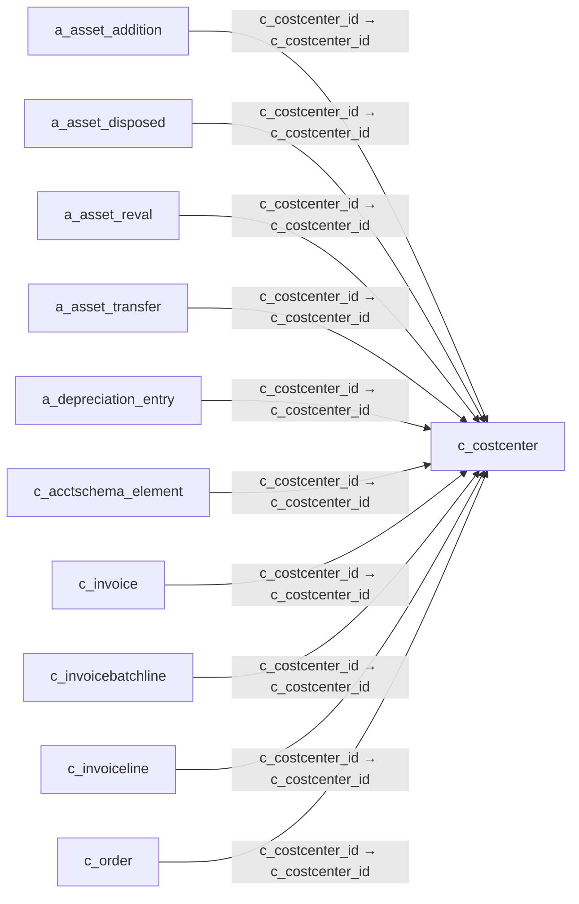

# c_costcenter — 원가 중심점

[전체 일람](../TABLE_INDEX.md) · [분류 일람](README.md) · [AI 사용 안내](../README.md) · [외래키 읽는 법](../RELATIONSHIPS.md)

## 기본 정보

| 항목 | 내용 |
|---|---|
| 물리명 | `adempiere.c_costcenter` |
| 한국어 논리명(문서용 해석) | 원가 중심점 |
| 원본 논리명 | Cost Center |
| 원본 사전 ID | 200414 |
| 분류 | `c` — 거래처·주문·청구·결제·회계 기준 |
| 전체 테넌트 행 수 | 0 |
| 물리 열 수 | 11 |
| 나가는 FK / 들어오는 FK | 0 / 29 |
| 구조·행 수 확인 시점 | 2026-11-03T23:29:01+09:00 |

## 의미와 쓰임

비용 귀속 단위로 참조하는 원가 중심점의 코드와 이름을 관리한다.

- 설명 근거: 물리명·열·외래키 구조를 근거로 보수적으로 해석.
- 한국어 이름과 개요는 문서용 해석입니다. 공식 한국어 번역으로 간주하지 않습니다.
- 원본 설명: —
- 원본 도움말: —
- PostgreSQL 테이블 주석: —

## 키와 열

### 기본키·고유 제약조건

| 종류 | 제약조건 | 열(순서 유지) |
|---|---|---|
| PRIMARY KEY | `c_costcenter_key` | `c_costcenter_id` |
| UNIQUE | `c_costcenter_uu_idx` | `c_costcenter_uu` |

### 열 목록

원본 논리명·설명은 `AD_Column`에서 가져왔습니다. 기본값은 실제 PostgreSQL 메타데이터이며, 비어 있는 항목은 `—`로 표시합니다.

| 순서 | 물리명 | 원본 논리명 | PostgreSQL 타입 | NULL | PK | 기본값 | 설명 |
|---:|---|---|---|---|---|---|---|
| 1 | `c_costcenter_id` | Cost Center | numeric(10,0) | 불가 | 예 | NULL::numeric | — |
| 2 | `c_costcenter_uu` | Cost Center UU | uuid | 허용 | — | — | — |
| 3 | `created` | Created | timestamp without time zone | 허용 | — | statement_timestamp() | Date this record was created |
| 4 | `createdby` | Created By | numeric(10,0) | 허용 | — | NULL::numeric | User who created this records |
| 5 | `isactive` | Active | character(1) | 불가 | — | 'Y'::bpchar | The record is active in the system |
| 6 | `name` | Name | character varying(60) | 허용 | — | NULL::character varying | Alphanumeric identifier of the entity |
| 7 | `updated` | Updated | timestamp without time zone | 허용 | — | statement_timestamp() | Date this record was updated |
| 8 | `updatedby` | Updated By | numeric(10,0) | 허용 | — | NULL::numeric | User who updated this records |
| 9 | `ad_client_id` | Tenant | numeric(10,0) | 허용 | — | NULL::numeric | Tenant for this installation. |
| 10 | `ad_org_id` | Organization | numeric(10,0) | 허용 | — | NULL::numeric | Organizational entity within tenant |
| 11 | `value` | Search Key | character varying(40) | 불가 | — | NULL::character varying | Search key for the record in the format required - must be unique |

## 외래키 흐름

화살표는 **FK를 가진 자식 → 참조되는 부모**입니다. 업무 처리의 시간 순서나 무조건적인 1:N 관계를 뜻하지 않습니다.

주변 관계 29개 중 10개를 그림으로 표시합니다. **전체 관계는 아래 두 표에 모두 포함**합니다.

### 이 테이블이 참조하는 부모 — 나가는 FK

해당 방향의 물리 FK 제약조건은 없습니다. 이름이 비슷한 열만으로 관계를 추가하지 않습니다.

### 이 테이블을 참조하는 자식 — 들어오는 FK

| 제약조건 | 참조하는 쪽(자식) | 자식 열 | 참조받는 쪽(부모) | 부모 열 | 삭제 / 갱신 | 검증 / 지연 가능 |
|---|---|---|---|---|---|---|
| `ccostcenter_aassetaddition` <!-- FK_IN: adempiere.a_asset_addition.ccostcenter_aassetaddition --> | [`a_asset_addition`](../a/a_asset_addition.md) | `c_costcenter_id` | [`c_costcenter`](c_costcenter.md) | `c_costcenter_id` | NO ACTION / NO ACTION | 완료 / 가능 (초기 지연) |
| `ccostcenter_aassetdisposed` <!-- FK_IN: adempiere.a_asset_disposed.ccostcenter_aassetdisposed --> | [`a_asset_disposed`](../a/a_asset_disposed.md) | `c_costcenter_id` | [`c_costcenter`](c_costcenter.md) | `c_costcenter_id` | NO ACTION / NO ACTION | 완료 / 가능 (초기 지연) |
| `ccostcenter_aassetreval` <!-- FK_IN: adempiere.a_asset_reval.ccostcenter_aassetreval --> | [`a_asset_reval`](../a/a_asset_reval.md) | `c_costcenter_id` | [`c_costcenter`](c_costcenter.md) | `c_costcenter_id` | NO ACTION / NO ACTION | 완료 / 가능 (초기 지연) |
| `ccostcenter_aassettransfer` <!-- FK_IN: adempiere.a_asset_transfer.ccostcenter_aassettransfer --> | [`a_asset_transfer`](../a/a_asset_transfer.md) | `c_costcenter_id` | [`c_costcenter`](c_costcenter.md) | `c_costcenter_id` | NO ACTION / NO ACTION | 완료 / 가능 (초기 지연) |
| `ccostcenter_adepreciationentry` <!-- FK_IN: adempiere.a_depreciation_entry.ccostcenter_adepreciationentry --> | [`a_depreciation_entry`](../a/a_depreciation_entry.md) | `c_costcenter_id` | [`c_costcenter`](c_costcenter.md) | `c_costcenter_id` | NO ACTION / NO ACTION | 완료 / 가능 (초기 지연) |
| `ccostcenter_cacctschemaelement` <!-- FK_IN: adempiere.c_acctschema_element.ccostcenter_cacctschemaelement --> | [`c_acctschema_element`](c_acctschema_element.md) | `c_costcenter_id` | [`c_costcenter`](c_costcenter.md) | `c_costcenter_id` | NO ACTION / NO ACTION | 완료 / 가능 (초기 지연) |
| `ccostcenter_cinvoice` <!-- FK_IN: adempiere.c_invoice.ccostcenter_cinvoice --> | [`c_invoice`](c_invoice.md) | `c_costcenter_id` | [`c_costcenter`](c_costcenter.md) | `c_costcenter_id` | NO ACTION / NO ACTION | 완료 / 가능 (초기 지연) |
| `ccostcenter_cinvoicebatchline` <!-- FK_IN: adempiere.c_invoicebatchline.ccostcenter_cinvoicebatchline --> | [`c_invoicebatchline`](c_invoicebatchline.md) | `c_costcenter_id` | [`c_costcenter`](c_costcenter.md) | `c_costcenter_id` | NO ACTION / NO ACTION | 완료 / 가능 (초기 지연) |
| `ccostcenter_cinvoiceline` <!-- FK_IN: adempiere.c_invoiceline.ccostcenter_cinvoiceline --> | [`c_invoiceline`](c_invoiceline.md) | `c_costcenter_id` | [`c_costcenter`](c_costcenter.md) | `c_costcenter_id` | NO ACTION / NO ACTION | 완료 / 가능 (초기 지연) |
| `ccostcenter_corder` <!-- FK_IN: adempiere.c_order.ccostcenter_corder --> | [`c_order`](c_order.md) | `c_costcenter_id` | [`c_costcenter`](c_costcenter.md) | `c_costcenter_id` | NO ACTION / NO ACTION | 완료 / 가능 (초기 지연) |
| `ccostcenter_corderline` <!-- FK_IN: adempiere.c_orderline.ccostcenter_corderline --> | [`c_orderline`](c_orderline.md) | `c_costcenter_id` | [`c_costcenter`](c_costcenter.md) | `c_costcenter_id` | NO ACTION / NO ACTION | 완료 / 가능 (초기 지연) |
| `ccostcenter_cpayment` <!-- FK_IN: adempiere.c_payment.ccostcenter_cpayment --> | [`c_payment`](c_payment.md) | `c_costcenter_id` | [`c_costcenter`](c_costcenter.md) | `c_costcenter_id` | NO ACTION / NO ACTION | 완료 / 가능 (초기 지연) |
| `ccostcenter_cpaymenttransaction` <!-- FK_IN: adempiere.c_paymenttransaction.ccostcenter_cpaymenttransaction --> | [`c_paymenttransaction`](c_paymenttransaction.md) | `c_costcenter_id` | [`c_costcenter`](c_costcenter.md) | `c_costcenter_id` | NO ACTION / NO ACTION | 완료 / 가능 (초기 지연) |
| `ccostcenter_factacct` <!-- FK_IN: adempiere.fact_acct.ccostcenter_factacct --> | [`fact_acct`](../fact/fact_acct.md) | `c_costcenter_id` | [`c_costcenter`](c_costcenter.md) | `c_costcenter_id` | NO ACTION / NO ACTION | 완료 / 가능 (초기 지연) |
| `ccostcenter_factacctsummary` <!-- FK_IN: adempiere.fact_acct_summary.ccostcenter_factacctsummary --> | [`fact_acct_summary`](../fact/fact_acct_summary.md) | `c_costcenter_id` | [`c_costcenter`](c_costcenter.md) | `c_costcenter_id` | NO ACTION / NO ACTION | 완료 / 가능 (초기 지연) |
| `ccostcenter_gldistribution` <!-- FK_IN: adempiere.gl_distribution.ccostcenter_gldistribution --> | [`gl_distribution`](../gl/gl_distribution.md) | `c_costcenter_id` | [`c_costcenter`](c_costcenter.md) | `c_costcenter_id` | NO ACTION / NO ACTION | 완료 / 가능 (초기 지연) |
| `ccostcenter_gldistributionline` <!-- FK_IN: adempiere.gl_distributionline.ccostcenter_gldistributionline --> | [`gl_distributionline`](../gl/gl_distributionline.md) | `c_costcenter_id` | [`c_costcenter`](c_costcenter.md) | `c_costcenter_id` | NO ACTION / NO ACTION | 완료 / 가능 (초기 지연) |
| `ccostcenter_gljournalline` <!-- FK_IN: adempiere.gl_journalline.ccostcenter_gljournalline --> | [`gl_journalline`](../gl/gl_journalline.md) | `c_costcenter_id` | [`c_costcenter`](c_costcenter.md) | `c_costcenter_id` | NO ACTION / NO ACTION | 완료 / 가능 (초기 지연) |
| `ccostcenter_minout` <!-- FK_IN: adempiere.m_inout.ccostcenter_minout --> | [`m_inout`](../m/m_inout.md) | `c_costcenter_id` | [`c_costcenter`](c_costcenter.md) | `c_costcenter_id` | NO ACTION / NO ACTION | 완료 / 가능 (초기 지연) |
| `ccostcenter_minoutline` <!-- FK_IN: adempiere.m_inoutline.ccostcenter_minoutline --> | [`m_inoutline`](../m/m_inoutline.md) | `c_costcenter_id` | [`c_costcenter`](c_costcenter.md) | `c_costcenter_id` | NO ACTION / NO ACTION | 완료 / 가능 (초기 지연) |
| `ccostcenter_minventory` <!-- FK_IN: adempiere.m_inventory.ccostcenter_minventory --> | [`m_inventory`](../m/m_inventory.md) | `c_costcenter_id` | [`c_costcenter`](c_costcenter.md) | `c_costcenter_id` | NO ACTION / NO ACTION | 완료 / 가능 (초기 지연) |
| `ccostcenter_minventoryline` <!-- FK_IN: adempiere.m_inventoryline.ccostcenter_minventoryline --> | [`m_inventoryline`](../m/m_inventoryline.md) | `c_costcenter_id` | [`c_costcenter`](c_costcenter.md) | `c_costcenter_id` | NO ACTION / NO ACTION | 완료 / 가능 (초기 지연) |
| `ccostcenter_mmovement` <!-- FK_IN: adempiere.m_movement.ccostcenter_mmovement --> | [`m_movement`](../m/m_movement.md) | `c_costcenter_id` | [`c_costcenter`](c_costcenter.md) | `c_costcenter_id` | NO ACTION / NO ACTION | 완료 / 가능 (초기 지연) |
| `ccostcenter_mmovementline` <!-- FK_IN: adempiere.m_movementline.ccostcenter_mmovementline --> | [`m_movementline`](../m/m_movementline.md) | `c_costcenter_id` | [`c_costcenter`](c_costcenter.md) | `c_costcenter_id` | NO ACTION / NO ACTION | 완료 / 가능 (초기 지연) |
| `ccostcenter_mproduction` <!-- FK_IN: adempiere.m_production.ccostcenter_mproduction --> | [`m_production`](../m/m_production.md) | `c_costcenter_id` | [`c_costcenter`](c_costcenter.md) | `c_costcenter_id` | NO ACTION / NO ACTION | 완료 / 가능 (초기 지연) |
| `ccostcenter_mproductionline` <!-- FK_IN: adempiere.m_productionline.ccostcenter_mproductionline --> | [`m_productionline`](../m/m_productionline.md) | `c_costcenter_id` | [`c_costcenter`](c_costcenter.md) | `c_costcenter_id` | NO ACTION / NO ACTION | 완료 / 가능 (초기 지연) |
| `ccostcenter_mrmaline` <!-- FK_IN: adempiere.m_rmaline.ccostcenter_mrmaline --> | [`m_rmaline`](../m/m_rmaline.md) | `c_costcenter_id` | [`c_costcenter`](c_costcenter.md) | `c_costcenter_id` | NO ACTION / NO ACTION | 완료 / 가능 (초기 지연) |
| `ccostcenter_pporder` <!-- FK_IN: adempiere.pp_order.ccostcenter_pporder --> | [`pp_order`](../pp/pp_order.md) | `c_costcenter_id` | [`c_costcenter`](c_costcenter.md) | `c_costcenter_id` | NO ACTION / NO ACTION | 완료 / 가능 (초기 지연) |
| `ccostcenter_rrequest` <!-- FK_IN: adempiere.r_request.ccostcenter_rrequest --> | [`r_request`](../r/r_request.md) | `c_costcenter_id` | [`c_costcenter`](c_costcenter.md) | `c_costcenter_id` | NO ACTION / NO ACTION | 완료 / 가능 (초기 지연) |

## 조회 시 주의

- FK 표의 자식 열과 부모 열을 같은 순서로 대응시킵니다. 복합 FK는 모든 열의 동등 조건을 `AND`로 연결합니다.
- 테이블 이름이나 `_id` 열 이름만으로 물리 FK가 있다고 가정하지 않습니다. FK 미선언은 업무 관계가 없다는 뜻도 아닙니다.
- 자식이 여러 행인 테이블과 조인하면 부모의 금액·건수가 중복될 수 있습니다. 집계 단위를 먼저 정합니다.
- `ad_client_id`가 있습니다. 업무 분석에서는 대상 테넌트를 명시합니다. GardenWorld는 `11`, 시스템 공통 설정은 `0`일 수 있으므로 일괄 필터 적용 전에 테이블 역할을 확인합니다.
- 수집 시점에 0행입니다. 이 표만으로 거래 실적·처리 결과를 계산할 수 없습니다.
- 행 수는 위 확인 시점의 전체 테넌트 값입니다. 최신 업무 실적이나 현재 실행 결과로 재사용하지 않습니다.
