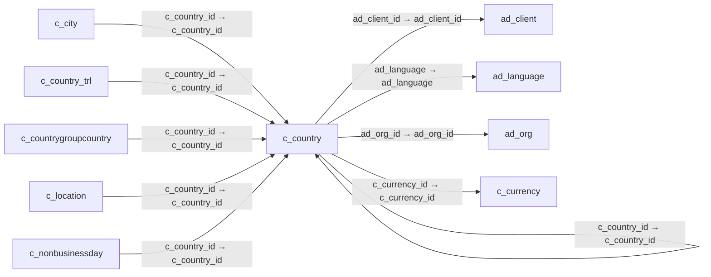

# c_country — 국가

[전체 일람](../TABLE_INDEX.md) · [분류 일람](README.md) · [AI 사용 안내](../README.md) · [외래키 읽는 법](../RELATIONSHIPS.md)

## 기본 정보

| 항목 | 내용 |
|---|---|
| 물리명 | `adempiere.c_country` |
| 한국어 논리명(문서용 해석) | 국가 |
| 원본 논리명 | Country |
| 원본 사전 ID | 170 |
| 분류 | `c` — 거래처·주문·청구·결제·회계 기준 |
| 전체 테넌트 행 수 | 251 |
| 물리 열 수 | 45 |
| 나가는 FK / 들어오는 FK | 5 / 15 |
| 구조·행 수 확인 시점 | 2026-11-03T23:29:01+09:00 |

## 의미와 쓰임

주소와 지역 구분에 사용하는 국가 기준정보를 관리한다.

- 설명 근거: 원본 애플리케이션 사전 명칭·설명을 한국어로 해석.
- 한국어 이름과 개요는 문서용 해석입니다. 공식 한국어 번역으로 간주하지 않습니다.
- 원본 설명: Country 
- 원본 도움말: —
- PostgreSQL 테이블 주석: —

## 키와 열

### 기본키·고유 제약조건

| 종류 | 제약조건 | 열(순서 유지) |
|---|---|---|
| PRIMARY KEY | `c_country_pkey` | `c_country_id` |
| UNIQUE | `c_country_uu_idx` | `c_country_uu` |

### 별도 고유 인덱스

PK·UNIQUE 제약조건의 인덱스와 별도로 존재하는 고유 인덱스입니다. 식·조건·열 순서는 원본 정의를 따릅니다.

- `c_countrycode`: `CREATE UNIQUE INDEX c_countrycode ON adempiere.c_country USING btree (countrycode)`

### 열 목록

원본 논리명·설명은 `AD_Column`에서 가져왔습니다. 기본값은 실제 PostgreSQL 메타데이터이며, 비어 있는 항목은 `—`로 표시합니다.

| 순서 | 물리명 | 원본 논리명 | PostgreSQL 타입 | NULL | PK | 기본값 | 설명 |
|---:|---|---|---|---|---|---|---|
| 1 | `c_country_id` | Country | numeric(10,0) | 불가 | 예 | — | Country  |
| 2 | `ad_client_id` | Tenant | numeric(10,0) | 불가 | — | — | Tenant for this installation. |
| 3 | `ad_org_id` | Organization | numeric(10,0) | 불가 | — | — | Organizational entity within tenant |
| 4 | `isactive` | Active | character(1) | 불가 | — | 'Y'::bpchar | The record is active in the system |
| 5 | `created` | Created | timestamp without time zone | 불가 | — | now() | Date this record was created |
| 6 | `createdby` | Created By | numeric(10,0) | 불가 | — | — | User who created this records |
| 7 | `updated` | Updated | timestamp without time zone | 불가 | — | now() | Date this record was updated |
| 8 | `updatedby` | Updated By | numeric(10,0) | 불가 | — | — | User who updated this records |
| 9 | `name` | Name | character varying(60) | 불가 | — | — | Alphanumeric identifier of the entity |
| 10 | `description` | Description | character varying(255) | 허용 | — | — | Optional short description of the record |
| 11 | `countrycode` | ISO Country Code | character(2) | 불가 | — | — | Upper-case two-letter alphanumeric ISO Country code according to ISO 3166-1 |
| 12 | `hasregion` | Country has Region | character(1) | 불가 | — | 'N'::bpchar | Country contains Regions |
| 13 | `regionname` | Region | character varying(60) | 허용 | — | — | Name of the Region |
| 14 | `expressionphone` | Phone Format | character varying(20) | 허용 | — | — | Format of the phone; Can contain fixed format elements, Variables: "_lLoOaAcCa09" |
| 15 | `displaysequence` | Address Print Format | character varying(20) | 불가 | — | — | Format for printing this Address |
| 16 | `expressionpostal` | Postal Code Format | character varying(20) | 허용 | — | — | Format of the postal code; Can contain fixed format elements, Variables: "_lLoOaAcCa09" |
| 17 | `haspostal_add` | Additional Postal code | character(1) | 불가 | — | 'N'::bpchar | Has Additional Postal Code |
| 18 | `expressionpostal_add` | Additional Postal Format | character varying(20) | 허용 | — | — | Format of the value; Can contain fixed format elements, Variables: "_lLoOaAcCa09" |
| 19 | `ad_language` | Language | character varying(6) | 허용 | — | — | Language for this entity |
| 20 | `c_currency_id` | Currency | numeric(10,0) | 허용 | — | — | The Currency for this record |
| 21 | `displaysequencelocal` | Local Address Format | character varying(20) | 허용 | — | — | Format for printing this Address locally |
| 22 | `isaddresslinesreverse` | Reverse Address Lines | character(1) | 불가 | — | 'N'::bpchar | Print Address in reverse Order |
| 23 | `isaddresslineslocalreverse` | Reverse Local Address Lines | character(1) | 불가 | — | 'N'::bpchar | Print Local Address in reverse Order |
| 24 | `expressionbankroutingno` | Bank Routing No Format | character varying(20) | 허용 | — | — | Format of the Bank Routing Number |
| 25 | `expressionbankaccountno` | Bank Account No Format | character varying(20) | 허용 | — | — | Format of the Bank Account |
| 26 | `mediasize` | Media Size | character varying(40) | 허용 | — | — | Java Media Size |
| 27 | `ispostcodelookup` | Use Postcode Lookup | character(1) | 불가 | — | 'N'::bpchar | Does this country have a post code web service |
| 28 | `lookupclassname` | Lookup ClassName | character varying(255) | 허용 | — | — | The class name of the postcode lookup plugin |
| 29 | `lookupclientid` | Lookup Tenant ID | character varying(50) | 허용 | — | — | The Client ID or Login submitted to the Lookup URL |
| 30 | `lookuppassword` | Lookup Password | character varying(50) | 허용 | — | — | The password submitted to the Lookup URL |
| 31 | `lookupurl` | Lookup URL | character varying(100) | 허용 | — | — | The URL of the web service that the plugin connects to in order to retrieve postcode data |
| 32 | `allowcitiesoutoflist` | Allow Cities out of List | character(1) | 허용 | — | 'Y'::bpchar | A flag to allow cities, currently not in the list, to be entered |
| 33 | `capturesequence` | Capture Sequence | character varying(60) | 허용 | — | — | — |
| 34 | `c_country_uu` | C_Country_UU | uuid | 허용 | — | — | — |
| 35 | `placeholderaddress1` | Placeholder for Address 1 | character varying(255) | 허용 | — | NULL::character varying | — |
| 36 | `placeholderaddress2` | Placeholder for Address 2 | character varying(255) | 허용 | — | NULL::character varying | — |
| 37 | `placeholderaddress3` | Placeholder for Address 3 | character varying(255) | 허용 | — | NULL::character varying | — |
| 38 | `placeholderaddress4` | Placeholder for Address 4 | character varying(255) | 허용 | — | NULL::character varying | — |
| 39 | `placeholderaddress5` | Placeholder for Address 5 | character varying(255) | 허용 | — | NULL::character varying | — |
| 40 | `placeholdercity` | Placeholder for city | character varying(255) | 허용 | — | NULL::character varying | — |
| 41 | `placeholdercomments` | Placeholder for comments | character varying(255) | 허용 | — | NULL::character varying | — |
| 42 | `placeholderpostal` | Placeholder for postal | character varying(255) | 허용 | — | NULL::character varying | — |
| 43 | `placeholderpostal_add` | Placeholder for additional zip | character varying(255) | 허용 | — | NULL::character varying | — |
| 44 | `m49code` | M49 Code | character varying(3) | 허용 | — | NULL::character varying | Standard country codes for statistical use (M49) defined by the United Nations |
| 45 | `isocountrycodealpha3` | ISO Alpha-3 Code | character varying(3) | 허용 | — | NULL::character varying | ISO Alpha-3 country code - a three-letter code that represents a country name, which is usually more closely related to the country name |

## 외래키 흐름

화살표는 **FK를 가진 자식 → 참조되는 부모**입니다. 업무 처리의 시간 순서나 무조건적인 1:N 관계를 뜻하지 않습니다.

주변 관계 19개 중 10개를 그림으로 표시합니다. **전체 관계는 아래 두 표에 모두 포함**합니다.

### 이 테이블이 참조하는 부모 — 나가는 FK

| 제약조건 | 참조하는 쪽(자식) | 자식 열 | 참조받는 쪽(부모) | 부모 열 | 삭제 / 갱신 | 검증 / 지연 가능 |
|---|---|---|---|---|---|---|
| `adlanguage_ccountry` <!-- FK_OUT: adempiere.c_country.adlanguage_ccountry --> | [`c_country`](c_country.md) | `ad_language` | [`ad_language`](../ad/ad_language.md) | `ad_language` | NO ACTION / NO ACTION | 완료 / 가능 (초기 지연) |
| `c_countryclient` <!-- FK_OUT: adempiere.c_country.c_countryclient --> | [`c_country`](c_country.md) | `ad_client_id` | [`ad_client`](../ad/ad_client.md) | `ad_client_id` | NO ACTION / NO ACTION | 완료 / 가능 (초기 지연) |
| `c_countryorg` <!-- FK_OUT: adempiere.c_country.c_countryorg --> | [`c_country`](c_country.md) | `ad_org_id` | [`ad_org`](../ad/ad_org.md) | `ad_org_id` | NO ACTION / NO ACTION | 완료 / 가능 (초기 지연) |
| `ccountry_ccountry` <!-- FK_OUT: adempiere.c_country.ccountry_ccountry --> | [`c_country`](c_country.md) | `c_country_id` | [`c_country`](c_country.md) | `c_country_id` | NO ACTION / NO ACTION | 완료 / 가능 (초기 지연) |
| `ccurrency_ccountry` <!-- FK_OUT: adempiere.c_country.ccurrency_ccountry --> | [`c_country`](c_country.md) | `c_currency_id` | [`c_currency`](c_currency.md) | `c_currency_id` | NO ACTION / NO ACTION | 완료 / 가능 (초기 지연) |

### 이 테이블을 참조하는 자식 — 들어오는 FK

| 제약조건 | 참조하는 쪽(자식) | 자식 열 | 참조받는 쪽(부모) | 부모 열 | 삭제 / 갱신 | 검증 / 지연 가능 |
|---|---|---|---|---|---|---|
| `ccountry_ccity` <!-- FK_IN: adempiere.c_city.ccountry_ccity --> | [`c_city`](c_city.md) | `c_country_id` | [`c_country`](c_country.md) | `c_country_id` | NO ACTION / NO ACTION | 완료 / 가능 (초기 지연) |
| `ccountry_ccountry` <!-- FK_IN: adempiere.c_country.ccountry_ccountry --> | [`c_country`](c_country.md) | `c_country_id` | [`c_country`](c_country.md) | `c_country_id` | NO ACTION / NO ACTION | 완료 / 가능 (초기 지연) |
| `ccountry_ccountrytrl` <!-- FK_IN: adempiere.c_country_trl.ccountry_ccountrytrl --> | [`c_country_trl`](c_country_trl.md) | `c_country_id` | [`c_country`](c_country.md) | `c_country_id` | CASCADE / NO ACTION | 완료 / 가능 (초기 지연) |
| `ccountry_ccountrygroupcountry` <!-- FK_IN: adempiere.c_countrygroupcountry.ccountry_ccountrygroupcountry --> | [`c_countrygroupcountry`](c_countrygroupcountry.md) | `c_country_id` | [`c_country`](c_country.md) | `c_country_id` | NO ACTION / NO ACTION | 완료 / 가능 (초기 지연) |
| `c_country_location` <!-- FK_IN: adempiere.c_location.c_country_location --> | [`c_location`](c_location.md) | `c_country_id` | [`c_country`](c_country.md) | `c_country_id` | NO ACTION / NO ACTION | 완료 / 가능 (초기 지연) |
| `ccountry_cnonbusinessday` <!-- FK_IN: adempiere.c_nonbusinessday.ccountry_cnonbusinessday --> | [`c_nonbusinessday`](c_nonbusinessday.md) | `c_country_id` | [`c_country`](c_country.md) | `c_country_id` | NO ACTION / NO ACTION | 완료 / 가능 (초기 지연) |
| `ccountry_cregion` <!-- FK_IN: adempiere.c_region.ccountry_cregion --> | [`c_region`](c_region.md) | `c_country_id` | [`c_country`](c_country.md) | `c_country_id` | NO ACTION / NO ACTION | 완료 / 가능 (초기 지연) |
| `c_country_c_tax` <!-- FK_IN: adempiere.c_tax.c_country_c_tax --> | [`c_tax`](c_tax.md) | `c_country_id` | [`c_country`](c_country.md) | `c_country_id` | NO ACTION / NO ACTION | 완료 / 가능 (초기 지연) |
| `c_countryto_c_tax` <!-- FK_IN: adempiere.c_tax.c_countryto_c_tax --> | [`c_tax`](c_tax.md) | `to_country_id` | [`c_country`](c_country.md) | `c_country_id` | NO ACTION / NO ACTION | 완료 / 가능 (초기 지연) |
| `ccountry_ipartner` <!-- FK_IN: adempiere.i_bpartner.ccountry_ipartner --> | [`i_bpartner`](../i/i_bpartner.md) | `c_country_id` | [`c_country`](c_country.md) | `c_country_id` | SET NULL / NO ACTION | 완료 / 가능 (초기 지연) |
| `ccountry_iinvoice` <!-- FK_IN: adempiere.i_invoice.ccountry_iinvoice --> | [`i_invoice`](../i/i_invoice.md) | `c_country_id` | [`c_country`](c_country.md) | `c_country_id` | SET NULL / NO ACTION | 완료 / 가능 (초기 지연) |
| `ccountry_iorder` <!-- FK_IN: adempiere.i_order.ccountry_iorder --> | [`i_order`](../i/i_order.md) | `c_country_id` | [`c_country`](c_country.md) | `c_country_id` | SET NULL / NO ACTION | 완료 / 가능 (초기 지연) |
| `countryofmanufacture_mcommodit` <!-- FK_IN: adempiere.m_commodityshipment.countryofmanufacture_mcommodit --> | [`m_commodityshipment`](../m/m_commodityshipment.md) | `countryofmanufacture_id` | [`c_country`](c_country.md) | `c_country_id` | NO ACTION / NO ACTION | 완료 / 가능 (초기 지연) |
| `ccountry_mfreight` <!-- FK_IN: adempiere.m_freight.ccountry_mfreight --> | [`m_freight`](../m/m_freight.md) | `c_country_id` | [`c_country`](c_country.md) | `c_country_id` | NO ACTION / NO ACTION | 완료 / 가능 (초기 지연) |
| `ccountryto_mfreight` <!-- FK_IN: adempiere.m_freight.ccountryto_mfreight --> | [`m_freight`](../m/m_freight.md) | `to_country_id` | [`c_country`](c_country.md) | `c_country_id` | NO ACTION / NO ACTION | 완료 / 가능 (초기 지연) |

## 조회 시 주의

- FK 표의 자식 열과 부모 열을 같은 순서로 대응시킵니다. 복합 FK는 모든 열의 동등 조건을 `AND`로 연결합니다.
- 테이블 이름이나 `_id` 열 이름만으로 물리 FK가 있다고 가정하지 않습니다. FK 미선언은 업무 관계가 없다는 뜻도 아닙니다.
- 자식이 여러 행인 테이블과 조인하면 부모의 금액·건수가 중복될 수 있습니다. 집계 단위를 먼저 정합니다.
- `ad_client_id`가 있습니다. 업무 분석에서는 대상 테넌트를 명시합니다. GardenWorld는 `11`, 시스템 공통 설정은 `0`일 수 있으므로 일괄 필터 적용 전에 테이블 역할을 확인합니다.
- 행 수는 위 확인 시점의 전체 테넌트 값입니다. 최신 업무 실적이나 현재 실행 결과로 재사용하지 않습니다.
