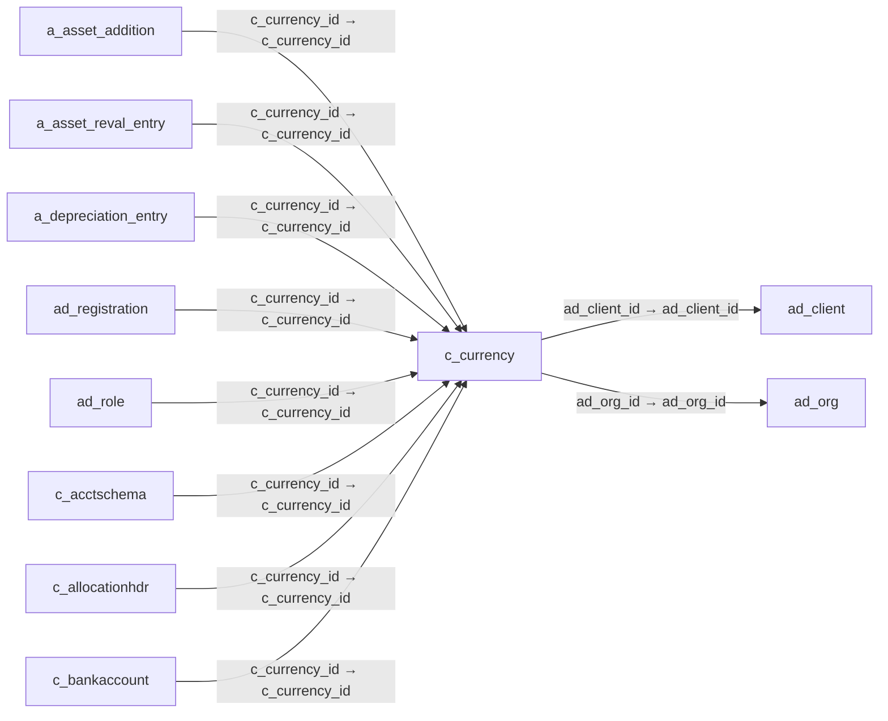

# c_currency — 통화

[전체 일람](../TABLE_INDEX.md) · [분류 일람](README.md) · [AI 사용 안내](../README.md) · [외래키 읽는 법](../RELATIONSHIPS.md)

## 기본 정보

| 항목 | 내용 |
|---|---|
| 물리명 | `adempiere.c_currency` |
| 한국어 논리명(문서용 해석) | 통화 |
| 원본 논리명 | Currency |
| 원본 사전 ID | 141 |
| 분류 | `c` — 거래처·주문·청구·결제·회계 기준 |
| 전체 테넌트 행 수 | 175 |
| 물리 열 수 | 19 |
| 나가는 FK / 들어오는 FK | 2 / 65 |
| 구조·행 수 확인 시점 | 2026-11-03T23:29:01+09:00 |

## 의미와 쓰임

거래와 회계 금액을 표시하는 통화의 기준정보를 관리한다.

- 설명 근거: 원본 애플리케이션 사전 명칭·설명을 한국어로 해석.
- 한국어 이름과 개요는 문서용 해석입니다. 공식 한국어 번역으로 간주하지 않습니다.
- 원본 설명: The Currency for this record
- 원본 도움말: —
- PostgreSQL 테이블 주석: —

## 키와 열

### 기본키·고유 제약조건

| 종류 | 제약조건 | 열(순서 유지) |
|---|---|---|
| PRIMARY KEY | `c_currency_pkey` | `c_currency_id` |
| UNIQUE | `c_currency_uu_idx` | `c_currency_uu` |

### 별도 고유 인덱스

PK·UNIQUE 제약조건의 인덱스와 별도로 존재하는 고유 인덱스입니다. 식·조건·열 순서는 원본 정의를 따릅니다.

- `c_currencyisocode`: `CREATE UNIQUE INDEX c_currencyisocode ON adempiere.c_currency USING btree (iso_code)`

### 열 목록

원본 논리명·설명은 `AD_Column`에서 가져왔습니다. 기본값은 실제 PostgreSQL 메타데이터이며, 비어 있는 항목은 `—`로 표시합니다.

| 순서 | 물리명 | 원본 논리명 | PostgreSQL 타입 | NULL | PK | 기본값 | 설명 |
|---:|---|---|---|---|---|---|---|
| 1 | `c_currency_id` | Currency | numeric(10,0) | 불가 | 예 | — | The Currency for this record |
| 2 | `ad_client_id` | Tenant | numeric(10,0) | 불가 | — | — | Tenant for this installation. |
| 3 | `ad_org_id` | Organization | numeric(10,0) | 불가 | — | — | Organizational entity within tenant |
| 4 | `isactive` | Active | character(1) | 불가 | — | 'Y'::bpchar | The record is active in the system |
| 5 | `created` | Created | timestamp without time zone | 불가 | — | now() | Date this record was created |
| 6 | `createdby` | Created By | numeric(10,0) | 불가 | — | — | User who created this records |
| 7 | `updated` | Updated | timestamp without time zone | 불가 | — | now() | Date this record was updated |
| 8 | `updatedby` | Updated By | numeric(10,0) | 불가 | — | — | User who updated this records |
| 9 | `iso_code` | ISO Currency Code | character(3) | 불가 | — | — | Three letter ISO 4217 Code of the Currency |
| 10 | `cursymbol` | Symbol | character varying(10) | 허용 | — | — | Symbol of the currency (opt used for printing only) |
| 11 | `description` | Description | character varying(255) | 불가 | — | — | Optional short description of the record |
| 12 | `stdprecision` | Standard Precision | numeric(10,0) | 불가 | — | — | Rule for rounding  calculated amounts |
| 13 | `costingprecision` | Costing Precision | numeric(10,0) | 불가 | — | — | Rounding used costing calculations |
| 14 | `iseuro` | The Euro Currency | character(1) | 불가 | — | 'N'::bpchar | This currency is the Euro |
| 15 | `isemumember` | EMU Member | character(1) | 불가 | — | 'N'::bpchar | This currency is member if the European Monetary Union |
| 16 | `emuentrydate` | EMU Entry Date | timestamp without time zone | 허용 | — | — | Date when the currency joined / will join the EMU |
| 17 | `emurate` | EMU Rate | numeric | 허용 | — | 0 | Official rate to the Euro |
| 18 | `roundofffactor` | Round Off Factor | numeric | 허용 | — | — | Used to Round Off Payment Amount |
| 19 | `c_currency_uu` | C_Currency_UU | uuid | 허용 | — | — | — |

## 외래키 흐름

화살표는 **FK를 가진 자식 → 참조되는 부모**입니다. 업무 처리의 시간 순서나 무조건적인 1:N 관계를 뜻하지 않습니다.

주변 관계 67개 중 10개를 그림으로 표시합니다. **전체 관계는 아래 두 표에 모두 포함**합니다.

### 이 테이블이 참조하는 부모 — 나가는 FK

| 제약조건 | 참조하는 쪽(자식) | 자식 열 | 참조받는 쪽(부모) | 부모 열 | 삭제 / 갱신 | 검증 / 지연 가능 |
|---|---|---|---|---|---|---|
| `c_currencyclient` <!-- FK_OUT: adempiere.c_currency.c_currencyclient --> | [`c_currency`](c_currency.md) | `ad_client_id` | [`ad_client`](../ad/ad_client.md) | `ad_client_id` | NO ACTION / NO ACTION | 완료 / 가능 (초기 지연) |
| `c_currencyorg` <!-- FK_OUT: adempiere.c_currency.c_currencyorg --> | [`c_currency`](c_currency.md) | `ad_org_id` | [`ad_org`](../ad/ad_org.md) | `ad_org_id` | NO ACTION / NO ACTION | 완료 / 가능 (초기 지연) |

### 이 테이블을 참조하는 자식 — 들어오는 FK

| 제약조건 | 참조하는 쪽(자식) | 자식 열 | 참조받는 쪽(부모) | 부모 열 | 삭제 / 갱신 | 검증 / 지연 가능 |
|---|---|---|---|---|---|---|
| `ccurrency_aassetaddition` <!-- FK_IN: adempiere.a_asset_addition.ccurrency_aassetaddition --> | [`a_asset_addition`](../a/a_asset_addition.md) | `c_currency_id` | [`c_currency`](c_currency.md) | `c_currency_id` | NO ACTION / NO ACTION | 완료 / 가능 (초기 지연) |
| `ccurrency_aassetrevalentry` <!-- FK_IN: adempiere.a_asset_reval_entry.ccurrency_aassetrevalentry --> | [`a_asset_reval_entry`](../a/a_asset_reval_entry.md) | `c_currency_id` | [`c_currency`](c_currency.md) | `c_currency_id` | NO ACTION / NO ACTION | 완료 / 가능 (초기 지연) |
| `ccurrency_adepreciationentry` <!-- FK_IN: adempiere.a_depreciation_entry.ccurrency_adepreciationentry --> | [`a_depreciation_entry`](../a/a_depreciation_entry.md) | `c_currency_id` | [`c_currency`](c_currency.md) | `c_currency_id` | NO ACTION / NO ACTION | 완료 / 가능 (초기 지연) |
| `ccurrency_adregistration` <!-- FK_IN: adempiere.ad_registration.ccurrency_adregistration --> | [`ad_registration`](../ad/ad_registration.md) | `c_currency_id` | [`c_currency`](c_currency.md) | `c_currency_id` | NO ACTION / NO ACTION | 완료 / 가능 (초기 지연) |
| `c_currency_ad_role` <!-- FK_IN: adempiere.ad_role.c_currency_ad_role --> | [`ad_role`](../ad/ad_role.md) | `c_currency_id` | [`c_currency`](c_currency.md) | `c_currency_id` | NO ACTION / NO ACTION | 완료 / 가능 (초기 지연) |
| `c_currency_c_acctschema` <!-- FK_IN: adempiere.c_acctschema.c_currency_c_acctschema --> | [`c_acctschema`](c_acctschema.md) | `c_currency_id` | [`c_currency`](c_currency.md) | `c_currency_id` | NO ACTION / NO ACTION | 완료 / 가능 (초기 지연) |
| `ccurrency_callocation` <!-- FK_IN: adempiere.c_allocationhdr.ccurrency_callocation --> | [`c_allocationhdr`](c_allocationhdr.md) | `c_currency_id` | [`c_currency`](c_currency.md) | `c_currency_id` | NO ACTION / NO ACTION | 완료 / 가능 (초기 지연) |
| `ccurrency_cbankaccount` <!-- FK_IN: adempiere.c_bankaccount.ccurrency_cbankaccount --> | [`c_bankaccount`](c_bankaccount.md) | `c_currency_id` | [`c_currency`](c_currency.md) | `c_currency_id` | NO ACTION / NO ACTION | 완료 / 가능 (초기 지연) |
| `ccurrency_cbankaccountprocesso` <!-- FK_IN: adempiere.c_bankaccount_processor.ccurrency_cbankaccountprocesso --> | [`c_bankaccount_processor`](c_bankaccount_processor.md) | `c_currency_id` | [`c_currency`](c_currency.md) | `c_currency_id` | NO ACTION / NO ACTION | 완료 / 가능 (초기 지연) |
| `ccurrency_cbankstmtline` <!-- FK_IN: adempiere.c_bankstatementline.ccurrency_cbankstmtline --> | [`c_bankstatementline`](c_bankstatementline.md) | `c_currency_id` | [`c_currency`](c_currency.md) | `c_currency_id` | NO ACTION / NO ACTION | 완료 / 가능 (초기 지연) |
| `fromccurrency_cbanktransfer` <!-- FK_IN: adempiere.c_banktransfer.fromccurrency_cbanktransfer --> | [`c_banktransfer`](c_banktransfer.md) | `from_c_currency_id` | [`c_currency`](c_currency.md) | `c_currency_id` | NO ACTION / NO ACTION | 완료 / 가능 (초기 지연) |
| `toccurrency_cbanktransfer` <!-- FK_IN: adempiere.c_banktransfer.toccurrency_cbanktransfer --> | [`c_banktransfer`](c_banktransfer.md) | `to_c_currency_id` | [`c_currency`](c_currency.md) | `c_currency_id` | NO ACTION / NO ACTION | 완료 / 가능 (초기 지연) |
| `ccurrency_ccashbook` <!-- FK_IN: adempiere.c_cashbook.ccurrency_ccashbook --> | [`c_cashbook`](c_cashbook.md) | `c_currency_id` | [`c_currency`](c_currency.md) | `c_currency_id` | NO ACTION / NO ACTION | 완료 / 가능 (초기 지연) |
| `ccurrency_ccashline` <!-- FK_IN: adempiere.c_cashline.ccurrency_ccashline --> | [`c_cashline`](c_cashline.md) | `c_currency_id` | [`c_currency`](c_currency.md) | `c_currency_id` | NO ACTION / NO ACTION | 완료 / 가능 (초기 지연) |
| `ccurrency_ccommission` <!-- FK_IN: adempiere.c_commission.ccurrency_ccommission --> | [`c_commission`](c_commission.md) | `c_currency_id` | [`c_currency`](c_currency.md) | `c_currency_id` | NO ACTION / NO ACTION | 완료 / 가능 (초기 지연) |
| `ccurrency_ccommissiondetail` <!-- FK_IN: adempiere.c_commissiondetail.ccurrency_ccommissiondetail --> | [`c_commissiondetail`](c_commissiondetail.md) | `c_currency_id` | [`c_currency`](c_currency.md) | `c_currency_id` | NO ACTION / NO ACTION | 완료 / 가능 (초기 지연) |
| `c_currencyconvrateto` <!-- FK_IN: adempiere.c_conversion_rate.c_currencyconvrateto --> | [`c_conversion_rate`](c_conversion_rate.md) | `c_currency_id_to` | [`c_currency`](c_currency.md) | `c_currency_id` | NO ACTION / NO ACTION | 완료 / 가능 (초기 지연) |
| `ccurrency_cconversionrate` <!-- FK_IN: adempiere.c_conversion_rate.ccurrency_cconversionrate --> | [`c_conversion_rate`](c_conversion_rate.md) | `c_currency_id` | [`c_currency`](c_currency.md) | `c_currency_id` | NO ACTION / NO ACTION | 완료 / 가능 (초기 지연) |
| `ccurrency_ccountry` <!-- FK_IN: adempiere.c_country.ccurrency_ccountry --> | [`c_country`](c_country.md) | `c_currency_id` | [`c_currency`](c_currency.md) | `c_currency_id` | NO ACTION / NO ACTION | 완료 / 가능 (초기 지연) |
| `ccurrency_ccurrencyacct` <!-- FK_IN: adempiere.c_currency_acct.ccurrency_ccurrencyacct --> | [`c_currency_acct`](c_currency_acct.md) | `c_currency_id` | [`c_currency`](c_currency.md) | `c_currency_id` | CASCADE / NO ACTION | 완료 / 가능 (초기 지연) |
| `ccurrency_ccurrencytrl` <!-- FK_IN: adempiere.c_currency_trl.ccurrency_ccurrencytrl --> | [`c_currency_trl`](c_currency_trl.md) | `c_currency_id` | [`c_currency`](c_currency.md) | `c_currency_id` | CASCADE / NO ACTION | 완료 / 가능 (초기 지연) |
| `ccurrency_ccycle` <!-- FK_IN: adempiere.c_cycle.ccurrency_ccycle --> | [`c_cycle`](c_cycle.md) | `c_currency_id` | [`c_currency`](c_currency.md) | `c_currency_id` | NO ACTION / NO ACTION | 완료 / 가능 (초기 지연) |
| `ccurrency_cdepositbatch` <!-- FK_IN: adempiere.c_depositbatch.ccurrency_cdepositbatch --> | [`c_depositbatch`](c_depositbatch.md) | `c_currency_id` | [`c_currency`](c_currency.md) | `c_currency_id` | NO ACTION / NO ACTION | 완료 / 가능 (초기 지연) |
| `ccurrency_cdunningrunentry` <!-- FK_IN: adempiere.c_dunningrunentry.ccurrency_cdunningrunentry --> | [`c_dunningrunentry`](c_dunningrunentry.md) | `c_currency_id` | [`c_currency`](c_currency.md) | `c_currency_id` | NO ACTION / NO ACTION | 완료 / 가능 (초기 지연) |
| `ccurrency_celementvalue` <!-- FK_IN: adempiere.c_elementvalue.ccurrency_celementvalue --> | [`c_elementvalue`](c_elementvalue.md) | `c_currency_id` | [`c_currency`](c_currency.md) | `c_currency_id` | NO ACTION / NO ACTION | 완료 / 가능 (초기 지연) |
| `ccurrency_cinvoice` <!-- FK_IN: adempiere.c_invoice.ccurrency_cinvoice --> | [`c_invoice`](c_invoice.md) | `c_currency_id` | [`c_currency`](c_currency.md) | `c_currency_id` | NO ACTION / NO ACTION | 완료 / 가능 (초기 지연) |
| `ccurrency_cinvoicebatch` <!-- FK_IN: adempiere.c_invoicebatch.ccurrency_cinvoicebatch --> | [`c_invoicebatch`](c_invoicebatch.md) | `c_currency_id` | [`c_currency`](c_currency.md) | `c_currency_id` | NO ACTION / NO ACTION | 완료 / 가능 (초기 지연) |
| `ccurrency_copportunity` <!-- FK_IN: adempiere.c_opportunity.ccurrency_copportunity --> | [`c_opportunity`](c_opportunity.md) | `c_currency_id` | [`c_currency`](c_currency.md) | `c_currency_id` | NO ACTION / NO ACTION | 완료 / 가능 (초기 지연) |
| `ccurrency_corder` <!-- FK_IN: adempiere.c_order.ccurrency_corder --> | [`c_order`](c_order.md) | `c_currency_id` | [`c_currency`](c_currency.md) | `c_currency_id` | NO ACTION / NO ACTION | 완료 / 가능 (초기 지연) |
| `ccurrency_corderline` <!-- FK_IN: adempiere.c_orderline.ccurrency_corderline --> | [`c_orderline`](c_orderline.md) | `c_currency_id` | [`c_currency`](c_currency.md) | `c_currency_id` | NO ACTION / NO ACTION | 완료 / 가능 (초기 지연) |
| `ccurrency_cpayment` <!-- FK_IN: adempiere.c_payment.ccurrency_cpayment --> | [`c_payment`](c_payment.md) | `c_currency_id` | [`c_currency`](c_currency.md) | `c_currency_id` | NO ACTION / NO ACTION | 완료 / 가능 (초기 지연) |
| `ccurrency_cpaymentprocessor` <!-- FK_IN: adempiere.c_paymentprocessor.ccurrency_cpaymentprocessor --> | [`c_paymentprocessor`](c_paymentprocessor.md) | `c_currency_id` | [`c_currency`](c_currency.md) | `c_currency_id` | NO ACTION / NO ACTION | 완료 / 가능 (초기 지연) |
| `ccurrency_cpaymenttransaction` <!-- FK_IN: adempiere.c_paymenttransaction.ccurrency_cpaymenttransaction --> | [`c_paymenttransaction`](c_paymenttransaction.md) | `c_currency_id` | [`c_currency`](c_currency.md) | `c_currency_id` | NO ACTION / NO ACTION | 완료 / 가능 (초기 지연) |
| `ccurrency_cproject` <!-- FK_IN: adempiere.c_project.ccurrency_cproject --> | [`c_project`](c_project.md) | `c_currency_id` | [`c_currency`](c_currency.md) | `c_currency_id` | NO ACTION / NO ACTION | 완료 / 가능 (초기 지연) |
| `ccurrency_crevenuerecplan` <!-- FK_IN: adempiere.c_revenuerecognition_plan.ccurrency_crevenuerecplan --> | [`c_revenuerecognition_plan`](c_revenuerecognition_plan.md) | `c_currency_id` | [`c_currency`](c_currency.md) | `c_currency_id` | NO ACTION / NO ACTION | 완료 / 가능 (초기 지연) |
| `ccurrency_crfq` <!-- FK_IN: adempiere.c_rfq.ccurrency_crfq --> | [`c_rfq`](c_rfq.md) | `c_currency_id` | [`c_currency`](c_currency.md) | `c_currency_id` | NO ACTION / NO ACTION | 완료 / 가능 (초기 지연) |
| `ccurrency_crfqresponse` <!-- FK_IN: adempiere.c_rfqresponse.ccurrency_crfqresponse --> | [`c_rfqresponse`](c_rfqresponse.md) | `c_currency_id` | [`c_currency`](c_currency.md) | `c_currency_id` | NO ACTION / NO ACTION | 완료 / 가능 (초기 지연) |
| `ccurrency_ctaxdeclline` <!-- FK_IN: adempiere.c_taxdeclarationline.ccurrency_ctaxdeclline --> | [`c_taxdeclarationline`](c_taxdeclarationline.md) | `c_currency_id` | [`c_currency`](c_currency.md) | `c_currency_id` | NO ACTION / NO ACTION | 완료 / 가능 (초기 지연) |
| `c_currency_fact_acct` <!-- FK_IN: adempiere.fact_acct.c_currency_fact_acct --> | [`fact_acct`](../fact/fact_acct.md) | `c_currency_id` | [`c_currency`](c_currency.md) | `c_currency_id` | NO ACTION / NO ACTION | 완료 / 가능 (초기 지연) |
| `ccurrency_gljournal` <!-- FK_IN: adempiere.gl_journal.ccurrency_gljournal --> | [`gl_journal`](../gl/gl_journal.md) | `c_currency_id` | [`c_currency`](c_currency.md) | `c_currency_id` | NO ACTION / NO ACTION | 완료 / 가능 (초기 지연) |
| `ccurrency_gljournalbatch` <!-- FK_IN: adempiere.gl_journalbatch.ccurrency_gljournalbatch --> | [`gl_journalbatch`](../gl/gl_journalbatch.md) | `c_currency_id` | [`c_currency`](c_currency.md) | `c_currency_id` | NO ACTION / NO ACTION | 완료 / 가능 (초기 지연) |
| `ccurrency_gljournalline` <!-- FK_IN: adempiere.gl_journalline.ccurrency_gljournalline --> | [`gl_journalline`](../gl/gl_journalline.md) | `c_currency_id` | [`c_currency`](c_currency.md) | `c_currency_id` | NO ACTION / NO ACTION | 완료 / 가능 (초기 지연) |
| `ccurrency_ibankstatement` <!-- FK_IN: adempiere.i_bankstatement.ccurrency_ibankstatement --> | [`i_bankstatement`](../i/i_bankstatement.md) | `c_currency_id` | [`c_currency`](c_currency.md) | `c_currency_id` | SET NULL / NO ACTION | 완료 / 가능 (초기 지연) |
| `ccurrency_iconvrate` <!-- FK_IN: adempiere.i_conversion_rate.ccurrency_iconvrate --> | [`i_conversion_rate`](../i/i_conversion_rate.md) | `c_currency_id` | [`c_currency`](c_currency.md) | `c_currency_id` | SET NULL / NO ACTION | 완료 / 가능 (초기 지연) |
| `ccurrency_iconvrateto` <!-- FK_IN: adempiere.i_conversion_rate.ccurrency_iconvrateto --> | [`i_conversion_rate`](../i/i_conversion_rate.md) | `c_currency_id_to` | [`c_currency`](c_currency.md) | `c_currency_id` | SET NULL / NO ACTION | 완료 / 가능 (초기 지연) |
| `ccurrency_ifajournal` <!-- FK_IN: adempiere.i_fajournal.ccurrency_ifajournal --> | [`i_fajournal`](../i/i_fajournal.md) | `c_currency_id` | [`c_currency`](c_currency.md) | `c_currency_id` | NO ACTION / NO ACTION | 완료 / 가능 (초기 지연) |
| `ccurrency_ifixedasset` <!-- FK_IN: adempiere.i_fixedasset.ccurrency_ifixedasset --> | [`i_fixedasset`](../i/i_fixedasset.md) | `c_currency_id` | [`c_currency`](c_currency.md) | `c_currency_id` | NO ACTION / NO ACTION | 완료 / 가능 (초기 지연) |
| `ccurrency_igljournal` <!-- FK_IN: adempiere.i_gljournal.ccurrency_igljournal --> | [`i_gljournal`](../i/i_gljournal.md) | `c_currency_id` | [`c_currency`](c_currency.md) | `c_currency_id` | SET NULL / NO ACTION | 완료 / 가능 (초기 지연) |
| `ccurrency_iinvoice` <!-- FK_IN: adempiere.i_invoice.ccurrency_iinvoice --> | [`i_invoice`](../i/i_invoice.md) | `c_currency_id` | [`c_currency`](c_currency.md) | `c_currency_id` | SET NULL / NO ACTION | 완료 / 가능 (초기 지연) |
| `ccurrency_iorder` <!-- FK_IN: adempiere.i_order.ccurrency_iorder --> | [`i_order`](../i/i_order.md) | `c_currency_id` | [`c_currency`](c_currency.md) | `c_currency_id` | SET NULL / NO ACTION | 완료 / 가능 (초기 지연) |
| `ccurrency_ipayment` <!-- FK_IN: adempiere.i_payment.ccurrency_ipayment --> | [`i_payment`](../i/i_payment.md) | `c_currency_id` | [`c_currency`](c_currency.md) | `c_currency_id` | NO ACTION / NO ACTION | 완료 / 가능 (초기 지연) |
| `ccurrency_ipricelist` <!-- FK_IN: adempiere.i_pricelist.ccurrency_ipricelist --> | [`i_pricelist`](../i/i_pricelist.md) | `c_currency_id` | [`c_currency`](c_currency.md) | `c_currency_id` | NO ACTION / NO ACTION | 완료 / 가능 (초기 지연) |
| `ccurrency_iproduct` <!-- FK_IN: adempiere.i_product.ccurrency_iproduct --> | [`i_product`](../i/i_product.md) | `c_currency_id` | [`c_currency`](c_currency.md) | `c_currency_id` | SET NULL / NO ACTION | 완료 / 가능 (초기 지연) |
| `ccurrency_mbpprice` <!-- FK_IN: adempiere.m_bp_price.ccurrency_mbpprice --> | [`m_bp_price`](../m/m_bp_price.md) | `c_currency_id` | [`c_currency`](c_currency.md) | `c_currency_id` | NO ACTION / NO ACTION | 완료 / 가능 (초기 지연) |
| `ccurrency_mfreight` <!-- FK_IN: adempiere.m_freight.ccurrency_mfreight --> | [`m_freight`](../m/m_freight.md) | `c_currency_id` | [`c_currency`](c_currency.md) | `c_currency_id` | NO ACTION / NO ACTION | 완료 / 가능 (초기 지연) |
| `ccurrency_minventory` <!-- FK_IN: adempiere.m_inventory.ccurrency_minventory --> | [`m_inventory`](../m/m_inventory.md) | `c_currency_id` | [`c_currency`](c_currency.md) | `c_currency_id` | NO ACTION / NO ACTION | 완료 / 가능 (초기 지연) |
| `ccurrency_mpackage` <!-- FK_IN: adempiere.m_package.ccurrency_mpackage --> | [`m_package`](../m/m_package.md) | `c_currency_id` | [`c_currency`](c_currency.md) | `c_currency_id` | NO ACTION / NO ACTION | 완료 / 가능 (초기 지연) |
| `ccurrency_mpricelist` <!-- FK_IN: adempiere.m_pricelist.ccurrency_mpricelist --> | [`m_pricelist`](../m/m_pricelist.md) | `c_currency_id` | [`c_currency`](c_currency.md) | `c_currency_id` | NO ACTION / NO ACTION | 완료 / 가능 (초기 지연) |
| `ccurrency_mproductpo` <!-- FK_IN: adempiere.m_product_po.ccurrency_mproductpo --> | [`m_product_po`](../m/m_product_po.md) | `c_currency_id` | [`c_currency`](c_currency.md) | `c_currency_id` | NO ACTION / NO ACTION | 완료 / 가능 (초기 지연) |
| `ccurrency_mrma` <!-- FK_IN: adempiere.m_rma.ccurrency_mrma --> | [`m_rma`](../m/m_rma.md) | `c_currency_id` | [`c_currency`](c_currency.md) | `c_currency_id` | NO ACTION / NO ACTION | 완료 / 가능 (초기 지연) |
| `ccurrency_mshippingtransaction` <!-- FK_IN: adempiere.m_shippingtransaction.ccurrency_mshippingtransaction --> | [`m_shippingtransaction`](../m/m_shippingtransaction.md) | `c_currency_id` | [`c_currency`](c_currency.md) | `c_currency_id` | NO ACTION / NO ACTION | 완료 / 가능 (초기 지연) |
| `ccurrency_pareportcolumn` <!-- FK_IN: adempiere.pa_reportcolumn.ccurrency_pareportcolumn --> | [`pa_reportcolumn`](../pa/pa_reportcolumn.md) | `c_currency_id` | [`c_currency`](c_currency.md) | `c_currency_id` | NO ACTION / NO ACTION | 완료 / 가능 (초기 지연) |
| `ccurrency_stimeexpenseline` <!-- FK_IN: adempiere.s_timeexpenseline.ccurrency_stimeexpenseline --> | [`s_timeexpenseline`](../s/s_timeexpenseline.md) | `c_currency_id` | [`c_currency`](c_currency.md) | `c_currency_id` | NO ACTION / NO ACTION | 완료 / 가능 (초기 지연) |
| `ccurrency_taging` <!-- FK_IN: adempiere.t_aging.ccurrency_taging --> | [`t_aging`](../t/t_aging.md) | `c_currency_id` | [`c_currency`](c_currency.md) | `c_currency_id` | CASCADE / NO ACTION | 완료 / 가능 (초기 지연) |
| `ccurrency_tinventoryvalue` <!-- FK_IN: adempiere.t_inventoryvalue.ccurrency_tinventoryvalue --> | [`t_inventoryvalue`](../t/t_inventoryvalue.md) | `c_currency_id` | [`c_currency`](c_currency.md) | `c_currency_id` | CASCADE / NO ACTION | 완료 / 가능 (초기 지연) |

## 조회 시 주의

- FK 표의 자식 열과 부모 열을 같은 순서로 대응시킵니다. 복합 FK는 모든 열의 동등 조건을 `AND`로 연결합니다.
- 테이블 이름이나 `_id` 열 이름만으로 물리 FK가 있다고 가정하지 않습니다. FK 미선언은 업무 관계가 없다는 뜻도 아닙니다.
- 자식이 여러 행인 테이블과 조인하면 부모의 금액·건수가 중복될 수 있습니다. 집계 단위를 먼저 정합니다.
- `ad_client_id`가 있습니다. 업무 분석에서는 대상 테넌트를 명시합니다. GardenWorld는 `11`, 시스템 공통 설정은 `0`일 수 있으므로 일괄 필터 적용 전에 테이블 역할을 확인합니다.
- 행 수는 위 확인 시점의 전체 테넌트 값입니다. 최신 업무 실적이나 현재 실행 결과로 재사용하지 않습니다.
