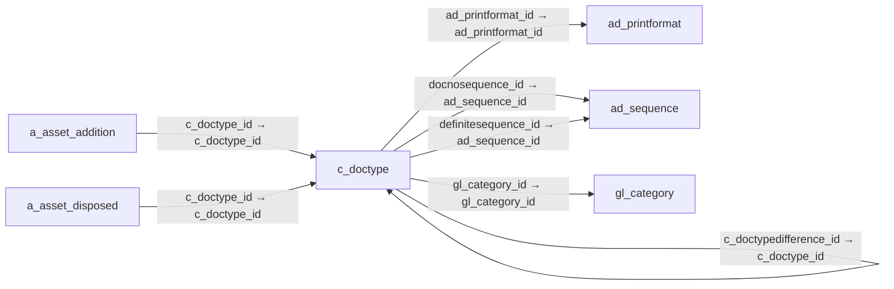

# c_doctype — 문서 유형

[전체 일람](../TABLE_INDEX.md) · [분류 일람](README.md) · [AI 사용 안내](../README.md) · [외래키 읽는 법](../RELATIONSHIPS.md)

## 기본 정보

| 항목 | 내용 |
|---|---|
| 물리명 | `adempiere.c_doctype` |
| 한국어 논리명(문서용 해석) | 문서 유형 |
| 원본 논리명 | Document Type |
| 원본 사전 ID | 217 |
| 분류 | `c` — 거래처·주문·청구·결제·회계 기준 |
| 전체 테넌트 행 수 | 52 |
| 물리 열 수 | 46 |
| 나가는 FK / 들어오는 FK | 8 / 53 |
| 구조·행 수 확인 시점 | 2026-11-03T23:29:01+09:00 |

## 의미와 쓰임

업무 문서의 유형과 처리 규칙을 정의한다.

- 설명 근거: 원본 애플리케이션 사전 명칭·설명을 한국어로 해석.
- 한국어 이름과 개요는 문서용 해석입니다. 공식 한국어 번역으로 간주하지 않습니다.
- 원본 설명: Document type or rules
- 원본 도움말: —
- PostgreSQL 테이블 주석: —

## 키와 열

### 기본키·고유 제약조건

| 종류 | 제약조건 | 열(순서 유지) |
|---|---|---|
| PRIMARY KEY | `c_doctype_pkey` | `c_doctype_id` |
| UNIQUE | `c_doctype_uu_idx` | `c_doctype_uu` |

### 별도 고유 인덱스

PK·UNIQUE 제약조건의 인덱스와 별도로 존재하는 고유 인덱스입니다. 식·조건·열 순서는 원본 정의를 따릅니다.

- `c_doctype_name`: `CREATE UNIQUE INDEX c_doctype_name ON adempiere.c_doctype USING btree (ad_client_id, name)`

### 열 목록

원본 논리명·설명은 `AD_Column`에서 가져왔습니다. 기본값은 실제 PostgreSQL 메타데이터이며, 비어 있는 항목은 `—`로 표시합니다.

| 순서 | 물리명 | 원본 논리명 | PostgreSQL 타입 | NULL | PK | 기본값 | 설명 |
|---:|---|---|---|---|---|---|---|
| 1 | `c_doctype_id` | Document Type | numeric(10,0) | 불가 | 예 | — | Document type or rules |
| 2 | `ad_client_id` | Tenant | numeric(10,0) | 불가 | — | — | Tenant for this installation. |
| 3 | `ad_org_id` | Organization | numeric(10,0) | 불가 | — | — | Organizational entity within tenant |
| 4 | `isactive` | Active | character(1) | 불가 | — | 'Y'::bpchar | The record is active in the system |
| 5 | `created` | Created | timestamp without time zone | 불가 | — | now() | Date this record was created |
| 6 | `createdby` | Created By | numeric(10,0) | 불가 | — | — | User who created this records |
| 7 | `updated` | Updated | timestamp without time zone | 불가 | — | now() | Date this record was updated |
| 8 | `updatedby` | Updated By | numeric(10,0) | 불가 | — | — | User who updated this records |
| 9 | `name` | Name | character varying(60) | 불가 | — | — | Alphanumeric identifier of the entity |
| 10 | `printname` | Print Text | character varying(60) | 불가 | — | — | The label text to be printed on a document or correspondence. |
| 11 | `description` | Description | character varying(255) | 허용 | — | — | Optional short description of the record |
| 12 | `docbasetype` | Document Base Type | character(3) | 불가 | — | — | Logical type of document |
| 13 | `issotrx` | Sales Transaction | character(1) | 불가 | — | 'Y'::bpchar | This is a Sales Transaction |
| 14 | `docsubtypeso` | SO Sub Type | character(2) | 허용 | — | — | Sales Order Sub Type |
| 15 | `hasproforma` | Pro forma Invoice | character(1) | 허용 | — | 'N'::bpchar | Indicates if Pro Forma Invoices can be generated from this document |
| 16 | `c_doctypeproforma_id` | Document Type for ProForma | numeric(10,0) | 허용 | — | — | Document type used for pro forma invoices generated from this sales document |
| 17 | `c_doctypeshipment_id` | Document Type for Shipment | numeric(10,0) | 허용 | — | — | Document type used for shipments generated from this sales document |
| 18 | `c_doctypeinvoice_id` | Document Type for Invoice | numeric(10,0) | 허용 | — | — | Document type used for invoices generated from this sales document |
| 19 | `isdocnocontrolled` | Document is Number Controlled | character(1) | 불가 | — | 'N'::bpchar | The document has a document sequence |
| 20 | `docnosequence_id` | Document Sequence | numeric(10,0) | 허용 | — | — | Document sequence determines the numbering of documents |
| 21 | `gl_category_id` | GL Category | numeric(10,0) | 불가 | — | — | General Ledger Category |
| 22 | `hascharges` | Charges | character(1) | 불가 | — | 'N'::bpchar | Charges can be added to the document |
| 23 | `documentnote` | Document Note | character varying(2000) | 허용 | — | — | Additional information for a Document |
| 24 | `isdefault` | Default | character(1) | 불가 | — | 'N'::bpchar | Default value |
| 25 | `documentcopies` | Document Copies | numeric(10,0) | 불가 | — | — | Number of copies to be printed |
| 26 | `ad_printformat_id` | Print Format | numeric(10,0) | 허용 | — | — | Data Print Format |
| 27 | `isdefaultcounterdoc` | Default Counter Document | character(1) | 불가 | — | 'N'::bpchar | The document type is the default counter document type |
| 28 | `isshipconfirm` | Ship/Receipt Confirmation | character(1) | 불가 | — | 'N'::bpchar | Require Ship or Receipt Confirmation before processing |
| 29 | `ispickqaconfirm` | Pick/QA Confirmation | character(1) | 불가 | — | 'N'::bpchar | Require Pick or QA Confirmation before processing |
| 30 | `isintransit` | In Transit | character(1) | 불가 | — | 'N'::bpchar | Movement is in transit |
| 31 | `issplitwhendifference` | Split when Difference | character(1) | 불가 | — | 'N'::bpchar | Split document when there is a difference |
| 32 | `c_doctypedifference_id` | Difference Document | numeric(10,0) | 허용 | — | — | Document type for generating in dispute Shipments |
| 33 | `iscreatecounter` | Create Counter Document | character(1) | 불가 | — | 'Y'::bpchar | Create Counter Document |
| 34 | `isindexed` | Indexed | character(1) | 불가 | — | 'Y'::bpchar | Index the document for the internal search engine |
| 35 | `isoverwriteseqoncomplete` | Overwrite Sequence on Complete | character(1) | 허용 | — | 'N'::bpchar | — |
| 36 | `definitesequence_id` | Definite Sequence | numeric(10,0) | 허용 | — | — | — |
| 37 | `isoverwritedateoncomplete` | Overwrite Date on Complete | character(1) | 허용 | — | 'N'::bpchar | — |
| 38 | `ispreparesplitdocument` | Prepare Split Document | character(1) | 불가 | — | 'Y'::bpchar | Prepare generated split shipment/receipt document |
| 39 | `c_doctype_uu` | C_DocType_UU | uuid | 허용 | — | — | — |
| 40 | `ischargeorproductmandatory` | Mandatory Charge or Product | character(1) | 허용 | — | 'N'::bpchar | — |
| 41 | `docsubtypeinv` | Inv Sub Type | character varying(2) | 허용 | — | NULL::character varying | Inventory Sub Type |
| 42 | `isnopricelistcheck` | Allow Product Without Price List | character(1) | 허용 | — | 'N'::bpchar | — |
| 43 | `isautogenerateinout` | Generate Shipment | character(1) | 불가 | — | 'N'::bpchar | Automatically Generate Shipment after (Sales/Purchase) Order completed |
| 44 | `isautogenerateinvoice` | Generate Invoice | character(1) | 불가 | — | 'N'::bpchar | Automatically Generate Invoice after (Sales/Purchase) Order completed |
| 45 | `iscanbereactivated` | Can Be Reactivated | character(1) | 불가 | — | 'N'::bpchar | This document can be reactivated |
| 46 | `isalwaysposted` | Always Posted | character(1) | 불가 | — | 'N'::bpchar | Posts the document if "AlwaysPosted" is checked, regardless of accounting schema. |

## 외래키 흐름

화살표는 **FK를 가진 자식 → 참조되는 부모**입니다. 업무 처리의 시간 순서나 무조건적인 1:N 관계를 뜻하지 않습니다.

주변 관계 57개 중 10개를 그림으로 표시합니다. **전체 관계는 아래 두 표에 모두 포함**합니다.

### 이 테이블이 참조하는 부모 — 나가는 FK

| 제약조건 | 참조하는 쪽(자식) | 자식 열 | 참조받는 쪽(부모) | 부모 열 | 삭제 / 갱신 | 검증 / 지연 가능 |
|---|---|---|---|---|---|---|
| `ad_sequence_doctypedoc` <!-- FK_OUT: adempiere.c_doctype.ad_sequence_doctypedoc --> | [`c_doctype`](c_doctype.md) | `docnosequence_id` | [`ad_sequence`](../ad/ad_sequence.md) | `ad_sequence_id` | NO ACTION / NO ACTION | 완료 / 가능 (초기 지연) |
| `adprintformat_cdoctype` <!-- FK_OUT: adempiere.c_doctype.adprintformat_cdoctype --> | [`c_doctype`](c_doctype.md) | `ad_printformat_id` | [`ad_printformat`](../ad/ad_printformat.md) | `ad_printformat_id` | NO ACTION / NO ACTION | 완료 / 가능 (초기 지연) |
| `cdoctype_invoice` <!-- FK_OUT: adempiere.c_doctype.cdoctype_invoice --> | [`c_doctype`](c_doctype.md) | `c_doctypeinvoice_id` | [`c_doctype`](c_doctype.md) | `c_doctype_id` | NO ACTION / NO ACTION | 완료 / 가능 (초기 지연) |
| `cdoctype_proforma` <!-- FK_OUT: adempiere.c_doctype.cdoctype_proforma --> | [`c_doctype`](c_doctype.md) | `c_doctypeproforma_id` | [`c_doctype`](c_doctype.md) | `c_doctype_id` | NO ACTION / NO ACTION | 완료 / 가능 (초기 지연) |
| `cdoctype_shipment` <!-- FK_OUT: adempiere.c_doctype.cdoctype_shipment --> | [`c_doctype`](c_doctype.md) | `c_doctypeshipment_id` | [`c_doctype`](c_doctype.md) | `c_doctype_id` | NO ACTION / NO ACTION | 완료 / 가능 (초기 지연) |
| `cdoctypedifference_cdoctype` <!-- FK_OUT: adempiere.c_doctype.cdoctypedifference_cdoctype --> | [`c_doctype`](c_doctype.md) | `c_doctypedifference_id` | [`c_doctype`](c_doctype.md) | `c_doctype_id` | NO ACTION / NO ACTION | 완료 / 가능 (초기 지연) |
| `definitesequence_cdoctype` <!-- FK_OUT: adempiere.c_doctype.definitesequence_cdoctype --> | [`c_doctype`](c_doctype.md) | `definitesequence_id` | [`ad_sequence`](../ad/ad_sequence.md) | `ad_sequence_id` | NO ACTION / NO ACTION | 완료 / 가능 (초기 지연) |
| `glcategory_cdoctype` <!-- FK_OUT: adempiere.c_doctype.glcategory_cdoctype --> | [`c_doctype`](c_doctype.md) | `gl_category_id` | [`gl_category`](../gl/gl_category.md) | `gl_category_id` | NO ACTION / NO ACTION | 완료 / 가능 (초기 지연) |

### 이 테이블을 참조하는 자식 — 들어오는 FK

| 제약조건 | 참조하는 쪽(자식) | 자식 열 | 참조받는 쪽(부모) | 부모 열 | 삭제 / 갱신 | 검증 / 지연 가능 |
|---|---|---|---|---|---|---|
| `cdoctype_aassetaddition` <!-- FK_IN: adempiere.a_asset_addition.cdoctype_aassetaddition --> | [`a_asset_addition`](../a/a_asset_addition.md) | `c_doctype_id` | [`c_doctype`](c_doctype.md) | `c_doctype_id` | NO ACTION / NO ACTION | 완료 / 가능 (초기 지연) |
| `cdoctype_aassetdisposed` <!-- FK_IN: adempiere.a_asset_disposed.cdoctype_aassetdisposed --> | [`a_asset_disposed`](../a/a_asset_disposed.md) | `c_doctype_id` | [`c_doctype`](c_doctype.md) | `c_doctype_id` | NO ACTION / NO ACTION | 완료 / 가능 (초기 지연) |
| `cdoctype_aassetrevalentry` <!-- FK_IN: adempiere.a_asset_reval_entry.cdoctype_aassetrevalentry --> | [`a_asset_reval_entry`](../a/a_asset_reval_entry.md) | `c_doctype_id` | [`c_doctype`](c_doctype.md) | `c_doctype_id` | NO ACTION / NO ACTION | 완료 / 가능 (초기 지연) |
| `cdoctype_adepreciationentry` <!-- FK_IN: adempiere.a_depreciation_entry.cdoctype_adepreciationentry --> | [`a_depreciation_entry`](../a/a_depreciation_entry.md) | `c_doctype_id` | [`c_doctype`](c_doctype.md) | `c_doctype_id` | NO ACTION / NO ACTION | 완료 / 가능 (초기 지연) |
| `cdoctype_addocumentactionacces` <!-- FK_IN: adempiere.ad_document_action_access.cdoctype_addocumentactionacces --> | [`ad_document_action_access`](../ad/ad_document_action_access.md) | `c_doctype_id` | [`c_doctype`](c_doctype.md) | `c_doctype_id` | NO ACTION / NO ACTION | 완료 / 가능 (초기 지연) |
| `cdoctype_adreplicationdocument` <!-- FK_IN: adempiere.ad_replicationdocument.cdoctype_adreplicationdocument --> | [`ad_replicationdocument`](../ad/ad_replicationdocument.md) | `c_doctype_id` | [`c_doctype`](c_doctype.md) | `c_doctype_id` | NO ACTION / NO ACTION | 완료 / 가능 (초기 지연) |
| `cdoctype_callocationhdr` <!-- FK_IN: adempiere.c_allocationhdr.cdoctype_callocationhdr --> | [`c_allocationhdr`](c_allocationhdr.md) | `c_doctype_id` | [`c_doctype`](c_doctype.md) | `c_doctype_id` | NO ACTION / NO ACTION | 완료 / 가능 (초기 지연) |
| `cdoctype_cbankstatement` <!-- FK_IN: adempiere.c_bankstatement.cdoctype_cbankstatement --> | [`c_bankstatement`](c_bankstatement.md) | `c_doctype_id` | [`c_doctype`](c_doctype.md) | `c_doctype_id` | NO ACTION / NO ACTION | 완료 / 가능 (초기 지연) |
| `cdoctype_cchargetypedoctype` <!-- FK_IN: adempiere.c_chargetype_doctype.cdoctype_cchargetypedoctype --> | [`c_chargetype_doctype`](c_chargetype_doctype.md) | `c_doctype_id` | [`c_doctype`](c_doctype.md) | `c_doctype_id` | NO ACTION / NO ACTION | 완료 / 가능 (초기 지연) |
| `cdoctype_cdepositbatch` <!-- FK_IN: adempiere.c_depositbatch.cdoctype_cdepositbatch --> | [`c_depositbatch`](c_depositbatch.md) | `c_doctype_id` | [`c_doctype`](c_doctype.md) | `c_doctype_id` | NO ACTION / NO ACTION | 완료 / 가능 (초기 지연) |
| `cdoctype_invoice` <!-- FK_IN: adempiere.c_doctype.cdoctype_invoice --> | [`c_doctype`](c_doctype.md) | `c_doctypeinvoice_id` | [`c_doctype`](c_doctype.md) | `c_doctype_id` | NO ACTION / NO ACTION | 완료 / 가능 (초기 지연) |
| `cdoctype_proforma` <!-- FK_IN: adempiere.c_doctype.cdoctype_proforma --> | [`c_doctype`](c_doctype.md) | `c_doctypeproforma_id` | [`c_doctype`](c_doctype.md) | `c_doctype_id` | NO ACTION / NO ACTION | 완료 / 가능 (초기 지연) |
| `cdoctype_shipment` <!-- FK_IN: adempiere.c_doctype.cdoctype_shipment --> | [`c_doctype`](c_doctype.md) | `c_doctypeshipment_id` | [`c_doctype`](c_doctype.md) | `c_doctype_id` | NO ACTION / NO ACTION | 완료 / 가능 (초기 지연) |
| `cdoctypedifference_cdoctype` <!-- FK_IN: adempiere.c_doctype.cdoctypedifference_cdoctype --> | [`c_doctype`](c_doctype.md) | `c_doctypedifference_id` | [`c_doctype`](c_doctype.md) | `c_doctype_id` | NO ACTION / NO ACTION | 완료 / 가능 (초기 지연) |
| `cdoctype_cdoctypetrl` <!-- FK_IN: adempiere.c_doctype_trl.cdoctype_cdoctypetrl --> | [`c_doctype_trl`](c_doctype_trl.md) | `c_doctype_id` | [`c_doctype`](c_doctype.md) | `c_doctype_id` | CASCADE / NO ACTION | 완료 / 가능 (초기 지연) |
| `cdoctype_cdoctypecounter` <!-- FK_IN: adempiere.c_doctypecounter.cdoctype_cdoctypecounter --> | [`c_doctypecounter`](c_doctypecounter.md) | `c_doctype_id` | [`c_doctype`](c_doctype.md) | `c_doctype_id` | NO ACTION / NO ACTION | 완료 / 가능 (초기 지연) |
| `cdoctypecount_cdoctypecount` <!-- FK_IN: adempiere.c_doctypecounter.cdoctypecount_cdoctypecount --> | [`c_doctypecounter`](c_doctypecounter.md) | `counter_c_doctype_id` | [`c_doctype`](c_doctype.md) | `c_doctype_id` | NO ACTION / NO ACTION | 완료 / 가능 (초기 지연) |
| `cdoctype_cinvoice` <!-- FK_IN: adempiere.c_invoice.cdoctype_cinvoice --> | [`c_invoice`](c_invoice.md) | `c_doctype_id` | [`c_doctype`](c_doctype.md) | `c_doctype_id` | NO ACTION / NO ACTION | 완료 / 가능 (초기 지연) |
| `cdoctypetarget_cinvoice` <!-- FK_IN: adempiere.c_invoice.cdoctypetarget_cinvoice --> | [`c_invoice`](c_invoice.md) | `c_doctypetarget_id` | [`c_doctype`](c_doctype.md) | `c_doctype_id` | NO ACTION / NO ACTION | 완료 / 가능 (초기 지연) |
| `cdoctype_cinvoicebatchline` <!-- FK_IN: adempiere.c_invoicebatchline.cdoctype_cinvoicebatchline --> | [`c_invoicebatchline`](c_invoicebatchline.md) | `c_doctype_id` | [`c_doctype`](c_doctype.md) | `c_doctype_id` | NO ACTION / NO ACTION | 완료 / 가능 (초기 지연) |
| `c_doctype_corder` <!-- FK_IN: adempiere.c_order.c_doctype_corder --> | [`c_order`](c_order.md) | `c_doctype_id` | [`c_doctype`](c_doctype.md) | `c_doctype_id` | NO ACTION / NO ACTION | 완료 / 가능 (초기 지연) |
| `cdoctypetarget_corder` <!-- FK_IN: adempiere.c_order.cdoctypetarget_corder --> | [`c_order`](c_order.md) | `c_doctypetarget_id` | [`c_doctype`](c_doctype.md) | `c_doctype_id` | NO ACTION / NO ACTION | 완료 / 가능 (초기 지연) |
| `cdoctype_cpayment` <!-- FK_IN: adempiere.c_payment.cdoctype_cpayment --> | [`c_payment`](c_payment.md) | `c_doctype_id` | [`c_doctype`](c_doctype.md) | `c_doctype_id` | NO ACTION / NO ACTION | 완료 / 가능 (초기 지연) |
| `cdoctype_cpos` <!-- FK_IN: adempiere.c_pos.cdoctype_cpos --> | [`c_pos`](c_pos.md) | `c_doctype_id` | [`c_doctype`](c_doctype.md) | `c_doctype_id` | NO ACTION / NO ACTION | 완료 / 가능 (초기 지연) |
| `cdoctype_ddorder` <!-- FK_IN: adempiere.dd_order.cdoctype_ddorder --> | [`dd_order`](../dd/dd_order.md) | `c_doctype_id` | [`c_doctype`](c_doctype.md) | `c_doctype_id` | NO ACTION / NO ACTION | 완료 / 가능 (초기 지연) |
| `cdoctype_gldistribution` <!-- FK_IN: adempiere.gl_distribution.cdoctype_gldistribution --> | [`gl_distribution`](../gl/gl_distribution.md) | `c_doctype_id` | [`c_doctype`](c_doctype.md) | `c_doctype_id` | NO ACTION / NO ACTION | 완료 / 가능 (초기 지연) |
| `cdoctype_gljournal` <!-- FK_IN: adempiere.gl_journal.cdoctype_gljournal --> | [`gl_journal`](../gl/gl_journal.md) | `c_doctype_id` | [`c_doctype`](c_doctype.md) | `c_doctype_id` | NO ACTION / NO ACTION | 완료 / 가능 (초기 지연) |
| `cdoctype_gljournalbatch` <!-- FK_IN: adempiere.gl_journalbatch.cdoctype_gljournalbatch --> | [`gl_journalbatch`](../gl/gl_journalbatch.md) | `c_doctype_id` | [`c_doctype`](c_doctype.md) | `c_doctype_id` | NO ACTION / NO ACTION | 완료 / 가능 (초기 지연) |
| `cdoctype_qssjournalgenerator` <!-- FK_IN: adempiere.gl_journalgenerator.cdoctype_qssjournalgenerator --> | [`gl_journalgenerator`](../gl/gl_journalgenerator.md) | `c_doctype_id` | [`c_doctype`](c_doctype.md) | `c_doctype_id` | NO ACTION / NO ACTION | 완료 / 가능 (초기 지연) |
| `cdoctype_hrprocess` <!-- FK_IN: adempiere.hr_process.cdoctype_hrprocess --> | [`hr_process`](../hr/hr_process.md) | `c_doctype_id` | [`c_doctype`](c_doctype.md) | `c_doctype_id` | NO ACTION / NO ACTION | 완료 / 가능 (초기 지연) |
| `cdoctypetarget_hrprocess` <!-- FK_IN: adempiere.hr_process.cdoctypetarget_hrprocess --> | [`hr_process`](../hr/hr_process.md) | `c_doctypetarget_id` | [`c_doctype`](c_doctype.md) | `c_doctype_id` | NO ACTION / NO ACTION | 완료 / 가능 (초기 지연) |
| `cdoctype_ifajournal` <!-- FK_IN: adempiere.i_fajournal.cdoctype_ifajournal --> | [`i_fajournal`](../i/i_fajournal.md) | `c_doctype_id` | [`c_doctype`](c_doctype.md) | `c_doctype_id` | NO ACTION / NO ACTION | 완료 / 가능 (초기 지연) |
| `cdoctype_igljournal` <!-- FK_IN: adempiere.i_gljournal.cdoctype_igljournal --> | [`i_gljournal`](../i/i_gljournal.md) | `c_doctype_id` | [`c_doctype`](c_doctype.md) | `c_doctype_id` | SET NULL / NO ACTION | 완료 / 가능 (초기 지연) |
| `cdoctype_iinventory` <!-- FK_IN: adempiere.i_inventory.cdoctype_iinventory --> | [`i_inventory`](../i/i_inventory.md) | `c_doctype_id` | [`c_doctype`](c_doctype.md) | `c_doctype_id` | NO ACTION / NO ACTION | 완료 / 가능 (초기 지연) |
| `cdoctype_iinvoice` <!-- FK_IN: adempiere.i_invoice.cdoctype_iinvoice --> | [`i_invoice`](../i/i_invoice.md) | `c_doctype_id` | [`c_doctype`](c_doctype.md) | `c_doctype_id` | SET NULL / NO ACTION | 완료 / 가능 (초기 지연) |
| `cdoctype_imovement` <!-- FK_IN: adempiere.i_movement.cdoctype_imovement --> | [`i_movement`](../i/i_movement.md) | `c_doctype_id` | [`c_doctype`](c_doctype.md) | `c_doctype_id` | NO ACTION / NO ACTION | 완료 / 가능 (초기 지연) |
| `cdoctype_iorder` <!-- FK_IN: adempiere.i_order.cdoctype_iorder --> | [`i_order`](../i/i_order.md) | `c_doctype_id` | [`c_doctype`](c_doctype.md) | `c_doctype_id` | SET NULL / NO ACTION | 완료 / 가능 (초기 지연) |
| `cdoctype_ipayment` <!-- FK_IN: adempiere.i_payment.cdoctype_ipayment --> | [`i_payment`](../i/i_payment.md) | `c_doctype_id` | [`c_doctype`](c_doctype.md) | `c_doctype_id` | SET NULL / NO ACTION | 완료 / 가능 (초기 지연) |
| `cdoctype_kindex` <!-- FK_IN: adempiere.k_index.cdoctype_kindex --> | [`k_index`](../k/k_index.md) | `c_doctype_id` | [`c_doctype`](c_doctype.md) | `c_doctype_id` | CASCADE / NO ACTION | 완료 / 가능 (초기 지연) |
| `cdoctype_kindexstop` <!-- FK_IN: adempiere.k_indexstop.cdoctype_kindexstop --> | [`k_indexstop`](../k/k_indexstop.md) | `c_doctype_id` | [`c_doctype`](c_doctype.md) | `c_doctype_id` | NO ACTION / NO ACTION | 완료 / 가능 (초기 지연) |
| `cdoctype_minout` <!-- FK_IN: adempiere.m_inout.cdoctype_minout --> | [`m_inout`](../m/m_inout.md) | `c_doctype_id` | [`c_doctype`](c_doctype.md) | `c_doctype_id` | NO ACTION / NO ACTION | 완료 / 가능 (초기 지연) |
| `cdoctype_minventory` <!-- FK_IN: adempiere.m_inventory.cdoctype_minventory --> | [`m_inventory`](../m/m_inventory.md) | `c_doctype_id` | [`c_doctype`](c_doctype.md) | `c_doctype_id` | NO ACTION / NO ACTION | 완료 / 가능 (초기 지연) |
| `cdoctype_mmovement` <!-- FK_IN: adempiere.m_movement.cdoctype_mmovement --> | [`m_movement`](../m/m_movement.md) | `c_doctype_id` | [`c_doctype`](c_doctype.md) | `c_doctype_id` | NO ACTION / NO ACTION | 완료 / 가능 (초기 지연) |
| `cdoctype_mproduction` <!-- FK_IN: adempiere.m_production.cdoctype_mproduction --> | [`m_production`](../m/m_production.md) | `c_doctype_id` | [`c_doctype`](c_doctype.md) | `c_doctype_id` | NO ACTION / NO ACTION | 완료 / 가능 (초기 지연) |
| `cdoctype_mrequisition` <!-- FK_IN: adempiere.m_requisition.cdoctype_mrequisition --> | [`m_requisition`](../m/m_requisition.md) | `c_doctype_id` | [`c_doctype`](c_doctype.md) | `c_doctype_id` | NO ACTION / NO ACTION | 완료 / 가능 (초기 지연) |
| `cdoctype_mrma` <!-- FK_IN: adempiere.m_rma.cdoctype_mrma --> | [`m_rma`](../m/m_rma.md) | `c_doctype_id` | [`c_doctype`](c_doctype.md) | `c_doctype_id` | NO ACTION / NO ACTION | 완료 / 가능 (초기 지연) |
| `cdoctype_mstoragereservationlo` <!-- FK_IN: adempiere.m_storagereservationlog.cdoctype_mstoragereservationlo --> | [`m_storagereservationlog`](../m/m_storagereservationlog.md) | `c_doctype_id` | [`c_doctype`](c_doctype.md) | `c_doctype_id` | NO ACTION / NO ACTION | 완료 / 가능 (초기 지연) |
| `cdoctype_ppcostcollector` <!-- FK_IN: adempiere.pp_cost_collector.cdoctype_ppcostcollector --> | [`pp_cost_collector`](../pp/pp_cost_collector.md) | `c_doctype_id` | [`c_doctype`](c_doctype.md) | `c_doctype_id` | NO ACTION / NO ACTION | 완료 / 가능 (초기 지연) |
| `cdoctypetarget_ppcostcollector` <!-- FK_IN: adempiere.pp_cost_collector.cdoctypetarget_ppcostcollector --> | [`pp_cost_collector`](../pp/pp_cost_collector.md) | `c_doctypetarget_id` | [`c_doctype`](c_doctype.md) | `c_doctype_id` | NO ACTION / NO ACTION | 완료 / 가능 (초기 지연) |
| `cdoctype_pporder` <!-- FK_IN: adempiere.pp_order.cdoctype_pporder --> | [`pp_order`](../pp/pp_order.md) | `c_doctype_id` | [`c_doctype`](c_doctype.md) | `c_doctype_id` | NO ACTION / NO ACTION | 완료 / 가능 (초기 지연) |
| `cdoctypetarget_pporder` <!-- FK_IN: adempiere.pp_order.cdoctypetarget_pporder --> | [`pp_order`](../pp/pp_order.md) | `c_doctypetarget_id` | [`c_doctype`](c_doctype.md) | `c_doctype_id` | NO ACTION / NO ACTION | 완료 / 가능 (초기 지연) |
| `cdoctype_tinvoicegl` <!-- FK_IN: adempiere.t_invoicegl.cdoctype_tinvoicegl --> | [`t_invoicegl`](../t/t_invoicegl.md) | `c_doctypereval_id` | [`c_doctype`](c_doctype.md) | `c_doctype_id` | CASCADE / NO ACTION | 완료 / 가능 (초기 지연) |
| `cdoctype_treplenish` <!-- FK_IN: adempiere.t_replenish.cdoctype_treplenish --> | [`t_replenish`](../t/t_replenish.md) | `c_doctype_id` | [`c_doctype`](c_doctype.md) | `c_doctype_id` | CASCADE / NO ACTION | 완료 / 가능 (초기 지연) |

## 조회 시 주의

- FK 표의 자식 열과 부모 열을 같은 순서로 대응시킵니다. 복합 FK는 모든 열의 동등 조건을 `AND`로 연결합니다.
- 테이블 이름이나 `_id` 열 이름만으로 물리 FK가 있다고 가정하지 않습니다. FK 미선언은 업무 관계가 없다는 뜻도 아닙니다.
- 자식이 여러 행인 테이블과 조인하면 부모의 금액·건수가 중복될 수 있습니다. 집계 단위를 먼저 정합니다.
- `ad_client_id`가 있습니다. 업무 분석에서는 대상 테넌트를 명시합니다. GardenWorld는 `11`, 시스템 공통 설정은 `0`일 수 있으므로 일괄 필터 적용 전에 테이블 역할을 확인합니다.
- `issotrx`가 있습니다. 판매(`Y`)와 구매(`N`)를 구분해서 분석합니다.
- 행 수는 위 확인 시점의 전체 테넌트 값입니다. 최신 업무 실적이나 현재 실행 결과로 재사용하지 않습니다.
