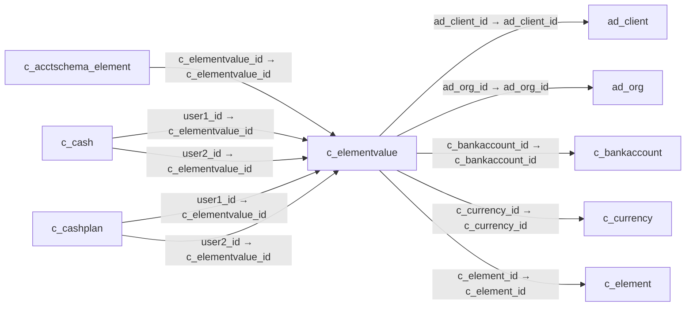

# c_elementvalue — 계정 요소 값

[전체 일람](../TABLE_INDEX.md) · [분류 일람](README.md) · [AI 사용 안내](../README.md) · [외래키 읽는 법](../RELATIONSHIPS.md)

## 기본 정보

| 항목 | 내용 |
|---|---|
| 물리명 | `adempiere.c_elementvalue` |
| 한국어 논리명(문서용 해석) | 계정 요소 값 |
| 원본 논리명 | Account Element |
| 원본 사전 ID | 188 |
| 분류 | `c` — 거래처·주문·청구·결제·회계 기준 |
| 전체 테넌트 행 수 | 379 |
| 물리 열 수 | 30 |
| 나가는 FK / 들어오는 FK | 5 / 78 |
| 구조·행 수 확인 시점 | 2026-11-03T23:29:01+09:00 |

## 의미와 쓰임

계정 요소 체계의 개별 값 또는 계정과목을 관리한다.

- 설명 근거: 원본 애플리케이션 사전 명칭·설명을 한국어로 해석.
- 한국어 이름과 개요는 문서용 해석입니다. 공식 한국어 번역으로 간주하지 않습니다.
- 원본 설명: Account Element
- 원본 도움말: —
- PostgreSQL 테이블 주석: —

## 키와 열

### 기본키·고유 제약조건

| 종류 | 제약조건 | 열(순서 유지) |
|---|---|---|
| PRIMARY KEY | `c_elementvalue_pkey` | `c_elementvalue_id` |
| UNIQUE | `c_elementvalue_uu_idx` | `c_elementvalue_uu` |

### 별도 고유 인덱스

PK·UNIQUE 제약조건의 인덱스와 별도로 존재하는 고유 인덱스입니다. 식·조건·열 순서는 원본 정의를 따릅니다.

- `c_elementvalue_value`: `CREATE UNIQUE INDEX c_elementvalue_value ON adempiere.c_elementvalue USING btree (c_element_id, value)`

### 열 목록

원본 논리명·설명은 `AD_Column`에서 가져왔습니다. 기본값은 실제 PostgreSQL 메타데이터이며, 비어 있는 항목은 `—`로 표시합니다.

| 순서 | 물리명 | 원본 논리명 | PostgreSQL 타입 | NULL | PK | 기본값 | 설명 |
|---:|---|---|---|---|---|---|---|
| 1 | `c_elementvalue_id` | Account Element | numeric(10,0) | 불가 | 예 | — | Account Element |
| 2 | `ad_client_id` | Tenant | numeric(10,0) | 불가 | — | — | Tenant for this installation. |
| 3 | `ad_org_id` | Organization | numeric(10,0) | 불가 | — | — | Organizational entity within tenant |
| 4 | `isactive` | Active | character(1) | 불가 | — | 'Y'::bpchar | The record is active in the system |
| 5 | `created` | Created | timestamp without time zone | 불가 | — | now() | Date this record was created |
| 6 | `createdby` | Created By | numeric(10,0) | 불가 | — | — | User who created this records |
| 7 | `updated` | Updated | timestamp without time zone | 불가 | — | now() | Date this record was updated |
| 8 | `updatedby` | Updated By | numeric(10,0) | 불가 | — | — | User who updated this records |
| 9 | `value` | Search Key | character varying(40) | 불가 | — | — | Search key for the record in the format required - must be unique |
| 10 | `name` | Name | character varying(120) | 불가 | — | — | Alphanumeric identifier of the entity |
| 11 | `description` | Description | character varying(255) | 허용 | — | — | Optional short description of the record |
| 12 | `accounttype` | Account Type | character(1) | 불가 | — | — | Indicates the type of account |
| 13 | `accountsign` | Account Sign | character(1) | 불가 | — | — | Indicates the Natural Sign of the Account as a Debit or Credit |
| 14 | `isdoccontrolled` | Document Controlled | character(1) | 허용 | — | 'N'::bpchar | Control account - If an account is controlled by a document, you cannot post manually to it |
| 15 | `c_element_id` | Element | numeric(10,0) | 불가 | — | — | Accounting Element |
| 16 | `issummary` | Summary Level | character(1) | 불가 | — | 'N'::bpchar | This is a summary entity |
| 17 | `validfrom` | Valid from | timestamp without time zone | 허용 | — | — | Valid from including this date (first day) |
| 18 | `validto` | Valid to | timestamp without time zone | 허용 | — | — | Valid to including this date (last day) |
| 19 | `postactual` | Post Actual | character(1) | 불가 | — | 'Y'::bpchar | Actual Values can be posted |
| 20 | `postbudget` | Post Budget | character(1) | 불가 | — | 'Y'::bpchar | Budget values can be posted |
| 21 | `postencumbrance` | Post Encumbrance | character(1) | 불가 | — | 'Y'::bpchar | Post commitments to this account |
| 22 | `poststatistical` | Post Statistical | character(1) | 불가 | — | 'Y'::bpchar | Post statistical quantities to this account? |
| 23 | `isbankaccount` | Bank Account | character(1) | 허용 | — | 'N'::bpchar | Indicates if this is the Bank Account |
| 24 | `c_bankaccount_id` | Bank Account | numeric(10,0) | 허용 | — | — | Account at the Bank |
| 25 | `isforeigncurrency` | Foreign Currency Account | character(1) | 허용 | — | 'N'::bpchar | Balances in foreign currency accounts are held in the nominated currency |
| 26 | `c_currency_id` | Currency | numeric(10,0) | 허용 | — | — | The Currency for this record |
| 27 | `c_elementvalue_uu` | C_ElementValue_UU | uuid | 허용 | — | — | — |
| 28 | `isdetailbpartner` | Manage Business Partners | character(1) | 불가 | — | 'N'::bpchar | — |
| 29 | `isdetailproduct` | Manage Products | character(1) | 불가 | — | 'N'::bpchar | — |
| 30 | `bpartnertype` | Business Partner Type | character(1) | 허용 | — | NULL::bpchar | — |

## 외래키 흐름

화살표는 **FK를 가진 자식 → 참조되는 부모**입니다. 업무 처리의 시간 순서나 무조건적인 1:N 관계를 뜻하지 않습니다.

주변 관계 83개 중 10개를 그림으로 표시합니다. **전체 관계는 아래 두 표에 모두 포함**합니다.

### 이 테이블이 참조하는 부모 — 나가는 FK

| 제약조건 | 참조하는 쪽(자식) | 자식 열 | 참조받는 쪽(부모) | 부모 열 | 삭제 / 갱신 | 검증 / 지연 가능 |
|---|---|---|---|---|---|---|
| `adclient_celementvalue` <!-- FK_OUT: adempiere.c_elementvalue.adclient_celementvalue --> | [`c_elementvalue`](c_elementvalue.md) | `ad_client_id` | [`ad_client`](../ad/ad_client.md) | `ad_client_id` | NO ACTION / NO ACTION | 완료 / 가능 (초기 지연) |
| `adorg_celementvalue` <!-- FK_OUT: adempiere.c_elementvalue.adorg_celementvalue --> | [`c_elementvalue`](c_elementvalue.md) | `ad_org_id` | [`ad_org`](../ad/ad_org.md) | `ad_org_id` | NO ACTION / NO ACTION | 완료 / 가능 (초기 지연) |
| `cbankaccount_celementvalue` <!-- FK_OUT: adempiere.c_elementvalue.cbankaccount_celementvalue --> | [`c_elementvalue`](c_elementvalue.md) | `c_bankaccount_id` | [`c_bankaccount`](c_bankaccount.md) | `c_bankaccount_id` | NO ACTION / NO ACTION | 완료 / 가능 (초기 지연) |
| `ccurrency_celementvalue` <!-- FK_OUT: adempiere.c_elementvalue.ccurrency_celementvalue --> | [`c_elementvalue`](c_elementvalue.md) | `c_currency_id` | [`c_currency`](c_currency.md) | `c_currency_id` | NO ACTION / NO ACTION | 완료 / 가능 (초기 지연) |
| `celement_celementvalue` <!-- FK_OUT: adempiere.c_elementvalue.celement_celementvalue --> | [`c_elementvalue`](c_elementvalue.md) | `c_element_id` | [`c_element`](c_element.md) | `c_element_id` | CASCADE / NO ACTION | 완료 / 가능 (초기 지연) |

### 이 테이블을 참조하는 자식 — 들어오는 FK

| 제약조건 | 참조하는 쪽(자식) | 자식 열 | 참조받는 쪽(부모) | 부모 열 | 삭제 / 갱신 | 검증 / 지연 가능 |
|---|---|---|---|---|---|---|
| `celementvalue_caschemaelement` <!-- FK_IN: adempiere.c_acctschema_element.celementvalue_caschemaelement --> | [`c_acctschema_element`](c_acctschema_element.md) | `c_elementvalue_id` | [`c_elementvalue`](c_elementvalue.md) | `c_elementvalue_id` | NO ACTION / NO ACTION | 완료 / 가능 (초기 지연) |
| `celementvalueuser1_ccash` <!-- FK_IN: adempiere.c_cash.celementvalueuser1_ccash --> | [`c_cash`](c_cash.md) | `user1_id` | [`c_elementvalue`](c_elementvalue.md) | `c_elementvalue_id` | NO ACTION / NO ACTION | 완료 / 가능 (초기 지연) |
| `celementvalueuser2_ccash` <!-- FK_IN: adempiere.c_cash.celementvalueuser2_ccash --> | [`c_cash`](c_cash.md) | `user2_id` | [`c_elementvalue`](c_elementvalue.md) | `c_elementvalue_id` | NO ACTION / NO ACTION | 완료 / 가능 (초기 지연) |
| `user1_ccashplan` <!-- FK_IN: adempiere.c_cashplan.user1_ccashplan --> | [`c_cashplan`](c_cashplan.md) | `user1_id` | [`c_elementvalue`](c_elementvalue.md) | `c_elementvalue_id` | NO ACTION / NO ACTION | 완료 / 가능 (초기 지연) |
| `user2_ccashplan` <!-- FK_IN: adempiere.c_cashplan.user2_ccashplan --> | [`c_cashplan`](c_cashplan.md) | `user2_id` | [`c_elementvalue`](c_elementvalue.md) | `c_elementvalue_id` | NO ACTION / NO ACTION | 완료 / 가능 (초기 지연) |
| `user1_ccashplanline` <!-- FK_IN: adempiere.c_cashplanline.user1_ccashplanline --> | [`c_cashplanline`](c_cashplanline.md) | `user1_id` | [`c_elementvalue`](c_elementvalue.md) | `c_elementvalue_id` | NO ACTION / NO ACTION | 완료 / 가능 (초기 지연) |
| `user2_ccashplanline` <!-- FK_IN: adempiere.c_cashplanline.user2_ccashplanline --> | [`c_cashplanline`](c_cashplanline.md) | `user2_id` | [`c_elementvalue`](c_elementvalue.md) | `c_elementvalue_id` | NO ACTION / NO ACTION | 완료 / 가능 (초기 지연) |
| `celementvalue_cevaluetrl` <!-- FK_IN: adempiere.c_elementvalue_trl.celementvalue_cevaluetrl --> | [`c_elementvalue_trl`](c_elementvalue_trl.md) | `c_elementvalue_id` | [`c_elementvalue`](c_elementvalue.md) | `c_elementvalue_id` | CASCADE / NO ACTION | 완료 / 가능 (초기 지연) |
| `celementvalueuser1_cinvoice` <!-- FK_IN: adempiere.c_invoice.celementvalueuser1_cinvoice --> | [`c_invoice`](c_invoice.md) | `user1_id` | [`c_elementvalue`](c_elementvalue.md) | `c_elementvalue_id` | NO ACTION / NO ACTION | 완료 / 가능 (초기 지연) |
| `celementvalueuser2_cinvoice` <!-- FK_IN: adempiere.c_invoice.celementvalueuser2_cinvoice --> | [`c_invoice`](c_invoice.md) | `user2_id` | [`c_elementvalue`](c_elementvalue.md) | `c_elementvalue_id` | NO ACTION / NO ACTION | 완료 / 가능 (초기 지연) |
| `celementvalueu1_cinvoicebline` <!-- FK_IN: adempiere.c_invoicebatchline.celementvalueu1_cinvoicebline --> | [`c_invoicebatchline`](c_invoicebatchline.md) | `user1_id` | [`c_elementvalue`](c_elementvalue.md) | `c_elementvalue_id` | NO ACTION / NO ACTION | 완료 / 가능 (초기 지연) |
| `celementvalueu2_cinvoicebline` <!-- FK_IN: adempiere.c_invoicebatchline.celementvalueu2_cinvoicebline --> | [`c_invoicebatchline`](c_invoicebatchline.md) | `user2_id` | [`c_elementvalue`](c_elementvalue.md) | `c_elementvalue_id` | NO ACTION / NO ACTION | 완료 / 가능 (초기 지연) |
| `celemenrvalueuser1_cinvline` <!-- FK_IN: adempiere.c_invoiceline.celemenrvalueuser1_cinvline --> | [`c_invoiceline`](c_invoiceline.md) | `user1_id` | [`c_elementvalue`](c_elementvalue.md) | `c_elementvalue_id` | NO ACTION / NO ACTION | 완료 / 가능 (초기 지연) |
| `celemenrvalueuser2_cinvline` <!-- FK_IN: adempiere.c_invoiceline.celemenrvalueuser2_cinvline --> | [`c_invoiceline`](c_invoiceline.md) | `user2_id` | [`c_elementvalue`](c_elementvalue.md) | `c_elementvalue_id` | NO ACTION / NO ACTION | 완료 / 가능 (초기 지연) |
| `celemenrvalueuser2_corder` <!-- FK_IN: adempiere.c_order.celemenrvalueuser2_corder --> | [`c_order`](c_order.md) | `user2_id` | [`c_elementvalue`](c_elementvalue.md) | `c_elementvalue_id` | NO ACTION / NO ACTION | 완료 / 가능 (초기 지연) |
| `celementvalueuser1_corder` <!-- FK_IN: adempiere.c_order.celementvalueuser1_corder --> | [`c_order`](c_order.md) | `user1_id` | [`c_elementvalue`](c_elementvalue.md) | `c_elementvalue_id` | NO ACTION / NO ACTION | 완료 / 가능 (초기 지연) |
| `celemenrvalueuser1_corderline` <!-- FK_IN: adempiere.c_orderline.celemenrvalueuser1_corderline --> | [`c_orderline`](c_orderline.md) | `user1_id` | [`c_elementvalue`](c_elementvalue.md) | `c_elementvalue_id` | NO ACTION / NO ACTION | 완료 / 가능 (초기 지연) |
| `celemenrvalueuser2_corderline` <!-- FK_IN: adempiere.c_orderline.celemenrvalueuser2_corderline --> | [`c_orderline`](c_orderline.md) | `user2_id` | [`c_elementvalue`](c_elementvalue.md) | `c_elementvalue_id` | NO ACTION / NO ACTION | 완료 / 가능 (초기 지연) |
| `celementvalueuser1_cpayment` <!-- FK_IN: adempiere.c_payment.celementvalueuser1_cpayment --> | [`c_payment`](c_payment.md) | `user1_id` | [`c_elementvalue`](c_elementvalue.md) | `c_elementvalue_id` | NO ACTION / NO ACTION | 완료 / 가능 (초기 지연) |
| `celementvalueuser2_cpayment` <!-- FK_IN: adempiere.c_payment.celementvalueuser2_cpayment --> | [`c_payment`](c_payment.md) | `user2_id` | [`c_elementvalue`](c_elementvalue.md) | `c_elementvalue_id` | NO ACTION / NO ACTION | 완료 / 가능 (초기 지연) |
| `user1_cpaymenttransaction` <!-- FK_IN: adempiere.c_paymenttransaction.user1_cpaymenttransaction --> | [`c_paymenttransaction`](c_paymenttransaction.md) | `user1_id` | [`c_elementvalue`](c_elementvalue.md) | `c_elementvalue_id` | NO ACTION / NO ACTION | 완료 / 가능 (초기 지연) |
| `user2_cpaymenttransaction` <!-- FK_IN: adempiere.c_paymenttransaction.user2_cpaymenttransaction --> | [`c_paymenttransaction`](c_paymenttransaction.md) | `user2_id` | [`c_elementvalue`](c_elementvalue.md) | `c_elementvalue_id` | NO ACTION / NO ACTION | 완료 / 가능 (초기 지연) |
| `celementvalue_csubacct` <!-- FK_IN: adempiere.c_subacct.celementvalue_csubacct --> | [`c_subacct`](c_subacct.md) | `c_elementvalue_id` | [`c_elementvalue`](c_elementvalue.md) | `c_elementvalue_id` | CASCADE / NO ACTION | 완료 / 가능 (초기 지연) |
| `celementvalueaccount_vc` <!-- FK_IN: adempiere.c_validcombination.celementvalueaccount_vc --> | [`c_validcombination`](c_validcombination.md) | `account_id` | [`c_elementvalue`](c_elementvalue.md) | `c_elementvalue_id` | CASCADE / NO ACTION | 완료 / 가능 (초기 지연) |
| `celementvalueuser1_vc` <!-- FK_IN: adempiere.c_validcombination.celementvalueuser1_vc --> | [`c_validcombination`](c_validcombination.md) | `user1_id` | [`c_elementvalue`](c_elementvalue.md) | `c_elementvalue_id` | NO ACTION / NO ACTION | 완료 / 가능 (초기 지연) |
| `celementvalueuser2_vc` <!-- FK_IN: adempiere.c_validcombination.celementvalueuser2_vc --> | [`c_validcombination`](c_validcombination.md) | `user2_id` | [`c_elementvalue`](c_elementvalue.md) | `c_elementvalue_id` | NO ACTION / NO ACTION | 완료 / 가능 (초기 지연) |
| `user1_ddorder` <!-- FK_IN: adempiere.dd_order.user1_ddorder --> | [`dd_order`](../dd/dd_order.md) | `user1_id` | [`c_elementvalue`](c_elementvalue.md) | `c_elementvalue_id` | NO ACTION / NO ACTION | 완료 / 가능 (초기 지연) |
| `user2_ddorder` <!-- FK_IN: adempiere.dd_order.user2_ddorder --> | [`dd_order`](../dd/dd_order.md) | `user2_id` | [`c_elementvalue`](c_elementvalue.md) | `c_elementvalue_id` | NO ACTION / NO ACTION | 완료 / 가능 (초기 지연) |
| `user1_ddorderline` <!-- FK_IN: adempiere.dd_orderline.user1_ddorderline --> | [`dd_orderline`](../dd/dd_orderline.md) | `user1_id` | [`c_elementvalue`](c_elementvalue.md) | `c_elementvalue_id` | NO ACTION / NO ACTION | 완료 / 가능 (초기 지연) |
| `user2_ddorderline` <!-- FK_IN: adempiere.dd_orderline.user2_ddorderline --> | [`dd_orderline`](../dd/dd_orderline.md) | `user2_id` | [`c_elementvalue`](c_elementvalue.md) | `c_elementvalue_id` | NO ACTION / NO ACTION | 완료 / 가능 (초기 지연) |
| `celementvalue_factacct` <!-- FK_IN: adempiere.fact_acct.celementvalue_factacct --> | [`fact_acct`](../fact/fact_acct.md) | `account_id` | [`c_elementvalue`](c_elementvalue.md) | `c_elementvalue_id` | NO ACTION / NO ACTION | 완료 / 가능 (초기 지연) |
| `celementvalueuser1_factacct` <!-- FK_IN: adempiere.fact_acct.celementvalueuser1_factacct --> | [`fact_acct`](../fact/fact_acct.md) | `user1_id` | [`c_elementvalue`](c_elementvalue.md) | `c_elementvalue_id` | NO ACTION / NO ACTION | 완료 / 가능 (초기 지연) |
| `celementvalueuser2_factacct` <!-- FK_IN: adempiere.fact_acct.celementvalueuser2_factacct --> | [`fact_acct`](../fact/fact_acct.md) | `user2_id` | [`c_elementvalue`](c_elementvalue.md) | `c_elementvalue_id` | NO ACTION / NO ACTION | 완료 / 가능 (초기 지연) |
| `account_factacctsummary` <!-- FK_IN: adempiere.fact_acct_summary.account_factacctsummary --> | [`fact_acct_summary`](../fact/fact_acct_summary.md) | `account_id` | [`c_elementvalue`](c_elementvalue.md) | `c_elementvalue_id` | NO ACTION / NO ACTION | 완료 / 가능 (초기 지연) |
| `user1_factacctsummary` <!-- FK_IN: adempiere.fact_acct_summary.user1_factacctsummary --> | [`fact_acct_summary`](../fact/fact_acct_summary.md) | `user1_id` | [`c_elementvalue`](c_elementvalue.md) | `c_elementvalue_id` | NO ACTION / NO ACTION | 완료 / 가능 (초기 지연) |
| `user2_factacctsummary` <!-- FK_IN: adempiere.fact_acct_summary.user2_factacctsummary --> | [`fact_acct_summary`](../fact/fact_acct_summary.md) | `user2_id` | [`c_elementvalue`](c_elementvalue.md) | `c_elementvalue_id` | NO ACTION / NO ACTION | 완료 / 가능 (초기 지연) |
| `cevalueacct_gldist` <!-- FK_IN: adempiere.gl_distribution.cevalueacct_gldist --> | [`gl_distribution`](../gl/gl_distribution.md) | `account_id` | [`c_elementvalue`](c_elementvalue.md) | `c_elementvalue_id` | NO ACTION / NO ACTION | 완료 / 가능 (초기 지연) |
| `cevalueuser1_gldist` <!-- FK_IN: adempiere.gl_distribution.cevalueuser1_gldist --> | [`gl_distribution`](../gl/gl_distribution.md) | `user1_id` | [`c_elementvalue`](c_elementvalue.md) | `c_elementvalue_id` | NO ACTION / NO ACTION | 완료 / 가능 (초기 지연) |
| `cevalueuser2_gldist` <!-- FK_IN: adempiere.gl_distribution.cevalueuser2_gldist --> | [`gl_distribution`](../gl/gl_distribution.md) | `user2_id` | [`c_elementvalue`](c_elementvalue.md) | `c_elementvalue_id` | NO ACTION / NO ACTION | 완료 / 가능 (초기 지연) |
| `cevalueacct_gldistline` <!-- FK_IN: adempiere.gl_distributionline.cevalueacct_gldistline --> | [`gl_distributionline`](../gl/gl_distributionline.md) | `account_id` | [`c_elementvalue`](c_elementvalue.md) | `c_elementvalue_id` | NO ACTION / NO ACTION | 완료 / 가능 (초기 지연) |
| `cevalueuser1_gldistline` <!-- FK_IN: adempiere.gl_distributionline.cevalueuser1_gldistline --> | [`gl_distributionline`](../gl/gl_distributionline.md) | `user1_id` | [`c_elementvalue`](c_elementvalue.md) | `c_elementvalue_id` | NO ACTION / NO ACTION | 완료 / 가능 (초기 지연) |
| `cevalueuser2_gldistline` <!-- FK_IN: adempiere.gl_distributionline.cevalueuser2_gldistline --> | [`gl_distributionline`](../gl/gl_distributionline.md) | `user2_id` | [`c_elementvalue`](c_elementvalue.md) | `c_elementvalue_id` | NO ACTION / NO ACTION | 완료 / 가능 (초기 지연) |
| `celementvalue_glfundrestr` <!-- FK_IN: adempiere.gl_fundrestriction.celementvalue_glfundrestr --> | [`gl_fundrestriction`](../gl/gl_fundrestriction.md) | `c_elementvalue_id` | [`c_elementvalue`](c_elementvalue.md) | `c_elementvalue_id` | NO ACTION / NO ACTION | 완료 / 가능 (초기 지연) |
| `celementvalueadjustcr_qssjourn` <!-- FK_IN: adempiere.gl_journalgenerator.celementvalueadjustcr_qssjourn --> | [`gl_journalgenerator`](../gl/gl_journalgenerator.md) | `c_elementvalueadjustcr_id` | [`c_elementvalue`](c_elementvalue.md) | `c_elementvalue_id` | NO ACTION / NO ACTION | 완료 / 가능 (초기 지연) |
| `celementvalueadjustdr_qssjourn` <!-- FK_IN: adempiere.gl_journalgenerator.celementvalueadjustdr_qssjourn --> | [`gl_journalgenerator`](../gl/gl_journalgenerator.md) | `c_elementvalueadjustdr_id` | [`c_elementvalue`](c_elementvalue.md) | `c_elementvalue_id` | NO ACTION / NO ACTION | 완료 / 가능 (초기 지연) |
| `celementvaluecr_qssjournalgene` <!-- FK_IN: adempiere.gl_journalgeneratorline.celementvaluecr_qssjournalgene --> | [`gl_journalgeneratorline`](../gl/gl_journalgeneratorline.md) | `c_elementvaluecr_id` | [`c_elementvalue`](c_elementvalue.md) | `c_elementvalue_id` | NO ACTION / NO ACTION | 완료 / 가능 (초기 지연) |
| `celementvaluedr_qssjournalgene` <!-- FK_IN: adempiere.gl_journalgeneratorline.celementvaluedr_qssjournalgene --> | [`gl_journalgeneratorline`](../gl/gl_journalgeneratorline.md) | `c_elementvaluedr_id` | [`c_elementvalue`](c_elementvalue.md) | `c_elementvalue_id` | NO ACTION / NO ACTION | 완료 / 가능 (초기 지연) |
| `celementvalue_qssjournalgenera` <!-- FK_IN: adempiere.gl_journalgeneratorsource.celementvalue_qssjournalgenera --> | [`gl_journalgeneratorsource`](../gl/gl_journalgeneratorsource.md) | `c_elementvalue_id` | [`c_elementvalue`](c_elementvalue.md) | `c_elementvalue_id` | NO ACTION / NO ACTION | 완료 / 가능 (초기 지연) |
| `account_gljournalline` <!-- FK_IN: adempiere.gl_journalline.account_gljournalline --> | [`gl_journalline`](../gl/gl_journalline.md) | `account_id` | [`c_elementvalue`](c_elementvalue.md) | `c_elementvalue_id` | NO ACTION / NO ACTION | 완료 / 가능 (초기 지연) |
| `user1_gljournalline` <!-- FK_IN: adempiere.gl_journalline.user1_gljournalline --> | [`gl_journalline`](../gl/gl_journalline.md) | `user1_id` | [`c_elementvalue`](c_elementvalue.md) | `c_elementvalue_id` | NO ACTION / NO ACTION | 완료 / 가능 (초기 지연) |
| `user2_gljournalline` <!-- FK_IN: adempiere.gl_journalline.user2_gljournalline --> | [`gl_journalline`](../gl/gl_journalline.md) | `user2_id` | [`c_elementvalue`](c_elementvalue.md) | `c_elementvalue_id` | NO ACTION / NO ACTION | 완료 / 가능 (초기 지연) |
| `user1_hrconceptacct` <!-- FK_IN: adempiere.hr_concept_acct.user1_hrconceptacct --> | [`hr_concept_acct`](../hr/hr_concept_acct.md) | `user1_id` | [`c_elementvalue`](c_elementvalue.md) | `c_elementvalue_id` | NO ACTION / NO ACTION | 완료 / 가능 (초기 지연) |
| `user1_hrmovement` <!-- FK_IN: adempiere.hr_movement.user1_hrmovement --> | [`hr_movement`](../hr/hr_movement.md) | `user1_id` | [`c_elementvalue`](c_elementvalue.md) | `c_elementvalue_id` | NO ACTION / NO ACTION | 완료 / 가능 (초기 지연) |
| `user2_hrmovement` <!-- FK_IN: adempiere.hr_movement.user2_hrmovement --> | [`hr_movement`](../hr/hr_movement.md) | `user2_id` | [`c_elementvalue`](c_elementvalue.md) | `c_elementvalue_id` | NO ACTION / NO ACTION | 완료 / 가능 (초기 지연) |
| `celementvalue_ielementvalue` <!-- FK_IN: adempiere.i_elementvalue.celementvalue_ielementvalue --> | [`i_elementvalue`](../i/i_elementvalue.md) | `c_elementvalue_id` | [`c_elementvalue`](c_elementvalue.md) | `c_elementvalue_id` | SET NULL / NO ACTION | 완료 / 가능 (초기 지연) |
| `cevalueparent_ielementvalue` <!-- FK_IN: adempiere.i_elementvalue.cevalueparent_ielementvalue --> | [`i_elementvalue`](../i/i_elementvalue.md) | `parentelementvalue_id` | [`c_elementvalue`](c_elementvalue.md) | `c_elementvalue_id` | SET NULL / NO ACTION | 완료 / 가능 (초기 지연) |
| `account_ifajournal` <!-- FK_IN: adempiere.i_fajournal.account_ifajournal --> | [`i_fajournal`](../i/i_fajournal.md) | `account_id` | [`c_elementvalue`](c_elementvalue.md) | `c_elementvalue_id` | NO ACTION / NO ACTION | 완료 / 가능 (초기 지연) |
| `user1_ifajournal` <!-- FK_IN: adempiere.i_fajournal.user1_ifajournal --> | [`i_fajournal`](../i/i_fajournal.md) | `user1_id` | [`c_elementvalue`](c_elementvalue.md) | `c_elementvalue_id` | NO ACTION / NO ACTION | 완료 / 가능 (초기 지연) |
| `user2_ifajournal` <!-- FK_IN: adempiere.i_fajournal.user2_ifajournal --> | [`i_fajournal`](../i/i_fajournal.md) | `user2_id` | [`c_elementvalue`](c_elementvalue.md) | `c_elementvalue_id` | NO ACTION / NO ACTION | 완료 / 가능 (초기 지연) |
| `celvalueaccount_igljournal` <!-- FK_IN: adempiere.i_gljournal.celvalueaccount_igljournal --> | [`i_gljournal`](../i/i_gljournal.md) | `account_id` | [`c_elementvalue`](c_elementvalue.md) | `c_elementvalue_id` | SET NULL / NO ACTION | 완료 / 가능 (초기 지연) |
| `celvalueuser2_igljournal` <!-- FK_IN: adempiere.i_gljournal.celvalueuser2_igljournal --> | [`i_gljournal`](../i/i_gljournal.md) | `user2_id` | [`c_elementvalue`](c_elementvalue.md) | `c_elementvalue_id` | SET NULL / NO ACTION | 완료 / 가능 (초기 지연) |
| `cevalueuser1_igljournal` <!-- FK_IN: adempiere.i_gljournal.cevalueuser1_igljournal --> | [`i_gljournal`](../i/i_gljournal.md) | `user1_id` | [`c_elementvalue`](c_elementvalue.md) | `c_elementvalue_id` | SET NULL / NO ACTION | 완료 / 가능 (초기 지연) |
| `celementvalue_ireportline` <!-- FK_IN: adempiere.i_reportline.celementvalue_ireportline --> | [`i_reportline`](../i/i_reportline.md) | `c_elementvalue_id` | [`c_elementvalue`](c_elementvalue.md) | `c_elementvalue_id` | SET NULL / NO ACTION | 완료 / 가능 (초기 지연) |
| `celementvalueuser1_minout` <!-- FK_IN: adempiere.m_inout.celementvalueuser1_minout --> | [`m_inout`](../m/m_inout.md) | `user1_id` | [`c_elementvalue`](c_elementvalue.md) | `c_elementvalue_id` | NO ACTION / NO ACTION | 완료 / 가능 (초기 지연) |
| `celementvalueuser2_minout` <!-- FK_IN: adempiere.m_inout.celementvalueuser2_minout --> | [`m_inout`](../m/m_inout.md) | `user2_id` | [`c_elementvalue`](c_elementvalue.md) | `c_elementvalue_id` | NO ACTION / NO ACTION | 완료 / 가능 (초기 지연) |
| `celemenrvalueuser1_minoutline` <!-- FK_IN: adempiere.m_inoutline.celemenrvalueuser1_minoutline --> | [`m_inoutline`](../m/m_inoutline.md) | `user1_id` | [`c_elementvalue`](c_elementvalue.md) | `c_elementvalue_id` | NO ACTION / NO ACTION | 완료 / 가능 (초기 지연) |
| `celemenrvalueuser2_minoutline` <!-- FK_IN: adempiere.m_inoutline.celemenrvalueuser2_minoutline --> | [`m_inoutline`](../m/m_inoutline.md) | `user2_id` | [`c_elementvalue`](c_elementvalue.md) | `c_elementvalue_id` | NO ACTION / NO ACTION | 완료 / 가능 (초기 지연) |
| `celementvalueuser1_minvent` <!-- FK_IN: adempiere.m_inventory.celementvalueuser1_minvent --> | [`m_inventory`](../m/m_inventory.md) | `user1_id` | [`c_elementvalue`](c_elementvalue.md) | `c_elementvalue_id` | NO ACTION / NO ACTION | 완료 / 가능 (초기 지연) |
| `celementvalueuser2_minvent` <!-- FK_IN: adempiere.m_inventory.celementvalueuser2_minvent --> | [`m_inventory`](../m/m_inventory.md) | `user2_id` | [`c_elementvalue`](c_elementvalue.md) | `c_elementvalue_id` | NO ACTION / NO ACTION | 완료 / 가능 (초기 지연) |
| `celementvalueuser1_mmove` <!-- FK_IN: adempiere.m_movement.celementvalueuser1_mmove --> | [`m_movement`](../m/m_movement.md) | `user1_id` | [`c_elementvalue`](c_elementvalue.md) | `c_elementvalue_id` | NO ACTION / NO ACTION | 완료 / 가능 (초기 지연) |
| `celementvalueuser2_mmove` <!-- FK_IN: adempiere.m_movement.celementvalueuser2_mmove --> | [`m_movement`](../m/m_movement.md) | `user2_id` | [`c_elementvalue`](c_elementvalue.md) | `c_elementvalue_id` | NO ACTION / NO ACTION | 완료 / 가능 (초기 지연) |
| `celementvalueuser1_mprod` <!-- FK_IN: adempiere.m_production.celementvalueuser1_mprod --> | [`m_production`](../m/m_production.md) | `user1_id` | [`c_elementvalue`](c_elementvalue.md) | `c_elementvalue_id` | NO ACTION / NO ACTION | 완료 / 가능 (초기 지연) |
| `celementvalueuser2_mprod` <!-- FK_IN: adempiere.m_production.celementvalueuser2_mprod --> | [`m_production`](../m/m_production.md) | `user2_id` | [`c_elementvalue`](c_elementvalue.md) | `c_elementvalue_id` | NO ACTION / NO ACTION | 완료 / 가능 (초기 지연) |
| `celementvalue_paratioelement` <!-- FK_IN: adempiere.pa_ratioelement.celementvalue_paratioelement --> | [`pa_ratioelement`](../pa/pa_ratioelement.md) | `account_id` | [`c_elementvalue`](c_elementvalue.md) | `c_elementvalue_id` | NO ACTION / NO ACTION | 완료 / 가능 (초기 지연) |
| `celementvalue_pareportcolumn` <!-- FK_IN: adempiere.pa_reportcolumn.celementvalue_pareportcolumn --> | [`pa_reportcolumn`](../pa/pa_reportcolumn.md) | `c_elementvalue_id` | [`c_elementvalue`](c_elementvalue.md) | `c_elementvalue_id` | NO ACTION / NO ACTION | 완료 / 가능 (초기 지연) |
| `celementvalue_pareportsource` <!-- FK_IN: adempiere.pa_reportsource.celementvalue_pareportsource --> | [`pa_reportsource`](../pa/pa_reportsource.md) | `c_elementvalue_id` | [`c_elementvalue`](c_elementvalue.md) | `c_elementvalue_id` | NO ACTION / NO ACTION | 완료 / 가능 (초기 지연) |
| `user1_pporder` <!-- FK_IN: adempiere.pp_order.user1_pporder --> | [`pp_order`](../pp/pp_order.md) | `user1_id` | [`c_elementvalue`](c_elementvalue.md) | `c_elementvalue_id` | NO ACTION / NO ACTION | 완료 / 가능 (초기 지연) |
| `user2_pporder` <!-- FK_IN: adempiere.pp_order.user2_pporder --> | [`pp_order`](../pp/pp_order.md) | `user2_id` | [`c_elementvalue`](c_elementvalue.md) | `c_elementvalue_id` | NO ACTION / NO ACTION | 완료 / 가능 (초기 지연) |

## 조회 시 주의

- FK 표의 자식 열과 부모 열을 같은 순서로 대응시킵니다. 복합 FK는 모든 열의 동등 조건을 `AND`로 연결합니다.
- 테이블 이름이나 `_id` 열 이름만으로 물리 FK가 있다고 가정하지 않습니다. FK 미선언은 업무 관계가 없다는 뜻도 아닙니다.
- 자식이 여러 행인 테이블과 조인하면 부모의 금액·건수가 중복될 수 있습니다. 집계 단위를 먼저 정합니다.
- `ad_client_id`가 있습니다. 업무 분석에서는 대상 테넌트를 명시합니다. GardenWorld는 `11`, 시스템 공통 설정은 `0`일 수 있으므로 일괄 필터 적용 전에 테이블 역할을 확인합니다.
- 행 수는 위 확인 시점의 전체 테넌트 값입니다. 최신 업무 실적이나 현재 실행 결과로 재사용하지 않습니다.
