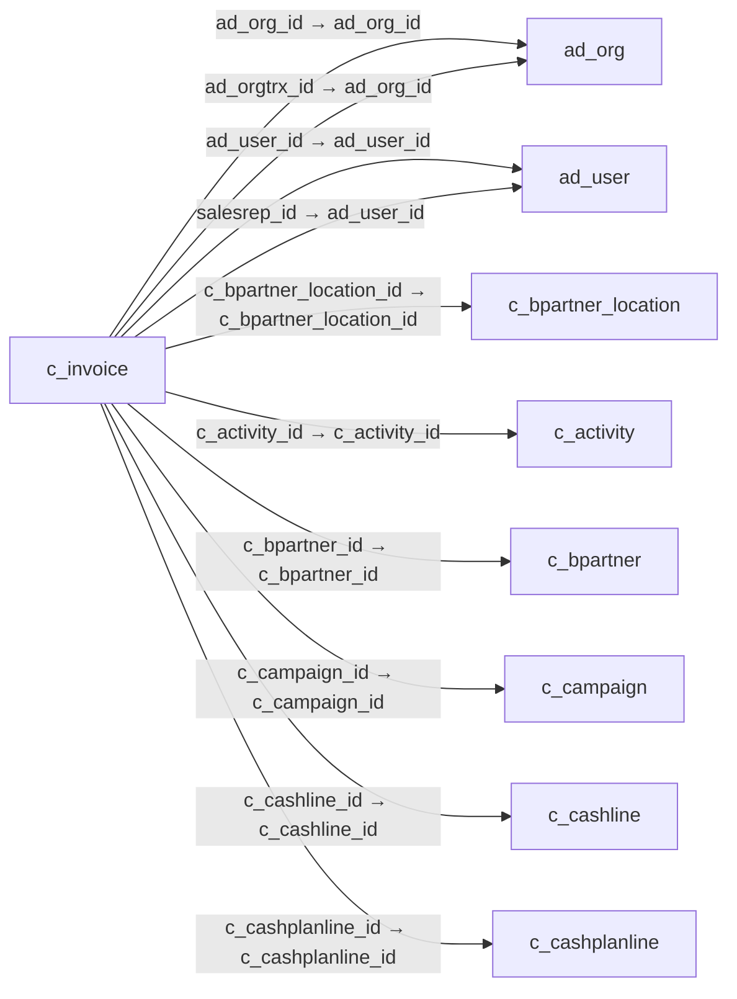

# c_invoice — 매출·매입 청구서

[전체 일람](../TABLE_INDEX.md) · [분류 일람](README.md) · [AI 사용 안내](../README.md) · [외래키 읽는 법](../RELATIONSHIPS.md)

## 기본 정보

| 항목 | 내용 |
|---|---|
| 물리명 | `adempiere.c_invoice` |
| 한국어 논리명(문서용 해석) | 매출·매입 청구서 |
| 원본 논리명 | Invoice |
| 원본 사전 ID | 318 |
| 분류 | `c` — 거래처·주문·청구·결제·회계 기준 |
| 전체 테넌트 행 수 | 8 |
| 물리 열 수 | 75 |
| 나가는 FK / 들어오는 FK | 30 / 32 |
| 구조·행 수 확인 시점 | 2026-11-03T23:29:01+09:00 |

## 의미와 쓰임

고객 매출 청구와 공급업체 매입 청구의 머리글을 저장하며 문서 유형에 따라 신용전표도 포함한다. 판매·구매 구분, 거래처, 청구일, 통화, 합계 및 지급 상태를 관리하므로 금액 분석 시 문서 유형과 취소 관계를 함께 확인한다.

- 설명 근거: 물리명·열·외래키 구조를 근거로 보수적으로 해석.
- 한국어 이름과 개요는 문서용 해석입니다. 공식 한국어 번역으로 간주하지 않습니다.
- 원본 설명: Invoice Identifier
- 원본 도움말: —
- PostgreSQL 테이블 주석: —

## 키와 열

### 기본키·고유 제약조건

| 종류 | 제약조건 | 열(순서 유지) |
|---|---|---|
| PRIMARY KEY | `c_invoice_pkey` | `c_invoice_id` |
| UNIQUE | `c_invoice_uu_idx` | `c_invoice_uu` |

### 별도 고유 인덱스

PK·UNIQUE 제약조건의 인덱스와 별도로 존재하는 고유 인덱스입니다. 식·조건·열 순서는 원본 정의를 따릅니다.

- `c_invoice_documentno`: `CREATE UNIQUE INDEX c_invoice_documentno ON adempiere.c_invoice USING btree (documentno, c_doctype_id, c_bpartner_id)`
- `c_invoice_documentno_target`: `CREATE UNIQUE INDEX c_invoice_documentno_target ON adempiere.c_invoice USING btree (c_bpartner_id, documentno, c_doctypetarget_id)`

### 열 목록

원본 논리명·설명은 `AD_Column`에서 가져왔습니다. 기본값은 실제 PostgreSQL 메타데이터이며, 비어 있는 항목은 `—`로 표시합니다.

| 순서 | 물리명 | 원본 논리명 | PostgreSQL 타입 | NULL | PK | 기본값 | 설명 |
|---:|---|---|---|---|---|---|---|
| 1 | `c_invoice_id` | Invoice | numeric(10,0) | 불가 | 예 | — | Invoice Identifier |
| 2 | `ad_client_id` | Tenant | numeric(10,0) | 불가 | — | — | Tenant for this installation. |
| 3 | `ad_org_id` | Organization | numeric(10,0) | 불가 | — | — | Organizational entity within tenant |
| 4 | `isactive` | Active | character(1) | 불가 | — | 'Y'::bpchar | The record is active in the system |
| 5 | `created` | Created | timestamp without time zone | 불가 | — | now() | Date this record was created |
| 6 | `createdby` | Created By | numeric(10,0) | 불가 | — | — | User who created this records |
| 7 | `updated` | Updated | timestamp without time zone | 불가 | — | now() | Date this record was updated |
| 8 | `updatedby` | Updated By | numeric(10,0) | 불가 | — | — | User who updated this records |
| 9 | `issotrx` | Sales Transaction | character(1) | 불가 | — | 'Y'::bpchar | This is a Sales Transaction |
| 10 | `documentno` | Document No | character varying(30) | 불가 | — | — | Document sequence number of the document |
| 11 | `docstatus` | Document Status | character(2) | 불가 | — | — | The current status of the document |
| 12 | `docaction` | Document Action | character(2) | 불가 | — | — | The targeted status of the document |
| 13 | `processing` | Process Now | character(1) | 허용 | — | — | — |
| 14 | `processed` | Processed | character(1) | 불가 | — | 'N'::bpchar | The document has been processed |
| 15 | `posted` | Posted | character(1) | 불가 | — | 'N'::bpchar | Posting status |
| 16 | `c_doctype_id` | Document Type | numeric(10,0) | 불가 | — | — | Document type or rules |
| 17 | `c_doctypetarget_id` | Target Document Type | numeric(10,0) | 불가 | — | — | Target document type for conversing documents |
| 18 | `c_order_id` | Order | numeric(10,0) | 허용 | — | — | Order |
| 19 | `description` | Description | character varying(255) | 허용 | — | — | Optional short description of the record |
| 20 | `isapproved` | Approved | character(1) | 불가 | — | 'N'::bpchar | Indicates if this document requires approval |
| 21 | `istransferred` | Transferred | character(1) | 불가 | — | 'N'::bpchar | Transferred to General Ledger (i.e. accounted) |
| 22 | `isprinted` | Printed | character(1) | 불가 | — | 'N'::bpchar | Indicates if this document / line is printed |
| 23 | `salesrep_id` | Sales Representative | numeric(10,0) | 허용 | — | — | Sales Representative or Company Agent |
| 24 | `dateinvoiced` | Date Invoiced | timestamp without time zone | 불가 | — | — | Date printed on Invoice |
| 25 | `dateprinted` | Date Printed | timestamp without time zone | 허용 | — | — | Date the document was printed. |
| 26 | `dateacct` | Account Date | timestamp without time zone | 불가 | — | — | Accounting Date |
| 27 | `c_bpartner_id` | Business Partner | numeric(10,0) | 불가 | — | — | Identifies a Business Partner |
| 28 | `c_bpartner_location_id` | Partner Location | numeric(10,0) | 불가 | — | — | Identifies the (ship to) address for this Business Partner |
| 29 | `poreference` | Order Reference | character varying(20) | 허용 | — | — | Transaction Reference Number (Sales Order, Purchase Order) of your Business Partner |
| 30 | `isdiscountprinted` | Discount Printed | character(1) | 불가 | — | 'Y'::bpchar | Print Discount on Invoice and Order |
| 31 | `dateordered` | Date Ordered | timestamp without time zone | 허용 | — | — | Date of Order |
| 32 | `c_currency_id` | Currency | numeric(10,0) | 불가 | — | — | The Currency for this record |
| 33 | `paymentrule` | Payment Rule | character(1) | 불가 | — | — | How you pay the invoice |
| 34 | `c_paymentterm_id` | Payment Term | numeric(10,0) | 불가 | — | — | The terms of Payment (timing, discount) |
| 35 | `c_charge_id` | Charge | numeric(10,0) | 허용 | — | — | Additional document charges |
| 36 | `chargeamt` | Charge amount | numeric | 허용 | — | 0 | Charge Amount |
| 37 | `totallines` | Total Lines | numeric | 불가 | — | 0 | Total of all document lines |
| 38 | `grandtotal` | Grand Total | numeric | 불가 | — | 0 | Total amount of document |
| 39 | `m_pricelist_id` | Price List | numeric(10,0) | 불가 | — | — | Unique identifier of a Price List |
| 40 | `istaxincluded` | Price includes Tax | character(1) | 불가 | — | 'N'::bpchar | Tax is included in the price  |
| 41 | `c_campaign_id` | Campaign | numeric(10,0) | 허용 | — | — | Marketing Campaign |
| 42 | `c_project_id` | Project | numeric(10,0) | 허용 | — | — | Financial Project |
| 43 | `c_activity_id` | Activity | numeric(10,0) | 허용 | — | — | Business Activity |
| 44 | `ispaid` | Paid | character(1) | 불가 | — | 'N'::bpchar | The document is fully paid |
| 45 | `c_payment_id` | Payment | numeric(10,0) | 허용 | — | — | Payment identifier |
| 46 | `c_cashline_id` | Cash Journal Line | numeric(10,0) | 허용 | — | — | Cash Journal Line |
| 47 | `createfrom` | Create lines from | character(1) | 허용 | — | — | Process which will generate a new document lines based on an existing document |
| 48 | `generateto` | Generate To | character(1) | 허용 | — | — | Generate To |
| 49 | `sendemail` | Send EMail | character(1) | 불가 | — | 'N'::bpchar | Enable sending Document EMail |
| 50 | `ad_user_id` | User/Contact | numeric(10,0) | 허용 | — | — | User within the system - Internal or Business Partner Contact |
| 51 | `copyfrom` | Copy From | character(1) | 허용 | — | — | Copy From Record |
| 52 | `isselfservice` | Self-Service | character(1) | 불가 | — | 'N'::bpchar | This is a Self-Service entry or this entry can be changed via Self-Service |
| 53 | `ad_orgtrx_id` | Trx Organization | numeric(10,0) | 허용 | — | — | Performing or initiating organization |
| 54 | `user1_id` | User Element List 1 | numeric(10,0) | 허용 | — | — | User defined list element #1 |
| 55 | `user2_id` | User Element List 2 | numeric(10,0) | 허용 | — | — | User defined list element #2 |
| 56 | `c_conversiontype_id` | Currency Type | numeric(10,0) | 허용 | — | — | Currency Conversion Rate Type |
| 57 | `ispayschedulevalid` | Pay Schedule valid | character(1) | 불가 | — | 'N'::bpchar | Is the Payment Schedule is valid |
| 58 | `ref_invoice_id` | Referenced Invoice | numeric(10,0) | 허용 | — | — | — |
| 59 | `isindispute` | In Dispute | character(1) | 불가 | — | 'N'::bpchar | Document is in dispute |
| 60 | `invoicecollectiontype` | Collection Status | character(1) | 허용 | — | — | Invoice Collection Status |
| 61 | `m_rma_id` | RMA | numeric(10,0) | 허용 | — | — | Return Material Authorization |
| 62 | `dunninggrace` | Dunning Grace Date | timestamp without time zone | 허용 | — | — | — |
| 63 | `c_dunninglevel_id` | Dunning Level | numeric(10,0) | 허용 | — | — | — |
| 64 | `reversal_id` | Reversal ID | numeric(10,0) | 허용 | — | — | ID of document reversal |
| 65 | `processedon` | Processed On | numeric | 허용 | — | — | The date+time (expressed in decimal format) when the document has been processed |
| 66 | `c_cashplanline_id` | Cash Plan Line | numeric(10,0) | 허용 | — | NULL::numeric | — |
| 67 | `c_invoice_uu` | C_Invoice_UU | uuid | 허용 | — | — | — |
| 68 | `isfixedassetinvoice` | Is Fixed Asset Invoice | character(1) | 허용 | — | — | — |
| 69 | `relatedinvoice_id` | Related Invoice | numeric(10,0) | 허용 | — | NULL::numeric | — |
| 70 | `isoverridecurrencyrate` | Override Currency Conversion Rate | character(1) | 불가 | — | 'N'::bpchar | Override Currency Conversion Rate |
| 71 | `currencyrate` | Rate | numeric | 허용 | — | — | Currency Conversion Rate |
| 72 | `createlinesfrom` | Create lines from | character(1) | 허용 | — | NULL::bpchar | Process which will generate a new document lines based on an existing document |
| 73 | `c_department_id` | Department | numeric(10,0) | 허용 | — | NULL::numeric | — |
| 74 | `c_costcenter_id` | Cost Center | numeric(10,0) | 허용 | — | NULL::numeric | — |
| 75 | `c_employee_id` | Employee | numeric(10,0) | 허용 | — | NULL::numeric | Identifies a Business Partner |

## 외래키 흐름

화살표는 **FK를 가진 자식 → 참조되는 부모**입니다. 업무 처리의 시간 순서나 무조건적인 1:N 관계를 뜻하지 않습니다.

주변 관계 59개 중 10개를 그림으로 표시합니다. **전체 관계는 아래 두 표에 모두 포함**합니다.

### 이 테이블이 참조하는 부모 — 나가는 FK

| 제약조건 | 참조하는 쪽(자식) | 자식 열 | 참조받는 쪽(부모) | 부모 열 | 삭제 / 갱신 | 검증 / 지연 가능 |
|---|---|---|---|---|---|---|
| `adorg_cinvoice` <!-- FK_OUT: adempiere.c_invoice.adorg_cinvoice --> | [`c_invoice`](c_invoice.md) | `ad_org_id` | [`ad_org`](../ad/ad_org.md) | `ad_org_id` | NO ACTION / NO ACTION | 완료 / 가능 (초기 지연) |
| `adorgtrx_cinvoice` <!-- FK_OUT: adempiere.c_invoice.adorgtrx_cinvoice --> | [`c_invoice`](c_invoice.md) | `ad_orgtrx_id` | [`ad_org`](../ad/ad_org.md) | `ad_org_id` | NO ACTION / NO ACTION | 완료 / 가능 (초기 지연) |
| `aduser_cinvoice` <!-- FK_OUT: adempiere.c_invoice.aduser_cinvoice --> | [`c_invoice`](c_invoice.md) | `ad_user_id` | [`ad_user`](../ad/ad_user.md) | `ad_user_id` | NO ACTION / NO ACTION | 완료 / 가능 (초기 지연) |
| `aduser_sr_cinvoice` <!-- FK_OUT: adempiere.c_invoice.aduser_sr_cinvoice --> | [`c_invoice`](c_invoice.md) | `salesrep_id` | [`ad_user`](../ad/ad_user.md) | `ad_user_id` | NO ACTION / NO ACTION | 완료 / 가능 (초기 지연) |
| `c_bplocation_cinvoice` <!-- FK_OUT: adempiere.c_invoice.c_bplocation_cinvoice --> | [`c_invoice`](c_invoice.md) | `c_bpartner_location_id` | [`c_bpartner_location`](c_bpartner_location.md) | `c_bpartner_location_id` | NO ACTION / NO ACTION | 완료 / 가능 (초기 지연) |
| `cactivity_cinvoice` <!-- FK_OUT: adempiere.c_invoice.cactivity_cinvoice --> | [`c_invoice`](c_invoice.md) | `c_activity_id` | [`c_activity`](c_activity.md) | `c_activity_id` | NO ACTION / NO ACTION | 완료 / 가능 (초기 지연) |
| `cbpartner_cinvoice` <!-- FK_OUT: adempiere.c_invoice.cbpartner_cinvoice --> | [`c_invoice`](c_invoice.md) | `c_bpartner_id` | [`c_bpartner`](c_bpartner.md) | `c_bpartner_id` | NO ACTION / NO ACTION | 완료 / 가능 (초기 지연) |
| `ccampaign_cinvoice` <!-- FK_OUT: adempiere.c_invoice.ccampaign_cinvoice --> | [`c_invoice`](c_invoice.md) | `c_campaign_id` | [`c_campaign`](c_campaign.md) | `c_campaign_id` | NO ACTION / NO ACTION | 완료 / 가능 (초기 지연) |
| `ccashline_cinvoice` <!-- FK_OUT: adempiere.c_invoice.ccashline_cinvoice --> | [`c_invoice`](c_invoice.md) | `c_cashline_id` | [`c_cashline`](c_cashline.md) | `c_cashline_id` | NO ACTION / NO ACTION | 완료 / 가능 (초기 지연) |
| `ccashplanline_cinvoice` <!-- FK_OUT: adempiere.c_invoice.ccashplanline_cinvoice --> | [`c_invoice`](c_invoice.md) | `c_cashplanline_id` | [`c_cashplanline`](c_cashplanline.md) | `c_cashplanline_id` | NO ACTION / NO ACTION | 완료 / 가능 (초기 지연) |
| `ccharge_cinvoice` <!-- FK_OUT: adempiere.c_invoice.ccharge_cinvoice --> | [`c_invoice`](c_invoice.md) | `c_charge_id` | [`c_charge`](c_charge.md) | `c_charge_id` | NO ACTION / NO ACTION | 완료 / 가능 (초기 지연) |
| `cconversiontype_cinvoice` <!-- FK_OUT: adempiere.c_invoice.cconversiontype_cinvoice --> | [`c_invoice`](c_invoice.md) | `c_conversiontype_id` | [`c_conversiontype`](c_conversiontype.md) | `c_conversiontype_id` | NO ACTION / NO ACTION | 완료 / 가능 (초기 지연) |
| `ccostcenter_cinvoice` <!-- FK_OUT: adempiere.c_invoice.ccostcenter_cinvoice --> | [`c_invoice`](c_invoice.md) | `c_costcenter_id` | [`c_costcenter`](c_costcenter.md) | `c_costcenter_id` | NO ACTION / NO ACTION | 완료 / 가능 (초기 지연) |
| `ccurrency_cinvoice` <!-- FK_OUT: adempiere.c_invoice.ccurrency_cinvoice --> | [`c_invoice`](c_invoice.md) | `c_currency_id` | [`c_currency`](c_currency.md) | `c_currency_id` | NO ACTION / NO ACTION | 완료 / 가능 (초기 지연) |
| `cdepartment_cinvoice` <!-- FK_OUT: adempiere.c_invoice.cdepartment_cinvoice --> | [`c_invoice`](c_invoice.md) | `c_department_id` | [`c_department`](c_department.md) | `c_department_id` | NO ACTION / NO ACTION | 완료 / 가능 (초기 지연) |
| `cdoctype_cinvoice` <!-- FK_OUT: adempiere.c_invoice.cdoctype_cinvoice --> | [`c_invoice`](c_invoice.md) | `c_doctype_id` | [`c_doctype`](c_doctype.md) | `c_doctype_id` | NO ACTION / NO ACTION | 완료 / 가능 (초기 지연) |
| `cdoctypetarget_cinvoice` <!-- FK_OUT: adempiere.c_invoice.cdoctypetarget_cinvoice --> | [`c_invoice`](c_invoice.md) | `c_doctypetarget_id` | [`c_doctype`](c_doctype.md) | `c_doctype_id` | NO ACTION / NO ACTION | 완료 / 가능 (초기 지연) |
| `cdunninglevel_cinvoice` <!-- FK_OUT: adempiere.c_invoice.cdunninglevel_cinvoice --> | [`c_invoice`](c_invoice.md) | `c_dunninglevel_id` | [`c_dunninglevel`](c_dunninglevel.md) | `c_dunninglevel_id` | NO ACTION / NO ACTION | 완료 / 가능 (초기 지연) |
| `celementvalueuser1_cinvoice` <!-- FK_OUT: adempiere.c_invoice.celementvalueuser1_cinvoice --> | [`c_invoice`](c_invoice.md) | `user1_id` | [`c_elementvalue`](c_elementvalue.md) | `c_elementvalue_id` | NO ACTION / NO ACTION | 완료 / 가능 (초기 지연) |
| `celementvalueuser2_cinvoice` <!-- FK_OUT: adempiere.c_invoice.celementvalueuser2_cinvoice --> | [`c_invoice`](c_invoice.md) | `user2_id` | [`c_elementvalue`](c_elementvalue.md) | `c_elementvalue_id` | NO ACTION / NO ACTION | 완료 / 가능 (초기 지연) |
| `cemployee_cinvoice` <!-- FK_OUT: adempiere.c_invoice.cemployee_cinvoice --> | [`c_invoice`](c_invoice.md) | `c_employee_id` | [`c_bpartner`](c_bpartner.md) | `c_bpartner_id` | NO ACTION / NO ACTION | 완료 / 가능 (초기 지연) |
| `cinvoice_ref` <!-- FK_OUT: adempiere.c_invoice.cinvoice_ref --> | [`c_invoice`](c_invoice.md) | `ref_invoice_id` | [`c_invoice`](c_invoice.md) | `c_invoice_id` | NO ACTION / NO ACTION | 완료 / 가능 (초기 지연) |
| `corder_cinvoice` <!-- FK_OUT: adempiere.c_invoice.corder_cinvoice --> | [`c_invoice`](c_invoice.md) | `c_order_id` | [`c_order`](c_order.md) | `c_order_id` | NO ACTION / NO ACTION | 완료 / 가능 (초기 지연) |
| `cpayment_cinvoice` <!-- FK_OUT: adempiere.c_invoice.cpayment_cinvoice --> | [`c_invoice`](c_invoice.md) | `c_payment_id` | [`c_payment`](c_payment.md) | `c_payment_id` | NO ACTION / NO ACTION | 완료 / 가능 (초기 지연) |
| `cpaymentterm_cinvoice` <!-- FK_OUT: adempiere.c_invoice.cpaymentterm_cinvoice --> | [`c_invoice`](c_invoice.md) | `c_paymentterm_id` | [`c_paymentterm`](c_paymentterm.md) | `c_paymentterm_id` | NO ACTION / NO ACTION | 완료 / 가능 (초기 지연) |
| `cproject_cinvoice` <!-- FK_OUT: adempiere.c_invoice.cproject_cinvoice --> | [`c_invoice`](c_invoice.md) | `c_project_id` | [`c_project`](c_project.md) | `c_project_id` | NO ACTION / NO ACTION | 완료 / 가능 (초기 지연) |
| `mpricelist_cinvoice` <!-- FK_OUT: adempiere.c_invoice.mpricelist_cinvoice --> | [`c_invoice`](c_invoice.md) | `m_pricelist_id` | [`m_pricelist`](../m/m_pricelist.md) | `m_pricelist_id` | NO ACTION / NO ACTION | 완료 / 가능 (초기 지연) |
| `mrma_cinvoice` <!-- FK_OUT: adempiere.c_invoice.mrma_cinvoice --> | [`c_invoice`](c_invoice.md) | `m_rma_id` | [`m_rma`](../m/m_rma.md) | `m_rma_id` | NO ACTION / NO ACTION | 완료 / 가능 (초기 지연) |
| `relatedinvoice_cinvoice` <!-- FK_OUT: adempiere.c_invoice.relatedinvoice_cinvoice --> | [`c_invoice`](c_invoice.md) | `relatedinvoice_id` | [`c_invoice`](c_invoice.md) | `c_invoice_id` | NO ACTION / NO ACTION | 완료 / 가능 (초기 지연) |
| `reversal_cinvoice` <!-- FK_OUT: adempiere.c_invoice.reversal_cinvoice --> | [`c_invoice`](c_invoice.md) | `reversal_id` | [`c_invoice`](c_invoice.md) | `c_invoice_id` | NO ACTION / NO ACTION | 완료 / 가능 (초기 지연) |

### 이 테이블을 참조하는 자식 — 들어오는 FK

| 제약조건 | 참조하는 쪽(자식) | 자식 열 | 참조받는 쪽(부모) | 부모 열 | 삭제 / 갱신 | 검증 / 지연 가능 |
|---|---|---|---|---|---|---|
| `cinvoice_aassetaddition` <!-- FK_IN: adempiere.a_asset_addition.cinvoice_aassetaddition --> | [`a_asset_addition`](../a/a_asset_addition.md) | `c_invoice_id` | [`c_invoice`](c_invoice.md) | `c_invoice_id` | NO ACTION / NO ACTION | 완료 / 가능 (초기 지연) |
| `cinvoice_aassetdisposed` <!-- FK_IN: adempiere.a_asset_disposed.cinvoice_aassetdisposed --> | [`a_asset_disposed`](../a/a_asset_disposed.md) | `c_invoice_id` | [`c_invoice`](c_invoice.md) | `c_invoice_id` | NO ACTION / NO ACTION | 완료 / 가능 (초기 지연) |
| `cinvoice_callocationline` <!-- FK_IN: adempiere.c_allocationline.cinvoice_callocationline --> | [`c_allocationline`](c_allocationline.md) | `c_invoice_id` | [`c_invoice`](c_invoice.md) | `c_invoice_id` | NO ACTION / NO ACTION | 완료 / 가능 (초기 지연) |
| `cinvoice_cbankstatementline` <!-- FK_IN: adempiere.c_bankstatementline.cinvoice_cbankstatementline --> | [`c_bankstatementline`](c_bankstatementline.md) | `c_invoice_id` | [`c_invoice`](c_invoice.md) | `c_invoice_id` | NO ACTION / NO ACTION | 완료 / 가능 (초기 지연) |
| `cinvoice_ccashline` <!-- FK_IN: adempiere.c_cashline.cinvoice_ccashline --> | [`c_cashline`](c_cashline.md) | `c_invoice_id` | [`c_invoice`](c_invoice.md) | `c_invoice_id` | NO ACTION / NO ACTION | 완료 / 가능 (초기 지연) |
| `cinvoice_ccommissionrun` <!-- FK_IN: adempiere.c_commissionrun.cinvoice_ccommissionrun --> | [`c_commissionrun`](c_commissionrun.md) | `c_invoice_id` | [`c_invoice`](c_invoice.md) | `c_invoice_id` | NO ACTION / NO ACTION | 완료 / 가능 (초기 지연) |
| `cinvoice_cdunningrunline` <!-- FK_IN: adempiere.c_dunningrunline.cinvoice_cdunningrunline --> | [`c_dunningrunline`](c_dunningrunline.md) | `c_invoice_id` | [`c_invoice`](c_invoice.md) | `c_invoice_id` | SET NULL / NO ACTION | 완료 / 가능 (초기 지연) |
| `cinvoice_ref` <!-- FK_IN: adempiere.c_invoice.cinvoice_ref --> | [`c_invoice`](c_invoice.md) | `ref_invoice_id` | [`c_invoice`](c_invoice.md) | `c_invoice_id` | NO ACTION / NO ACTION | 완료 / 가능 (초기 지연) |
| `relatedinvoice_cinvoice` <!-- FK_IN: adempiere.c_invoice.relatedinvoice_cinvoice --> | [`c_invoice`](c_invoice.md) | `relatedinvoice_id` | [`c_invoice`](c_invoice.md) | `c_invoice_id` | NO ACTION / NO ACTION | 완료 / 가능 (초기 지연) |
| `reversal_cinvoice` <!-- FK_IN: adempiere.c_invoice.reversal_cinvoice --> | [`c_invoice`](c_invoice.md) | `reversal_id` | [`c_invoice`](c_invoice.md) | `c_invoice_id` | NO ACTION / NO ACTION | 완료 / 가능 (초기 지연) |
| `cinvoice_cinvoicebatchline` <!-- FK_IN: adempiere.c_invoicebatchline.cinvoice_cinvoicebatchline --> | [`c_invoicebatchline`](c_invoicebatchline.md) | `c_invoice_id` | [`c_invoice`](c_invoice.md) | `c_invoice_id` | NO ACTION / NO ACTION | 완료 / 가능 (초기 지연) |
| `cinvoice_cinvoiceline` <!-- FK_IN: adempiere.c_invoiceline.cinvoice_cinvoiceline --> | [`c_invoiceline`](c_invoiceline.md) | `c_invoice_id` | [`c_invoice`](c_invoice.md) | `c_invoice_id` | CASCADE / NO ACTION | 완료 / 가능 (초기 지연) |
| `cinvoice_cinvoicepaysched` <!-- FK_IN: adempiere.c_invoicepayschedule.cinvoice_cinvoicepaysched --> | [`c_invoicepayschedule`](c_invoicepayschedule.md) | `c_invoice_id` | [`c_invoice`](c_invoice.md) | `c_invoice_id` | CASCADE / NO ACTION | 완료 / 가능 (초기 지연) |
| `cinvoice_cinvoicetax` <!-- FK_IN: adempiere.c_invoicetax.cinvoice_cinvoicetax --> | [`c_invoicetax`](c_invoicetax.md) | `c_invoice_id` | [`c_invoice`](c_invoice.md) | `c_invoice_id` | CASCADE / NO ACTION | 완료 / 가능 (초기 지연) |
| `cinvoice_cpayment` <!-- FK_IN: adempiere.c_payment.cinvoice_cpayment --> | [`c_payment`](c_payment.md) | `c_invoice_id` | [`c_invoice`](c_invoice.md) | `c_invoice_id` | NO ACTION / NO ACTION | 완료 / 가능 (초기 지연) |
| `cinvoice_cpaymentallocate` <!-- FK_IN: adempiere.c_paymentallocate.cinvoice_cpaymentallocate --> | [`c_paymentallocate`](c_paymentallocate.md) | `c_invoice_id` | [`c_invoice`](c_invoice.md) | `c_invoice_id` | NO ACTION / NO ACTION | 완료 / 가능 (초기 지연) |
| `cinvoice_cpaymenttransaction` <!-- FK_IN: adempiere.c_paymenttransaction.cinvoice_cpaymenttransaction --> | [`c_paymenttransaction`](c_paymenttransaction.md) | `c_invoice_id` | [`c_invoice`](c_invoice.md) | `c_invoice_id` | NO ACTION / NO ACTION | 완료 / 가능 (초기 지연) |
| `cinvoice_cpayselectline` <!-- FK_IN: adempiere.c_payselectionline.cinvoice_cpayselectline --> | [`c_payselectionline`](c_payselectionline.md) | `c_invoice_id` | [`c_invoice`](c_invoice.md) | `c_invoice_id` | NO ACTION / NO ACTION | 완료 / 가능 (초기 지연) |
| `cinvoice_crecurring` <!-- FK_IN: adempiere.c_recurring.cinvoice_crecurring --> | [`c_recurring`](c_recurring.md) | `c_invoice_id` | [`c_invoice`](c_invoice.md) | `c_invoice_id` | NO ACTION / NO ACTION | 완료 / 가능 (초기 지연) |
| `cinvoice_crecurringrun` <!-- FK_IN: adempiere.c_recurring_run.cinvoice_crecurringrun --> | [`c_recurring_run`](c_recurring_run.md) | `c_invoice_id` | [`c_invoice`](c_invoice.md) | `c_invoice_id` | CASCADE / NO ACTION | 완료 / 가능 (초기 지연) |
| `cinvoice_ctaxdeclline` <!-- FK_IN: adempiere.c_taxdeclarationline.cinvoice_ctaxdeclline --> | [`c_taxdeclarationline`](c_taxdeclarationline.md) | `c_invoice_id` | [`c_invoice`](c_invoice.md) | `c_invoice_id` | NO ACTION / NO ACTION | 완료 / 가능 (초기 지연) |
| `cinvoice_ddorder` <!-- FK_IN: adempiere.dd_order.cinvoice_ddorder --> | [`dd_order`](../dd/dd_order.md) | `c_invoice_id` | [`c_invoice`](c_invoice.md) | `c_invoice_id` | NO ACTION / NO ACTION | 완료 / 가능 (초기 지연) |
| `cinvoice_ibankstatement` <!-- FK_IN: adempiere.i_bankstatement.cinvoice_ibankstatement --> | [`i_bankstatement`](../i/i_bankstatement.md) | `c_invoice_id` | [`c_invoice`](c_invoice.md) | `c_invoice_id` | SET NULL / NO ACTION | 완료 / 가능 (초기 지연) |
| `cinvoice_iinvoice` <!-- FK_IN: adempiere.i_invoice.cinvoice_iinvoice --> | [`i_invoice`](../i/i_invoice.md) | `c_invoice_id` | [`c_invoice`](c_invoice.md) | `c_invoice_id` | SET NULL / NO ACTION | 완료 / 가능 (초기 지연) |
| `cinvoice_ipayment` <!-- FK_IN: adempiere.i_payment.cinvoice_ipayment --> | [`i_payment`](../i/i_payment.md) | `c_invoice_id` | [`c_invoice`](c_invoice.md) | `c_invoice_id` | SET NULL / NO ACTION | 완료 / 가능 (초기 지연) |
| `cinvoice_minout` <!-- FK_IN: adempiere.m_inout.cinvoice_minout --> | [`m_inout`](../m/m_inout.md) | `c_invoice_id` | [`c_invoice`](c_invoice.md) | `c_invoice_id` | NO ACTION / NO ACTION | 완료 / 가능 (초기 지연) |
| `cinvoice_minoutconfirm` <!-- FK_IN: adempiere.m_inoutconfirm.cinvoice_minoutconfirm --> | [`m_inoutconfirm`](../m/m_inoutconfirm.md) | `c_invoice_id` | [`c_invoice`](c_invoice.md) | `c_invoice_id` | NO ACTION / NO ACTION | 완료 / 가능 (초기 지연) |
| `cinvoice_mshippingtransaction` <!-- FK_IN: adempiere.m_shippingtransaction.cinvoice_mshippingtransaction --> | [`m_shippingtransaction`](../m/m_shippingtransaction.md) | `c_invoice_id` | [`c_invoice`](c_invoice.md) | `c_invoice_id` | NO ACTION / NO ACTION | 완료 / 가능 (초기 지연) |
| `cinvoicerequest_rrequest` <!-- FK_IN: adempiere.r_request.cinvoicerequest_rrequest --> | [`r_request`](../r/r_request.md) | `c_invoicerequest_id` | [`c_invoice`](c_invoice.md) | `c_invoice_id` | NO ACTION / NO ACTION | 완료 / 가능 (초기 지연) |
| `rinvoice_rrequest` <!-- FK_IN: adempiere.r_request.rinvoice_rrequest --> | [`r_request`](../r/r_request.md) | `c_invoice_id` | [`c_invoice`](c_invoice.md) | `c_invoice_id` | NO ACTION / NO ACTION | 완료 / 가능 (초기 지연) |
| `cinvoice_rrequestaction` <!-- FK_IN: adempiere.r_requestaction.cinvoice_rrequestaction --> | [`r_requestaction`](../r/r_requestaction.md) | `c_invoice_id` | [`c_invoice`](c_invoice.md) | `c_invoice_id` | NO ACTION / NO ACTION | 완료 / 가능 (초기 지연) |
| `cinvoice_tinvoicegl` <!-- FK_IN: adempiere.t_invoicegl.cinvoice_tinvoicegl --> | [`t_invoicegl`](../t/t_invoicegl.md) | `c_invoice_id` | [`c_invoice`](c_invoice.md) | `c_invoice_id` | CASCADE / NO ACTION | 완료 / 가능 (초기 지연) |

## 조회 시 주의

- FK 표의 자식 열과 부모 열을 같은 순서로 대응시킵니다. 복합 FK는 모든 열의 동등 조건을 `AND`로 연결합니다.
- 테이블 이름이나 `_id` 열 이름만으로 물리 FK가 있다고 가정하지 않습니다. FK 미선언은 업무 관계가 없다는 뜻도 아닙니다.
- 자식이 여러 행인 테이블과 조인하면 부모의 금액·건수가 중복될 수 있습니다. 집계 단위를 먼저 정합니다.
- `ad_client_id`가 있습니다. 업무 분석에서는 대상 테넌트를 명시합니다. GardenWorld는 `11`, 시스템 공통 설정은 `0`일 수 있으므로 일괄 필터 적용 전에 테이블 역할을 확인합니다.
- `issotrx`가 있습니다. 판매(`Y`)와 구매(`N`)를 구분해서 분석합니다.
- 행 수는 위 확인 시점의 전체 테넌트 값입니다. 최신 업무 실적이나 현재 실행 결과로 재사용하지 않습니다.
