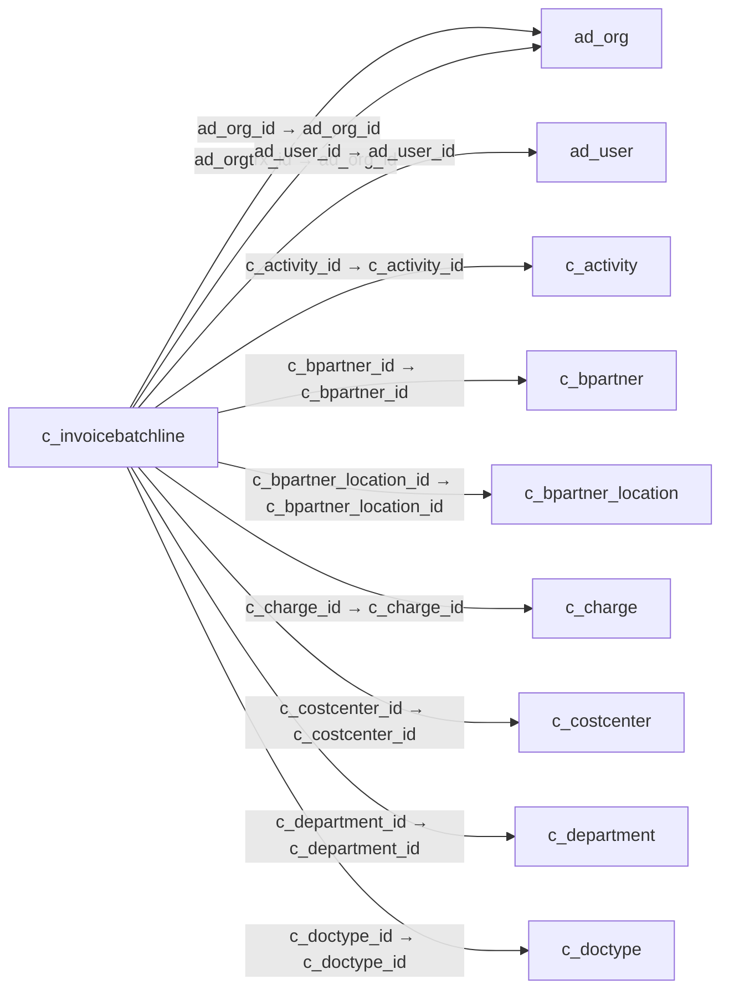

# c_invoicebatchline — 비용 청구 일괄 입력 명세

[전체 일람](../TABLE_INDEX.md) · [분류 일람](README.md) · [AI 사용 안내](../README.md) · [외래키 읽는 법](../RELATIONSHIPS.md)

## 기본 정보

| 항목 | 내용 |
|---|---|
| 물리명 | `adempiere.c_invoicebatchline` |
| 한국어 논리명(문서용 해석) | 비용 청구 일괄 입력 명세 |
| 원본 논리명 | Invoice Batch Line |
| 원본 사전 ID | 768 |
| 분류 | `c` — 거래처·주문·청구·결제·회계 기준 |
| 전체 테넌트 행 수 | 0 |
| 물리 열 수 | 37 |
| 나가는 FK / 들어오는 FK | 17 / 0 |
| 구조·행 수 확인 시점 | 2026-11-03T23:29:01+09:00 |

## 의미와 쓰임

비용 청구 배치에 포함된 개별 입력 행을 관리한다.

- 설명 근거: 원본 애플리케이션 사전 명칭·설명을 한국어로 해석.
- 한국어 이름과 개요는 문서용 해석입니다. 공식 한국어 번역으로 간주하지 않습니다.
- 원본 설명: Expense Invoice Batch Line
- 원본 도움말: —
- PostgreSQL 테이블 주석: —

## 키와 열

### 기본키·고유 제약조건

| 종류 | 제약조건 | 열(순서 유지) |
|---|---|---|
| PRIMARY KEY | `c_invoicebatchline_pkey` | `c_invoicebatchline_id` |
| UNIQUE | `c_invoicebatchline_uu_idx` | `c_invoicebatchline_uu` |

### 열 목록

원본 논리명·설명은 `AD_Column`에서 가져왔습니다. 기본값은 실제 PostgreSQL 메타데이터이며, 비어 있는 항목은 `—`로 표시합니다.

| 순서 | 물리명 | 원본 논리명 | PostgreSQL 타입 | NULL | PK | 기본값 | 설명 |
|---:|---|---|---|---|---|---|---|
| 1 | `c_invoicebatchline_id` | Invoice Batch Line | numeric(10,0) | 불가 | 예 | — | Expense Invoice Batch Line |
| 2 | `ad_client_id` | Tenant | numeric(10,0) | 불가 | — | — | Tenant for this installation. |
| 3 | `ad_org_id` | Organization | numeric(10,0) | 불가 | — | — | Organizational entity within tenant |
| 4 | `isactive` | Active | character(1) | 불가 | — | 'Y'::bpchar | The record is active in the system |
| 5 | `created` | Created | timestamp without time zone | 불가 | — | now() | Date this record was created |
| 6 | `createdby` | Created By | numeric(10,0) | 불가 | — | — | User who created this records |
| 7 | `updated` | Updated | timestamp without time zone | 불가 | — | now() | Date this record was updated |
| 8 | `updatedby` | Updated By | numeric(10,0) | 불가 | — | — | User who updated this records |
| 9 | `c_invoicebatch_id` | Invoice Batch | numeric(10,0) | 불가 | — | — | Expense Invoice Batch Header |
| 10 | `line` | Line No | numeric(10,0) | 불가 | — | 0 | Unique line for this document |
| 11 | `c_doctype_id` | Document Type | numeric(10,0) | 불가 | — | — | Document type or rules |
| 12 | `documentno` | Document No | character varying(30) | 불가 | — | — | Document sequence number of the document |
| 13 | `dateinvoiced` | Date Invoiced | timestamp without time zone | 불가 | — | — | Date printed on Invoice |
| 14 | `dateacct` | Account Date | timestamp without time zone | 불가 | — | — | Accounting Date |
| 15 | `c_bpartner_id` | Business Partner | numeric(10,0) | 불가 | — | — | Identifies a Business Partner |
| 16 | `c_bpartner_location_id` | Partner Location | numeric(10,0) | 불가 | — | — | Identifies the (ship to) address for this Business Partner |
| 17 | `ad_user_id` | User/Contact | numeric(10,0) | 허용 | — | — | User within the system - Internal or Business Partner Contact |
| 18 | `c_charge_id` | Charge | numeric(10,0) | 불가 | — | — | Additional document charges |
| 19 | `qtyentered` | Quantity | numeric | 불가 | — | 0 | The Quantity Entered is based on the selected UoM |
| 20 | `priceentered` | Price | numeric | 불가 | — | 0 | Price Entered - the price based on the selected/base UoM |
| 21 | `istaxincluded` | Price includes Tax | character(1) | 불가 | — | 'N'::bpchar | Tax is included in the price  |
| 22 | `linenetamt` | Line Amount | numeric | 불가 | — | 0 | Line Extended Amount (Quantity * Actual Price) without Freight and Charges |
| 23 | `c_tax_id` | Tax | numeric(10,0) | 불가 | — | — | Tax identifier |
| 24 | `taxamt` | Tax Amount | numeric | 불가 | — | 0 | Tax Amount for a document |
| 25 | `linetotalamt` | Line Total | numeric | 불가 | — | 0 | Total line amount incl. Tax |
| 26 | `c_project_id` | Project | numeric(10,0) | 허용 | — | — | Financial Project |
| 27 | `c_activity_id` | Activity | numeric(10,0) | 허용 | — | — | Business Activity |
| 28 | `ad_orgtrx_id` | Trx Organization | numeric(10,0) | 허용 | — | — | Performing or initiating organization |
| 29 | `user1_id` | User Element List 1 | numeric(10,0) | 허용 | — | — | User defined list element #1 |
| 30 | `user2_id` | User Element List 2 | numeric(10,0) | 허용 | — | — | User defined list element #2 |
| 31 | `processed` | Processed | character(1) | 불가 | — | 'N'::bpchar | The document has been processed |
| 32 | `c_invoice_id` | Invoice | numeric(10,0) | 허용 | — | — | Invoice Identifier |
| 33 | `c_invoiceline_id` | Invoice Line | numeric(10,0) | 허용 | — | — | Invoice Detail Line |
| 34 | `description` | Description | character varying(255) | 허용 | — | — | Optional short description of the record |
| 35 | `c_invoicebatchline_uu` | C_InvoiceBatchLine_UU | uuid | 허용 | — | — | — |
| 36 | `c_department_id` | Department | numeric(10,0) | 허용 | — | NULL::numeric | — |
| 37 | `c_costcenter_id` | Cost Center | numeric(10,0) | 허용 | — | NULL::numeric | — |

## 외래키 흐름

화살표는 **FK를 가진 자식 → 참조되는 부모**입니다. 업무 처리의 시간 순서나 무조건적인 1:N 관계를 뜻하지 않습니다.

주변 관계 17개 중 10개를 그림으로 표시합니다. **전체 관계는 아래 두 표에 모두 포함**합니다.

### 이 테이블이 참조하는 부모 — 나가는 FK

| 제약조건 | 참조하는 쪽(자식) | 자식 열 | 참조받는 쪽(부모) | 부모 열 | 삭제 / 갱신 | 검증 / 지연 가능 |
|---|---|---|---|---|---|---|
| `adorg_cinvoicebatchline` <!-- FK_OUT: adempiere.c_invoicebatchline.adorg_cinvoicebatchline --> | [`c_invoicebatchline`](c_invoicebatchline.md) | `ad_org_id` | [`ad_org`](../ad/ad_org.md) | `ad_org_id` | NO ACTION / NO ACTION | 완료 / 가능 (초기 지연) |
| `adorgtrx_cinvoicebatchline` <!-- FK_OUT: adempiere.c_invoicebatchline.adorgtrx_cinvoicebatchline --> | [`c_invoicebatchline`](c_invoicebatchline.md) | `ad_orgtrx_id` | [`ad_org`](../ad/ad_org.md) | `ad_org_id` | NO ACTION / NO ACTION | 완료 / 가능 (초기 지연) |
| `aduser_cinvoicebatchline` <!-- FK_OUT: adempiere.c_invoicebatchline.aduser_cinvoicebatchline --> | [`c_invoicebatchline`](c_invoicebatchline.md) | `ad_user_id` | [`ad_user`](../ad/ad_user.md) | `ad_user_id` | NO ACTION / NO ACTION | 완료 / 가능 (초기 지연) |
| `cactivity_cinvoicebatchline` <!-- FK_OUT: adempiere.c_invoicebatchline.cactivity_cinvoicebatchline --> | [`c_invoicebatchline`](c_invoicebatchline.md) | `c_activity_id` | [`c_activity`](c_activity.md) | `c_activity_id` | NO ACTION / NO ACTION | 완료 / 가능 (초기 지연) |
| `cbpartner_cinvoicebatchline` <!-- FK_OUT: adempiere.c_invoicebatchline.cbpartner_cinvoicebatchline --> | [`c_invoicebatchline`](c_invoicebatchline.md) | `c_bpartner_id` | [`c_bpartner`](c_bpartner.md) | `c_bpartner_id` | NO ACTION / NO ACTION | 완료 / 가능 (초기 지연) |
| `cbplocation_cinvoicebline` <!-- FK_OUT: adempiere.c_invoicebatchline.cbplocation_cinvoicebline --> | [`c_invoicebatchline`](c_invoicebatchline.md) | `c_bpartner_location_id` | [`c_bpartner_location`](c_bpartner_location.md) | `c_bpartner_location_id` | NO ACTION / NO ACTION | 완료 / 가능 (초기 지연) |
| `ccharge_cinvoicebatchline` <!-- FK_OUT: adempiere.c_invoicebatchline.ccharge_cinvoicebatchline --> | [`c_invoicebatchline`](c_invoicebatchline.md) | `c_charge_id` | [`c_charge`](c_charge.md) | `c_charge_id` | NO ACTION / NO ACTION | 완료 / 가능 (초기 지연) |
| `ccostcenter_cinvoicebatchline` <!-- FK_OUT: adempiere.c_invoicebatchline.ccostcenter_cinvoicebatchline --> | [`c_invoicebatchline`](c_invoicebatchline.md) | `c_costcenter_id` | [`c_costcenter`](c_costcenter.md) | `c_costcenter_id` | NO ACTION / NO ACTION | 완료 / 가능 (초기 지연) |
| `cdepartment_cinvoicebatchline` <!-- FK_OUT: adempiere.c_invoicebatchline.cdepartment_cinvoicebatchline --> | [`c_invoicebatchline`](c_invoicebatchline.md) | `c_department_id` | [`c_department`](c_department.md) | `c_department_id` | NO ACTION / NO ACTION | 완료 / 가능 (초기 지연) |
| `cdoctype_cinvoicebatchline` <!-- FK_OUT: adempiere.c_invoicebatchline.cdoctype_cinvoicebatchline --> | [`c_invoicebatchline`](c_invoicebatchline.md) | `c_doctype_id` | [`c_doctype`](c_doctype.md) | `c_doctype_id` | NO ACTION / NO ACTION | 완료 / 가능 (초기 지연) |
| `celementvalueu1_cinvoicebline` <!-- FK_OUT: adempiere.c_invoicebatchline.celementvalueu1_cinvoicebline --> | [`c_invoicebatchline`](c_invoicebatchline.md) | `user1_id` | [`c_elementvalue`](c_elementvalue.md) | `c_elementvalue_id` | NO ACTION / NO ACTION | 완료 / 가능 (초기 지연) |
| `celementvalueu2_cinvoicebline` <!-- FK_OUT: adempiere.c_invoicebatchline.celementvalueu2_cinvoicebline --> | [`c_invoicebatchline`](c_invoicebatchline.md) | `user2_id` | [`c_elementvalue`](c_elementvalue.md) | `c_elementvalue_id` | NO ACTION / NO ACTION | 완료 / 가능 (초기 지연) |
| `cinvoice_cinvoicebatchline` <!-- FK_OUT: adempiere.c_invoicebatchline.cinvoice_cinvoicebatchline --> | [`c_invoicebatchline`](c_invoicebatchline.md) | `c_invoice_id` | [`c_invoice`](c_invoice.md) | `c_invoice_id` | NO ACTION / NO ACTION | 완료 / 가능 (초기 지연) |
| `cinvoicebatch_cinvoicebline` <!-- FK_OUT: adempiere.c_invoicebatchline.cinvoicebatch_cinvoicebline --> | [`c_invoicebatchline`](c_invoicebatchline.md) | `c_invoicebatch_id` | [`c_invoicebatch`](c_invoicebatch.md) | `c_invoicebatch_id` | CASCADE / NO ACTION | 완료 / 가능 (초기 지연) |
| `cinvoiceline_cinvoicebline` <!-- FK_OUT: adempiere.c_invoicebatchline.cinvoiceline_cinvoicebline --> | [`c_invoicebatchline`](c_invoicebatchline.md) | `c_invoiceline_id` | [`c_invoiceline`](c_invoiceline.md) | `c_invoiceline_id` | NO ACTION / NO ACTION | 완료 / 가능 (초기 지연) |
| `cproject_cinvoicebatchline` <!-- FK_OUT: adempiere.c_invoicebatchline.cproject_cinvoicebatchline --> | [`c_invoicebatchline`](c_invoicebatchline.md) | `c_project_id` | [`c_project`](c_project.md) | `c_project_id` | NO ACTION / NO ACTION | 완료 / 가능 (초기 지연) |
| `ctax_cinvoicebatchline` <!-- FK_OUT: adempiere.c_invoicebatchline.ctax_cinvoicebatchline --> | [`c_invoicebatchline`](c_invoicebatchline.md) | `c_tax_id` | [`c_tax`](c_tax.md) | `c_tax_id` | NO ACTION / NO ACTION | 완료 / 가능 (초기 지연) |

### 이 테이블을 참조하는 자식 — 들어오는 FK

해당 방향의 물리 FK 제약조건은 없습니다. 이름이 비슷한 열만으로 관계를 추가하지 않습니다.

## 조회 시 주의

- FK 표의 자식 열과 부모 열을 같은 순서로 대응시킵니다. 복합 FK는 모든 열의 동등 조건을 `AND`로 연결합니다.
- 테이블 이름이나 `_id` 열 이름만으로 물리 FK가 있다고 가정하지 않습니다. FK 미선언은 업무 관계가 없다는 뜻도 아닙니다.
- 자식이 여러 행인 테이블과 조인하면 부모의 금액·건수가 중복될 수 있습니다. 집계 단위를 먼저 정합니다.
- `ad_client_id`가 있습니다. 업무 분석에서는 대상 테넌트를 명시합니다. GardenWorld는 `11`, 시스템 공통 설정은 `0`일 수 있으므로 일괄 필터 적용 전에 테이블 역할을 확인합니다.
- 수집 시점에 0행입니다. 이 표만으로 거래 실적·처리 결과를 계산할 수 없습니다.
- 행 수는 위 확인 시점의 전체 테넌트 값입니다. 최신 업무 실적이나 현재 실행 결과로 재사용하지 않습니다.
