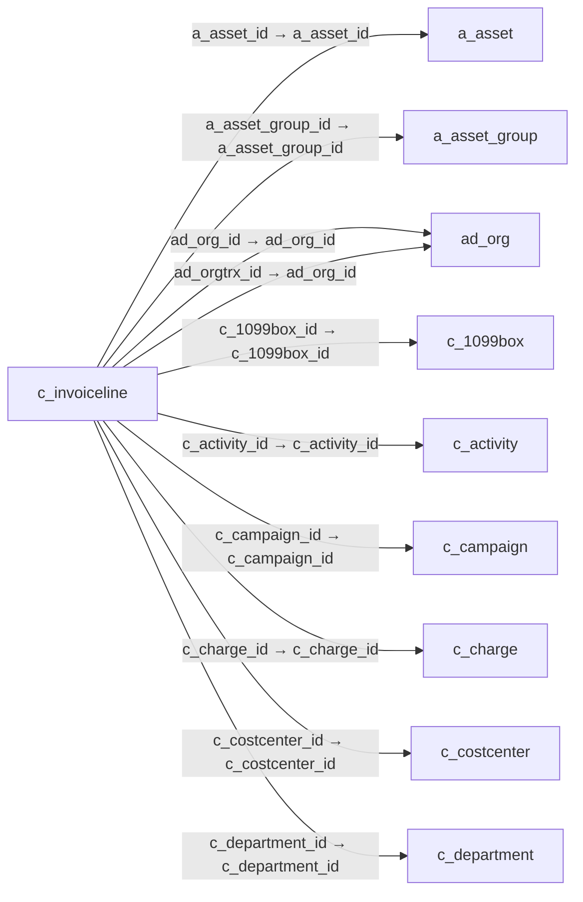

# c_invoiceline — 매출·매입 청구 명세

[전체 일람](../TABLE_INDEX.md) · [분류 일람](README.md) · [AI 사용 안내](../README.md) · [외래키 읽는 법](../RELATIONSHIPS.md)

## 기본 정보

| 항목 | 내용 |
|---|---|
| 물리명 | `adempiere.c_invoiceline` |
| 한국어 논리명(문서용 해석) | 매출·매입 청구 명세 |
| 원본 논리명 | Invoice Line |
| 원본 사전 ID | 333 |
| 분류 | `c` — 거래처·주문·청구·결제·회계 기준 |
| 전체 테넌트 행 수 | 24 |
| 물리 열 수 | 54 |
| 나가는 FK / 들어오는 FK | 26 / 16 |
| 구조·행 수 확인 시점 | 2026-11-03T23:29:01+09:00 |

## 의미와 쓰임

청구서의 개별 상품·서비스 등 상세 행을 저장한다. 상위 청구서가 판매·구매 또는 신용전표인지 함께 확인해야 한다.

- 설명 근거: 물리명·열·외래키 구조를 근거로 보수적으로 해석.
- 한국어 이름과 개요는 문서용 해석입니다. 공식 한국어 번역으로 간주하지 않습니다.
- 원본 설명: Invoice Detail Line
- 원본 도움말: —
- PostgreSQL 테이블 주석: —

## 키와 열

### 기본키·고유 제약조건

| 종류 | 제약조건 | 열(순서 유지) |
|---|---|---|
| PRIMARY KEY | `c_invoiceline_pkey` | `c_invoiceline_id` |
| UNIQUE | `c_invoiceline_uu_idx` | `c_invoiceline_uu` |

### 열 목록

원본 논리명·설명은 `AD_Column`에서 가져왔습니다. 기본값은 실제 PostgreSQL 메타데이터이며, 비어 있는 항목은 `—`로 표시합니다.

| 순서 | 물리명 | 원본 논리명 | PostgreSQL 타입 | NULL | PK | 기본값 | 설명 |
|---:|---|---|---|---|---|---|---|
| 1 | `c_invoiceline_id` | Invoice Line | numeric(10,0) | 불가 | 예 | — | Invoice Detail Line |
| 2 | `ad_client_id` | Tenant | numeric(10,0) | 불가 | — | — | Tenant for this installation. |
| 3 | `ad_org_id` | Organization | numeric(10,0) | 불가 | — | — | Organizational entity within tenant |
| 4 | `isactive` | Active | character(1) | 불가 | — | 'Y'::bpchar | The record is active in the system |
| 5 | `created` | Created | timestamp without time zone | 불가 | — | now() | Date this record was created |
| 6 | `createdby` | Created By | numeric(10,0) | 불가 | — | — | User who created this records |
| 7 | `updated` | Updated | timestamp without time zone | 불가 | — | now() | Date this record was updated |
| 8 | `updatedby` | Updated By | numeric(10,0) | 불가 | — | — | User who updated this records |
| 9 | `c_invoice_id` | Invoice | numeric(10,0) | 불가 | — | — | Invoice Identifier |
| 10 | `c_orderline_id` | Sales Order Line | numeric(10,0) | 허용 | — | — | Sales Order Line |
| 11 | `m_inoutline_id` | Shipment/Receipt Line | numeric(10,0) | 허용 | — | — | Line on Shipment or Receipt document |
| 12 | `line` | Line No | numeric(10,0) | 불가 | — | — | Unique line for this document |
| 13 | `description` | Description | character varying(255) | 허용 | — | — | Optional short description of the record |
| 14 | `m_product_id` | Product | numeric(10,0) | 허용 | — | — | Product, Service, Item |
| 15 | `qtyinvoiced` | Quantity Invoiced | numeric | 불가 | — | 0 | Invoiced Quantity |
| 16 | `pricelist` | List Price | numeric | 불가 | — | 0 | List Price |
| 17 | `priceactual` | Unit Price | numeric | 불가 | — | 0 | Actual Price  |
| 18 | `pricelimit` | Limit Price | numeric | 불가 | — | 0 | Lowest price for a product |
| 19 | `linenetamt` | Line Amount | numeric | 불가 | — | 0 | Line Extended Amount (Quantity * Actual Price) without Freight and Charges |
| 20 | `c_charge_id` | Charge | numeric(10,0) | 허용 | — | — | Additional document charges |
| 21 | `c_uom_id` | UOM | numeric(10,0) | 허용 | — | — | Unit of Measure |
| 22 | `c_tax_id` | Tax | numeric(10,0) | 허용 | — | — | Tax identifier |
| 23 | `s_resourceassignment_id` | Resource Assignment | numeric(10,0) | 허용 | — | — | Resource Assignment |
| 24 | `a_asset_id` | Asset | numeric(10,0) | 허용 | — | — | Asset used internally or by customers |
| 25 | `taxamt` | Tax Amount | numeric | 허용 | — | 0 | Tax Amount for a document |
| 26 | `m_attributesetinstance_id` | Attribute Set Instance | numeric(10,0) | 허용 | — | 0 | Product Attribute Set Instance |
| 27 | `isdescription` | Description Only | character(1) | 불가 | — | 'N'::bpchar | if true, the line is just description and no transaction |
| 28 | `isprinted` | Printed | character(1) | 불가 | — | 'Y'::bpchar | Indicates if this document / line is printed |
| 29 | `linetotalamt` | Line Total | numeric | 허용 | — | 0 | Total line amount incl. Tax |
| 30 | `ref_invoiceline_id` | Referenced Invoice Line | numeric(10,0) | 허용 | — | — | — |
| 31 | `processed` | Processed | character(1) | 불가 | — | 'N'::bpchar | The document has been processed |
| 32 | `qtyentered` | Quantity | numeric | 불가 | — | — | The Quantity Entered is based on the selected UoM |
| 33 | `priceentered` | Price | numeric | 불가 | — | — | Price Entered - the price based on the selected/base UoM |
| 34 | `c_project_id` | Project | numeric(10,0) | 허용 | — | — | Financial Project |
| 35 | `c_projectphase_id` | Project Phase | numeric(10,0) | 허용 | — | — | Phase of a Project |
| 36 | `c_projecttask_id` | Project Task | numeric(10,0) | 허용 | — | — | Actual Project Task in a Phase |
| 37 | `rrstartdate` | Revenue Recognition Start | timestamp without time zone | 허용 | — | — | Revenue Recognition Start Date |
| 38 | `rramt` | Revenue Recognition Amt | numeric | 허용 | — | — | Revenue Recognition Amount |
| 39 | `c_campaign_id` | Campaign | numeric(10,0) | 허용 | — | — | Marketing Campaign |
| 40 | `c_activity_id` | Activity | numeric(10,0) | 허용 | — | — | Business Activity |
| 41 | `user1_id` | User Element List 1 | numeric(10,0) | 허용 | — | — | User defined list element #1 |
| 42 | `user2_id` | User Element List 2 | numeric(10,0) | 허용 | — | — | User defined list element #2 |
| 43 | `ad_orgtrx_id` | Trx Organization | numeric(10,0) | 허용 | — | — | Performing or initiating organization |
| 44 | `m_rmaline_id` | RMA Line | numeric(10,0) | 허용 | — | — | Return Material Authorization Line |
| 45 | `a_createasset` | Create Asset | character(1) | 허용 | — | 'N'::bpchar | — |
| 46 | `a_processed` | Processed | character(1) | 허용 | — | 'N'::bpchar | — |
| 47 | `a_capvsexp` | Capital/Expense | character varying(3) | 허용 | — | — | — |
| 48 | `a_asset_group_id` | Asset Group | numeric(10,0) | 허용 | — | — | Group of Assets |
| 49 | `c_invoiceline_uu` | C_InvoiceLine_UU | uuid | 허용 | — | — | — |
| 50 | `isfixedassetinvoice` | Is Fixed Asset Invoice | character(1) | 허용 | — | — | — |
| 51 | `c_1099box_id` | 1099 Box | numeric(10,0) | 허용 | — | NULL::numeric | — |
| 52 | `c_department_id` | Department | numeric(10,0) | 허용 | — | NULL::numeric | — |
| 53 | `c_costcenter_id` | Cost Center | numeric(10,0) | 허용 | — | NULL::numeric | — |
| 54 | `c_employee_id` | Employee | numeric(10,0) | 허용 | — | NULL::numeric | Identifies a Business Partner |

## 외래키 흐름

화살표는 **FK를 가진 자식 → 참조되는 부모**입니다. 업무 처리의 시간 순서나 무조건적인 1:N 관계를 뜻하지 않습니다.

주변 관계 41개 중 10개를 그림으로 표시합니다. **전체 관계는 아래 두 표에 모두 포함**합니다.

### 이 테이블이 참조하는 부모 — 나가는 FK

| 제약조건 | 참조하는 쪽(자식) | 자식 열 | 참조받는 쪽(부모) | 부모 열 | 삭제 / 갱신 | 검증 / 지연 가능 |
|---|---|---|---|---|---|---|
| `aasset_cinvoiceline` <!-- FK_OUT: adempiere.c_invoiceline.aasset_cinvoiceline --> | [`c_invoiceline`](c_invoiceline.md) | `a_asset_id` | [`a_asset`](../a/a_asset.md) | `a_asset_id` | NO ACTION / NO ACTION | 완료 / 가능 (초기 지연) |
| `aassetgroup_cinvoiceline` <!-- FK_OUT: adempiere.c_invoiceline.aassetgroup_cinvoiceline --> | [`c_invoiceline`](c_invoiceline.md) | `a_asset_group_id` | [`a_asset_group`](../a/a_asset_group.md) | `a_asset_group_id` | NO ACTION / NO ACTION | 완료 / 가능 (초기 지연) |
| `adorg_cinvoiceline` <!-- FK_OUT: adempiere.c_invoiceline.adorg_cinvoiceline --> | [`c_invoiceline`](c_invoiceline.md) | `ad_org_id` | [`ad_org`](../ad/ad_org.md) | `ad_org_id` | NO ACTION / NO ACTION | 완료 / 가능 (초기 지연) |
| `adorgtrx_cinvoiceline` <!-- FK_OUT: adempiere.c_invoiceline.adorgtrx_cinvoiceline --> | [`c_invoiceline`](c_invoiceline.md) | `ad_orgtrx_id` | [`ad_org`](../ad/ad_org.md) | `ad_org_id` | NO ACTION / NO ACTION | 완료 / 가능 (초기 지연) |
| `c1099box_cinvoiceline` <!-- FK_OUT: adempiere.c_invoiceline.c1099box_cinvoiceline --> | [`c_invoiceline`](c_invoiceline.md) | `c_1099box_id` | [`c_1099box`](c_1099box.md) | `c_1099box_id` | NO ACTION / NO ACTION | 완료 / 가능 (초기 지연) |
| `cactivity_cinvoiceline` <!-- FK_OUT: adempiere.c_invoiceline.cactivity_cinvoiceline --> | [`c_invoiceline`](c_invoiceline.md) | `c_activity_id` | [`c_activity`](c_activity.md) | `c_activity_id` | NO ACTION / NO ACTION | 완료 / 가능 (초기 지연) |
| `ccampaign_cinvoiceline` <!-- FK_OUT: adempiere.c_invoiceline.ccampaign_cinvoiceline --> | [`c_invoiceline`](c_invoiceline.md) | `c_campaign_id` | [`c_campaign`](c_campaign.md) | `c_campaign_id` | NO ACTION / NO ACTION | 완료 / 가능 (초기 지연) |
| `ccharge_cinvoiceline` <!-- FK_OUT: adempiere.c_invoiceline.ccharge_cinvoiceline --> | [`c_invoiceline`](c_invoiceline.md) | `c_charge_id` | [`c_charge`](c_charge.md) | `c_charge_id` | NO ACTION / NO ACTION | 완료 / 가능 (초기 지연) |
| `ccostcenter_cinvoiceline` <!-- FK_OUT: adempiere.c_invoiceline.ccostcenter_cinvoiceline --> | [`c_invoiceline`](c_invoiceline.md) | `c_costcenter_id` | [`c_costcenter`](c_costcenter.md) | `c_costcenter_id` | NO ACTION / NO ACTION | 완료 / 가능 (초기 지연) |
| `cdepartment_cinvoiceline` <!-- FK_OUT: adempiere.c_invoiceline.cdepartment_cinvoiceline --> | [`c_invoiceline`](c_invoiceline.md) | `c_department_id` | [`c_department`](c_department.md) | `c_department_id` | NO ACTION / NO ACTION | 완료 / 가능 (초기 지연) |
| `celemenrvalueuser1_cinvline` <!-- FK_OUT: adempiere.c_invoiceline.celemenrvalueuser1_cinvline --> | [`c_invoiceline`](c_invoiceline.md) | `user1_id` | [`c_elementvalue`](c_elementvalue.md) | `c_elementvalue_id` | NO ACTION / NO ACTION | 완료 / 가능 (초기 지연) |
| `celemenrvalueuser2_cinvline` <!-- FK_OUT: adempiere.c_invoiceline.celemenrvalueuser2_cinvline --> | [`c_invoiceline`](c_invoiceline.md) | `user2_id` | [`c_elementvalue`](c_elementvalue.md) | `c_elementvalue_id` | NO ACTION / NO ACTION | 완료 / 가능 (초기 지연) |
| `cemployee_cinvoiceline` <!-- FK_OUT: adempiere.c_invoiceline.cemployee_cinvoiceline --> | [`c_invoiceline`](c_invoiceline.md) | `c_employee_id` | [`c_bpartner`](c_bpartner.md) | `c_bpartner_id` | NO ACTION / NO ACTION | 완료 / 가능 (초기 지연) |
| `cinvoice_cinvoiceline` <!-- FK_OUT: adempiere.c_invoiceline.cinvoice_cinvoiceline --> | [`c_invoiceline`](c_invoiceline.md) | `c_invoice_id` | [`c_invoice`](c_invoice.md) | `c_invoice_id` | CASCADE / NO ACTION | 완료 / 가능 (초기 지연) |
| `convoiceline_ref` <!-- FK_OUT: adempiere.c_invoiceline.convoiceline_ref --> | [`c_invoiceline`](c_invoiceline.md) | `ref_invoiceline_id` | [`c_invoiceline`](c_invoiceline.md) | `c_invoiceline_id` | NO ACTION / NO ACTION | 완료 / 가능 (초기 지연) |
| `corderline_cinvoiceline` <!-- FK_OUT: adempiere.c_invoiceline.corderline_cinvoiceline --> | [`c_invoiceline`](c_invoiceline.md) | `c_orderline_id` | [`c_orderline`](c_orderline.md) | `c_orderline_id` | NO ACTION / NO ACTION | 완료 / 가능 (초기 지연) |
| `cproject_cinvoiceline` <!-- FK_OUT: adempiere.c_invoiceline.cproject_cinvoiceline --> | [`c_invoiceline`](c_invoiceline.md) | `c_project_id` | [`c_project`](c_project.md) | `c_project_id` | NO ACTION / NO ACTION | 완료 / 가능 (초기 지연) |
| `cprojectphase_cinvoiceline` <!-- FK_OUT: adempiere.c_invoiceline.cprojectphase_cinvoiceline --> | [`c_invoiceline`](c_invoiceline.md) | `c_projectphase_id` | [`c_projectphase`](c_projectphase.md) | `c_projectphase_id` | SET NULL / NO ACTION | 완료 / 가능 (초기 지연) |
| `cprojecttask_cinvoiceline` <!-- FK_OUT: adempiere.c_invoiceline.cprojecttask_cinvoiceline --> | [`c_invoiceline`](c_invoiceline.md) | `c_projecttask_id` | [`c_projecttask`](c_projecttask.md) | `c_projecttask_id` | SET NULL / NO ACTION | 완료 / 가능 (초기 지연) |
| `ctax_cinvoiceline` <!-- FK_OUT: adempiere.c_invoiceline.ctax_cinvoiceline --> | [`c_invoiceline`](c_invoiceline.md) | `c_tax_id` | [`c_tax`](c_tax.md) | `c_tax_id` | NO ACTION / NO ACTION | 완료 / 가능 (초기 지연) |
| `cuom_cinvoiceline` <!-- FK_OUT: adempiere.c_invoiceline.cuom_cinvoiceline --> | [`c_invoiceline`](c_invoiceline.md) | `c_uom_id` | [`c_uom`](c_uom.md) | `c_uom_id` | NO ACTION / NO ACTION | 완료 / 가능 (초기 지연) |
| `mattrsetinst_cinvoiceline` <!-- FK_OUT: adempiere.c_invoiceline.mattrsetinst_cinvoiceline --> | [`c_invoiceline`](c_invoiceline.md) | `m_attributesetinstance_id` | [`m_attributesetinstance`](../m/m_attributesetinstance.md) | `m_attributesetinstance_id` | NO ACTION / NO ACTION | 완료 / 가능 (초기 지연) |
| `minoutline_cinvoiceline` <!-- FK_OUT: adempiere.c_invoiceline.minoutline_cinvoiceline --> | [`c_invoiceline`](c_invoiceline.md) | `m_inoutline_id` | [`m_inoutline`](../m/m_inoutline.md) | `m_inoutline_id` | NO ACTION / NO ACTION | 완료 / 가능 (초기 지연) |
| `mproduct_cinvoiceline` <!-- FK_OUT: adempiere.c_invoiceline.mproduct_cinvoiceline --> | [`c_invoiceline`](c_invoiceline.md) | `m_product_id` | [`m_product`](../m/m_product.md) | `m_product_id` | NO ACTION / NO ACTION | 완료 / 가능 (초기 지연) |
| `mrmaline_cinvoiceline` <!-- FK_OUT: adempiere.c_invoiceline.mrmaline_cinvoiceline --> | [`c_invoiceline`](c_invoiceline.md) | `m_rmaline_id` | [`m_rmaline`](../m/m_rmaline.md) | `m_rmaline_id` | NO ACTION / NO ACTION | 완료 / 가능 (초기 지연) |
| `sresourceassign_cinvoiceline` <!-- FK_OUT: adempiere.c_invoiceline.sresourceassign_cinvoiceline --> | [`c_invoiceline`](c_invoiceline.md) | `s_resourceassignment_id` | [`s_resourceassignment`](../s/s_resourceassignment.md) | `s_resourceassignment_id` | NO ACTION / NO ACTION | 완료 / 가능 (초기 지연) |

### 이 테이블을 참조하는 자식 — 들어오는 FK

| 제약조건 | 참조하는 쪽(자식) | 자식 열 | 참조받는 쪽(부모) | 부모 열 | 삭제 / 갱신 | 검증 / 지연 가능 |
|---|---|---|---|---|---|---|
| `cinvoiceline_aassetaddition` <!-- FK_IN: adempiere.a_asset_addition.cinvoiceline_aassetaddition --> | [`a_asset_addition`](../a/a_asset_addition.md) | `c_invoiceline_id` | [`c_invoiceline`](c_invoiceline.md) | `c_invoiceline_id` | NO ACTION / NO ACTION | 완료 / 가능 (초기 지연) |
| `cinvoiceline_aassetdisposed` <!-- FK_IN: adempiere.a_asset_disposed.cinvoiceline_aassetdisposed --> | [`a_asset_disposed`](../a/a_asset_disposed.md) | `c_invoiceline_id` | [`c_invoiceline`](c_invoiceline.md) | `c_invoiceline_id` | NO ACTION / NO ACTION | 완료 / 가능 (초기 지연) |
| `cinvoiceline_aassetretirement` <!-- FK_IN: adempiere.a_asset_retirement.cinvoiceline_aassetretirement --> | [`a_asset_retirement`](../a/a_asset_retirement.md) | `c_invoiceline_id` | [`c_invoiceline`](c_invoiceline.md) | `c_invoiceline_id` | NO ACTION / NO ACTION | 완료 / 가능 (초기 지연) |
| `cinvoiceline_ccommissiondet` <!-- FK_IN: adempiere.c_commissiondetail.cinvoiceline_ccommissiondet --> | [`c_commissiondetail`](c_commissiondetail.md) | `c_invoiceline_id` | [`c_invoiceline`](c_invoiceline.md) | `c_invoiceline_id` | NO ACTION / NO ACTION | 완료 / 가능 (초기 지연) |
| `cinvoiceline_cinvoicebline` <!-- FK_IN: adempiere.c_invoicebatchline.cinvoiceline_cinvoicebline --> | [`c_invoicebatchline`](c_invoicebatchline.md) | `c_invoiceline_id` | [`c_invoiceline`](c_invoiceline.md) | `c_invoiceline_id` | NO ACTION / NO ACTION | 완료 / 가능 (초기 지연) |
| `convoiceline_ref` <!-- FK_IN: adempiere.c_invoiceline.convoiceline_ref --> | [`c_invoiceline`](c_invoiceline.md) | `ref_invoiceline_id` | [`c_invoiceline`](c_invoiceline.md) | `c_invoiceline_id` | NO ACTION / NO ACTION | 완료 / 가능 (초기 지연) |
| `cinvoiceline_clandedcost` <!-- FK_IN: adempiere.c_landedcost.cinvoiceline_clandedcost --> | [`c_landedcost`](c_landedcost.md) | `c_invoiceline_id` | [`c_invoiceline`](c_invoiceline.md) | `c_invoiceline_id` | CASCADE / NO ACTION | 완료 / 가능 (초기 지연) |
| `cinvoiceline_clandedcostalloc` <!-- FK_IN: adempiere.c_landedcostallocation.cinvoiceline_clandedcostalloc --> | [`c_landedcostallocation`](c_landedcostallocation.md) | `c_invoiceline_id` | [`c_invoiceline`](c_invoiceline.md) | `c_invoiceline_id` | NO ACTION / NO ACTION | 완료 / 가능 (초기 지연) |
| `cinvoiceline_crevenuerecplan` <!-- FK_IN: adempiere.c_revenuerecognition_plan.cinvoiceline_crevenuerecplan --> | [`c_revenuerecognition_plan`](c_revenuerecognition_plan.md) | `c_invoiceline_id` | [`c_invoiceline`](c_invoiceline.md) | `c_invoiceline_id` | NO ACTION / NO ACTION | 완료 / 가능 (초기 지연) |
| `cinvoiceline_ctaxdeclline` <!-- FK_IN: adempiere.c_taxdeclarationline.cinvoiceline_ctaxdeclline --> | [`c_taxdeclarationline`](c_taxdeclarationline.md) | `c_invoiceline_id` | [`c_invoiceline`](c_invoiceline.md) | `c_invoiceline_id` | NO ACTION / NO ACTION | 완료 / 가능 (초기 지연) |
| `cinvliceline_iinvoice` <!-- FK_IN: adempiere.i_invoice.cinvliceline_iinvoice --> | [`i_invoice`](../i/i_invoice.md) | `c_invoiceline_id` | [`c_invoiceline`](c_invoiceline.md) | `c_invoiceline_id` | SET NULL / NO ACTION | 완료 / 가능 (초기 지연) |
| `minvoiceline_mcostdetail` <!-- FK_IN: adempiere.m_costdetail.minvoiceline_mcostdetail --> | [`m_costdetail`](../m/m_costdetail.md) | `c_invoiceline_id` | [`c_invoiceline`](c_invoiceline.md) | `c_invoiceline_id` | NO ACTION / NO ACTION | 완료 / 가능 (초기 지연) |
| `cinvoiceline_minoutlineconfirm` <!-- FK_IN: adempiere.m_inoutlineconfirm.cinvoiceline_minoutlineconfirm --> | [`m_inoutlineconfirm`](../m/m_inoutlineconfirm.md) | `c_invoiceline_id` | [`c_invoiceline`](c_invoiceline.md) | `c_invoiceline_id` | NO ACTION / NO ACTION | 완료 / 가능 (초기 지연) |
| `convoiceline_mmatchinv` <!-- FK_IN: adempiere.m_matchinv.convoiceline_mmatchinv --> | [`m_matchinv`](../m/m_matchinv.md) | `c_invoiceline_id` | [`c_invoiceline`](c_invoiceline.md) | `c_invoiceline_id` | NO ACTION / NO ACTION | 완료 / 가능 (초기 지연) |
| `cinvoiceline_mmatchpo` <!-- FK_IN: adempiere.m_matchpo.cinvoiceline_mmatchpo --> | [`m_matchpo`](../m/m_matchpo.md) | `c_invoiceline_id` | [`c_invoiceline`](c_invoiceline.md) | `c_invoiceline_id` | NO ACTION / NO ACTION | 완료 / 가능 (초기 지연) |
| `cinvoiceline_stimeexpenseline` <!-- FK_IN: adempiere.s_timeexpenseline.cinvoiceline_stimeexpenseline --> | [`s_timeexpenseline`](../s/s_timeexpenseline.md) | `c_invoiceline_id` | [`c_invoiceline`](c_invoiceline.md) | `c_invoiceline_id` | NO ACTION / NO ACTION | 완료 / 가능 (초기 지연) |

## 조회 시 주의

- FK 표의 자식 열과 부모 열을 같은 순서로 대응시킵니다. 복합 FK는 모든 열의 동등 조건을 `AND`로 연결합니다.
- 테이블 이름이나 `_id` 열 이름만으로 물리 FK가 있다고 가정하지 않습니다. FK 미선언은 업무 관계가 없다는 뜻도 아닙니다.
- 자식이 여러 행인 테이블과 조인하면 부모의 금액·건수가 중복될 수 있습니다. 집계 단위를 먼저 정합니다.
- `ad_client_id`가 있습니다. 업무 분석에서는 대상 테넌트를 명시합니다. GardenWorld는 `11`, 시스템 공통 설정은 `0`일 수 있으므로 일괄 필터 적용 전에 테이블 역할을 확인합니다.
- 행 수는 위 확인 시점의 전체 테넌트 값입니다. 최신 업무 실적이나 현재 실행 결과로 재사용하지 않습니다.
