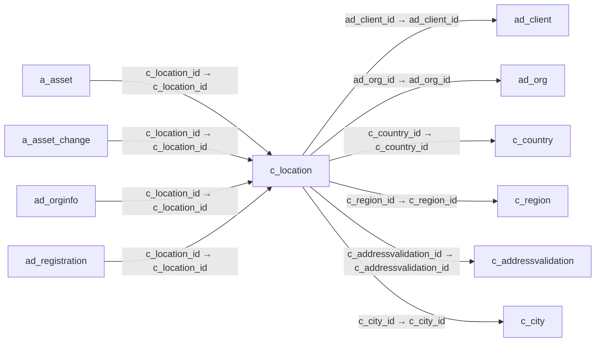

# c_location — 주소

[전체 일람](../TABLE_INDEX.md) · [분류 일람](README.md) · [AI 사용 안내](../README.md) · [외래키 읽는 법](../RELATIONSHIPS.md)

## 기본 정보

| 항목 | 내용 |
|---|---|
| 물리명 | `adempiere.c_location` |
| 한국어 논리명(문서용 해석) | 주소 |
| 원본 논리명 | Address |
| 원본 사전 ID | 162 |
| 분류 | `c` — 거래처·주문·청구·결제·회계 기준 |
| 전체 테넌트 행 수 | 34 |
| 물리 열 수 | 26 |
| 나가는 FK / 들어오는 FK | 6 / 32 |
| 구조·행 수 확인 시점 | 2026-11-03T23:29:01+09:00 |

## 의미와 쓰임

국가·지역·도시·우편번호 등을 포함하는 공통 주소 정보를 관리한다.

- 설명 근거: 원본 애플리케이션 사전 명칭·설명을 한국어로 해석.
- 한국어 이름과 개요는 문서용 해석입니다. 공식 한국어 번역으로 간주하지 않습니다.
- 원본 설명: Location or Address
- 원본 도움말: —
- PostgreSQL 테이블 주석: —

## 키와 열

### 기본키·고유 제약조건

| 종류 | 제약조건 | 열(순서 유지) |
|---|---|---|
| PRIMARY KEY | `c_location_pkey` | `c_location_id` |
| UNIQUE | `c_location_uu_idx` | `c_location_uu` |

### 열 목록

원본 논리명·설명은 `AD_Column`에서 가져왔습니다. 기본값은 실제 PostgreSQL 메타데이터이며, 비어 있는 항목은 `—`로 표시합니다.

| 순서 | 물리명 | 원본 논리명 | PostgreSQL 타입 | NULL | PK | 기본값 | 설명 |
|---:|---|---|---|---|---|---|---|
| 1 | `c_location_id` | Address | numeric(10,0) | 불가 | 예 | — | Location or Address |
| 2 | `ad_client_id` | Tenant | numeric(10,0) | 불가 | — | — | Tenant for this installation. |
| 3 | `ad_org_id` | Organization | numeric(10,0) | 불가 | — | — | Organizational entity within tenant |
| 4 | `isactive` | Active | character(1) | 불가 | — | 'Y'::bpchar | The record is active in the system |
| 5 | `created` | Created | timestamp without time zone | 불가 | — | now() | Date this record was created |
| 6 | `createdby` | Created By | numeric(10,0) | 불가 | — | — | User who created this records |
| 7 | `updated` | Updated | timestamp without time zone | 불가 | — | now() | Date this record was updated |
| 8 | `updatedby` | Updated By | numeric(10,0) | 불가 | — | — | User who updated this records |
| 9 | `address1` | Address 1 | character varying(60) | 허용 | — | — | Address line 1 for this location |
| 10 | `address2` | Address 2 | character varying(60) | 허용 | — | — | Address line 2 for this location |
| 11 | `city` | City | character varying(60) | 허용 | — | — | Identifies a City |
| 12 | `postal` | ZIP | character varying(10) | 허용 | — | — | Postal code |
| 13 | `postal_add` | Additional Zip | character varying(10) | 허용 | — | — | Additional ZIP or Postal code |
| 14 | `c_country_id` | Country | numeric(10,0) | 불가 | — | — | Country  |
| 15 | `c_region_id` | Region | numeric(10,0) | 허용 | — | — | Identifies a geographical Region |
| 16 | `c_city_id` | City | numeric(10,0) | 허용 | — | — | City |
| 17 | `regionname` | Region | character varying(40) | 허용 | — | — | Name of the Region |
| 18 | `address3` | Address 3 | character varying(60) | 허용 | — | — | Address Line 3 for the location |
| 19 | `address4` | Address 4 | character varying(60) | 허용 | — | — | Address Line 4 for the location |
| 20 | `c_location_uu` | C_Location_UU | uuid | 허용 | — | — | — |
| 21 | `validateaddress` | Validate Address | character(1) | 허용 | — | NULL::bpchar | — |
| 22 | `result` | Result | character varying(2000) | 허용 | — | NULL::character varying | Result of the action taken |
| 23 | `isvalid` | Valid | character(1) | 허용 | — | 'N'::bpchar | Element is valid |
| 24 | `c_addressvalidation_id` | Address Validation | numeric(10,0) | 허용 | — | NULL::numeric | — |
| 25 | `address5` | Address 5 | character varying(60) | 허용 | — | NULL::character varying | Address Line 5 for the location |
| 26 | `comments` | Comments | character varying(2000) | 허용 | — | NULL::character varying | Comments or additional information |

## 외래키 흐름

화살표는 **FK를 가진 자식 → 참조되는 부모**입니다. 업무 처리의 시간 순서나 무조건적인 1:N 관계를 뜻하지 않습니다.

주변 관계 38개 중 10개를 그림으로 표시합니다. **전체 관계는 아래 두 표에 모두 포함**합니다.

### 이 테이블이 참조하는 부모 — 나가는 FK

| 제약조건 | 참조하는 쪽(자식) | 자식 열 | 참조받는 쪽(부모) | 부모 열 | 삭제 / 갱신 | 검증 / 지연 가능 |
|---|---|---|---|---|---|---|
| `adclient_clocation` <!-- FK_OUT: adempiere.c_location.adclient_clocation --> | [`c_location`](c_location.md) | `ad_client_id` | [`ad_client`](../ad/ad_client.md) | `ad_client_id` | NO ACTION / NO ACTION | 완료 / 가능 (초기 지연) |
| `adorg_clocation` <!-- FK_OUT: adempiere.c_location.adorg_clocation --> | [`c_location`](c_location.md) | `ad_org_id` | [`ad_org`](../ad/ad_org.md) | `ad_org_id` | NO ACTION / NO ACTION | 완료 / 가능 (초기 지연) |
| `c_country_location` <!-- FK_OUT: adempiere.c_location.c_country_location --> | [`c_location`](c_location.md) | `c_country_id` | [`c_country`](c_country.md) | `c_country_id` | NO ACTION / NO ACTION | 완료 / 가능 (초기 지연) |
| `c_region_location` <!-- FK_OUT: adempiere.c_location.c_region_location --> | [`c_location`](c_location.md) | `c_region_id` | [`c_region`](c_region.md) | `c_region_id` | NO ACTION / NO ACTION | 완료 / 가능 (초기 지연) |
| `caddressvalidation_clocation` <!-- FK_OUT: adempiere.c_location.caddressvalidation_clocation --> | [`c_location`](c_location.md) | `c_addressvalidation_id` | [`c_addressvalidation`](c_addressvalidation.md) | `c_addressvalidation_id` | NO ACTION / NO ACTION | 완료 / 가능 (초기 지연) |
| `ccity_clocation` <!-- FK_OUT: adempiere.c_location.ccity_clocation --> | [`c_location`](c_location.md) | `c_city_id` | [`c_city`](c_city.md) | `c_city_id` | NO ACTION / NO ACTION | 완료 / 가능 (초기 지연) |

### 이 테이블을 참조하는 자식 — 들어오는 FK

| 제약조건 | 참조하는 쪽(자식) | 자식 열 | 참조받는 쪽(부모) | 부모 열 | 삭제 / 갱신 | 검증 / 지연 가능 |
|---|---|---|---|---|---|---|
| `clocation_aasset` <!-- FK_IN: adempiere.a_asset.clocation_aasset --> | [`a_asset`](../a/a_asset.md) | `c_location_id` | [`c_location`](c_location.md) | `c_location_id` | NO ACTION / NO ACTION | 완료 / 가능 (초기 지연) |
| `clocation_aassetchange` <!-- FK_IN: adempiere.a_asset_change.clocation_aassetchange --> | [`a_asset_change`](../a/a_asset_change.md) | `c_location_id` | [`c_location`](c_location.md) | `c_location_id` | NO ACTION / NO ACTION | 완료 / 가능 (초기 지연) |
| `c_location_ad_orginfo` <!-- FK_IN: adempiere.ad_orginfo.c_location_ad_orginfo --> | [`ad_orginfo`](../ad/ad_orginfo.md) | `c_location_id` | [`c_location`](c_location.md) | `c_location_id` | NO ACTION / NO ACTION | 완료 / 가능 (초기 지연) |
| `clocation_adregistration` <!-- FK_IN: adempiere.ad_registration.clocation_adregistration --> | [`ad_registration`](../ad/ad_registration.md) | `c_location_id` | [`c_location`](c_location.md) | `c_location_id` | NO ACTION / NO ACTION | 완료 / 가능 (초기 지연) |
| `bplocation_aduser` <!-- FK_IN: adempiere.ad_user.bplocation_aduser --> | [`ad_user`](../ad/ad_user.md) | `bp_location_id` | [`c_location`](c_location.md) | `c_location_id` | NO ACTION / NO ACTION | 완료 / 가능 (초기 지연) |
| `clocation_aduser` <!-- FK_IN: adempiere.ad_user.clocation_aduser --> | [`ad_user`](../ad/ad_user.md) | `c_location_id` | [`c_location`](c_location.md) | `c_location_id` | NO ACTION / NO ACTION | 완료 / 가능 (초기 지연) |
| `clocation_caschemaelement` <!-- FK_IN: adempiere.c_acctschema_element.clocation_caschemaelement --> | [`c_acctschema_element`](c_acctschema_element.md) | `c_location_id` | [`c_location`](c_location.md) | `c_location_id` | NO ACTION / NO ACTION | 완료 / 가능 (초기 지연) |
| `clocation_caddresstransaction` <!-- FK_IN: adempiere.c_addresstransaction.clocation_caddresstransaction --> | [`c_addresstransaction`](c_addresstransaction.md) | `c_location_id` | [`c_location`](c_location.md) | `c_location_id` | NO ACTION / NO ACTION | 완료 / 가능 (초기 지연) |
| `clocation_cbank` <!-- FK_IN: adempiere.c_bank.clocation_cbank --> | [`c_bank`](c_bank.md) | `c_location_id` | [`c_location`](c_location.md) | `c_location_id` | NO ACTION / NO ACTION | 완료 / 가능 (초기 지연) |
| `clocation_cbplocation` <!-- FK_IN: adempiere.c_bpartner_location.clocation_cbplocation --> | [`c_bpartner_location`](c_bpartner_location.md) | `c_location_id` | [`c_location`](c_location.md) | `c_location_id` | NO ACTION / NO ACTION | 완료 / 가능 (초기 지연) |
| `mlocationfrom_vc` <!-- FK_IN: adempiere.c_validcombination.mlocationfrom_vc --> | [`c_validcombination`](c_validcombination.md) | `c_locfrom_id` | [`c_location`](c_location.md) | `c_location_id` | NO ACTION / NO ACTION | 완료 / 가능 (초기 지연) |
| `mlocationto_vc` <!-- FK_IN: adempiere.c_validcombination.mlocationto_vc --> | [`c_validcombination`](c_validcombination.md) | `c_locto_id` | [`c_location`](c_location.md) | `c_location_id` | NO ACTION / NO ACTION | 완료 / 가능 (초기 지연) |
| `c_locationfrom_fact_acct` <!-- FK_IN: adempiere.fact_acct.c_locationfrom_fact_acct --> | [`fact_acct`](../fact/fact_acct.md) | `c_locfrom_id` | [`c_location`](c_location.md) | `c_location_id` | NO ACTION / NO ACTION | 완료 / 가능 (초기 지연) |
| `c_locationto_fact_acct` <!-- FK_IN: adempiere.fact_acct.c_locationto_fact_acct --> | [`fact_acct`](../fact/fact_acct.md) | `c_locto_id` | [`c_location`](c_location.md) | `c_location_id` | NO ACTION / NO ACTION | 완료 / 가능 (초기 지연) |
| `clocfrom_factacctsummary` <!-- FK_IN: adempiere.fact_acct_summary.clocfrom_factacctsummary --> | [`fact_acct_summary`](../fact/fact_acct_summary.md) | `c_locfrom_id` | [`c_location`](c_location.md) | `c_location_id` | NO ACTION / NO ACTION | 완료 / 가능 (초기 지연) |
| `clocto_factacctsummary` <!-- FK_IN: adempiere.fact_acct_summary.clocto_factacctsummary --> | [`fact_acct_summary`](../fact/fact_acct_summary.md) | `c_locto_id` | [`c_location`](c_location.md) | `c_location_id` | NO ACTION / NO ACTION | 완료 / 가능 (초기 지연) |
| `clocfrom_gldist` <!-- FK_IN: adempiere.gl_distribution.clocfrom_gldist --> | [`gl_distribution`](../gl/gl_distribution.md) | `c_locfrom_id` | [`c_location`](c_location.md) | `c_location_id` | NO ACTION / NO ACTION | 완료 / 가능 (초기 지연) |
| `clocto_gldist` <!-- FK_IN: adempiere.gl_distribution.clocto_gldist --> | [`gl_distribution`](../gl/gl_distribution.md) | `c_locto_id` | [`c_location`](c_location.md) | `c_location_id` | NO ACTION / NO ACTION | 완료 / 가능 (초기 지연) |
| `clocfrom_gldistline` <!-- FK_IN: adempiere.gl_distributionline.clocfrom_gldistline --> | [`gl_distributionline`](../gl/gl_distributionline.md) | `c_locfrom_id` | [`c_location`](c_location.md) | `c_location_id` | NO ACTION / NO ACTION | 완료 / 가능 (초기 지연) |
| `clocto_gldistline` <!-- FK_IN: adempiere.gl_distributionline.clocto_gldistline --> | [`gl_distributionline`](../gl/gl_distributionline.md) | `c_locto_id` | [`c_location`](c_location.md) | `c_location_id` | NO ACTION / NO ACTION | 완료 / 가능 (초기 지연) |
| `clocfrom_gljournalline` <!-- FK_IN: adempiere.gl_journalline.clocfrom_gljournalline --> | [`gl_journalline`](../gl/gl_journalline.md) | `c_locfrom_id` | [`c_location`](c_location.md) | `c_location_id` | NO ACTION / NO ACTION | 완료 / 가능 (초기 지연) |
| `clocto_gljournalline` <!-- FK_IN: adempiere.gl_journalline.clocto_gljournalline --> | [`gl_journalline`](../gl/gl_journalline.md) | `c_locto_id` | [`c_location`](c_location.md) | `c_location_id` | NO ACTION / NO ACTION | 완료 / 가능 (초기 지연) |
| `clocation_iasset` <!-- FK_IN: adempiere.i_asset.clocation_iasset --> | [`i_asset`](../i/i_asset.md) | `c_location_id` | [`c_location`](c_location.md) | `c_location_id` | NO ACTION / NO ACTION | 완료 / 가능 (초기 지연) |
| `clocfrom_ifajournal` <!-- FK_IN: adempiere.i_fajournal.clocfrom_ifajournal --> | [`i_fajournal`](../i/i_fajournal.md) | `c_locfrom_id` | [`c_location`](c_location.md) | `c_location_id` | NO ACTION / NO ACTION | 완료 / 가능 (초기 지연) |
| `clocto_ifajournal` <!-- FK_IN: adempiere.i_fajournal.clocto_ifajournal --> | [`i_fajournal`](../i/i_fajournal.md) | `c_locto_id` | [`c_location`](c_location.md) | `c_location_id` | NO ACTION / NO ACTION | 완료 / 가능 (초기 지연) |
| `clocfrom_igljournal` <!-- FK_IN: adempiere.i_gljournal.clocfrom_igljournal --> | [`i_gljournal`](../i/i_gljournal.md) | `c_locfrom_id` | [`c_location`](c_location.md) | `c_location_id` | SET NULL / NO ACTION | 완료 / 가능 (초기 지연) |
| `clocto_igljournal` <!-- FK_IN: adempiere.i_gljournal.clocto_igljournal --> | [`i_gljournal`](../i/i_gljournal.md) | `c_locto_id` | [`c_location`](c_location.md) | `c_location_id` | SET NULL / NO ACTION | 완료 / 가능 (초기 지연) |
| `clocation_iinvoice` <!-- FK_IN: adempiere.i_invoice.clocation_iinvoice --> | [`i_invoice`](../i/i_invoice.md) | `c_location_id` | [`c_location`](c_location.md) | `c_location_id` | SET NULL / NO ACTION | 완료 / 가능 (초기 지연) |
| `clocation_iorder` <!-- FK_IN: adempiere.i_order.clocation_iorder --> | [`i_order`](../i/i_order.md) | `c_location_id` | [`c_location`](c_location.md) | `c_location_id` | SET NULL / NO ACTION | 완료 / 가능 (초기 지연) |
| `c_location_warehouse` <!-- FK_IN: adempiere.m_warehouse.c_location_warehouse --> | [`m_warehouse`](../m/m_warehouse.md) | `c_location_id` | [`c_location`](c_location.md) | `c_location_id` | NO ACTION / NO ACTION | 완료 / 가능 (초기 지연) |
| `clocation_pareportcolumn` <!-- FK_IN: adempiere.pa_reportcolumn.clocation_pareportcolumn --> | [`pa_reportcolumn`](../pa/pa_reportcolumn.md) | `c_location_id` | [`c_location`](c_location.md) | `c_location_id` | NO ACTION / NO ACTION | 완료 / 가능 (초기 지연) |
| `clocation_pareportsource` <!-- FK_IN: adempiere.pa_reportsource.clocation_pareportsource --> | [`pa_reportsource`](../pa/pa_reportsource.md) | `c_location_id` | [`c_location`](c_location.md) | `c_location_id` | NO ACTION / NO ACTION | 완료 / 가능 (초기 지연) |

## 조회 시 주의

- FK 표의 자식 열과 부모 열을 같은 순서로 대응시킵니다. 복합 FK는 모든 열의 동등 조건을 `AND`로 연결합니다.
- 테이블 이름이나 `_id` 열 이름만으로 물리 FK가 있다고 가정하지 않습니다. FK 미선언은 업무 관계가 없다는 뜻도 아닙니다.
- 자식이 여러 행인 테이블과 조인하면 부모의 금액·건수가 중복될 수 있습니다. 집계 단위를 먼저 정합니다.
- `ad_client_id`가 있습니다. 업무 분석에서는 대상 테넌트를 명시합니다. GardenWorld는 `11`, 시스템 공통 설정은 `0`일 수 있으므로 일괄 필터 적용 전에 테이블 역할을 확인합니다.
- 행 수는 위 확인 시점의 전체 테넌트 값입니다. 최신 업무 실적이나 현재 실행 결과로 재사용하지 않습니다.
