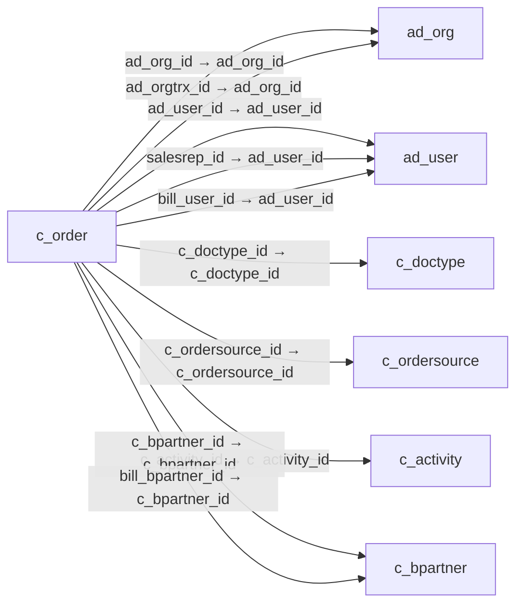

# c_order — 판매 주문·구매 발주

[전체 일람](../TABLE_INDEX.md) · [분류 일람](README.md) · [AI 사용 안내](../README.md) · [외래키 읽는 법](../RELATIONSHIPS.md)

## 기본 정보

| 항목 | 내용 |
|---|---|
| 물리명 | `adempiere.c_order` |
| 한국어 논리명(문서용 해석) | 판매 주문·구매 발주 |
| 원본 논리명 | Order |
| 원본 사전 ID | 259 |
| 분류 | `c` — 거래처·주문·청구·결제·회계 기준 |
| 전체 테넌트 행 수 | 8 |
| 물리 열 수 | 94 |
| 나가는 FK / 들어오는 FK | 40 / 31 |
| 구조·행 수 확인 시점 | 2026-11-03T23:29:01+09:00 |

## 의미와 쓰임

판매 주문과 구매 발주의 머리글을 함께 저장한다. 판매·구매 구분, 문서 유형, 거래처, 주문일, 창고, 통화 및 납품·청구 상태를 확인하여 조회 범위를 결정한다.

- 설명 근거: 물리명·열·외래키 구조를 근거로 보수적으로 해석.
- 한국어 이름과 개요는 문서용 해석입니다. 공식 한국어 번역으로 간주하지 않습니다.
- 원본 설명: Order
- 원본 도움말: —
- PostgreSQL 테이블 주석: —

## 키와 열

### 기본키·고유 제약조건

| 종류 | 제약조건 | 열(순서 유지) |
|---|---|---|
| PRIMARY KEY | `c_order_pkey` | `c_order_id` |
| UNIQUE | `c_order_uu_idx` | `c_order_uu` |

### 별도 고유 인덱스

PK·UNIQUE 제약조건의 인덱스와 별도로 존재하는 고유 인덱스입니다. 식·조건·열 순서는 원본 정의를 따릅니다.

- `c_order_documentno`: `CREATE UNIQUE INDEX c_order_documentno ON adempiere.c_order USING btree (documentno, c_doctype_id, c_bpartner_id)`

### 열 목록

원본 논리명·설명은 `AD_Column`에서 가져왔습니다. 기본값은 실제 PostgreSQL 메타데이터이며, 비어 있는 항목은 `—`로 표시합니다.

| 순서 | 물리명 | 원본 논리명 | PostgreSQL 타입 | NULL | PK | 기본값 | 설명 |
|---:|---|---|---|---|---|---|---|
| 1 | `c_order_id` | Order | numeric(10,0) | 불가 | 예 | — | Order |
| 2 | `ad_client_id` | Tenant | numeric(10,0) | 불가 | — | — | Tenant for this installation. |
| 3 | `ad_org_id` | Organization | numeric(10,0) | 불가 | — | — | Organizational entity within tenant |
| 4 | `isactive` | Active | character(1) | 불가 | — | 'Y'::bpchar | The record is active in the system |
| 5 | `created` | Created | timestamp without time zone | 불가 | — | now() | Date this record was created |
| 6 | `createdby` | Created By | numeric(10,0) | 불가 | — | — | User who created this records |
| 7 | `updated` | Updated | timestamp without time zone | 불가 | — | now() | Date this record was updated |
| 8 | `updatedby` | Updated By | numeric(10,0) | 불가 | — | — | User who updated this records |
| 9 | `issotrx` | Sales Transaction | character(1) | 불가 | — | 'Y'::bpchar | This is a Sales Transaction |
| 10 | `documentno` | Document No | character varying(30) | 불가 | — | — | Document sequence number of the document |
| 11 | `docstatus` | Document Status | character(2) | 불가 | — | — | The current status of the document |
| 12 | `docaction` | Document Action | character(2) | 불가 | — | — | The targeted status of the document |
| 13 | `processing` | Process Now | character(1) | 허용 | — | — | — |
| 14 | `processed` | Processed | character(1) | 불가 | — | 'N'::bpchar | The document has been processed |
| 15 | `c_doctype_id` | Document Type | numeric(10,0) | 불가 | — | — | Document type or rules |
| 16 | `c_doctypetarget_id` | Target Document Type | numeric(10,0) | 불가 | — | — | Target document type for conversing documents |
| 17 | `description` | Description | character varying(255) | 허용 | — | — | Optional short description of the record |
| 18 | `isapproved` | Approved | character(1) | 불가 | — | 'N'::bpchar | Indicates if this document requires approval |
| 19 | `iscreditapproved` | Credit Approved | character(1) | 불가 | — | 'N'::bpchar | Credit  has been approved |
| 20 | `isdelivered` | Delivered | character(1) | 불가 | — | 'N'::bpchar | — |
| 21 | `isinvoiced` | Invoiced | character(1) | 불가 | — | 'N'::bpchar | Is this invoiced? |
| 22 | `isprinted` | Printed | character(1) | 불가 | — | 'N'::bpchar | Indicates if this document / line is printed |
| 23 | `istransferred` | Transferred | character(1) | 불가 | — | 'N'::bpchar | Transferred to General Ledger (i.e. accounted) |
| 24 | `isselected` | Selected | character(1) | 불가 | — | 'N'::bpchar | — |
| 25 | `salesrep_id` | Sales Representative | numeric(10,0) | 허용 | — | — | Sales Representative or Company Agent |
| 26 | `dateordered` | Date Ordered | timestamp without time zone | 불가 | — | — | Date of Order |
| 27 | `datepromised` | Date Promised | timestamp without time zone | 허용 | — | — | Date Order was promised |
| 28 | `dateprinted` | Date Printed | timestamp without time zone | 허용 | — | — | Date the document was printed. |
| 29 | `dateacct` | Account Date | timestamp without time zone | 불가 | — | — | Accounting Date |
| 30 | `c_bpartner_id` | Business Partner | numeric(10,0) | 불가 | — | — | Identifies a Business Partner |
| 31 | `c_bpartner_location_id` | Partner Location | numeric(10,0) | 불가 | — | — | Identifies the (ship to) address for this Business Partner |
| 32 | `poreference` | Order Reference | character varying(20) | 허용 | — | — | Transaction Reference Number (Sales Order, Purchase Order) of your Business Partner |
| 33 | `isdiscountprinted` | Discount Printed | character(1) | 불가 | — | 'Y'::bpchar | Print Discount on Invoice and Order |
| 34 | `c_currency_id` | Currency | numeric(10,0) | 불가 | — | — | The Currency for this record |
| 35 | `paymentrule` | Payment Rule | character(1) | 불가 | — | — | How you pay the invoice |
| 36 | `c_paymentterm_id` | Payment Term | numeric(10,0) | 불가 | — | — | The terms of Payment (timing, discount) |
| 37 | `invoicerule` | Invoice Rule | character(1) | 불가 | — | — | Frequency and method of invoicing  |
| 38 | `deliveryrule` | Delivery Rule | character(1) | 불가 | — | — | Defines the timing of Delivery |
| 39 | `freightcostrule` | Freight Cost Rule | character(1) | 불가 | — | — | Method for charging Freight |
| 40 | `freightamt` | Freight Amount | numeric | 허용 | — | 0 | Freight Amount  |
| 41 | `deliveryviarule` | Delivery Via | character(1) | 불가 | — | — | How the order will be delivered |
| 42 | `m_shipper_id` | Shipper | numeric(10,0) | 허용 | — | — | Method or manner of product delivery |
| 43 | `c_charge_id` | Charge | numeric(10,0) | 허용 | — | — | Additional document charges |
| 44 | `chargeamt` | Charge amount | numeric | 허용 | — | 0 | Charge Amount |
| 45 | `priorityrule` | Priority | character(1) | 불가 | — | — | Priority of a document |
| 46 | `totallines` | Total Lines | numeric | 불가 | — | 0 | Total of all document lines |
| 47 | `grandtotal` | Grand Total | numeric | 불가 | — | 0 | Total amount of document |
| 48 | `m_warehouse_id` | Warehouse | numeric(10,0) | 불가 | — | — | Storage Warehouse and Service Point |
| 49 | `m_pricelist_id` | Price List | numeric(10,0) | 불가 | — | — | Unique identifier of a Price List |
| 50 | `istaxincluded` | Price includes Tax | character(1) | 불가 | — | 'N'::bpchar | Tax is included in the price  |
| 51 | `c_campaign_id` | Campaign | numeric(10,0) | 허용 | — | — | Marketing Campaign |
| 52 | `c_project_id` | Project | numeric(10,0) | 허용 | — | — | Financial Project |
| 53 | `c_activity_id` | Activity | numeric(10,0) | 허용 | — | — | Business Activity |
| 54 | `posted` | Posted | character(1) | 불가 | — | 'N'::bpchar | Posting status |
| 55 | `c_payment_id` | Payment | numeric(10,0) | 허용 | — | — | Payment identifier |
| 56 | `c_cashline_id` | Cash Journal Line | numeric(10,0) | 허용 | — | — | Cash Journal Line |
| 57 | `sendemail` | Send EMail | character(1) | 불가 | — | 'N'::bpchar | Enable sending Document EMail |
| 58 | `ad_user_id` | User/Contact | numeric(10,0) | 허용 | — | — | User within the system - Internal or Business Partner Contact |
| 59 | `copyfrom` | Copy From | character(1) | 허용 | — | — | Copy From Record |
| 60 | `isselfservice` | Self-Service | character(1) | 불가 | — | 'N'::bpchar | This is a Self-Service entry or this entry can be changed via Self-Service |
| 61 | `ad_orgtrx_id` | Trx Organization | numeric(10,0) | 허용 | — | — | Performing or initiating organization |
| 62 | `user1_id` | User Element List 1 | numeric(10,0) | 허용 | — | — | User defined list element #1 |
| 63 | `user2_id` | User Element List 2 | numeric(10,0) | 허용 | — | — | User defined list element #2 |
| 64 | `c_conversiontype_id` | Currency Type | numeric(10,0) | 허용 | — | — | Currency Conversion Rate Type |
| 65 | `bill_bpartner_id` | Invoice Partner | numeric(10,0) | 허용 | — | — | Business Partner to be invoiced |
| 66 | `bill_location_id` | Invoice Location | numeric(10,0) | 허용 | — | — | Business Partner Location for invoicing |
| 67 | `bill_user_id` | Invoice Contact | numeric(10,0) | 허용 | — | — | Business Partner Contact for invoicing |
| 68 | `pay_bpartner_id` | Payment BPartner | numeric(10,0) | 허용 | — | — | Business Partner responsible for the payment |
| 69 | `pay_location_id` | Payment Location | numeric(10,0) | 허용 | — | — | Location of the Business Partner responsible for the payment |
| 70 | `ref_order_id` | Referenced Order | numeric(10,0) | 허용 | — | — | Reference to corresponding Sales/Purchase Order |
| 71 | `isdropship` | Drop Shipment | character(1) | 불가 | — | 'N'::bpchar | Drop Shipments are sent directly to the Drop Shipment Location |
| 72 | `volume` | Volume | numeric | 허용 | — | — | Volume of a product |
| 73 | `weight` | Weight | numeric | 허용 | — | — | Weight of a product |
| 74 | `ordertype` | Order Type | character varying(510) | 허용 | — | — | Type of Order: MRP records grouped by source (Sales Order, Purchase Order, Distribution Order, Requisition) |
| 75 | `c_pos_id` | POS Terminal | numeric(10,0) | 허용 | — | — | Point of Sales Terminal |
| 76 | `amounttendered` | Amount Tendered | numeric(22,2) | 허용 | — | — | — |
| 77 | `amountrefunded` | Amount Refunded | numeric(22,2) | 허용 | — | — | — |
| 78 | `link_order_id` | Linked Order | numeric(10,0) | 허용 | — | — | This field links a sales order to the purchase order that is generated from it. |
| 79 | `m_freightcategory_id` | Freight Category | numeric(10,0) | 허용 | — | NULL::numeric | Category of the Freight |
| 80 | `dropship_bpartner_id` | Drop Ship Business Partner | numeric(10,0) | 허용 | — | — | Business Partner to ship to |
| 81 | `dropship_location_id` | Drop Shipment Location | numeric(10,0) | 허용 | — | — | Business Partner Location for shipping to |
| 82 | `dropship_user_id` | Drop Shipment Contact | numeric(10,0) | 허용 | — | — | Business Partner Contact for drop shipment |
| 83 | `promotioncode` | Promotion Code | character varying(30) | 허용 | — | — | User entered promotion code at sales time |
| 84 | `c_ordersource_id` | Order Source | numeric(10,0) | 허용 | — | — | — |
| 85 | `processedon` | Processed On | numeric | 허용 | — | — | The date+time (expressed in decimal format) when the document has been processed |
| 86 | `ispayschedulevalid` | Pay Schedule valid | character(1) | 불가 | — | 'N'::bpchar | Is the Payment Schedule is valid |
| 87 | `c_cashplanline_id` | Cash Plan Line | numeric(10,0) | 허용 | — | NULL::numeric | — |
| 88 | `c_order_uu` | C_Order_UU | uuid | 허용 | — | — | — |
| 89 | `shippingrateinquiry` | Rate Inquiry | character(1) | 허용 | — | NULL::bpchar | — |
| 90 | `ispriviledgedrate` | Privileged Rate | character(1) | 불가 | — | 'N'::bpchar | — |
| 91 | `c_opportunity_id` | Sales Opportunity | numeric(10,0) | 허용 | — | NULL::numeric | — |
| 92 | `quotationorder_id` | Quotation | numeric(10,0) | 허용 | — | NULL::numeric | Quotation used for generating this order |
| 93 | `c_department_id` | Department | numeric(10,0) | 허용 | — | NULL::numeric | — |
| 94 | `c_costcenter_id` | Cost Center | numeric(10,0) | 허용 | — | NULL::numeric | — |

## 외래키 흐름

화살표는 **FK를 가진 자식 → 참조되는 부모**입니다. 업무 처리의 시간 순서나 무조건적인 1:N 관계를 뜻하지 않습니다.

주변 관계 68개 중 10개를 그림으로 표시합니다. **전체 관계는 아래 두 표에 모두 포함**합니다.

### 이 테이블이 참조하는 부모 — 나가는 FK

| 제약조건 | 참조하는 쪽(자식) | 자식 열 | 참조받는 쪽(부모) | 부모 열 | 삭제 / 갱신 | 검증 / 지연 가능 |
|---|---|---|---|---|---|---|
| `adorg_corder` <!-- FK_OUT: adempiere.c_order.adorg_corder --> | [`c_order`](c_order.md) | `ad_org_id` | [`ad_org`](../ad/ad_org.md) | `ad_org_id` | NO ACTION / NO ACTION | 완료 / 가능 (초기 지연) |
| `adorgtrx_corder` <!-- FK_OUT: adempiere.c_order.adorgtrx_corder --> | [`c_order`](c_order.md) | `ad_orgtrx_id` | [`ad_org`](../ad/ad_org.md) | `ad_org_id` | NO ACTION / NO ACTION | 완료 / 가능 (초기 지연) |
| `aduser_corder` <!-- FK_OUT: adempiere.c_order.aduser_corder --> | [`c_order`](c_order.md) | `ad_user_id` | [`ad_user`](../ad/ad_user.md) | `ad_user_id` | NO ACTION / NO ACTION | 완료 / 가능 (초기 지연) |
| `aduser_sr_corder` <!-- FK_OUT: adempiere.c_order.aduser_sr_corder --> | [`c_order`](c_order.md) | `salesrep_id` | [`ad_user`](../ad/ad_user.md) | `ad_user_id` | NO ACTION / NO ACTION | 완료 / 가능 (초기 지연) |
| `aduserbill_corder` <!-- FK_OUT: adempiere.c_order.aduserbill_corder --> | [`c_order`](c_order.md) | `bill_user_id` | [`ad_user`](../ad/ad_user.md) | `ad_user_id` | NO ACTION / NO ACTION | 완료 / 가능 (초기 지연) |
| `c_doctype_corder` <!-- FK_OUT: adempiere.c_order.c_doctype_corder --> | [`c_order`](c_order.md) | `c_doctype_id` | [`c_doctype`](c_doctype.md) | `c_doctype_id` | NO ACTION / NO ACTION | 완료 / 가능 (초기 지연) |
| `c_order__c_orders_c_ordersou` <!-- FK_OUT: adempiere.c_order.c_order__c_orders_c_ordersou --> | [`c_order`](c_order.md) | `c_ordersource_id` | [`c_ordersource`](c_ordersource.md) | `c_ordersource_id` | NO ACTION / NO ACTION | 완료 / 가능 (초기 지연) |
| `cactivity_corder` <!-- FK_OUT: adempiere.c_order.cactivity_corder --> | [`c_order`](c_order.md) | `c_activity_id` | [`c_activity`](c_activity.md) | `c_activity_id` | NO ACTION / NO ACTION | 완료 / 가능 (초기 지연) |
| `cbpartner_corder` <!-- FK_OUT: adempiere.c_order.cbpartner_corder --> | [`c_order`](c_order.md) | `c_bpartner_id` | [`c_bpartner`](c_bpartner.md) | `c_bpartner_id` | NO ACTION / NO ACTION | 완료 / 가능 (초기 지연) |
| `cbpartnerbill_corder` <!-- FK_OUT: adempiere.c_order.cbpartnerbill_corder --> | [`c_order`](c_order.md) | `bill_bpartner_id` | [`c_bpartner`](c_bpartner.md) | `c_bpartner_id` | NO ACTION / NO ACTION | 완료 / 가능 (초기 지연) |
| `cbpartnerlocation_corder` <!-- FK_OUT: adempiere.c_order.cbpartnerlocation_corder --> | [`c_order`](c_order.md) | `c_bpartner_location_id` | [`c_bpartner_location`](c_bpartner_location.md) | `c_bpartner_location_id` | NO ACTION / NO ACTION | 완료 / 가능 (초기 지연) |
| `cbpartnerpay_corder` <!-- FK_OUT: adempiere.c_order.cbpartnerpay_corder --> | [`c_order`](c_order.md) | `pay_bpartner_id` | [`c_bpartner`](c_bpartner.md) | `c_bpartner_id` | NO ACTION / NO ACTION | 완료 / 가능 (초기 지연) |
| `cbplocationbill_corder` <!-- FK_OUT: adempiere.c_order.cbplocationbill_corder --> | [`c_order`](c_order.md) | `bill_location_id` | [`c_bpartner_location`](c_bpartner_location.md) | `c_bpartner_location_id` | NO ACTION / NO ACTION | 완료 / 가능 (초기 지연) |
| `cbplocationpay_corder` <!-- FK_OUT: adempiere.c_order.cbplocationpay_corder --> | [`c_order`](c_order.md) | `pay_location_id` | [`c_bpartner_location`](c_bpartner_location.md) | `c_bpartner_location_id` | NO ACTION / NO ACTION | 완료 / 가능 (초기 지연) |
| `ccampaign_corder` <!-- FK_OUT: adempiere.c_order.ccampaign_corder --> | [`c_order`](c_order.md) | `c_campaign_id` | [`c_campaign`](c_campaign.md) | `c_campaign_id` | NO ACTION / NO ACTION | 완료 / 가능 (초기 지연) |
| `ccashline_corder` <!-- FK_OUT: adempiere.c_order.ccashline_corder --> | [`c_order`](c_order.md) | `c_cashline_id` | [`c_cashline`](c_cashline.md) | `c_cashline_id` | NO ACTION / NO ACTION | 완료 / 가능 (초기 지연) |
| `ccashplanline_corder` <!-- FK_OUT: adempiere.c_order.ccashplanline_corder --> | [`c_order`](c_order.md) | `c_cashplanline_id` | [`c_cashplanline`](c_cashplanline.md) | `c_cashplanline_id` | NO ACTION / NO ACTION | 완료 / 가능 (초기 지연) |
| `ccharge_corder` <!-- FK_OUT: adempiere.c_order.ccharge_corder --> | [`c_order`](c_order.md) | `c_charge_id` | [`c_charge`](c_charge.md) | `c_charge_id` | NO ACTION / NO ACTION | 완료 / 가능 (초기 지연) |
| `cconversiontype_corder` <!-- FK_OUT: adempiere.c_order.cconversiontype_corder --> | [`c_order`](c_order.md) | `c_conversiontype_id` | [`c_conversiontype`](c_conversiontype.md) | `c_conversiontype_id` | NO ACTION / NO ACTION | 완료 / 가능 (초기 지연) |
| `ccostcenter_corder` <!-- FK_OUT: adempiere.c_order.ccostcenter_corder --> | [`c_order`](c_order.md) | `c_costcenter_id` | [`c_costcenter`](c_costcenter.md) | `c_costcenter_id` | NO ACTION / NO ACTION | 완료 / 가능 (초기 지연) |
| `ccurrency_corder` <!-- FK_OUT: adempiere.c_order.ccurrency_corder --> | [`c_order`](c_order.md) | `c_currency_id` | [`c_currency`](c_currency.md) | `c_currency_id` | NO ACTION / NO ACTION | 완료 / 가능 (초기 지연) |
| `cdepartment_corder` <!-- FK_OUT: adempiere.c_order.cdepartment_corder --> | [`c_order`](c_order.md) | `c_department_id` | [`c_department`](c_department.md) | `c_department_id` | NO ACTION / NO ACTION | 완료 / 가능 (초기 지연) |
| `cdoctypetarget_corder` <!-- FK_OUT: adempiere.c_order.cdoctypetarget_corder --> | [`c_order`](c_order.md) | `c_doctypetarget_id` | [`c_doctype`](c_doctype.md) | `c_doctype_id` | NO ACTION / NO ACTION | 완료 / 가능 (초기 지연) |
| `celemenrvalueuser2_corder` <!-- FK_OUT: adempiere.c_order.celemenrvalueuser2_corder --> | [`c_order`](c_order.md) | `user2_id` | [`c_elementvalue`](c_elementvalue.md) | `c_elementvalue_id` | NO ACTION / NO ACTION | 완료 / 가능 (초기 지연) |
| `celementvalueuser1_corder` <!-- FK_OUT: adempiere.c_order.celementvalueuser1_corder --> | [`c_order`](c_order.md) | `user1_id` | [`c_elementvalue`](c_elementvalue.md) | `c_elementvalue_id` | NO ACTION / NO ACTION | 완료 / 가능 (초기 지연) |
| `copportunity_corder` <!-- FK_OUT: adempiere.c_order.copportunity_corder --> | [`c_order`](c_order.md) | `c_opportunity_id` | [`c_opportunity`](c_opportunity.md) | `c_opportunity_id` | NO ACTION / NO ACTION | 완료 / 가능 (초기 지연) |
| `corder_ref` <!-- FK_OUT: adempiere.c_order.corder_ref --> | [`c_order`](c_order.md) | `ref_order_id` | [`c_order`](c_order.md) | `c_order_id` | NO ACTION / NO ACTION | 완료 / 가능 (초기 지연) |
| `cpayment_corder` <!-- FK_OUT: adempiere.c_order.cpayment_corder --> | [`c_order`](c_order.md) | `c_payment_id` | [`c_payment`](c_payment.md) | `c_payment_id` | NO ACTION / NO ACTION | 완료 / 가능 (초기 지연) |
| `cpaymentterm_soheader` <!-- FK_OUT: adempiere.c_order.cpaymentterm_soheader --> | [`c_order`](c_order.md) | `c_paymentterm_id` | [`c_paymentterm`](c_paymentterm.md) | `c_paymentterm_id` | NO ACTION / NO ACTION | 완료 / 가능 (초기 지연) |
| `cpos_corder` <!-- FK_OUT: adempiere.c_order.cpos_corder --> | [`c_order`](c_order.md) | `c_pos_id` | [`c_pos`](c_pos.md) | `c_pos_id` | NO ACTION / NO ACTION | 완료 / 가능 (초기 지연) |
| `cproject_corder` <!-- FK_OUT: adempiere.c_order.cproject_corder --> | [`c_order`](c_order.md) | `c_project_id` | [`c_project`](c_project.md) | `c_project_id` | NO ACTION / NO ACTION | 완료 / 가능 (초기 지연) |
| `dropshipbpartner_corder` <!-- FK_OUT: adempiere.c_order.dropshipbpartner_corder --> | [`c_order`](c_order.md) | `dropship_bpartner_id` | [`c_bpartner`](c_bpartner.md) | `c_bpartner_id` | NO ACTION / NO ACTION | 완료 / 가능 (초기 지연) |
| `dropshiplocation_corder` <!-- FK_OUT: adempiere.c_order.dropshiplocation_corder --> | [`c_order`](c_order.md) | `dropship_location_id` | [`c_bpartner_location`](c_bpartner_location.md) | `c_bpartner_location_id` | NO ACTION / NO ACTION | 완료 / 가능 (초기 지연) |
| `dropshipuser_corder` <!-- FK_OUT: adempiere.c_order.dropshipuser_corder --> | [`c_order`](c_order.md) | `dropship_user_id` | [`ad_user`](../ad/ad_user.md) | `ad_user_id` | NO ACTION / NO ACTION | 완료 / 가능 (초기 지연) |
| `linkorder_corder` <!-- FK_OUT: adempiere.c_order.linkorder_corder --> | [`c_order`](c_order.md) | `link_order_id` | [`c_order`](c_order.md) | `c_order_id` | SET NULL / NO ACTION | 완료 / 가능 (초기 지연) |
| `mfreightcategory_order` <!-- FK_OUT: adempiere.c_order.mfreightcategory_order --> | [`c_order`](c_order.md) | `m_freightcategory_id` | [`m_freightcategory`](../m/m_freightcategory.md) | `m_freightcategory_id` | NO ACTION / NO ACTION | 완료 / 가능 (초기 지연) |
| `mpricelist_soheader` <!-- FK_OUT: adempiere.c_order.mpricelist_soheader --> | [`c_order`](c_order.md) | `m_pricelist_id` | [`m_pricelist`](../m/m_pricelist.md) | `m_pricelist_id` | NO ACTION / NO ACTION | 완료 / 가능 (초기 지연) |
| `mshipper_corder` <!-- FK_OUT: adempiere.c_order.mshipper_corder --> | [`c_order`](c_order.md) | `m_shipper_id` | [`m_shipper`](../m/m_shipper.md) | `m_shipper_id` | NO ACTION / NO ACTION | 완료 / 가능 (초기 지연) |
| `mwarehouse_corder` <!-- FK_OUT: adempiere.c_order.mwarehouse_corder --> | [`c_order`](c_order.md) | `m_warehouse_id` | [`m_warehouse`](../m/m_warehouse.md) | `m_warehouse_id` | NO ACTION / NO ACTION | 완료 / 가능 (초기 지연) |
| `quotationorder_corder` <!-- FK_OUT: adempiere.c_order.quotationorder_corder --> | [`c_order`](c_order.md) | `quotationorder_id` | [`c_order`](c_order.md) | `c_order_id` | NO ACTION / NO ACTION | 완료 / 가능 (초기 지연) |

### 이 테이블을 참조하는 자식 — 들어오는 FK

| 제약조건 | 참조하는 쪽(자식) | 자식 열 | 참조받는 쪽(부모) | 부모 열 | 삭제 / 갱신 | 검증 / 지연 가능 |
|---|---|---|---|---|---|---|
| `corder_bbuyersfunds` <!-- FK_IN: adempiere.b_buyerfunds.corder_bbuyersfunds --> | [`b_buyerfunds`](../b/b_buyerfunds.md) | `c_order_id` | [`c_order`](c_order.md) | `c_order_id` | NO ACTION / NO ACTION | 완료 / 가능 (초기 지연) |
| `corder_bsellerfunds` <!-- FK_IN: adempiere.b_sellerfunds.corder_bsellerfunds --> | [`b_sellerfunds`](../b/b_sellerfunds.md) | `c_order_id` | [`c_order`](c_order.md) | `c_order_id` | NO ACTION / NO ACTION | 완료 / 가능 (초기 지연) |
| `corder_callocation` <!-- FK_IN: adempiere.c_allocationline.corder_callocation --> | [`c_allocationline`](c_allocationline.md) | `c_order_id` | [`c_order`](c_order.md) | `c_order_id` | NO ACTION / NO ACTION | 완료 / 가능 (초기 지연) |
| `corder_cinvoice` <!-- FK_IN: adempiere.c_invoice.corder_cinvoice --> | [`c_invoice`](c_invoice.md) | `c_order_id` | [`c_order`](c_order.md) | `c_order_id` | NO ACTION / NO ACTION | 완료 / 가능 (초기 지연) |
| `corder_copportunity` <!-- FK_IN: adempiere.c_opportunity.corder_copportunity --> | [`c_opportunity`](c_opportunity.md) | `c_order_id` | [`c_order`](c_order.md) | `c_order_id` | NO ACTION / NO ACTION | 완료 / 가능 (초기 지연) |
| `corder_ref` <!-- FK_IN: adempiere.c_order.corder_ref --> | [`c_order`](c_order.md) | `ref_order_id` | [`c_order`](c_order.md) | `c_order_id` | NO ACTION / NO ACTION | 완료 / 가능 (초기 지연) |
| `linkorder_corder` <!-- FK_IN: adempiere.c_order.linkorder_corder --> | [`c_order`](c_order.md) | `link_order_id` | [`c_order`](c_order.md) | `c_order_id` | SET NULL / NO ACTION | 완료 / 가능 (초기 지연) |
| `quotationorder_corder` <!-- FK_IN: adempiere.c_order.quotationorder_corder --> | [`c_order`](c_order.md) | `quotationorder_id` | [`c_order`](c_order.md) | `c_order_id` | NO ACTION / NO ACTION | 완료 / 가능 (초기 지연) |
| `corder_corderlandedcost` <!-- FK_IN: adempiere.c_orderlandedcost.corder_corderlandedcost --> | [`c_orderlandedcost`](c_orderlandedcost.md) | `c_order_id` | [`c_order`](c_order.md) | `c_order_id` | NO ACTION / NO ACTION | 완료 / 가능 (초기 지연) |
| `corder_corderline` <!-- FK_IN: adempiere.c_orderline.corder_corderline --> | [`c_orderline`](c_orderline.md) | `c_order_id` | [`c_order`](c_order.md) | `c_order_id` | NO ACTION / NO ACTION | 완료 / 가능 (초기 지연) |
| `corder_corderpayschedule` <!-- FK_IN: adempiere.c_orderpayschedule.corder_corderpayschedule --> | [`c_orderpayschedule`](c_orderpayschedule.md) | `c_order_id` | [`c_order`](c_order.md) | `c_order_id` | NO ACTION / NO ACTION | 완료 / 가능 (초기 지연) |
| `corder_cordertax` <!-- FK_IN: adempiere.c_ordertax.corder_cordertax --> | [`c_ordertax`](c_ordertax.md) | `c_order_id` | [`c_order`](c_order.md) | `c_order_id` | CASCADE / NO ACTION | 완료 / 가능 (초기 지연) |
| `corder_cpayment` <!-- FK_IN: adempiere.c_payment.corder_cpayment --> | [`c_payment`](c_payment.md) | `c_order_id` | [`c_order`](c_order.md) | `c_order_id` | NO ACTION / NO ACTION | 완료 / 가능 (초기 지연) |
| `corder_cpaymenttransaction` <!-- FK_IN: adempiere.c_paymenttransaction.corder_cpaymenttransaction --> | [`c_paymenttransaction`](c_paymenttransaction.md) | `c_order_id` | [`c_order`](c_order.md) | `c_order_id` | NO ACTION / NO ACTION | 완료 / 가능 (초기 지연) |
| `corder_cpospayment` <!-- FK_IN: adempiere.c_pospayment.corder_cpospayment --> | [`c_pospayment`](c_pospayment.md) | `c_order_id` | [`c_order`](c_order.md) | `c_order_id` | NO ACTION / NO ACTION | 완료 / 가능 (초기 지연) |
| `corder_cprojectline` <!-- FK_IN: adempiere.c_projectline.corder_cprojectline --> | [`c_projectline`](c_projectline.md) | `c_order_id` | [`c_order`](c_order.md) | `c_order_id` | NO ACTION / NO ACTION | 완료 / 가능 (초기 지연) |
| `corderpo_cprojectline` <!-- FK_IN: adempiere.c_projectline.corderpo_cprojectline --> | [`c_projectline`](c_projectline.md) | `c_orderpo_id` | [`c_order`](c_order.md) | `c_order_id` | NO ACTION / NO ACTION | 완료 / 가능 (초기 지연) |
| `corder_cprojectphase` <!-- FK_IN: adempiere.c_projectphase.corder_cprojectphase --> | [`c_projectphase`](c_projectphase.md) | `c_order_id` | [`c_order`](c_order.md) | `c_order_id` | NO ACTION / NO ACTION | 완료 / 가능 (초기 지연) |
| `corder_crecurring` <!-- FK_IN: adempiere.c_recurring.corder_crecurring --> | [`c_recurring`](c_recurring.md) | `c_order_id` | [`c_order`](c_order.md) | `c_order_id` | NO ACTION / NO ACTION | 완료 / 가능 (초기 지연) |
| `corder_crecurringrun` <!-- FK_IN: adempiere.c_recurring_run.corder_crecurringrun --> | [`c_recurring_run`](c_recurring_run.md) | `c_order_id` | [`c_order`](c_order.md) | `c_order_id` | CASCADE / NO ACTION | 완료 / 가능 (초기 지연) |
| `corder_crfq` <!-- FK_IN: adempiere.c_rfq.corder_crfq --> | [`c_rfq`](c_rfq.md) | `c_order_id` | [`c_order`](c_order.md) | `c_order_id` | NO ACTION / NO ACTION | 완료 / 가능 (초기 지연) |
| `corder_crfqresponse` <!-- FK_IN: adempiere.c_rfqresponse.corder_crfqresponse --> | [`c_rfqresponse`](c_rfqresponse.md) | `c_order_id` | [`c_order`](c_order.md) | `c_order_id` | NO ACTION / NO ACTION | 완료 / 가능 (초기 지연) |
| `corder_ddorder` <!-- FK_IN: adempiere.dd_order.corder_ddorder --> | [`dd_order`](../dd/dd_order.md) | `c_order_id` | [`c_order`](c_order.md) | `c_order_id` | NO ACTION / NO ACTION | 완료 / 가능 (초기 지연) |
| `reforder_ddorder` <!-- FK_IN: adempiere.dd_order.reforder_ddorder --> | [`dd_order`](../dd/dd_order.md) | `ref_order_id` | [`c_order`](c_order.md) | `c_order_id` | NO ACTION / NO ACTION | 완료 / 가능 (초기 지연) |
| `corder_iorder` <!-- FK_IN: adempiere.i_order.corder_iorder --> | [`i_order`](../i/i_order.md) | `c_order_id` | [`c_order`](c_order.md) | `c_order_id` | SET NULL / NO ACTION | 완료 / 가능 (초기 지연) |
| `corder_minout` <!-- FK_IN: adempiere.m_inout.corder_minout --> | [`m_inout`](../m/m_inout.md) | `c_order_id` | [`c_order`](c_order.md) | `c_order_id` | NO ACTION / NO ACTION | 완료 / 가능 (초기 지연) |
| `corder_mrma` <!-- FK_IN: adempiere.m_rma.corder_mrma --> | [`m_rma`](../m/m_rma.md) | `c_order_id` | [`c_order`](c_order.md) | `c_order_id` | NO ACTION / NO ACTION | 완료 / 가능 (초기 지연) |
| `corder_mshippingtransaction` <!-- FK_IN: adempiere.m_shippingtransaction.corder_mshippingtransaction --> | [`m_shippingtransaction`](../m/m_shippingtransaction.md) | `c_order_id` | [`c_order`](c_order.md) | `c_order_id` | NO ACTION / NO ACTION | 완료 / 가능 (초기 지연) |
| `corder_ppmrp` <!-- FK_IN: adempiere.pp_mrp.corder_ppmrp --> | [`pp_mrp`](../pp/pp_mrp.md) | `c_order_id` | [`c_order`](c_order.md) | `c_order_id` | NO ACTION / NO ACTION | 완료 / 가능 (초기 지연) |
| `corder_rrequest` <!-- FK_IN: adempiere.r_request.corder_rrequest --> | [`r_request`](../r/r_request.md) | `c_order_id` | [`c_order`](c_order.md) | `c_order_id` | NO ACTION / NO ACTION | 완료 / 가능 (초기 지연) |
| `corder_rrequestaction` <!-- FK_IN: adempiere.r_requestaction.corder_rrequestaction --> | [`r_requestaction`](../r/r_requestaction.md) | `c_order_id` | [`c_order`](c_order.md) | `c_order_id` | NO ACTION / NO ACTION | 완료 / 가능 (초기 지연) |

## 조회 시 주의

- FK 표의 자식 열과 부모 열을 같은 순서로 대응시킵니다. 복합 FK는 모든 열의 동등 조건을 `AND`로 연결합니다.
- 테이블 이름이나 `_id` 열 이름만으로 물리 FK가 있다고 가정하지 않습니다. FK 미선언은 업무 관계가 없다는 뜻도 아닙니다.
- 자식이 여러 행인 테이블과 조인하면 부모의 금액·건수가 중복될 수 있습니다. 집계 단위를 먼저 정합니다.
- `ad_client_id`가 있습니다. 업무 분석에서는 대상 테넌트를 명시합니다. GardenWorld는 `11`, 시스템 공통 설정은 `0`일 수 있으므로 일괄 필터 적용 전에 테이블 역할을 확인합니다.
- `issotrx`가 있습니다. 판매(`Y`)와 구매(`N`)를 구분해서 분석합니다.
- 행 수는 위 확인 시점의 전체 테넌트 값입니다. 최신 업무 실적이나 현재 실행 결과로 재사용하지 않습니다.
